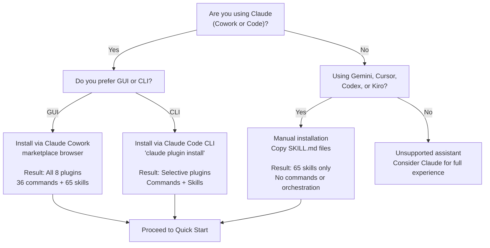
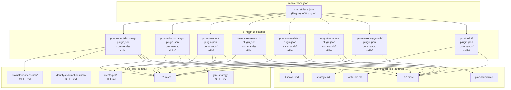
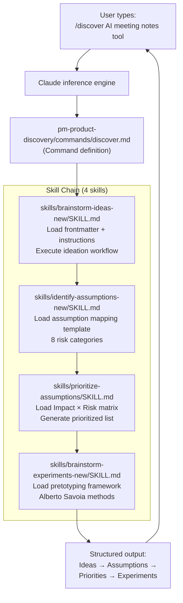
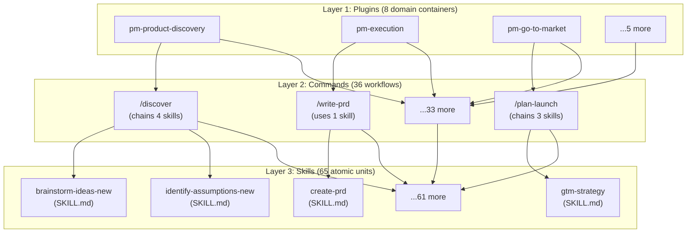

<!-- source: DeepWiki mcp.deepwiki.com · repo phuryn/pm-skills · page 2 Getting Started · fetched 2026-10-27 -->

# Getting Started

<details>
<summary>Relevant source files</summary>

The following files were used as context for generating this wiki page:

- [.docs/images/pm-skills-install.gif](.docs/images/pm-skills-install.gif)
- [README.md](README.md)

</details>


This page provides a quick-start guide for installing and using the PM Skills Marketplace. It covers prerequisite knowledge, installation decision criteria, and your first workflow. For detailed installation procedures, see [Installation](#2.1). For comprehensive usage patterns and examples, see [Using Skills and Commands](#2.2).

---

## Prerequisites

Before installing the PM Skills Marketplace, you need one of the following AI assistants:

| AI Assistant | Full Support | Skills Only | Installation Method |
|--------------|--------------|-------------|---------------------|
| **Claude Cowork** (GUI) | ✓ | — | Marketplace browser |
| **Claude Code** (CLI) | ✓ | — | `claude plugin` commands |
| **Gemini CLI** | — | ✓ | Manual file copy |
| **Cursor** | — | ✓ | Manual file copy |
| **Codex CLI** | — | ✓ | Manual file copy |
| **Kiro** | — | ✓ | Manual file copy |

**Full Support** means you get plugins, commands (`/discover`, `/strategy`, etc.), and skills with orchestration. **Skills Only** means you get the 65 individual skills but not the command chaining workflows.

No other dependencies are required. The marketplace is a collection of markdown files with YAML frontmatter that AI assistants parse and execute.

**Sources:** [README.md:49-94]()

---

## Choosing Your Installation Path

The installation method you choose determines which capabilities you get:

### Decision Tree: Which Installation Method?



**Recommendation:** Use **Claude Cowork** for the simplest installation (one-click, all plugins). Use **Claude Code** if you want granular control over which plugins to install. Use manual installation only if you're on a non-Claude platform.

**Sources:** [README.md:49-94]()

---

## Quick Start: 3 Steps to Your First Workflow

### Step 1: Install the Marketplace

**For Claude Cowork:**
1. Open Customize (bottom-left corner)
2. Navigate to Browse plugins → Personal → +
3. Select "Add marketplace from GitHub"
4. Enter: `phuryn/pm-skills`

All 8 plugins install automatically.

**For Claude Code CLI:**
```bash
# Add marketplace
claude plugin marketplace add phuryn/pm-skills

# Install core plugins (choose based on your needs)
claude plugin install pm-product-discovery@pm-skills
claude plugin install pm-execution@pm-skills
```

Full installation details in [Installation](#2.1).

### Step 2: Verify Installation

After installation, the following directory structure exists in your environment:

#### Installation Architecture



Each plugin directory contains:
- `plugin.json` - Manifest with plugin metadata
- `commands/` - Directory containing command definition files (`*.md`)
- `skills/` - Directory containing skill subdirectories
- `README.md` - Plugin documentation

Each skill directory contains:
- `SKILL.md` - Skill definition with YAML frontmatter + instructions

**Sources:** [README.md:1-10](), [marketplace.json:1-50]()

### Step 3: Run Your First Command

Open a conversation in Claude and type:

```
/discover AI-powered meeting notes tool for remote teams
```

This executes the discovery workflow, which chains 4 skills:
1. `brainstorm-ideas-new` - Generate solution ideas
2. `identify-assumptions-new` - Map risky assumptions
3. `prioritize-assumptions` - Rank by impact × risk
4. `brainstorm-experiments-new` - Design validation experiments

You'll see Claude guide you through each step with structured templates and probing questions.

**Sources:** [README.md:15-19, 120-137]()

---

## Understanding Command-to-Skill Execution Flow

When you invoke a command, here's what happens under the hood:

### Execution Flow: /discover Command



Each `SKILL.md` file contains:
- **YAML frontmatter** with metadata (`name`, `description`, `tags`, `related_skills`)
- **Markdown instructions** with step-by-step guidance, templates, and examples

Claude parses the frontmatter to understand skill capabilities, then executes the instructions as a guided workflow.

**Sources:** [README.md:31-46, 120-137]()

---

## Common First Workflows

After installation, try these workflows based on your product stage:

| Your Situation | Recommended Command | What It Does |
|----------------|---------------------|--------------|
| New product idea | `/discover [idea]` | Full discovery: ideation → assumptions → experiments |
| Need strategic clarity | `/strategy [product]` | 9-section Product Strategy Canvas |
| Writing requirements | `/write-prd [feature]` | Structured PRD with 8 sections |
| Planning a launch | `/plan-launch [product]` | GTM strategy: beachhead → channels → messaging |
| Defining success metrics | `/north-star [product]` | North Star Metric + input metrics |
| Feature prioritization | Direct skill invocation | Use `prioritize-features` or `prioritization-frameworks` |

For comprehensive command documentation, see [Key Commands](#6).

**Sources:** [README.md:15-19, 120-393]()

---

## Skills vs Commands: What You Installed

### The Three-Layer Model

The marketplace organizes capabilities into three layers:



**Plugins** are installable packages. Each plugin covers a PM domain (discovery, strategy, execution, etc.).

**Commands** are slash-commands (`/discover`, `/strategy`) that you invoke explicitly. They orchestrate one or more skills into workflows.

**Skills** are atomic units of PM knowledge. They can be:
- Automatically loaded by Claude when relevant to the conversation
- Explicitly invoked via `/plugin-name:skill-name` or `/skill-name`
- Chained together by commands

Example: The `/discover` command (defined in [pm-product-discovery/commands/discover.md]()) chains these skills:
1. [pm-product-discovery/skills/brainstorm-ideas-new/SKILL.md]()
2. [pm-product-discovery/skills/identify-assumptions-new/SKILL.md]()
3. [pm-product-discovery/skills/prioritize-assumptions/SKILL.md]()
4. [pm-product-discovery/skills/brainstorm-experiments-new/SKILL.md]()

For architectural details, see [Three-Tier Abstraction Model](#3.1).

**Sources:** [README.md:31-46]()

---

## Verification: Did Installation Work?

Test your installation with these checks:

### 1. Command Availability Test

Type `/` in Claude and verify you see:
- `/discover`
- `/strategy`
- `/write-prd`
- `/plan-launch`
- Other commands from installed plugins

### 2. Skill Automatic Loading Test

Ask Claude a product question without invoking a command:

```
What framework should I use to prioritize 20 feature requests?
```

If installation succeeded, Claude will reference `prioritization-frameworks` skill and explain 9 frameworks (Opportunity Score, ICE, RICE, MoSCoW, Kano, Value vs. Effort, Weighted Scoring, Buy-a-Feature, Story Mapping).

### 3. Explicit Skill Invocation Test

Force-load a specific skill:

```
/identify-assumptions-new for a two-sided marketplace connecting freelancers with clients
```

Claude should load [pm-product-discovery/skills/identify-assumptions-new/SKILL.md]() and walk you through 8 risk categories.

If any test fails, see [Installation](#2.1) for troubleshooting.

**Sources:** [README.md:31-46, 99-137]()

---

## File Structure Reference

Here's what got installed:

```
phuryn/pm-skills/
├── marketplace.json                    # Registry of 8 plugins
├── validate_plugins.py                 # Quality validation script
├── CONTRIBUTING.md                     # Contribution guidelines
│
├── pm-product-discovery/
│   ├── plugin.json                     # Plugin manifest
│   ├── README.md                       # Plugin documentation
│   ├── commands/
│   │   ├── discover.md                 # /discover command
│   │   ├── brainstorm.md               # /brainstorm command
│   │   ├── interview.md                # /interview command
│   │   ├── setup-metrics.md            # /setup-metrics command
│   │   └── triage-requests.md          # /triage-requests command
│   └── skills/
│       ├── brainstorm-ideas-new/SKILL.md
│       ├── identify-assumptions-new/SKILL.md
│       ├── prioritize-assumptions/SKILL.md
│       ├── brainstorm-experiments-new/SKILL.md
│       └── ...9 more skills
│
├── pm-product-strategy/
│   ├── plugin.json
│   ├── commands/
│   │   ├── strategy.md                 # /strategy command
│   │   ├── business-model.md           # /business-model command
│   │   └── ...3 more commands
│   └── skills/
│       ├── product-strategy/SKILL.md
│       ├── lean-canvas/SKILL.md
│       └── ...10 more skills
│
├── pm-execution/
│   ├── plugin.json
│   ├── commands/
│   │   ├── write-prd.md                # /write-prd command
│   │   ├── sprint.md                   # /sprint command
│   │   └── ...8 more commands
│   └── skills/
│       ├── create-prd/SKILL.md
│       ├── brainstorm-okrs/SKILL.md
│       └── ...13 more skills
│
└── ...5 more plugin directories
    (pm-market-research, pm-data-analytics, pm-go-to-market,
     pm-marketing-growth, pm-toolkit)
```

Each skill's `SKILL.md` follows this structure:

```markdown
---
name: skill-name
description: Brief description (30+ characters)
tags: [tag1, tag2, tag3]
related_skills: [other-skill-1, other-skill-2]
---

# Instructions

Step-by-step guidance for the AI assistant...

## Template

Structured template or framework...

## Examples

Sample outputs or use cases...
```

**Sources:** [README.md:1-10](), [validate_plugins.py:1-309]()

---

## Next Steps

After completing installation and verification:

1. **Learn command patterns** - See [Using Skills and Commands](#2.2) for invocation patterns and examples
2. **Explore your workflow stage** - See [Plugin Reference](#4) to find plugins matching your current product stage
3. **Try a complete workflow** - See [Key Commands](#6) for end-to-end workflow examples
4. **Understand the architecture** - See [Architecture](#3) for how skills, commands, and plugins work together

Common learning paths:

| Your Role | Start With | Then Explore |
|-----------|------------|--------------|
| **PM in discovery** | [pm-product-discovery](#4.1) | [/discover command](#6.1) |
| **PM defining strategy** | [pm-product-strategy](#4.2) | [/strategy command](#6.2) |
| **PM writing specs** | [pm-execution](#4.3) | [/write-prd command](#6.3) |
| **PM launching product** | [pm-go-to-market](#4.6) | [/plan-launch command](#6.4) |
| **PM analyzing data** | [pm-data-analytics](#4.5) | [Data Analytics Skills](#5.4) |

**Sources:** [README.md:1-447]()

---

## Troubleshooting

### Claude Cowork Installation Issues (Windows)

If Cowork is unstable or can't start a VM, run this PowerShell script as Administrator:

```powershell
$action = New-ScheduledTaskAction -Execute "powershell.exe" -Argument "-WindowStyle Hidden -Command `"if ((Get-Service CoworkVMService).Status -ne 'Running') { Start-Service CoworkVMService }`""

$trigger = New-ScheduledTaskTrigger -RepetitionInterval (New-TimeSpan -Minutes 1) -Once -At (Get-Date)

$settings = New-ScheduledTaskSettingsSet -AllowStartIfOnBatteries -DontStopIfGoingOnBatteries

Register-ScheduledTask -TaskName "CoworkVMServiceMonitor" `
  -Action $action `
  -Trigger $trigger `
  -Settings $settings `
  -RunLevel Highest `
  -User "SYSTEM"
```

This resolves 90% of Windows installation issues. For remaining issues, manually start the "Claude" service in `services.msc`.

**Sources:** [README.md:422-443]()

### Commands Not Appearing

If commands don't appear after installation:

1. **Claude Cowork:** Restart the application
2. **Claude Code:** Run `claude plugin list` to verify installation
3. **Check plugin manifest:** Ensure [plugin.json]() files exist in each plugin directory

### Skills Not Loading Automatically

If skills aren't automatically loaded in conversations:

1. Verify `SKILL.md` files exist in `skills/*/` subdirectories
2. Check frontmatter is valid YAML (use [validate_plugins.py]() to verify)
3. Try explicit invocation: `/skill-name` to force-load

For validation, run:

```bash
python validate_plugins.py
```

This checks all manifests, skills, and commands for structural issues.

**Sources:** [README.md:422-443](), [validate_plugins.py:1-309]()

---

