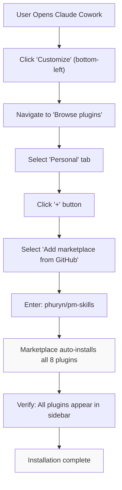
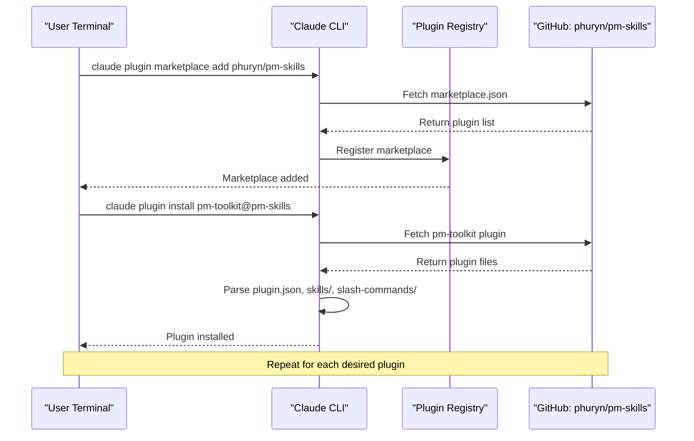
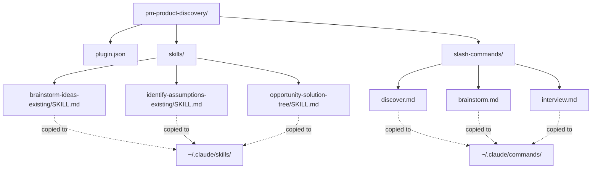

<!-- source: DeepWiki mcp.deepwiki.com · repo phuryn/pm-skills · page 2.1 Installation · fetched 2026-10-27 -->

# Installation

<details>
<summary>Relevant source files</summary>

The following files were used as context for generating this wiki page:

- [.docs/images/pm-skills-install.gif](.docs/images/pm-skills-install.gif)
- [README.md](README.md)

</details>


This document provides detailed installation instructions for the PM Skills Marketplace across three integration pathways: Claude Cowork (GUI-based), Claude Code CLI (command-line), and other AI assistants (manual file copying). Each method offers different levels of integration and capabilities.

For information about using installed skills and commands after installation, see [Using Skills and Commands](#2.2). For architectural details about how plugins, commands, and skills relate to each other, see [Three-Tier Abstraction Model](#3.1).

---

## Overview

The PM Skills Marketplace supports three installation methods with varying capability profiles:

| Method | User Type | Commands | Skills | Plugins | Orchestration |
|--------|-----------|----------|--------|---------|---------------|
| **Claude Cowork** | Non-developers | ✓ | ✓ | ✓ | ✓ |
| **Claude Code CLI** | Developers | ✓ | ✓ | ✓ | ✓ |
| **Other AI Tools** | Any | ✗ | ✓ | ✗ | ✗ |

**Full-stack installation** (Claude Cowork and Claude Code) provides access to plugins, commands (`/discover`, `/strategy`, etc.), skills, and multi-skill orchestration workflows. **Skills-only installation** (other AI tools) provides individual skill files but sacrifices command chaining and plugin structure.

**Sources:** [README.md:47-94](), Diagram 5 from high-level architecture

---

## Repository Structure

The marketplace repository at `phuryn/pm-skills` contains the following structure:

```
pm-skills/
├── marketplace.json              # Marketplace manifest
├── validate_plugins.py           # Quality gate validation
├── pm-product-discovery/         # Plugin directory
│   ├── plugin.json              # Plugin manifest
│   ├── README.md                # Plugin documentation
│   ├── skills/                  # Skill definitions
│   │   ├── brainstorm-ideas-existing/
│   │   │   └── SKILL.md        # Universal skill format
│   │   ├── identify-assumptions-existing/
│   │   │   └── SKILL.md
│   │   └── ...
│   └── slash-commands/          # Command definitions
│       ├── discover.md
│       └── ...
├── pm-product-strategy/
├── pm-execution/
├── pm-market-research/
├── pm-data-analytics/
├── pm-go-to-market/
├── pm-marketing-growth/
└── pm-toolkit/
```

Each of the 8 plugin directories follows this pattern. The `skills/*/SKILL.md` files use a universal frontmatter format that works across AI assistants, while `slash-commands/*.md` files are Claude-specific.

**Sources:** [README.md:32-40](), Diagram 1 from high-level architecture

---

## Method 1: Claude Cowork (GUI)

### Installation Flow Diagram



### Step-by-Step Instructions

1. **Open Customize Panel**: Click the **Customize** button in the bottom-left corner of Claude Cowork
2. **Access Plugin Marketplace**: Navigate to **Browse plugins** → **Personal** → **+**
3. **Add GitHub Marketplace**: Select **Add marketplace from GitHub**
4. **Enter Repository**: Input `phuryn/pm-skills` in the repository field
5. **Automatic Installation**: All 8 plugins install automatically without manual selection

The Cowork GUI reads `marketplace.json` at the repository root, which contains references to all plugin directories and their manifests (`plugin.json`).

### What Gets Installed

```mermaid
graph LR
    REPO["GitHub: phuryn/pm-skills"]
    COWORK["Claude Cowork Installation"]
    
    subgraph PLUGINS["8 Installed Plugins"]
        P1["pm-product-discovery"]
        P2["pm-product-strategy"]
        P3["pm-execution"]
        P4["pm-market-research"]
        P5["pm-data-analytics"]
        P6["pm-go-to-market"]
        P7["pm-marketing-growth"]
        P8["pm-toolkit"]
    end
    
    subgraph CAPABILITIES["Available Capabilities"]
        CMD["36 Commands\n(/discover, /strategy, etc.)"]
        SKILLS["65 Skills\n(brainstorm-ideas, create-prd, etc.)"]
        CHAIN["Multi-skill orchestration"]
    end
    
    REPO --> COWORK
    COWORK --> PLUGINS
    PLUGINS --> CAPABILITIES
```



All plugins are installed as a single marketplace entity. Commands are invoked with `/command-name` syntax, and skills load automatically when relevant to the conversation.

**Sources:** [README.md:49-58](), Diagram 5 from high-level architecture

---

## Method 2: Claude Code CLI

### Two-Step Installation Process

The CLI requires two distinct steps: marketplace registration and plugin installation.



### Step 1: Register Marketplace

```bash
claude plugin marketplace add phuryn/pm-skills
```

This command registers the marketplace by fetching `marketplace.json` from the repository root and adding it to the local plugin registry. The marketplace manifest contains metadata about all available plugins but does not install them.

### Step 2: Install Plugins

Install individual plugins using the `plugin-name@marketplace-name` syntax:

```bash
# Recommended installation order (by frequency of use)
claude plugin install pm-product-discovery@pm-skills
claude plugin install pm-product-strategy@pm-skills
claude plugin install pm-execution@pm-skills
claude plugin install pm-go-to-market@pm-skills
claude plugin install pm-market-research@pm-skills
claude plugin install pm-data-analytics@pm-skills
claude plugin install pm-marketing-growth@pm-skills
claude plugin install pm-toolkit@pm-skills
```

Each `install` command:
1. Clones the plugin directory from GitHub
2. Parses the `plugin.json` manifest
3. Copies `skills/*/SKILL.md` files to the local skill registry
4. Copies `slash-commands/*.md` files to the local command registry
5. Validates frontmatter and structure

### Plugin Directory to File Mapping



The CLI maintains local copies in `~/.claude/` (Linux/macOS) or `%APPDATA%\Claude\` (Windows). Each plugin's `skills/` and `slash-commands/` directories are unpacked into these central registries.

### Selective Installation

Unlike Cowork, the CLI allows installing only needed plugins:

```bash
# Minimal installation for discovery workflows
claude plugin install pm-product-discovery@pm-skills
claude plugin install pm-execution@pm-skills

# Add strategy capabilities later
claude plugin install pm-product-strategy@pm-skills
```

**Sources:** [README.md:60-75](), Diagram 5 from high-level architecture

---

## Method 3: Other AI Assistants (Skills Only)

### Compatibility and Limitations

The `SKILL.md` files follow the universal skill format defined in the AI assistant ecosystem. However, `slash-commands/*.md` files use Claude-specific orchestration syntax and will not function in other tools.

| AI Tool | Skill Directory | Commands Support | Skills Support |
|---------|----------------|------------------|----------------|
| **Gemini CLI** | `~/.gemini/skills/` | ✗ | ✓ |
| **Cursor** | `~/.cursor/skills/` | ✗ | ✓ |
| **Codex CLI** | `~/.codex/skills/` | ✗ | ✓ |
| **Kiro** | `~/.kiro/skills/` | ✗ | ✓ |

### Manual Installation Process

```mermaid
flowchart LR
    REPO["Clone/Download\nphuryn/pm-skills"]
    
    subgraph PLUGINS["8 Plugin Directories"]
        P1["pm-product-discovery/"]
        P2["pm-product-strategy/"]
        P3["pm-execution/"]
        PMORE["... (5 more)"]
    end
    
    subgraph EXTRACT["Extract Skills"]
        SK1["skills/brainstorm-ideas-existing/SKILL.md"]
        SK2["skills/identify-assumptions-existing/SKILL.md"]
        SK3["skills/create-prd/SKILL.md"]
        SKMORE["... (62 more)"]
    end
    
    DEST["Destination:\n~/.gemini/skills/\n~/.cursor/skills/\n~/.codex/skills/\n~/.kiro/skills/"]
    
    REPO --> PLUGINS
    PLUGINS --> EXTRACT
    EXTRACT --> DEST
```



### Bulk Copy Script

For copying all 65 skills to Gemini CLI:

```bash
# Navigate to cloned repository
cd pm-skills

# Copy all SKILL.md files from all plugins
for plugin in pm-*/; do
  cp -r "$plugin/skills/"* ~/.gemini/skills/ 2>/dev/null
done
```

For other tools, replace `~/.gemini/skills/` with the appropriate destination:
- **Cursor**: `~/.cursor/skills/`
- **Codex CLI**: `~/.codex/skills/`
- **Kiro**: `~/.kiro/skills/`

### File Structure After Manual Installation

```
~/.gemini/skills/
├── brainstorm-ideas-existing/
│   └── SKILL.md
├── brainstorm-ideas-new/
│   └── SKILL.md
├── identify-assumptions-existing/
│   └── SKILL.md
├── create-prd/
│   └── SKILL.md
├── product-strategy/
│   └── SKILL.md
└── ... (61 more skills)
```

Each skill directory contains a single `SKILL.md` file with frontmatter metadata and structured instructions. The AI assistant reads these files to provide domain-specific guidance.

### Lost Capabilities

Without commands, users cannot invoke orchestrated workflows like `/discover` (which chains `brainstorm-ideas` → `identify-assumptions` → `prioritize-assumptions` → `brainstorm-experiments`). Instead, users must manually invoke skills sequentially:

**Claude with commands:**
```
/discover AI writing assistant for non-native English speakers
```

**Other AI without commands:**
```
Use the brainstorm-ideas-new skill for an AI writing assistant targeting non-native English speakers
[review results]
Now use identify-assumptions-new to map risky assumptions
[review results]
Use prioritize-assumptions to rank by impact and risk
[review results]
Use brainstorm-experiments-new to design validation experiments
```

**Sources:** [README.md:77-93](), Diagram 1 and Diagram 5 from high-level architecture

---

## Post-Installation Verification

### For Claude Cowork

1. Open a new conversation
2. Type `/` to see all available commands
3. Verify commands like `/discover`, `/strategy`, `/write-prd` appear
4. Check plugin list in the Customize panel (bottom-left) shows all 8 plugins

### For Claude Code CLI

```bash
# List installed marketplaces
claude plugin marketplace list

# List installed plugins
claude plugin list

# Verify specific plugin
claude plugin show pm-product-discovery@pm-skills
```

Expected output should include:
- **Marketplace**: `pm-skills`
- **Plugins**: 8 entries (or fewer if selectively installed)
- **Skills**: 65 total across all plugins
- **Commands**: 36 total across all plugins

### For Other AI Assistants

1. Start a conversation
2. Ask: "What PM skills do you have available?"
3. The assistant should reference skills from the marketplace (e.g., "I can help with brainstorm-ideas-new, create-prd, product-strategy...")
4. Test a specific skill: "Use the create-prd skill to outline a PRD for [feature]"

**Sources:** [README.md:13-19](), inference from installation methods

---

## Installation Capability Matrix

```mermaid
graph TB
    subgraph INSTALL["Installation Methods"]
        COWORK["Claude Cowork\n(GUI)"]
        CODE["Claude Code\n(CLI)"]
        OTHER["Other AI Tools\n(Manual)"]
    end
    
    subgraph LAYER1["Plugin Layer"]
        PL1["8 Plugin Directories"]
        PL2["plugin.json Manifests"]
    end
    
    subgraph LAYER2["Command Layer"]
        CMD1["36 Commands"]
        CMD2["slash-commands/*.md"]
    end
    
    subgraph LAYER3["Skill Layer"]
        SK1["65 Skills"]
        SK2["skills/*/SKILL.md"]
    end
    
    subgraph FEATURES["Capability Profile"]
        F1["Orchestration"]
        F2["Command Chaining"]
        F3["Skill Loading"]
        F4["Plugin Management"]
    end
    
    COWORK -.->|installs| PL1
    COWORK -.->|installs| CMD1
    COWORK -.->|installs| SK1
    COWORK -.->|enables| F1
    COWORK -.->|enables| F2
    COWORK -.->|enables| F3
    COWORK -.->|enables| F4
    
    CODE -.->|installs| PL1
    CODE -.->|installs| CMD1
    CODE -.->|installs| SK1
    CODE -.->|enables| F1
    CODE -.->|enables| F2
    CODE -.->|enables| F3
    CODE -.->|enables| F4
    
    OTHER -.->|copies| SK1
    OTHER -.->|enables| F3
    
    style COWORK fill:#f9f9f9
    style CODE fill:#f9f9f9
    style OTHER fill:#f9f9f9
```



**Key Tradeoffs:**
- **Claude Cowork**: Simplest installation, all plugins auto-installed, ideal for non-technical users
- **Claude Code CLI**: Granular control, selective plugin installation, version pinning, ideal for developers
- **Other AI Tools**: Maximum compatibility, skills-only, no orchestration, manual maintenance

**Sources:** [README.md:47-94](), Diagram 5 from high-level architecture

---

## Troubleshooting

### Windows: CoworkVMService Instability

If Claude Cowork crashes or cannot start a VM (issue [claude-code/issues/27010](https://github.com/anthropics/claude-code/issues/27010)), use this PowerShell script to create a service monitor:

```powershell
$action = New-ScheduledTaskAction -Execute "powershell.exe" -Argument "-WindowStyle Hidden -Command `"if ((Get-Service CoworkVMService).Status -ne 'Running') { Start-Service CoworkVMService }`""

$trigger = New-ScheduledTaskTrigger -RepetitionInterval (New-TimeSpan -Minutes 1) -Once -At (Get-Date)

$settings = New-ScheduledTaskSettingsSet -AllowStartIfOnBatteries -DontStopIfGoingOnBatteries

Register-ScheduledTask -TaskName "CoworkVMServiceMonitor" `
  -Action $action `
  -Trigger $trigger `
  -Settings $settings `
  -RunLevel Highest `
  -User "SYSTEM"
```

This resolves 90% of Windows installation issues. For the remaining 10%, open `services.msc` and manually start the "Claude" service.

### Claude Code: Plugin Installation Fails

If `claude plugin install` fails with validation errors:

1. Check internet connectivity to GitHub
2. Verify the marketplace was added: `claude plugin marketplace list`
3. Check for typos in the plugin name: `claude plugin install pm-product-discovery@pm-skills`
4. Review validation output for specific errors (missing frontmatter, malformed JSON, etc.)

The `validate_plugins.py` script enforces 50+ structural checks. See [Plugin Validation System](#7.2) for details on validation rules.

### Other AI Tools: Skills Not Loading

If manually copied skills don't appear:

1. Verify the destination directory exists (create it if needed)
2. Check file permissions: `chmod -R 755 ~/.gemini/skills/`
3. Ensure `SKILL.md` files retain their frontmatter (YAML header between `---` delimiters)
4. Restart the AI assistant after copying files
5. Test by explicitly mentioning a skill name in conversation

**Sources:** [README.md:422-442](), inference from validation system

---

## Next Steps

After successful installation:
- See [Using Skills and Commands](#2.2) for invocation patterns
- See [Plugin Reference](#4) for comprehensive documentation of all 8 plugins
- See [Key Commands](#6) for guided walkthroughs of complex workflows like `/discover` and `/strategy`

For contributing new skills or plugins, see [Contributing](#7).

**Sources:** Table of contents structure, [README.md:418-420]()

---

