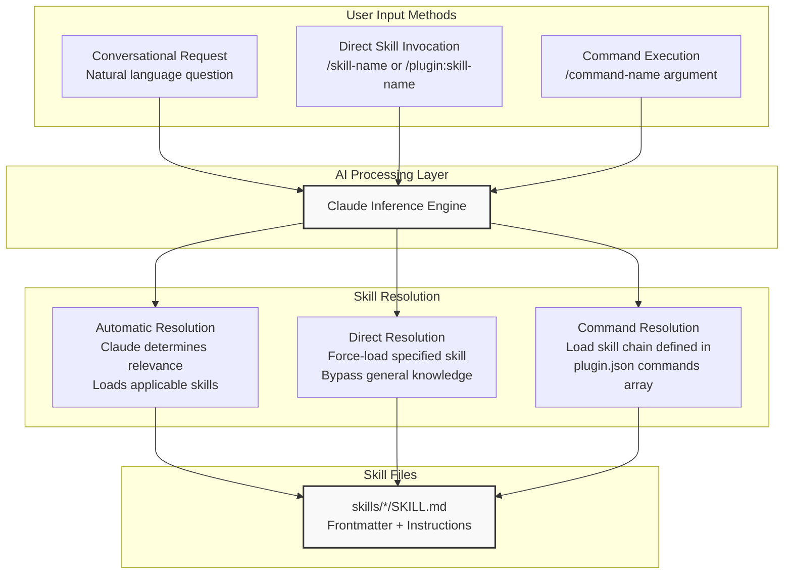
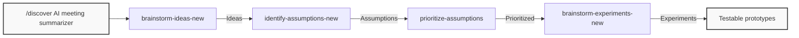
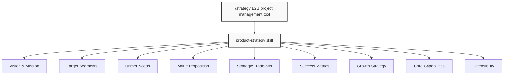
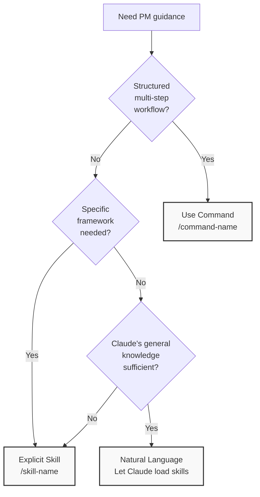

<!-- source: DeepWiki mcp.deepwiki.com · repo phuryn/pm-skills · page 2.2 Using Skills and Commands · fetched 2026-10-27 -->

# Using Skills and Commands

<details>
<summary>Relevant source files</summary>

The following files were used as context for generating this wiki page:

- [.docs/images/add-marketplace.webp](.docs/images/add-marketplace.webp)
- [.docs/images/how-skills-work.webp](.docs/images/how-skills-work.webp)
- [README.md](README.md)

</details>


This page explains how to invoke skills and commands in the PM Skills Marketplace. Skills are atomic capabilities that can be loaded automatically or explicitly invoked. Commands are workflow orchestrators that chain multiple skills together. Understanding the three access patterns—automatic loading, explicit invocation, and command execution—enables you to leverage the marketplace effectively for different use cases.

For installation instructions, see [Installation](#2.1). For detailed plugin documentation, see [Plugin Reference](#4).

---

## Overview: Three Access Patterns

The marketplace supports three distinct ways to activate skills and commands, each optimized for different scenarios.



**Sources:** [README.md:33-46](), High-Level Diagram 4

---

## Automatic Skill Loading

Skills load automatically when Claude determines they are relevant to the conversation. This pattern requires no explicit invocation—Claude's inference engine activates skills contextually based on the user's intent.

### How It Works

When you ask a question or make a request, Claude:
1. Analyzes the user's intent
2. Identifies relevant skills from installed plugins
3. Loads the skill's `SKILL.md` file into context
4. Applies the skill's framework, templates, and instructions to generate a response

Skills designed for automatic loading typically contain reference frameworks (e.g., `prioritization-frameworks`, `opportunity-solution-tree`) or analytical capabilities that Claude can apply when relevant.

### Examples

| User Input | Skills Loaded | Plugin |
|------------|---------------|---------|
| "What are the riskiest assumptions for our AI writing assistant?" | `identify-assumptions-new` | `pm-product-discovery` |
| "Help me build an Opportunity Solution Tree for improving activation" | `opportunity-solution-tree` | `pm-product-discovery` |
| "Which prioritization framework should I use for a 50-item backlog?" | `prioritization-frameworks` | `pm-execution` |
| "Estimate TAM/SAM/SOM for an AI code review tool in the US market" | `market-sizing` | `pm-market-research` |
| "Compare Lean Canvas vs Business Model Canvas for my startup" | `lean-canvas`, `business-model`, `startup-canvas` | `pm-product-strategy` |

Claude loads these skills without explicit syntax because it recognizes the domain keywords and intent patterns that map to skill capabilities.

**Sources:** [README.md:33-36](), [README.md:128-131](), [README.md:220-224](), [README.md:254-258](), [README.md:170-174]()

---

## Explicit Skill Invocation

For scenarios where you want to force-load a specific skill—overriding Claude's general knowledge or ensuring a particular framework is used—explicit invocation syntax is available.

### Syntax

```
/skill-name
```

or

```
/plugin-name:skill-name
```

Claude will automatically prepend the plugin name if you use the short form and the skill name is unique across plugins.

### When to Use Explicit Invocation

Explicit invocation is recommended when:
- You want to prioritize a specific PM framework over Claude's general knowledge
- Multiple skills might apply, and you need a particular one
- You're debugging or testing a specific skill
- You want to reference a skill's structured template directly

### Skill Name Resolution

The marketplace contains 65 skills across 8 plugins. Skills follow a naming convention where:
- Directory name = skill name (e.g., `brainstorm-ideas-new/`)
- File path: `{plugin}/skills/{skill-name}/SKILL.md`
- Invocation: `/skill-name` or `/plugin-name:skill-name`

#### Skill Naming Examples

| Plugin | Skill Directory | Invocation |
|--------|----------------|------------|
| `pm-product-discovery` | `skills/brainstorm-ideas-new/` | `/brainstorm-ideas-new` |
| `pm-product-strategy` | `skills/lean-canvas/` | `/lean-canvas` |
| `pm-execution` | `skills/create-prd/` | `/create-prd` |
| `pm-go-to-market` | `skills/gtm-strategy/` | `/gtm-strategy` |

### Examples

```
/identify-assumptions We're building an AI meeting summarizer

/lean-canvas Marketplace connecting freelancers with startups

/pm-execution:prioritization-frameworks Show me all frameworks

/opportunity-solution-tree Outcome: Increase user activation to 40%
```

**Sources:** [README.md:35-36](), CONTRIBUTING.md guidelines on skill naming

---

## Command Execution

Commands are predefined workflows that chain multiple skills in a structured sequence. Each command is defined in a plugin's `plugin.json` manifest with metadata and a list of skills to execute.

### Command Structure

Commands are defined in each plugin's `plugin.json` file:

```json
{
  "commands": [
    {
      "name": "command-name",
      "description": "Command purpose",
      "argument-hint": "Expected input format",
      "skills": ["skill-1", "skill-2", "skill-3"]
    }
  ]
}
```

**File Location:** `{plugin-directory}/plugin.json`

### Syntax

```
/command-name [argument or context]
```

Commands accept a free-form argument that provides context for the workflow. The argument can be a product description, problem statement, or specific input depending on the command's purpose.

### How Commands Chain Skills

When you invoke a command:
1. Claude loads the command definition from the plugin manifest
2. Executes skills in the order specified in the `skills` array
3. Passes context from one skill to the next
4. Guides you through the workflow with prompts
5. Suggests relevant next commands upon completion

### Command Examples

#### `/discover` Command

The `/discover` command chains four skills for a complete discovery cycle:



**Command Definition:** `pm-product-discovery/plugin.json`

**Invocation:**
```
/discover AI-powered meeting summarizer for remote teams
```

**Workflow:**
1. **brainstorm-ideas-new**: Multi-perspective ideation (PM, Designer, Engineer)
2. **identify-assumptions-new**: Map assumptions across 8 risk categories
3. **prioritize-assumptions**: Impact × Risk matrix
4. **brainstorm-experiments-new**: Design pretotypes (Alberto Savoia method)

#### `/strategy` Command

The `/strategy` command creates a 9-section Product Strategy Canvas:



**Command Definition:** `pm-product-strategy/plugin.json`

**Invocation:**
```
/strategy B2B project management tool for agencies
```

#### `/write-prd` Command

The `/write-prd` command generates an 8-section PRD:

**Invocation:**
```
/write-prd Smart notification system that reduces alert fatigue
```

**Workflow:**
1. Loads `create-prd` skill
2. Guides through 8 PRD sections
3. Produces structured requirements document

**Command Definition:** `pm-execution/plugin.json`

### All Available Commands (36 Total)

| Plugin | Commands |
|--------|----------|
| `pm-product-discovery` | `/discover`, `/brainstorm`, `/triage-requests`, `/interview`, `/setup-metrics` |
| `pm-product-strategy` | `/strategy`, `/business-model`, `/value-proposition`, `/market-scan`, `/pricing` |
| `pm-execution` | `/write-prd`, `/plan-okrs`, `/transform-roadmap`, `/sprint`, `/pre-mortem`, `/meeting-notes`, `/stakeholder-map`, `/write-stories`, `/test-scenarios`, `/generate-data` |
| `pm-market-research` | `/research-users`, `/competitive-analysis`, `/analyze-feedback` |
| `pm-data-analytics` | `/write-query`, `/analyze-cohorts`, `/analyze-test` |
| `pm-go-to-market` | `/plan-launch`, `/growth-strategy`, `/battlecard` |
| `pm-marketing-growth` | `/market-product`, `/north-star` |
| `pm-toolkit` | `/review-resume`, `/tailor-resume`, `/draft-nda`, `/privacy-policy`, `/proofread` |

**Sources:** [README.md:37-38](), [README.md:118-393]()

---

## Skill vs Command Decision Guide



### When to Use Each Pattern

| Pattern | Use When | Examples |
|---------|----------|----------|
| **Automatic Loading** | Quick questions, exploratory work, leveraging Claude's judgment | "What's a good North Star metric for my marketplace?", "Help me prioritize these features" |
| **Explicit Invocation** | Need specific framework, override general knowledge, debugging | `/lean-canvas`, `/opportunity-solution-tree`, `/prioritization-frameworks` |
| **Command Execution** | End-to-end workflow, structured process, guided experience | `/discover`, `/strategy`, `/write-prd`, `/plan-launch` |

**Sources:** [README.md:33-46](), High-Level Diagram 4

---

## Practical Workflow Examples

### Scenario 1: New Product Discovery

**Goal:** Validate a new product idea

**Approach:** Command-driven workflow

```
/discover AI writing assistant for non-native English speakers

[Follow the guided workflow]
→ Generates ideas from PM/Designer/Engineer perspectives
→ Identifies 8 risk categories of assumptions
→ Prioritizes assumptions in Impact × Risk matrix
→ Designs pretotype experiments

[After /discover completes]
/strategy AI writing assistant for non-native English speakers

[Creates 9-section Product Strategy Canvas]
```

**Skills Loaded:**
1. `pm-product-discovery/skills/brainstorm-ideas-new/SKILL.md`
2. `pm-product-discovery/skills/identify-assumptions-new/SKILL.md`
3. `pm-product-discovery/skills/prioritize-assumptions/SKILL.md`
4. `pm-product-discovery/skills/brainstorm-experiments-new/SKILL.md`
5. `pm-product-strategy/skills/product-strategy/SKILL.md`

### Scenario 2: Feature Prioritization

**Goal:** Prioritize a backlog of feature requests

**Approach:** Mix of explicit invocation and automatic loading

```
/prioritization-frameworks

[Reviews 9 frameworks: Opportunity Score, ICE, RICE, MoSCoW, Kano, etc.]

Which framework should I use for enterprise B2B features?

[Claude recommends based on context]

/prioritize-features [attach feature list CSV]

[Applies chosen framework and generates prioritized backlog]
```

**Skills Loaded:**
1. `pm-execution/skills/prioritization-frameworks/SKILL.md` (explicit)
2. `pm-product-discovery/skills/prioritize-features/SKILL.md` (automatic or explicit)

### Scenario 3: PRD Creation

**Goal:** Write a PRD for a new feature

**Approach:** Command-driven

```
/write-prd Multi-tenant workspace feature for our project management tool

[Guided through 8 sections:]
1. Overview
2. Problem Statement
3. Goals & Success Metrics
4. User Personas
5. Requirements
6. Technical Considerations
7. Launch Plan
8. Open Questions

[After PRD is complete]
/pre-mortem [PRD content]

[Risk analysis: Tigers, Paper Tigers, Elephants]
```

**Skills Loaded:**
1. `pm-execution/skills/create-prd/SKILL.md`
2. `pm-execution/skills/pre-mortem/SKILL.md`

### Scenario 4: Market Research

**Goal:** Understand competitive landscape and market sizing

**Approach:** Natural language with automatic loading

```
Estimate TAM/SAM/SOM for a developer productivity tool in North America

[Claude loads market-sizing skill automatically]

Create a competitive analysis comparing us to GitHub Copilot, Cursor, and Tabnine

[Claude loads competitor-analysis skill automatically]
```

**Skills Loaded:**
1. `pm-market-research/skills/market-sizing/SKILL.md` (automatic)
2. `pm-market-research/skills/competitor-analysis/SKILL.md` (automatic)

**Sources:** [README.md:127-137](), [README.md:169-179](), [README.md:219-229](), [README.md:253-263]()

---

## Command Chaining Workflow

Commands are designed to flow into each other, matching the natural PM workflow. After any command completes, Claude suggests relevant next steps.

```mermaid
graph LR
    DISCOVER["/discover<br/>New Product"]
    STRATEGY["/strategy<br/>Strategic Direction"]
    PRD["/write-prd<br/>Requirements"]
    LAUNCH["/plan-launch<br/>GTM Strategy"]
    METRICS["/north-star<br/>Success Metrics"]
    
    DISCOVER -->|"Validated idea"| STRATEGY
    STRATEGY -->|"Clear positioning"| PRD
    PRD -->|"Scoped feature"| LAUNCH
    LAUNCH -->|"Launch plan"| METRICS
    
    style DISCOVER fill:#f9f9f9,stroke:#333,stroke-width:2px
    style STRATEGY fill:#f9f9f9,stroke:#333,stroke-width:2px
    style PRD fill:#f9f9f9,stroke:#333,stroke-width:2px
    style LAUNCH fill:#f9f9f9,stroke:#333,stroke-width:2px
    style METRICS fill:#f9f9f9,stroke:#333,stroke-width:2px
```



**Typical Product Lifecycle Flow:**
1. `/discover` → Validate problem and solution
2. `/strategy` → Define strategic positioning
3. `/write-prd` → Spec the solution
4. `/plan-launch` → Plan go-to-market
5. `/north-star` → Define success metrics

**Sources:** [README.md:45-46](), High-Level Diagram 2

---

## Tips for Effective Usage

### Optimize for Context

- **Short sessions:** Use explicit invocation (`/skill-name`) to load specific frameworks quickly
- **Long sessions:** Let automatic loading work—Claude learns context over time
- **Complex workflows:** Use commands (`/command-name`) for guided, multi-step processes

### Skill Discovery

To explore available skills:
```
List all skills in pm-product-discovery

Show me all prioritization frameworks

What skills help with GTM planning?
```

Claude can search installed plugins and describe capabilities.

### Force Loading for Precision

When Claude's general knowledge conflicts with a specific framework:
```
/opportunity-solution-tree

[Forces Teresa Torres' OST framework instead of generic problem trees]
```

### Combining Patterns

Mix patterns in a single conversation:
```
/discover AI code review tool

[After discovery completes, ask naturally:]
How should I price this for mid-size engineering teams?

[Claude loads pricing-strategy skill automatically]

/lean-canvas

[Explicitly invoke Lean Canvas to capture business model]
```

**Sources:** [README.md:33-46]()

---

