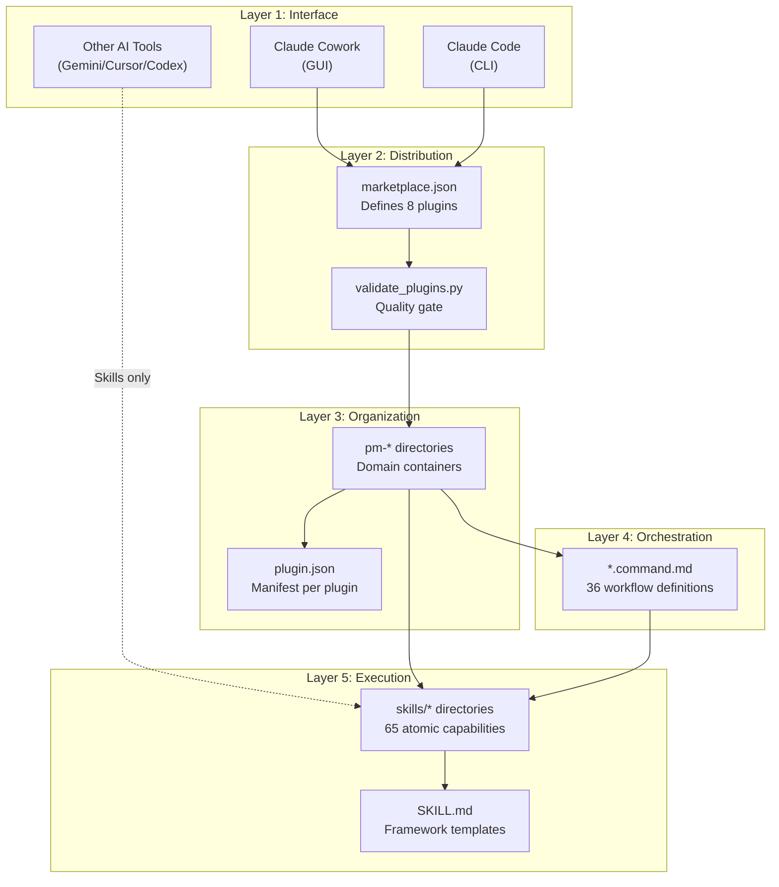
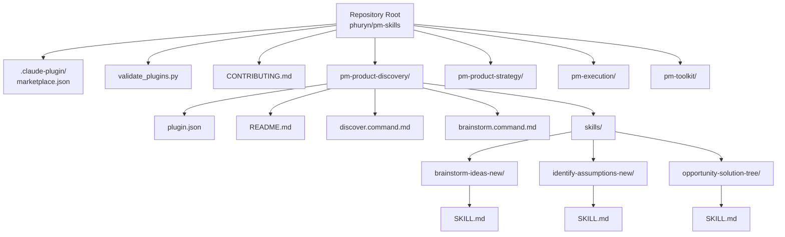
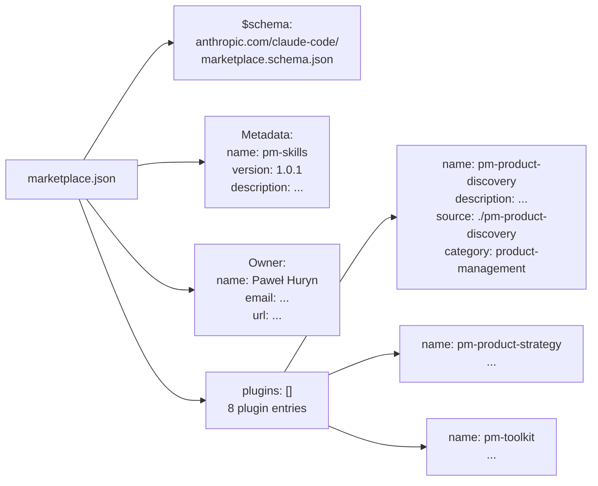
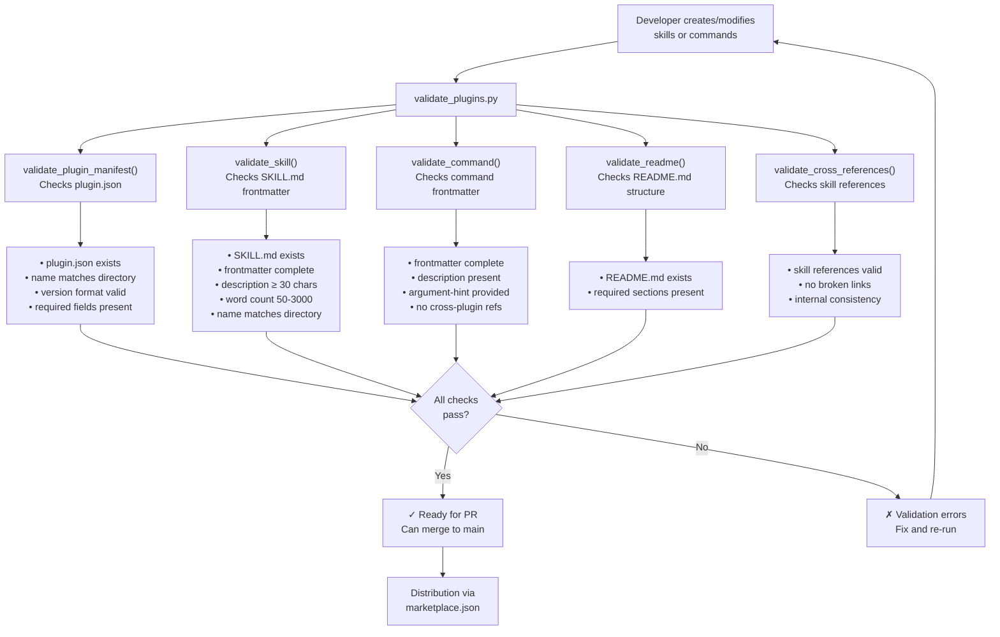
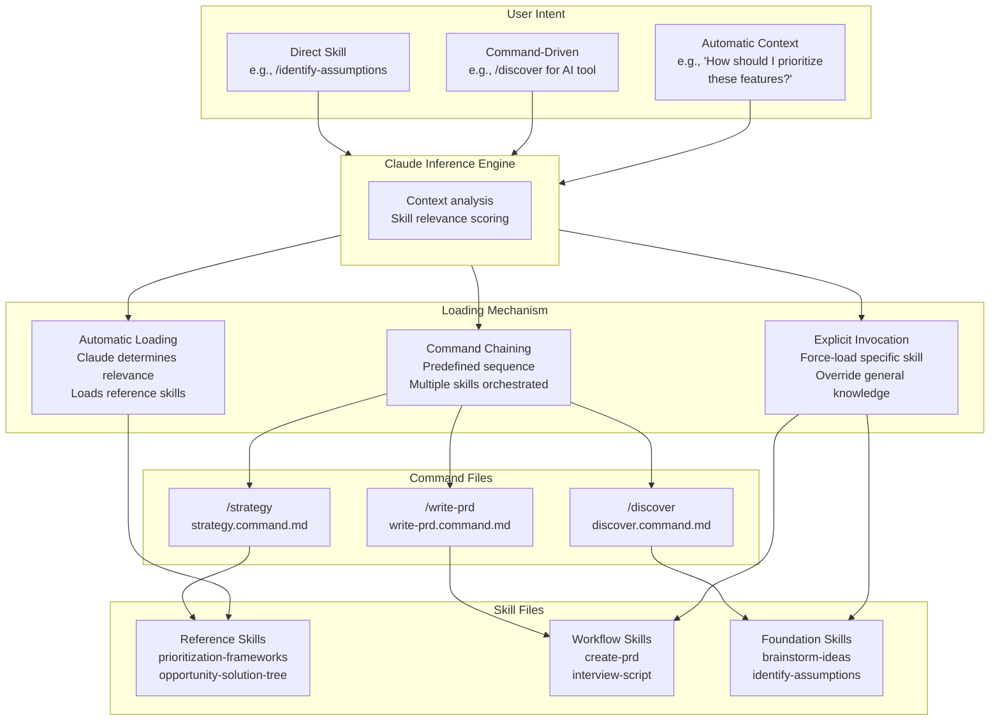
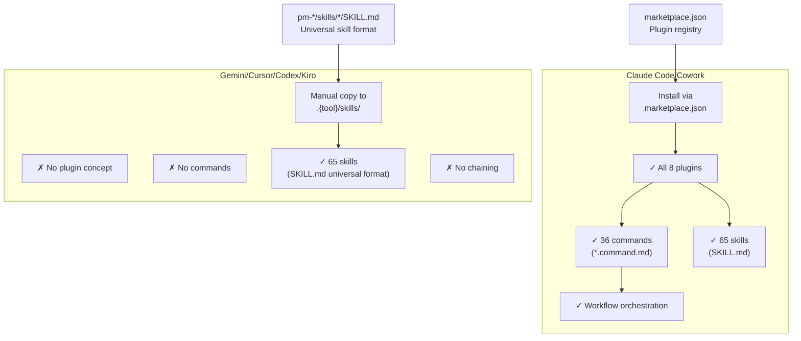
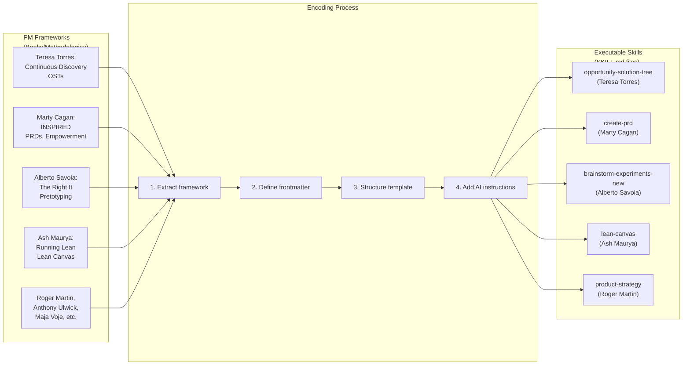

<!-- source: DeepWiki mcp.deepwiki.com · repo phuryn/pm-skills · page 3 Architecture · fetched 2026-10-27 -->

# Architecture

<details>
<summary>Relevant source files</summary>

The following files were used as context for generating this wiki page:

- [.claude-plugin/marketplace.json](.claude-plugin/marketplace.json)
- [README.md](README.md)

</details>


This document explains the architectural design of the PM Skills Marketplace, focusing on the three-tier abstraction model (Skills → Commands → Plugins), the file system structure, and how components interact at the code level.

For installation procedures, see [Installation](#2.1). For usage patterns, see [Using Skills and Commands](#2.2). For detailed plugin documentation, see [Plugin Reference](#4).

---

## Architectural Overview

The PM Skills Marketplace implements a **five-layer hierarchical architecture** that transforms PM frameworks into executable AI-guided workflows. The system separates concerns across distribution, organization, orchestration, and execution layers.

### Five-Layer System Hierarchy



**Sources:** [README.md:31-45](), [.claude-plugin/marketplace.json:1-61]()

---

## Core Abstractions

The system defines three primary abstractions that map to distinct file system entities and behavioral patterns.

### Abstraction 1: Skills (Atomic Capabilities)

**Definition:** Skills are atomic, reusable units of PM domain knowledge encoded as markdown files. Each skill represents a single framework, analytical method, or guided workflow.

**File Structure:**
```
pm-*/
└── skills/
    └── skill-name/
        └── SKILL.md
```

**Code Mapping:**

| Concept | File Path | Format |
|---------|-----------|--------|
| Skill definition | `pm-{plugin}/skills/{skill-name}/SKILL.md` | Frontmatter + template + instructions |
| Skill invocation | `/{skill-name}` or `/{plugin}:{skill-name}` | Claude command syntax |
| Skill loading | Automatic (context-based) or explicit | AI inference engine |

**Example Skill File Structure:**
[pm-product-discovery/skills/brainstorm-ideas-new/SKILL.md]() contains:
- YAML frontmatter with `name`, `description`, `version`
- Template sections (e.g., "Problem Space", "Solution Ideas")
- Step-by-step instructions for AI execution

**Characteristics:**
- **Noun-based naming** (e.g., `opportunity-solution-tree`, not `create-ost`)
- **Self-contained** (no cross-plugin dependencies)
- **Universal format** (works across AI tools via `SKILL.md` convention)
- **Metadata-driven** (frontmatter enables validation and discovery)

**Sources:** [README.md:33-36](), [CONTRIBUTING.md:1-28]()

### Abstraction 2: Commands (Orchestrated Workflows)

**Definition:** Commands are user-triggered workflows that chain one or more skills into a structured, multi-step process. Commands are invoked via `/command-name` syntax.

**File Structure:**
```
pm-*/
└── {command-name}.command.md
```

**Code Mapping:**

| Concept | File Path | Format |
|---------|-----------|--------|
| Command definition | `pm-{plugin}/{command-name}.command.md` | Frontmatter + skill references + flow logic |
| Command invocation | `/command-name [context]` | Slash command syntax |
| Skill chaining | Inline references to `skills/*/SKILL.md` | Sequential or branching |

**Example Command Flow:**
[pm-product-discovery/discover.command.md]() chains:
1. `skills/brainstorm-ideas-*/SKILL.md` (ideation)
2. `skills/identify-assumptions-*/SKILL.md` (risk mapping)
3. `skills/prioritize-assumptions/SKILL.md` (prioritization)
4. `skills/brainstorm-experiments-*/SKILL.md` (experiment design)

**Characteristics:**
- **Verb-based naming** (e.g., `/discover`, `/write-prd`)
- **Multi-skill orchestration** (composite workflows)
- **Context-adaptive** (branches based on existing vs. new products)
- **Claude-specific** (not portable to other AI tools)

**Sources:** [README.md:37-39](), [README.md:120-124]()

### Abstraction 3: Plugins (Domain Containers)

**Definition:** Plugins are installable packages that group related skills and commands into a coherent domain (e.g., discovery, strategy, execution).

**File Structure:**
```
pm-{domain}/
├── plugin.json          # Manifest
├── README.md           # Documentation
├── {command}.command.md # Commands (0-10 per plugin)
└── skills/             # Skills directory
    ├── skill-1/
    │   └── SKILL.md
    └── skill-2/
        └── SKILL.md
```

**Code Mapping:**

| Concept | File Path | Content |
|---------|-----------|---------|
| Plugin manifest | `pm-{domain}/plugin.json` | Name, version, description, skills, commands |
| Plugin registration | `.claude-plugin/marketplace.json` | Source path, category |
| Plugin installation | `claude plugin install {name}@pm-skills` | CLI command |

**Manifest Schema (plugin.json):**
```
{
  "name": "pm-{domain}",
  "version": "1.0.0",
  "description": "...",
  "skills": ["skill-1", "skill-2", ...],
  "commands": ["command-1", "command-2", ...]
}
```

**Current Plugin Inventory:**

| Plugin | Skills | Commands | Primary Purpose |
|--------|--------|----------|-----------------|
| `pm-product-discovery` | 13 | 5 | Ideation, experiments, OSTs, interviews |
| `pm-product-strategy` | 12 | 5 | Vision, business models, competitive analysis |
| `pm-execution` | 15 | 10 | PRDs, OKRs, roadmaps, sprints, stakeholder mgmt |
| `pm-market-research` | 7 | 3 | Personas, segmentation, journey maps |
| `pm-data-analytics` | 3 | 3 | SQL generation, cohort analysis, A/B testing |
| `pm-go-to-market` | 6 | 3 | GTM strategy, growth loops, beachhead segments |
| `pm-marketing-growth` | 5 | 2 | Positioning, North Star metrics, value props |
| `pm-toolkit` | 4 | 5 | Resume review, NDAs, privacy policies |

**Sources:** [README.md:39](), [.claude-plugin/marketplace.json:11-60](), [README.md:98-393]()

---

## File System to Runtime Mapping

This diagram shows how the repository's file structure maps to runtime entities that the AI assistant loads and executes.

### File System Structure



**Key File Paths:**
- **Marketplace registry:** [.claude-plugin/marketplace.json:1-61]()
- **Plugin manifests:** `pm-*/plugin.json` (one per plugin)
- **Command definitions:** `pm-*/*.command.md` (36 total across all plugins)
- **Skill definitions:** `pm-*/skills/*/SKILL.md` (65 total across all plugins)
- **Validation script:** [validate_plugins.py:1-309]()

**Sources:** File system structure from repository layout

---

## Distribution and Validation Architecture

### Marketplace Distribution Mechanism

The `.claude-plugin/marketplace.json` file serves as the distribution manifest, defining all plugins available for installation.

**Marketplace Schema:**



**Sources:** [.claude-plugin/marketplace.json:1-61]()

### Validation Pipeline

The `validate_plugins.py` script enforces structural and semantic consistency across all plugins before they can be distributed.

**Validation Flow:**



**Validation Functions:**

| Function | Purpose | File Reference |
|----------|---------|----------------|
| `validate_plugin_manifest()` | Validates `plugin.json` structure | [validate_plugins.py:45-89]() |
| `validate_skill()` | Validates skill frontmatter and content | [validate_plugins.py:91-165]() |
| `validate_command()` | Validates command frontmatter | [validate_plugins.py:167-210]() |
| `validate_readme()` | Validates README structure | [validate_plugins.py:212-245]() |
| `check_cross_references()` | Validates skill references | [validate_plugins.py:247-285]() |

**Validation Enforcement:**
- Runs pre-commit (recommended via git hooks)
- Blocks distribution of malformed plugins
- Generates detailed error reports with line numbers
- Enforces naming conventions (nouns for skills, verbs for commands)

**Sources:** [validate_plugins.py:1-309](), [CONTRIBUTING.md:1-28]()

---

## Multi-Modal Access Patterns

The architecture supports three distinct invocation modes, each optimized for different use cases and user expertise levels.

### Access Pattern Mapping



**Access Pattern Comparison:**

| Pattern | Invocation | Use Case | Example | Loaded Entities |
|---------|-----------|----------|---------|-----------------|
| **Automatic** | Natural language query | User doesn't know skill names | "What assumptions should I test?" | Claude infers relevant `SKILL.md` files |
| **Command-Driven** | `/command-name` | Guided multi-step workflow | `/discover AI meeting tool` | Loads `discover.command.md` + referenced skills |
| **Explicit** | `/skill-name` | Power user needs specific framework | `/opportunity-solution-tree` | Force-loads specific `SKILL.md` |

**Sources:** [README.md:33-36](), [README.md:37-39](), [README.md:41-45]()

---

## Cross-Platform Compatibility Architecture

The system implements **graceful degradation** to support both Claude-native and non-Claude AI tools.

### Capability Matrix by Platform



**Installation Mapping:**

| AI Tool | Installation Method | File Path | Capabilities |
|---------|-------------------|-----------|--------------|
| **Claude Cowork** | GUI: Add marketplace from GitHub | `.claude-plugin/marketplace.json` | Full stack (plugins + commands + skills) |
| **Claude Code** | CLI: `claude plugin install` | `.claude-plugin/marketplace.json` | Full stack (plugins + commands + skills) |
| **Gemini CLI** | Copy: `cp pm-*/skills/* ~/.gemini/skills/` | `~/.gemini/skills/` | Skills only |
| **Cursor** | Copy: `cp pm-*/skills/* ~/.cursor/skills/` | `~/.cursor/skills/` | Skills only |
| **Codex CLI** | Copy: `cp pm-*/skills/* ~/.codex/skills/` | `~/.codex/skills/` | Skills only |
| **Kiro** | Copy: `cp pm-*/skills/* ~/.kiro/skills/` | `~/.kiro/skills/` | Skills only |

**Universal Skill Format:**
The `SKILL.md` file format is the **portability layer**. All AI tools that implement the skill specification can read and execute skills, even without plugin or command support.

**Sources:** [README.md:55-94](), [README.md:77-93]()

---

## Knowledge Codification Architecture

The system functions as a **framework translation engine** that converts PM methodologies into executable AI workflows.

### Framework to Skill Pipeline



**Framework Attribution Table:**

| Practitioner | Methodology | Encoded Skills | File Paths |
|--------------|-------------|----------------|------------|
| Teresa Torres | Continuous Discovery, OSTs | `opportunity-solution-tree`, `interview-script`, `identify-assumptions-*` | [pm-product-discovery/skills/opportunity-solution-tree/SKILL.md]() |
| Marty Cagan | INSPIRED, PRDs | `create-prd`, `product-vision` | [pm-execution/skills/create-prd/SKILL.md]() |
| Alberto Savoia | The Right It, Pretotyping | `brainstorm-experiments-new`, `identify-assumptions-new` | [pm-product-discovery/skills/brainstorm-experiments-new/SKILL.md]() |
| Ash Maurya | Running Lean | `lean-canvas` | [pm-product-strategy/skills/lean-canvas/SKILL.md]() |
| Roger Martin | Playing to Win | `product-strategy` | [pm-product-strategy/skills/product-strategy/SKILL.md]() |
| Anthony Ulwick | Jobs to Be Done | `value-proposition`, `interview-script` | [pm-product-strategy/skills/value-proposition/SKILL.md]() |
| Maja Voje | GTM Strategy | `beachhead-segment`, `gtm-strategy` | [pm-go-to-market/skills/beachhead-segment/SKILL.md]() |

**Skill Encoding Pattern:**
Each `SKILL.md` file follows a consistent structure:
1. **Frontmatter** (YAML): `name`, `description`, `version`, `source`
2. **Context Section**: When to use this skill
3. **Template Section**: Structured output format
4. **Instructions**: Step-by-step AI execution guidance
5. **Examples** (optional): Sample outputs

**Sources:** [README.md:25-27](), [README.md:401-415]()

---

## Architectural Principles

### Design Decisions

| Principle | Implementation | Rationale |
|-----------|----------------|-----------|
| **Separation of Concerns** | Skills (atomic) vs Commands (composite) vs Plugins (containers) | Enables reuse, composition, and independent evolution |
| **Metadata-Driven** | YAML frontmatter in all `SKILL.md` and `plugin.json` | Enables automated validation, discovery, and tooling |
| **Graceful Degradation** | Universal `SKILL.md` format works across AI tools | Prioritizes compatibility without sacrificing Claude-native features |
| **Quality Gates** | `validate_plugins.py` runs pre-distribution | Shifts quality control left, enables safe community contributions |
| **Framework Attribution** | `source` field in frontmatter links to original authors | Maintains intellectual honesty, encourages deeper learning |
| **No Cross-Plugin Dependencies** | Skills reference only within-plugin skills | Prevents fragility, enables selective installation |
| **Semantic Naming** | Skills = nouns, Commands = verbs | Improves discoverability and mental model clarity |
| **Version Control** | Each plugin and skill has independent version | Enables backward compatibility and migration paths |

### Constraints and Tradeoffs

**Constraint:** Commands are Claude-specific (not portable to Gemini/Cursor/etc.)  
**Tradeoff:** Accepted to leverage Claude's orchestration capabilities; skills remain portable.

**Constraint:** No cross-plugin skill references allowed  
**Tradeoff:** Some duplication (e.g., prioritization appears in multiple contexts) to maintain modularity.

**Constraint:** Skill word count must be 50-3000 words  
**Tradeoff:** Balances comprehensiveness with token efficiency.

**Sources:** [CONTRIBUTING.md:1-28](), [validate_plugins.py:91-165]()

---

## Summary

The PM Skills Marketplace architecture implements a **layered abstraction model** where:
- **Layer 5:** 65 `SKILL.md` files encode atomic PM frameworks
- **Layer 4:** 36 `*.command.md` files orchestrate multi-skill workflows
- **Layer 3:** 8 `pm-*` plugin directories organize by domain
- **Layer 2:** `marketplace.json` and `validate_plugins.py` manage distribution and quality
- **Layer 1:** Claude Code/Cowork/other AI tools consume via different integration paths

The file system structure directly mirrors the conceptual model, making the codebase navigable by matching directory names to domain concepts (e.g., `pm-product-discovery` contains discovery-related skills). The validation pipeline enforces consistency, while the universal `SKILL.md` format ensures cross-platform compatibility.

For specific plugin details, see [Plugin Reference](#4). For creating new skills or commands, see [Contributing](#7).

---

