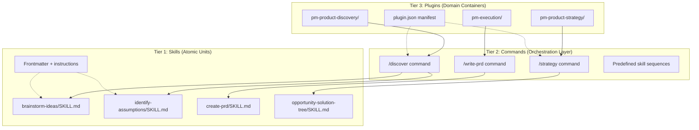
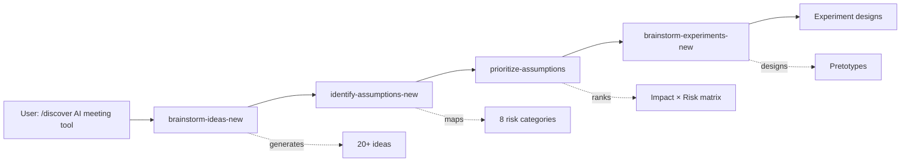
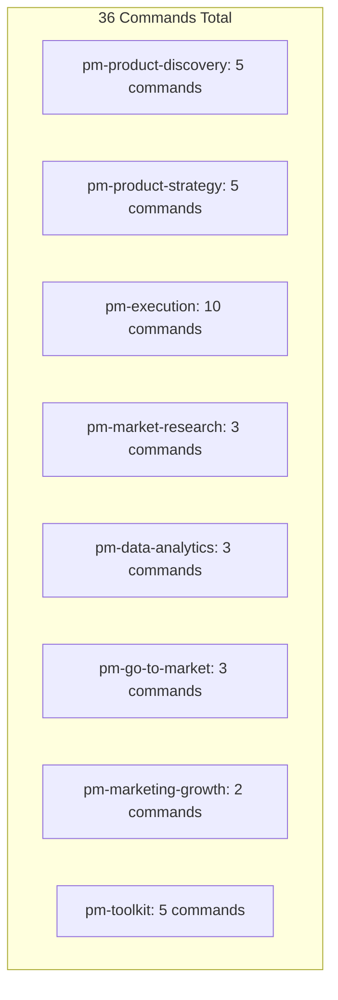
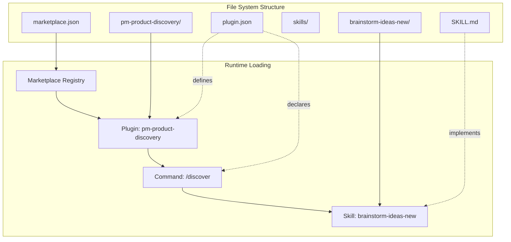
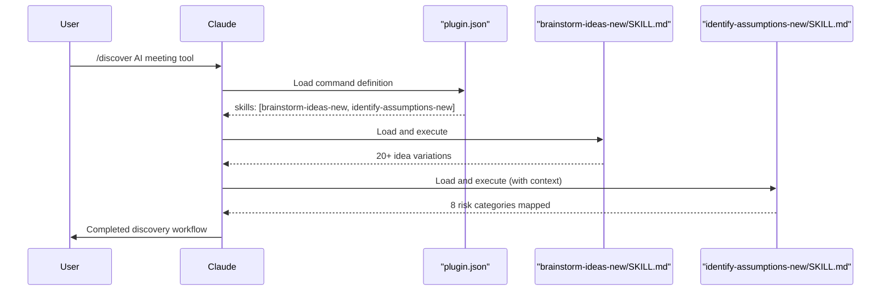
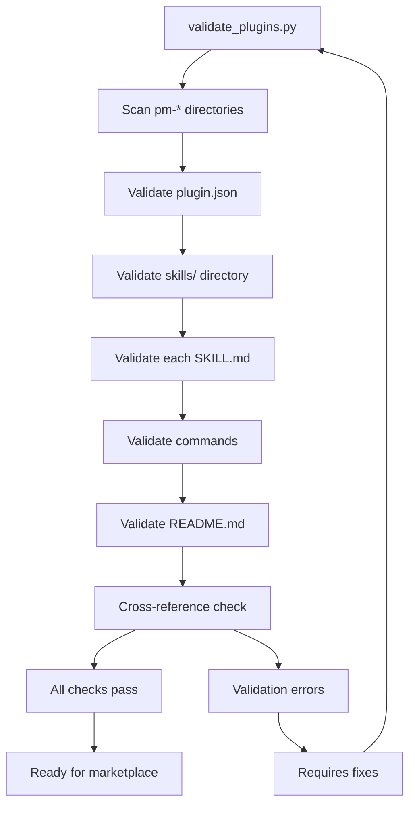

<!-- source: DeepWiki mcp.deepwiki.com · repo phuryn/pm-skills · page 3.1 Three-Tier Abstraction Model · fetched 2026-10-27 -->

# Three-Tier Abstraction Model

<details>
<summary>Relevant source files</summary>

The following files were used as context for generating this wiki page:

- [.docs/images/plugins-overview.webp](.docs/images/plugins-overview.webp)
- [README.md](README.md)

</details>


## Purpose and Scope

This document explains the three-tier abstraction model that structures the PM Skills Marketplace: **Skills** (atomic units), **Commands** (orchestrated workflows), and **Plugins** (domain containers). It covers the file structure, metadata schemas, loading mechanisms, and orchestration patterns that enable both atomic skill reuse and complex multi-step workflows.

For installation and usage instructions, see [Getting Started](#2). For the broader plugin ecosystem design, see [Plugin Ecosystem](#3.2). For how PM frameworks are encoded into skills, see [Framework Knowledge Base](#3.3).

---

## The Three Tiers

The marketplace implements a hierarchical abstraction where each tier serves distinct purposes while maintaining clean separation of concerns:



**Sources:** [README.md:31-45]()

---

## Tier 1: Skills (Atomic Units)

### Definition and Purpose

Skills are the foundational units of the marketplace. Each skill encodes a specific PM framework, analytical method, or guided workflow as a structured markdown file. Skills operate at atomic granularity—each addresses one discrete PM task.

### File Structure

Every skill follows a standardized directory structure:

```
pm-{plugin-name}/
└── skills/
    └── {skill-name}/
        └── SKILL.md
```

The `SKILL.md` file contains two components:

1. **Frontmatter** (YAML metadata block)
2. **Instructions** (markdown content)

**Sources:** [README.md:33-35]()

### Skill Frontmatter Schema

Skills declare metadata in a YAML frontmatter block:

```yaml
---
name: skill-name
description: Brief description (minimum 30 characters)
version: 1.0.0
---
```

| Field | Type | Requirement | Validation |
|-------|------|-------------|------------|
| `name` | string | Required | Must match directory name |
| `description` | string | Required | Length ≥ 30 characters |
| `version` | string | Required | Semantic versioning format |

The `validate_plugins.py` script enforces these constraints at lines 108-156, checking frontmatter completeness, name consistency, and description length.

**Sources:** [validate_plugins.py:108-156](), [CONTRIBUTING.md:1-28]()

### Skill Naming Convention

Skills use **noun-based naming** to reflect their role as domain knowledge containers:

- ✅ `opportunity-solution-tree` (noun: a specific framework)
- ✅ `create-prd` (verb → noun: creates a PRD artifact)
- ✅ `prioritization-frameworks` (noun: reference knowledge)
- ❌ `plan-sprint` (verb-based: belongs in commands)

This semantic distinction separates knowledge artifacts (skills) from orchestrated actions (commands).

**Sources:** [CONTRIBUTING.md:1-28](), [README.md:33-35]()

### Skill Word Count Requirements

Skills must contain substantive content:

```
Minimum: 50 words
Maximum: 3000 words
```

This constraint ensures skills provide sufficient guidance while remaining focused. The validator checks word counts at lines 149-156, extracting content after frontmatter and counting words excluding code blocks.

**Sources:** [validate_plugins.py:149-156]()

### Loading Mechanisms

Skills support two loading patterns:

**1. Automatic Loading (Implicit Invocation)**

Claude's inference engine automatically loads relevant skills based on conversation context. Users don't need to know skill names—the AI determines relevance and activates appropriate domain knowledge.

Example: Asking "What are the riskiest assumptions for our AI assistant?" automatically loads `identify-assumptions`.

**2. Explicit Invocation (Force Loading)**

Users can force-load skills to override general knowledge:

```
/plugin-name:skill-name
/skill-name  (Claude adds plugin prefix)
```

This pattern gives power users precision when general AI knowledge conflicts with specialized frameworks.

**Sources:** [README.md:35-36]()

### Skill Categories

Skills fall into three functional categories:

| Category | Purpose | Examples | Usage Pattern |
|----------|---------|----------|---------------|
| **Reference** | Domain knowledge that Claude draws on contextually | `prioritization-frameworks`, `opportunity-solution-tree` | Automatic loading |
| **Workflow** | Step-by-step guided processes | `create-prd`, `interview-script` | Command-driven or explicit |
| **Foundation** | Reusable components shared by multiple commands | `brainstorm-ideas`, `identify-assumptions` | Command-driven |

**Sources:** [README.md:43](), Diagram 4 from high-level architecture

### Example: Skill File Structure

```
pm-product-discovery/
└── skills/
    ├── brainstorm-ideas-new/
    │   └── SKILL.md
    ├── identify-assumptions-new/
    │   └── SKILL.md
    └── opportunity-solution-tree/
        └── SKILL.md
```

Each `SKILL.md` follows the universal skill format recognized by Claude and other AI assistants supporting the specification.

**Sources:** [README.md:79](), [README.md:99-137]()

---

## Tier 2: Commands (Orchestration Layer)

### Definition and Purpose

Commands are Claude-specific workflows that chain one or more skills into predefined sequences. They provide structured, opinionated paths through complex PM processes.

### Command Definition Location

Commands are declared in each plugin's `plugin.json` manifest:

```
pm-{plugin-name}/
├── plugin.json
└── skills/
```

The `plugin.json` file contains a `commands` array where each command specifies:

- Command name (slash-command identifier)
- Description
- Argument hint
- Skill references

**Sources:** [README.md:37](), marketplace.json structure

### Command Metadata Schema

Commands declare metadata in the plugin manifest:

```json
{
  "commands": [
    {
      "name": "discover",
      "description": "Full discovery cycle: ideation → assumptions → prioritization → experiments",
      "argument-hint": "Product idea or problem statement",
      "skills": [
        "brainstorm-ideas-new",
        "identify-assumptions-new",
        "prioritize-assumptions",
        "brainstorm-experiments-new"
      ]
    }
  ]
}
```

| Field | Type | Requirement | Purpose |
|-------|------|-------------|---------|
| `name` | string | Required | Command identifier (used as `/name`) |
| `description` | string | Required | Human-readable command purpose |
| `argument-hint` | string | Required | Guides users on what to provide |
| `skills` | array | Optional | Skills to activate in sequence |

**Sources:** [validate_plugins.py:158-192]()

### Command Naming Convention

Commands use **verb-based naming** to reflect their action-oriented nature:

- ✅ `/discover` (verb: initiates discovery)
- ✅ `/write-prd` (verb: creates a PRD)
- ✅ `/plan-launch` (verb: plans GTM)
- ❌ `/prd` (noun: should be a skill)

This linguistic distinction reinforces the separation between knowledge (skills) and workflows (commands).

**Sources:** [CONTRIBUTING.md:1-28](), [README.md:37]()

### Orchestration Pattern: Skill Chaining

Commands orchestrate skills in predefined sequences. The `/discover` command demonstrates multi-stage chaining:



Each skill in the chain receives context from prior skills, creating a coherent workflow. The command doesn't contain the logic—it references atomic skills that execute independently.

**Sources:** [README.md:37](), [README.md:120]()

### Command Validation

The validator enforces command structure at lines 158-192:

1. **Frontmatter completeness**: `name`, `description`, `argument-hint` must exist
2. **Description presence**: Non-empty description required
3. **Argument hint presence**: Non-empty hint required
4. **No cross-plugin references**: Commands cannot reference skills from other plugins (architectural isolation)

Cross-plugin references are forbidden to maintain plugin independence and prevent circular dependencies.

**Sources:** [validate_plugins.py:158-192]()

### Command Count Distribution

The marketplace contains **36 total commands** distributed across 8 plugins:



The `pm-execution` plugin has the highest command count (10) reflecting the operational density of execution workflows (PRDs, OKRs, sprints, retrospectives, stakeholder management, etc.).

**Sources:** [README.md:7](), [README.md:99-393]()

### Sequential Flow Design

Commands suggest next steps to create natural workflow progression:

```
/discover → /strategy → /write-prd → /plan-launch → /north-star
```

After each command completes, Claude suggests contextually relevant next commands based on the product lifecycle stage. This design mirrors the natural PM workflow sequence.

**Sources:** [README.md:45]()

---

## Tier 3: Plugins (Domain Containers)

### Definition and Purpose

Plugins group related skills and commands into installable packages organized by PM domain. Each plugin represents a coherent capability area with independent versioning and distribution.

### Plugin Directory Structure

Each plugin follows a standardized structure:

```
pm-{domain-name}/
├── plugin.json          # Manifest (required)
├── README.md            # Documentation (required)
└── skills/              # Skill directory (required)
    ├── skill-1/
    │   └── SKILL.md
    ├── skill-2/
    │   └── SKILL.md
    └── skill-n/
        └── SKILL.md
```

**Sources:** [validate_plugins.py:48-75]()

### Plugin Manifest Schema

The `plugin.json` manifest defines plugin metadata and contents:

```json
{
  "name": "pm-product-discovery",
  "description": "Product discovery: ideation, experiments, assumptions, OSTs, interviews",
  "version": "1.0.0",
  "author": "Paweł Huryn",
  "skills": [
    "brainstorm-ideas-new",
    "identify-assumptions-new",
    "prioritize-assumptions"
  ],
  "commands": [
    {
      "name": "discover",
      "description": "Full discovery cycle",
      "argument-hint": "Product idea or problem",
      "skills": ["brainstorm-ideas-new", "identify-assumptions-new"]
    }
  ]
}
```

| Field | Type | Requirement | Validation |
|-------|------|-------------|------------|
| `name` | string | Required | Must match directory name |
| `description` | string | Required | Brief domain summary |
| `version` | string | Required | Semantic versioning |
| `author` | string | Required | Creator attribution |
| `skills` | array | Required | List of skill directory names |
| `commands` | array | Optional | Command definitions |

**Sources:** [validate_plugins.py:77-107]()

### Plugin Naming Convention

Plugins use the `pm-{domain}` prefix:

- `pm-product-discovery`
- `pm-product-strategy`
- `pm-execution`
- `pm-market-research`
- `pm-data-analytics`
- `pm-go-to-market`
- `pm-marketing-growth`
- `pm-toolkit`

This convention provides namespace clarity and distinguishes marketplace plugins from other potential plugin sources.

**Sources:** [README.md:7](), [README.md:97-393]()

### Plugin Validation Requirements

The validator enforces plugin integrity at multiple levels:

**1. Manifest Validation** (lines 77-107):
- `plugin.json` file exists
- Required fields present (`name`, `description`, `version`, `author`, `skills`)
- Plugin name matches directory name
- Version follows semantic versioning (X.Y.Z format)

**2. Structural Validation** (lines 48-75):
- README.md exists
- skills/ directory exists
- Each declared skill has a corresponding directory

**3. Cross-Reference Validation** (lines 193-220):
- Skills referenced in `plugin.json` exist in `skills/` directory
- Skills in `skills/` directory are declared in manifest
- No orphaned or undeclared skills

**Sources:** [validate_plugins.py:48-107](), [validate_plugins.py:193-220]()

### Plugin Independence Principle

Plugins are architecturally isolated—they cannot reference skills or commands from other plugins. This constraint:

1. Ensures plugins can be installed independently
2. Prevents circular dependencies
3. Enables selective installation via Claude Code CLI
4. Maintains clean domain boundaries

The validator blocks cross-plugin references at lines 186-192.

**Sources:** [validate_plugins.py:186-192](), [CONTRIBUTING.md:1-28]()

### Plugin Scale Distribution

The 8 plugins contain **65 total skills** and **36 total commands**:

| Plugin | Skills | Commands | Ratio |
|--------|--------|----------|-------|
| pm-product-discovery | 13 | 5 | 2.6:1 |
| pm-product-strategy | 12 | 5 | 2.4:1 |
| pm-execution | 15 | 10 | 1.5:1 |
| pm-market-research | 7 | 3 | 2.3:1 |
| pm-data-analytics | 3 | 3 | 1:1 |
| pm-go-to-market | 6 | 3 | 2:1 |
| pm-marketing-growth | 5 | 2 | 2.5:1 |
| pm-toolkit | 4 | 5 | 0.8:1 |
| **Total** | **65** | **36** | **1.8:1** |

The average skill-to-command ratio of 1.8:1 indicates skills are reused across multiple commands, validating the atomic abstraction design.

**Sources:** [README.md:7](), [README.md:99-393]()

---

## Integration: How the Tiers Interact

### File System to Runtime Mapping



**Sources:** [marketplace.json:1-50](), [README.md:55-75]()

### Marketplace Distribution Layer

The `marketplace.json` file serves as the distribution manifest:

```json
{
  "name": "pm-skills",
  "version": "1.0.0",
  "plugins": [
    "pm-product-discovery",
    "pm-product-strategy",
    "pm-execution"
  ]
}
```

This manifest enables one-click installation in Claude Cowork and CLI-based selective installation in Claude Code.

**Sources:** [marketplace.json:1-50](), [README.md:49-75]()

### Access Pattern Matrix

The three tiers support different access patterns depending on the AI assistant:

| AI Assistant | Plugins | Commands | Skills | Orchestration |
|--------------|---------|----------|--------|---------------|
| Claude Cowork | ✓ Full | ✓ Full | ✓ Full | ✓ Multi-skill chaining |
| Claude Code CLI | ✓ Full | ✓ Full | ✓ Full | ✓ Multi-skill chaining |
| Gemini CLI | ✗ N/A | ✗ N/A | ✓ Manual copy | ✗ None |
| Cursor | ✗ N/A | ✗ N/A | ✓ Manual copy | ✗ None |
| Codex CLI | ✗ N/A | ✗ N/A | ✓ Manual copy | ✗ None |
| Kiro | ✗ N/A | ✗ N/A | ✓ Manual copy | ✗ None |

Claude-native installations get the full three-tier stack. Other AI tools access skills only, sacrificing orchestration for universal compatibility through the `SKILL.md` format.

**Sources:** [README.md:77-93](), Diagram 5 from high-level architecture

### Command → Skill Resolution Flow



**Sources:** [README.md:37](), [README.md:120]()

---

## Quality Assurance: Validation System

### Validation Entry Point

The `validate_plugins.py` script enforces structural integrity across all three tiers:

```bash
python validate_plugins.py
```

The script validates:
1. Plugin manifests
2. Skill structure and metadata
3. Command definitions
4. Cross-references
5. README documentation

**Sources:** [validate_plugins.py:1-309]()

### Validation Flow



**Sources:** [validate_plugins.py:221-309]()

### Validation Checks by Tier

**Tier 3 (Plugin) Validation:**
- Manifest existence and completeness (lines 77-107)
- Name consistency with directory (lines 95-100)
- Version format compliance (lines 101-107)
- Required directory structure (lines 48-75)

**Tier 2 (Command) Validation:**
- Frontmatter completeness (lines 158-165)
- Description and argument-hint presence (lines 166-180)
- No cross-plugin skill references (lines 186-192)

**Tier 1 (Skill) Validation:**
- SKILL.md existence (lines 108-115)
- Frontmatter completeness (lines 116-127)
- Name consistency (lines 128-136)
- Description length ≥ 30 characters (lines 137-142)
- Word count 50-3000 words (lines 149-156)

**Sources:** [validate_plugins.py:48-192]()

### Validation Error Reporting

The validator provides detailed error messages with file paths and line numbers:

```
ERROR: pm-product-discovery/skills/brainstorm-ideas-new/SKILL.md
- Description too short (18 chars, minimum 30)
- Missing version in frontmatter

ERROR: pm-execution/plugin.json
- Command 'write-prd' references non-existent skill 'create-prds'
```

This precise error reporting enables rapid fixes during contribution workflows.

**Sources:** [validate_plugins.py:221-309]()

---

## Design Rationale

### Why Three Tiers?

The three-tier model solves competing requirements:

**Requirement 1: Atomic Reusability**
Skills must be independently usable and automatically loadable by AI inference engines.

**Requirement 2: Guided Workflows**
Complex PM processes require structured, opinionated sequences.

**Requirement 3: Domain Organization**
Related capabilities need logical grouping for discoverability and installation.

The three-tier abstraction satisfies all three:
- Skills provide atomic reusability
- Commands provide guided workflows
- Plugins provide domain organization

**Sources:** [README.md:31-45](), Diagram 1 from high-level architecture

### Graceful Degradation Strategy

The architecture prioritizes **maximum compatibility with graceful degradation**:

- **Full Stack (Claude)**: Plugins + Commands + Skills + Orchestration
- **Skills Only (Other AI)**: Skills + Manual workflow assembly

This design choice values universal skill access over platform-specific orchestration, enabling knowledge democratization across AI tool ecosystems.

**Sources:** [README.md:77-93](), Diagram 5 from high-level architecture

### Noun-Verb Linguistic Split

The semantic distinction between skills (nouns) and commands (verbs) creates cognitive clarity:

- **Skills**: "What is X?" → Domain knowledge artifacts
- **Commands**: "Do X" → Action-oriented workflows

This linguistic convention makes the abstraction self-documenting and reduces conceptual overhead for contributors.

**Sources:** [CONTRIBUTING.md:1-28]()

---

## Summary

The three-tier abstraction model structures the PM Skills Marketplace as:

1. **Skills** (65 total): Atomic PM frameworks in `skills/*/SKILL.md` with frontmatter metadata, automatically loaded or explicitly invoked
2. **Commands** (36 total): Orchestrated workflows in `plugin.json` manifests, chaining skills into predefined sequences
3. **Plugins** (8 total): Domain containers with independent versioning, grouping related skills and commands

This layered design enables both atomic skill reuse (automatic loading for contextual assistance) and structured workflows (command-driven orchestration), while maintaining plugin independence and quality through automated validation.

**Sources:** [README.md:31-45](), [README.md:7](), [validate_plugins.py:1-309](), [CONTRIBUTING.md:1-28]()

---

