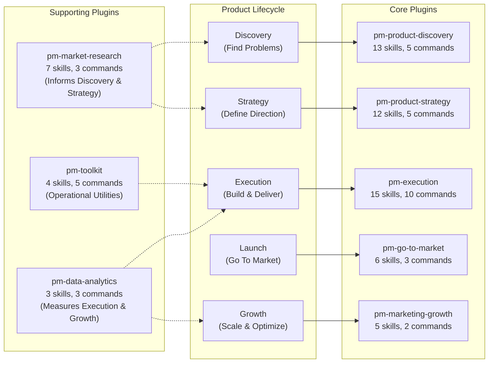
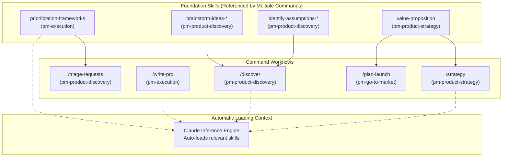

<!-- source: DeepWiki mcp.deepwiki.com · repo phuryn/pm-skills · page 4 Plugin Reference · fetched 2026-10-27 -->

# Plugin Reference

<details>
<summary>Relevant source files</summary>

The following files were used as context for generating this wiki page:

- [.claude-plugin/marketplace.json](.claude-plugin/marketplace.json)
- [README.md](README.md)

</details>


This page provides a comprehensive reference for all 8 plugins in the PM Skills Marketplace. Each plugin is a domain-specific collection of skills and commands organized around a stage of the product lifecycle or a supporting capability.

For detailed documentation of individual plugins including skill parameters, command workflows, and usage examples, see the dedicated plugin pages ([4.1](#4.1) through [4.8](#4.8)). For architectural context on how skills, commands, and plugins relate to each other, see [Three-Tier Abstraction Model](#3.1). For installation instructions, see [Installation](#2.1).

---

## Plugin Catalog Overview

The marketplace contains 8 plugins totaling 65 skills and 36 commands. Five plugins align with sequential product lifecycle stages (Discovery → Strategy → Execution → Launch → Growth), while three provide cross-cutting support capabilities.

### Complete Plugin List

| Plugin | Type | Skills | Commands | Primary Focus |
|--------|------|--------|----------|---------------|
| `pm-product-discovery` | Lifecycle | 13 | 5 | Ideation, experiments, assumption testing, OSTs, interviews |
| `pm-product-strategy` | Lifecycle | 12 | 5 | Vision, business models, pricing, competitive analysis |
| `pm-execution` | Lifecycle | 15 | 10 | PRDs, OKRs, roadmaps, sprints, stakeholder management |
| `pm-go-to-market` | Lifecycle | 6 | 3 | GTM strategy, growth loops, beachhead segments, ICPs |
| `pm-marketing-growth` | Lifecycle | 5 | 2 | North Star metrics, positioning, value props, marketing ideas |
| `pm-market-research` | Support | 7 | 3 | User personas, segmentation, journey maps, competitive analysis |
| `pm-data-analytics` | Support | 3 | 3 | SQL queries, cohort analysis, A/B testing |
| `pm-toolkit` | Support | 4 | 5 | Resume review, NDAs, privacy policies, proofreading |
| **Total** | — | **65** | **36** | — |

**Sources:** [README.md:99-393](), [.claude-plugin/marketplace.json:11-60]()

---

## Plugin Architecture and Directory Structure

Each plugin follows a standardized directory structure that defines its manifest, skills, commands, and documentation.

### Plugin Directory Structure

```mermaid
graph TB
    subgraph "Marketplace Root"
        MKT["marketplace.json<br/>(registry)"]
    end
    
    subgraph "pm-product-discovery/"
        PD_MANIFEST["plugin.json<br/>(manifest)"]
        PD_README["README.md<br/>(docs)"]
        PD_SKILLS["skills/<br/>(13 skill dirs)"]
        PD_COMMANDS["commands/<br/>(5 command files)"]
    end
    
    subgraph "pm-product-strategy/"
        PS_MANIFEST["plugin.json"]
        PS_README["README.md"]
        PS_SKILLS["skills/<br/>(12 skill dirs)"]
        PS_COMMANDS["commands/<br/>(5 command files)"]
    end
    
    subgraph "pm-execution/"
        PE_MANIFEST["plugin.json"]
        PE_README["README.md"]
        PE_SKILLS["skills/<br/>(15 skill dirs)"]
        PE_COMMANDS["commands/<br/>(10 command files)"]
    end
    
    subgraph "pm-market-research/"
        PMR_MANIFEST["plugin.json"]
        PMR_README["README.md"]
        PMR_SKILLS["skills/<br/>(7 skill dirs)"]
        PMR_COMMANDS["commands/<br/>(3 command files)"]
    end
    
    subgraph "pm-data-analytics/"
        PDA_MANIFEST["plugin.json"]
        PDA_README["README.md"]
        PDA_SKILLS["skills/<br/>(3 skill dirs)"]
        PDA_COMMANDS["commands/<br/>(3 command files)"]
    end
    
    subgraph "pm-go-to-market/"
        PG_MANIFEST["plugin.json"]
        PG_README["README.md"]
        PG_SKILLS["skills/<br/>(6 skill dirs)"]
        PG_COMMANDS["commands/<br/>(3 command files)"]
    end
    
    subgraph "pm-marketing-growth/"
        PMG_MANIFEST["plugin.json"]
        PMG_README["README.md"]
        PMG_SKILLS["skills/<br/>(5 skill dirs)"]
        PMG_COMMANDS["commands/<br/>(2 command files)"]
    end
    
    subgraph "pm-toolkit/"
        PT_MANIFEST["plugin.json"]
        PT_README["README.md"]
        PT_SKILLS["skills/<br/>(4 skill dirs)"]
        PT_COMMANDS["commands/<br/>(5 command files)"]
    end
    
    MKT --> PD_MANIFEST
    MKT --> PS_MANIFEST
    MKT --> PE_MANIFEST
    MKT --> PMR_MANIFEST
    MKT --> PDA_MANIFEST
    MKT --> PG_MANIFEST
    MKT --> PMG_MANIFEST
    MKT --> PT_MANIFEST
```



**Sources:** [.claude-plugin/marketplace.json:11-60](), repository directory structure

---

## Plugin Components

Each plugin consists of four key components that work together to provide functionality to AI assistants.

### Component Types

| Component | File/Directory | Purpose | Required |
|-----------|---------------|---------|----------|
| **Manifest** | `plugin.json` | Plugin metadata, version, dependencies | Yes |
| **Skills** | `skills/*/SKILL.md` | Domain knowledge, frameworks, guided workflows | Yes |
| **Commands** | `commands/*.md` | Orchestrated workflows that chain skills | No |
| **Documentation** | `README.md` | Human-readable reference and examples | Yes |

### Manifest File Structure (`plugin.json`)

Each `plugin.json` defines:
- `name` — Plugin identifier (must match directory name)
- `version` — Semantic version string
- `description` — Brief summary of capabilities
- `skills` — Array of skill references (paths to skill directories)
- `commands` — Array of command definitions with names, descriptions, and skill references

### Skill Directory Structure

Each skill lives in `skills/{skill-name}/SKILL.md` with frontmatter:
```markdown
---
name: skill-name
description: Brief description (30+ chars, per validation rules)
tags: [comma, separated, tags]
---
```

### Command File Structure

Each command lives in `commands/{command-name}.md` with frontmatter:
```markdown
---
name: /command-name
description: Brief description
argument-hint: Expected user input format
skills: [skill-1, skill-2, skill-3]
---
```

**Sources:** [validate_plugins.py:1-309](), [CONTRIBUTING.md:1-28]()

---

## Plugin Lifecycle Mapping

The five lifecycle plugins map to sequential product development stages, while support plugins provide cross-cutting capabilities.

### Lifecycle Plugin Flow



**Sources:** [README.md:98-393](), Diagram 2 from high-level system architecture

---

## Skill and Command Distribution

The distribution of skills and commands across plugins reveals design patterns: execution-heavy plugins have more commands (orchestration), while strategy plugins emphasize reference skills (knowledge).

### Distribution Analysis

| Plugin | Skills | Commands | Skill:Command Ratio | Pattern |
|--------|--------|----------|---------------------|---------|
| `pm-execution` | 15 | 10 | 1.5:1 | **High orchestration** — many workflows (sprints, PRDs, roadmaps) |
| `pm-product-discovery` | 13 | 5 | 2.6:1 | **Balanced** — foundational skills with key workflows |
| `pm-product-strategy` | 12 | 5 | 2.4:1 | **Reference-heavy** — strategic frameworks and canvases |
| `pm-market-research` | 7 | 3 | 2.3:1 | **Supporting** — research methodologies |
| `pm-go-to-market` | 6 | 3 | 2:1 | **Balanced** — GTM frameworks and execution |
| `pm-marketing-growth` | 5 | 2 | 2.5:1 | **Reference-heavy** — positioning and metrics |
| `pm-toolkit` | 4 | 5 | 0.8:1 | **High orchestration** — utility workflows |
| `pm-data-analytics` | 3 | 3 | 1:1 | **1:1 mapping** — each skill = dedicated workflow |

**Sources:** [README.md:99-393]()

---

## Cross-Plugin Skill References

Commands can reference skills from their own plugin only (no cross-plugin dependencies, per contribution guidelines). However, skills can be invoked independently across contexts.

### Commonly Referenced Skills Across Workflows



**Note:** Dashed lines indicate skills loaded automatically by Claude's inference engine when contextually relevant, not explicit command dependencies.

**Sources:** [README.md:33-43](), [CONTRIBUTING.md:1-28]()

---

## Plugin Categories and Use Cases

Each plugin serves specific PM scenarios and decision types.

### Discovery Plugins (2 plugins, 20 skills)

**pm-product-discovery**
- **When to use:** Exploring new product ideas, testing assumptions, planning experiments
- **Key capabilities:** Opportunity Solution Trees, assumption mapping, pretotyping (Alberto Savoia method), interview synthesis
- **Example scenarios:** "What are the riskiest assumptions for our AI assistant?", "Design experiments to validate our pricing hypothesis"

**pm-market-research**
- **When to use:** Understanding users, analyzing competitors, sizing markets
- **Key capabilities:** Personas, segmentation, journey mapping, TAM/SAM/SOM calculation
- **Example scenarios:** "Build user personas from interview data", "Estimate market size for AI code review tools"

### Strategy Plugins (2 plugins, 17 skills)

**pm-product-strategy**
- **When to use:** Defining product vision, evaluating business models, analyzing competitive landscape
- **Key capabilities:** Product Strategy Canvas (9 sections), Lean Canvas, Business Model Canvas, SWOT, Porter's Five Forces
- **Example scenarios:** "Create a product strategy for our B2B tool", "Compare Lean Canvas vs BMC for my startup"

**pm-marketing-growth**
- **When to use:** Defining positioning, setting metrics, planning marketing campaigns
- **Key capabilities:** North Star Metric identification, positioning statements, value prop copywriting
- **Example scenarios:** "What's our North Star Metric for a two-sided marketplace?", "Create positioning that differentiates from Notion"

### Execution Plugins (2 plugins, 18 skills)

**pm-execution**
- **When to use:** Daily product management workflows — PRDs, sprints, roadmaps, stakeholder updates
- **Key capabilities:** PRD templates (Marty Cagan style), OKR planning, roadmap transformation, sprint planning/retros
- **Example scenarios:** "Write a PRD for notification system", "Transform feature list into outcome roadmap"

**pm-toolkit**
- **When to use:** Operational tasks beyond core product work
- **Key capabilities:** Resume review (XYZ+S formula), NDA drafting, privacy policy generation, proofreading
- **Example scenarios:** "Review my PM resume", "Draft a privacy policy for GDPR compliance"

### Launch & Growth Plugins (2 plugins, 11 skills)

**pm-go-to-market**
- **When to use:** Planning product launches, defining customer acquisition strategy
- **Key capabilities:** GTM strategy (Maja Voje framework), beachhead segmentation, growth loop design, ICP definition
- **Example scenarios:** "Plan GTM for developer productivity tool", "Design growth loops for freemium SaaS"

**pm-data-analytics**
- **When to use:** Analyzing product metrics, testing hypotheses, generating insights
- **Key capabilities:** SQL query generation (BigQuery/PostgreSQL/MySQL), cohort retention analysis, A/B test statistical analysis
- **Example scenarios:** "Calculate sample size for 95% confidence, 2% MDE", "Analyze retention for January vs February cohorts"

**Sources:** [README.md:99-393]()

---

## Plugin Metadata and Registry

The marketplace registry (`marketplace.json`) defines plugin metadata and installation sources.

### Marketplace Registry Structure

| Field | Type | Purpose | Example |
|-------|------|---------|---------|
| `name` | string | Marketplace identifier | `"pm-skills"` |
| `version` | string | Marketplace version | `"1.0.1"` |
| `description` | string | Marketplace summary | Describes 65 skills, 36 commands |
| `owner.name` | string | Maintainer name | `"Paweł Huryn"` |
| `owner.email` | string | Contact email | `"pawel@productcompass.pm"` |
| `owner.url` | string | Maintainer URL | `"https://www.productcompass.pm"` |
| `plugins[]` | array | Plugin definitions | 8 plugin objects |

### Plugin Object Schema

Each plugin entry in `marketplace.json` contains:
```json
{
  "name": "pm-product-discovery",
  "description": "Product discovery skills for PMs...",
  "source": "./pm-product-discovery",
  "category": "product-management"
}
```

**Sources:** [.claude-plugin/marketplace.json:1-61]()

---

## Plugin Installation Paths

Different installation methods provide different capability levels.

### Installation Methods Comparison

| Method | Tool | Plugins | Commands | Skills | Command |
|--------|------|---------|----------|--------|---------|
| **GUI Marketplace** | Claude Cowork | ✓ All 8 | ✓ All 36 | ✓ All 65 | Browse plugins → Add from GitHub → `phuryn/pm-skills` |
| **CLI Marketplace** | Claude Code | ✓ Selective | ✓ Yes | ✓ Yes | `claude plugin install {plugin}@pm-skills` |
| **Manual Copy** | Other AI tools | ✗ No | ✗ No | ✓ Skills only | `cp -r pm-*/skills/* ~/.gemini/skills/` |

**Full capability:** Claude Cowork and Claude Code support the complete plugin architecture (plugins + commands + skills).

**Skills-only mode:** Other AI assistants (Gemini, Cursor, Codex, Kiro) can consume skill files directly but cannot execute commands or leverage plugin orchestration.

**Sources:** [README.md:47-94]()

---

## Framework Attribution by Plugin

Skills encode methodologies from established PM practitioners. This table maps frameworks to their source plugins.

### Framework → Plugin Mapping

| Framework/Methodology | Author | Plugin(s) | Skills |
|----------------------|--------|-----------|--------|
| Continuous Discovery, OSTs | Teresa Torres | `pm-product-discovery` | `opportunity-solution-tree`, interview skills |
| INSPIRED, PRD templates | Marty Cagan | `pm-execution` | `create-prd`, empowerment frameworks |
| The Right It, Pretotyping | Alberto Savoia | `pm-product-discovery` | `brainstorm-experiments-new` |
| Running Lean, Lean Canvas | Ash Maurya | `pm-product-strategy` | `lean-canvas` |
| Playing to Win | Roger L. Martin | `pm-product-strategy` | `product-strategy` canvas |
| Jobs to Be Done | Anthony Ulwick | `pm-product-strategy`, `pm-market-research` | `value-proposition`, personas |
| Business Model Generation | Strategyzer | `pm-product-strategy` | `business-model`, `value-proposition` |
| Radical Focus (OKRs) | Christina Wodtke | `pm-execution` | `brainstorm-okrs` |
| Lean Analytics | Croll & Yoskovitz | `pm-data-analytics`, `pm-marketing-growth` | Cohort analysis, North Star |
| Hacking Growth | Sean Ellis | `pm-marketing-growth`, `pm-go-to-market` | Growth loops, positioning |
| GTM Strategy | Maja Voje | `pm-go-to-market` | `gtm-strategy`, `beachhead-segment` |

**Sources:** [README.md:401-415]()

---

## Validation Requirements

All plugins must pass automated validation before distribution. The `validate_plugins.py` script enforces structural and semantic requirements.

### Validation Checks by Component

| Component | Check | Rule |
|-----------|-------|------|
| **Manifest** | File exists | `plugin.json` required |
| | Name match | `plugin.json` name === directory name |
| | Version format | Semantic versioning (e.g., `1.0.0`) |
| | Required fields | `name`, `version`, `description`, `skills` |
| **Skills** | File exists | `skills/*/SKILL.md` required |
| | Frontmatter | `name`, `description`, `tags` required |
| | Description length | ≥30 characters |
| | Word count | 50–3000 words |
| | Name consistency | Frontmatter name === directory name |
| **Commands** | Frontmatter | `name`, `description`, `argument-hint`, `skills` required |
| | Skill references | All referenced skills exist in plugin |
| | Cross-plugin check | No references to external plugin skills |
| **README** | File exists | `README.md` required |
| | Sections | Expected structure (overview, install, skills, commands) |

**Sources:** [validate_plugins.py:1-309](), [CONTRIBUTING.md:1-28]()

---

## Related Pages

- For individual plugin documentation with complete skill and command references, see plugin pages [4.1](#4.1) through [4.8](#4.8)
- For architectural concepts (skills, commands, plugins abstraction), see [Three-Tier Abstraction Model](#3.1)
- For installation instructions and setup, see [Installation](#2.1)
- For contribution guidelines and creating new plugins, see [Contributing](#7)
- For validation system details, see [Plugin Validation System](#7.2)

---

