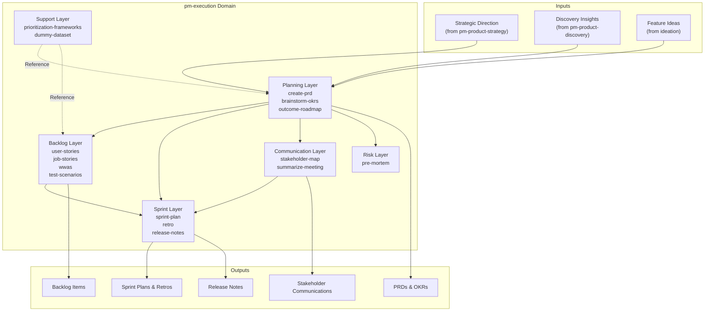
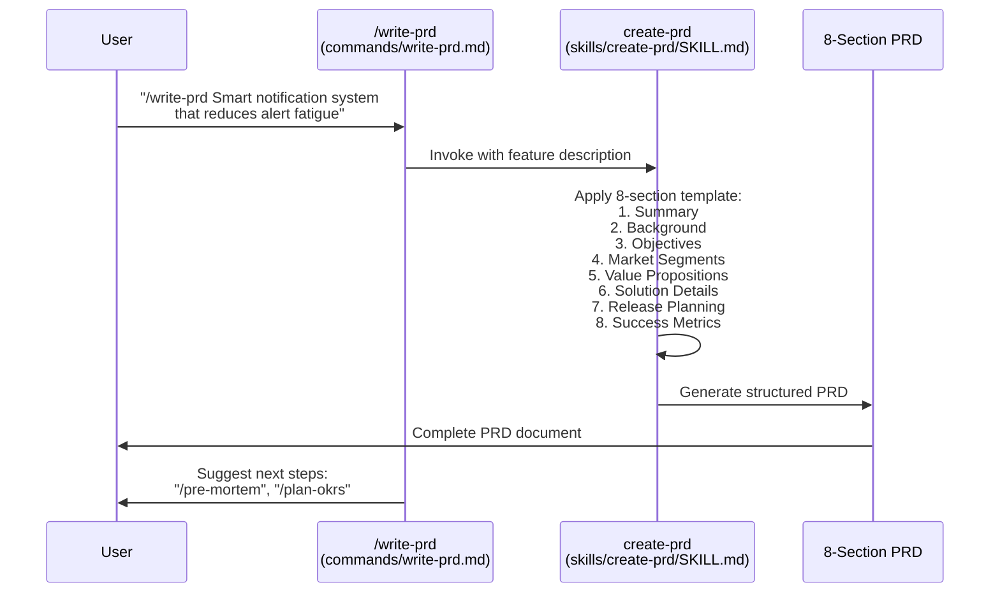
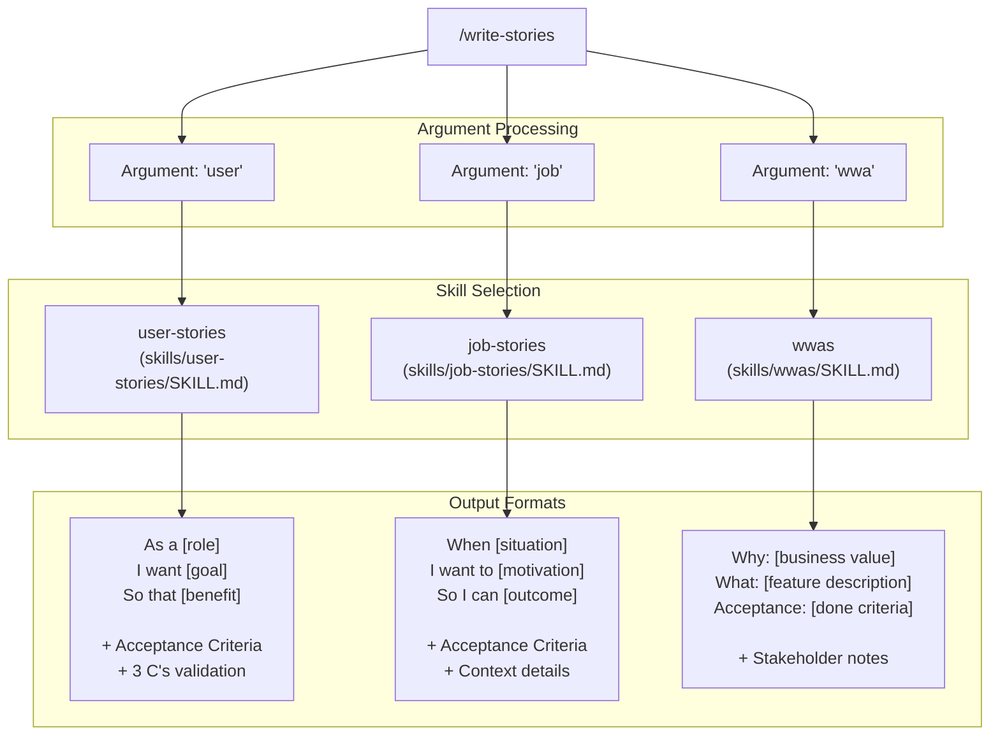
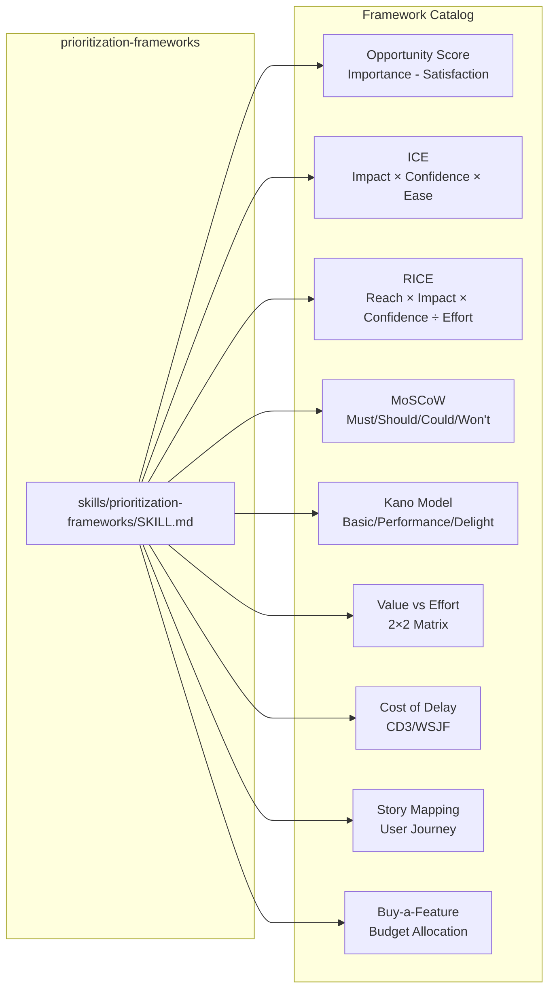
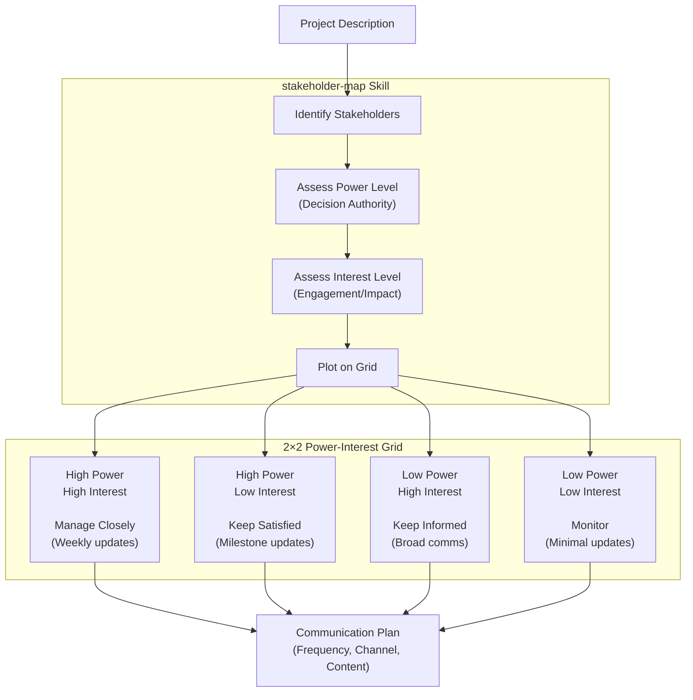
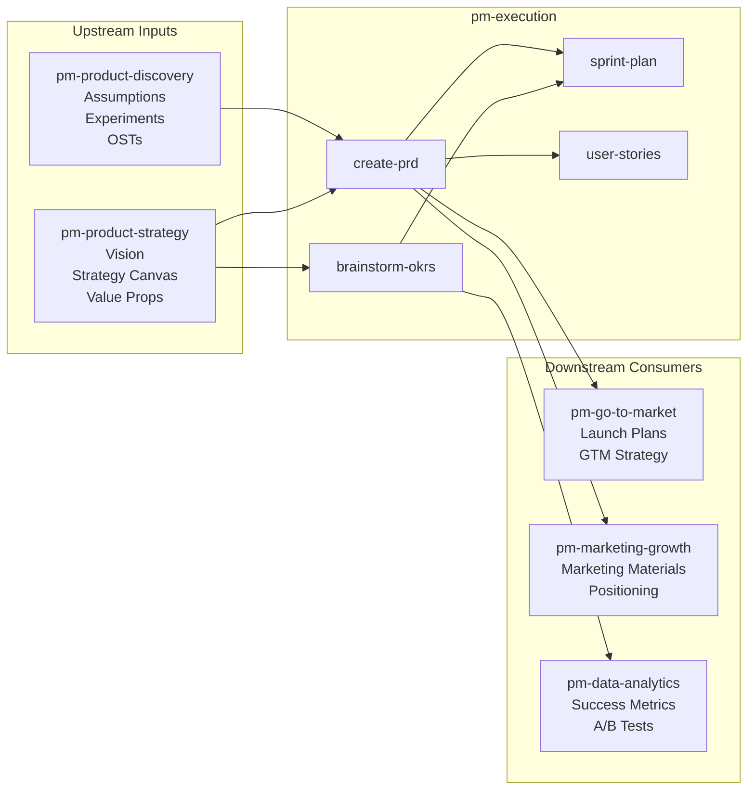

<!-- source: DeepWiki mcp.deepwiki.com · repo phuryn/pm-skills · page 4.3 pm-execution · fetched 2026-10-27 -->

# pm-execution

<details>
<summary>Relevant source files</summary>

The following files were used as context for generating this wiki page:

- [README.md](README.md)
- [pm-execution/README.md](pm-execution/README.md)

</details>


## Purpose and Scope

This page documents the `pm-execution` plugin, which provides 15 skills and 10 commands for day-to-day product management execution tasks. This plugin covers the operational layer of product work: writing PRDs, planning OKRs and sprints, managing stakeholders, creating roadmaps, running retrospectives, generating release notes, and converting features into backlog items.

For strategic planning before execution, see [pm-product-strategy](#4.2). For discovery work that precedes execution, see [pm-product-discovery](#4.1). For launch planning after execution completes, see [pm-go-to-market](#4.6).

**Sources:** [README.md:183-229](), [pm-execution/README.md:1-43]()

---

## Execution Domain Coverage

The `pm-execution` plugin addresses the "build and deliver" phase of the product lifecycle. It transforms strategic decisions into actionable work (PRDs, OKRs, roadmaps, backlog items) and provides operational workflows for sprint planning, retrospectives, stakeholder communication, and release management.



The plugin organizes execution work into six functional layers: Planning (high-level requirements), Sprint (iteration management), Backlog (story decomposition), Communication (stakeholder management), Risk (pre-mortem analysis), and Support (reference frameworks and utilities).

**Sources:** [README.md:183-229](), [pm-execution/README.md:1-43]()

---

## Skill-to-File Mapping

The following table maps each skill to its file location and primary purpose:

| Skill Name | File Path | Primary Purpose |
|------------|-----------|-----------------|
| `create-prd` | `pm-execution/skills/create-prd/SKILL.md` | 8-section PRD template covering summary, background, objectives, market segments, value propositions, solution details, and release planning |
| `brainstorm-okrs` | `pm-execution/skills/brainstorm-okrs/SKILL.md` | Team-level OKRs aligned with company objectives |
| `outcome-roadmap` | `pm-execution/skills/outcome-roadmap/SKILL.md` | Transform feature-based roadmaps into outcome-focused roadmaps |
| `sprint-plan` | `pm-execution/skills/sprint-plan/SKILL.md` | Capacity estimation, story selection, dependency mapping, risk identification |
| `retro` | `pm-execution/skills/retro/SKILL.md` | Structured sprint retrospective facilitation |
| `release-notes` | `pm-execution/skills/release-notes/SKILL.md` | User-facing release notes from tickets, PRDs, or changelogs |
| `pre-mortem` | `pm-execution/skills/pre-mortem/SKILL.md` | Risk analysis with Tigers/Paper Tigers/Elephants classification |
| `stakeholder-map` | `pm-execution/skills/stakeholder-map/SKILL.md` | Power × Interest grid with tailored communication plan |
| `summarize-meeting` | `pm-execution/skills/summarize-meeting/SKILL.md` | Meeting transcript → structured notes with decisions and action items |
| `user-stories` | `pm-execution/skills/user-stories/SKILL.md` | 3 C's (Card, Conversation, Confirmation) and INVEST criteria |
| `job-stories` | `pm-execution/skills/job-stories/SKILL.md` | When [situation], I want to [motivation], so I can [outcome] format |
| `wwas` | `pm-execution/skills/wwas/SKILL.md` | Why-What-Acceptance format for product backlog items |
| `test-scenarios` | `pm-execution/skills/test-scenarios/SKILL.md` | Comprehensive test scenarios with happy paths, edge cases, error handling |
| `dummy-dataset` | `pm-execution/skills/dummy-dataset/SKILL.md` | Realistic dummy datasets as CSV, JSON, SQL, or Python |
| `prioritization-frameworks` | `pm-execution/skills/prioritization-frameworks/SKILL.md` | Reference guide to 9 prioritization frameworks (Opportunity Score, ICE, RICE, MoSCoW, Kano, etc.) |

**Sources:** [pm-execution/README.md:5-21](), [README.md:187-203]()

---

## Command Orchestration Architecture

The 10 commands in `pm-execution` orchestrate skills into workflows. Commands are stored in `pm-execution/commands/*.md` and invoke skills through structured sequences.

```mermaid
graph TB
    subgraph "User Invocations"
        U1["/write-prd"]
        U2["/plan-okrs"]
        U3["/transform-roadmap"]
        U4["/sprint plan|retro|release"]
        U5["/pre-mortem"]
        U6["/meeting-notes"]
        U7["/stakeholder-map"]
        U8["/write-stories user|job|wwa"]
        U9["/test-scenarios"]
        U10["/generate-data"]
    end
    
    subgraph "Command Files"
        C1["pm-execution/commands/write-prd.md"]
        C2["pm-execution/commands/plan-okrs.md"]
        C3["pm-execution/commands/transform-roadmap.md"]
        C4["pm-execution/commands/sprint.md"]
        C5["pm-execution/commands/pre-mortem.md"]
        C6["pm-execution/commands/meeting-notes.md"]
        C7["pm-execution/commands/stakeholder-map.md"]
        C8["pm-execution/commands/write-stories.md"]
        C9["pm-execution/commands/test-scenarios.md"]
        C10["pm-execution/commands/generate-data.md"]
    end
    
    subgraph "Skill Invocations"
        S1["create-prd"]
        S2["brainstorm-okrs"]
        S3["outcome-roadmap"]
        S4a["sprint-plan"]
        S4b["retro"]
        S4c["release-notes"]
        S5["pre-mortem"]
        S6["summarize-meeting"]
        S7["stakeholder-map"]
        S8a["user-stories"]
        S8b["job-stories"]
        S8c["wwas"]
        S9["test-scenarios"]
        S10["dummy-dataset"]
    end
    
    U1 --> C1 --> S1
    U2 --> C2 --> S2
    U3 --> C3 --> S3
    U4 --> C4 --> S4a & S4b & S4c
    U5 --> C5 --> S5
    U6 --> C6 --> S6
    U7 --> C7 --> S7
    U8 --> C8 --> S8a & S8b & S8c
    U9 --> C9 --> S9
    U10 --> C10 --> S10
```



Each command file defines a workflow that invokes one or more skills. The `/sprint` command supports three subcommands (`plan`, `retro`, `release`), while `/write-stories` supports three backlog item formats (`user`, `job`, `wwa`).

**Sources:** [pm-execution/README.md:23-34](), [README.md:207-216]()

---

## Command Reference

| Command | File Path | Arguments | Skills Invoked | Purpose |
|---------|-----------|-----------|----------------|---------|
| `/write-prd` | `pm-execution/commands/write-prd.md` | Feature idea or problem statement | `create-prd` | Create comprehensive 8-section PRD |
| `/plan-okrs` | `pm-execution/commands/plan-okrs.md` | Company objectives (optional) | `brainstorm-okrs` | Brainstorm team-level OKRs |
| `/transform-roadmap` | `pm-execution/commands/transform-roadmap.md` | Feature-based roadmap | `outcome-roadmap` | Convert to outcome-focused roadmap |
| `/sprint` | `pm-execution/commands/sprint.md` | `plan\|retro\|release` | `sprint-plan`, `retro`, or `release-notes` | Sprint lifecycle management |
| `/pre-mortem` | `pm-execution/commands/pre-mortem.md` | PRD or launch plan | `pre-mortem` | Risk analysis before execution |
| `/meeting-notes` | `pm-execution/commands/meeting-notes.md` | Meeting transcript | `summarize-meeting` | Structured meeting summary |
| `/stakeholder-map` | `pm-execution/commands/stakeholder-map.md` | Project description | `stakeholder-map` | Map stakeholders and create communication plan |
| `/write-stories` | `pm-execution/commands/write-stories.md` | `user\|job\|wwa` + feature description | `user-stories`, `job-stories`, or `wwas` | Break features into backlog items |
| `/test-scenarios` | `pm-execution/commands/test-scenarios.md` | User stories or feature specs | `test-scenarios` | Generate comprehensive test scenarios |
| `/generate-data` | `pm-execution/commands/generate-data.md` | Data requirements | `dummy-dataset` | Create realistic dummy datasets |

**Sources:** [pm-execution/README.md:23-34](), [README.md:207-216]()

---

## PRD Creation Workflow

The `/write-prd` command demonstrates how commands orchestrate skills. It invokes `create-prd` to generate an 8-section PRD structure.



The `create-prd` skill applies a comprehensive template covering product requirements from strategic context through release planning. The command suggests related commands upon completion to guide users through the execution workflow.

**Sources:** [README.md:207](), [pm-execution/README.md:8](), [README.md:226]()

---

## Backlog Item Decomposition

The `/write-stories` command supports three backlog item formats through conditional skill invocation:



Each skill implements a distinct methodology:
- **`user-stories`**: 3 C's (Card, Conversation, Confirmation) and INVEST criteria
- **`job-stories`**: Situation-Motivation-Outcome format (JTBD-based)
- **`wwas`**: Why-What-Acceptance format emphasizing business value

**Sources:** [pm-execution/README.md:10-11,20-21](), [README.md:198-200,214]()

---

## Sprint Lifecycle Commands

The `/sprint` command provides a single entry point for three distinct sprint workflows:

| Subcommand | Skill Invoked | File Path | Purpose |
|------------|---------------|-----------|---------|
| `/sprint plan` | `sprint-plan` | `pm-execution/skills/sprint-plan/SKILL.md` | Capacity estimation, story selection, dependency mapping, risk identification |
| `/sprint retro` | `retro` | `pm-execution/skills/retro/SKILL.md` | Structured retrospective facilitation |
| `/sprint release` | `release-notes` | `pm-execution/skills/release-notes/SKILL.md` | User-facing release notes generation |

The command routes to the appropriate skill based on the subcommand argument, enabling a unified interface for sprint management while maintaining skill modularity.

**Sources:** [pm-execution/README.md:15-16](), [README.md:192-194,210]()

---

## Prioritization Frameworks Reference

The `prioritization-frameworks` skill functions as a reference encyclopedia rather than a workflow. It documents 9 prioritization methodologies:



Claude automatically loads this skill when users ask prioritization questions (e.g., "Which framework should I use for a 50-item backlog?"). It provides when-to-use guidance, formulas, and templates for each framework without requiring explicit invocation.

**Sources:** [pm-execution/README.md:13](), [README.md:203,221]()

---

## Stakeholder Communication Workflow

The `/stakeholder-map` command orchestrates the `stakeholder-map` skill to create Power × Interest grids with tailored communication strategies:



The skill segments stakeholders into four quadrants and generates quadrant-specific communication strategies. Output includes update frequency, preferred channels, and content depth for each stakeholder group.

**Sources:** [pm-execution/README.md:17](), [README.md:196,213]()

---

## Risk Analysis with Pre-Mortem

The `/pre-mortem` command invokes the `pre-mortem` skill to identify risks before execution begins. It classifies risks into three categories:

| Risk Type | Definition | Response Strategy |
|-----------|------------|-------------------|
| **Tigers** | Real, high-impact risks that require mitigation | Develop contingency plans, allocate resources, monitor actively |
| **Paper Tigers** | Perceived risks that are unlikely to materialize | Document and deprioritize, check assumptions |
| **Elephants** | Known issues being ignored | Force acknowledgment, escalate, create explicit mitigation plans |

The skill analyzes PRDs or launch plans and generates risk scenarios with likelihood assessment, impact evaluation, and recommended mitigation strategies.

**Sources:** [pm-execution/README.md:12](), [README.md:195,211]()

---

## File Structure

The `pm-execution` plugin follows the standard plugin architecture:

```
pm-execution/
├── plugin.json                          # Plugin manifest
├── README.md                            # Plugin documentation
├── commands/                            # 10 command definitions
│   ├── generate-data.md
│   ├── meeting-notes.md
│   ├── plan-okrs.md
│   ├── pre-mortem.md
│   ├── sprint.md
│   ├── stakeholder-map.md
│   ├── test-scenarios.md
│   ├── transform-roadmap.md
│   ├── write-prd.md
│   └── write-stories.md
└── skills/                              # 15 skill directories
    ├── brainstorm-okrs/
    │   └── SKILL.md
    ├── create-prd/
    │   └── SKILL.md
    ├── dummy-dataset/
    │   └── SKILL.md
    ├── job-stories/
    │   └── SKILL.md
    ├── outcome-roadmap/
    │   └── SKILL.md
    ├── pre-mortem/
    │   └── SKILL.md
    ├── prioritization-frameworks/
    │   └── SKILL.md
    ├── release-notes/
    │   └── SKILL.md
    ├── retro/
    │   └── SKILL.md
    ├── sprint-plan/
    │   └── SKILL.md
    ├── stakeholder-map/
    │   └── SKILL.md
    ├── summarize-meeting/
    │   └── SKILL.md
    ├── test-scenarios/
    │   └── SKILL.md
    ├── user-stories/
    │   └── SKILL.md
    └── wwas/
        └── SKILL.md
```

Each skill directory contains a `SKILL.md` file with frontmatter metadata and skill instructions. Command files in `commands/` reference skills through explicit invocation syntax.

**Sources:** [pm-execution/README.md:1-43]()

---

## Integration with Other Plugins

The `pm-execution` plugin receives inputs from discovery and strategy plugins and produces outputs consumed by launch and growth plugins:



Cross-plugin workflow example:
1. `/discover` (pm-product-discovery) → Identifies risky assumptions
2. `/strategy` (pm-product-strategy) → Defines strategic direction
3. `/write-prd` (pm-execution) → Translates strategy into requirements
4. `/plan-launch` (pm-go-to-market) → Creates launch plan from PRD

**Sources:** [README.md:41-45]()

---

## Usage Examples

### Example 1: PRD Creation
```
/write-prd Smart notification system that reduces alert fatigue
```
Invokes `create-prd` skill to generate an 8-section PRD covering summary, background, objectives, market segments, value propositions, solution details, release planning, and success metrics.

### Example 2: Sprint Retrospective
```
/sprint retro — Here are the notes from our last sprint
```
Invokes `retro` skill to facilitate structured retrospective: What went well? What didn't? Action items?

### Example 3: Backlog Decomposition
```
/write-stories job — Break down the "team dashboard" feature into job stories
```
Invokes `job-stories` skill to create stories in When-Motivation-Outcome format with acceptance criteria.

### Example 4: Risk Analysis
```
/pre-mortem [Attach PRD]
```
Invokes `pre-mortem` skill to classify risks as Tigers/Paper Tigers/Elephants and suggest mitigation strategies.

**Sources:** [README.md:220-228](), [pm-execution/README.md:23-34]()

---

