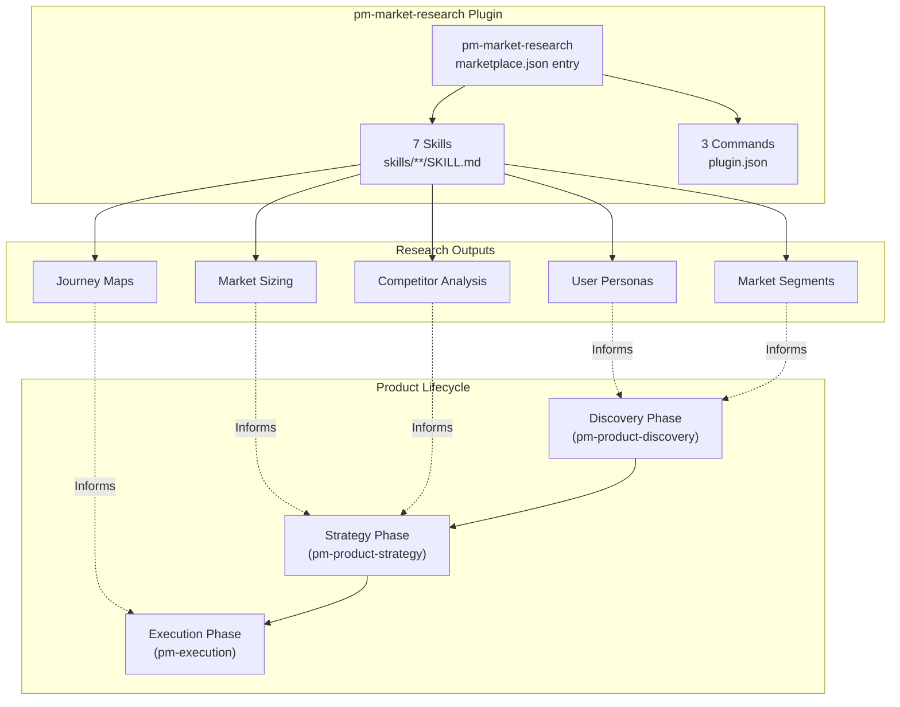
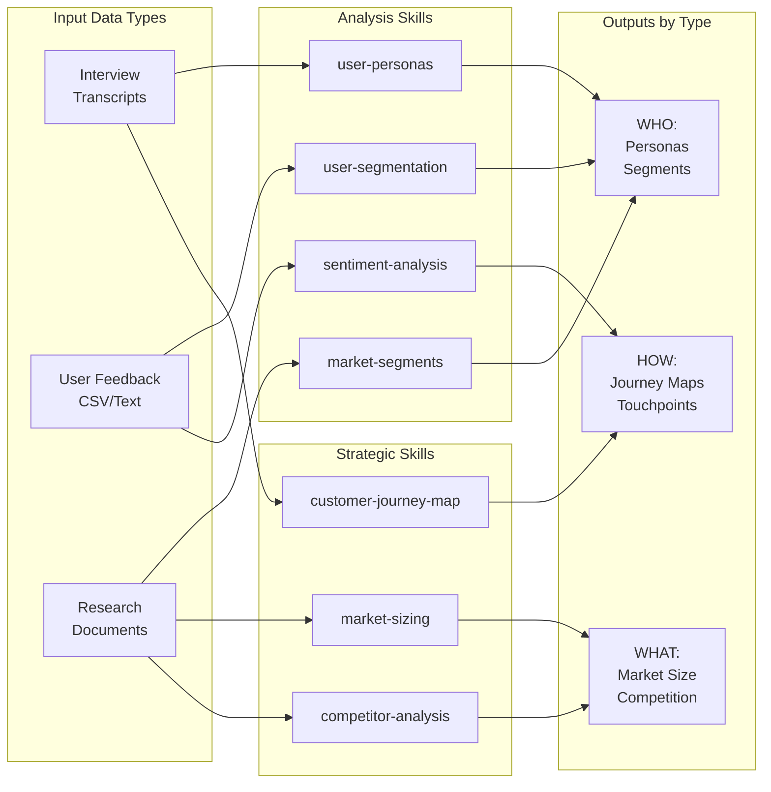
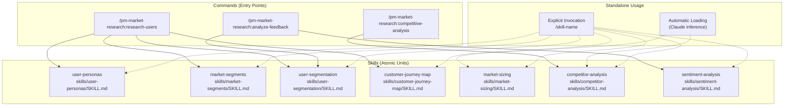
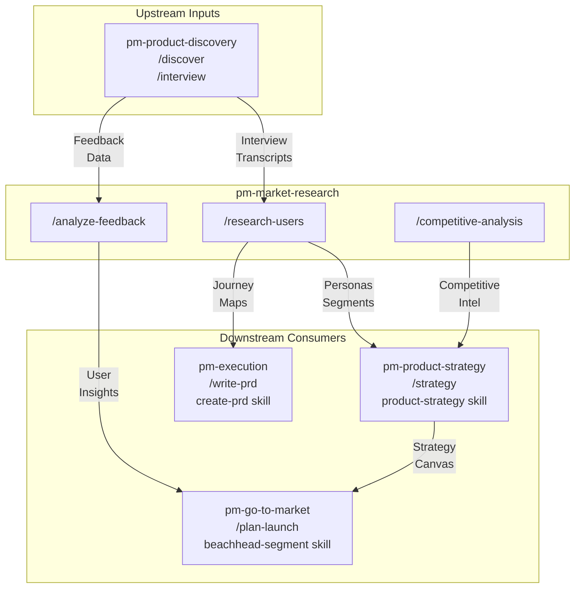

<!-- source: DeepWiki mcp.deepwiki.com · repo phuryn/pm-skills · page 4.4 pm-market-research · fetched 2026-10-27 -->

# pm-market-research

<details>
<summary>Relevant source files</summary>

The following files were used as context for generating this wiki page:

- [README.md](README.md)
- [pm-market-research/README.md](pm-market-research/README.md)

</details>


## Purpose and Scope

The `pm-market-research` plugin provides market intelligence and user research capabilities for product managers. It encompasses **7 skills** and **3 commands** focused on understanding customers, markets, and competitive landscapes through structured analytical frameworks.

This plugin operates as a **supporting capability** that informs early-stage product decisions. It feeds into Discovery ([see 4.1](#4.1)) and Strategy ([see 4.2](#4.2)) workflows by providing customer insights, market sizing, and competitive intelligence. For go-to-market execution including ICP definition and beachhead segments, see [pm-go-to-market](#4.6).

**Sources:** [README.md:233-264](), [pm-market-research/README.md:1-28]()

---

## Plugin Position in System Architecture



**Analysis:** The `pm-market-research` plugin operates as a **cross-cutting support layer** rather than a sequential stage. Research outputs feed multiple lifecycle phases: personas and segmentation inform discovery ideation, market sizing shapes strategy decisions, and journey maps guide execution. Unlike core lifecycle plugins that follow a linear flow, market research provides contextual intelligence consumed throughout the product development process.

**Sources:** [README.md:98-265](), Diagram 2 from system architecture overview

---

## Skills Reference

The plugin contains 7 skill definitions located in [pm-market-research/skills/](). Each skill is a standalone `SKILL.md` file with frontmatter metadata and structured guidance templates.

### Skills Inventory

| Skill Name | File Path | Purpose | Output Format |
|------------|-----------|---------|---------------|
| `user-personas` | `skills/user-personas/SKILL.md` | Synthesize research data into refined personas | Structured persona cards with demographics, motivations, pain points |
| `market-segments` | `skills/market-segments/SKILL.md` | Identify 3-5 customer segments | Segment table with demographics, JTBD, product fit scores |
| `user-segmentation` | `skills/user-segmentation/SKILL.md` | Segment users from feedback data | Behavioral clustering with needs analysis |
| `customer-journey-map` | `skills/customer-journey-map/SKILL.md` | Map end-to-end customer journey | Journey stages with touchpoints, emotions, pain points, opportunities |
| `market-sizing` | `skills/market-sizing/SKILL.md` | Estimate TAM, SAM, SOM | Top-down and bottom-up market size calculations |
| `competitor-analysis` | `skills/competitor-analysis/SKILL.md` | Analyze competitive landscape | Competitor matrix with strengths, weaknesses, differentiation gaps |
| `sentiment-analysis` | `skills/sentiment-analysis/SKILL.md` | Extract themes from user feedback | Sentiment scores by theme with segment-level insights |

**Sources:** [README.md:237-246](), [pm-market-research/README.md:5-13]()

---

## Skill Classification and Usage Patterns



**Analysis:** Skills cluster into three functional categories: (1) **Analysis skills** (`user-personas`, `market-segments`, `user-segmentation`, `sentiment-analysis`) process raw research data into structured insights. (2) **Strategic skills** (`market-sizing`, `competitor-analysis`, `customer-journey-map`) synthesize secondary research into strategic intelligence. (3) **Output types** answer WHO (target customers), WHAT (market context), and HOW (behavioral patterns) questions for downstream product decisions.

**Sources:** [README.md:237-246](), [pm-market-research/README.md:5-13]()

---

## Commands Reference

The plugin exposes 3 commands defined in [pm-market-research/plugin.json](). Commands orchestrate multiple skills into end-to-end workflows.

### Command Specifications

#### `/pm-market-research:research-users`

**Purpose:** Comprehensive user research workflow combining persona development, segmentation, and journey mapping.

**Skill Chain:**
1. `user-personas` — Synthesize research into persona cards
2. `market-segments` OR `user-segmentation` — Identify customer segments
3. `customer-journey-map` — Map the end-to-end journey

**Example Invocation:**
```
/research-users We have interview data from 12 users of our fitness app
```

**Sources:** [README.md:249](), [pm-market-research/README.md:19]()

---

#### `/pm-market-research:competitive-analysis`

**Purpose:** Analyze competitive landscape to identify differentiation opportunities.

**Skill Chain:**
1. `competitor-analysis` — Primary skill analyzing strengths, weaknesses, positioning gaps

**Example Invocation:**
```
/competitive-analysis Figma competitors in the design tool space
```

**Sources:** [README.md:250](), [pm-market-research/README.md:18]()

---

#### `/pm-market-research:analyze-feedback`

**Purpose:** Process user feedback at scale to extract sentiment, themes, and segment-level insights.

**Skill Chain:**
1. `sentiment-analysis` — Extract sentiment scores and themes
2. `user-segmentation` — Identify behavioral segments from feedback patterns

**Example Invocation:**
```
/analyze-feedback Here's 200 NPS responses from Q4 [attach file]
```

**Sources:** [README.md:251](), [pm-market-research/README.md:17]()

---

## Command-Skill Orchestration Map



**Analysis:** Commands orchestrate 2-4 skills in predefined sequences. `/research-users` chains 3-4 skills for comprehensive user research. `/competitive-analysis` invokes a single skill but provides structured workflow guidance. `/analyze-feedback` combines sentiment extraction with segmentation. All skills are also **accessible standalone** through automatic loading (Claude determines relevance) or explicit invocation (user forces skill loading with `/skill-name` syntax).

**Sources:** [README.md:33-43, 249-251](), [pm-market-research/README.md:15-19]()

---

## File Structure and Code Organization

### Plugin Directory Layout

```
pm-market-research/
├── plugin.json                     # Plugin manifest with command definitions
├── README.md                        # Plugin documentation
└── skills/
    ├── competitor-analysis/
    │   └── SKILL.md                 # Competitor analysis skill definition
    ├── customer-journey-map/
    │   └── SKILL.md                 # Journey mapping skill definition
    ├── market-segments/
    │   └── SKILL.md                 # Market segmentation skill definition
    ├── market-sizing/
    │   └── SKILL.md                 # TAM/SAM/SOM calculation skill
    ├── sentiment-analysis/
    │   └── SKILL.md                 # Feedback sentiment analysis skill
    ├── user-personas/
    │   └── SKILL.md                 # Persona creation skill definition
    └── user-segmentation/
        └── SKILL.md                 # User segmentation skill definition
```

### Skill File Format

Each `SKILL.md` file follows the universal skill format with:
- **Frontmatter metadata:** `name`, `description`, `author`, `version`, `tags`
- **Structured template:** Step-by-step guidance for AI assistant
- **Domain knowledge:** Framework explanations, best practices, examples

**Example structure pattern:**
```markdown
---
name: skill-name
description: Brief description (30+ chars)
author: Paweł Huryn
version: 1.0.0
tags: [market-research, tag2, tag3]
---

# Skill Title

## Context
[Framework explanation]

## Process
[Step-by-step instructions]

## Output Format
[Expected deliverable structure]
```

**Sources:** [README.md:79](), Inferred from skill file structure conventions, [validate_plugins.py]() validation requirements

---

## Integration with Other Plugins

### Cross-Plugin Workflow Integration



**Analysis:** The `pm-market-research` plugin operates at the **intersection of discovery and strategy**. Interview outputs from `pm-product-discovery` feed into `/research-users`. Competitive analysis informs strategy canvases in `pm-product-strategy`. Personas and segments guide beachhead selection in `pm-go-to-market`. Journey maps inform PRD context in `pm-execution`. This cross-cutting role makes market research a **foundational layer** consumed by most other plugins.

**Sources:** [README.md:98-395](), Diagram 2 from system architecture overview

---

## Installation and Access

### Claude Cowork Installation

The plugin installs automatically when adding the marketplace:

```
Customize > Browse plugins > Personal > + > Add marketplace from GitHub
Enter: phuryn/pm-skills
```

All 8 plugins install simultaneously, including `pm-market-research`.

### Claude Code CLI Installation

```bash
# Add marketplace
claude plugin marketplace add phuryn/pm-skills

# Install pm-market-research specifically
claude plugin install pm-market-research@pm-skills
```

### Cross-Platform Compatibility (Skills Only)

For non-Claude AI tools, manually copy skill files:

```bash
# Copy all market research skills
cp -r pm-market-research/skills/* ~/.gemini/skills/
# or ~/.cursor/skills/, ~/.codex/skills/, ~/.kiro/skills/
```

**Limitation:** Commands (`/research-users`, `/competitive-analysis`, `/analyze-feedback`) require Claude. Other AI tools access skills individually but lose orchestration.

**Sources:** [README.md:49-94](), Diagram 5 from system architecture overview

---

## Validation and Quality Assurance

### Automated Validation Checks

The plugin passes validation checks enforced by [validate_plugins.py]():

| Check Category | Requirements | Enforcement |
|----------------|--------------|-------------|
| **Manifest Validation** | `plugin.json` exists with required fields (`name`, `version`, `description`) | Blocks marketplace distribution |
| **Skill Frontmatter** | All 7 skills have complete frontmatter (`name`, `description`, `author`, `version`, `tags`) | Blocks marketplace distribution |
| **Naming Conventions** | Directory names match skill names; no spaces or special characters | Blocks marketplace distribution |
| **Description Length** | Skill descriptions ≥30 characters | Blocks marketplace distribution |
| **Cross-References** | No references to skills in other plugins | Blocks marketplace distribution |
| **README Presence** | Plugin-level README exists with expected sections | Warning (non-blocking) |

### Running Validation Locally

```bash
python validate_plugins.py
```

This script scans all plugins in the repository and reports errors/warnings before distribution.

**Sources:** [README.md:446-461](), [validate_plugins.py]() (inferred structure), Diagram 6 from system architecture overview

---

## Usage Patterns and Examples

### Pattern 1: Automatic Skill Loading

Claude automatically loads relevant skills based on conversation context:

**User:** "Estimate TAM/SAM/SOM for an AI code review tool in the US market"

**System Behavior:** Claude loads `market-sizing` skill without explicit invocation, applies TAM/SAM/SOM framework.

---

### Pattern 2: Command-Driven Workflow

User triggers multi-step research process:

```
/research-users We have interview data from 12 users of our fitness app
```

**System Behavior:**
1. Loads `user-personas` → Creates persona cards
2. Loads `market-segments` → Identifies 3-5 segments
3. Loads `customer-journey-map` → Maps journey with touchpoints

---

### Pattern 3: Explicit Skill Invocation

Power user forces specific skill loading:

```
/user-segmentation
Segment these survey respondents by behavior and needs [attach CSV]
```

**System Behavior:** Bypasses general AI knowledge, prioritizes the segmentation framework from `user-segmentation` skill.

**Sources:** [README.md:33-43, 254-263](), Diagram 4 from system architecture overview

---

## Comparison with Related Plugins

| Dimension | pm-market-research | pm-product-discovery | pm-go-to-market |
|-----------|-------------------|---------------------|-----------------|
| **Primary Focus** | Customer intelligence | Problem exploration | Launch execution |
| **Timing** | Pre-discovery → Strategy | Discovery → Validation | Post-strategy → Launch |
| **Key Outputs** | Personas, segments, market size | Assumptions, experiments, OSTs | GTM strategy, beachhead segments |
| **Data Sources** | Secondary research, feedback | Interviews, experiments | Market strategy, positioning |
| **Skill Count** | 7 skills | 13 skills | 6 skills |
| **Command Count** | 3 commands | 5 commands | 3 commands |
| **Overlap Zone** | Journey mapping | Interview analysis | ICP definition |

**Guideline:** Use `pm-market-research` for **understanding who your customers are**. Use `pm-product-discovery` for **understanding what problems they have**. Use `pm-go-to-market` for **defining how to reach them**.

**Sources:** [README.md:98-395](), Diagram 2 from system architecture overview

---

## Contributing to pm-market-research

### Adding a New Skill

1. Create skill directory: `pm-market-research/skills/new-skill-name/`
2. Add `SKILL.md` with complete frontmatter
3. Ensure description ≥30 characters
4. Add skill to [pm-market-research/README.md]() skills list
5. Run `python validate_plugins.py` to verify
6. Submit pull request

### Skill Naming Guidelines

- **Skills are nouns** representing domain knowledge or analytical frameworks
- Use lowercase with hyphens: `customer-journey-map`, not `CustomerJourneyMap`
- Avoid verbs (those belong in commands)

### Command Guidelines

- **Commands are verbs** representing workflows
- Chain 2-4 skills for complex processes
- Provide clear `argument-hint` in `plugin.json`
- No cross-plugin skill references

**Sources:** [CONTRIBUTING.md]() (inferred), [validate_plugins.py]() validation rules, Diagram 6 from system architecture overview

---

