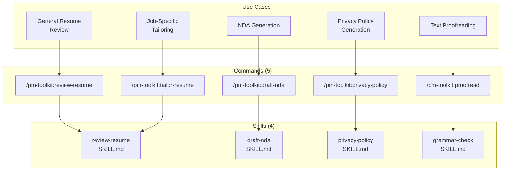
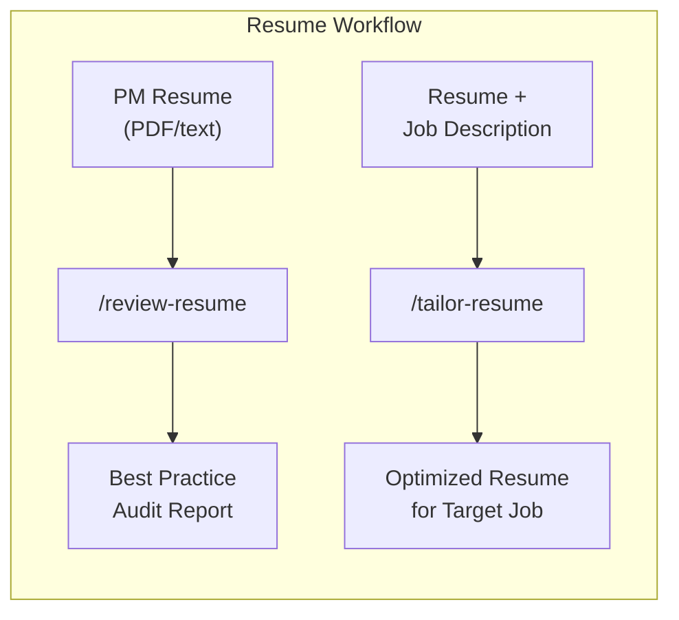
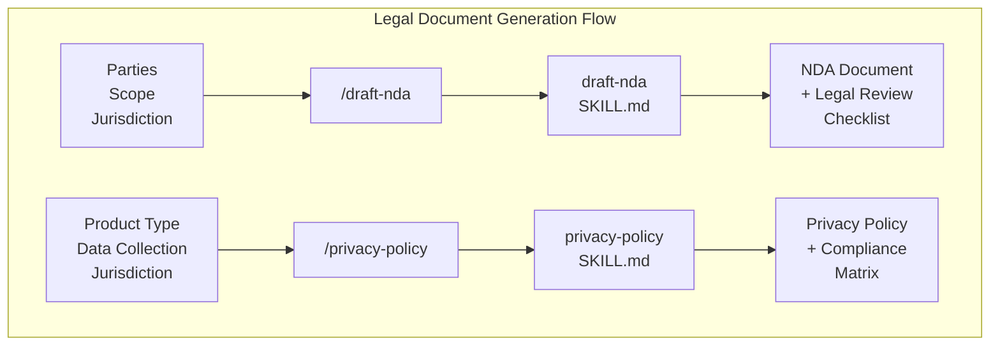
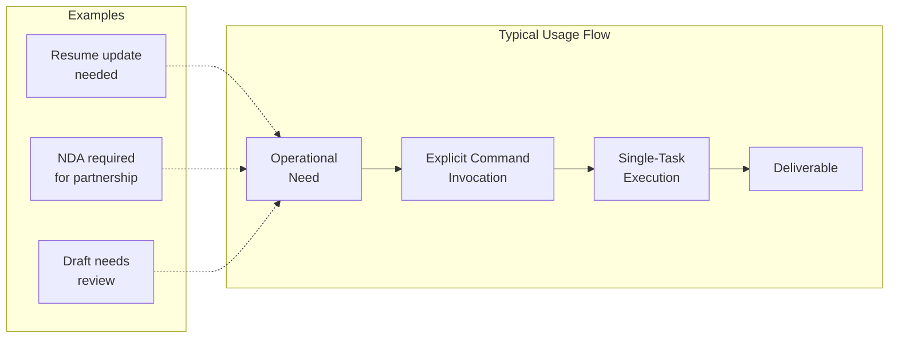

<!-- source: DeepWiki mcp.deepwiki.com · repo phuryn/pm-skills · page 4.8 pm-toolkit · fetched 2026-10-27 -->

# pm-toolkit

<details>
<summary>Relevant source files</summary>

The following files were used as context for generating this wiki page:

- [README.md](README.md)
- [pm-toolkit/README.md](pm-toolkit/README.md)

</details>


## Purpose and Scope

The `pm-toolkit` plugin provides operational utility skills for product managers beyond core product work. It covers four distinct utility areas: resume review and optimization, legal document drafting (NDAs and privacy policies), and text proofreading. This plugin serves as a cross-cutting support layer that complements the product lifecycle plugins.

For core product management workflows, see [pm-product-discovery](#4.1), [pm-product-strategy](#4.2), or [pm-execution](#4.3). For user research and market analysis, see [pm-market-research](#4.4).

**Sources:** [README.md:362-393](), [pm-toolkit/README.md:1-26]()

---

## Plugin Architecture

### Skills-to-Commands Mapping

The `pm-toolkit` plugin implements a 4-skill, 5-command structure where one skill (`review-resume`) powers two distinct command workflows:



**Analysis:** The `review-resume` skill supports both `/review-resume` and `/tailor-resume` commands through different invocation contexts. This pattern demonstrates skill reusability where a single skill template adapts based on command parameters and user input.

**Sources:** [README.md:367-381](), [pm-toolkit/README.md:5-18]()

---

## Skill Inventory

### Resume Skills

| Skill | File Path | Function | Key Features |
|-------|-----------|----------|--------------|
| `review-resume` | `pm-toolkit/skills/review-resume/SKILL.md` | PM resume review and optimization | 10 best practices: XYZ+S formula, keyword optimization, structure validation, action verb usage |

The `review-resume` skill implements a structured evaluation framework:

- **XYZ+S Formula**: Validates that accomplishments follow "Accomplished X by doing Y, resulting in Z, using skills/tools S"
- **Keyword Optimization**: Extracts job-relevant keywords for ATS systems
- **Structure Validation**: Checks section ordering, formatting consistency, and length constraints
- **Job-Specific Tailoring**: Reframes experience to align with target job descriptions when invoked via `/tailor-resume`

**Sources:** [README.md:369](), [pm-toolkit/README.md:10]()

### Legal Document Skills

| Skill | File Path | Function | Compliance Scope |
|-------|-----------|----------|------------------|
| `draft-nda` | `pm-toolkit/skills/draft-nda/SKILL.md` | Non-Disclosure Agreement generation | Jurisdiction-appropriate clauses, bilateral/unilateral options |
| `privacy-policy` | `pm-toolkit/skills/privacy-policy/SKILL.md` | Privacy policy generation | GDPR, CCPA compliance, data lifecycle coverage |

Both legal skills include:

- **Jurisdiction Awareness**: Adapts clauses based on specified legal jurisdiction
- **Compliance Markers**: Flags sections requiring legal review
- **Template Customization**: Adjusts for product type, data collection practices, and regulatory requirements

**Sources:** [README.md:370-371](), [pm-toolkit/README.md:7,9]()

### Proofreading Skills

| Skill | File Path | Function | Scope |
|-------|-----------|----------|-------|
| `grammar-check` | `pm-toolkit/skills/grammar-check/SKILL.md` | Grammar, logic, and flow analysis | Targeted fixes without full rewrites |

The `grammar-check` skill implements a non-invasive correction approach:

- **Error Categorization**: Grammar, logical consistency, flow/coherence issues
- **Targeted Suggestions**: Proposes specific fixes rather than rewriting entire sections
- **Preservation of Voice**: Maintains original writing style and tone

**Sources:** [README.md:372](), [pm-toolkit/README.md:8]()

---

## Command Reference

### Resume Commands



#### `/review-resume`

**Invocation Pattern:**
```
/review-resume [attach resume file]
```

**Output Structure:**
1. Overall assessment (score out of 10)
2. Section-by-section evaluation against 10 best practices
3. Keyword analysis for ATS optimization
4. Structure and formatting recommendations
5. Action item list prioritized by impact

**Sources:** [README.md:376-389](), [pm-toolkit/README.md:17]()

#### `/tailor-resume`

**Invocation Pattern:**
```
/tailor-resume [attach resume] + [paste job description]
```

**Output Structure:**
1. Job requirement extraction and mapping
2. Experience reframing for keyword alignment
3. Skills section optimization
4. Achievement re-prioritization based on job criteria
5. Cover letter talking points

**Sources:** [README.md:377-390](), [pm-toolkit/README.md:18]()

---

### Legal Document Commands



#### `/draft-nda`

**Invocation Pattern:**
```
/draft-nda
```

**Required Input (conversational):**
- Party names and addresses
- NDA type (unilateral vs bilateral)
- Scope of confidential information
- Duration and jurisdiction
- Special provisions (e.g., return of materials, permitted disclosures)

**Output Structure:**
1. Complete NDA document with standard clauses
2. Jurisdiction-specific language adjustments
3. Legal review checklist highlighting custom provisions
4. Signature block formatting

**Sources:** [README.md:378](), [pm-toolkit/README.md:14]()

#### `/privacy-policy`

**Invocation Pattern:**
```
/privacy-policy
```

**Required Input (conversational):**
- Product type and target users
- Data collection types (personal, behavioral, device, etc.)
- Data usage purposes
- Third-party sharing practices
- User rights and controls
- Primary jurisdiction

**Output Structure:**
1. Complete privacy policy document
2. GDPR/CCPA compliance matrix
3. Cookie consent language (if applicable)
4. Data retention schedules
5. Legal review sections flagged

**Sources:** [README.md:379](), [pm-toolkit/README.md:15]()

---

### Proofreading Command

#### `/proofread`

**Invocation Pattern:**
```
/proofread [paste text or attach document]
```

**Analysis Categories:**

| Category | Detection | Suggestion Format |
|----------|-----------|-------------------|
| Grammar | Syntax errors, agreement issues, punctuation | Line-specific corrections |
| Logic | Contradictions, unclear references, incomplete arguments | Clarification prompts |
| Flow | Transition gaps, repetition, paragraph coherence | Restructuring recommendations |

**Output Structure:**
1. Error summary by category (count and severity)
2. Line-by-line correction suggestions
3. Structural flow recommendations
4. Cleaned text with tracked changes (optional)

**Sources:** [README.md:380-391](), [pm-toolkit/README.md:16]()

---

## Usage Patterns

### Standalone Utility Access

Unlike product lifecycle plugins, `pm-toolkit` skills are typically invoked explicitly for discrete utility tasks:



**Pattern Characteristics:**
- **No Chaining**: Commands do not suggest follow-up commands
- **Contextually Independent**: Does not depend on prior product workflow state
- **Immediate Output**: Produces final deliverable without iteration prompts

**Sources:** [README.md:362-393]()

---

### Integration with Core Workflows

While `pm-toolkit` operates independently, it provides operational support at specific workflow stages:

| Core Workflow | Integration Point | Toolkit Command |
|---------------|-------------------|-----------------|
| `/write-prd` → Stakeholder review | Document review before distribution | `/proofread` |
| `/plan-launch` → Partnership outreach | Legal protection for discussions | `/draft-nda` |
| Product launch → User privacy | Regulatory compliance documentation | `/privacy-policy` |
| Job search / hiring | Resume optimization for PM role | `/review-resume` or `/tailor-resume` |

**Sources:** [README.md:362-393]()

---

## File Structure

### Directory Layout

```
pm-toolkit/
├── plugin.json                          # Manifest: 4 skills, 5 commands
├── README.md                            # Plugin overview
├── skills/
│   ├── draft-nda/
│   │   └── SKILL.md                     # NDA generation template
│   ├── grammar-check/
│   │   └── SKILL.md                     # Proofreading logic
│   ├── privacy-policy/
│   │   └── SKILL.md                     # Privacy policy template
│   └── review-resume/
│       └── SKILL.md                     # Resume evaluation framework
└── commands/
    ├── draft-nda.md                     # /draft-nda command
    ├── privacy-policy.md                # /privacy-policy command
    ├── proofread.md                     # /proofread command
    ├── review-resume.md                 # /review-resume command
    └── tailor-resume.md                 # /tailor-resume command
```

**Sources:** [pm-toolkit/README.md:1-26]()

---

## Installation and Access

### Installation Methods

| Method | Command | Result |
|--------|---------|--------|
| **Claude Cowork** | Add marketplace: `phuryn/pm-skills` | All 8 plugins including `pm-toolkit` |
| **Claude Code CLI** | `claude plugin install pm-toolkit@pm-skills` | `pm-toolkit` only |
| **Other AI Tools** | Copy `pm-toolkit/skills/*/SKILL.md` to tool's skills directory | Skills only, no commands |

### Standalone vs Marketplace Installation

The `pm-toolkit` plugin can be installed independently without other plugins, making it suitable for users who only need operational utilities:

```bash
# Install only pm-toolkit
claude plugin marketplace add phuryn/pm-skills
claude plugin install pm-toolkit@pm-skills
```

**Sources:** [README.md:47-94]()

---

## Validation and Quality Assurance

The `pm-toolkit` plugin adheres to the same validation standards as all marketplace plugins. The `validate_plugins.py` script enforces:

**Manifest Validation:**
- `plugin.json` exists at `pm-toolkit/plugin.json`
- Required fields: `name`, `version`, `description`, `author`
- Skill and command references are valid

**Skill Validation:**
- Each `SKILL.md` contains complete frontmatter
- Description length ≥ 30 characters
- Word count between 50-3000 words
- Filename matches skill name

**Command Validation:**
- Frontmatter includes `description` and `argument-hint`
- No cross-plugin skill references
- Valid skill references within `pm-toolkit`

**Sources:** [README.md:446-461]()

---

## Comparison with Other Utility Plugins

Unlike specialized product lifecycle plugins, `pm-toolkit` provides general operational support:

| Plugin | Focus | Integration Pattern |
|--------|-------|---------------------|
| `pm-toolkit` | Operational utilities | Standalone, on-demand |
| `pm-execution` | Product delivery workflows | Chained, iterative |
| `pm-data-analytics` | Product metrics analysis | Data-driven, analytical |
| `pm-market-research` | User insights | Research-driven, informative |

The toolkit's standalone nature makes it suitable for:
- Individual contributors without full marketplace access
- Specific utility needs outside product workflows
- Cross-functional team members (designers, engineers) who need resume or document support

**Sources:** [README.md:98-413]()

---

