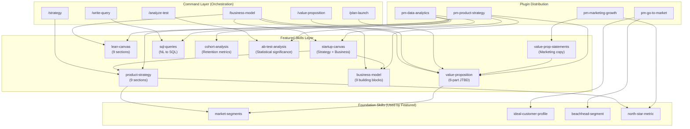
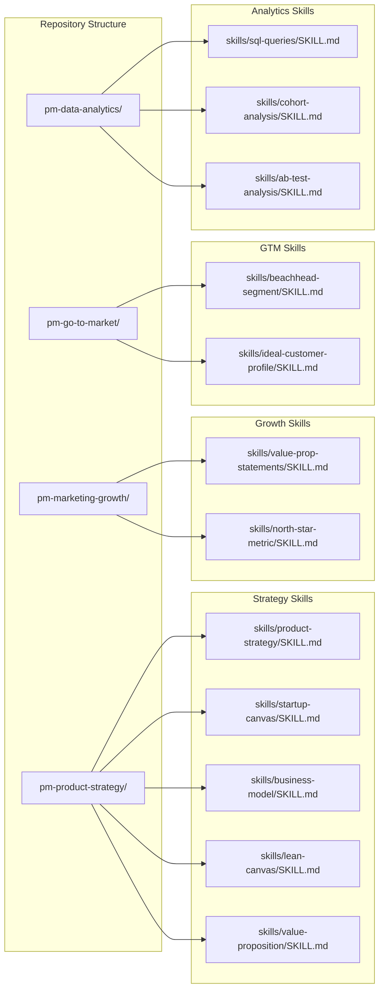
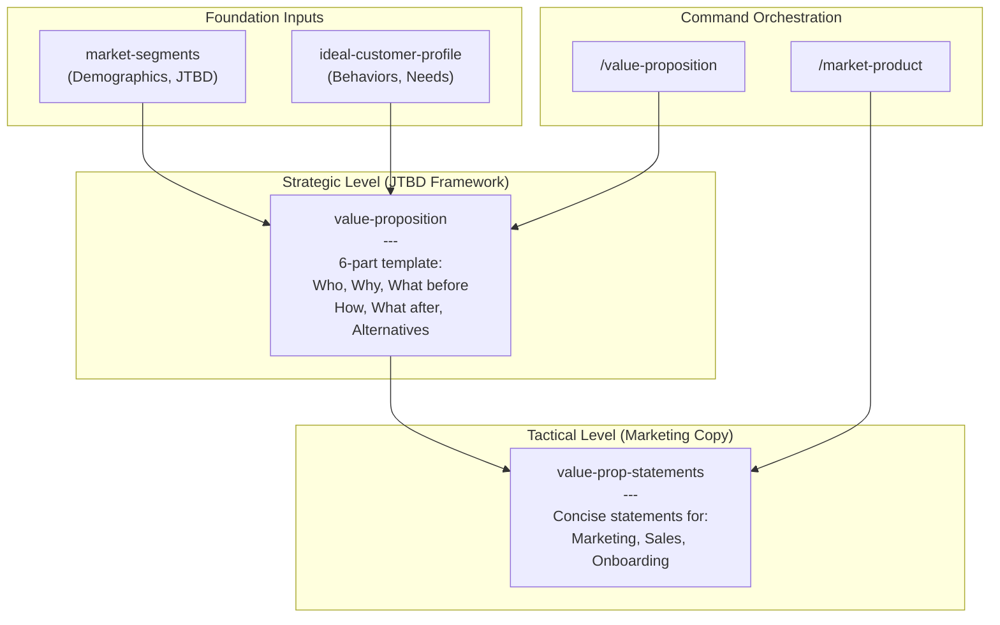
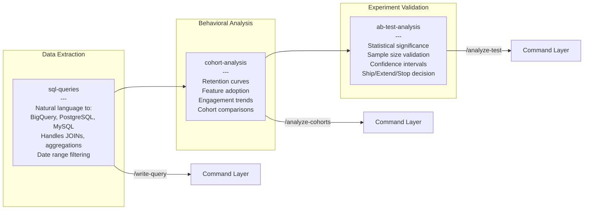
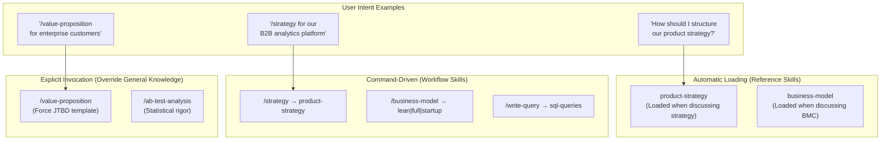

<!-- source: DeepWiki mcp.deepwiki.com · repo phuryn/pm-skills · page 5 Featured Skills · fetched 2026-10-27 -->

# Featured Skills

Relevant source files

The following files were used as context for generating this wiki page:

- [README.md](README.md)

This section provides in-depth documentation for the marketplace's most complex, high-value skills—those that encode complete PM frameworks, multi-step methodologies, or sophisticated analytical techniques. These skills represent the distillation of book-length methodologies into executable AI-guided workflows.

While all 65 skills in the marketplace follow structured templates and provide domain knowledge, featured skills are distinguished by their:
- **Multi-section frameworks**: Complex canvases with 6-9 interconnected sections
- **Sophisticated methodology**: Based on published PM literature requiring step-by-step guidance
- **Decision scaffolding**: Structured templates that prevent incomplete analysis
- **Reusability**: Foundation skills used across multiple commands and contexts

For complete listings of all skills organized by plugin domain, see individual plugin pages [4.1](#4.1) through [4.8](#4.8). For command-driven workflows that orchestrate skills, see [6](#6).

---

## Featured Skill Categories

The featured skills fall into four primary categories, each documented in detail in subsections below:

| Category | Skills | Subsection | Primary Use Case |
|----------|--------|------------|------------------|
| **Business Model Canvases** | `business-model`, `lean-canvas`, `startup-canvas` | [5.1](#5.1) | Strategic business model design and validation |
| **Product Strategy Canvas** | `product-strategy` | [5.2](#5.2) | Comprehensive 9-section strategy definition |
| **Value Proposition Design** | `value-proposition`, `value-prop-statements` | [5.3](#5.3) | JTBD-based value proposition articulation |
| **Data Analytics Skills** | `sql-queries`, `cohort-analysis`, `ab-test-analysis` | [5.4](#5.4) | Quantitative analysis and experimentation |

**Sources**: [README.md:99-413]()

---

## Featured Skills Architecture

The following diagram shows how featured skills relate to commands, plugins, and other skills in the three-tier architecture:

**Analysis**: Featured skills occupy a middle layer in the three-tier architecture. Commands orchestrate them into end-to-end workflows (e.g., `/strategy` invokes `product-strategy`), while featured skills themselves compose foundation skills for specific sections (e.g., `product-strategy` uses `market-segments` and `north-star-metric`). The `startup-canvas` skill demonstrates composition by combining both `product-strategy` and `business-model` into a unified framework.

**Sources**: [README.md:31-45](), [README.md:120-179]()

---

## Skill File Structure Mapping

The following diagram maps featured skills to their physical file locations in the codebase:

**Analysis**: Each featured skill resides in a `SKILL.md` file within its plugin's `skills/` directory. The skill directory name must match the skill identifier (enforced by `validate_plugins.py`). Strategy-related skills are concentrated in `pm-product-strategy/`, while supporting skills are distributed across `pm-go-to-market/`, `pm-marketing-growth/`, and `pm-data-analytics/` based on their primary domain alignment.

**Sources**: [README.md:78-86](), [validate_plugins.py:1-309]()

---

## Canvas Comparison Framework

The three business model canvases serve different use cases and product stages:

| Dimension | Business Model Canvas | Lean Canvas | Startup Canvas |
|-----------|----------------------|-------------|----------------|
| **File Location** | `pm-product-strategy/skills/business-model/` | `pm-product-strategy/skills/lean-canvas/` | `pm-product-strategy/skills/startup-canvas/` |
| **Sections** | 9 (Value Prop, Segments, Channels, Relationships, Revenue, Resources, Activities, Partners, Costs) | 9 (Problem, Solution, Key Metrics, Unique Value, Unfair Advantage, Channels, Segments, Cost, Revenue) | 18 (Strategy 9 + Business 9) |
| **Primary Author** | Strategyzer (Osterwalder) | Ash Maurya | Hybrid framework |
| **Best For** | Established products, business model pivots | Startups, new product validation | Early-stage products needing both strategy and business model |
| **Key Strength** | Comprehensive business architecture | Lean startup assumptions testing | Unified strategy + business view |
| **Command Access** | `/business-model full` | `/business-model lean` | `/business-model startup` |
| **Typical Word Count** | 800-1200 | 600-900 | 1500-2000 |
| **Dependencies** | `market-segments` | `market-segments` | `product-strategy`, `business-model` |

**Sources**: [README.md:145-158]()

---

## Value Proposition Skill Hierarchy

Value proposition skills operate at two levels of abstraction:

**Analysis**: The `value-proposition` skill provides the strategic foundation using the 6-part JTBD template (Who, Why, What before, How, What after, Alternatives). The `value-prop-statements` skill consumes this foundation to generate concise, audience-specific marketing copy. Commands bridge the two: `/value-proposition` creates the strategic JTBD framework, while `/market-product` generates tactical statements for sales and marketing teams.

**Sources**: [README.md:145-179](), [README.md:332-359]()

---

## Data Analytics Skill Stack

The three analytics skills form a quantitative decision-making pipeline:

**Analysis**: Analytics skills follow a data pipeline pattern. `sql-queries` extracts data from databases using natural language specifications. `cohort-analysis` processes this data to identify behavioral patterns across user cohorts. `ab-test-analysis` validates experimental hypotheses with statistical rigor. Each skill exposes both direct invocation (automatic loading when relevant) and command-driven workflows for structured execution.

**Sources**: [README.md:267-294]()

---

## Featured Skill Validation Requirements

Featured skills must pass additional validation checks due to their complexity:

| Validation Check | Standard Skills | Featured Skills | Enforcement Location |
|-----------------|----------------|-----------------|---------------------|
| **Frontmatter complete** | ✓ | ✓ | `validate_plugins.py:89-120` |
| **Description ≥30 chars** | ✓ | ✓ | `validate_plugins.py:121-135` |
| **Word count 50-3000** | ✓ | ✓ | `validate_plugins.py:136-150` |
| **Section count ≥3** | ✗ | ✓ (canvases) | Manual review |
| **Template completeness** | ✗ | ✓ (9 sections for canvases) | Manual review |
| **Cross-references valid** | ✓ | ✓ | `validate_plugins.py:151-175` |
| **Framework attribution** | ✗ | ✓ (Must cite source) | `CONTRIBUTING.md:15-20` |

**Analysis**: Featured skills undergo the same automated validation as all skills (`validate_plugins.py`) but require additional manual review for template completeness and framework attribution. Canvas skills must implement all sections (e.g., all 9 Business Model Canvas blocks), and must credit the original framework authors (Strategyzer, Ash Maurya, etc.) in their frontmatter or documentation.

**Sources**: [validate_plugins.py:89-175](), [CONTRIBUTING.md:1-28]()

---

## Usage Patterns by Skill Type

Different featured skills support distinct access patterns:

**Analysis**: Featured skills support all three access patterns from Diagram 4 in the high-level architecture. Reference skills like `product-strategy` and `business-model` are automatically loaded when Claude detects strategic discussions. Workflow skills are invoked via commands (`/strategy`, `/business-model`) for structured execution. Explicit invocation (`/skill-name`) forces Claude to use the specific framework, overriding general knowledge—critical when precise methodology matters (e.g., statistical A/B test analysis vs. Claude's general understanding).

**Sources**: [README.md:31-45]()

---

## Framework Attribution and Lineage

Featured skills encode methodologies from published PM literature:

| Skill | Framework Author | Source Publication | Codification Approach |
|-------|-----------------|-------------------|----------------------|
| `product-strategy` | Roger L. Martin | *Playing to Win* | 9-section canvas extraction |
| `lean-canvas` | Ash Maurya | *Running Lean* | Direct template implementation |
| `business-model` | Strategyzer (Osterwalder) | *Business Model Generation* | 9 building blocks structure |
| `value-proposition` | Strategyzer + Ulwick | *Value Proposition Design* + *Jobs to Be Done* | Hybrid 6-part JTBD template |
| `opportunity-solution-tree` | Teresa Torres | *Continuous Discovery Habits* | Outcome → Opportunity → Solution → Experiment hierarchy |
| `cohort-analysis` | Croll & Yoskovitz | *Lean Analytics* | Retention metrics framework |
| `ab-test-analysis` | Statistical canon | Multiple sources | Sample size, significance, confidence intervals |

**Analysis**: Each featured skill represents a "knowledge translation" process: book-length methodologies are distilled into structured templates with step-by-step AI guidance. The `value-proposition` skill demonstrates hybrid codification, combining Strategyzer's visual design thinking with Ulwick's JTBD rigor. Attribution is maintained in skill frontmatter and the marketplace README.

**Sources**: [README.md:401-415]()

---

## Subsection Navigation

For detailed documentation of each featured skill category:

- **[5.1 Business Model Canvases](#5.1)**: Deep dive into `business-model`, `lean-canvas`, and `startup-canvas` with section-by-section breakdowns and decision criteria
- **[5.2 Product Strategy Canvas](#5.2)**: Complete guide to the 9-section `product-strategy` skill covering vision, segments, costs, value props, trade-offs, metrics, growth, capabilities, and defensibility
- **[5.3 Value Proposition Design](#5.3)**: Detailed explanation of the 6-part JTBD template and how `value-proposition` and `value-prop-statements` work together
- **[5.4 Data Analytics Skills](#5.4)**: Technical documentation for `sql-queries`, `cohort-analysis`, and `ab-test-analysis` including SQL dialect support and statistical methods

**Sources**: [README.md:99-413]()

---

