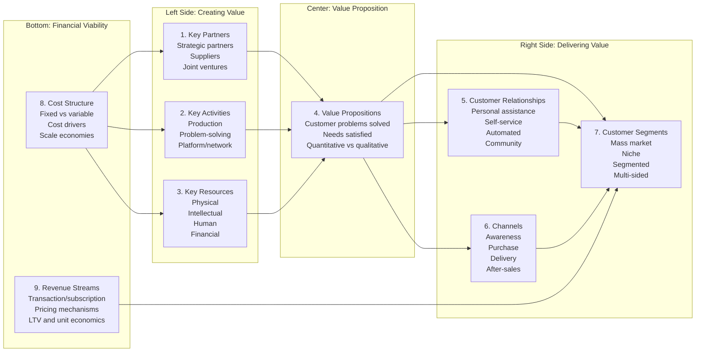
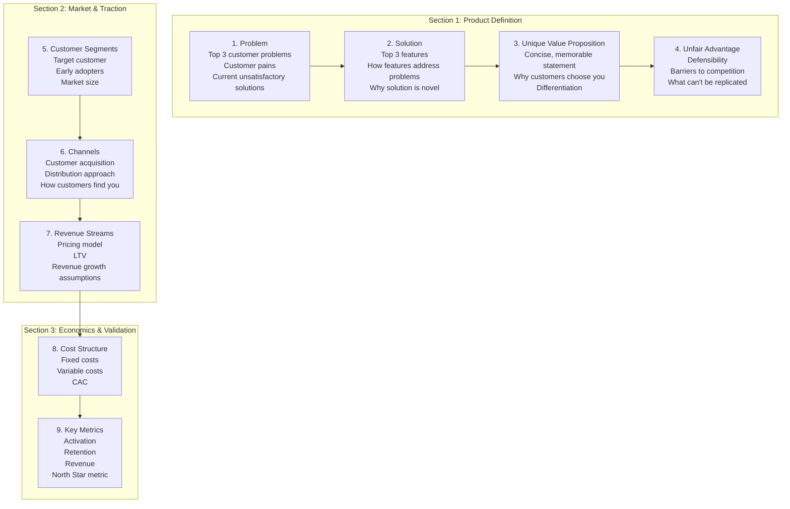
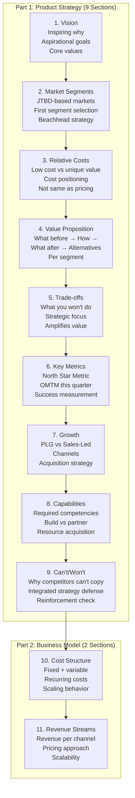
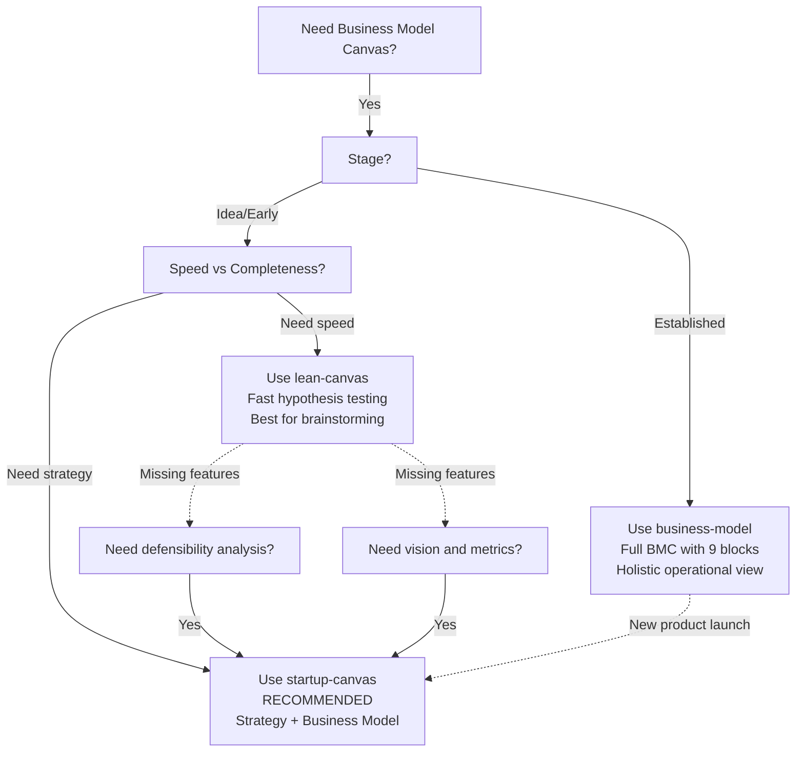
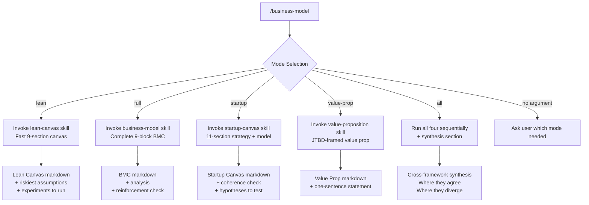
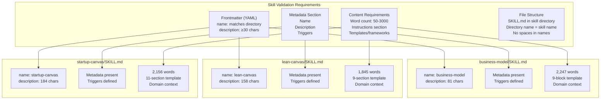
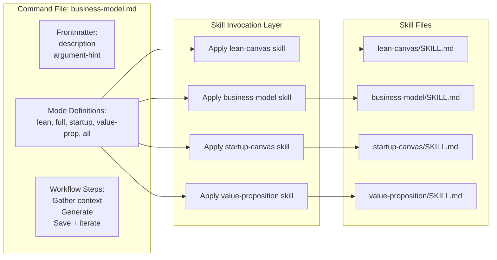

<!-- source: DeepWiki mcp.deepwiki.com · repo phuryn/pm-skills · page 5.1 Business Model Canvases · fetched 2026-10-27 -->

# Business Model Canvases

<details>
<summary>Relevant source files</summary>

The following files were used as context for generating this wiki page:

- [pm-product-strategy/commands/business-model.md](pm-product-strategy/commands/business-model.md)
- [pm-product-strategy/skills/business-model/SKILL.md](pm-product-strategy/skills/business-model/SKILL.md)
- [pm-product-strategy/skills/lean-canvas/SKILL.md](pm-product-strategy/skills/lean-canvas/SKILL.md)
- [pm-product-strategy/skills/startup-canvas/SKILL.md](pm-product-strategy/skills/startup-canvas/SKILL.md)

</details>


## Purpose and Scope

This page documents the three business model canvas frameworks available in the `pm-product-strategy` plugin: **Business Model Canvas**, **Lean Canvas**, and **Startup Canvas**. Each framework is implemented as an individual skill (`business-model`, `lean-canvas`, `startup-canvas`) and can be invoked directly or through the orchestrating `/business-model` command.

This page provides technical documentation of each skill's structure, compares their design philosophies and use cases, and explains the command-based orchestration layer. For broader product strategy skills including competitive analysis and pricing, see [Product Strategy Plugin](#4.2). For value proposition design specifically, see [Value Proposition Design](#5.3).

**Sources:** [pm-product-strategy/skills/business-model/SKILL.md:1-134](), [pm-product-strategy/skills/lean-canvas/SKILL.md:1-122](), [pm-product-strategy/skills/startup-canvas/SKILL.md:1-139](), [pm-product-strategy/commands/business-model.md:1-184]()

---

## Three Canvas Frameworks: Architectural Overview

### Framework Comparison Matrix

The marketplace provides three distinct approaches to business model design, each optimized for different contexts:

| Framework | Skill Name | Sections | Primary Use Case | Key Differentiator |
|-----------|-----------|----------|------------------|-------------------|
| **Business Model Canvas** | `business-model` | 9 building blocks | Established businesses, corporate strategy, investor materials | Holistic operational view; maps how value flows through organization |
| **Lean Canvas** | `lean-canvas` | 9 sections (problem-focused) | Rapid hypothesis testing, early-stage startups | Speed over completeness; startup-focused adaptations |
| **Startup Canvas** | `startup-canvas` | 11 sections (strategy + business model) | New products requiring strategic clarity | Separates strategy (9 sections) from business model (2 sections) |

**Sources:** [pm-product-strategy/skills/business-model/SKILL.md:105-119](), [pm-product-strategy/skills/lean-canvas/SKILL.md:96-109](), [pm-product-strategy/skills/startup-canvas/SKILL.md:12-35]()

---

### Skill Structure Diagram

All three canvas skills share a common structural pattern defined by the skill specification format:

```mermaid
graph TB
    subgraph "Skill File Structure"
        FM["Frontmatter (YAML)"]
        MD["Metadata Section"]
        DC["Domain Context"]
        INSTR["Instructions"]
        INPUT["Input Requirements"]
        TMPL["Canvas Template"]
        PROC["Output Process"]
        NOTES["Notes"]
        REFS["Further Reading"]
    end
    
    subgraph "business-model.SKILL.md"
        BM_FM["name: business-model<br/>description: Generate BMC with 9 blocks"]
        BM_TMPL["9 Building Blocks:<br/>Key Partners<br/>Key Activities<br/>Key Resources<br/>Value Propositions<br/>Customer Relationships<br/>Channels<br/>Customer Segments<br/>Cost Structure<br/>Revenue Streams"]
        BM_CTX["Domain Context:<br/>BMC vs Lean vs Startup<br/>When to use BMC"]
    end
    
    subgraph "lean-canvas.SKILL.md"
        LC_FM["name: lean-canvas<br/>description: Generate Lean Canvas"]
        LC_TMPL["9 Sections:<br/>Problem<br/>Solution<br/>UVP<br/>Unfair Advantage<br/>Customer Segments<br/>Channels<br/>Revenue Streams<br/>Cost Structure<br/>Key Metrics"]
        LC_CTX["Domain Context:<br/>Lean vs BMC vs Startup<br/>Known limitations"]
    end
    
    subgraph "startup-canvas.SKILL.md"
        SC_FM["name: startup-canvas<br/>description: Strategy + Business Model"]
        SC_TMPL["Part 1: Strategy (9 sections)<br/>Vision, Segments, Costs, Value Prop,<br/>Trade-offs, Metrics, Growth,<br/>Capabilities, Can't/Won't<br/>Part 2: Business Model<br/>Cost Structure + Revenue Streams"]
        SC_CTX["Domain Context:<br/>Why not BMC? Why not Lean?<br/>Separation of concerns"]
    end
    
    FM --> BM_FM
    FM --> LC_FM
    FM --> SC_FM
    
    TMPL --> BM_TMPL
    TMPL --> LC_TMPL
    TMPL --> SC_TMPL
    
    DC --> BM_CTX
    DC --> LC_CTX
    DC --> SC_CTX
```



**Sources:** [pm-product-strategy/skills/business-model/SKILL.md:1-10](), [pm-product-strategy/skills/lean-canvas/SKILL.md:1-11](), [pm-product-strategy/skills/startup-canvas/SKILL.md:1-11]()

---

## Business Model Canvas (`business-model`)

### Overview

The `business-model` skill implements Alexander Osterwalder's Business Model Canvas (BMC), the most widely adopted business model framework. It provides a balanced, holistic view of how value flows through an organization across 9 interconnected building blocks.

**Skill Location:** [pm-product-strategy/skills/business-model/SKILL.md]()  
**Frontmatter:** [pm-product-strategy/skills/business-model/SKILL.md:1-4]()  
**Triggers:** `business model canvas`, `BMC`, `business model`, `how we make money`

**Sources:** [pm-product-strategy/skills/business-model/SKILL.md:1-15]()

---

### Nine Building Blocks Structure

The BMC organizes business model elements into three logical groups:



**Template Structure:** [pm-product-strategy/skills/business-model/SKILL.md:24-90]()  
**Output Process:** [pm-product-strategy/skills/business-model/SKILL.md:91-101]()

**Sources:** [pm-product-strategy/skills/business-model/SKILL.md:24-101]()

---

### Known Limitations for Product Strategy

The skill documentation explicitly identifies five limitations when using BMC for product strategy work:

| Limitation | Description | Impact |
|-----------|-------------|---------|
| **No Vision** | Doesn't address why the team should wake up every day | Lacks motivational/aspirational component |
| **No Can't/Won't Test** | No defensibility analysis beyond listing resources | Doesn't evaluate competitive moats |
| **No Trade-offs** | Doesn't capture what you choose NOT to do | Misses strategic focus decisions |
| **No Key Metrics** | No measurement framework | Can't track if strategy is working |
| **Low-value Sections** | Key Partnerships and Key Resources rarely useful for early-stage | Not optimized for startups |

**Domain Context Section:** [pm-product-strategy/skills/business-model/SKILL.md:103-120]()

**Sources:** [pm-product-strategy/skills/business-model/SKILL.md:103-127]()

---

### When to Use BMC

The skill provides explicit usage guidance:

**Recommended For:**
- Established businesses
- Corporate strategy documentation
- Investor materials requiring operational detail
- Situations where you need to articulate how all pieces connect

**Consider Alternatives When:**
- Building a new product (use `startup-canvas`)
- Need rapid hypothesis testing (use `lean-canvas`)
- Require strategic clarity beyond operational model (use `startup-canvas`)

**Usage Guidance:** [pm-product-strategy/skills/business-model/SKILL.md:115-119]()

**Sources:** [pm-product-strategy/skills/business-model/SKILL.md:115-127]()

---

## Lean Canvas (`lean-canvas`)

### Overview

The `lean-canvas` skill implements Ash Maurya's Lean Canvas, a startup-focused adaptation of the Business Model Canvas. It replaces Partners/Activities/Resources with Problem/Solution/Unfair Advantage to optimize for rapid hypothesis testing.

**Skill Location:** [pm-product-strategy/skills/lean-canvas/SKILL.md]()  
**Frontmatter:** [pm-product-strategy/skills/lean-canvas/SKILL.md:1-4]()  
**Triggers:** `lean canvas`, `startup canvas`, `lean model`, `business hypothesis`

**Sources:** [pm-product-strategy/skills/lean-canvas/SKILL.md:1-15]()

---

### Nine Sections Structure

Lean Canvas reorganizes the BMC sections with startup-specific focuses:



**Template Structure:** [pm-product-strategy/skills/lean-canvas/SKILL.md:24-81]()  
**Output Process:** [pm-product-strategy/skills/lean-canvas/SKILL.md:82-93]()

**Sources:** [pm-product-strategy/skills/lean-canvas/SKILL.md:24-93]()

---

### Known Limitations

The skill documentation identifies four limitations of Lean Canvas:

| Limitation | Description | Architectural Issue |
|-----------|-------------|-------------------|
| **Redundancy** | "Problem" overlaps with Market Segments; "Solution" overlaps with Value Proposition | Creates confusion about section boundaries |
| **Missing Strategic Sections** | No vision, no trade-offs, no relative costs positioning | Incomplete strategic framework |
| **Narrow Defensibility** | "Unfair Advantage" focuses on single element | Strong strategy requires integrated choices, not one advantage |
| **No Coherence Check** | Doesn't validate if strategic choices reinforce each other | Misses system-level validation |

**Domain Context Section:** [pm-product-strategy/skills/lean-canvas/SKILL.md:95-109]()

**Sources:** [pm-product-strategy/skills/lean-canvas/SKILL.md:95-116]()

---

### When to Use Lean Canvas

**Recommended For:**
- Quick hypothesis testing when speed is critical
- Early-stage brainstorming
- Validating riskiest assumptions rapidly

**Best Used As:** A brainstorming tool, not a strategy document

**Consider Instead:** `startup-canvas` when you need both strategic clarity AND a business model for a new product

**Usage Guidance:** [pm-product-strategy/skills/lean-canvas/SKILL.md:106-108]()

**Sources:** [pm-product-strategy/skills/lean-canvas/SKILL.md:106-116]()

---

## Startup Canvas (`startup-canvas`)

### Overview

The `startup-canvas` skill implements Paweł Huryn's Startup Canvas, which **separates strategy from business model**. It combines the 9-section Product Strategy Canvas with a 2-section Business Model (Cost Structure + Revenue Streams).

**Skill Location:** [pm-product-strategy/skills/startup-canvas/SKILL.md]()  
**Frontmatter:** [pm-product-strategy/skills/startup-canvas/SKILL.md:1-4]()  
**Triggers:** `startup canvas`, `new product canvas`, `startup strategy`, `startup business model`

**Sources:** [pm-product-strategy/skills/startup-canvas/SKILL.md:1-15]()

---

### Eleven Sections: Strategy + Business Model

The Startup Canvas explicitly separates strategic decisions from business model mechanics:



**Template Structure:** [pm-product-strategy/skills/startup-canvas/SKILL.md:48-103]()  
**Output Process:** [pm-product-strategy/skills/startup-canvas/SKILL.md:104-118]()

**Sources:** [pm-product-strategy/skills/startup-canvas/SKILL.md:48-118]()

---

### Design Philosophy: Separation of Concerns

The Domain Context section explains the architectural decision to separate strategy from business model:

**Why BMC Mixes Concerns:**
- BMC combines strategic choices (value proposition, segments) with operational mechanics (partners, activities, resources)
- No clear boundary between "what we choose to do" vs "how we execute it"

**Why Lean Canvas Mixes Concerns:**
- "Problem" is a market definition (strategic) mixed with "Solution" (product feature)
- Strategic elements (UVP, Unfair Advantage) mixed with business model (Cost, Revenue)

**Startup Canvas Separation:**
- **Part 1 (Strategy):** Vision, segments, positioning, value props, trade-offs, metrics, growth, capabilities, defensibility
- **Part 2 (Business Model):** Cost structure and revenue streams only

**Domain Context Section:** [pm-product-strategy/skills/startup-canvas/SKILL.md:12-35]()

**Sources:** [pm-product-strategy/skills/startup-canvas/SKILL.md:12-35]()

---

### When to Use Startup Canvas

**Recommended For:**
- New products requiring both strategic clarity AND a business model
- Startups in strategy definition phase
- Situations where you need to test the Can't/Won't defensibility

**Explicit Recommendation:** The skill documentation states this is "the recommended approach" for new products.

**Trade-off Analysis:** Startup Canvas provides more structure than Lean Canvas but requires more upfront thinking than BMC. It's optimized for startups that need strategic rigor without established business operational complexity.

**Usage Guidance:** [pm-product-strategy/skills/startup-canvas/SKILL.md:30-35]()

**Sources:** [pm-product-strategy/skills/startup-canvas/SKILL.md:30-35](), [pm-product-strategy/skills/startup-canvas/SKILL.md:119-123]()

---

## Framework Comparison and Selection

### Decision Matrix



**Sources:** [pm-product-strategy/skills/business-model/SKILL.md:115-119](), [pm-product-strategy/skills/lean-canvas/SKILL.md:106-108](), [pm-product-strategy/skills/startup-canvas/SKILL.md:30-35](), [pm-product-strategy/commands/business-model.md:177-183]()

---

### Comparative Analysis Table

| Criterion | Business Model Canvas | Lean Canvas | Startup Canvas |
|-----------|---------------------|-------------|----------------|
| **Primary Author** | Alexander Osterwalder (Strategyzer) | Ash Maurya | Paweł Huryn |
| **Section Count** | 9 building blocks | 9 sections | 11 sections (9 strategy + 2 business) |
| **Best For** | Established businesses | Speed and hypothesis testing | New products needing strategy clarity |
| **Vision Statement** | ❌ Missing | ❌ Missing | ✅ Section 1 |
| **Trade-offs** | ❌ Missing | ❌ Missing | ✅ Section 5 |
| **Defensibility** | Resources only | Unfair Advantage (narrow) | ✅ Can't/Won't (integrated) |
| **Key Metrics** | ❌ Missing | ✅ Included | ✅ Section 6 (North Star + OMTM) |
| **Complexity** | Medium | Low | High |
| **Time to Complete** | 60-90 min | 20-30 min | 90-120 min |
| **Strategic Clarity** | Low | Medium | High |
| **Operational Detail** | High | Medium | Low |

**Sources:** [pm-product-strategy/skills/business-model/SKILL.md:105-119](), [pm-product-strategy/skills/lean-canvas/SKILL.md:96-109](), [pm-product-strategy/skills/startup-canvas/SKILL.md:12-35]()

---

## Command Orchestration (`/business-model`)

### Command Overview

The `/business-model` command provides a unified interface to all three canvas frameworks plus value proposition design. It supports five modes: `lean`, `full`, `startup`, `value-prop`, and `all`.

**Command Location:** [pm-product-strategy/commands/business-model.md]()  
**Argument Hint:** `[lean|full|startup|value-prop] <product or business>`

**Sources:** [pm-product-strategy/commands/business-model.md:1-19]()

---

### Command Mode Routing



**Mode Definitions:** [pm-product-strategy/commands/business-model.md:21-154]()

**Sources:** [pm-product-strategy/commands/business-model.md:1-184]()

---

### Invocation Examples

The command supports flexible invocation patterns:

```bash
# Lean Canvas mode
/business-model lean Marketplace connecting freelance PMs with startups

# Full BMC mode
/business-model full Enterprise analytics platform

# Startup Canvas mode (recommended for new products)
/business-model startup AI writing tool for non-native English speakers

# Value Proposition only
/business-model value-prop SaaS onboarding tool

# All frameworks with synthesis
/business-model all SaaS onboarding tool

# Interactive mode
/business-model
```

**Invocation Patterns:** [pm-product-strategy/commands/business-model.md:10-19]()

**Sources:** [pm-product-strategy/commands/business-model.md:10-19]()

---

### Workflow Pattern

All modes follow a consistent three-step workflow:

**Step 1: Gather Context** [pm-product-strategy/commands/business-model.md:157-164]()
- Product or business idea
- Stage (idea, validated, scaling)
- Existing business model to refine (if any)
- Target customer

**Step 2: Generate Framework(s)** [pm-product-strategy/commands/business-model.md:166-167]()
- Apply relevant skill(s) based on mode
- Generate markdown output following skill templates

**Step 3: Save and Iterate** [pm-product-strategy/commands/business-model.md:169-176]()
- Save as markdown file
- Offer follow-up actions:
  - Stress-test with SWOT/PESTLE analysis
  - Design pricing strategy for revenue streams
  - Build strategy canvas around model
  - Identify beachhead segment

**Sources:** [pm-product-strategy/commands/business-model.md:155-176]()

---

## Implementation Architecture

### Skill File Structure

All three canvas skills follow the validated plugin structure enforced by `validate_plugins.py`:



**Validation Script:** `validate_plugins.py`  
**Frontmatter Validation:** Checks name, description length, YAML structure  
**Content Validation:** Word count range, required sections, file naming

**Sources:** [pm-product-strategy/skills/business-model/SKILL.md:1-10](), [pm-product-strategy/skills/lean-canvas/SKILL.md:1-11](), [pm-product-strategy/skills/startup-canvas/SKILL.md:1-11]()

---

### Domain Context Pattern

All three skills implement a **Domain Context** section that provides comparative analysis and usage guidance. This pattern follows the knowledge codification principle documented in [Framework Knowledge Base](#3.3).

**Pattern Structure:**
1. **Framework Name and Origin** - Who created it, what book/methodology
2. **Comparative Analysis** - How it differs from the other two canvases
3. **Known Limitations** - Explicit weaknesses for specific use cases
4. **When to Use** - Decision criteria and recommendations
5. **Alternatives** - When to consider other frameworks

**Implementation Examples:**
- Business Model Canvas: [pm-product-strategy/skills/business-model/SKILL.md:103-127]()
- Lean Canvas: [pm-product-strategy/skills/lean-canvas/SKILL.md:95-116]()
- Startup Canvas: [pm-product-strategy/skills/startup-canvas/SKILL.md:12-35]()

**Sources:** [pm-product-strategy/skills/business-model/SKILL.md:103-127](), [pm-product-strategy/skills/lean-canvas/SKILL.md:95-116](), [pm-product-strategy/skills/startup-canvas/SKILL.md:12-35]()

---

### Command Integration

The `/business-model` command demonstrates the **command orchestration pattern** by routing to different skills based on mode selection:



**Command-Skill Relationship:**
- Commands are **orchestrators** that chain skills
- Skills are **atomic units** that can be invoked independently
- Commands add workflow logic (context gathering, follow-up suggestions)
- Skills provide template structure and domain knowledge

**Sources:** [pm-product-strategy/commands/business-model.md:1-184]()

---

### Attribution and Further Reading

Each skill includes attribution to the framework's creator and links to detailed articles:

| Skill | Framework Creator | Further Reading |
|-------|------------------|----------------|
| `business-model` | Alexander Osterwalder (Strategyzer) | [Business Model Canvas Examples: Google Maps, Airbnb, Uber](https://www.productcompass.pm/p/business-model-canvas-examples) |
| `lean-canvas` | Ash Maurya | [Startup Canvas: Product Strategy and a Business Model for a New Product](https://www.productcompass.pm/p/startup-canvas) |
| `startup-canvas` | Paweł Huryn | [Startup Canvas](https://www.productcompass.pm/p/startup-canvas), [Product Strategy Canvas](https://www.productcompass.pm/p/product-strategy-canvas), [Value Proposition Design](https://www.productcompass.pm/p/how-to-design-value-proposition-template) |

**Attribution Sections:**
- Business Model Canvas: [pm-product-strategy/skills/business-model/SKILL.md:130-133]()
- Lean Canvas: [pm-product-strategy/skills/lean-canvas/SKILL.md:119-122]()
- Startup Canvas: [pm-product-strategy/skills/startup-canvas/SKILL.md:133-139]()

**Sources:** [pm-product-strategy/skills/business-model/SKILL.md:130-133](), [pm-product-strategy/skills/lean-canvas/SKILL.md:119-122](), [pm-product-strategy/skills/startup-canvas/SKILL.md:127-139]()

---

