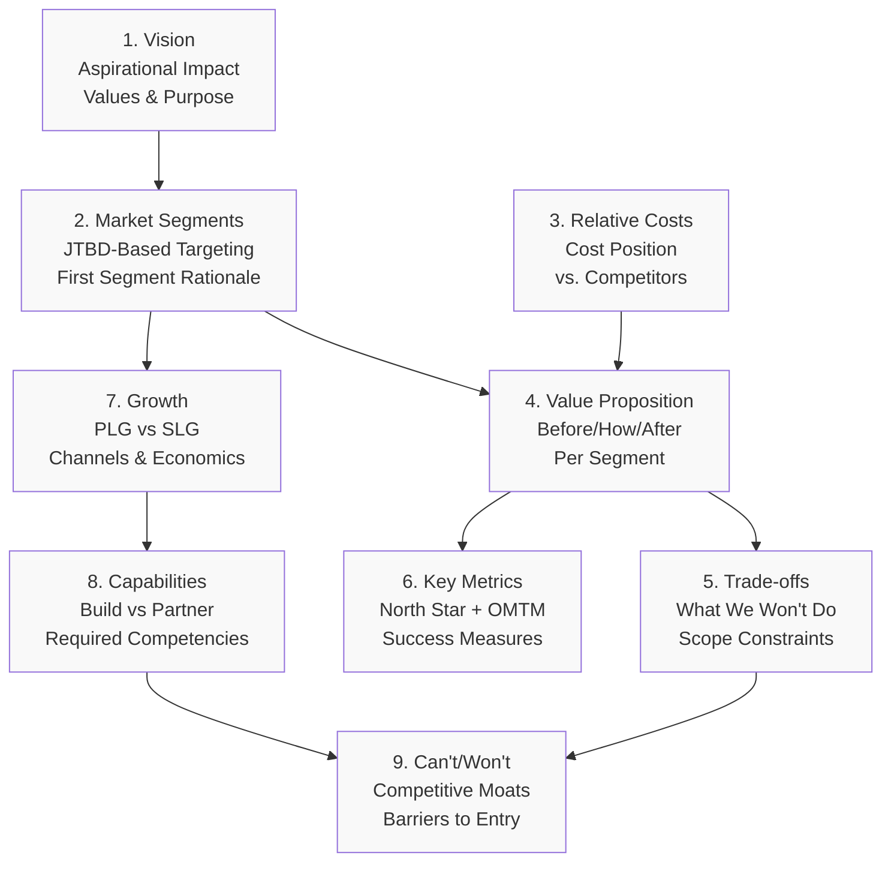
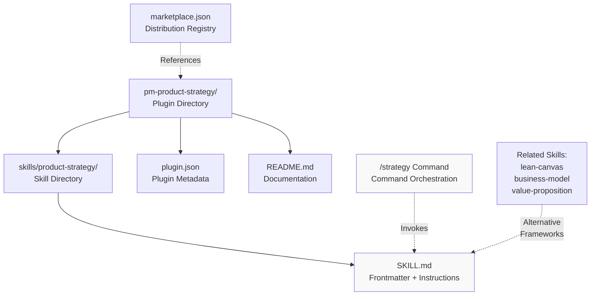
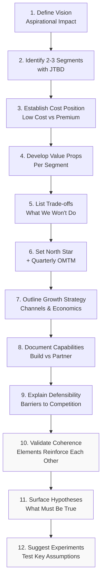
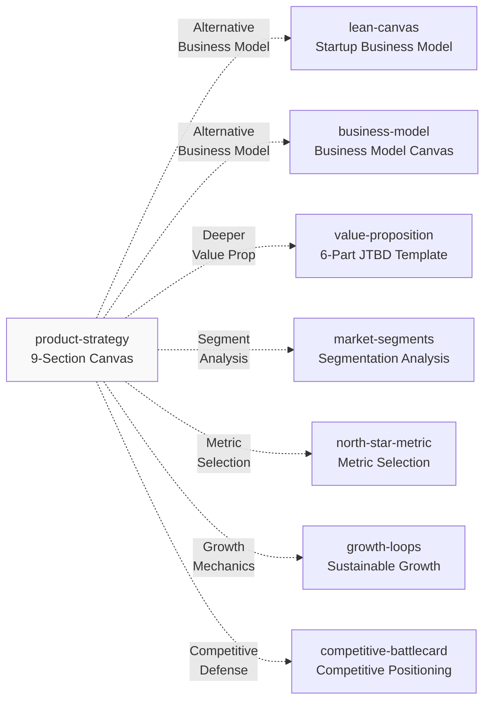

<!-- source: DeepWiki mcp.deepwiki.com · repo phuryn/pm-skills · page 5.2 Product Strategy Canvas · fetched 2026-10-27 -->

# Product Strategy Canvas

<details>
<summary>Relevant source files</summary>

The following files were used as context for generating this wiki page:

- [README.md](README.md)
- [pm-product-strategy/skills/product-strategy/SKILL.md](pm-product-strategy/skills/product-strategy/SKILL.md)

</details>


## Purpose and Scope

The Product Strategy Canvas is a comprehensive 9-section strategic planning framework implemented as the `product-strategy` skill within the `pm-product-strategy` plugin. It guides users through creating a complete product strategy covering vision, market positioning, value delivery, and competitive defensibility.

This page documents the canvas structure, implementation details, and how it integrates with the broader marketplace. For business model frameworks (Lean Canvas, Business Model Canvas), see [Business Model Canvases](#5.1). For value proposition design specifically, see [Value Proposition Design](#5.3).

**Sources:** [README.md:141-179](), [pm-product-strategy/skills/product-strategy/SKILL.md:1-112]()

---

## Nine-Section Framework Architecture

The Product Strategy Canvas consists of nine interconnected sections that form a coherent strategic narrative. Each section addresses a specific strategic question and constrains subsequent decisions.

### Framework Structure Diagram



The framework enforces strategic coherence through dependencies: vision informs segment selection, segments and costs determine value propositions, value propositions drive metrics and growth strategies, which require specific capabilities that create defensibility.

**Sources:** [pm-product-strategy/skills/product-strategy/SKILL.md:24-73]()

---

## Code Implementation Structure

### File System Layout



**Key Implementation Files:**

| File Path | Purpose |
|-----------|---------|
| `pm-product-strategy/skills/product-strategy/SKILL.md` | Canvas template, instructions, and frontmatter metadata |
| `pm-product-strategy/plugin.json` | Plugin manifest declaring the `product-strategy` skill |
| `marketplace.json` | Registry entry pointing to the plugin repository |

**Sources:** [pm-product-strategy/skills/product-strategy/SKILL.md:1-112](), [README.md:141-179]()

---

## Frontmatter Metadata

The skill is defined through YAML frontmatter in [pm-product-strategy/skills/product-strategy/SKILL.md:1-4]():

```yaml
---
name: product-strategy
description: "Create a comprehensive product strategy using the 9-section Product Strategy Canvas — vision, segments, costs, value propositions, trade-offs, metrics, growth, capabilities, and defensibility. Use when building a product strategy, creating a strategic plan, or defining product direction."
---
```

| Field | Value | Purpose |
|-------|-------|---------|
| `name` | `product-strategy` | Skill identifier for invocation and validation |
| `description` | Canvas overview | Triggers for automatic skill loading by Claude |

The description contains keywords (`product strategy`, `strategy canvas`, `strategic plan`) that enable Claude's inference engine to load this skill contextually when users discuss strategic planning.

**Sources:** [pm-product-strategy/skills/product-strategy/SKILL.md:1-4]()

---

## Canvas Sections: Detailed Specification

### Section 1: Vision

**Template Questions:**
- How can we inspire people?
- What are we aspiring to achieve?
- What values do we uphold?

**Implementation:** [pm-product-strategy/skills/product-strategy/SKILL.md:26-29]()

Vision establishes the aspirational frame. It answers "why does this matter?" before defining "what" or "how."

---

### Section 2: Market Segments

**Template Questions:**
- Market defined by people's problems (not demographics)
- Jobs to Be Done (JTBD), desired outcomes, constraints
- Who is our first segment?
- Why this segment first?

**Implementation:** [pm-product-strategy/skills/product-strategy/SKILL.md:31-35]()

Segments are defined by problems (JTBD) rather than demographics. The framework requires explicit rationale for prioritizing the first beachhead segment.

---

### Section 3: Relative Costs

**Template Questions:**
- Do we optimize for low cost (like Southwest Airlines)?
- Or do we emphasize unique value (like Starbucks)?
- What's our cost position relative to competitors?

**Implementation:** [pm-product-strategy/skills/product-strategy/SKILL.md:37-40]()

Binary positioning choice: cost leadership vs. differentiation. This constrains value proposition design and pricing strategy.

---

### Section 4: Value Proposition

**Template Structure (per segment):**
- **What before**: The customer's current situation, pain, or need
- **How**: How your product delivers the solution
- **What after**: The improved outcome or future state
- **Alternatives**: What customers use today instead

**Implementation:** [pm-product-strategy/skills/product-strategy/SKILL.md:42-47]()

Uses a JTBD-based value proposition format. Each target segment receives a distinct value proposition. This structure differs from the standalone `value-proposition` skill ([Value Proposition Design](#5.3)), which provides a 6-part template.

---

### Section 5: Trade-offs

**Template Questions:**
- What will we NOT do?
- What features or markets are out of scope?
- How does saying "no" create focus and amplify our value?

**Implementation:** [pm-product-strategy/skills/product-strategy/SKILL.md:49-52]()

Explicit negative scope. Saying "no" creates differentiation and prevents resource dilution.

---

### Section 6: Key Metrics

**Template Structure:**
- **North Star Metric**: Single metric that drives overall business success
- **OMTM (One Metric That Matters)**: The one metric we optimize for this quarter

**Implementation:** [pm-product-strategy/skills/product-strategy/SKILL.md:54-56]()

Distinguishes between long-term success metric (North Star) and short-term optimization target (OMTM). The `north-star-metric` skill in `pm-marketing-growth` provides deeper guidance on metric selection.

---

### Section 7: Growth

**Template Questions:**
- Sales-Led Growth or Product-Led Growth?
- Primary acquisition channels
- How do we scale?
- What's our unit economics?

**Implementation:** [pm-product-strategy/skills/product-strategy/SKILL.md:58-62]()

Defines the growth motion and channel strategy. Links to GTM strategy skills in `pm-go-to-market` plugin for detailed go-to-market planning.

---

### Section 8: Capabilities

**Template Questions:**
- What competencies and resources do we need?
- What do we build vs. partner for?
- What capabilities must we develop to win?

**Implementation:** [pm-product-strategy/skills/product-strategy/SKILL.md:64-67]()

Build vs. buy analysis. Identifies organizational capabilities required to execute the strategy.

---

### Section 9: Can't/Won't (Defensibility)

**Template Questions:**
- Why can't competitors easily copy this?
- What defensibility do we have (network effects, switching costs, IP)?
- What barriers to entry exist for new competitors?

**Implementation:** [pm-product-strategy/skills/product-strategy/SKILL.md:69-72]()

Competitive moat analysis. Explains why the strategy is sustainable against imitation and new entrants.

---

## Execution Process Workflow

The skill defines a 12-step output process in [pm-product-strategy/skills/product-strategy/SKILL.md:74-87]():



**Validation Phase** (Steps 10-12): After generating all nine sections, the workflow enforces coherence checking, hypothesis extraction, and experiment design. This connects strategy creation to discovery workflows in `pm-product-discovery`.

**Sources:** [pm-product-strategy/skills/product-strategy/SKILL.md:74-87]()

---

## Command Invocation Patterns

### Direct Skill Invocation

Users can invoke the skill directly:
```
/product-strategy B2B project management tool for agencies
```

Claude loads the skill definition from [pm-product-strategy/skills/product-strategy/SKILL.md]() and follows the template structure.

### Command Orchestration via `/strategy`

The `/strategy` command (defined in `pm-product-strategy` plugin) provides a structured entry point:

```
/strategy B2B project management tool for agencies
```

This command chains the `product-strategy` skill with optional contextual skills like `market-segments` and `competitive-battlecard`.

**Sources:** [README.md:162]()

---

## Input Requirements and Context

The skill expects the following inputs ([pm-product-strategy/skills/product-strategy/SKILL.md:18-22]()):

| Input Type | Purpose |
|------------|---------|
| Product description and current positioning | Establishes baseline context |
| Market context, competitors, and customer insights | Informs segments and value props |
| Company resources, constraints, and priorities | Shapes capabilities and trade-offs |
| Any relevant business or market data | Validates hypotheses |

Users can provide this context through:
- Inline text in the command argument
- Attached files (market research, competitor analyses)
- Conversational context from prior interactions

---

## Integration with Related Skills

### Cross-Skill Dependencies



**Skill Relationships:**

- **`lean-canvas`** and **`business-model`**: Alternative frameworks for business model design. Product Strategy Canvas includes business model elements but focuses on competitive positioning.
- **`value-proposition`**: Provides 6-part JTBD template. The canvas includes a simplified 4-part value prop per segment.
- **`market-segments`**: Deep segmentation analysis. The canvas requires 2-3 segments with JTBD.
- **`north-star-metric`**: Metric selection framework. The canvas requires North Star + OMTM.
- **`growth-loops`**: Sustainable growth loop design. The canvas specifies growth motion (PLG vs SLG).
- **`competitive-battlecard`**: Sales-ready competitive positioning. The canvas includes defensibility analysis.

Users can invoke these skills for deeper exploration of specific canvas sections.

**Sources:** [README.md:141-179](), [pm-product-strategy/skills/product-strategy/SKILL.md:1-112]()

---

## Output Validation Notes

The skill includes validation guidance ([pm-product-strategy/skills/product-strategy/SKILL.md:88-93]()):

| Validation Check | Purpose |
|------------------|---------|
| **Logical Fit** | Ensure all 9 elements fit together logically |
| **Hypothesis Extraction** | Identify what must be true for this strategy to work |
| **Experiment Design** | Propose validation experiments with minimal effort |
| **Strategy as Decision Filter** | Strategy guides decisions; clarity enables faster execution |
| **Quarterly Review** | Revisit quarterly as market conditions change |

These notes guide Claude to produce strategies that are testable, coherent, and actionable.

**Sources:** [pm-product-strategy/skills/product-strategy/SKILL.md:88-93]()

---

## Supporting Resources

The skill definition includes external resources ([pm-product-strategy/skills/product-strategy/SKILL.md:97-111]()):

### Template Resources

- **PPTX Template**: Pre-formatted PowerPoint template with all 9 sections
- **Location**: [pm-product-strategy/skills/product-strategy/SKILL.md:99]()

### Further Reading

| Resource | Topic |
|----------|-------|
| Product Strategy Canvas: From Vision to Action | Framework explanation |
| Product Strategy Examples: Google Maps, Netflix, OpenAI | Real-world applications |
| Product Vision vs Strategy vs Objectives vs Roadmap | Conceptual boundaries |
| Product Model First Principles | Strategy in product operating models |
| Business Outcomes vs Product Outcomes vs Customer Outcomes | Outcome classification |
| From Strategy to Objectives Masterclass | Video course on strategy execution |

These resources are curated from The Product Compass Newsletter and provide theoretical grounding for the framework.

**Sources:** [pm-product-strategy/skills/product-strategy/SKILL.md:97-111]()

---

## Usage Examples

### Example 1: Direct Invocation
```
/product-strategy AI-powered code review tool for mid-size engineering teams
```

Claude loads the skill and generates all 9 sections based on the provided product description.

### Example 2: Conversational Context
```
User: We're building a developer productivity tool. What should our product strategy look like?

Claude: [Automatically loads product-strategy skill]
Let me help you create a Product Strategy Canvas...
```

Claude's inference engine recognizes "product strategy" as a trigger and loads the skill without explicit invocation.

### Example 3: Command Chain
```
/strategy → generates canvas → suggests /plan-launch for GTM strategy
```

After completing the canvas, Claude suggests the `/plan-launch` command from `pm-go-to-market` to translate strategy into launch tactics.

**Sources:** [README.md:170-178](), [pm-product-strategy/skills/product-strategy/SKILL.md:1-112]()

---

## Framework Attribution

The Product Strategy Canvas synthesizes concepts from:

- **Roger L. Martin** — *Playing to Win* (strategy framework structure)
- **Marty Cagan** — *INSPIRED* (product vision and empowerment)
- **Anthony W. Ulwick** — *Jobs to Be Done* (outcome-driven segmentation)
- **Christina Wodtke** — *Radical Focus* (North Star and OMTM metrics)

The 9-section structure is a proprietary framework documented at [The Product Compass Newsletter](https://www.productcompass.pm).

**Sources:** [README.md:401-416](), [pm-product-strategy/skills/product-strategy/SKILL.md:103-111]()

---

