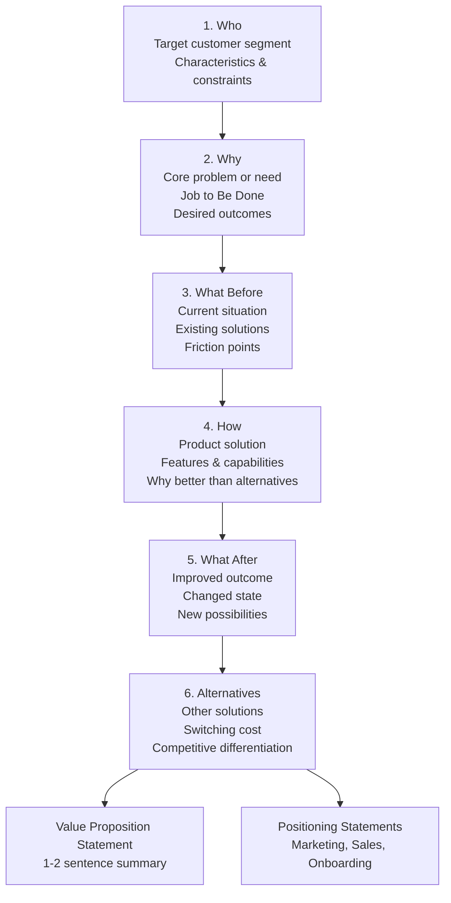
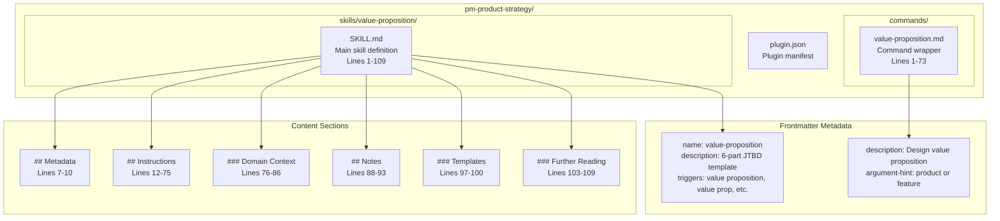
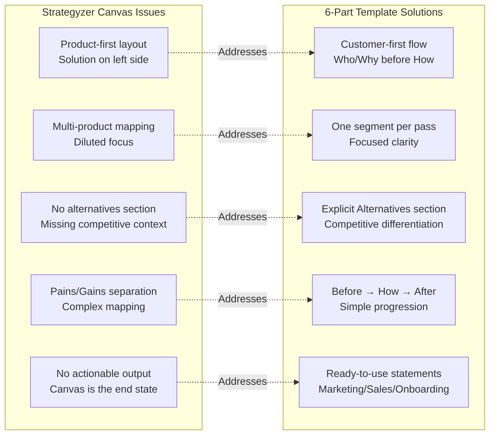
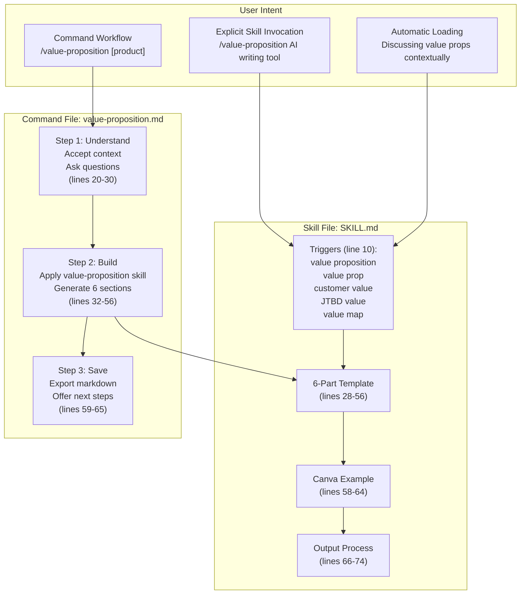
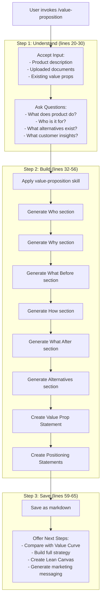
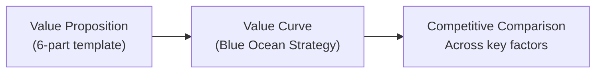
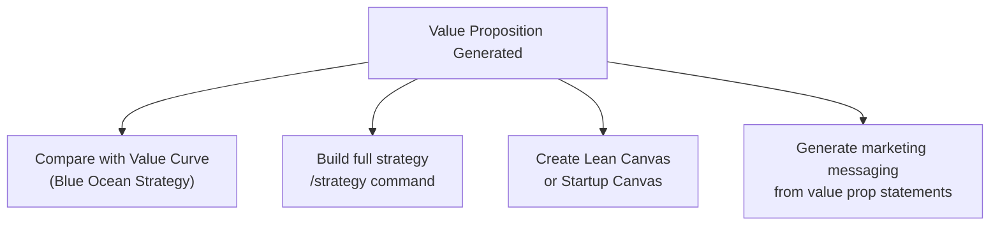

<!-- source: DeepWiki mcp.deepwiki.com · repo phuryn/pm-skills · page 5.3 Value Proposition Design · fetched 2026-10-27 -->

# Value Proposition Design

<details>
<summary>Relevant source files</summary>

The following files were used as context for generating this wiki page:

- [pm-product-strategy/commands/value-proposition.md](pm-product-strategy/commands/value-proposition.md)
- [pm-product-strategy/skills/value-proposition/SKILL.md](pm-product-strategy/skills/value-proposition/SKILL.md)

</details>


## Purpose and Scope

This page documents the **value-proposition** skill and **/value-proposition** command, which implement a 6-part Jobs-to-be-Done (JTBD) template for creating customer-focused value propositions. This template, developed by Paweł Huryn and Aatir Abdul Rauf, serves as an alternative to Strategyzer's Value Proposition Canvas with emphasis on customer-first design and actionable outputs.

The value proposition skill is part of the **pm-product-strategy** plugin. For broader product strategy documentation including vision, pricing, and competitive analysis, see [pm-product-strategy](#4.2). For business model design that incorporates value propositions, see [Business Model Canvases](#5.1). For the complete 9-section strategy framework, see [Product Strategy Canvas](#5.2).

**Sources**: [pm-product-strategy/skills/value-proposition/SKILL.md:1-15](), [pm-product-strategy/commands/value-proposition.md:1-8]()

---

## The 6-Part Template Structure

The value proposition template consists of six sequential sections that guide users from customer identification to competitive differentiation:

### Template Component Diagram



### Section Details

| Section | Focus | Key Questions |
|---------|-------|---------------|
| **1. Who** | Customer segment | Who is this for? What are their characteristics and constraints? |
| **2. Why** | Problem definition | What's the core problem? What's the Job to Be Done? What outcomes do they want? |
| **3. What Before** | Current state | What's their current situation? What are they using today? What friction exists? |
| **4. How** | Solution design | How does the product solve it? What features deliver value? Why is it better? |
| **5. What After** | Future state | What's the improved outcome? How does their life/work change? What becomes possible? |
| **6. Alternatives** | Competitive context | What other solutions exist? Why choose us? What's the switching cost? |

**Sources**: [pm-product-strategy/skills/value-proposition/SKILL.md:24-56]()

---

## File Organization and Code Structure

### Directory Structure Diagram



### Key File Components

**Skill Definition** ([pm-product-strategy/skills/value-proposition/SKILL.md]())

The skill file implements the standard skill structure:
- **Frontmatter** (lines 1-4): Defines `name`, `description` for AI assistant indexing
- **Metadata** (lines 7-10): Human-readable name, description, and trigger keywords
- **Instructions** (lines 12-75): The 6-part template structure and output process
- **Domain Context** (lines 76-86): Comparison with Strategyzer's Value Proposition Canvas
- **Notes** (lines 88-93): JTBD framework principles and testing guidance
- **Templates** (lines 97-100): Link to PPTX template resource
- **Further Reading** (lines 103-109): Educational resources on value proposition design

**Command Wrapper** ([pm-product-strategy/commands/value-proposition.md]())

The command file orchestrates the skill through a structured workflow:
- **Frontmatter** (lines 1-4): `description` and `argument-hint` for command invocation
- **Invocation Examples** (lines 10-16): Usage patterns with/without arguments
- **Workflow** (lines 18-66): 3-step process (Understand → Build → Save)
- **Notes** (lines 68-73): Usage guidance and cross-references

**Sources**: [pm-product-strategy/skills/value-proposition/SKILL.md:1-109](), [pm-product-strategy/commands/value-proposition.md:1-73]()

---

## Comparison with Strategyzer's Value Proposition Canvas

### Structural Differences Diagram



### Detailed Comparison

| Dimension | Strategyzer Canvas | 6-Part JTBD Template |
|-----------|-------------------|---------------------|
| **Starting Point** | Product/Service (left side) | Customer (Who/Why) |
| **Segment Handling** | Multiple products/services simultaneously | One segment at a time |
| **Competitive Analysis** | No explicit alternatives section | Section 6 forces naming substitutes |
| **Structure Complexity** | Customer Jobs, Pains, Gains vs Pain Relievers, Gain Creators, Products | What Before → How → What After |
| **Actionable Output** | Visual canvas (not reusable) | Value Prop Statement + Positioning Statements |
| **Use Case** | Detailed pains/gains decomposition for mature products | Clarity, speed, actionable output |

**When to Use Each**:
- **Strategyzer's Canvas**: Complex customer needs, mature product requiring detailed pain/gain analysis
- **6-Part Template**: New products, speed required, need marketing-ready statements

**Sources**: [pm-product-strategy/skills/value-proposition/SKILL.md:76-86]()

---

## Usage Patterns

### Invocation Methods Diagram



### Invocation Examples

**Direct Skill Invocation** (AI determines context automatically):
```
value proposition for our AI writing assistant
```

**Command Invocation** (structured 3-step workflow):
```
/value-proposition AI writing tool for non-native English speakers
/value-proposition [upload pitch deck or PRD]
/value-proposition                    # Interactive mode
```

**Automatic Loading** (Claude activates contextually):
```
"How should I articulate the value of our product to customers?"
```

**Sources**: [pm-product-strategy/commands/value-proposition.md:10-16](), [pm-product-strategy/skills/value-proposition/SKILL.md:10]()

---

## Workflow Process

### Command Execution Flow



### Multi-Segment Handling

For products with multiple customer segments, the command creates separate value propositions for each segment ([pm-product-strategy/commands/value-proposition.md:57]()):

```
## Value Proposition: [Product]

### For [Segment A]:
[6-part template for Segment A]

### For [Segment B]:
[6-part template for Segment B]
```

**Sources**: [pm-product-strategy/commands/value-proposition.md:18-66]()

---

## Output Format

### Generated Structure

The skill produces structured output following this template ([pm-product-strategy/commands/value-proposition.md:36-55]()):

```markdown
## Value Proposition: [Product]

### For [Segment]:

1. **Who**: [target user profile and characteristics]
2. **Why**: [the job they're trying to do, desired outcomes]
3. **What Before**: [their current painful reality — existing tools, friction, workarounds]
4. **How**: [your solution — specific features and capabilities that deliver value]
5. **What After**: [the improved outcome — what becomes possible]
6. **Alternatives**: [what they'd use without you, and why you're better]

### Value Proposition Statement
[One sentence: For [who] who [need], [product] is a [category] that [benefit]. 
Unlike [alternative], we [differentiator].]

### Value Proposition Statements (Reusable)
- Marketing: [concise marketing message]
- Sales: [sales-focused pitch]
- Onboarding: [user onboarding message]
```

### Example: Canva

Real-world example from the skill definition ([pm-product-strategy/skills/value-proposition/SKILL.md:58-64]()):

| Section | Content |
|---------|---------|
| **Who** | Non-designers who need to create marketing graphics |
| **Why** | They need professional-looking designs but can't hire designers or use complex tools |
| **What Before** | Using PowerPoint, Photoshop (too complex), or hiring expensive designers |
| **How** | Drag-and-drop templates, built-in design elements, AI design assistance, intuitive interface |
| **What After** | Create professional designs in minutes, launch campaigns faster, save design costs |
| **Alternatives** | Photoshop (complex), Fiverr (slow, expensive), Canva competitors (fewer templates, harder UX) |

**Value Proposition Statement**: "For non-designers who need professional marketing graphics, Canva is a design platform that enables anyone to create stunning visuals in minutes. Unlike Photoshop's steep learning curve or Fiverr's slow turnaround, Canva provides drag-and-drop simplicity with AI-powered design assistance."

**Sources**: [pm-product-strategy/skills/value-proposition/SKILL.md:58-64](), [pm-product-strategy/commands/value-proposition.md:36-55]()

---

## Jobs-to-be-Done (JTBD) Framework Principles

The template is grounded in JTBD methodology, which emphasizes progress over demographics ([pm-product-strategy/skills/value-proposition/SKILL.md:89-92]()):

### Key Principles

| Principle | Implementation |
|-----------|----------------|
| **Progress Focus** | "Why" section captures the progress customers try to make, not demographics |
| **Segment Specificity** | One value prop per segment; different groups get different value props |
| **Strategic Clarity** | Strong value props simplify marketing, sales, and product decisions |
| **Customer Validation** | Test with real customers before finalizing |

### Value Curve Integration

The skill notes suggest using a **Value Curve** (Blue Ocean Strategy) to visually compare offerings against competitors across key factors ([pm-product-strategy/skills/value-proposition/SKILL.md:93](), [pm-product-strategy/commands/value-proposition.md:62]()):



**Sources**: [pm-product-strategy/skills/value-proposition/SKILL.md:88-93]()

---

## Templates and Resources

### Available Templates

**PowerPoint Template** ([pm-product-strategy/skills/value-proposition/SKILL.md:99]()):
- [Value Proposition Template (PPTX)](https://docs.google.com/presentation/d/1RXH1Udj71aXQJzGeqYSOStnfQ-6dNz14/edit?slide=id.g2a98aeea3b1_0_247#slide=id.g2a98aeea3b1_0_247)

### Further Reading Resources

Educational materials referenced in the skill ([pm-product-strategy/skills/value-proposition/SKILL.md:103-109]()):

| Resource | Type | Topic |
|----------|------|-------|
| [How to Design a Value Proposition Customers Can't Resist?](https://www.productcompass.pm/p/how-to-design-value-proposition-template) | Article | 6-part template detailed guide |
| [How to Achieve Product-Market Fit? Part I: Market and Value Proposition](https://www.productcompass.pm/p/how-to-achieve-the-product-market) | Article | PMF and value prop relationship |
| [Jobs-to-be-Done Masterclass with Tony Ulwick and Sabeen Sattar](https://www.productcompass.pm/p/jobs-to-be-done-masterclass-with) | Video Course | JTBD methodology deep dive |
| [Product Innovation Masterclass](https://www.productcompass.pm/p/product-innovation-masterclass) | Video Course | Innovation and value creation |

**Sources**: [pm-product-strategy/skills/value-proposition/SKILL.md:97-109]()

---

## Integration with Other Skills

### Command Next Steps

After generating a value proposition, the command offers integration with related workflows ([pm-product-strategy/commands/value-proposition.md:62-65]()):



### Related Skills and Commands

| Integration | Purpose | Reference |
|-------------|---------|-----------|
| **/strategy** | Incorporate value prop into 9-section Product Strategy Canvas | [Product Strategy Canvas](#5.2) |
| **Lean Canvas** | Use value prop in business model design | [Business Model Canvases](#5.1) |
| **Value Curve** | Visual competitive comparison | Blue Ocean Strategy framework |
| **Marketing messaging** | Transform value prop statements into campaigns | pm-marketing-growth plugin |

**Sources**: [pm-product-strategy/commands/value-proposition.md:62-73]()

---

## Attribution

The 6-part JTBD value proposition template was developed by **Paweł Huryn** and **Aatir Abdul Rauf** as an alternative to Alexander Osterwalder's Strategyzer Value Proposition Canvas ([pm-product-strategy/skills/value-proposition/SKILL.md:78]()).

The template addresses structural limitations in the Strategyzer canvas through customer-first design, single-segment focus, explicit competitive analysis, simplified structure, and actionable outputs.

**Sources**: [pm-product-strategy/skills/value-proposition/SKILL.md:76-86]()

---

