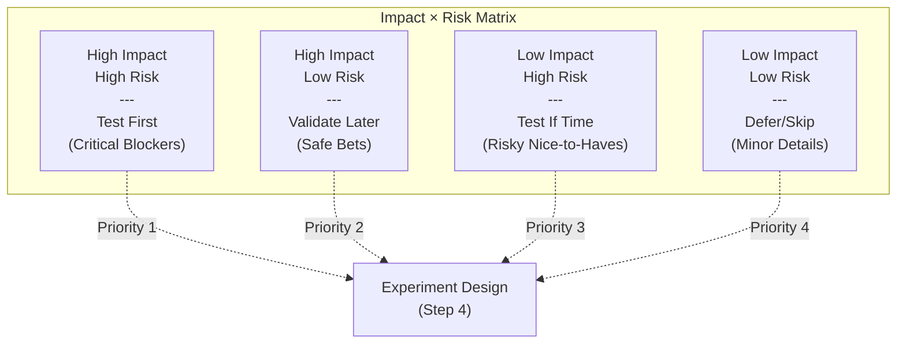
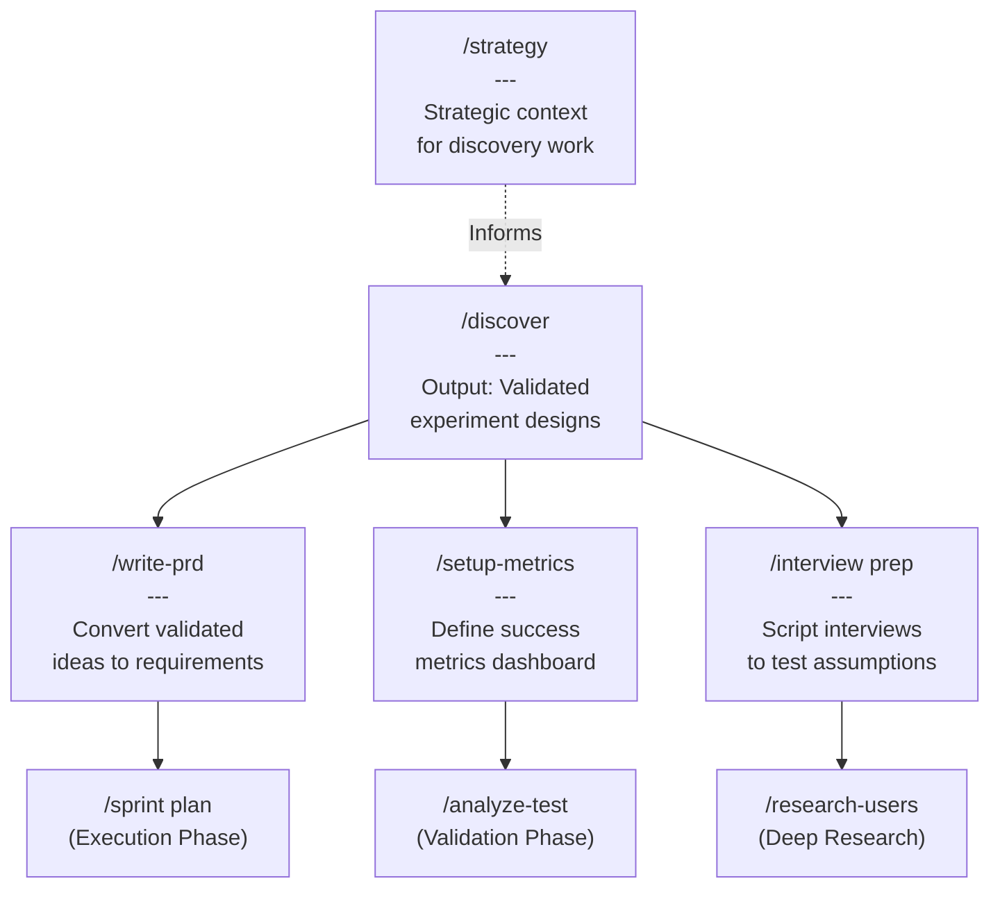
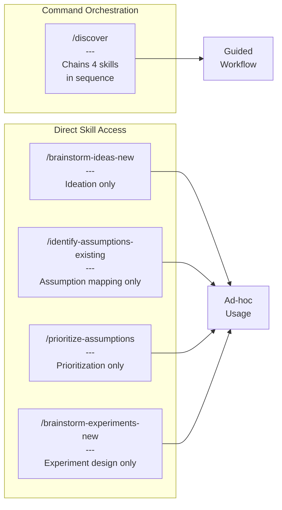

<!-- source: DeepWiki mcp.deepwiki.com · repo phuryn/pm-skills · page 6.1 /discover Command · fetched 2026-10-27 -->

# /discover Command

<details>
<summary>Relevant source files</summary>

The following files were used as context for generating this wiki page:

- [README.md](README.md)
- [pm-product-discovery/README.md](pm-product-discovery/README.md)

</details>


## Purpose and Scope

The `/discover` command orchestrates a complete product discovery cycle, chaining four sequential skills into a structured workflow: ideation → assumption mapping → prioritization → experiment design. This command implements continuous discovery principles from Teresa Torres' methodology, guiding users from an initial product concept through validated experiments ready for execution.

**Use this command when:** You have a new product idea or feature concept and need to progress from raw idea to testable experiments with identified risks.

**For related workflows:** For strategic planning after discovery, see [/strategy Command](#6.2). For converting validated ideas into requirements, see [/write-prd Command](#6.3). For detailed discovery skill documentation, see [pm-product-discovery](#4.1).

**Sources:** [README.md:37](), [README.md:120](), [pm-product-discovery/README.md:24]()

---

## Command Architecture

The `/discover` command is implemented as a command orchestration pattern that sequentially invokes four foundation skills from the `pm-product-discovery` plugin. Each skill outputs structured artifacts that serve as inputs to subsequent steps.

### Four-Skill Chain

```mermaid
graph LR
    INPUT["User Input<br/>(Product Concept)"]
    
    STEP1["brainstorm-ideas<br/>(existing|new)"]
    STEP2["identify-assumptions<br/>(existing|new)"]
    STEP3["prioritize-assumptions"]
    STEP4["brainstorm-experiments<br/>(existing|new)"]
    
    OUTPUT1["Feature Ideas<br/>(3-5 concepts)"]
    OUTPUT2["Assumption List<br/>(VUVF or 8-category)"]
    OUTPUT3["Prioritized Matrix<br/>(Impact × Risk)"]
    OUTPUT4["Experiment Designs<br/>(Pretotypes/Tests)"]
    
    INPUT --> STEP1
    STEP1 --> OUTPUT1
    OUTPUT1 --> STEP2
    STEP2 --> OUTPUT2
    OUTPUT2 --> STEP3
    STEP3 --> OUTPUT3
    OUTPUT3 --> STEP4
    STEP4 --> OUTPUT4
    
    OUTPUT4 --> NEXT["Suggested Next Steps:<br/>/write-prd<br/>/setup-metrics<br/>/interview prep"]
```



**Sources:** [README.md:37](), [README.md:120](), [pm-product-discovery/README.md:24]()

---

## Workflow Steps

### Step 1: Ideation (`brainstorm-ideas`)

The first step generates 3-5 feature or product ideas using multi-perspective ideation. The command invokes either `brainstorm-ideas-existing` or `brainstorm-ideas-new` depending on whether the target is an existing product or a new venture.

**Skill variants:**
- `brainstorm-ideas-existing` — Multi-perspective ideation from PM, Designer, and Engineer viewpoints for existing products
- `brainstorm-ideas-new` — Ideation for new products in initial discovery phase

**Outputs:**
- 3-5 concrete feature/product ideas
- Each idea includes: concept description, target user, expected value, and initial feasibility assessment

**Implementation:** [pm-product-discovery/skills/brainstorm-ideas-existing/SKILL.md](), [pm-product-discovery/skills/brainstorm-ideas-new/SKILL.md]()

**Sources:** [pm-product-discovery/README.md:10-11]()

---

### Step 2: Assumption Mapping (`identify-assumptions`)

The second step analyzes each idea from Step 1 to extract risky assumptions that must be validated. The command invokes either `identify-assumptions-existing` or `identify-assumptions-new`.

**Skill variants:**
- `identify-assumptions-existing` — Maps assumptions across 4 risk dimensions (Value, Usability, Viability, Feasibility)
- `identify-assumptions-new` — Maps assumptions across 8 risk categories (adds Go-to-Market, Strategy, Team, Competition)

#### Assumption Risk Categories

| Category | Scope | Example Questions |
|----------|-------|-------------------|
| **Value** | Will users want this? | Do users perceive the problem as urgent? |
| **Usability** | Can users succeed with it? | Can users complete the core workflow intuitively? |
| **Viability** | Can we build a sustainable business? | Will users pay the target price point? |
| **Feasibility** | Can we build it technically? | Do we have the infrastructure to handle scale? |
| **Go-to-Market** (new only) | Can we reach customers? | Can we acquire users at acceptable CAC? |
| **Strategy** (new only) | Does this fit our portfolio? | Does this align with our 3-year strategy? |
| **Team** (new only) | Do we have the capabilities? | Do we have PM/design resources available? |
| **Competition** (new only) | Can we differentiate? | Why will users switch from incumbents? |

**Outputs:**
- 5-15 risky assumptions per idea
- Each assumption includes: statement, risk category, rationale for risk

**Implementation:** [pm-product-discovery/skills/identify-assumptions-existing/SKILL.md](), [pm-product-discovery/skills/identify-assumptions-new/SKILL.md]()

**Sources:** [pm-product-discovery/README.md:12-13]()

---

### Step 3: Assumption Prioritization (`prioritize-assumptions`)

The third step ranks all assumptions from Step 2 using a 2×2 Impact × Risk matrix. This step is critical for focusing resources on the highest-stakes uncertainties.

#### Prioritization Matrix



**Outputs:**
- Prioritized assumption list with Impact (1-5) and Risk (1-5) scores
- Quadrant classification (High Impact/High Risk assumptions ranked first)
- Suggested experiment types for each assumption

**Implementation:** [pm-product-discovery/skills/prioritize-assumptions/SKILL.md]()

**Sources:** [pm-product-discovery/README.md:17]()

---

### Step 4: Experiment Design (`brainstorm-experiments`)

The fourth step designs 1-3 lean experiments to test the highest-priority assumptions from Step 3. The command invokes either `brainstorm-experiments-existing` or `brainstorm-experiments-new`.

**Skill variants:**
- `brainstorm-experiments-existing` — Designs experiments to test assumptions for existing products (A/B tests, feature flags, prototypes)
- `brainstorm-experiments-new` — Designs pretotypes for new products using Alberto Savoia's methodology (Fake Door, Mechanical Turk, Pinocchio, etc.)

#### Pretotype Patterns (New Products)

| Pattern | Description | Best For |
|---------|-------------|----------|
| **Fake Door** | Landing page that looks real but collects interest | Testing demand before building |
| **Mechanical Turk** | Manual process that simulates automation | Testing value before automating |
| **Pinocchio** | Non-functional prototype that looks real | Testing interaction patterns |
| **Minimum Viable Test** | Smallest possible experiment to validate assumption | Testing specific hypotheses cheaply |

**Outputs:**
- 1-3 experiment designs per high-priority assumption
- Each experiment includes: hypothesis, method, success criteria, timeline, resources required

**Implementation:** [pm-product-discovery/skills/brainstorm-experiments-existing/SKILL.md](), [pm-product-discovery/skills/brainstorm-experiments-new/SKILL.md]()

**Sources:** [pm-product-discovery/README.md:8-9]()

---

## Invocation Patterns

### Basic Invocation

```
/discover [product concept description]
```

### Example Invocations

```
/discover AI-powered meeting summarizer for remote teams

/discover Smart notification system that reduces alert fatigue for enterprise users

/discover Two-sided marketplace connecting freelance designers with early-stage startups
```

### Context Detection

The command automatically detects whether the concept targets an existing product or a new product based on conversation context. You can explicitly specify:

```
/discover existing product: Add team collaboration features to our project management tool

/discover new product: Mobile app for tracking carbon footprint of daily activities
```

**Sources:** [README.md:134-136]()

---

## Integration with Lifecycle Commands

The `/discover` command outputs feed into downstream workflow commands:



**Command suggestions:** Upon completion, `/discover` recommends next steps based on output:
- If experiments require PRD → Suggests `/write-prd`
- If metrics undefined → Suggests `/setup-metrics`
- If user interviews needed → Suggests `/interview prep`

**Sources:** [README.md:45](), [README.md:207-228]()

---

## Command Implementation Details

### Plugin Structure

The `/discover` command resides in the `pm-product-discovery` plugin:

```
pm-product-discovery/
├── plugin.json                          # Plugin manifest with command definitions
├── commands/
│   └── discover.md                      # Command orchestration logic
└── skills/
    ├── brainstorm-ideas-existing/       # Step 1 (existing)
    ├── brainstorm-ideas-new/            # Step 1 (new)
    ├── identify-assumptions-existing/   # Step 2 (existing)
    ├── identify-assumptions-new/        # Step 2 (new)
    ├── prioritize-assumptions/          # Step 3
    ├── brainstorm-experiments-existing/ # Step 4 (existing)
    └── brainstorm-experiments-new/      # Step 4 (new)
```

**Sources:** [pm-product-discovery/README.md:21-27]()

### Command vs Skill Access

Users can invoke the full workflow via `/discover` or access individual skills directly:



**When to use direct skills:**
- You've already completed earlier steps
- You need to iterate on a specific step
- You want to apply a skill to different context (e.g., prioritizing technical debt assumptions)

**Sources:** [README.md:35-36](), [README.md:41-44]()

---

## Theoretical Foundation

The `/discover` command codifies continuous discovery practices from:

| Framework | Contribution to `/discover` | Source |
|-----------|----------------------------|--------|
| **Teresa Torres** | Opportunity Solution Tree structure, assumption-driven testing | *Continuous Discovery Habits* |
| **Alberto Savoia** | Pretotyping patterns for new products (Fake Door, Mechanical Turk, etc.) | *The Right It* |
| **Marty Cagan** | Value/Usability/Viability/Feasibility risk framework | *INSPIRED* |
| **Lean Startup** | Build-Measure-Learn cycle, minimum viable experiments | Eric Ries |

**Sources:** [README.md:401-414]()

---

## Example: Full Discovery Cycle

### Input

```
/discover AI-powered code review assistant for mid-size engineering teams
```

### Step 1 Output: Ideas

1. **Auto-fix suggestions** — AI proposes code fixes for common issues (syntax, security, performance)
2. **Context-aware comments** — AI generates review comments based on PR context and team standards
3. **Churn prediction** — AI flags files likely to cause bugs based on change patterns

### Step 2 Output: Assumptions

**Auto-fix suggestions:**
- **Value:** Developers trust AI-generated fixes (Impact: 5, Risk: 4)
- **Usability:** Developers can understand why AI suggests each fix (Impact: 4, Risk: 3)
- **Feasibility:** AI accuracy reaches 85%+ for auto-fixes (Impact: 5, Risk: 5)

**Context-aware comments:**
- **Value:** Teams prefer AI-generated comments over no comments (Impact: 4, Risk: 2)
- **Viability:** Teams will pay $50/user/month for this capability (Impact: 5, Risk: 4)

### Step 3 Output: Prioritized Matrix

| Rank | Assumption | Impact | Risk | Quadrant |
|------|-----------|--------|------|----------|
| 1 | AI accuracy reaches 85%+ for auto-fixes | 5 | 5 | High/High |
| 2 | Developers trust AI-generated fixes | 5 | 4 | High/High |
| 3 | Teams will pay $50/user/month | 5 | 4 | High/High |
| 4 | Developers can understand fix rationale | 4 | 3 | High/Med |

### Step 4 Output: Experiments

**Experiment 1:** AI Accuracy Benchmark
- **Hypothesis:** AI achieves 85%+ accuracy on common code issues
- **Method:** Run AI on 500 historical PRs, measure precision/recall against human reviews
- **Success Criteria:** Precision ≥85%, Recall ≥70%
- **Timeline:** 2 weeks

**Experiment 2:** Fake Door Landing Page
- **Hypothesis:** 100+ teams sign up for waitlist within 4 weeks
- **Method:** Landing page with "AI Code Review Assistant" value prop, email capture
- **Success Criteria:** ≥100 sign-ups, ≥30% conversion from landing page
- **Timeline:** 4 weeks, $500 Google Ads budget

**Sources:** [README.md:134](), [pm-product-discovery/README.md:24]()

---

## Validation and Quality

The `/discover` command and its constituent skills undergo automated validation via `validate_plugins.py`:

**Validation checks:**
- Command frontmatter completeness (description, argument-hint)
- Skill reference integrity (all chained skills exist)
- No cross-plugin dependencies
- Markdown structure compliance

**Sources:** [validate_plugins.py:1-309]()

---

