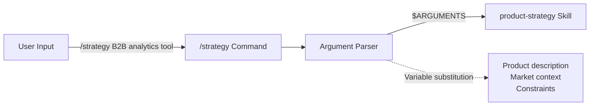
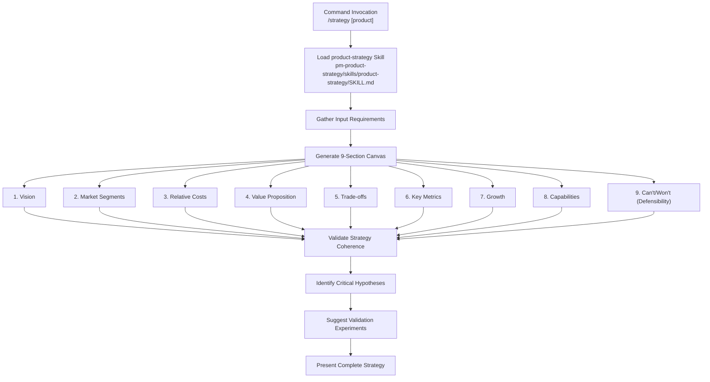
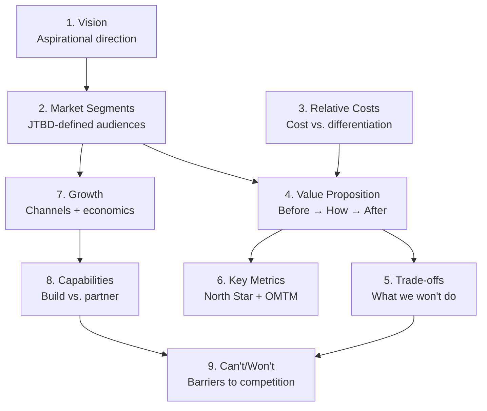
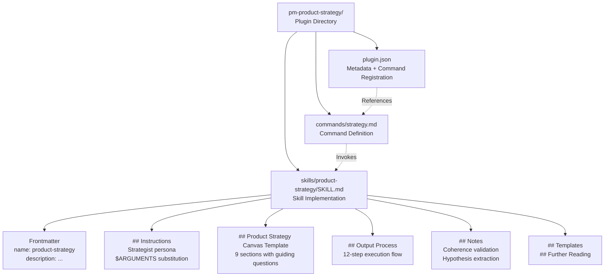
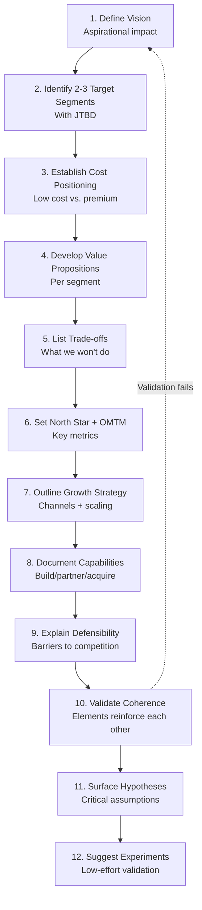
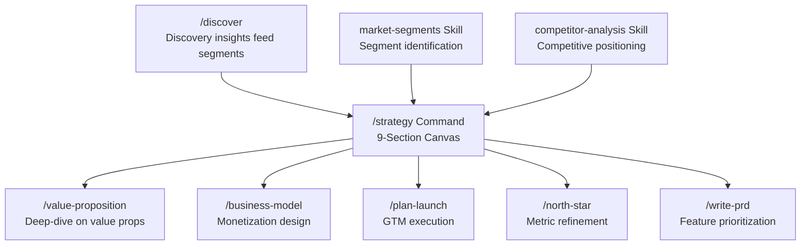
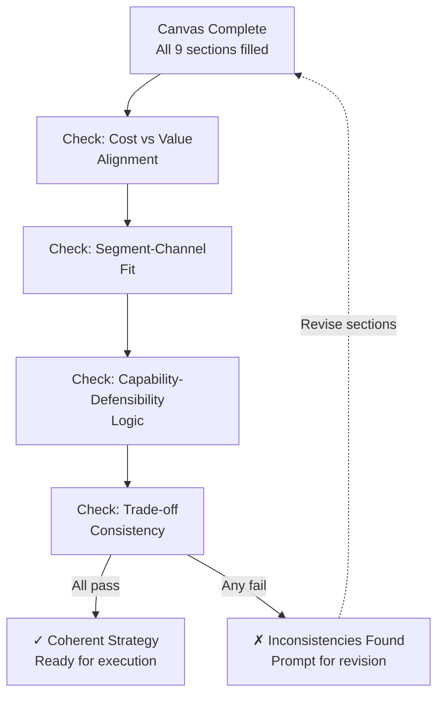

<!-- source: DeepWiki mcp.deepwiki.com · repo phuryn/pm-skills · page 6.2 /strategy Command · fetched 2026-10-27 -->

# /strategy Command

<details>
<summary>Relevant source files</summary>

The following files were used as context for generating this wiki page:

- [README.md](README.md)
- [pm-product-strategy/README.md](pm-product-strategy/README.md)
- [pm-product-strategy/skills/product-strategy/SKILL.md](pm-product-strategy/skills/product-strategy/SKILL.md)

</details>


## Purpose and Scope

This page documents the `/strategy` command, which generates a comprehensive 9-section Product Strategy Canvas for defining product direction, competitive positioning, and growth strategy. The command is part of the `pm-product-strategy` plugin and orchestrates the `product-strategy` skill to guide users through strategic planning from vision to defensibility.

For information about related strategic frameworks (Lean Canvas, Business Model Canvas), see [Business Model Canvases](#5.1). For detailed skill documentation, see [pm-product-strategy Plugin](#4.2).

**Sources:** [README.md:16](), [README.md:160-166](), [pm-product-strategy/README.md:25]()

---

## Command Overview

The `/strategy` command creates a structured strategic planning session that walks product managers through nine interconnected strategy components. Unlike generic AI responses, this command enforces a rigorous framework derived from Roger L. Martin's "Playing to Win" methodology and modern product strategy best practices.

| Property | Value |
|----------|-------|
| **Command Name** | `/strategy` or `/pm-product-strategy:strategy` |
| **Plugin** | `pm-product-strategy` |
| **Primary Skill** | `product-strategy` |
| **Input Format** | `/strategy [product description]` |
| **Output** | 9-section Product Strategy Canvas with validation |
| **Typical Duration** | 10-20 minutes of interactive dialogue |

**Sources:** [pm-product-strategy/README.md:1-26](), [README.md:160-166]()

---

## Command Invocation and Arguments



**Argument Format:**

The command accepts free-form product descriptions that are passed as `$ARGUMENTS` to the skill template. The skill expects:

- **Product description** — What the product is and who it serves
- **Market context** — Competitive landscape and customer insights (optional, can be elicited)
- **Company constraints** — Resources, priorities, limitations (optional, can be elicited)

**Example invocations:**

```
/strategy B2B project management tool for agencies
/strategy AI writing assistant targeting non-native English speakers
/strategy Mobile fitness app for busy professionals
```

**Sources:** [pm-product-strategy/skills/product-strategy/SKILL.md:14](), [README.md:176]()

---

## Workflow Architecture



**Execution Flow:**

1. **Skill Loading** — Claude loads [pm-product-strategy/skills/product-strategy/SKILL.md:1-112]()
2. **Input Collection** — System prompts for product description, market context, competitors, resources
3. **Canvas Generation** — 9 sections filled sequentially with user interaction
4. **Coherence Validation** — Cross-checks that elements reinforce each other
5. **Hypothesis Extraction** — Identifies assumptions that must be true for success
6. **Experiment Design** — Proposes low-effort tests for key assumptions

**Sources:** [pm-product-strategy/skills/product-strategy/SKILL.md:74-87]()

---

## The 9-Section Product Strategy Canvas

The command structures strategy generation around nine interconnected components. Each section builds on previous answers to create a coherent whole.

### Section Dependency Graph



**Sources:** [pm-product-strategy/skills/product-strategy/SKILL.md:24-73]()

### 1. Vision

**Purpose:** Define the aspirational impact and motivating force for the product.

**Template Questions:**
- How can we inspire people?
- What are we aspiring to achieve?
- What values do we uphold?

**Code Reference:** [pm-product-strategy/skills/product-strategy/SKILL.md:26-29]()

**Output:** 2-3 sentence vision statement combining aspiration, impact, and values.

---

### 2. Market Segments

**Purpose:** Identify target audiences defined by problems and Jobs to Be Done, not demographics.

**Template Questions:**
- Market defined by people's problems (not demographics)
- Jobs to Be Done (JTBD), desired outcomes, constraints
- Who is our first segment?
- Why this segment first?

**Code Reference:** [pm-product-strategy/skills/product-strategy/SKILL.md:31-35]()

**Output:** 2-3 market segments with JTBD for each, plus justification for beachhead segment selection.

---

### 3. Relative Costs

**Purpose:** Establish cost positioning strategy relative to competitors.

**Template Questions:**
- Do we optimize for low cost (like Southwest Airlines)?
- Or do we emphasize unique value (like Starbucks)?
- What's our cost position relative to competitors?

**Code Reference:** [pm-product-strategy/skills/product-strategy/SKILL.md:37-40]()

**Output:** Clear positioning as either cost leader or differentiation player with competitive comparison.

---

### 4. Value Proposition

**Purpose:** Define the transformation delivered to each target segment using JTBD structure.

**Template Questions (per segment):**
- **What before** — The customer's current situation, pain, or need
- **How** — How your product delivers the solution
- **What after** — The improved outcome or future state
- **Alternatives** — What customers use today instead

**Code Reference:** [pm-product-strategy/skills/product-strategy/SKILL.md:42-47]()

**Output:** One value proposition per segment following the 4-part structure. This connects directly to the `value-proposition` skill for deeper exploration.

---

### 5. Trade-offs

**Purpose:** Define strategic boundaries by explicitly stating what the product will NOT do.

**Template Questions:**
- What will we NOT do?
- What features or markets are out of scope?
- How does saying "no" create focus and amplify our value?

**Code Reference:** [pm-product-strategy/skills/product-strategy/SKILL.md:49-52]()

**Output:** 3-5 explicit "we will not" statements with rationale for how constraints create focus.

---

### 6. Key Metrics

**Purpose:** Identify the single metric that matters most for business success and quarterly focus.

**Template Questions:**
- **North Star Metric** — Single metric that drives overall business success
- **OMTM (One Metric That Matters)** — The one metric we optimize for this quarter

**Code Reference:** [pm-product-strategy/skills/product-strategy/SKILL.md:54-56]()

**Output:** North Star Metric definition plus current quarterly OMTM. This section often triggers the `/north-star` command for deeper metric design.

---

### 7. Growth

**Purpose:** Define how the product will scale and acquire users.

**Template Questions:**
- Sales-Led Growth or Product-Led Growth?
- Primary acquisition channels
- How do we scale?
- What's our unit economics?

**Code Reference:** [pm-product-strategy/skills/product-strategy/SKILL.md:58-62]()

**Output:** Growth motion (PLG/SLG), 2-3 primary channels, unit economics assumptions.

---

### 8. Capabilities

**Purpose:** Identify required competencies and make-vs-buy decisions.

**Template Questions:**
- What competencies and resources do we need?
- What do we build vs. partner for?
- What capabilities must we develop to win?

**Code Reference:** [pm-product-strategy/skills/product-strategy/SKILL.md:64-67]()

**Output:** List of critical capabilities with build/partner/acquire decisions for each.

---

### 9. Can't/Won't (Defensibility)

**Purpose:** Articulate competitive moats and barriers to entry.

**Template Questions:**
- Why can't competitors easily copy this?
- What defensibility do we have (network effects, switching costs, IP)?
- What barriers to entry exist for new competitors?

**Code Reference:** [pm-product-strategy/skills/product-strategy/SKILL.md:69-72]()

**Output:** 2-3 defensibility mechanisms with explanation of why they create sustainable advantage.

**Sources:** [pm-product-strategy/skills/product-strategy/SKILL.md:24-73]()

---

## Implementation Details

### File Structure Mapping



**Key Files:**

| File | Purpose | Lines |
|------|---------|-------|
| `pm-product-strategy/skills/product-strategy/SKILL.md` | Core skill implementation with 9-section template | [1-112]() |
| `pm-product-strategy/commands/strategy.md` | Command definition that invokes the skill | Not shown in provided files |
| `pm-product-strategy/plugin.json` | Plugin manifest registering the command | Not shown in provided files |

**Sources:** [pm-product-strategy/skills/product-strategy/SKILL.md:1-112]()

### Skill Frontmatter

The skill uses YAML frontmatter for metadata:

```yaml
name: product-strategy
description: "Create a comprehensive product strategy using the 9-section Product Strategy Canvas — vision, segments, costs, value propositions, trade-offs, metrics, growth, capabilities, and defensibility. Use when building a product strategy, creating a strategic plan, or defining product direction."
```

**Trigger Keywords:** The skill activates automatically when conversation contains: "product strategy", "strategy canvas", "strategic plan", "product strategy document"

**Sources:** [pm-product-strategy/skills/product-strategy/SKILL.md:1-4](), [pm-product-strategy/skills/product-strategy/SKILL.md:10]()

---

## Output Process

The command follows a 12-step process defined in [pm-product-strategy/skills/product-strategy/SKILL.md:74-87]():



**Process Characteristics:**

- **Sequential Execution** — Steps 1-9 must complete in order to ensure logical dependencies
- **Coherence Validation** — Step 10 checks for contradictions (e.g., premium positioning but low-value prop)
- **Hypothesis Extraction** — Step 11 identifies "what must be true" assumptions
- **Actionable Next Steps** — Step 12 provides specific experiments to validate strategy

**Sources:** [pm-product-strategy/skills/product-strategy/SKILL.md:74-87]()

---

## Integration with Other Commands and Skills

The `/strategy` command sits at the center of strategic planning workflows and connects to multiple other capabilities:



**Upstream Dependencies:**

- **`/discover`** — Discovery insights inform market segments and customer problems ([pm-product-discovery](#4.1))
- **`market-segments`** — Segment analysis feeds Section 2 ([pm-market-research](#4.4))
- **`competitor-analysis`** — Competitive landscape informs positioning ([pm-market-research](#4.4))

**Downstream Workflows:**

- **`/value-proposition`** — Section 4 often warrants deeper exploration ([pm-product-strategy](#4.2))
- **`/business-model`** — Strategy informs business model design (lean/full/startup canvas)
- **`/plan-launch`** — Strategy guides GTM execution ([pm-go-to-market](#4.6))
- **`/north-star`** — Section 6 metrics may need refinement ([pm-marketing-growth](#4.7))
- **`/write-prd`** — Strategy priorities guide feature specification ([pm-execution](#4.3))

**Sources:** [README.md:15-19](), [README.md:120-131](), [README.md:160-179]()

---

## Usage Patterns and Examples

### Basic Invocation

```
/strategy B2B project management tool for agencies
```

**Expected Interaction:**

1. System asks for market context and competitors
2. User provides context or system proceeds with available info
3. System works through 9 sections sequentially
4. User provides answers or requests guidance at each step
5. System validates coherence and surfaces assumptions
6. Final output: Complete strategy canvas with validation

**Sources:** [README.md:176]()

### With Pre-Loaded Context

```
/strategy AI writing assistant for non-native English speakers

[Context provided in conversation:]
- Market: 1.5B non-native English speakers globally
- Competitors: Grammarly, Hemingway Editor, native AI tools
- Our advantage: Specialized training on ESL writing patterns
```

This accelerates Section 2 (Segments) and Section 9 (Defensibility) by providing competitive context upfront.

**Sources:** [README.md:177]()

### Iterative Refinement

The command supports strategy refinement over multiple sessions:

```
/strategy [product] — Initial strategy creation
[Weeks later, after validation experiments]
/strategy [same product] — Refine based on learnings
```

The skill notes recommend quarterly revisits: "Revisit quarterly as market conditions change" ([pm-product-strategy/skills/product-strategy/SKILL.md:93]())

---

## Validation and Quality Assurance

### Built-in Coherence Checks

The command includes validation logic to ensure strategic consistency:

| Check | Description | Example Failure |
|-------|-------------|-----------------|
| **Cost-Value Alignment** | If Section 3 = "premium", Section 4 must show unique value | Premium cost + commoditized value prop |
| **Segment-Channel Fit** | Section 7 channels must reach Section 2 segments | Enterprise B2B segment + consumer social channels |
| **Capability-Defensibility** | Section 8 capabilities must support Section 9 moats | Network effects claim without viral mechanism |
| **Trade-off Consistency** | Section 5 exclusions align with Sections 2-4 focus | "No mobile app" but mobile-first segment |

**Implementation:** [pm-product-strategy/skills/product-strategy/SKILL.md:88-93]()



**Sources:** [pm-product-strategy/skills/product-strategy/SKILL.md:84](), [pm-product-strategy/skills/product-strategy/SKILL.md:88-93]()

### Hypothesis and Experiment Generation

After validation, the command extracts critical assumptions and proposes experiments:

**Step 11: Surface Critical Hypotheses**
- "Enterprises will pay premium for compliance features" (Section 4 hypothesis)
- "Sales-led motion can reach $10K ACV customers cost-effectively" (Section 7 hypothesis)
- "We can build ML capabilities in 6 months" (Section 8 hypothesis)

**Step 12: Suggest Validation Experiments**
- Hypothesis: Premium pricing → Experiment: 10 customer interviews on willingness-to-pay
- Hypothesis: Sales-led GTM → Experiment: Pilot with 2 SDRs for 1 month
- Hypothesis: ML capability → Experiment: Technical spike with sample dataset

**Sources:** [pm-product-strategy/skills/product-strategy/SKILL.md:85-86]()

---

## External Resources and Templates

The skill provides downloadable templates and further reading:

**Template:**
- [Product Strategy Canvas (PPTX)](https://docs.google.com/presentation/d/1xRBqSOISvAKzwM_z5tC8fiuO5O2YhboB/edit?usp=sharing&ouid=111307342557889008106&rtpof=true&sd=true)

**Further Reading:**
- [Product Strategy Canvas: From Vision to Action](https://www.productcompass.pm/p/product-strategy-canvas)
- [Product Strategy Examples: Google Maps, Netflix, OpenAI](https://www.productcompass.pm/p/product-strategy-examples)
- [Product Vision vs Strategy vs Objectives vs Roadmap](https://www.productcompass.pm/p/product-vision-strategy-goals-and)
- [Product Model First Principles: Product Team and Product Strategy In Depth](https://www.productcompass.pm/p/product-model-first-principles-transformed-cagan)
- [From Strategy to Objectives Masterclass](https://www.productcompass.pm/p/product-vision-strategy-objectives-course) (video course)

**Sources:** [pm-product-strategy/skills/product-strategy/SKILL.md:97-111]()

---

## Theoretical Foundation

The 9-section Product Strategy Canvas synthesizes multiple strategic frameworks:

| Section | Primary Framework Source |
|---------|-------------------------|
| Vision | Simon Sinek (Start With Why), Marty Cagan (INSPIRED) |
| Market Segments | Clayton Christensen (JTBD), Anthony Ulwick (Outcome-Driven Innovation) |
| Relative Costs | Michael Porter (Competitive Advantage) |
| Value Proposition | Strategyzer (Value Proposition Design), JTBD methodology |
| Trade-offs | Roger L. Martin (Playing to Win), Michael Porter (What is Strategy?) |
| Key Metrics | Christina Wodtke (Radical Focus), Sean Ellis (North Star Framework) |
| Growth | Brian Balfour (Growth Loops), PLG framework |
| Capabilities | Michael Porter (Competitive Advantage), Marty Cagan (Product Teams) |
| Can't/Won't | Hamilton Helmer (7 Powers), Warren Buffett (Moats) |

**Core Philosophy:** Strategy is about making intentional choices and trade-offs, not listing aspirations. The canvas forces explicit decisions (what we won't do) and ensures internal consistency.

**Sources:** [README.md:401-414](), [pm-product-strategy/skills/product-strategy/SKILL.md:103-111]()

---

