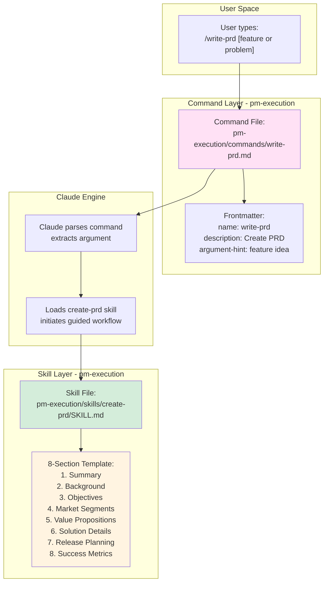
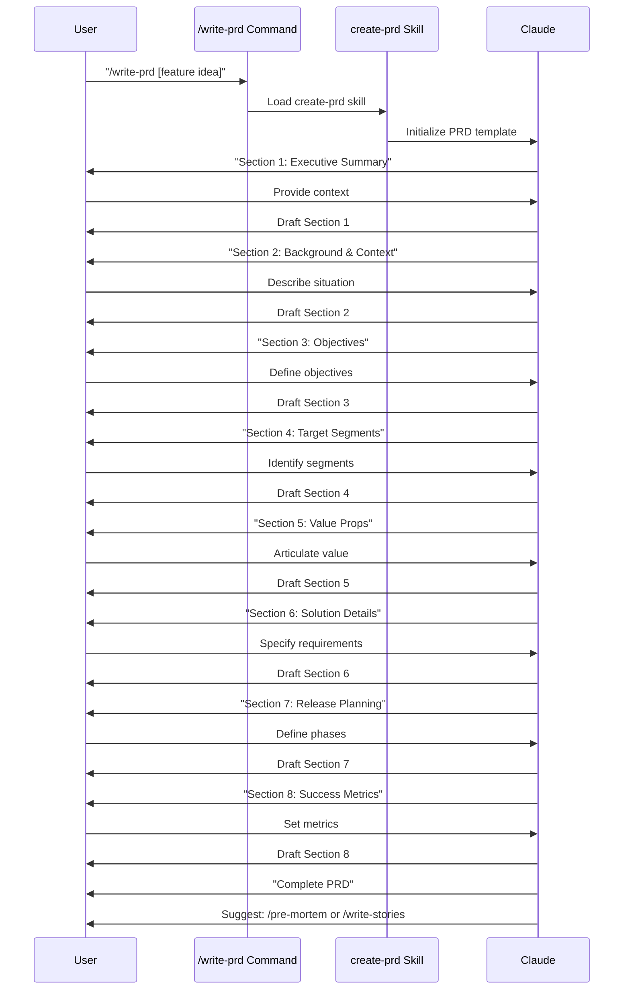
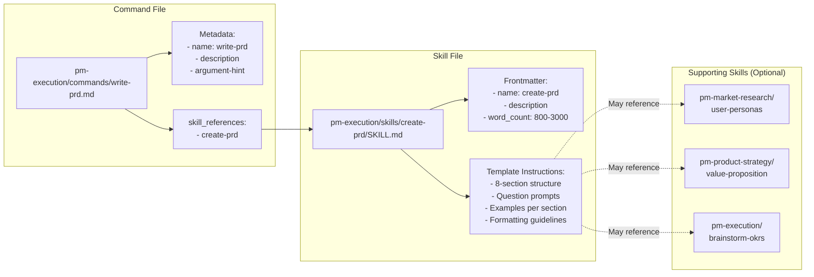
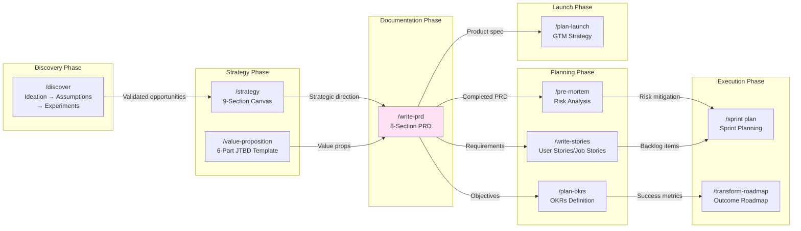
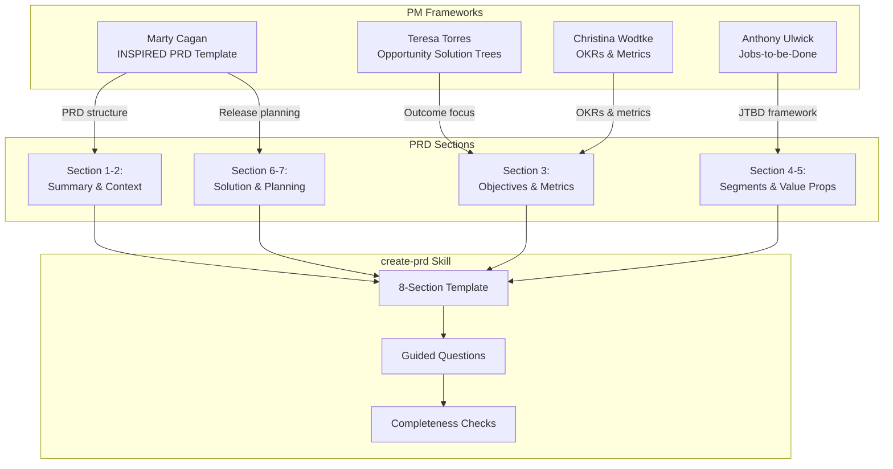

<!-- source: DeepWiki mcp.deepwiki.com · repo phuryn/pm-skills · page 6.3 /write-prd Command · fetched 2026-10-27 -->

# /write-prd Command

<details>
<summary>Relevant source files</summary>

The following files were used as context for generating this wiki page:

- [README.md](README.md)
- [pm-execution/README.md](pm-execution/README.md)

</details>


## Purpose and Scope

This page documents the `/write-prd` command, a workflow orchestration command in the pm-execution plugin that generates comprehensive Product Requirements Documents (PRDs) from feature ideas or problem statements. The command implements Marty Cagan's INSPIRED methodology for PRD creation using an 8-section template structure.

For information about the broader execution plugin capabilities, see [pm-execution Plugin](#4.3). For details on other product strategy workflows, see [/strategy Command](#6.2) and [/discover Command](#6.1).

**Sources:** [README.md:17](), [README.md:207](), [pm-execution/README.md:8](), [pm-execution/README.md:33]()

---

## Overview

The `/write-prd` command transforms a feature idea, product concept, or problem statement into a structured PRD following a comprehensive 8-section template. The command guides users through each section interactively, ensuring completeness while maintaining focus on customer value and business objectives.

### When to Use

| Scenario | Command Usage |
|----------|---------------|
| **Starting from scratch** | `/write-prd AI-powered meeting summarizer for remote teams` |
| **Feature for existing product** | `/write-prd Smart notification system that reduces alert fatigue` |
| **After discovery phase** | `/write-prd` after completing `/discover` to formalize validated opportunities |
| **Problem statement** | `/write-prd We need to improve our checkout conversion rate` |

**Sources:** [README.md:207](), [README.md:226-228](), [pm-execution/README.md:33]()

---

## Command Invocation Architecture

The following diagram shows how the `/write-prd` command maps from user invocation to the underlying code structure:



**Diagram: Command Invocation Flow** - The `/write-prd` command in the pm-execution plugin loads the `create-prd` skill, which contains the 8-section PRD template and guided workflow instructions.

**Sources:** [pm-execution/README.md:33](), [README.md:207]()

---

## PRD Template Structure

The command uses a comprehensive 8-section template that covers all essential aspects of a product requirements document:

```mermaid
graph TD
    subgraph "Section 1: Executive Summary"
        S1A["Product Name"]
        S1B["Problem Statement"]
        S1C["Proposed Solution"]
        S1D["Expected Outcome"]
    end
    
    subgraph "Section 2: Background & Context"
        S2A["Current Situation"]
        S2B["User Pain Points"]
        S2C["Market Context"]
        S2D["Strategic Rationale"]
    end
    
    subgraph "Section 3: Objectives & Success Criteria"
        S3A["Primary Objectives"]
        S3B["Success Metrics"]
        S3C["Leading Indicators"]
        S3D["Non-Goals"]
    end
    
    subgraph "Section 4: Target Market Segments"
        S4A["User Personas"]
        S4B["Segment Priorities"]
        S4C["JTBD per Segment"]
    end
    
    subgraph "Section 5: Value Propositions"
        S5A["Core Value Props"]
        S5B["Differentiation"]
        S5C["Competitive Advantage"]
    end
    
    subgraph "Section 6: Solution Details"
        S6A["Feature Requirements"]
        S6B["User Stories"]
        S6C["Technical Constraints"]
        S6D["UX Guidelines"]
    end
    
    subgraph "Section 7: Release Planning"
        S7A["MVP Scope"]
        S7B["Phase Roadmap"]
        S7C["Dependencies"]
        S7D["Risk Mitigation"]
    end
    
    subgraph "Section 8: Success Metrics"
        S8A["North Star Metric"]
        S8B["Input Metrics"]
        S8C["Measurement Plan"]
    end
    
    S1A --> S1B --> S1C --> S1D
    S1D --> S2A
    S2A --> S2B --> S2C --> S2D
    S2D --> S3A
    S3A --> S3B --> S3C --> S3D
    S3D --> S4A
    S4A --> S4B --> S4C
    S4C --> S5A
    S5A --> S5B --> S5C
    S5C --> S6A
    S6A --> S6B --> S6C --> S6D
    S6D --> S7A
    S7A --> S7B --> S7C --> S7D
    S7D --> S8A
    S8A --> S8B --> S8C
```



**Diagram: 8-Section PRD Template Structure** - The `create-prd` skill guides users through these sections sequentially, building a comprehensive requirements document.

### Section Breakdown

| Section | Purpose | Key Elements |
|---------|---------|--------------|
| **1. Executive Summary** | Quick overview for stakeholders | Product name, problem, solution, expected outcome |
| **2. Background & Context** | Justify why this matters now | Current situation, pain points, market context, strategic fit |
| **3. Objectives & Success Criteria** | Define what success looks like | Primary objectives, success metrics, leading indicators, non-goals |
| **4. Target Market Segments** | Clarify who this serves | User personas, segment priorities, Jobs-to-be-Done |
| **5. Value Propositions** | Articulate the value | Core value props, differentiation, competitive advantage |
| **6. Solution Details** | Specify what to build | Feature requirements, user stories, technical constraints, UX guidelines |
| **7. Release Planning** | Outline delivery approach | MVP scope, phased roadmap, dependencies, risks |
| **8. Success Metrics** | Define measurement framework | North Star Metric, input metrics, measurement plan |

**Sources:** [pm-execution/README.md:8]()

---

## Workflow Process

The command follows a guided, interactive workflow that builds the PRD section-by-section:



**Diagram: Interactive PRD Creation Workflow** - The command guides users through each section, soliciting input and generating structured content progressively.

### Workflow Characteristics

- **Interactive questioning**: Claude asks clarifying questions for each section
- **Incremental refinement**: Users can revise sections before moving forward
- **Template consistency**: All PRDs follow the same structure
- **Completeness checks**: Claude ensures required fields are populated
- **Next step suggestions**: Command suggests follow-up workflows (`/pre-mortem`, `/write-stories`)

**Sources:** [README.md:207](), [pm-execution/README.md:33]()

---

## Underlying Skill: create-prd

The `/write-prd` command is a thin orchestration layer that invokes the `create-prd` skill:



**Diagram: Command-to-Skill Relationship** - The command file references the `create-prd` skill, which contains the PRD template logic. Claude may automatically load supporting skills from other plugins when relevant.

### Skill vs Command Distinction

| Aspect | `/write-prd` Command | `create-prd` Skill |
|--------|---------------------|-------------------|
| **Invocation** | User-triggered with `/` | Automatic or explicit |
| **File Location** | `pm-execution/commands/write-prd.md` | `pm-execution/skills/create-prd/SKILL.md` |
| **Purpose** | Orchestration wrapper | Domain knowledge + template |
| **Reusability** | Single workflow | Can be used by multiple commands |
| **Accessibility** | Claude Code/Cowork only | Universal (all AI tools) |

**Sources:** [pm-execution/README.md:8](), [pm-execution/README.md:33]()

---

## Integration with PM Lifecycle

The `/write-prd` command integrates with other commands in the marketplace to support the full product development lifecycle:



**Diagram: /write-prd in the Command Ecosystem** - The command serves as a pivotal documentation step that connects discovery/strategy phases to execution/launch phases.

### Common Command Sequences

1. **Discovery → PRD → Execution**
   - `/discover` → `/write-prd` → `/write-stories` → `/sprint plan`

2. **Strategy → PRD → Risk → Launch**
   - `/strategy` → `/write-prd` → `/pre-mortem` → `/plan-launch`

3. **PRD → OKRs → Roadmap**
   - `/write-prd` → `/plan-okrs` → `/transform-roadmap`

**Sources:** [README.md:14-19](), [README.md:207-216](), [README.md:45]()

---

## Usage Examples

### Example 1: New Feature for Existing Product

```
User: /write-prd Smart notification system that reduces alert fatigue

Claude: I'll help you create a PRD for a smart notification system. 
Let me start with the Executive Summary.

1. What's the core problem this feature solves?
2. Who experiences this problem most acutely?
3. What's the high-level solution approach?

User: Our users receive 50+ notifications per day and ignore most of them. 
Power users are most affected. We want to use ML to predict which 
notifications matter most to each user.

Claude: [Generates Section 1: Executive Summary]

**Product Name:** Smart Notification System

**Problem Statement:** Users receive 50+ daily notifications, leading to 
notification fatigue and missed critical updates. Power users are 
overwhelmed and have disabled most notifications.

**Proposed Solution:** ML-powered notification intelligence that learns 
user behavior and surfaces only high-priority alerts. Includes snoozing, 
batching, and smart digests.

**Expected Outcome:** 70% reduction in notification volume, 3x increase 
in notification engagement rates, improved user satisfaction scores.

Shall I continue to Section 2: Background & Context?
```

### Example 2: Problem Statement

```
User: /write-prd We need to improve our checkout conversion rate

Claude: I'll help you create a PRD focused on checkout conversion. 
First, let me understand the context:

1. What's the current conversion rate and target?
2. What friction points have you identified?
3. Do you have data on where users drop off?

User: Current rate is 42%, industry benchmark is 65%. Main issues: 
forced account creation, complex forms, unclear shipping costs. 
Analytics show 30% abandon at shipping form.

Claude: [Generates PRD sections with focus on conversion optimization]
```

### Example 3: After Discovery Phase

```
User: We just completed /discover and validated that enterprise users 
need better team collaboration features. Can we create a PRD?

Claude: /write-prd Enhanced team collaboration for enterprise users

Great! I can reference the assumptions and experiments from your 
discovery work. Let me pull in that context...

[Claude automatically references discovery outputs in Background section]
```

**Sources:** [README.md:226-228](), [README.md:207]()

---

## Command Arguments and Options

### Command Signature

```
/write-prd [feature idea or problem statement]
```

### Argument Format

| Argument Type | Example | Behavior |
|--------------|---------|----------|
| **Feature description** | `/write-prd AI-powered search` | Creates PRD for specified feature |
| **Problem statement** | `/write-prd Low user retention` | Creates PRD focused on solving problem |
| **Empty (no args)** | `/write-prd` | Prompts user to describe feature/problem |
| **With context attachment** | `/write-prd [attach discovery doc]` | Incorporates attached context into PRD |

### Enhanced Invocation Patterns

The command supports natural language variations:

```
# Standard invocation
/write-prd Video editing tool for content creators

# Problem-focused
/write-prd Our mobile app crashes frequently on older devices

# With discovery context
/write-prd Based on our OST, we need multi-channel messaging

# Feature expansion
/write-prd Add real-time collaboration to our document editor
```

**Sources:** [README.md:207](), [pm-execution/README.md:33]()

---

## Output Format and Artifacts

### Generated PRD Structure

The command produces a structured markdown document with consistent formatting:

```markdown
# [Product Name] - Product Requirements Document

## 1. Executive Summary
- **Product Name:** [Name]
- **Problem Statement:** [Problem]
- **Proposed Solution:** [Solution]
- **Expected Outcome:** [Outcome]

## 2. Background & Context
[Current situation, pain points, market context, strategic rationale]

## 3. Objectives & Success Criteria
### Primary Objectives
- [Objective 1]
- [Objective 2]

### Success Metrics
- [Metric 1]: [Target]
- [Metric 2]: [Target]

### Non-Goals
- [What we're NOT doing]

## 4. Target Market Segments
[Personas and segment priorities]

## 5. Value Propositions
[Core value props and differentiation]

## 6. Solution Details
[Feature requirements, user stories, technical constraints]

## 7. Release Planning
[MVP scope, phased roadmap, dependencies]

## 8. Success Metrics & Measurement
[North Star, input metrics, measurement plan]
```

### Follow-Up Suggestions

After PRD completion, Claude suggests relevant next commands:

```
✓ PRD created successfully!

Suggested next steps:
• Run /pre-mortem to identify risks in this PRD
• Use /write-stories user to break requirements into user stories
• Execute /plan-okrs to define team objectives for this work
• Start /sprint plan when ready to begin development
```

**Sources:** [pm-execution/README.md:8](), [README.md:45]()

---

## Technical Implementation Details

### File Structure

```
pm-execution/
├── commands/
│   └── write-prd.md           # Command definition
├── skills/
│   └── create-prd/
│       └── SKILL.md            # PRD template and logic
└── README.md                   # Plugin documentation
```

### Command File Frontmatter

The command file includes metadata that Claude uses for invocation:

```yaml
name: write-prd
description: Create a comprehensive Product Requirements Document from a feature idea or problem statement
argument-hint: feature idea or problem statement
skill_references:
  - create-prd
```

### Skill File Structure

The `create-prd` skill contains:

1. **Frontmatter metadata** (name, description, word count constraints)
2. **Template structure** (8 sections with subsections)
3. **Prompt instructions** (questions to guide users per section)
4. **Examples** (sample content for each section)
5. **Formatting guidelines** (markdown structure, headings, lists)

**Sources:** [pm-execution/README.md:8](), [pm-execution/README.md:33]()

---

## Relationship to PM Methodologies

The `/write-prd` command encodes best practices from multiple PM thought leaders:



**Diagram: Framework Attribution** - The PRD template synthesizes methodologies from Marty Cagan (INSPIRED), Teresa Torres (Continuous Discovery), Christina Wodtke (Radical Focus), and Anthony Ulwick (JTBD).

### Framework Mappings

| PRD Section | Source Framework | Key Concept |
|-------------|------------------|-------------|
| **Objectives & Success Criteria** | Christina Wodtke (*Radical Focus*) | OKR structure, leading indicators |
| **Target Segments + Value Props** | Anthony Ulwick (*Jobs to Be Done*) | JTBD, outcome-driven innovation |
| **Solution Details** | Marty Cagan (*INSPIRED*) | Empowered teams, discovery vs delivery |
| **Release Planning** | Dan Olsen (*Lean Product Playbook*) | MVP definition, phased rollout |

**Sources:** [README.md:401-414](), [pm-execution/README.md:8]()

---

## Validation and Quality Checks

The command enforces quality through Claude's interpretation of the skill's instructions:

### Automatic Validations

| Validation Check | Enforced By | Purpose |
|-----------------|-------------|---------|
| **All 8 sections present** | Skill template structure | Completeness |
| **Success metrics defined** | Section 3 + Section 8 prompts | Measurability |
| **Target segments specified** | Section 4 prompts | User focus |
| **MVP scope vs future phases** | Section 7 prompts | Phased delivery |
| **Non-goals articulated** | Section 3 prompts | Scope boundaries |

### Manual Review Suggestions

Claude prompts users to review:

- **Alignment:** Does this PRD align with product strategy? (suggest `/strategy`)
- **Risks:** Have we identified failure modes? (suggest `/pre-mortem`)
- **Actionability:** Can engineering build from this? (suggest `/write-stories`)

**Sources:** [pm-execution/README.md:8](), [README.md:207]()

---

## Comparison with Related Commands

### /write-prd vs /strategy

| Aspect | `/write-prd` | `/strategy` |
|--------|-------------|------------|
| **Scope** | Single feature/initiative | Entire product direction |
| **Output** | 8-section PRD | 9-section strategy canvas |
| **Timeline** | Near-term (1-2 quarters) | Long-term (1-3 years) |
| **Audience** | Engineering, design, PM | Executives, stakeholders, investors |
| **Relationship** | Executes strategy | Informs PRDs |

### /write-prd vs /discover

| Aspect | `/write-prd` | `/discover` |
|--------|-------------|------------|
| **Phase** | Specification | Exploration |
| **Output** | Requirements document | Validated opportunities |
| **Certainty** | High (ready to build) | Low (hypotheses to test) |
| **Process** | Structured documentation | Divergent thinking |
| **Sequence** | After validation | Before specification |

**Sources:** [README.md:14-19](), [README.md:207]()

---

## Known Limitations and Considerations

### Command Constraints

1. **Claude-specific**: Commands only work in Claude Code and Claude Cowork. For other AI tools, use the `create-prd` skill directly.
2. **No cross-plugin references**: The command cannot automatically reference skills from other plugins (enforced by validation).
3. **Manual synthesis required**: Users must synthesize inputs from discovery, research, and strategy phases.

### Usage Guidance

- **When to skip sections**: For minor features, some sections (e.g., market segments) may be abbreviated.
- **Technical depth**: Section 6 requires collaboration with engineering for feasibility validation.
- **Metric definition**: Section 8 benefits from data analyst input for measurement feasibility.

### Best Practices

1. **Complete `/discover` first**: Validate assumptions before writing requirements.
2. **Reference `/strategy`**: Ensure PRD aligns with product strategy canvas.
3. **Follow with `/pre-mortem`**: Identify risks before committing to build.
4. **Break into `/write-stories`**: Translate requirements into actionable backlog items.

**Sources:** [README.md:77-86](), [README.md:45]()

---

## Sources Summary

This page documents the `/write-prd` command based on:

- [README.md:14-19]() — Command overview and quick start
- [README.md:207]() — Command description in pm-execution section
- [README.md:226-228]() — Usage examples
- [pm-execution/README.md:8]() — Skill description (create-prd)
- [pm-execution/README.md:33]() — Command description in plugin README
- [README.md:401-414]() — Framework attribution (Marty Cagan, Christina Wodtke, etc.)
- [README.md:77-86]() — Other AI tools compatibility
- [README.md:45]() — Command chaining and workflow

---

