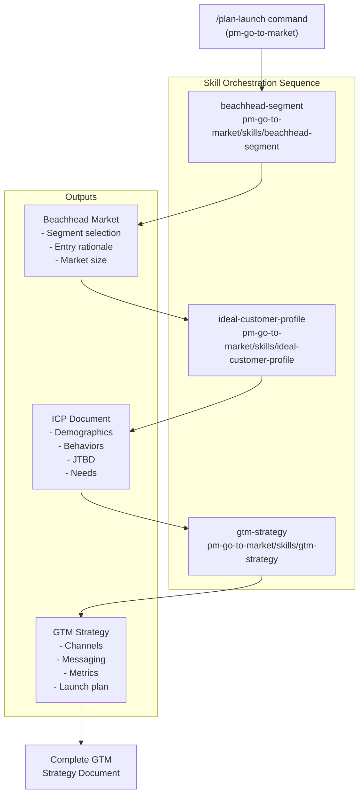
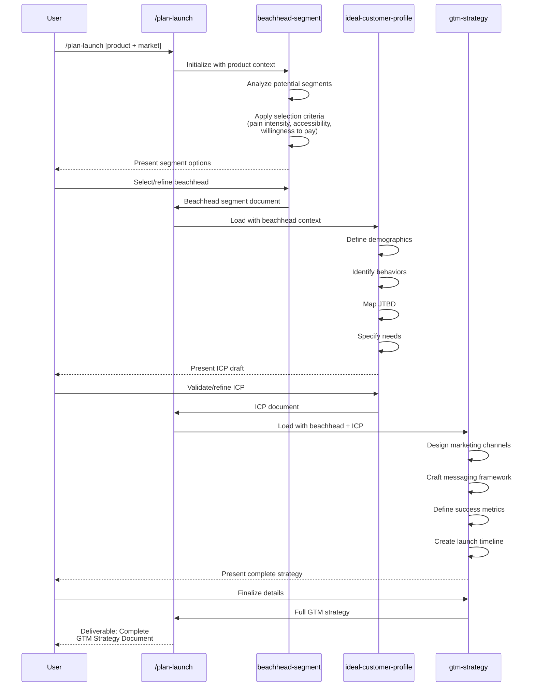
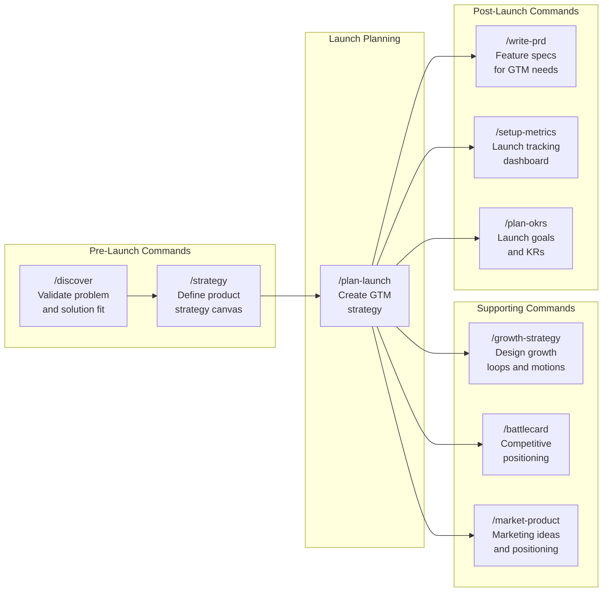

<!-- source: DeepWiki mcp.deepwiki.com · repo phuryn/pm-skills · page 6.4 /plan-launch Command · fetched 2026-10-27 -->

# /plan-launch Command

<details>
<summary>Relevant source files</summary>

The following files were used as context for generating this wiki page:

- [README.md](README.md)
- [pm-go-to-market/README.md](pm-go-to-market/README.md)

</details>


## Purpose and Scope

The `/plan-launch` command orchestrates a comprehensive go-to-market (GTM) strategy workflow, guiding users from initial market segmentation through to a complete launch plan. This command chains multiple skills from the `pm-go-to-market` plugin to create a structured, end-to-end GTM strategy document.

This page documents the command's architecture, skill orchestration sequence, and implementation details. For related GTM skills used independently, see [4.6 pm-go-to-market](#4.6). For the product strategy canvas that precedes GTM planning, see [6.2 /strategy Command](#6.2). For post-launch growth tactics, see [4.7 pm-marketing-growth](#4.7).

**Sources:** [README.md:18](), [README.md:298-328](), [pm-go-to-market/README.md:18]()

---

## Command Overview

The `/plan-launch` command creates a full go-to-market strategy by systematically addressing:

| Component | Output |
|-----------|--------|
| **Market Entry** | Beachhead segment identification and prioritization |
| **Customer Definition** | Ideal Customer Profile (ICP) with demographics, behaviors, JTBD |
| **Strategic Framework** | Complete GTM strategy covering channels, messaging, metrics |
| **Launch Execution** | Timeline, success criteria, and tactical launch plan |

The command is invoked with product context as an argument:

```
/plan-launch [product description and target market]
```

Example invocation: `/plan-launch AI code review tool targeting mid-size engineering teams`

**When to use:**
- Preparing for a new product launch
- Entering a new market segment with an existing product
- Creating a GTM playbook for sales/marketing teams
- Validating market entry assumptions before resource allocation

**Sources:** [README.md:313-328](), [pm-go-to-market/README.md:18]()

---

## Skill Chain Architecture

The `/plan-launch` command orchestrates three core skills in sequence, with each skill's output informing the next stage of the workflow.



**Architecture notes:**

- Skills execute sequentially, not in parallel
- Each skill receives the product context plus outputs from previous skills
- The command maintains state across skill invocations
- Skills are loaded from `pm-go-to-market/skills/*/SKILL.md` files
- Command definition located in `pm-go-to-market/commands/plan-launch.md`

**Sources:** [README.md:31-45](), [pm-go-to-market/README.md:5-12](), [pm-go-to-market/README.md:18]()

---

## Workflow Sequence

The command executes a four-phase workflow with user interaction points at each stage.



**Phase 1: Beachhead Segmentation**
- Analyze market landscape and potential entry points
- Apply Maja Voje's beachhead selection framework
- Evaluate segments on pain intensity, market accessibility, and willingness to pay
- Select the single highest-potential segment for initial entry

**Phase 2: ICP Definition**
- Deep-dive into the beachhead segment
- Create detailed customer profile with demographics, firmographics (B2B), and psychographics
- Map Jobs-to-be-Done and functional/emotional/social needs
- Identify behavioral patterns and purchase triggers

**Phase 3: GTM Strategy Design**
- Design multi-channel marketing approach aligned to ICP
- Develop positioning and messaging framework
- Define success metrics (leading and lagging indicators)
- Create tactical launch plan with timeline and milestones

**Phase 4: Integration & Delivery**
- Synthesize all components into unified strategy document
- Provide recommendations for next steps
- Suggest validation experiments or post-launch tracking

**Sources:** [pm-go-to-market/README.md:5-18]()

---

## Skills Orchestrated

### beachhead-segment

**File location:** `pm-go-to-market/skills/beachhead-segment/SKILL.md`

**Purpose:** Identifies the optimal first market segment for product entry using a structured evaluation framework.

**Framework basis:** Maja Voje's GTM strategy methodology focusing on concentrated market entry.

**Key outputs:**
- 3-5 candidate segments with analysis
- Evaluation matrix (pain intensity × accessibility × willingness to pay)
- Recommended beachhead with entry rationale
- Market size estimation (TAM/SAM/SOM for beachhead)

**Template structure:**
```
Segment Name
├── Demographics/Firmographics
├── Pain Points
├── Current Alternatives
├── Accessibility Assessment
├── Willingness to Pay Assessment
└── Strategic Fit Score
```

**Sources:** [README.md:305-306](), [pm-go-to-market/README.md:7]()

### ideal-customer-profile

**File location:** `pm-go-to-market/skills/ideal-customer-profile/SKILL.md`

**Purpose:** Creates a detailed profile of the ideal customer within the beachhead segment, enabling targeted sales and marketing.

**Framework basis:** Jobs-to-be-Done customer profiling with behavioral segmentation.

**Key outputs:**
- Demographics (B2C) or firmographics (B2B)
- Behavioral characteristics and patterns
- Jobs-to-be-Done framework analysis
- Needs hierarchy (functional, emotional, social)
- Purchase triggers and decision criteria
- Objections and concerns

**Template structure:**
```
ICP Profile
├── Who They Are (demographics/firmographics)
├── What They Do (behaviors)
├── Why They Buy (JTBD)
├── What They Need (functional/emotional/social)
├── How They Decide (process and criteria)
└── Alternatives They Consider
```

**Sources:** [README.md:306](), [pm-go-to-market/README.md:12]()

### gtm-strategy

**File location:** `pm-go-to-market/skills/gtm-strategy/SKILL.md`

**Purpose:** Synthesizes beachhead and ICP insights into an executable go-to-market strategy with channels, messaging, metrics, and launch plan.

**Framework basis:** Integrated GTM framework combining channel strategy, messaging frameworks, and launch planning.

**Key outputs:**
- Marketing channel strategy (awareness, consideration, conversion)
- Messaging framework aligned to ICP needs and JTBD
- Success metrics (North Star + input metrics)
- Launch timeline with milestones
- Resource requirements
- Risk mitigation strategies

**Template structure:**
```
GTM Strategy
├── Executive Summary
├── Beachhead & ICP Recap
├── Channel Strategy
│   ├── Awareness channels
│   ├── Consideration channels
│   └── Conversion channels
├── Messaging Framework
│   ├── Core positioning
│   ├── Value propositions
│   └── Channel-specific messaging
├── Success Metrics
│   ├── North Star Metric
│   ├── Input metrics
│   └── Launch KPIs
├── Launch Plan
│   ├── Pre-launch phase
│   ├── Launch phase
│   └── Post-launch phase
└── Resource Requirements & Risks
```

**Sources:** [README.md:304-305](), [pm-go-to-market/README.md:11]()

---

## Command Implementation

### File Structure

```
pm-go-to-market/
├── plugin.json                          # Plugin manifest
├── commands/
│   └── plan-launch.md                   # Command definition with frontmatter
└── skills/
    ├── beachhead-segment/
    │   └── SKILL.md                     # Skill definition
    ├── ideal-customer-profile/
    │   └── SKILL.md
    └── gtm-strategy/
        └── SKILL.md
```

**Sources:** [pm-go-to-market/README.md:1-27]()

### Command Frontmatter Structure

The command file `pm-go-to-market/commands/plan-launch.md` contains frontmatter metadata that defines:

| Field | Purpose |
|-------|---------|
| `name` | Command identifier: `plan-launch` |
| `description` | User-facing description shown in command palette |
| `argument-hint` | Placeholder text: `[product and target market]` |
| `skills` | Array of skill references executed in sequence |

The command references skills using relative paths within the plugin namespace, maintaining encapsulation and preventing cross-plugin dependencies.

**Sources:** [README.md:31-45](), [pm-go-to-market/README.md:18]()

### Skill Loading Mechanism

```mermaid
graph LR
    subgraph "Command Invocation"
        USER["User executes:<br/>/plan-launch or<br/>/pm-go-to-market:plan-launch"]
    end
    
    subgraph "Plugin Resolution"
        RESOLVE["Claude resolves to:<br/>pm-go-to-market plugin"]
        LOAD["Load command file:<br/>commands/plan-launch.md"]
    end
    
    subgraph "Skill Orchestration"
        PARSE["Parse frontmatter<br/>skill references"]
        SEQ["Sequential execution:<br/>1. beachhead-segment<br/>2. ideal-customer-profile<br/>3. gtm-strategy"]
    end
    
    subgraph "Skill Files"
        S1["Load SKILL.md files<br/>from pm-go-to-market/skills/"]
        S2["Apply skill templates<br/>to user context"]
        S3["Maintain context<br/>across skills"]
    end
    
    USER --> RESOLVE
    RESOLVE --> LOAD
    LOAD --> PARSE
    PARSE --> SEQ
    SEQ --> S1
    S1 --> S2
    S2 --> S3
    S3 --> OUTPUT["Deliver complete<br/>GTM strategy document"]
```



**Execution flow:**

1. User invokes `/plan-launch [context]` in conversation
2. Claude Code/Cowork resolves to `pm-go-to-market` plugin
3. Command file loaded from `pm-go-to-market/commands/plan-launch.md`
4. Frontmatter parsed to extract skill sequence
5. Skills loaded sequentially from `pm-go-to-market/skills/*/SKILL.md`
6. Each skill's template and instructions applied to accumulated context
7. Output from each skill added to context for subsequent skills
8. Final GTM strategy document delivered to user

**Sources:** [README.md:31-45](), [README.md:55-75]()

---

## Usage Examples

### Example 1: B2B SaaS Launch

**Invocation:**
```
/plan-launch AI-powered code review tool for mid-size engineering teams (50-200 developers)
```

**Expected workflow:**

1. **Beachhead identification:** Analyzes potential segments (startups, mid-market, enterprise) and recommends focusing on Series A/B startups with 50-200 developers, strong engineering culture, and active CI/CD pipelines.

2. **ICP definition:** Creates profile of VP Engineering or Engineering Manager at Series A/B SaaS companies, budgetary authority, experiencing code quality issues, values developer productivity tools.

3. **GTM strategy:** Recommends developer-led GTM motion with content marketing (engineering blogs, conference talks), product-led trial, and community building. Success metrics: developer signups, activation rate, team conversion rate.

**Output:** 8-12 page GTM strategy document ready for sales/marketing execution.

**Sources:** [README.md:325]()

### Example 2: Consumer App Launch

**Invocation:**
```
/plan-launch Meal planning app for busy parents juggling work and family schedules
```

**Expected workflow:**

1. **Beachhead identification:** Evaluates working parents, dual-income households, stay-at-home parents, and recommends dual-income households with children under 10 as beachhead due to high time pressure and disposable income.

2. **ICP definition:** Profile of 30-45 year old working parent, both partners employed full-time, 2-3 children, suburban household, values efficiency and health, struggles with dinner planning.

3. **GTM strategy:** Recommends content-led approach (parenting blogs, Instagram, TikTok), freemium model, referral program. Metrics: app installs, weekly active users, premium conversion rate.

**Output:** Consumer-focused GTM strategy with emphasis on viral growth and community.

**Sources:** [README.md:313-328]()

### Example 3: B2B Enterprise Tool Launch

**Invocation:**
```
/plan-launch Enterprise data governance platform for regulated industries
```

**Expected workflow:**

1. **Beachhead identification:** Analyzes financial services, healthcare, government sectors. Recommends mid-size financial services firms (500-5000 employees) with active compliance requirements and budget for governance tools.

2. **ICP definition:** Chief Data Officer or VP Compliance at mid-size financial institutions, responsible for regulatory compliance, experiencing audit issues, existing data infrastructure.

3. **GTM strategy:** Sales-led approach with industry conferences, analyst relations, compliance content marketing, pilot programs. Metrics: qualified pipeline, pilot conversion, implementation success rate.

**Output:** Enterprise-focused GTM strategy with long sales cycles and relationship-driven approach.

**Sources:** [README.md:313-328]()

---

## Integration with Other Commands

The `/plan-launch` command typically follows other discovery and strategy commands in the product development workflow, and can inform subsequent execution commands.



**Recommended command sequence:**

1. **Pre-launch foundation:** Run `/discover` to validate problem-solution fit and identify assumptions. Follow with `/strategy` to create comprehensive product strategy.

2. **GTM planning:** Execute `/plan-launch` to create beachhead-focused GTM strategy.

3. **Strategy refinement:** Use `/growth-strategy` to design sustainable growth loops beyond beachhead. Use `/battlecard` for competitive positioning materials.

4. **Marketing execution:** Run `/market-product` for tactical marketing ideas, positioning statements, and value propositions aligned to GTM strategy.

5. **Launch execution:** Use `/write-prd` for features needed to support GTM (e.g., analytics, onboarding flows). Create `/setup-metrics` dashboard for launch tracking. Define `/plan-okrs` for launch objectives.

**Context sharing:** The command's outputs (beachhead segment, ICP, messaging framework) serve as inputs to subsequent commands, maintaining strategic alignment across the product lifecycle.

**Sources:** [README.md:13-20](), [README.md:41-45]()

---

## Related Skills

The following skills from `pm-go-to-market` can be invoked independently when specific GTM components are needed without the full workflow:

| Skill | Use Case | Invocation |
|-------|----------|------------|
| `beachhead-segment` | Need only segment selection without full GTM | Direct conversation or `/pm-go-to-market:beachhead-segment` |
| `ideal-customer-profile` | Creating ICP for existing product/segment | Direct conversation or reference in context |
| `gtm-strategy` | Full GTM for known segment and ICP | Direct conversation when beachhead/ICP already defined |
| `growth-loops` | Designing sustainable growth mechanisms | See `/growth-strategy` command |
| `gtm-motions` | Evaluating product-led vs sales-led approach | See `/growth-strategy` command |
| `competitive-battlecard` | Sales enablement materials | See `/battlecard` command |

Skills are automatically loaded by Claude when context suggests relevance, or can be explicitly invoked using plugin-prefixed syntax.

**Sources:** [README.md:31-45](), [pm-go-to-market/README.md:5-18]()

---

## Validation and Quality Checks

The command and its constituent skills undergo automated validation via `validate_plugins.py` to ensure structural integrity:

**Command-level checks:**
- Frontmatter completeness (name, description, argument-hint)
- Valid skill references (no cross-plugin dependencies)
- Markdown formatting compliance

**Skill-level checks:**
- SKILL.md file existence in each skill directory
- Frontmatter metadata (name, description, word count)
- Description length ≥ 30 characters
- Content word count: 50-3000 words
- No broken internal references

Commands failing validation are rejected from marketplace distribution until issues are resolved.

**Sources:** [README.md:446-447](), Diagram 6 from high-level architecture

---

