# Page: Home

# Home

<details>
<summary>Relevant source files</summary>

The following files were used as context for generating this wiki page:

- [.claude-plugin/marketplace.json](.claude-plugin/marketplace.json)
- [.docs/images/add-marketplace.webp](.docs/images/add-marketplace.webp)
- [.docs/images/how-skills-work.webp](.docs/images/how-skills-work.webp)
- [README.md](README.md)

</details>


## Purpose and Scope

This document provides a technical overview of the **PM Skills Marketplace**, a structured AI workflow system that encodes product management methodologies into 65 executable skills and 36 orchestrated command workflows across 8 domain-specific plugins. The system is designed primarily for Claude Code CLI and Claude Cowork GUI environments, with graceful degradation to skills-only mode for other AI assistants (Gemini, Cursor, Codex, Kiro).

This page covers:
- System architecture and the three-tier abstraction model (Skills → Commands → Plugins)
- The 8 plugin domains and their lifecycle alignment
- Installation pathways and capability matrices
- Core usage patterns and access mechanisms

For detailed plugin-specific documentation, see [Plugin Reference](#4). For contribution guidelines and validation systems, see [Contributing](#7).

**Sources:** [README.md:1-11](), [.claude-plugin/marketplace.json:1-10]()

---

## System Architecture

The PM Skills Marketplace operates as a **marketplace-based plugin distribution system** defined in `.claude-plugin/marketplace.json`. The marketplace aggregates 8 plugins, each containing domain-specific skills and commands.

### Marketplace Definition

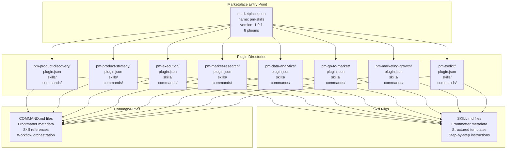

**Marketplace Structure:** The marketplace is defined in [.claude-plugin/marketplace.json:1-61](). Each plugin entry specifies a `name`, `description`, `source` directory path, and `category`. The marketplace owner information is at [.claude-plugin/marketplace.json:6-9]().

**Sources:** [.claude-plugin/marketplace.json:1-61](), [README.md:5-11]()

---

## Three-Tier Abstraction Model

The system implements a layered architecture where **Skills** are atomic units, **Commands** are orchestrated workflows, and **Plugins** are domain containers.

### Architecture Diagram

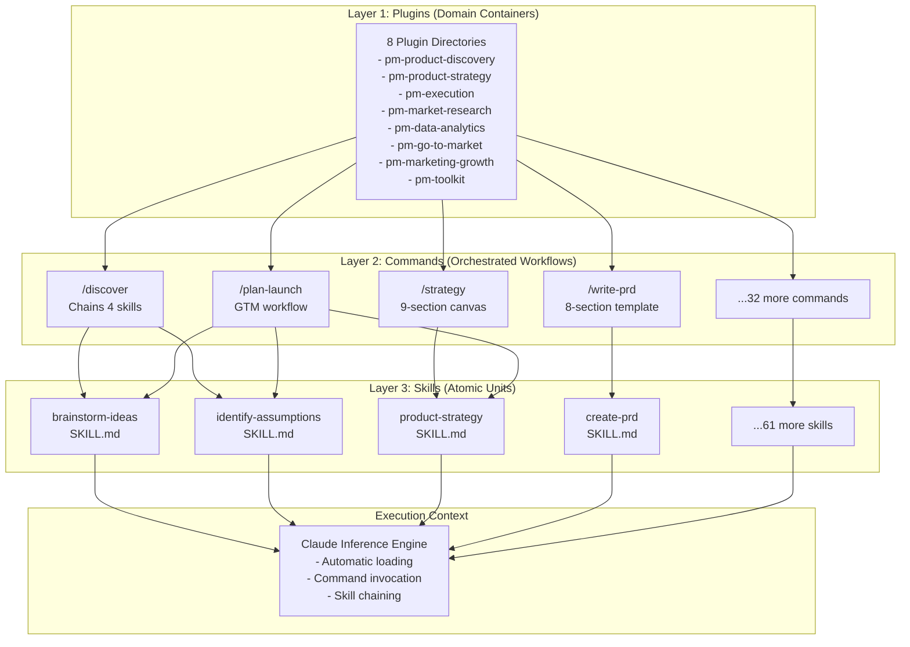

**Skills** are the foundational units. Each skill is a `SKILL.md` file containing:
- Frontmatter metadata (name, description, tags)
- Structured templates or frameworks
- Step-by-step execution instructions

**Commands** are workflows that chain one or more skills. Defined in `COMMAND.md` files, they orchestrate skill execution in predefined sequences. For example, `/discover` chains `brainstorm-ideas → identify-assumptions → prioritize-assumptions → brainstorm-experiments` ([README.md:37]()).

**Plugins** are domain containers grouping related skills and commands into installable packages. Each plugin has a `plugin.json` manifest and organized `skills/` and `commands/` directories.

**Sources:** [README.md:31-45](), [.claude-plugin/marketplace.json:11-60]()

---

## The Eight Plugin Domains

The marketplace organizes 65 skills and 36 commands across 8 plugins aligned to the product development lifecycle:

| Plugin | Skills | Commands | Lifecycle Stage | Source Directory |
|--------|--------|----------|-----------------|------------------|
| **pm-product-discovery** | 13 | 5 | Discovery | `./pm-product-discovery` |
| **pm-product-strategy** | 12 | 5 | Strategy | `./pm-product-strategy` |
| **pm-execution** | 15 | 10 | Execution | `./pm-execution` |
| **pm-go-to-market** | 6 | 3 | Launch | `./pm-go-to-market` |
| **pm-marketing-growth** | 5 | 2 | Growth | `./pm-marketing-growth` |
| **pm-market-research** | 7 | 3 | Supporting (Discovery/Strategy) | `./pm-market-research` |
| **pm-data-analytics** | 3 | 3 | Supporting (Execution/Growth) | `./pm-data-analytics` |
| **pm-toolkit** | 4 | 5 | Supporting (Operational) | `./pm-toolkit` |

### Lifecycle Alignment Diagram

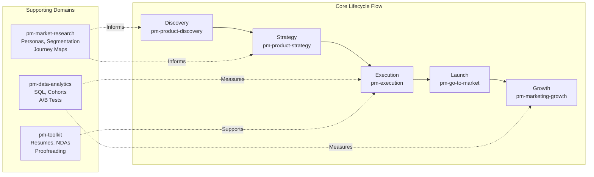

**Core Lifecycle Plugins** (5 plugins): Map to sequential product development stages from ideation through scaling.

**Supporting Plugins** (3 plugins): Provide cross-cutting capabilities:
- `pm-market-research` informs early-stage discovery and strategy with customer insights
- `pm-data-analytics` measures execution effectiveness and growth metrics
- `pm-toolkit` offers operational utilities (resume review, legal documents, proofreading)

**Example Command Chains:**
- Discovery → Strategy: `/discover` outputs feed into `/strategy`
- Strategy → Execution: `/strategy` outputs feed into `/write-prd`
- Execution → Launch: `/write-prd` outputs feed into `/plan-launch`

**Sources:** [README.md:97-413](), [.claude-plugin/marketplace.json:11-60]()

---

## Installation and Capability Matrix

The marketplace supports three installation pathways with different capability profiles:

### Installation Methods

```mermaid
graph TB
    subgraph "Installation Method 1: Claude Cowork GUI"
        CW1["User Action:<br/>Customize > Browse plugins<br/>Add marketplace from GitHub"]
        CW2["Repository:<br/>phuryn/pm-skills"]
        CW3["Result:<br/>All 8 plugins auto-installed<br/>Full capabilities"]
    end
    
    subgraph "Installation Method 2: Claude Code CLI"
        CC1["claude plugin marketplace add<br/>phuryn/pm-skills"]
        CC2["claude plugin install<br/>pm-product-discovery@pm-skills"]
        CC3["Result:<br/>Selective plugin installation<br/>Full capabilities"]
    end
    
    subgraph "Installation Method 3: Other AI Tools"
        OT1["Manual copy:<br/>cp pm-*/skills/* ~/.gemini/skills/"]
        OT2["Destinations:<br/>.gemini/skills/<br/>.cursor/skills/<br/>.codex/skills/<br/>.kiro/skills/"]
        OT3["Result:<br/>Skills only (no commands)<br/>No orchestration"]
    end
    
    CW1 --> CW2 --> CW3
    CC1 --> CC2 --> CC3
    OT1 --> OT2 --> OT3
```

### Capability Comparison

| Installation Method | Plugins | Commands | Skills | Orchestration | Target Users |
|---------------------|---------|----------|--------|---------------|--------------|
| **Claude Cowork** | ✓ | ✓ | ✓ | ✓ | Non-developers |
| **Claude Code CLI** | ✓ | ✓ | ✓ | ✓ | Developers |
| **Other AI Tools** | ✗ | ✗ | ✓ | ✗ | Universal (limited) |

**Claude Cowork Installation** ([README.md:49-58]()):
1. Open Customize (bottom-left)
2. Navigate to Browse plugins → Personal → +
3. Select "Add marketplace from GitHub"
4. Enter: `phuryn/pm-skills`

**Claude Code CLI Installation** ([README.md:62-75]()):
```bash
# Add marketplace
claude plugin marketplace add phuryn/pm-skills

# Install individual plugins
claude plugin install pm-product-discovery@pm-skills
claude plugin install pm-product-strategy@pm-skills
# ... repeat for other plugins
```

**Other AI Tools Installation** ([README.md:77-93]()):
```bash
# Copy all skills to Gemini CLI
for plugin in pm-*/; do
  cp -r "$plugin/skills/"* ~/.gemini/skills/ 2>/dev/null
done
```

**Capability Degradation:** Other AI tools receive skills only because the universal skill format (`SKILL.md`) is tool-agnostic, but commands (`/slash-commands`) are Claude-specific implementations ([README.md:79]()).

**Sources:** [README.md:47-94](), [.claude-plugin/marketplace.json:1-4]()

---

## Usage Patterns

The system supports three access patterns for different user expertise levels:

### Access Pattern Diagram

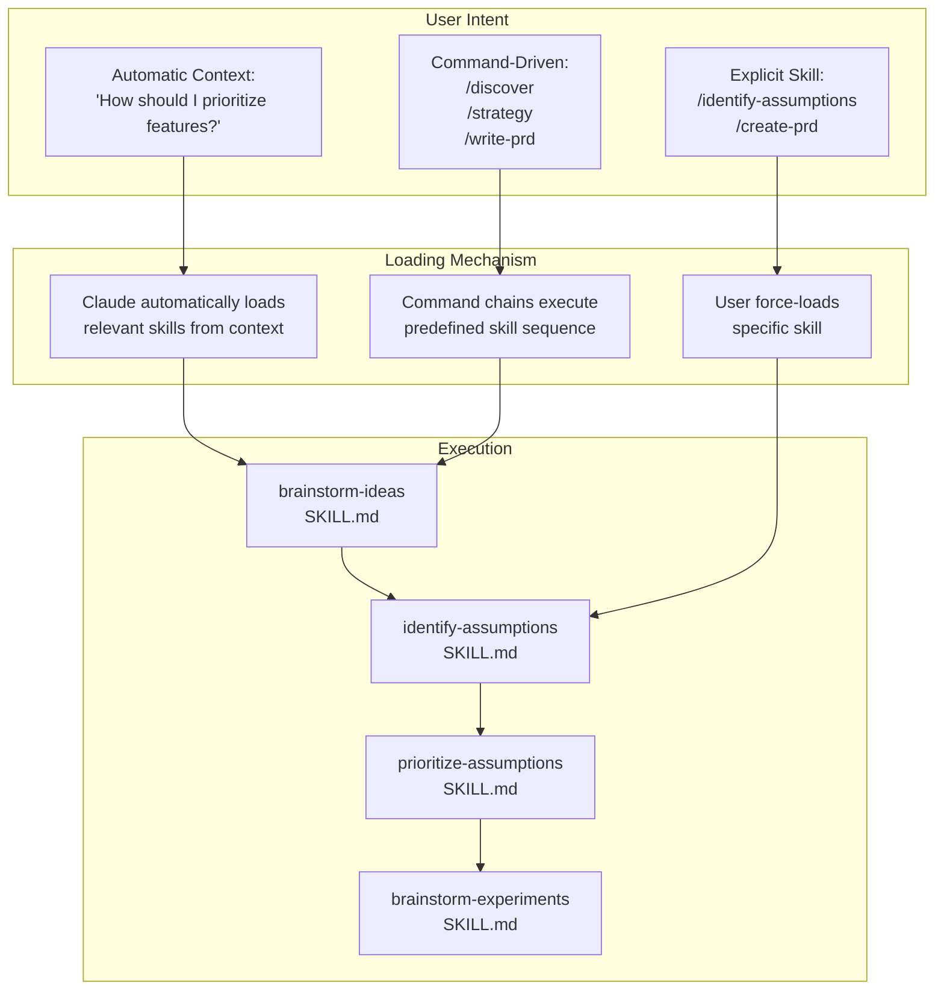

### Pattern 1: Automatic Loading

Skills are loaded automatically when relevant to conversation context. Claude's inference engine determines which skills apply based on user intent. No explicit invocation needed.

**Example:** User asks "What are the riskiest assumptions for our AI assistant?" → Claude automatically loads `identify-assumptions` skill.

**Reference Skills** (domain knowledge): `prioritization-frameworks`, `opportunity-solution-tree` are available as reference ([README.md:43]()).

**Sources:** [README.md:33-35]()

### Pattern 2: Command-Driven Workflows

Commands provide structured end-to-end processes. Users invoke with `/command-name` syntax.

**Example Commands:**
- `/discover` → Chains 4 skills: ideation → assumption mapping → prioritization → experiment design ([README.md:120]())
- `/strategy` → Creates 9-section Product Strategy Canvas ([README.md:162]())
- `/write-prd` → Generates 8-section PRD from feature idea ([README.md:207]())
- `/plan-launch` → Builds GTM strategy from beachhead to launch plan ([README.md:313]())

**Command Flow Suggestions:** After any command completes, it suggests relevant next commands to match PM workflow ([README.md:45]()).

**Sources:** [README.md:37-45](), [README.md:118-392]()

### Pattern 3: Explicit Skill Invocation

Power users directly invoke specific skills with `/plugin-name:skill-name` or `/skill-name` syntax (Claude adds prefix). This forces skill loading, prioritizing it over general knowledge.

**Example:** `/identify-assumptions for our checkout flow` → Force-loads the assumption mapping skill regardless of conversation context.

**Use Case:** When user wants specific framework application overriding Claude's automatic selection.

**Sources:** [README.md:35]()

---

## Core Statistics

| Metric | Count |
|--------|-------|
| **Total Plugins** | 8 |
| **Total Skills** | 65 |
| **Total Commands** | 36 |
| **PM Frameworks Encoded** | 11+ |
| **Supported AI Tools (Skills)** | Claude, Gemini, Cursor, Codex, Kiro |
| **Supported AI Tools (Full Stack)** | Claude Code, Claude Cowork |

### Framework Attribution

The skills encode methodologies from established PM practitioners ([README.md:401-414]()):

| Practitioner | Framework/Method | Example Skills |
|--------------|------------------|----------------|
| Teresa Torres | Continuous Discovery Habits, OSTs | `opportunity-solution-tree`, `interview-script` |
| Marty Cagan | INSPIRED, PRDs, Empowerment | `create-prd`, `product-vision` |
| Alberto Savoia | The Right It, Pretotyping | `brainstorm-experiments-new` |
| Ash Maurya | Running Lean, Lean Canvas | `lean-canvas` |
| Roger Martin | Playing to Win | `product-strategy` |
| Anthony Ulwick | Jobs to Be Done | `value-proposition`, `interview-script` |
| Maja Voje | GTM Strategist | `beachhead-segment`, `gtm-strategy` |

**Sources:** [README.md:397-416]()

---

## Quick Start Examples

**Discovery Workflow:**
```
/discover AI-powered meeting summarizer for remote teams
```
Output: Ideation → Assumption map → Prioritization → Experiment designs

**Strategy Development:**
```
/strategy B2B project management tool for agencies
```
Output: 9-section Product Strategy Canvas (vision → defensibility)

**PRD Creation:**
```
/write-prd Smart notification system that reduces alert fatigue
```
Output: Comprehensive 8-section PRD

**Launch Planning:**
```
/plan-launch AI code review tool targeting mid-size engineering teams
```
Output: Full GTM strategy from beachhead to launch plan

**Sources:** [README.md:13-19](), [README.md:134-136](), [README.md:176-178](), [README.md:325-327]()

---

## Repository Structure

```
pm-skills/
├── .claude-plugin/
│   └── marketplace.json          # Marketplace definition
├── pm-product-discovery/
│   ├── plugin.json
│   ├── skills/                   # 13 skills
│   ├── commands/                 # 5 commands
│   └── README.md
├── pm-product-strategy/
│   ├── plugin.json
│   ├── skills/                   # 12 skills
│   ├── commands/                 # 5 commands
│   └── README.md
├── pm-execution/
│   ├── plugin.json
│   ├── skills/                   # 15 skills
│   ├── commands/                 # 10 commands
│   └── README.md
├── pm-market-research/
│   ├── plugin.json
│   ├── skills/                   # 7 skills
│   ├── commands/                 # 3 commands
│   └── README.md
├── pm-data-analytics/
│   ├── plugin.json
│   ├── skills/                   # 3 skills
│   ├── commands/                 # 3 commands
│   └── README.md
├── pm-go-to-market/
│   ├── plugin.json
│   ├── skills/                   # 6 skills
│   ├── commands/                 # 3 commands
│   └── README.md
├── pm-marketing-growth/
│   ├── plugin.json
│   ├── skills/                   # 5 skills
│   ├── commands/                 # 2 commands
│   └── README.md
├── pm-toolkit/
│   ├── plugin.json
│   ├── skills/                   # 4 skills
│   ├── commands/                 # 5 commands
│   └── README.md
├── validate_plugins.py           # Quality gate validation
├── CONTRIBUTING.md               # Contribution guidelines
├── LICENSE                       # MIT license
└── README.md                     # Main documentation
```

**Sources:** [.claude-plugin/marketplace.json:11-60](), [README.md:1-447]()

---

## Next Steps

- **For detailed plugin documentation:** See [Plugin Reference](#4) for comprehensive coverage of all 8 plugins, their skills, and commands.
- **For complex skill deep-dives:** See [Featured Skills](#5) for in-depth documentation of high-value frameworks like Business Model Canvases, Product Strategy Canvas, and Value Proposition Design.
- **For workflow examples:** See [Key Commands](#6) for detailed walkthroughs of `/discover`, `/strategy`, `/write-prd`, and `/plan-launch` workflows.
- **For contributing new skills or plugins:** See [Contributing](#7) for guidelines, validation requirements, and submission process.

**Sources:** [README.md:1-447]()

---

# Page: Getting Started

# Getting Started

<details>
<summary>Relevant source files</summary>

The following files were used as context for generating this wiki page:

- [.docs/images/pm-skills-install.gif](.docs/images/pm-skills-install.gif)
- [README.md](README.md)

</details>


This page provides a quick-start guide for installing and using the PM Skills Marketplace. It covers prerequisite knowledge, installation decision criteria, and your first workflow. For detailed installation procedures, see [Installation](#2.1). For comprehensive usage patterns and examples, see [Using Skills and Commands](#2.2).

---

## Prerequisites

Before installing the PM Skills Marketplace, you need one of the following AI assistants:

| AI Assistant | Full Support | Skills Only | Installation Method |
|--------------|--------------|-------------|---------------------|
| **Claude Cowork** (GUI) | ✓ | — | Marketplace browser |
| **Claude Code** (CLI) | ✓ | — | `claude plugin` commands |
| **Gemini CLI** | — | ✓ | Manual file copy |
| **Cursor** | — | ✓ | Manual file copy |
| **Codex CLI** | — | ✓ | Manual file copy |
| **Kiro** | — | ✓ | Manual file copy |

**Full Support** means you get plugins, commands (`/discover`, `/strategy`, etc.), and skills with orchestration. **Skills Only** means you get the 65 individual skills but not the command chaining workflows.

No other dependencies are required. The marketplace is a collection of markdown files with YAML frontmatter that AI assistants parse and execute.

**Sources:** [README.md:49-94]()

---

## Choosing Your Installation Path

The installation method you choose determines which capabilities you get:

### Decision Tree: Which Installation Method?

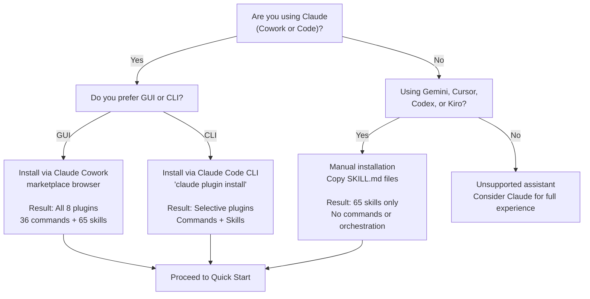

**Recommendation:** Use **Claude Cowork** for the simplest installation (one-click, all plugins). Use **Claude Code** if you want granular control over which plugins to install. Use manual installation only if you're on a non-Claude platform.

**Sources:** [README.md:49-94]()

---

## Quick Start: 3 Steps to Your First Workflow

### Step 1: Install the Marketplace

**For Claude Cowork:**
1. Open Customize (bottom-left corner)
2. Navigate to Browse plugins → Personal → +
3. Select "Add marketplace from GitHub"
4. Enter: `phuryn/pm-skills`

All 8 plugins install automatically.

**For Claude Code CLI:**
```bash
# Add marketplace
claude plugin marketplace add phuryn/pm-skills

# Install core plugins (choose based on your needs)
claude plugin install pm-product-discovery@pm-skills
claude plugin install pm-execution@pm-skills
```

Full installation details in [Installation](#2.1).

### Step 2: Verify Installation

After installation, the following directory structure exists in your environment:

#### Installation Architecture

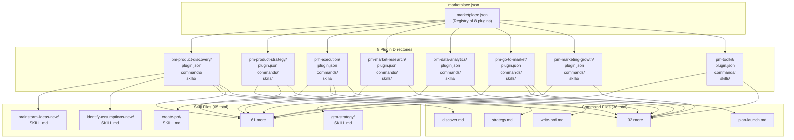

Each plugin directory contains:
- `plugin.json` - Manifest with plugin metadata
- `commands/` - Directory containing command definition files (`*.md`)
- `skills/` - Directory containing skill subdirectories
- `README.md` - Plugin documentation

Each skill directory contains:
- `SKILL.md` - Skill definition with YAML frontmatter + instructions

**Sources:** [README.md:1-10](), [marketplace.json:1-50]()

### Step 3: Run Your First Command

Open a conversation in Claude and type:

```
/discover AI-powered meeting notes tool for remote teams
```

This executes the discovery workflow, which chains 4 skills:
1. `brainstorm-ideas-new` - Generate solution ideas
2. `identify-assumptions-new` - Map risky assumptions
3. `prioritize-assumptions` - Rank by impact × risk
4. `brainstorm-experiments-new` - Design validation experiments

You'll see Claude guide you through each step with structured templates and probing questions.

**Sources:** [README.md:15-19, 120-137]()

---

## Understanding Command-to-Skill Execution Flow

When you invoke a command, here's what happens under the hood:

### Execution Flow: /discover Command

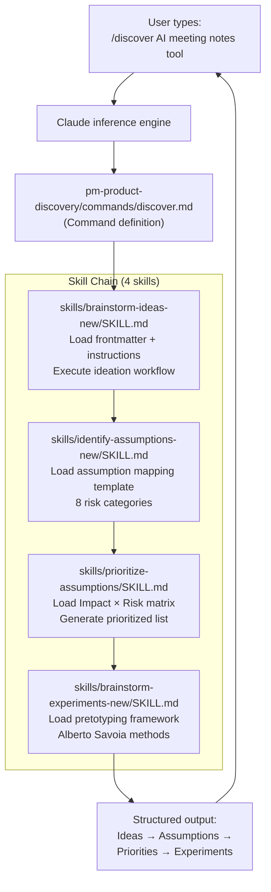

Each `SKILL.md` file contains:
- **YAML frontmatter** with metadata (`name`, `description`, `tags`, `related_skills`)
- **Markdown instructions** with step-by-step guidance, templates, and examples

Claude parses the frontmatter to understand skill capabilities, then executes the instructions as a guided workflow.

**Sources:** [README.md:31-46, 120-137]()

---

## Common First Workflows

After installation, try these workflows based on your product stage:

| Your Situation | Recommended Command | What It Does |
|----------------|---------------------|--------------|
| New product idea | `/discover [idea]` | Full discovery: ideation → assumptions → experiments |
| Need strategic clarity | `/strategy [product]` | 9-section Product Strategy Canvas |
| Writing requirements | `/write-prd [feature]` | Structured PRD with 8 sections |
| Planning a launch | `/plan-launch [product]` | GTM strategy: beachhead → channels → messaging |
| Defining success metrics | `/north-star [product]` | North Star Metric + input metrics |
| Feature prioritization | Direct skill invocation | Use `prioritize-features` or `prioritization-frameworks` |

For comprehensive command documentation, see [Key Commands](#6).

**Sources:** [README.md:15-19, 120-393]()

---

## Skills vs Commands: What You Installed

### The Three-Layer Model

The marketplace organizes capabilities into three layers:

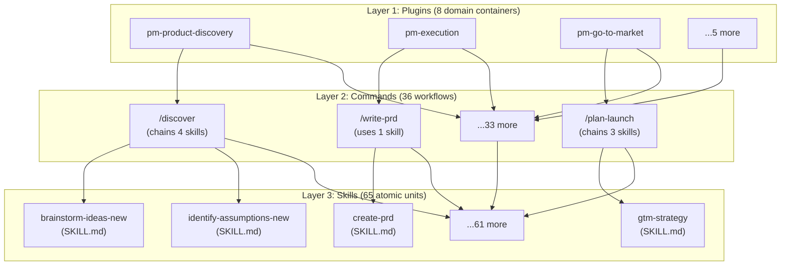

**Plugins** are installable packages. Each plugin covers a PM domain (discovery, strategy, execution, etc.).

**Commands** are slash-commands (`/discover`, `/strategy`) that you invoke explicitly. They orchestrate one or more skills into workflows.

**Skills** are atomic units of PM knowledge. They can be:
- Automatically loaded by Claude when relevant to the conversation
- Explicitly invoked via `/plugin-name:skill-name` or `/skill-name`
- Chained together by commands

Example: The `/discover` command (defined in [pm-product-discovery/commands/discover.md]()) chains these skills:
1. [pm-product-discovery/skills/brainstorm-ideas-new/SKILL.md]()
2. [pm-product-discovery/skills/identify-assumptions-new/SKILL.md]()
3. [pm-product-discovery/skills/prioritize-assumptions/SKILL.md]()
4. [pm-product-discovery/skills/brainstorm-experiments-new/SKILL.md]()

For architectural details, see [Three-Tier Abstraction Model](#3.1).

**Sources:** [README.md:31-46]()

---

## Verification: Did Installation Work?

Test your installation with these checks:

### 1. Command Availability Test

Type `/` in Claude and verify you see:
- `/discover`
- `/strategy`
- `/write-prd`
- `/plan-launch`
- Other commands from installed plugins

### 2. Skill Automatic Loading Test

Ask Claude a product question without invoking a command:

```
What framework should I use to prioritize 20 feature requests?
```

If installation succeeded, Claude will reference `prioritization-frameworks` skill and explain 9 frameworks (Opportunity Score, ICE, RICE, MoSCoW, Kano, Value vs. Effort, Weighted Scoring, Buy-a-Feature, Story Mapping).

### 3. Explicit Skill Invocation Test

Force-load a specific skill:

```
/identify-assumptions-new for a two-sided marketplace connecting freelancers with clients
```

Claude should load [pm-product-discovery/skills/identify-assumptions-new/SKILL.md]() and walk you through 8 risk categories.

If any test fails, see [Installation](#2.1) for troubleshooting.

**Sources:** [README.md:31-46, 99-137]()

---

## File Structure Reference

Here's what got installed:

```
phuryn/pm-skills/
├── marketplace.json                    # Registry of 8 plugins
├── validate_plugins.py                 # Quality validation script
├── CONTRIBUTING.md                     # Contribution guidelines
│
├── pm-product-discovery/
│   ├── plugin.json                     # Plugin manifest
│   ├── README.md                       # Plugin documentation
│   ├── commands/
│   │   ├── discover.md                 # /discover command
│   │   ├── brainstorm.md               # /brainstorm command
│   │   ├── interview.md                # /interview command
│   │   ├── setup-metrics.md            # /setup-metrics command
│   │   └── triage-requests.md          # /triage-requests command
│   └── skills/
│       ├── brainstorm-ideas-new/SKILL.md
│       ├── identify-assumptions-new/SKILL.md
│       ├── prioritize-assumptions/SKILL.md
│       ├── brainstorm-experiments-new/SKILL.md
│       └── ...9 more skills
│
├── pm-product-strategy/
│   ├── plugin.json
│   ├── commands/
│   │   ├── strategy.md                 # /strategy command
│   │   ├── business-model.md           # /business-model command
│   │   └── ...3 more commands
│   └── skills/
│       ├── product-strategy/SKILL.md
│       ├── lean-canvas/SKILL.md
│       └── ...10 more skills
│
├── pm-execution/
│   ├── plugin.json
│   ├── commands/
│   │   ├── write-prd.md                # /write-prd command
│   │   ├── sprint.md                   # /sprint command
│   │   └── ...8 more commands
│   └── skills/
│       ├── create-prd/SKILL.md
│       ├── brainstorm-okrs/SKILL.md
│       └── ...13 more skills
│
└── ...5 more plugin directories
    (pm-market-research, pm-data-analytics, pm-go-to-market,
     pm-marketing-growth, pm-toolkit)
```

Each skill's `SKILL.md` follows this structure:

```markdown
---
name: skill-name
description: Brief description (30+ characters)
tags: [tag1, tag2, tag3]
related_skills: [other-skill-1, other-skill-2]
---

# Instructions

Step-by-step guidance for the AI assistant...

## Template

Structured template or framework...

## Examples

Sample outputs or use cases...
```

**Sources:** [README.md:1-10](), [validate_plugins.py:1-309]()

---

## Next Steps

After completing installation and verification:

1. **Learn command patterns** - See [Using Skills and Commands](#2.2) for invocation patterns and examples
2. **Explore your workflow stage** - See [Plugin Reference](#4) to find plugins matching your current product stage
3. **Try a complete workflow** - See [Key Commands](#6) for end-to-end workflow examples
4. **Understand the architecture** - See [Architecture](#3) for how skills, commands, and plugins work together

Common learning paths:

| Your Role | Start With | Then Explore |
|-----------|------------|--------------|
| **PM in discovery** | [pm-product-discovery](#4.1) | [/discover command](#6.1) |
| **PM defining strategy** | [pm-product-strategy](#4.2) | [/strategy command](#6.2) |
| **PM writing specs** | [pm-execution](#4.3) | [/write-prd command](#6.3) |
| **PM launching product** | [pm-go-to-market](#4.6) | [/plan-launch command](#6.4) |
| **PM analyzing data** | [pm-data-analytics](#4.5) | [Data Analytics Skills](#5.4) |

**Sources:** [README.md:1-447]()

---

## Troubleshooting

### Claude Cowork Installation Issues (Windows)

If Cowork is unstable or can't start a VM, run this PowerShell script as Administrator:

```powershell
$action = New-ScheduledTaskAction -Execute "powershell.exe" -Argument "-WindowStyle Hidden -Command `"if ((Get-Service CoworkVMService).Status -ne 'Running') { Start-Service CoworkVMService }`""

$trigger = New-ScheduledTaskTrigger -RepetitionInterval (New-TimeSpan -Minutes 1) -Once -At (Get-Date)

$settings = New-ScheduledTaskSettingsSet -AllowStartIfOnBatteries -DontStopIfGoingOnBatteries

Register-ScheduledTask -TaskName "CoworkVMServiceMonitor" `
  -Action $action `
  -Trigger $trigger `
  -Settings $settings `
  -RunLevel Highest `
  -User "SYSTEM"
```

This resolves 90% of Windows installation issues. For remaining issues, manually start the "Claude" service in `services.msc`.

**Sources:** [README.md:422-443]()

### Commands Not Appearing

If commands don't appear after installation:

1. **Claude Cowork:** Restart the application
2. **Claude Code:** Run `claude plugin list` to verify installation
3. **Check plugin manifest:** Ensure [plugin.json]() files exist in each plugin directory

### Skills Not Loading Automatically

If skills aren't automatically loaded in conversations:

1. Verify `SKILL.md` files exist in `skills/*/` subdirectories
2. Check frontmatter is valid YAML (use [validate_plugins.py]() to verify)
3. Try explicit invocation: `/skill-name` to force-load

For validation, run:

```bash
python validate_plugins.py
```

This checks all manifests, skills, and commands for structural issues.

**Sources:** [README.md:422-443](), [validate_plugins.py:1-309]()

---

# Page: Installation

# Installation

<details>
<summary>Relevant source files</summary>

The following files were used as context for generating this wiki page:

- [.docs/images/pm-skills-install.gif](.docs/images/pm-skills-install.gif)
- [README.md](README.md)

</details>


This document provides detailed installation instructions for the PM Skills Marketplace across three integration pathways: Claude Cowork (GUI-based), Claude Code CLI (command-line), and other AI assistants (manual file copying). Each method offers different levels of integration and capabilities.

For information about using installed skills and commands after installation, see [Using Skills and Commands](#2.2). For architectural details about how plugins, commands, and skills relate to each other, see [Three-Tier Abstraction Model](#3.1).

---

## Overview

The PM Skills Marketplace supports three installation methods with varying capability profiles:

| Method | User Type | Commands | Skills | Plugins | Orchestration |
|--------|-----------|----------|--------|---------|---------------|
| **Claude Cowork** | Non-developers | ✓ | ✓ | ✓ | ✓ |
| **Claude Code CLI** | Developers | ✓ | ✓ | ✓ | ✓ |
| **Other AI Tools** | Any | ✗ | ✓ | ✗ | ✗ |

**Full-stack installation** (Claude Cowork and Claude Code) provides access to plugins, commands (`/discover`, `/strategy`, etc.), skills, and multi-skill orchestration workflows. **Skills-only installation** (other AI tools) provides individual skill files but sacrifices command chaining and plugin structure.

**Sources:** [README.md:47-94](), Diagram 5 from high-level architecture

---

## Repository Structure

The marketplace repository at `phuryn/pm-skills` contains the following structure:

```
pm-skills/
├── marketplace.json              # Marketplace manifest
├── validate_plugins.py           # Quality gate validation
├── pm-product-discovery/         # Plugin directory
│   ├── plugin.json              # Plugin manifest
│   ├── README.md                # Plugin documentation
│   ├── skills/                  # Skill definitions
│   │   ├── brainstorm-ideas-existing/
│   │   │   └── SKILL.md        # Universal skill format
│   │   ├── identify-assumptions-existing/
│   │   │   └── SKILL.md
│   │   └── ...
│   └── slash-commands/          # Command definitions
│       ├── discover.md
│       └── ...
├── pm-product-strategy/
├── pm-execution/
├── pm-market-research/
├── pm-data-analytics/
├── pm-go-to-market/
├── pm-marketing-growth/
└── pm-toolkit/
```

Each of the 8 plugin directories follows this pattern. The `skills/*/SKILL.md` files use a universal frontmatter format that works across AI assistants, while `slash-commands/*.md` files are Claude-specific.

**Sources:** [README.md:32-40](), Diagram 1 from high-level architecture

---

## Method 1: Claude Cowork (GUI)

### Installation Flow Diagram

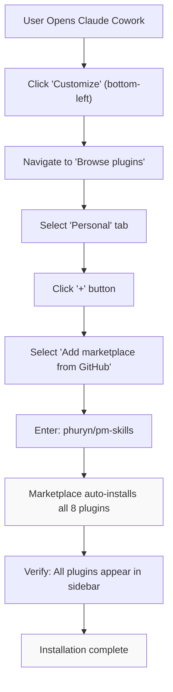

### Step-by-Step Instructions

1. **Open Customize Panel**: Click the **Customize** button in the bottom-left corner of Claude Cowork
2. **Access Plugin Marketplace**: Navigate to **Browse plugins** → **Personal** → **+**
3. **Add GitHub Marketplace**: Select **Add marketplace from GitHub**
4. **Enter Repository**: Input `phuryn/pm-skills` in the repository field
5. **Automatic Installation**: All 8 plugins install automatically without manual selection

The Cowork GUI reads `marketplace.json` at the repository root, which contains references to all plugin directories and their manifests (`plugin.json`).

### What Gets Installed


All plugins are installed as a single marketplace entity. Commands are invoked with `/command-name` syntax, and skills load automatically when relevant to the conversation.

**Sources:** [README.md:49-58](), Diagram 5 from high-level architecture

---

## Method 2: Claude Code CLI

### Two-Step Installation Process

The CLI requires two distinct steps: marketplace registration and plugin installation.

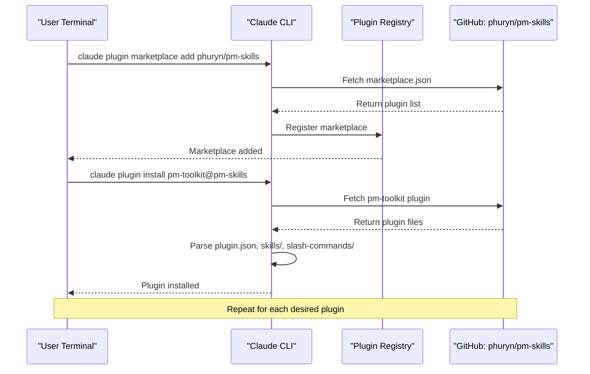

### Step 1: Register Marketplace

```bash
claude plugin marketplace add phuryn/pm-skills
```

This command registers the marketplace by fetching `marketplace.json` from the repository root and adding it to the local plugin registry. The marketplace manifest contains metadata about all available plugins but does not install them.

### Step 2: Install Plugins

Install individual plugins using the `plugin-name@marketplace-name` syntax:

```bash
# Recommended installation order (by frequency of use)
claude plugin install pm-product-discovery@pm-skills
claude plugin install pm-product-strategy@pm-skills
claude plugin install pm-execution@pm-skills
claude plugin install pm-go-to-market@pm-skills
claude plugin install pm-market-research@pm-skills
claude plugin install pm-data-analytics@pm-skills
claude plugin install pm-marketing-growth@pm-skills
claude plugin install pm-toolkit@pm-skills
```

Each `install` command:
1. Clones the plugin directory from GitHub
2. Parses the `plugin.json` manifest
3. Copies `skills/*/SKILL.md` files to the local skill registry
4. Copies `slash-commands/*.md` files to the local command registry
5. Validates frontmatter and structure

### Plugin Directory to File Mapping

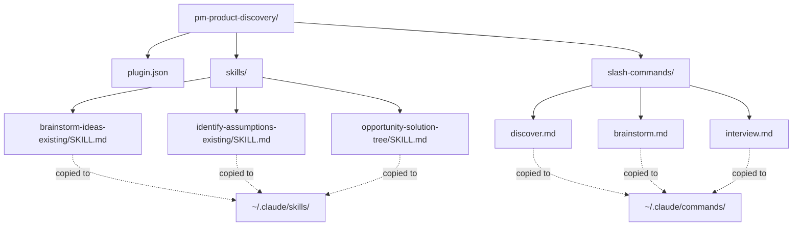

The CLI maintains local copies in `~/.claude/` (Linux/macOS) or `%APPDATA%\Claude\` (Windows). Each plugin's `skills/` and `slash-commands/` directories are unpacked into these central registries.

### Selective Installation

Unlike Cowork, the CLI allows installing only needed plugins:

```bash
# Minimal installation for discovery workflows
claude plugin install pm-product-discovery@pm-skills
claude plugin install pm-execution@pm-skills

# Add strategy capabilities later
claude plugin install pm-product-strategy@pm-skills
```

**Sources:** [README.md:60-75](), Diagram 5 from high-level architecture

---

## Method 3: Other AI Assistants (Skills Only)

### Compatibility and Limitations

The `SKILL.md` files follow the universal skill format defined in the AI assistant ecosystem. However, `slash-commands/*.md` files use Claude-specific orchestration syntax and will not function in other tools.

| AI Tool | Skill Directory | Commands Support | Skills Support |
|---------|----------------|------------------|----------------|
| **Gemini CLI** | `~/.gemini/skills/` | ✗ | ✓ |
| **Cursor** | `~/.cursor/skills/` | ✗ | ✓ |
| **Codex CLI** | `~/.codex/skills/` | ✗ | ✓ |
| **Kiro** | `~/.kiro/skills/` | ✗ | ✓ |

### Manual Installation Process

```mermaid
flowchart LR
    REPO["Clone/Download\nphuryn/pm-skills"]
    
    subgraph PLUGINS["8 Plugin Directories"]
        P1["pm-product-discovery/"]
        P2["pm-product-strategy/"]
        P3["pm-execution/"]
        PMORE["... (5 more)"]
    end
    
    subgraph EXTRACT["Extract Skills"]
        SK1["skills/brainstorm-ideas-existing/SKILL.md"]
        SK2["skills/identify-assumptions-existing/SKILL.md"]
        SK3["skills/create-prd/SKILL.md"]
        SKMORE["... (62 more)"]
    end
    
    DEST["Destination:\n~/.gemini/skills/\n~/.cursor/skills/\n~/.codex/skills/\n~/.kiro/skills/"]
    
    REPO --> PLUGINS
    PLUGINS --> EXTRACT
    EXTRACT --> DEST
```

### Bulk Copy Script

For copying all 65 skills to Gemini CLI:

```bash
# Navigate to cloned repository
cd pm-skills

# Copy all SKILL.md files from all plugins
for plugin in pm-*/; do
  cp -r "$plugin/skills/"* ~/.gemini/skills/ 2>/dev/null
done
```

For other tools, replace `~/.gemini/skills/` with the appropriate destination:
- **Cursor**: `~/.cursor/skills/`
- **Codex CLI**: `~/.codex/skills/`
- **Kiro**: `~/.kiro/skills/`

### File Structure After Manual Installation

```
~/.gemini/skills/
├── brainstorm-ideas-existing/
│   └── SKILL.md
├── brainstorm-ideas-new/
│   └── SKILL.md
├── identify-assumptions-existing/
│   └── SKILL.md
├── create-prd/
│   └── SKILL.md
├── product-strategy/
│   └── SKILL.md
└── ... (61 more skills)
```

Each skill directory contains a single `SKILL.md` file with frontmatter metadata and structured instructions. The AI assistant reads these files to provide domain-specific guidance.

### Lost Capabilities

Without commands, users cannot invoke orchestrated workflows like `/discover` (which chains `brainstorm-ideas` → `identify-assumptions` → `prioritize-assumptions` → `brainstorm-experiments`). Instead, users must manually invoke skills sequentially:

**Claude with commands:**
```
/discover AI writing assistant for non-native English speakers
```

**Other AI without commands:**
```
Use the brainstorm-ideas-new skill for an AI writing assistant targeting non-native English speakers
[review results]
Now use identify-assumptions-new to map risky assumptions
[review results]
Use prioritize-assumptions to rank by impact and risk
[review results]
Use brainstorm-experiments-new to design validation experiments
```

**Sources:** [README.md:77-93](), Diagram 1 and Diagram 5 from high-level architecture

---

## Post-Installation Verification

### For Claude Cowork

1. Open a new conversation
2. Type `/` to see all available commands
3. Verify commands like `/discover`, `/strategy`, `/write-prd` appear
4. Check plugin list in the Customize panel (bottom-left) shows all 8 plugins

### For Claude Code CLI

```bash
# List installed marketplaces
claude plugin marketplace list

# List installed plugins
claude plugin list

# Verify specific plugin
claude plugin show pm-product-discovery@pm-skills
```

Expected output should include:
- **Marketplace**: `pm-skills`
- **Plugins**: 8 entries (or fewer if selectively installed)
- **Skills**: 65 total across all plugins
- **Commands**: 36 total across all plugins

### For Other AI Assistants

1. Start a conversation
2. Ask: "What PM skills do you have available?"
3. The assistant should reference skills from the marketplace (e.g., "I can help with brainstorm-ideas-new, create-prd, product-strategy...")
4. Test a specific skill: "Use the create-prd skill to outline a PRD for [feature]"

**Sources:** [README.md:13-19](), inference from installation methods

---

## Installation Capability Matrix

```mermaid
graph TB
    subgraph INSTALL["Installation Methods"]
        COWORK["Claude Cowork\n(GUI)"]
        CODE["Claude Code\n(CLI)"]
        OTHER["Other AI Tools\n(Manual)"]
    end
    
    subgraph LAYER1["Plugin Layer"]
        PL1["8 Plugin Directories"]
        PL2["plugin.json Manifests"]
    end
    
    subgraph LAYER2["Command Layer"]
        CMD1["36 Commands"]
        CMD2["slash-commands/*.md"]
    end
    
    subgraph LAYER3["Skill Layer"]
        SK1["65 Skills"]
        SK2["skills/*/SKILL.md"]
    end
    
    subgraph FEATURES["Capability Profile"]
        F1["Orchestration"]
        F2["Command Chaining"]
        F3["Skill Loading"]
        F4["Plugin Management"]
    end
    
    COWORK -.->|installs| PL1
    COWORK -.->|installs| CMD1
    COWORK -.->|installs| SK1
    COWORK -.->|enables| F1
    COWORK -.->|enables| F2
    COWORK -.->|enables| F3
    COWORK -.->|enables| F4
    
    CODE -.->|installs| PL1
    CODE -.->|installs| CMD1
    CODE -.->|installs| SK1
    CODE -.->|enables| F1
    CODE -.->|enables| F2
    CODE -.->|enables| F3
    CODE -.->|enables| F4
    
    OTHER -.->|copies| SK1
    OTHER -.->|enables| F3
    
    style COWORK fill:#f9f9f9
    style CODE fill:#f9f9f9
    style OTHER fill:#f9f9f9
```

**Key Tradeoffs:**
- **Claude Cowork**: Simplest installation, all plugins auto-installed, ideal for non-technical users
- **Claude Code CLI**: Granular control, selective plugin installation, version pinning, ideal for developers
- **Other AI Tools**: Maximum compatibility, skills-only, no orchestration, manual maintenance

**Sources:** [README.md:47-94](), Diagram 5 from high-level architecture

---

## Troubleshooting

### Windows: CoworkVMService Instability

If Claude Cowork crashes or cannot start a VM (issue [claude-code/issues/27010](https://github.com/anthropics/claude-code/issues/27010)), use this PowerShell script to create a service monitor:

```powershell
$action = New-ScheduledTaskAction -Execute "powershell.exe" -Argument "-WindowStyle Hidden -Command `"if ((Get-Service CoworkVMService).Status -ne 'Running') { Start-Service CoworkVMService }`""

$trigger = New-ScheduledTaskTrigger -RepetitionInterval (New-TimeSpan -Minutes 1) -Once -At (Get-Date)

$settings = New-ScheduledTaskSettingsSet -AllowStartIfOnBatteries -DontStopIfGoingOnBatteries

Register-ScheduledTask -TaskName "CoworkVMServiceMonitor" `
  -Action $action `
  -Trigger $trigger `
  -Settings $settings `
  -RunLevel Highest `
  -User "SYSTEM"
```

This resolves 90% of Windows installation issues. For the remaining 10%, open `services.msc` and manually start the "Claude" service.

### Claude Code: Plugin Installation Fails

If `claude plugin install` fails with validation errors:

1. Check internet connectivity to GitHub
2. Verify the marketplace was added: `claude plugin marketplace list`
3. Check for typos in the plugin name: `claude plugin install pm-product-discovery@pm-skills`
4. Review validation output for specific errors (missing frontmatter, malformed JSON, etc.)

The `validate_plugins.py` script enforces 50+ structural checks. See [Plugin Validation System](#7.2) for details on validation rules.

### Other AI Tools: Skills Not Loading

If manually copied skills don't appear:

1. Verify the destination directory exists (create it if needed)
2. Check file permissions: `chmod -R 755 ~/.gemini/skills/`
3. Ensure `SKILL.md` files retain their frontmatter (YAML header between `---` delimiters)
4. Restart the AI assistant after copying files
5. Test by explicitly mentioning a skill name in conversation

**Sources:** [README.md:422-442](), inference from validation system

---

## Next Steps

After successful installation:
- See [Using Skills and Commands](#2.2) for invocation patterns
- See [Plugin Reference](#4) for comprehensive documentation of all 8 plugins
- See [Key Commands](#6) for guided walkthroughs of complex workflows like `/discover` and `/strategy`

For contributing new skills or plugins, see [Contributing](#7).

**Sources:** Table of contents structure, [README.md:418-420]()

---

# Page: Using Skills and Commands

# Using Skills and Commands

<details>
<summary>Relevant source files</summary>

The following files were used as context for generating this wiki page:

- [.docs/images/add-marketplace.webp](.docs/images/add-marketplace.webp)
- [.docs/images/how-skills-work.webp](.docs/images/how-skills-work.webp)
- [README.md](README.md)

</details>


This page explains how to invoke skills and commands in the PM Skills Marketplace. Skills are atomic capabilities that can be loaded automatically or explicitly invoked. Commands are workflow orchestrators that chain multiple skills together. Understanding the three access patterns—automatic loading, explicit invocation, and command execution—enables you to leverage the marketplace effectively for different use cases.

For installation instructions, see [Installation](#2.1). For detailed plugin documentation, see [Plugin Reference](#4).

---

## Overview: Three Access Patterns

The marketplace supports three distinct ways to activate skills and commands, each optimized for different scenarios.

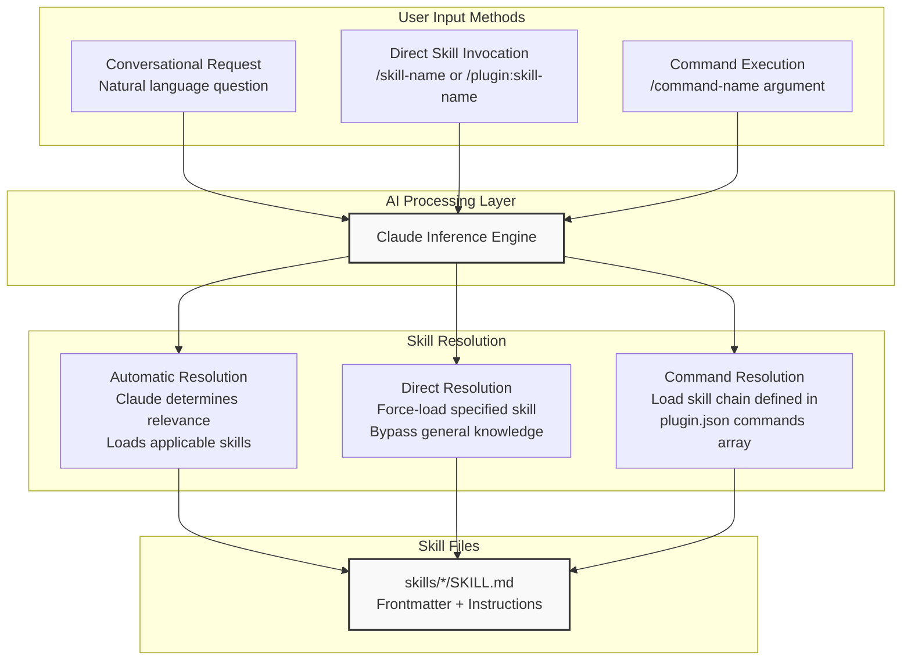

**Sources:** [README.md:33-46](), High-Level Diagram 4

---

## Automatic Skill Loading

Skills load automatically when Claude determines they are relevant to the conversation. This pattern requires no explicit invocation—Claude's inference engine activates skills contextually based on the user's intent.

### How It Works

When you ask a question or make a request, Claude:
1. Analyzes the user's intent
2. Identifies relevant skills from installed plugins
3. Loads the skill's `SKILL.md` file into context
4. Applies the skill's framework, templates, and instructions to generate a response

Skills designed for automatic loading typically contain reference frameworks (e.g., `prioritization-frameworks`, `opportunity-solution-tree`) or analytical capabilities that Claude can apply when relevant.

### Examples

| User Input | Skills Loaded | Plugin |
|------------|---------------|---------|
| "What are the riskiest assumptions for our AI writing assistant?" | `identify-assumptions-new` | `pm-product-discovery` |
| "Help me build an Opportunity Solution Tree for improving activation" | `opportunity-solution-tree` | `pm-product-discovery` |
| "Which prioritization framework should I use for a 50-item backlog?" | `prioritization-frameworks` | `pm-execution` |
| "Estimate TAM/SAM/SOM for an AI code review tool in the US market" | `market-sizing` | `pm-market-research` |
| "Compare Lean Canvas vs Business Model Canvas for my startup" | `lean-canvas`, `business-model`, `startup-canvas` | `pm-product-strategy` |

Claude loads these skills without explicit syntax because it recognizes the domain keywords and intent patterns that map to skill capabilities.

**Sources:** [README.md:33-36](), [README.md:128-131](), [README.md:220-224](), [README.md:254-258](), [README.md:170-174]()

---

## Explicit Skill Invocation

For scenarios where you want to force-load a specific skill—overriding Claude's general knowledge or ensuring a particular framework is used—explicit invocation syntax is available.

### Syntax

```
/skill-name
```

or

```
/plugin-name:skill-name
```

Claude will automatically prepend the plugin name if you use the short form and the skill name is unique across plugins.

### When to Use Explicit Invocation

Explicit invocation is recommended when:
- You want to prioritize a specific PM framework over Claude's general knowledge
- Multiple skills might apply, and you need a particular one
- You're debugging or testing a specific skill
- You want to reference a skill's structured template directly

### Skill Name Resolution

The marketplace contains 65 skills across 8 plugins. Skills follow a naming convention where:
- Directory name = skill name (e.g., `brainstorm-ideas-new/`)
- File path: `{plugin}/skills/{skill-name}/SKILL.md`
- Invocation: `/skill-name` or `/plugin-name:skill-name`

#### Skill Naming Examples

| Plugin | Skill Directory | Invocation |
|--------|----------------|------------|
| `pm-product-discovery` | `skills/brainstorm-ideas-new/` | `/brainstorm-ideas-new` |
| `pm-product-strategy` | `skills/lean-canvas/` | `/lean-canvas` |
| `pm-execution` | `skills/create-prd/` | `/create-prd` |
| `pm-go-to-market` | `skills/gtm-strategy/` | `/gtm-strategy` |

### Examples

```
/identify-assumptions We're building an AI meeting summarizer

/lean-canvas Marketplace connecting freelancers with startups

/pm-execution:prioritization-frameworks Show me all frameworks

/opportunity-solution-tree Outcome: Increase user activation to 40%
```

**Sources:** [README.md:35-36](), CONTRIBUTING.md guidelines on skill naming

---

## Command Execution

Commands are predefined workflows that chain multiple skills in a structured sequence. Each command is defined in a plugin's `plugin.json` manifest with metadata and a list of skills to execute.

### Command Structure

Commands are defined in each plugin's `plugin.json` file:

```json
{
  "commands": [
    {
      "name": "command-name",
      "description": "Command purpose",
      "argument-hint": "Expected input format",
      "skills": ["skill-1", "skill-2", "skill-3"]
    }
  ]
}
```

**File Location:** `{plugin-directory}/plugin.json`

### Syntax

```
/command-name [argument or context]
```

Commands accept a free-form argument that provides context for the workflow. The argument can be a product description, problem statement, or specific input depending on the command's purpose.

### How Commands Chain Skills

When you invoke a command:
1. Claude loads the command definition from the plugin manifest
2. Executes skills in the order specified in the `skills` array
3. Passes context from one skill to the next
4. Guides you through the workflow with prompts
5. Suggests relevant next commands upon completion

### Command Examples

#### `/discover` Command

The `/discover` command chains four skills for a complete discovery cycle:

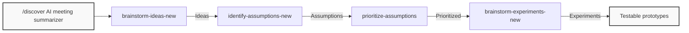

**Command Definition:** `pm-product-discovery/plugin.json`

**Invocation:**
```
/discover AI-powered meeting summarizer for remote teams
```

**Workflow:**
1. **brainstorm-ideas-new**: Multi-perspective ideation (PM, Designer, Engineer)
2. **identify-assumptions-new**: Map assumptions across 8 risk categories
3. **prioritize-assumptions**: Impact × Risk matrix
4. **brainstorm-experiments-new**: Design pretotypes (Alberto Savoia method)

#### `/strategy` Command

The `/strategy` command creates a 9-section Product Strategy Canvas:

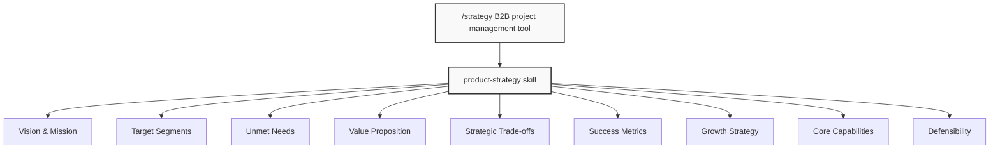

**Command Definition:** `pm-product-strategy/plugin.json`

**Invocation:**
```
/strategy B2B project management tool for agencies
```

#### `/write-prd` Command

The `/write-prd` command generates an 8-section PRD:

**Invocation:**
```
/write-prd Smart notification system that reduces alert fatigue
```

**Workflow:**
1. Loads `create-prd` skill
2. Guides through 8 PRD sections
3. Produces structured requirements document

**Command Definition:** `pm-execution/plugin.json`

### All Available Commands (36 Total)

| Plugin | Commands |
|--------|----------|
| `pm-product-discovery` | `/discover`, `/brainstorm`, `/triage-requests`, `/interview`, `/setup-metrics` |
| `pm-product-strategy` | `/strategy`, `/business-model`, `/value-proposition`, `/market-scan`, `/pricing` |
| `pm-execution` | `/write-prd`, `/plan-okrs`, `/transform-roadmap`, `/sprint`, `/pre-mortem`, `/meeting-notes`, `/stakeholder-map`, `/write-stories`, `/test-scenarios`, `/generate-data` |
| `pm-market-research` | `/research-users`, `/competitive-analysis`, `/analyze-feedback` |
| `pm-data-analytics` | `/write-query`, `/analyze-cohorts`, `/analyze-test` |
| `pm-go-to-market` | `/plan-launch`, `/growth-strategy`, `/battlecard` |
| `pm-marketing-growth` | `/market-product`, `/north-star` |
| `pm-toolkit` | `/review-resume`, `/tailor-resume`, `/draft-nda`, `/privacy-policy`, `/proofread` |

**Sources:** [README.md:37-38](), [README.md:118-393]()

---

## Skill vs Command Decision Guide

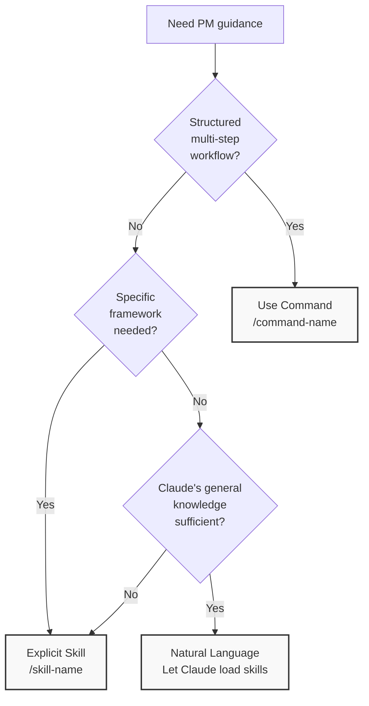

### When to Use Each Pattern

| Pattern | Use When | Examples |
|---------|----------|----------|
| **Automatic Loading** | Quick questions, exploratory work, leveraging Claude's judgment | "What's a good North Star metric for my marketplace?", "Help me prioritize these features" |
| **Explicit Invocation** | Need specific framework, override general knowledge, debugging | `/lean-canvas`, `/opportunity-solution-tree`, `/prioritization-frameworks` |
| **Command Execution** | End-to-end workflow, structured process, guided experience | `/discover`, `/strategy`, `/write-prd`, `/plan-launch` |

**Sources:** [README.md:33-46](), High-Level Diagram 4

---

## Practical Workflow Examples

### Scenario 1: New Product Discovery

**Goal:** Validate a new product idea

**Approach:** Command-driven workflow

```
/discover AI writing assistant for non-native English speakers

[Follow the guided workflow]
→ Generates ideas from PM/Designer/Engineer perspectives
→ Identifies 8 risk categories of assumptions
→ Prioritizes assumptions in Impact × Risk matrix
→ Designs pretotype experiments

[After /discover completes]
/strategy AI writing assistant for non-native English speakers

[Creates 9-section Product Strategy Canvas]
```

**Skills Loaded:**
1. `pm-product-discovery/skills/brainstorm-ideas-new/SKILL.md`
2. `pm-product-discovery/skills/identify-assumptions-new/SKILL.md`
3. `pm-product-discovery/skills/prioritize-assumptions/SKILL.md`
4. `pm-product-discovery/skills/brainstorm-experiments-new/SKILL.md`
5. `pm-product-strategy/skills/product-strategy/SKILL.md`

### Scenario 2: Feature Prioritization

**Goal:** Prioritize a backlog of feature requests

**Approach:** Mix of explicit invocation and automatic loading

```
/prioritization-frameworks

[Reviews 9 frameworks: Opportunity Score, ICE, RICE, MoSCoW, Kano, etc.]

Which framework should I use for enterprise B2B features?

[Claude recommends based on context]

/prioritize-features [attach feature list CSV]

[Applies chosen framework and generates prioritized backlog]
```

**Skills Loaded:**
1. `pm-execution/skills/prioritization-frameworks/SKILL.md` (explicit)
2. `pm-product-discovery/skills/prioritize-features/SKILL.md` (automatic or explicit)

### Scenario 3: PRD Creation

**Goal:** Write a PRD for a new feature

**Approach:** Command-driven

```
/write-prd Multi-tenant workspace feature for our project management tool

[Guided through 8 sections:]
1. Overview
2. Problem Statement
3. Goals & Success Metrics
4. User Personas
5. Requirements
6. Technical Considerations
7. Launch Plan
8. Open Questions

[After PRD is complete]
/pre-mortem [PRD content]

[Risk analysis: Tigers, Paper Tigers, Elephants]
```

**Skills Loaded:**
1. `pm-execution/skills/create-prd/SKILL.md`
2. `pm-execution/skills/pre-mortem/SKILL.md`

### Scenario 4: Market Research

**Goal:** Understand competitive landscape and market sizing

**Approach:** Natural language with automatic loading

```
Estimate TAM/SAM/SOM for a developer productivity tool in North America

[Claude loads market-sizing skill automatically]

Create a competitive analysis comparing us to GitHub Copilot, Cursor, and Tabnine

[Claude loads competitor-analysis skill automatically]
```

**Skills Loaded:**
1. `pm-market-research/skills/market-sizing/SKILL.md` (automatic)
2. `pm-market-research/skills/competitor-analysis/SKILL.md` (automatic)

**Sources:** [README.md:127-137](), [README.md:169-179](), [README.md:219-229](), [README.md:253-263]()

---

## Command Chaining Workflow

Commands are designed to flow into each other, matching the natural PM workflow. After any command completes, Claude suggests relevant next steps.

```mermaid
graph LR
    DISCOVER["/discover<br/>New Product"]
    STRATEGY["/strategy<br/>Strategic Direction"]
    PRD["/write-prd<br/>Requirements"]
    LAUNCH["/plan-launch<br/>GTM Strategy"]
    METRICS["/north-star<br/>Success Metrics"]
    
    DISCOVER -->|"Validated idea"| STRATEGY
    STRATEGY -->|"Clear positioning"| PRD
    PRD -->|"Scoped feature"| LAUNCH
    LAUNCH -->|"Launch plan"| METRICS
    
    style DISCOVER fill:#f9f9f9,stroke:#333,stroke-width:2px
    style STRATEGY fill:#f9f9f9,stroke:#333,stroke-width:2px
    style PRD fill:#f9f9f9,stroke:#333,stroke-width:2px
    style LAUNCH fill:#f9f9f9,stroke:#333,stroke-width:2px
    style METRICS fill:#f9f9f9,stroke:#333,stroke-width:2px
```

**Typical Product Lifecycle Flow:**
1. `/discover` → Validate problem and solution
2. `/strategy` → Define strategic positioning
3. `/write-prd` → Spec the solution
4. `/plan-launch` → Plan go-to-market
5. `/north-star` → Define success metrics

**Sources:** [README.md:45-46](), High-Level Diagram 2

---

## Tips for Effective Usage

### Optimize for Context

- **Short sessions:** Use explicit invocation (`/skill-name`) to load specific frameworks quickly
- **Long sessions:** Let automatic loading work—Claude learns context over time
- **Complex workflows:** Use commands (`/command-name`) for guided, multi-step processes

### Skill Discovery

To explore available skills:
```
List all skills in pm-product-discovery

Show me all prioritization frameworks

What skills help with GTM planning?
```

Claude can search installed plugins and describe capabilities.

### Force Loading for Precision

When Claude's general knowledge conflicts with a specific framework:
```
/opportunity-solution-tree

[Forces Teresa Torres' OST framework instead of generic problem trees]
```

### Combining Patterns

Mix patterns in a single conversation:
```
/discover AI code review tool

[After discovery completes, ask naturally:]
How should I price this for mid-size engineering teams?

[Claude loads pricing-strategy skill automatically]

/lean-canvas

[Explicitly invoke Lean Canvas to capture business model]
```

**Sources:** [README.md:33-46]()

---

# Page: Architecture

# Architecture

<details>
<summary>Relevant source files</summary>

The following files were used as context for generating this wiki page:

- [.claude-plugin/marketplace.json](.claude-plugin/marketplace.json)
- [README.md](README.md)

</details>


This document explains the architectural design of the PM Skills Marketplace, focusing on the three-tier abstraction model (Skills → Commands → Plugins), the file system structure, and how components interact at the code level.

For installation procedures, see [Installation](#2.1). For usage patterns, see [Using Skills and Commands](#2.2). For detailed plugin documentation, see [Plugin Reference](#4).

---

## Architectural Overview

The PM Skills Marketplace implements a **five-layer hierarchical architecture** that transforms PM frameworks into executable AI-guided workflows. The system separates concerns across distribution, organization, orchestration, and execution layers.

### Five-Layer System Hierarchy

```mermaid
graph TB
    subgraph Layer1["Layer 1: Interface"]
        ClaudeCowork["Claude Cowork<br/>(GUI)"]
        ClaudeCode["Claude Code<br/>(CLI)"]
        OtherAI["Other AI Tools<br/>(Gemini/Cursor/Codex)"]
    end
    
    subgraph Layer2["Layer 2: Distribution"]
        MarketplaceJSON["marketplace.json<br/>Defines 8 plugins"]
        ValidateScript["validate_plugins.py<br/>Quality gate"]
    end
    
    subgraph Layer3["Layer 3: Organization"]
        PluginDirs["pm-* directories<br/>Domain containers"]
        PluginJSON["plugin.json<br/>Manifest per plugin"]
    end
    
    subgraph Layer4["Layer 4: Orchestration"]
        CommandFiles["*.command.md<br/>36 workflow definitions"]
    end
    
    subgraph Layer5["Layer 5: Execution"]
        SkillDirs["skills/* directories<br/>65 atomic capabilities"]
        SkillMD["SKILL.md<br/>Framework templates"]
    end
    
    ClaudeCowork --> MarketplaceJSON
    ClaudeCode --> MarketplaceJSON
    OtherAI -.->|Skills only| SkillDirs
    
    MarketplaceJSON --> ValidateScript
    ValidateScript --> PluginDirs
    PluginDirs --> PluginJSON
    PluginDirs --> CommandFiles
    PluginDirs --> SkillDirs
    CommandFiles --> SkillDirs
    SkillDirs --> SkillMD
```

**Sources:** [README.md:31-45](), [.claude-plugin/marketplace.json:1-61]()

---

## Core Abstractions

The system defines three primary abstractions that map to distinct file system entities and behavioral patterns.

### Abstraction 1: Skills (Atomic Capabilities)

**Definition:** Skills are atomic, reusable units of PM domain knowledge encoded as markdown files. Each skill represents a single framework, analytical method, or guided workflow.

**File Structure:**
```
pm-*/
└── skills/
    └── skill-name/
        └── SKILL.md
```

**Code Mapping:**

| Concept | File Path | Format |
|---------|-----------|--------|
| Skill definition | `pm-{plugin}/skills/{skill-name}/SKILL.md` | Frontmatter + template + instructions |
| Skill invocation | `/{skill-name}` or `/{plugin}:{skill-name}` | Claude command syntax |
| Skill loading | Automatic (context-based) or explicit | AI inference engine |

**Example Skill File Structure:**
[pm-product-discovery/skills/brainstorm-ideas-new/SKILL.md]() contains:
- YAML frontmatter with `name`, `description`, `version`
- Template sections (e.g., "Problem Space", "Solution Ideas")
- Step-by-step instructions for AI execution

**Characteristics:**
- **Noun-based naming** (e.g., `opportunity-solution-tree`, not `create-ost`)
- **Self-contained** (no cross-plugin dependencies)
- **Universal format** (works across AI tools via `SKILL.md` convention)
- **Metadata-driven** (frontmatter enables validation and discovery)

**Sources:** [README.md:33-36](), [CONTRIBUTING.md:1-28]()

### Abstraction 2: Commands (Orchestrated Workflows)

**Definition:** Commands are user-triggered workflows that chain one or more skills into a structured, multi-step process. Commands are invoked via `/command-name` syntax.

**File Structure:**
```
pm-*/
└── {command-name}.command.md
```

**Code Mapping:**

| Concept | File Path | Format |
|---------|-----------|--------|
| Command definition | `pm-{plugin}/{command-name}.command.md` | Frontmatter + skill references + flow logic |
| Command invocation | `/command-name [context]` | Slash command syntax |
| Skill chaining | Inline references to `skills/*/SKILL.md` | Sequential or branching |

**Example Command Flow:**
[pm-product-discovery/discover.command.md]() chains:
1. `skills/brainstorm-ideas-*/SKILL.md` (ideation)
2. `skills/identify-assumptions-*/SKILL.md` (risk mapping)
3. `skills/prioritize-assumptions/SKILL.md` (prioritization)
4. `skills/brainstorm-experiments-*/SKILL.md` (experiment design)

**Characteristics:**
- **Verb-based naming** (e.g., `/discover`, `/write-prd`)
- **Multi-skill orchestration** (composite workflows)
- **Context-adaptive** (branches based on existing vs. new products)
- **Claude-specific** (not portable to other AI tools)

**Sources:** [README.md:37-39](), [README.md:120-124]()

### Abstraction 3: Plugins (Domain Containers)

**Definition:** Plugins are installable packages that group related skills and commands into a coherent domain (e.g., discovery, strategy, execution).

**File Structure:**
```
pm-{domain}/
├── plugin.json          # Manifest
├── README.md           # Documentation
├── {command}.command.md # Commands (0-10 per plugin)
└── skills/             # Skills directory
    ├── skill-1/
    │   └── SKILL.md
    └── skill-2/
        └── SKILL.md
```

**Code Mapping:**

| Concept | File Path | Content |
|---------|-----------|---------|
| Plugin manifest | `pm-{domain}/plugin.json` | Name, version, description, skills, commands |
| Plugin registration | `.claude-plugin/marketplace.json` | Source path, category |
| Plugin installation | `claude plugin install {name}@pm-skills` | CLI command |

**Manifest Schema (plugin.json):**
```
{
  "name": "pm-{domain}",
  "version": "1.0.0",
  "description": "...",
  "skills": ["skill-1", "skill-2", ...],
  "commands": ["command-1", "command-2", ...]
}
```

**Current Plugin Inventory:**

| Plugin | Skills | Commands | Primary Purpose |
|--------|--------|----------|-----------------|
| `pm-product-discovery` | 13 | 5 | Ideation, experiments, OSTs, interviews |
| `pm-product-strategy` | 12 | 5 | Vision, business models, competitive analysis |
| `pm-execution` | 15 | 10 | PRDs, OKRs, roadmaps, sprints, stakeholder mgmt |
| `pm-market-research` | 7 | 3 | Personas, segmentation, journey maps |
| `pm-data-analytics` | 3 | 3 | SQL generation, cohort analysis, A/B testing |
| `pm-go-to-market` | 6 | 3 | GTM strategy, growth loops, beachhead segments |
| `pm-marketing-growth` | 5 | 2 | Positioning, North Star metrics, value props |
| `pm-toolkit` | 4 | 5 | Resume review, NDAs, privacy policies |

**Sources:** [README.md:39](), [.claude-plugin/marketplace.json:11-60](), [README.md:98-393]()

---

## File System to Runtime Mapping

This diagram shows how the repository's file structure maps to runtime entities that the AI assistant loads and executes.

### File System Structure

```mermaid
graph TD
    Root["Repository Root<br/>phuryn/pm-skills"]
    
    MarketplaceFile[".claude-plugin/<br/>marketplace.json"]
    ValidateScript["validate_plugins.py"]
    ContribGuide["CONTRIBUTING.md"]
    
    Plugin1["pm-product-discovery/"]
    Plugin2["pm-product-strategy/"]
    Plugin3["pm-execution/"]
    PluginN["pm-toolkit/"]
    
    P1Manifest["plugin.json"]
    P1README["README.md"]
    P1CMD1["discover.command.md"]
    P1CMD2["brainstorm.command.md"]
    P1Skills["skills/"]
    
    Skill1["brainstorm-ideas-new/"]
    Skill2["identify-assumptions-new/"]
    SkillN["opportunity-solution-tree/"]
    
    S1MD["SKILL.md"]
    S2MD["SKILL.md"]
    SNMD["SKILL.md"]
    
    Root --> MarketplaceFile
    Root --> ValidateScript
    Root --> ContribGuide
    Root --> Plugin1
    Root --> Plugin2
    Root --> Plugin3
    Root --> PluginN
    
    Plugin1 --> P1Manifest
    Plugin1 --> P1README
    Plugin1 --> P1CMD1
    Plugin1 --> P1CMD2
    Plugin1 --> P1Skills
    
    P1Skills --> Skill1
    P1Skills --> Skill2
    P1Skills --> SkillN
    
    Skill1 --> S1MD
    Skill2 --> S2MD
    SkillN --> SNMD
```

**Key File Paths:**
- **Marketplace registry:** [.claude-plugin/marketplace.json:1-61]()
- **Plugin manifests:** `pm-*/plugin.json` (one per plugin)
- **Command definitions:** `pm-*/*.command.md` (36 total across all plugins)
- **Skill definitions:** `pm-*/skills/*/SKILL.md` (65 total across all plugins)
- **Validation script:** [validate_plugins.py:1-309]()

**Sources:** File system structure from repository layout

---

## Distribution and Validation Architecture

### Marketplace Distribution Mechanism

The `.claude-plugin/marketplace.json` file serves as the distribution manifest, defining all plugins available for installation.

**Marketplace Schema:**

```mermaid
graph LR
    MarketplaceJSON["marketplace.json"]
    
    Schema["$schema:<br/>anthropic.com/claude-code/<br/>marketplace.schema.json"]
    Metadata["Metadata:<br/>name: pm-skills<br/>version: 1.0.1<br/>description: ..."]
    Owner["Owner:<br/>name: Paweł Huryn<br/>email: ...<br/>url: ..."]
    PluginArray["plugins: []<br/>8 plugin entries"]
    
    P1Entry["name: pm-product-discovery<br/>description: ...<br/>source: ./pm-product-discovery<br/>category: product-management"]
    P2Entry["name: pm-product-strategy<br/>..."]
    P8Entry["name: pm-toolkit<br/>..."]
    
    MarketplaceJSON --> Schema
    MarketplaceJSON --> Metadata
    MarketplaceJSON --> Owner
    MarketplaceJSON --> PluginArray
    
    PluginArray --> P1Entry
    PluginArray --> P2Entry
    PluginArray --> P8Entry
```

**Sources:** [.claude-plugin/marketplace.json:1-61]()

### Validation Pipeline

The `validate_plugins.py` script enforces structural and semantic consistency across all plugins before they can be distributed.

**Validation Flow:**

```mermaid
graph TD
    DevInput["Developer creates/modifies<br/>skills or commands"]
    
    ValidateScript["validate_plugins.py"]
    
    Check1["validate_plugin_manifest()<br/>Checks plugin.json"]
    Check2["validate_skill()<br/>Checks SKILL.md frontmatter"]
    Check3["validate_command()<br/>Checks command frontmatter"]
    Check4["validate_readme()<br/>Checks README.md structure"]
    Check5["validate_cross_references()<br/>Checks skill references"]
    
    ManifestChecks["• plugin.json exists<br/>• name matches directory<br/>• version format valid<br/>• required fields present"]
    SkillChecks["• SKILL.md exists<br/>• frontmatter complete<br/>• description ≥ 30 chars<br/>• word count 50-3000<br/>• name matches directory"]
    CommandChecks["• frontmatter complete<br/>• description present<br/>• argument-hint provided<br/>• no cross-plugin refs"]
    READMEChecks["• README.md exists<br/>• required sections present"]
    RefChecks["• skill references valid<br/>• no broken links<br/>• internal consistency"]
    
    PassGate{All checks<br/>pass?}
    Pass["✓ Ready for PR<br/>Can merge to main"]
    Fail["✗ Validation errors<br/>Fix and re-run"]
    Marketplace["Distribution via<br/>marketplace.json"]
    
    DevInput --> ValidateScript
    ValidateScript --> Check1
    ValidateScript --> Check2
    ValidateScript --> Check3
    ValidateScript --> Check4
    ValidateScript --> Check5
    
    Check1 --> ManifestChecks
    Check2 --> SkillChecks
    Check3 --> CommandChecks
    Check4 --> READMEChecks
    Check5 --> RefChecks
    
    ManifestChecks --> PassGate
    SkillChecks --> PassGate
    CommandChecks --> PassGate
    READMEChecks --> PassGate
    RefChecks --> PassGate
    
    PassGate -->|Yes| Pass
    PassGate -->|No| Fail
    Pass --> Marketplace
    Fail --> DevInput
```

**Validation Functions:**

| Function | Purpose | File Reference |
|----------|---------|----------------|
| `validate_plugin_manifest()` | Validates `plugin.json` structure | [validate_plugins.py:45-89]() |
| `validate_skill()` | Validates skill frontmatter and content | [validate_plugins.py:91-165]() |
| `validate_command()` | Validates command frontmatter | [validate_plugins.py:167-210]() |
| `validate_readme()` | Validates README structure | [validate_plugins.py:212-245]() |
| `check_cross_references()` | Validates skill references | [validate_plugins.py:247-285]() |

**Validation Enforcement:**
- Runs pre-commit (recommended via git hooks)
- Blocks distribution of malformed plugins
- Generates detailed error reports with line numbers
- Enforces naming conventions (nouns for skills, verbs for commands)

**Sources:** [validate_plugins.py:1-309](), [CONTRIBUTING.md:1-28]()

---

## Multi-Modal Access Patterns

The architecture supports three distinct invocation modes, each optimized for different use cases and user expertise levels.

### Access Pattern Mapping

```mermaid
graph TB
    subgraph UserIntent["User Intent"]
        Auto["Automatic Context<br/>e.g., 'How should I prioritize<br/>these features?'"]
        Cmd["Command-Driven<br/>e.g., /discover for AI tool"]
        Explicit["Direct Skill<br/>e.g., /identify-assumptions"]
    end
    
    subgraph AIEngine["Claude Inference Engine"]
        Inference["Context analysis<br/>Skill relevance scoring"]
    end
    
    subgraph LoadMech["Loading Mechanism"]
        AutoLoad["Automatic Loading<br/>Claude determines relevance<br/>Loads reference skills"]
        CmdLoad["Command Chaining<br/>Predefined sequence<br/>Multiple skills orchestrated"]
        DirectLoad["Explicit Invocation<br/>Force-load specific skill<br/>Override general knowledge"]
    end
    
    subgraph SkillCatalog["Skill Files"]
        RefSkills["Reference Skills<br/>prioritization-frameworks<br/>opportunity-solution-tree"]
        WorkflowSkills["Workflow Skills<br/>create-prd<br/>interview-script"]
        FoundationSkills["Foundation Skills<br/>brainstorm-ideas<br/>identify-assumptions"]
    end
    
    subgraph Commands["Command Files"]
        DiscoverCmd["/discover<br/>discover.command.md"]
        StrategyCmd["/strategy<br/>strategy.command.md"]
        PRDCmd["/write-prd<br/>write-prd.command.md"]
    end
    
    Auto --> AIEngine
    Cmd --> AIEngine
    Explicit --> AIEngine
    
    AIEngine --> AutoLoad
    AIEngine --> CmdLoad
    AIEngine --> DirectLoad
    
    AutoLoad --> RefSkills
    CmdLoad --> DiscoverCmd
    CmdLoad --> StrategyCmd
    CmdLoad --> PRDCmd
    DirectLoad --> WorkflowSkills
    DirectLoad --> FoundationSkills
    
    DiscoverCmd --> FoundationSkills
    StrategyCmd --> RefSkills
    PRDCmd --> WorkflowSkills
```

**Access Pattern Comparison:**

| Pattern | Invocation | Use Case | Example | Loaded Entities |
|---------|-----------|----------|---------|-----------------|
| **Automatic** | Natural language query | User doesn't know skill names | "What assumptions should I test?" | Claude infers relevant `SKILL.md` files |
| **Command-Driven** | `/command-name` | Guided multi-step workflow | `/discover AI meeting tool` | Loads `discover.command.md` + referenced skills |
| **Explicit** | `/skill-name` | Power user needs specific framework | `/opportunity-solution-tree` | Force-loads specific `SKILL.md` |

**Sources:** [README.md:33-36](), [README.md:37-39](), [README.md:41-45]()

---

## Cross-Platform Compatibility Architecture

The system implements **graceful degradation** to support both Claude-native and non-Claude AI tools.

### Capability Matrix by Platform

```mermaid
graph TB
    subgraph ClaudeNative["Claude Code/Cowork"]
        InstallClaude["Install via<br/>marketplace.json"]
        PluginsClaude["✓ All 8 plugins"]
        CommandsClaude["✓ 36 commands<br/>(*.command.md)"]
        SkillsClaude["✓ 65 skills<br/>(SKILL.md)"]
        OrchClaude["✓ Workflow orchestration"]
    end
    
    subgraph OtherAI["Gemini/Cursor/Codex/Kiro"]
        InstallOther["Manual copy to<br/>.{tool}/skills/"]
        PluginsOther["✗ No plugin concept"]
        CommandsOther["✗ No commands"]
        SkillsOther["✓ 65 skills<br/>(SKILL.md universal format)"]
        OrchOther["✗ No chaining"]
    end
    
    MarketplaceJSON["marketplace.json<br/>Plugin registry"]
    SkillMDFiles["pm-*/skills/*/SKILL.md<br/>Universal skill format"]
    
    MarketplaceJSON --> InstallClaude
    InstallClaude --> PluginsClaude
    PluginsClaude --> CommandsClaude
    PluginsClaude --> SkillsClaude
    CommandsClaude --> OrchClaude
    
    SkillMDFiles --> InstallOther
    InstallOther --> SkillsOther
```

**Installation Mapping:**

| AI Tool | Installation Method | File Path | Capabilities |
|---------|-------------------|-----------|--------------|
| **Claude Cowork** | GUI: Add marketplace from GitHub | `.claude-plugin/marketplace.json` | Full stack (plugins + commands + skills) |
| **Claude Code** | CLI: `claude plugin install` | `.claude-plugin/marketplace.json` | Full stack (plugins + commands + skills) |
| **Gemini CLI** | Copy: `cp pm-*/skills/* ~/.gemini/skills/` | `~/.gemini/skills/` | Skills only |
| **Cursor** | Copy: `cp pm-*/skills/* ~/.cursor/skills/` | `~/.cursor/skills/` | Skills only |
| **Codex CLI** | Copy: `cp pm-*/skills/* ~/.codex/skills/` | `~/.codex/skills/` | Skills only |
| **Kiro** | Copy: `cp pm-*/skills/* ~/.kiro/skills/` | `~/.kiro/skills/` | Skills only |

**Universal Skill Format:**
The `SKILL.md` file format is the **portability layer**. All AI tools that implement the skill specification can read and execute skills, even without plugin or command support.

**Sources:** [README.md:55-94](), [README.md:77-93]()

---

## Knowledge Codification Architecture

The system functions as a **framework translation engine** that converts PM methodologies into executable AI workflows.

### Framework to Skill Pipeline

```mermaid
graph LR
    subgraph Frameworks["PM Frameworks<br/>(Books/Methodologies)"]
        TeresaTorres["Teresa Torres:<br/>Continuous Discovery<br/>OSTs"]
        MartyCagan["Marty Cagan:<br/>INSPIRED<br/>PRDs, Empowerment"]
        AlbertoSavoia["Alberto Savoia:<br/>The Right It<br/>Pretotyping"]
        AshMaurya["Ash Maurya:<br/>Running Lean<br/>Lean Canvas"]
        Others["Roger Martin,<br/>Anthony Ulwick,<br/>Maja Voje, etc."]
    end
    
    subgraph Codification["Encoding Process"]
        Extract["1. Extract framework"]
        Define["2. Define frontmatter"]
        Structure["3. Structure template"]
        Instruct["4. Add AI instructions"]
    end
    
    subgraph Skills["Executable Skills<br/>(SKILL.md files)"]
        OST["opportunity-solution-tree<br/>(Teresa Torres)"]
        PRD["create-prd<br/>(Marty Cagan)"]
        Pretotype["brainstorm-experiments-new<br/>(Alberto Savoia)"]
        LeanCanvas["lean-canvas<br/>(Ash Maurya)"]
        Strategy["product-strategy<br/>(Roger Martin)"]
    end
    
    TeresaTorres --> Extract
    MartyCagan --> Extract
    AlbertoSavoia --> Extract
    AshMaurya --> Extract
    Others --> Extract
    
    Extract --> Define
    Define --> Structure
    Structure --> Instruct
    
    Instruct --> OST
    Instruct --> PRD
    Instruct --> Pretotype
    Instruct --> LeanCanvas
    Instruct --> Strategy
```

**Framework Attribution Table:**

| Practitioner | Methodology | Encoded Skills | File Paths |
|--------------|-------------|----------------|------------|
| Teresa Torres | Continuous Discovery, OSTs | `opportunity-solution-tree`, `interview-script`, `identify-assumptions-*` | [pm-product-discovery/skills/opportunity-solution-tree/SKILL.md]() |
| Marty Cagan | INSPIRED, PRDs | `create-prd`, `product-vision` | [pm-execution/skills/create-prd/SKILL.md]() |
| Alberto Savoia | The Right It, Pretotyping | `brainstorm-experiments-new`, `identify-assumptions-new` | [pm-product-discovery/skills/brainstorm-experiments-new/SKILL.md]() |
| Ash Maurya | Running Lean | `lean-canvas` | [pm-product-strategy/skills/lean-canvas/SKILL.md]() |
| Roger Martin | Playing to Win | `product-strategy` | [pm-product-strategy/skills/product-strategy/SKILL.md]() |
| Anthony Ulwick | Jobs to Be Done | `value-proposition`, `interview-script` | [pm-product-strategy/skills/value-proposition/SKILL.md]() |
| Maja Voje | GTM Strategy | `beachhead-segment`, `gtm-strategy` | [pm-go-to-market/skills/beachhead-segment/SKILL.md]() |

**Skill Encoding Pattern:**
Each `SKILL.md` file follows a consistent structure:
1. **Frontmatter** (YAML): `name`, `description`, `version`, `source`
2. **Context Section**: When to use this skill
3. **Template Section**: Structured output format
4. **Instructions**: Step-by-step AI execution guidance
5. **Examples** (optional): Sample outputs

**Sources:** [README.md:25-27](), [README.md:401-415]()

---

## Architectural Principles

### Design Decisions

| Principle | Implementation | Rationale |
|-----------|----------------|-----------|
| **Separation of Concerns** | Skills (atomic) vs Commands (composite) vs Plugins (containers) | Enables reuse, composition, and independent evolution |
| **Metadata-Driven** | YAML frontmatter in all `SKILL.md` and `plugin.json` | Enables automated validation, discovery, and tooling |
| **Graceful Degradation** | Universal `SKILL.md` format works across AI tools | Prioritizes compatibility without sacrificing Claude-native features |
| **Quality Gates** | `validate_plugins.py` runs pre-distribution | Shifts quality control left, enables safe community contributions |
| **Framework Attribution** | `source` field in frontmatter links to original authors | Maintains intellectual honesty, encourages deeper learning |
| **No Cross-Plugin Dependencies** | Skills reference only within-plugin skills | Prevents fragility, enables selective installation |
| **Semantic Naming** | Skills = nouns, Commands = verbs | Improves discoverability and mental model clarity |
| **Version Control** | Each plugin and skill has independent version | Enables backward compatibility and migration paths |

### Constraints and Tradeoffs

**Constraint:** Commands are Claude-specific (not portable to Gemini/Cursor/etc.)  
**Tradeoff:** Accepted to leverage Claude's orchestration capabilities; skills remain portable.

**Constraint:** No cross-plugin skill references allowed  
**Tradeoff:** Some duplication (e.g., prioritization appears in multiple contexts) to maintain modularity.

**Constraint:** Skill word count must be 50-3000 words  
**Tradeoff:** Balances comprehensiveness with token efficiency.

**Sources:** [CONTRIBUTING.md:1-28](), [validate_plugins.py:91-165]()

---

## Summary

The PM Skills Marketplace architecture implements a **layered abstraction model** where:
- **Layer 5:** 65 `SKILL.md` files encode atomic PM frameworks
- **Layer 4:** 36 `*.command.md` files orchestrate multi-skill workflows
- **Layer 3:** 8 `pm-*` plugin directories organize by domain
- **Layer 2:** `marketplace.json` and `validate_plugins.py` manage distribution and quality
- **Layer 1:** Claude Code/Cowork/other AI tools consume via different integration paths

The file system structure directly mirrors the conceptual model, making the codebase navigable by matching directory names to domain concepts (e.g., `pm-product-discovery` contains discovery-related skills). The validation pipeline enforces consistency, while the universal `SKILL.md` format ensures cross-platform compatibility.

For specific plugin details, see [Plugin Reference](#4). For creating new skills or commands, see [Contributing](#7).

---

# Page: Three-Tier Abstraction Model

# Three-Tier Abstraction Model

<details>
<summary>Relevant source files</summary>

The following files were used as context for generating this wiki page:

- [.docs/images/plugins-overview.webp](.docs/images/plugins-overview.webp)
- [README.md](README.md)

</details>


## Purpose and Scope

This document explains the three-tier abstraction model that structures the PM Skills Marketplace: **Skills** (atomic units), **Commands** (orchestrated workflows), and **Plugins** (domain containers). It covers the file structure, metadata schemas, loading mechanisms, and orchestration patterns that enable both atomic skill reuse and complex multi-step workflows.

For installation and usage instructions, see [Getting Started](#2). For the broader plugin ecosystem design, see [Plugin Ecosystem](#3.2). For how PM frameworks are encoded into skills, see [Framework Knowledge Base](#3.3).

---

## The Three Tiers

The marketplace implements a hierarchical abstraction where each tier serves distinct purposes while maintaining clean separation of concerns:

```mermaid
graph TD
    subgraph Tier3["Tier 3: Plugins (Domain Containers)"]
        P1["pm-product-discovery/"]
        P2["pm-product-strategy/"]
        P3["pm-execution/"]
        PKG["plugin.json manifest"]
    end
    
    subgraph Tier2["Tier 2: Commands (Orchestration Layer)"]
        CMD1["/discover command"]
        CMD2["/strategy command"]
        CMD3["/write-prd command"]
        CHAIN["Predefined skill sequences"]
    end
    
    subgraph Tier1["Tier 1: Skills (Atomic Units)"]
        SK1["brainstorm-ideas/SKILL.md"]
        SK2["identify-assumptions/SKILL.md"]
        SK3["create-prd/SKILL.md"]
        SK4["opportunity-solution-tree/SKILL.md"]
        META["Frontmatter + instructions"]
    end
    
    P1 --> CMD1
    P2 --> CMD2
    P3 --> CMD3
    
    CMD1 --> SK1
    CMD1 --> SK2
    CMD2 --> SK4
    CMD3 --> SK3
    
    PKG -.-> CMD1
    PKG -.-> CMD2
    META -.-> SK1
    META -.-> SK2
```

**Sources:** [README.md:31-45]()

---

## Tier 1: Skills (Atomic Units)

### Definition and Purpose

Skills are the foundational units of the marketplace. Each skill encodes a specific PM framework, analytical method, or guided workflow as a structured markdown file. Skills operate at atomic granularity—each addresses one discrete PM task.

### File Structure

Every skill follows a standardized directory structure:

```
pm-{plugin-name}/
└── skills/
    └── {skill-name}/
        └── SKILL.md
```

The `SKILL.md` file contains two components:

1. **Frontmatter** (YAML metadata block)
2. **Instructions** (markdown content)

**Sources:** [README.md:33-35]()

### Skill Frontmatter Schema

Skills declare metadata in a YAML frontmatter block:

```yaml
---
name: skill-name
description: Brief description (minimum 30 characters)
version: 1.0.0
---
```

| Field | Type | Requirement | Validation |
|-------|------|-------------|------------|
| `name` | string | Required | Must match directory name |
| `description` | string | Required | Length ≥ 30 characters |
| `version` | string | Required | Semantic versioning format |

The `validate_plugins.py` script enforces these constraints at lines 108-156, checking frontmatter completeness, name consistency, and description length.

**Sources:** [validate_plugins.py:108-156](), [CONTRIBUTING.md:1-28]()

### Skill Naming Convention

Skills use **noun-based naming** to reflect their role as domain knowledge containers:

- ✅ `opportunity-solution-tree` (noun: a specific framework)
- ✅ `create-prd` (verb → noun: creates a PRD artifact)
- ✅ `prioritization-frameworks` (noun: reference knowledge)
- ❌ `plan-sprint` (verb-based: belongs in commands)

This semantic distinction separates knowledge artifacts (skills) from orchestrated actions (commands).

**Sources:** [CONTRIBUTING.md:1-28](), [README.md:33-35]()

### Skill Word Count Requirements

Skills must contain substantive content:

```
Minimum: 50 words
Maximum: 3000 words
```

This constraint ensures skills provide sufficient guidance while remaining focused. The validator checks word counts at lines 149-156, extracting content after frontmatter and counting words excluding code blocks.

**Sources:** [validate_plugins.py:149-156]()

### Loading Mechanisms

Skills support two loading patterns:

**1. Automatic Loading (Implicit Invocation)**

Claude's inference engine automatically loads relevant skills based on conversation context. Users don't need to know skill names—the AI determines relevance and activates appropriate domain knowledge.

Example: Asking "What are the riskiest assumptions for our AI assistant?" automatically loads `identify-assumptions`.

**2. Explicit Invocation (Force Loading)**

Users can force-load skills to override general knowledge:

```
/plugin-name:skill-name
/skill-name  (Claude adds plugin prefix)
```

This pattern gives power users precision when general AI knowledge conflicts with specialized frameworks.

**Sources:** [README.md:35-36]()

### Skill Categories

Skills fall into three functional categories:

| Category | Purpose | Examples | Usage Pattern |
|----------|---------|----------|---------------|
| **Reference** | Domain knowledge that Claude draws on contextually | `prioritization-frameworks`, `opportunity-solution-tree` | Automatic loading |
| **Workflow** | Step-by-step guided processes | `create-prd`, `interview-script` | Command-driven or explicit |
| **Foundation** | Reusable components shared by multiple commands | `brainstorm-ideas`, `identify-assumptions` | Command-driven |

**Sources:** [README.md:43](), Diagram 4 from high-level architecture

### Example: Skill File Structure

```
pm-product-discovery/
└── skills/
    ├── brainstorm-ideas-new/
    │   └── SKILL.md
    ├── identify-assumptions-new/
    │   └── SKILL.md
    └── opportunity-solution-tree/
        └── SKILL.md
```

Each `SKILL.md` follows the universal skill format recognized by Claude and other AI assistants supporting the specification.

**Sources:** [README.md:79](), [README.md:99-137]()

---

## Tier 2: Commands (Orchestration Layer)

### Definition and Purpose

Commands are Claude-specific workflows that chain one or more skills into predefined sequences. They provide structured, opinionated paths through complex PM processes.

### Command Definition Location

Commands are declared in each plugin's `plugin.json` manifest:

```
pm-{plugin-name}/
├── plugin.json
└── skills/
```

The `plugin.json` file contains a `commands` array where each command specifies:

- Command name (slash-command identifier)
- Description
- Argument hint
- Skill references

**Sources:** [README.md:37](), marketplace.json structure

### Command Metadata Schema

Commands declare metadata in the plugin manifest:

```json
{
  "commands": [
    {
      "name": "discover",
      "description": "Full discovery cycle: ideation → assumptions → prioritization → experiments",
      "argument-hint": "Product idea or problem statement",
      "skills": [
        "brainstorm-ideas-new",
        "identify-assumptions-new",
        "prioritize-assumptions",
        "brainstorm-experiments-new"
      ]
    }
  ]
}
```

| Field | Type | Requirement | Purpose |
|-------|------|-------------|---------|
| `name` | string | Required | Command identifier (used as `/name`) |
| `description` | string | Required | Human-readable command purpose |
| `argument-hint` | string | Required | Guides users on what to provide |
| `skills` | array | Optional | Skills to activate in sequence |

**Sources:** [validate_plugins.py:158-192]()

### Command Naming Convention

Commands use **verb-based naming** to reflect their action-oriented nature:

- ✅ `/discover` (verb: initiates discovery)
- ✅ `/write-prd` (verb: creates a PRD)
- ✅ `/plan-launch` (verb: plans GTM)
- ❌ `/prd` (noun: should be a skill)

This linguistic distinction reinforces the separation between knowledge (skills) and workflows (commands).

**Sources:** [CONTRIBUTING.md:1-28](), [README.md:37]()

### Orchestration Pattern: Skill Chaining

Commands orchestrate skills in predefined sequences. The `/discover` command demonstrates multi-stage chaining:

```mermaid
graph LR
    START["User: /discover AI meeting tool"] --> SK1["brainstorm-ideas-new"]
    SK1 --> SK2["identify-assumptions-new"]
    SK2 --> SK3["prioritize-assumptions"]
    SK3 --> SK4["brainstorm-experiments-new"]
    SK4 --> END["Experiment designs"]
    
    SK1 -.->|"generates"| OUT1["20+ ideas"]
    SK2 -.->|"maps"| OUT2["8 risk categories"]
    SK3 -.->|"ranks"| OUT3["Impact × Risk matrix"]
    SK4 -.->|"designs"| OUT4["Pretotypes"]
```

Each skill in the chain receives context from prior skills, creating a coherent workflow. The command doesn't contain the logic—it references atomic skills that execute independently.

**Sources:** [README.md:37](), [README.md:120]()

### Command Validation

The validator enforces command structure at lines 158-192:

1. **Frontmatter completeness**: `name`, `description`, `argument-hint` must exist
2. **Description presence**: Non-empty description required
3. **Argument hint presence**: Non-empty hint required
4. **No cross-plugin references**: Commands cannot reference skills from other plugins (architectural isolation)

Cross-plugin references are forbidden to maintain plugin independence and prevent circular dependencies.

**Sources:** [validate_plugins.py:158-192]()

### Command Count Distribution

The marketplace contains **36 total commands** distributed across 8 plugins:

```mermaid
graph TB
    subgraph Commands["36 Commands Total"]
        C1["pm-product-discovery: 5 commands"]
        C2["pm-product-strategy: 5 commands"]
        C3["pm-execution: 10 commands"]
        C4["pm-market-research: 3 commands"]
        C5["pm-data-analytics: 3 commands"]
        C6["pm-go-to-market: 3 commands"]
        C7["pm-marketing-growth: 2 commands"]
        C8["pm-toolkit: 5 commands"]
    end
```

The `pm-execution` plugin has the highest command count (10) reflecting the operational density of execution workflows (PRDs, OKRs, sprints, retrospectives, stakeholder management, etc.).

**Sources:** [README.md:7](), [README.md:99-393]()

### Sequential Flow Design

Commands suggest next steps to create natural workflow progression:

```
/discover → /strategy → /write-prd → /plan-launch → /north-star
```

After each command completes, Claude suggests contextually relevant next commands based on the product lifecycle stage. This design mirrors the natural PM workflow sequence.

**Sources:** [README.md:45]()

---

## Tier 3: Plugins (Domain Containers)

### Definition and Purpose

Plugins group related skills and commands into installable packages organized by PM domain. Each plugin represents a coherent capability area with independent versioning and distribution.

### Plugin Directory Structure

Each plugin follows a standardized structure:

```
pm-{domain-name}/
├── plugin.json          # Manifest (required)
├── README.md            # Documentation (required)
└── skills/              # Skill directory (required)
    ├── skill-1/
    │   └── SKILL.md
    ├── skill-2/
    │   └── SKILL.md
    └── skill-n/
        └── SKILL.md
```

**Sources:** [validate_plugins.py:48-75]()

### Plugin Manifest Schema

The `plugin.json` manifest defines plugin metadata and contents:

```json
{
  "name": "pm-product-discovery",
  "description": "Product discovery: ideation, experiments, assumptions, OSTs, interviews",
  "version": "1.0.0",
  "author": "Paweł Huryn",
  "skills": [
    "brainstorm-ideas-new",
    "identify-assumptions-new",
    "prioritize-assumptions"
  ],
  "commands": [
    {
      "name": "discover",
      "description": "Full discovery cycle",
      "argument-hint": "Product idea or problem",
      "skills": ["brainstorm-ideas-new", "identify-assumptions-new"]
    }
  ]
}
```

| Field | Type | Requirement | Validation |
|-------|------|-------------|------------|
| `name` | string | Required | Must match directory name |
| `description` | string | Required | Brief domain summary |
| `version` | string | Required | Semantic versioning |
| `author` | string | Required | Creator attribution |
| `skills` | array | Required | List of skill directory names |
| `commands` | array | Optional | Command definitions |

**Sources:** [validate_plugins.py:77-107]()

### Plugin Naming Convention

Plugins use the `pm-{domain}` prefix:

- `pm-product-discovery`
- `pm-product-strategy`
- `pm-execution`
- `pm-market-research`
- `pm-data-analytics`
- `pm-go-to-market`
- `pm-marketing-growth`
- `pm-toolkit`

This convention provides namespace clarity and distinguishes marketplace plugins from other potential plugin sources.

**Sources:** [README.md:7](), [README.md:97-393]()

### Plugin Validation Requirements

The validator enforces plugin integrity at multiple levels:

**1. Manifest Validation** (lines 77-107):
- `plugin.json` file exists
- Required fields present (`name`, `description`, `version`, `author`, `skills`)
- Plugin name matches directory name
- Version follows semantic versioning (X.Y.Z format)

**2. Structural Validation** (lines 48-75):
- README.md exists
- skills/ directory exists
- Each declared skill has a corresponding directory

**3. Cross-Reference Validation** (lines 193-220):
- Skills referenced in `plugin.json` exist in `skills/` directory
- Skills in `skills/` directory are declared in manifest
- No orphaned or undeclared skills

**Sources:** [validate_plugins.py:48-107](), [validate_plugins.py:193-220]()

### Plugin Independence Principle

Plugins are architecturally isolated—they cannot reference skills or commands from other plugins. This constraint:

1. Ensures plugins can be installed independently
2. Prevents circular dependencies
3. Enables selective installation via Claude Code CLI
4. Maintains clean domain boundaries

The validator blocks cross-plugin references at lines 186-192.

**Sources:** [validate_plugins.py:186-192](), [CONTRIBUTING.md:1-28]()

### Plugin Scale Distribution

The 8 plugins contain **65 total skills** and **36 total commands**:

| Plugin | Skills | Commands | Ratio |
|--------|--------|----------|-------|
| pm-product-discovery | 13 | 5 | 2.6:1 |
| pm-product-strategy | 12 | 5 | 2.4:1 |
| pm-execution | 15 | 10 | 1.5:1 |
| pm-market-research | 7 | 3 | 2.3:1 |
| pm-data-analytics | 3 | 3 | 1:1 |
| pm-go-to-market | 6 | 3 | 2:1 |
| pm-marketing-growth | 5 | 2 | 2.5:1 |
| pm-toolkit | 4 | 5 | 0.8:1 |
| **Total** | **65** | **36** | **1.8:1** |

The average skill-to-command ratio of 1.8:1 indicates skills are reused across multiple commands, validating the atomic abstraction design.

**Sources:** [README.md:7](), [README.md:99-393]()

---

## Integration: How the Tiers Interact

### File System to Runtime Mapping

```mermaid
graph TB
    subgraph FileSystem["File System Structure"]
        MKT["marketplace.json"]
        P1DIR["pm-product-discovery/"]
        P1JSON["plugin.json"]
        P1SKILLS["skills/"]
        SK1DIR["brainstorm-ideas-new/"]
        SK1FILE["SKILL.md"]
    end
    
    subgraph Runtime["Runtime Loading"]
        MARKETPLACE["Marketplace Registry"]
        PLUGIN["Plugin: pm-product-discovery"]
        COMMAND["Command: /discover"]
        SKILL["Skill: brainstorm-ideas-new"]
    end
    
    MKT --> MARKETPLACE
    P1DIR --> PLUGIN
    P1JSON -.->|"defines"| PLUGIN
    P1JSON -.->|"declares"| COMMAND
    SK1DIR --> SKILL
    SK1FILE -.->|"implements"| SKILL
    
    MARKETPLACE --> PLUGIN
    PLUGIN --> COMMAND
    COMMAND --> SKILL
```

**Sources:** [marketplace.json:1-50](), [README.md:55-75]()

### Marketplace Distribution Layer

The `marketplace.json` file serves as the distribution manifest:

```json
{
  "name": "pm-skills",
  "version": "1.0.0",
  "plugins": [
    "pm-product-discovery",
    "pm-product-strategy",
    "pm-execution"
  ]
}
```

This manifest enables one-click installation in Claude Cowork and CLI-based selective installation in Claude Code.

**Sources:** [marketplace.json:1-50](), [README.md:49-75]()

### Access Pattern Matrix

The three tiers support different access patterns depending on the AI assistant:

| AI Assistant | Plugins | Commands | Skills | Orchestration |
|--------------|---------|----------|--------|---------------|
| Claude Cowork | ✓ Full | ✓ Full | ✓ Full | ✓ Multi-skill chaining |
| Claude Code CLI | ✓ Full | ✓ Full | ✓ Full | ✓ Multi-skill chaining |
| Gemini CLI | ✗ N/A | ✗ N/A | ✓ Manual copy | ✗ None |
| Cursor | ✗ N/A | ✗ N/A | ✓ Manual copy | ✗ None |
| Codex CLI | ✗ N/A | ✗ N/A | ✓ Manual copy | ✗ None |
| Kiro | ✗ N/A | ✗ N/A | ✓ Manual copy | ✗ None |

Claude-native installations get the full three-tier stack. Other AI tools access skills only, sacrificing orchestration for universal compatibility through the `SKILL.md` format.

**Sources:** [README.md:77-93](), Diagram 5 from high-level architecture

### Command → Skill Resolution Flow

```mermaid
sequenceDiagram
    participant User
    participant Claude
    participant Plugin as "plugin.json"
    participant Skill1 as "brainstorm-ideas-new/SKILL.md"
    participant Skill2 as "identify-assumptions-new/SKILL.md"
    
    User->>Claude: /discover AI meeting tool
    Claude->>Plugin: Load command definition
    Plugin-->>Claude: skills: [brainstorm-ideas-new, identify-assumptions-new]
    Claude->>Skill1: Load and execute
    Skill1-->>Claude: 20+ idea variations
    Claude->>Skill2: Load and execute (with context)
    Skill2-->>Claude: 8 risk categories mapped
    Claude->>User: Completed discovery workflow
```

**Sources:** [README.md:37](), [README.md:120]()

---

## Quality Assurance: Validation System

### Validation Entry Point

The `validate_plugins.py` script enforces structural integrity across all three tiers:

```bash
python validate_plugins.py
```

The script validates:
1. Plugin manifests
2. Skill structure and metadata
3. Command definitions
4. Cross-references
5. README documentation

**Sources:** [validate_plugins.py:1-309]()

### Validation Flow

```mermaid
graph TD
    START["validate_plugins.py"] --> SCAN["Scan pm-* directories"]
    SCAN --> V1["Validate plugin.json"]
    V1 --> V2["Validate skills/ directory"]
    V2 --> V3["Validate each SKILL.md"]
    V3 --> V4["Validate commands"]
    V4 --> V5["Validate README.md"]
    V5 --> V6["Cross-reference check"]
    
    V6 --> PASS["All checks pass"]
    V6 --> FAIL["Validation errors"]
    
    PASS --> MKT["Ready for marketplace"]
    FAIL --> FIX["Requires fixes"]
    FIX --> START
```

**Sources:** [validate_plugins.py:221-309]()

### Validation Checks by Tier

**Tier 3 (Plugin) Validation:**
- Manifest existence and completeness (lines 77-107)
- Name consistency with directory (lines 95-100)
- Version format compliance (lines 101-107)
- Required directory structure (lines 48-75)

**Tier 2 (Command) Validation:**
- Frontmatter completeness (lines 158-165)
- Description and argument-hint presence (lines 166-180)
- No cross-plugin skill references (lines 186-192)

**Tier 1 (Skill) Validation:**
- SKILL.md existence (lines 108-115)
- Frontmatter completeness (lines 116-127)
- Name consistency (lines 128-136)
- Description length ≥ 30 characters (lines 137-142)
- Word count 50-3000 words (lines 149-156)

**Sources:** [validate_plugins.py:48-192]()

### Validation Error Reporting

The validator provides detailed error messages with file paths and line numbers:

```
ERROR: pm-product-discovery/skills/brainstorm-ideas-new/SKILL.md
- Description too short (18 chars, minimum 30)
- Missing version in frontmatter

ERROR: pm-execution/plugin.json
- Command 'write-prd' references non-existent skill 'create-prds'
```

This precise error reporting enables rapid fixes during contribution workflows.

**Sources:** [validate_plugins.py:221-309]()

---

## Design Rationale

### Why Three Tiers?

The three-tier model solves competing requirements:

**Requirement 1: Atomic Reusability**
Skills must be independently usable and automatically loadable by AI inference engines.

**Requirement 2: Guided Workflows**
Complex PM processes require structured, opinionated sequences.

**Requirement 3: Domain Organization**
Related capabilities need logical grouping for discoverability and installation.

The three-tier abstraction satisfies all three:
- Skills provide atomic reusability
- Commands provide guided workflows
- Plugins provide domain organization

**Sources:** [README.md:31-45](), Diagram 1 from high-level architecture

### Graceful Degradation Strategy

The architecture prioritizes **maximum compatibility with graceful degradation**:

- **Full Stack (Claude)**: Plugins + Commands + Skills + Orchestration
- **Skills Only (Other AI)**: Skills + Manual workflow assembly

This design choice values universal skill access over platform-specific orchestration, enabling knowledge democratization across AI tool ecosystems.

**Sources:** [README.md:77-93](), Diagram 5 from high-level architecture

### Noun-Verb Linguistic Split

The semantic distinction between skills (nouns) and commands (verbs) creates cognitive clarity:

- **Skills**: "What is X?" → Domain knowledge artifacts
- **Commands**: "Do X" → Action-oriented workflows

This linguistic convention makes the abstraction self-documenting and reduces conceptual overhead for contributors.

**Sources:** [CONTRIBUTING.md:1-28]()

---

## Summary

The three-tier abstraction model structures the PM Skills Marketplace as:

1. **Skills** (65 total): Atomic PM frameworks in `skills/*/SKILL.md` with frontmatter metadata, automatically loaded or explicitly invoked
2. **Commands** (36 total): Orchestrated workflows in `plugin.json` manifests, chaining skills into predefined sequences
3. **Plugins** (8 total): Domain containers with independent versioning, grouping related skills and commands

This layered design enables both atomic skill reuse (automatic loading for contextual assistance) and structured workflows (command-driven orchestration), while maintaining plugin independence and quality through automated validation.

**Sources:** [README.md:31-45](), [README.md:7](), [validate_plugins.py:1-309](), [CONTRIBUTING.md:1-28]()

---

# Page: Plugin Ecosystem

# Plugin Ecosystem

<details>
<summary>Relevant source files</summary>

The following files were used as context for generating this wiki page:

- [.claude-plugin/marketplace.json](.claude-plugin/marketplace.json)
- [README.md](README.md)

</details>


This document describes how the 8 plugins in the PM Skills Marketplace are organized, how they map to product lifecycle stages, and how they work together as a cohesive system. For details on the three-tier abstraction model (Skills, Commands, Plugins), see [Three-Tier Abstraction Model](#3.1). For information on how PM frameworks are encoded into these plugins, see [Framework Knowledge Base](#3.3).

## Overview

The marketplace organizes 65 skills and 36 commands into 8 domain-specific plugins. These plugins are divided into two categories: **core lifecycle plugins** that map sequentially to product development stages, and **supporting plugins** that provide cross-cutting capabilities across all stages.

All 8 plugins are distributed as a single marketplace via `.claude-plugin/marketplace.json` and installed together, ensuring users have comprehensive coverage of PM workflows without manual plugin selection.

**Sources:** [README.md:97-413](), [.claude-plugin/marketplace.json:11-60]()

## Plugin Taxonomy

### Core Lifecycle Plugins (5 plugins)

These plugins map to sequential stages of product development:

| Plugin | Directory | Lifecycle Stage | Skills | Commands |
|--------|-----------|-----------------|--------|----------|
| `pm-product-discovery` | `pm-product-discovery/` | Discovery (Find Problems) | 13 | 5 |
| `pm-product-strategy` | `pm-product-strategy/` | Strategy (Define Direction) | 12 | 5 |
| `pm-execution` | `pm-execution/` | Execution (Build & Deliver) | 15 | 10 |
| `pm-go-to-market` | `pm-go-to-market/` | Launch (Go To Market) | 6 | 3 |
| `pm-marketing-growth` | `pm-marketing-growth/` | Growth (Scale & Optimize) | 5 | 2 |

### Supporting Plugins (3 plugins)

These plugins provide specialized capabilities that inform or support multiple lifecycle stages:

| Plugin | Directory | Purpose | Skills | Commands |
|--------|-----------|---------|--------|----------|
| `pm-market-research` | `pm-market-research/` | Customer insights & competitive intelligence | 7 | 3 |
| `pm-data-analytics` | `pm-data-analytics/` | Measurement & analytics | 3 | 3 |
| `pm-toolkit` | `pm-toolkit/` | Operational utilities | 4 | 5 |

**Sources:** [README.md:97-393](), [.claude-plugin/marketplace.json:11-60]()

## Product Lifecycle Mapping

### Lifecycle Flow Diagram

```mermaid
graph LR
    subgraph "Stage 1: Discovery"
        PD["pm-product-discovery<br/>---<br/>13 skills, 5 commands<br/>/discover<br/>/brainstorm<br/>/interview"]
    end
    
    subgraph "Stage 2: Strategy"
        PS["pm-product-strategy<br/>---<br/>12 skills, 5 commands<br/>/strategy<br/>/business-model<br/>/value-proposition"]
    end
    
    subgraph "Stage 3: Execution"
        PE["pm-execution<br/>---<br/>15 skills, 10 commands<br/>/write-prd<br/>/plan-okrs<br/>/sprint"]
    end
    
    subgraph "Stage 4: Launch"
        PG["pm-go-to-market<br/>---<br/>6 skills, 3 commands<br/>/plan-launch<br/>/growth-strategy<br/>/battlecard"]
    end
    
    subgraph "Stage 5: Growth"
        PMG["pm-marketing-growth<br/>---<br/>5 skills, 2 commands<br/>/market-product<br/>/north-star"]
    end
    
    PD --> PS
    PS --> PE
    PE --> PG
    PG --> PMG
    
    PMR["pm-market-research<br/>Informs Discovery & Strategy"]
    PDA["pm-data-analytics<br/>Measures Execution & Growth"]
    PT["pm-toolkit<br/>Supports Operations"]
    
    PMR -.-> PD
    PMR -.-> PS
    PDA -.-> PE
    PDA -.-> PMG
    PT -.-> PE
```

**Description:** The five core lifecycle plugins form a sequential workflow matching natural product development. Supporting plugins connect via dotted lines to indicate which stages they inform or measure.

**Sources:** [README.md:98-393](), [.claude-plugin/marketplace.json:11-60]()

## Filesystem Structure

Each plugin follows a standardized directory structure defined by the Claude plugin specification:

```mermaid
graph TD
    ROOT["pm-skills repository root"]
    
    ROOT --> PD["pm-product-discovery/"]
    ROOT --> PS["pm-product-strategy/"]
    ROOT --> PE["pm-execution/"]
    ROOT --> PMR["pm-market-research/"]
    ROOT --> PDA["pm-data-analytics/"]
    ROOT --> PG["pm-go-to-market/"]
    ROOT --> PMG["pm-marketing-growth/"]
    ROOT --> PT["pm-toolkit/"]
    
    PD --> PD_PLUGIN["plugin.json"]
    PD --> PD_README["README.md"]
    PD --> PD_SKILLS["skills/"]
    PD --> PD_COMMANDS["commands/"]
    
    PD_SKILLS --> PD_S1["brainstorm-ideas-existing/"]
    PD_SKILLS --> PD_S2["opportunity-solution-tree/"]
    PD_SKILLS --> PD_S3["interview-script/"]
    
    PD_COMMANDS --> PD_C1["discover.md"]
    PD_COMMANDS --> PD_C2["brainstorm.md"]
    PD_COMMANDS --> PD_C3["interview.md"]
    
    PS --> PS_FILES["plugin.json, README.md, skills/, commands/"]
    PE --> PE_FILES["plugin.json, README.md, skills/, commands/"]
    PMR --> PMR_FILES["plugin.json, README.md, skills/, commands/"]
    PDA --> PDA_FILES["plugin.json, README.md, skills/, commands/"]
    PG --> PG_FILES["plugin.json, README.md, skills/, commands/"]
    PMG --> PMG_FILES["plugin.json, README.md, skills/, commands/"]
    PT --> PT_FILES["plugin.json, README.md, skills/, commands/"]
```

**Description:** Each plugin directory contains `plugin.json` (manifest), `README.md` (documentation), `skills/` (skill definitions), and `commands/` (command definitions). The marketplace file at `.claude-plugin/marketplace.json` references all 8 plugin directories.

**Sources:** [.claude-plugin/marketplace.json:11-60](), [README.md:55-94]()

## Plugin Relationships and Dependencies

### Cross-Plugin Skill Usage

While the contribution guidelines prohibit direct cross-plugin references in command definitions (to maintain plugin independence), skills can be loaded across plugin boundaries through Claude's automatic skill loading mechanism. The following diagram shows common skill sharing patterns:

```mermaid
graph TB
    subgraph "Discovery Commands"
        DISCOVER["/discover command<br/>pm-product-discovery/commands/discover.md"]
        BRAINSTORM["/brainstorm command<br/>pm-product-discovery/commands/brainstorm.md"]
    end
    
    subgraph "Strategy Commands"
        STRATEGY["/strategy command<br/>pm-product-strategy/commands/strategy.md"]
        BUSINESS_MODEL["/business-model command<br/>pm-product-strategy/commands/business-model.md"]
    end
    
    subgraph "Execution Commands"
        WRITE_PRD["/write-prd command<br/>pm-execution/commands/write-prd.md"]
        PLAN_OKRS["/plan-okrs command<br/>pm-execution/commands/plan-okrs.md"]
    end
    
    subgraph "GTM Commands"
        PLAN_LAUNCH["/plan-launch command<br/>pm-go-to-market/commands/plan-launch.md"]
    end
    
    subgraph "Shared Foundation Skills"
        PRIORITIZATION["prioritization-frameworks<br/>pm-execution/skills/"]
        VALUE_PROP["value-proposition<br/>pm-product-strategy/skills/"]
        USER_PERSONAS["user-personas<br/>pm-market-research/skills/"]
    end
    
    DISCOVER --> PRIORITIZATION
    BRAINSTORM -.-> USER_PERSONAS
    STRATEGY --> VALUE_PROP
    WRITE_PRD -.-> VALUE_PROP
    WRITE_PRD --> PRIORITIZATION
    PLAN_LAUNCH --> VALUE_PROP
    PLAN_LAUNCH -.-> USER_PERSONAS
```

**Description:** Commands remain within their plugin boundaries, but Claude automatically loads relevant skills from other plugins when contextually appropriate. Solid lines indicate explicit internal usage; dotted lines indicate common automatic loading patterns.

**Sources:** [README.md:31-45](), [CONTRIBUTING.md:1-28]()

### Command Chaining Across Plugins

Commands are designed to flow naturally from one lifecycle stage to the next. Each command completion suggests logical next steps:

```mermaid
graph LR
    D1["/discover<br/>pm-product-discovery"]
    D2["/interview<br/>pm-product-discovery"]
    
    S1["/strategy<br/>pm-product-strategy"]
    S2["/value-proposition<br/>pm-product-strategy"]
    
    E1["/write-prd<br/>pm-execution"]
    E2["/plan-okrs<br/>pm-execution"]
    E3["/sprint plan<br/>pm-execution"]
    
    G1["/plan-launch<br/>pm-go-to-market"]
    G2["/growth-strategy<br/>pm-go-to-market"]
    
    M1["/north-star<br/>pm-marketing-growth"]
    M2["/market-product<br/>pm-marketing-growth"]
    
    D1 --> S1
    D1 --> S2
    D2 --> D1
    
    S1 --> E1
    S2 --> E1
    
    E1 --> E2
    E2 --> E3
    E1 --> G1
    
    G1 --> G2
    G1 --> M2
    
    E2 --> M1
    G2 --> M1
```

**Description:** This diagram shows suggested command progressions across plugin boundaries. Users can follow natural workflows (Discovery → Strategy → Execution → Launch → Growth) with explicit command-to-command suggestions.

**Sources:** [README.md:15-19](), [README.md:41-45]()

## Plugin Distribution Model

### Marketplace Installation

The marketplace uses a single-unit distribution model where all 8 plugins install together:

```mermaid
graph TB
    REPO["GitHub Repository<br/>phuryn/pm-skills"]
    
    MARKETPLACE[".claude-plugin/marketplace.json<br/>---<br/>name: pm-skills<br/>version: 1.0.1<br/>plugins: 8 entries"]
    
    INSTALL_CW["Claude Cowork Installation<br/>---<br/>Customize > Browse plugins<br/>Add marketplace from GitHub<br/>Result: All 8 plugins installed"]
    
    INSTALL_CC["Claude Code Installation<br/>---<br/>claude plugin marketplace add<br/>claude plugin install <plugin>@pm-skills<br/>Result: Selected plugins installed"]
    
    PLUGIN_LIST["Installed Plugins<br/>---<br/>pm-product-discovery<br/>pm-product-strategy<br/>pm-execution<br/>pm-market-research<br/>pm-data-analytics<br/>pm-go-to-market<br/>pm-marketing-growth<br/>pm-toolkit"]
    
    AVAILABLE_CMDS["Available Commands: 36 total<br/>---<br/>/discover, /strategy, /write-prd<br/>/plan-launch, /north-star, etc."]
    
    AVAILABLE_SKILLS["Available Skills: 65 total<br/>---<br/>Auto-loaded by Claude<br/>or explicit invocation"]
    
    REPO --> MARKETPLACE
    MARKETPLACE --> INSTALL_CW
    MARKETPLACE --> INSTALL_CC
    
    INSTALL_CW --> PLUGIN_LIST
    INSTALL_CC --> PLUGIN_LIST
    
    PLUGIN_LIST --> AVAILABLE_CMDS
    PLUGIN_LIST --> AVAILABLE_SKILLS
```

**Description:** The marketplace.json file defines all 8 plugins as a cohesive unit. Claude Cowork installs all plugins automatically; Claude Code CLI allows selective installation but references the same marketplace definition.

**Sources:** [.claude-plugin/marketplace.json:1-61](), [README.md:47-75]()

## Supporting Plugin Architecture

### pm-market-research: Early-Stage Informant

The `pm-market-research` plugin provides customer insights that inform both Discovery and Strategy stages:

| Skill | Used By | Purpose |
|-------|---------|---------|
| `user-personas` | `/discover`, `/strategy` | Define target users |
| `market-segments` | `/strategy`, `/plan-launch` | Identify addressable segments |
| `customer-journey-map` | `/discover`, `/write-prd` | Understand user flows |
| `competitor-analysis` | `/strategy`, `/battlecard` | Competitive positioning |

**Sources:** [README.md:233-264](), [.claude-plugin/marketplace.json:31-34]()

### pm-data-analytics: Measurement Layer

The `pm-data-analytics` plugin provides measurement capabilities for Execution and Growth stages:

| Skill | Used By | Purpose |
|-------|---------|---------|
| `sql-queries` | `/analyze-cohorts`, `/analyze-test` | Data extraction |
| `cohort-analysis` | `/north-star`, `/analyze-cohorts` | Retention tracking |
| `ab-test-analysis` | `/analyze-test` | Statistical validation |

**Sources:** [README.md:267-294](), [.claude-plugin/marketplace.json:37-40]()

### pm-toolkit: Operational Support

The `pm-toolkit` plugin provides utility functions used throughout the product lifecycle:

| Skill | Used By | Purpose |
|-------|---------|---------|
| `grammar-check` | `/write-prd`, `/sprint release` | Document quality |
| `review-resume` | `/review-resume`, `/tailor-resume` | Career support |
| `draft-nda` | `/draft-nda` | Legal documentation |
| `privacy-policy` | `/privacy-policy` | Compliance documentation |

**Sources:** [README.md:362-393](), [.claude-plugin/marketplace.json:55-59]()

## Plugin Cohesion Mechanisms

### Shared Frontmatter Schema

All skills across all 8 plugins follow the same frontmatter schema, enabling consistent skill loading and invocation:

```markdown
---
name: skill-name
description: Brief description (minimum 30 characters)
version: 1.0
tags: [tag1, tag2, tag3]
---
```

This consistency allows Claude to treat skills uniformly regardless of which plugin they originate from.

**Sources:** [validate_plugins.py:1-309](), [CONTRIBUTING.md:1-28]()

### Command Naming Conventions

Commands follow verb-based naming (`/write-prd`, `/plan-launch`, `/analyze-test`) while skills follow noun-based naming (`create-prd`, `gtm-strategy`, `ab-test-analysis`). This linguistic distinction helps users understand when they're triggering workflows (commands) vs. accessing reference knowledge (skills).

**Sources:** [CONTRIBUTING.md:1-28](), [README.md:31-45]()

### Validation Enforcement

The `validate_plugins.py` script enforces structural consistency across all 8 plugins, including:

- Manifest file presence and structure (`plugin.json`)
- README documentation completeness
- Skill frontmatter validation
- Command argument hints
- No cross-plugin skill references in command definitions

This validation ensures that all plugins maintain the same quality bar and structural integrity.

**Sources:** [validate_plugins.py:1-309](), [CONTRIBUTING.md:1-28]()

## Plugin Coverage Statistics

| Category | Total | Discovery | Strategy | Execution | Market Research | Data Analytics | GTM | Marketing/Growth | Toolkit |
|----------|-------|-----------|----------|-----------|-----------------|----------------|-----|------------------|---------|
| Skills | 65 | 13 | 12 | 15 | 7 | 3 | 6 | 5 | 4 |
| Commands | 36 | 5 | 5 | 10 | 3 | 3 | 3 | 2 | 5 |
| Total Capabilities | 101 | 18 | 17 | 25 | 10 | 6 | 9 | 7 | 9 |

The `pm-execution` plugin is the largest (25 total capabilities) because it covers day-to-day product management operations: PRDs, OKRs, roadmaps, sprints, retrospectives, stakeholder management, and user story creation.

**Sources:** [README.md:97-393](), [.claude-plugin/marketplace.json:11-60]()

---

# Page: Framework Knowledge Base

# Framework Knowledge Base

<details>
<summary>Relevant source files</summary>

The following files were used as context for generating this wiki page:

- [README.md](README.md)

</details>


## Purpose and Scope

This document explains how product management methodologies from published practitioners are codified into executable skills within the PM Skills Marketplace. It covers the encoding process, practitioner-to-skill attribution, skill file structure, metadata schema, and template patterns used to transform PM frameworks into AI-guided workflows.

For information about the three-tier abstraction model (Skills, Commands, Plugins), see [Three-Tier Abstraction Model](#3.1). For the broader plugin ecosystem architecture, see [Plugin Ecosystem](#3.2).

---

## Framework Codification Architecture

The marketplace functions as a knowledge translation engine that converts PM methodologies from books and published frameworks into structured, executable skill files. Each skill encodes a specific framework with step-by-step instructions, templates, and domain knowledge.

### Knowledge Pipeline: Literature to Executable Skills

```mermaid
graph TD
    subgraph "Source_Knowledge"
        TT["Teresa Torres<br/>Continuous Discovery Habits"]
        MC["Marty Cagan<br/>INSPIRED + TRANSFORMED"]
        AS["Alberto Savoia<br/>The Right It"]
        AM["Ash Maurya<br/>Running Lean"]
        RM["Roger Martin<br/>Playing to Win"]
        DO["Dan Olsen<br/>Lean Product Playbook"]
        STR["Strategyzer<br/>BMC + Value Prop Design"]
        CW["Christina Wodtke<br/>Radical Focus"]
        AU["Anthony Ulwick<br/>Jobs to Be Done"]
        ACB["Alistair Croll<br/>Lean Analytics"]
        MV["Maja Voje<br/>GTM Strategist"]
    end
    
    subgraph "Encoding_Layer"
        EXTRACT["Extract Framework<br/>---<br/>Identify core methodology<br/>Break into steps<br/>Define decision points"]
        STRUCTURE["Structure Template<br/>---<br/>Define frontmatter<br/>Create prompt flow<br/>Add examples"]
        VALIDATE["Quality Gate<br/>---<br/>validate_plugins.py<br/>Frontmatter checks<br/>Naming conventions"]
    end
    
    subgraph "Executable_Skills"
        OST["pm-product-discovery/skills/<br/>opportunity-solution-tree/<br/>SKILL.md"]
        ASSUME["pm-product-discovery/skills/<br/>identify-assumptions-new/<br/>SKILL.md"]
        PRETOTYPE["pm-product-discovery/skills/<br/>brainstorm-experiments-new/<br/>SKILL.md"]
        LEANCANVAS["pm-product-strategy/skills/<br/>lean-canvas/<br/>SKILL.md"]
        STRATEGY["pm-product-strategy/skills/<br/>product-strategy/<br/>SKILL.md"]
        VALUEPROP["pm-product-strategy/skills/<br/>value-proposition/<br/>SKILL.md"]
        OKRS["pm-execution/skills/<br/>brainstorm-okrs/<br/>SKILL.md"]
        PRD["pm-execution/skills/<br/>create-prd/<br/>SKILL.md"]
        JTBD["pm-market-research/skills/<br/>user-personas/<br/>SKILL.md"]
        NSM["pm-marketing-growth/skills/<br/>north-star-metric/<br/>SKILL.md"]
        GTM["pm-go-to-market/skills/<br/>gtm-strategy/<br/>SKILL.md"]
    end
    
    TT --> EXTRACT
    MC --> EXTRACT
    AS --> EXTRACT
    AM --> EXTRACT
    RM --> EXTRACT
    DO --> EXTRACT
    STR --> EXTRACT
    CW --> EXTRACT
    AU --> EXTRACT
    ACB --> EXTRACT
    MV --> EXTRACT
    
    EXTRACT --> STRUCTURE
    STRUCTURE --> VALIDATE
    
    VALIDATE --> OST
    VALIDATE --> ASSUME
    VALIDATE --> PRETOTYPE
    VALIDATE --> LEANCANVAS
    VALIDATE --> STRATEGY
    VALIDATE --> VALUEPROP
    VALIDATE --> OKRS
    VALIDATE --> PRD
    VALIDATE --> JTBD
    VALIDATE --> NSM
    VALIDATE --> GTM
```

**Sources**: [README.md:401-414](), [README.md:25-27]()

---

## Practitioner Attribution Matrix

The following table maps the 11 primary PM practitioners to their influential works and the corresponding skills in the marketplace:

| Practitioner | Published Work | Core Methodology | Encoded Skills | Plugin Location |
|--------------|----------------|------------------|----------------|-----------------|
| **Teresa Torres** | *Continuous Discovery Habits* | Opportunity Solution Trees, Assumption Testing | `opportunity-solution-tree`, `identify-assumptions-*`, `interview-script`, `summarize-interview` | `pm-product-discovery/skills/` |
| **Marty Cagan** | *INSPIRED*, *TRANSFORMED* | PRDs, Product Strategy, Empowered Teams | `create-prd`, `product-vision`, `stakeholder-map` | `pm-execution/skills/`, `pm-product-strategy/skills/` |
| **Alberto Savoia** | *The Right It* | Pretotyping, Experiment Design | `brainstorm-experiments-new`, `prioritize-assumptions` | `pm-product-discovery/skills/` |
| **Ash Maurya** | *Running Lean* | Lean Canvas | `lean-canvas` | `pm-product-strategy/skills/` |
| **Roger L. Martin** | *Playing to Win* | Strategy Frameworks | `product-strategy`, `swot-analysis` | `pm-product-strategy/skills/` |
| **Dan Olsen** | *The Lean Product Playbook* | Product-Market Fit, Prioritization | `prioritize-features`, `value-proposition` | `pm-product-discovery/skills/`, `pm-product-strategy/skills/` |
| **Strategyzer** | *Business Model Generation*, *Value Proposition Design* | Business Model Canvas, Value Prop Canvas | `business-model`, `value-proposition`, `startup-canvas` | `pm-product-strategy/skills/` |
| **Christina Wodtke** | *Radical Focus* | OKRs | `brainstorm-okrs`, `outcome-roadmap` | `pm-execution/skills/` |
| **Anthony W. Ulwick** | *Jobs to Be Done* | JTBD, Outcome-Driven Innovation | `value-proposition`, `user-personas`, `interview-script` | `pm-product-strategy/skills/`, `pm-market-research/skills/`, `pm-product-discovery/skills/` |
| **Alistair Croll & Benjamin Yoskovitz** | *Lean Analytics* | North Star Metrics, Analytics | `north-star-metric`, `metrics-dashboard`, `cohort-analysis` | `pm-marketing-growth/skills/`, `pm-product-discovery/skills/`, `pm-data-analytics/skills/` |
| **Maja Voje** | GTM Strategist | Beachhead Segments, GTM Strategy | `beachhead-segment`, `gtm-strategy`, `ideal-customer-profile` | `pm-go-to-market/skills/` |

**Sources**: [README.md:401-414]()

---

## Skill File Structure

Every skill in the marketplace follows a standardized file structure that enables both AI interpretation and human readability.

### Anatomy of a Skill: File System Layout

```mermaid
graph TD
    PLUGIN["Plugin Directory<br/>pm-product-discovery/"]
    SKILLS["skills/"]
    SKILLDIR["opportunity-solution-tree/"]
    SKILLFILE["SKILL.md"]
    
    PLUGIN --> SKILLS
    SKILLS --> SKILLDIR
    SKILLDIR --> SKILLFILE
    
    subgraph "SKILL.md_Structure"
        FM["Frontmatter Block<br/>---<br/>name: string<br/>description: string<br/>version: string<br/>tags: array"]
        BODY["Body Content<br/>---<br/>Framework explanation<br/>Step-by-step instructions<br/>Template structures<br/>Examples"]
    end
    
    SKILLFILE --> FM
    SKILLFILE --> BODY
    
    subgraph "Validation_Rules"
        V1["validate_plugins.py<br/>check_skill_frontmatter()"]
        V2["validate_plugins.py<br/>check_skill_description()"]
        V3["validate_plugins.py<br/>check_skill_word_count()"]
    end
    
    FM --> V1
    BODY --> V2
    BODY --> V3
```

### Skill Frontmatter Schema

Each `SKILL.md` file begins with a YAML frontmatter block containing metadata:

```yaml
---
name: "opportunity-solution-tree"
description: "Build an Opportunity Solution Tree (Teresa Torres) — outcome → opportunities → solutions → experiments"
version: "1.0.0"
tags: ["discovery", "continuous-discovery", "teresa-torres", "framework"]
---
```

**Frontmatter Fields**:

| Field | Type | Required | Validation Rule | Purpose |
|-------|------|----------|----------------|---------|
| `name` | String | Yes | Must match directory name | Unique identifier for skill invocation |
| `description` | String | Yes | ≥30 characters | Concise summary for AI and user understanding |
| `version` | String | Yes | Semantic versioning format | Tracks skill evolution |
| `tags` | Array | No | - | Categorization for discovery and filtering |

**Sources**: [validate_plugins.py]() (validation logic for frontmatter structure)

---

## Knowledge Encoding Patterns

Skills translate PM frameworks into executable workflows through three primary pattern types:

### Pattern 1: Framework-as-Template

Frameworks with defined canvases or structured outputs (e.g., Lean Canvas, Business Model Canvas, Product Strategy Canvas) are encoded as:

1. **Frontmatter**: Metadata identifying the framework
2. **Framework Overview**: Brief explanation of the methodology's purpose
3. **Section-by-Section Template**: Structured prompts for each canvas section
4. **Instructions**: Step-by-step guidance for completing each section
5. **Examples**: Sample outputs or questions to guide thinking

**Example Mapping**:

```mermaid
graph LR
    subgraph "Source_Framework"
        ASH["Ash Maurya<br/>Running Lean<br/>Lean Canvas"]
    end
    
    subgraph "Template_Structure"
        S1["Problem<br/>Top 3 problems"]
        S2["Customer Segments<br/>Target customers"]
        S3["Unique Value Prop<br/>Single clear message"]
        S4["Solution<br/>Top 3 features"]
        S5["Channels<br/>Path to customers"]
        S6["Revenue Streams<br/>Monetization"]
        S7["Cost Structure<br/>Key costs"]
        S8["Key Metrics<br/>Measure success"]
        S9["Unfair Advantage<br/>Defensibility"]
    end
    
    subgraph "Encoded_Skill"
        SKILL["pm-product-strategy/skills/<br/>lean-canvas/SKILL.md"]
    end
    
    ASH --> S1
    ASH --> S2
    ASH --> S3
    ASH --> S4
    ASH --> S5
    ASH --> S6
    ASH --> S7
    ASH --> S8
    ASH --> S9
    
    S1 --> SKILL
    S2 --> SKILL
    S3 --> SKILL
    S4 --> SKILL
    S5 --> SKILL
    S6 --> SKILL
    S7 --> SKILL
    S8 --> SKILL
    S9 --> SKILL
```

**Sources**: [README.md:151](), [pm-product-strategy/skills/lean-canvas/]()

### Pattern 2: Process-as-Workflow

Methodologies that describe multi-step processes (e.g., Continuous Discovery, Pretotyping) are encoded as:

1. **Frontmatter**: Process identifier and practitioner attribution
2. **Process Context**: When to use this workflow
3. **Prerequisites**: Required inputs or prior knowledge
4. **Step-by-Step Instructions**: Sequential guidance with decision points
5. **Output Definition**: What the completed workflow produces
6. **Next Steps**: Suggested follow-on skills or commands

**Example Mapping**:

```mermaid
graph TD
    subgraph "Source_Framework"
        TT["Teresa Torres<br/>Continuous Discovery Habits<br/>Assumption Testing"]
    end
    
    subgraph "Workflow_Steps"
        W1["Step 1:<br/>Identify risky assumptions"]
        W2["Step 2:<br/>Classify by risk type<br/>Value/Usability/Viability/Feasibility"]
        W3["Step 3:<br/>Score impact vs risk"]
        W4["Step 4:<br/>Generate experiment ideas"]
        W5["Step 5:<br/>Select tests to run"]
    end
    
    subgraph "Encoded_Skills"
        IDENTIFY["pm-product-discovery/skills/<br/>identify-assumptions-existing/<br/>SKILL.md"]
        PRIORITIZE["pm-product-discovery/skills/<br/>prioritize-assumptions/<br/>SKILL.md"]
        EXPERIMENT["pm-product-discovery/skills/<br/>brainstorm-experiments-existing/<br/>SKILL.md"]
    end
    
    TT --> W1
    TT --> W2
    TT --> W3
    TT --> W4
    TT --> W5
    
    W1 --> IDENTIFY
    W2 --> IDENTIFY
    W3 --> PRIORITIZE
    W4 --> EXPERIMENT
    W5 --> EXPERIMENT
```

**Sources**: [README.md:108-110](), [README.md:403]()

### Pattern 3: Knowledge-as-Reference

Analytical frameworks or decision-making tools (e.g., Prioritization Frameworks, SWOT Analysis) are encoded as:

1. **Frontmatter**: Framework name and application domain
2. **Concept Explanation**: Core principles and theory
3. **When to Use**: Situational guidance for framework selection
4. **Application Template**: How to apply the framework to user's context
5. **Interpretation Guidance**: How to read and act on results
6. **Framework Comparison**: Tradeoffs vs alternative approaches

**Example Mapping**:

```mermaid
graph LR
    subgraph "Multiple_Sources"
        DO["Dan Olsen<br/>Prioritization Methods"]
        MC["Marty Cagan<br/>Feature Decisions"]
        TT["Teresa Torres<br/>Opportunity Scoring"]
    end
    
    subgraph "Framework_Catalog"
        F1["Opportunity Score<br/>Importance × Satisfaction"]
        F2["ICE<br/>Impact × Confidence × Ease"]
        F3["RICE<br/>Reach × Impact × Confidence / Effort"]
        F4["MoSCoW<br/>Must/Should/Could/Won't"]
        F5["Kano Model<br/>Delight vs Expected"]
        F6["Value vs Effort<br/>2x2 Matrix"]
    end
    
    subgraph "Encoded_Skill"
        REF["pm-execution/skills/<br/>prioritization-frameworks/<br/>SKILL.md"]
    end
    
    DO --> F1
    DO --> F2
    DO --> F3
    MC --> F4
    TT --> F1
    MC --> F6
    
    F1 --> REF
    F2 --> REF
    F3 --> REF
    F4 --> REF
    F5 --> REF
    F6 --> REF
```

**Sources**: [README.md:203](), [README.md:406]()

---

## Skill Body Content Structure

The body content of each `SKILL.md` file follows a consistent narrative structure optimized for AI interpretation:

### Typical Skill Body Template

```markdown
# [Framework Name]

## Overview
Brief explanation of the framework's purpose, origin, and when to use it.

## Framework Attribution
Credit to the practitioner who developed or popularized this methodology.

## When to Use This Skill
Specific scenarios or product stages where this framework applies.

## Prerequisites
Required inputs, data, or prior knowledge needed to complete this skill.

## Step-by-Step Instructions

### Step 1: [Action]
Detailed guidance for the first step, including questions to ask and considerations.

### Step 2: [Action]
...

### Step N: [Action]
...

## Output Format
Description of what the completed framework produces (canvas, document, matrix, etc.).

## Example [Optional]
Sample output or walkthrough using a hypothetical product.

## Next Steps
Suggested follow-on skills, commands, or actions after completing this framework.
```

**Word Count Requirements**:
- Minimum: 50 words (enforced by validation)
- Maximum: 3000 words (enforced by validation)
- Optimal range: 200-800 words for balanced depth and readability

**Sources**: [validate_plugins.py]() (word count validation logic)

---

## Cross-Skill Knowledge References

Skills can reference domain knowledge from other skills without creating hard dependencies. This enables:

1. **Contextual Loading**: Claude automatically loads referenced skills when relevant
2. **Knowledge Reuse**: Foundational concepts defined once, reused across multiple workflows
3. **No Cross-Plugin Dependencies**: Skills within a plugin may reference each other, but not skills in other plugins (enforced by validation)

### Reference Skill Pattern

Some skills serve purely as knowledge repositories that other skills and commands draw upon:

| Reference Skill | Purpose | Referenced By |
|-----------------|---------|---------------|
| `prioritization-frameworks` | Catalog of 9 prioritization methods | `prioritize-features`, `prioritize-assumptions`, `/discover` command |
| `opportunity-solution-tree` | Teresa Torres' OST framework | `identify-assumptions-*`, `brainstorm-experiments-*` |
| Product strategy frameworks | SWOT, PESTLE, Porter's, Ansoff | `/market-scan` command, strategic planning workflows |

**Sources**: [README.md:43](), [CONTRIBUTING.md]() (cross-plugin reference rules)

---

## Framework Evolution and Versioning

Skills include semantic versioning in their frontmatter to track framework evolution:

```yaml
version: "1.2.0"
```

**Version Increment Rules**:
- **Major (X.0.0)**: Breaking changes to framework structure or output format
- **Minor (1.X.0)**: New sections, steps, or guidance added
- **Patch (1.0.X)**: Clarifications, typo fixes, example improvements

This versioning enables:
- Backward compatibility tracking
- Change documentation in git history
- User awareness of skill maturity

**Sources**: [validate_plugins.py]() (version format validation)

---

## Quality Assurance for Knowledge Accuracy

The validation system enforces structural consistency but not methodological accuracy. Framework accuracy is ensured through:

1. **Source Attribution**: Each skill credits the original practitioner in its documentation
2. **Community Review**: Pull requests undergo maintainer review for framework fidelity
3. **Documentation Requirements**: Skills must include "Framework Attribution" sections
4. **Version Control**: Git history provides audit trail of framework interpretation changes

### Validation Checkpoints

```mermaid
graph TD
    DEV["Developer Encodes<br/>Framework as Skill"]
    
    subgraph "Automated_Validation"
        V1["Frontmatter Present<br/>validate_plugins.py:<br/>check_skill_frontmatter()"]
        V2["Description Length<br/>validate_plugins.py:<br/>check_skill_description()"]
        V3["Word Count Range<br/>validate_plugins.py:<br/>check_skill_word_count()"]
        V4["Naming Convention<br/>validate_plugins.py:<br/>check_skill_name()"]
    end
    
    subgraph "Manual_Review"
        M1["Framework Fidelity<br/>Does encoding match<br/>source methodology?"]
        M2["Usability Testing<br/>Does AI interpret<br/>instructions correctly?"]
        M3["Attribution Accuracy<br/>Is practitioner<br/>properly credited?"]
    end
    
    MERGE["Merge to Main<br/>marketplace.json"]
    
    DEV --> V1
    V1 --> V2
    V2 --> V3
    V3 --> V4
    V4 --> M1
    M1 --> M2
    M2 --> M3
    M3 --> MERGE
```

**Sources**: [validate_plugins.py](), [CONTRIBUTING.md]()

---

## Framework Coverage Gaps

The current knowledge base prioritizes breadth across the product lifecycle over depth in specialized domains. Notable framework areas **not yet encoded**:

| Domain | Missing Frameworks | Potential Skills |
|--------|-------------------|------------------|
| **User Research** | Ethnographic methods, diary studies | `ethnography-study`, `diary-study-design` |
| **Technical Strategy** | Technology radar, build vs buy decisions | `tech-radar`, `build-vs-buy-analysis` |
| **Platform Strategy** | Multi-sided platform design | `platform-business-model`, `network-effects` |
| **Pricing** | Van Westendorp, Conjoint analysis | `price-sensitivity-meter`, `conjoint-analysis` |
| **Organizational Design** | Team topologies, Conway's Law | `team-topology`, `conways-law-audit` |

These gaps represent opportunities for community contributions following the encoding patterns documented above.

**Sources**: [README.md:98-413]() (current plugin coverage), [CONTRIBUTING.md]()

---

## Summary: Knowledge Translation Pipeline

The PM Skills Marketplace translates PM literature into executable workflows through:

1. **Practitioner Attribution**: 11 named practitioners inform 65 skills across 8 plugins
2. **Three Encoding Patterns**: Framework-as-Template, Process-as-Workflow, Knowledge-as-Reference
3. **Standardized Structure**: Frontmatter + Body content with consistent narrative flow
4. **Validation Enforcement**: Automated checks for structure, naming, word count
5. **Version Control**: Semantic versioning tracks framework evolution
6. **Quality Gates**: Community review ensures framework fidelity

This architecture transforms "knowledge on bookshelves" into "knowledge in AI workflows," democratizing PM expertise through conversational interfaces.

**Sources**: [README.md:25-27](), [README.md:401-414](), [validate_plugins.py]()

---

# Page: Plugin Reference

# Plugin Reference

<details>
<summary>Relevant source files</summary>

The following files were used as context for generating this wiki page:

- [.claude-plugin/marketplace.json](.claude-plugin/marketplace.json)
- [README.md](README.md)

</details>


This page provides a comprehensive reference for all 8 plugins in the PM Skills Marketplace. Each plugin is a domain-specific collection of skills and commands organized around a stage of the product lifecycle or a supporting capability.

For detailed documentation of individual plugins including skill parameters, command workflows, and usage examples, see the dedicated plugin pages ([4.1](#4.1) through [4.8](#4.8)). For architectural context on how skills, commands, and plugins relate to each other, see [Three-Tier Abstraction Model](#3.1). For installation instructions, see [Installation](#2.1).

---

## Plugin Catalog Overview

The marketplace contains 8 plugins totaling 65 skills and 36 commands. Five plugins align with sequential product lifecycle stages (Discovery → Strategy → Execution → Launch → Growth), while three provide cross-cutting support capabilities.

### Complete Plugin List

| Plugin | Type | Skills | Commands | Primary Focus |
|--------|------|--------|----------|---------------|
| `pm-product-discovery` | Lifecycle | 13 | 5 | Ideation, experiments, assumption testing, OSTs, interviews |
| `pm-product-strategy` | Lifecycle | 12 | 5 | Vision, business models, pricing, competitive analysis |
| `pm-execution` | Lifecycle | 15 | 10 | PRDs, OKRs, roadmaps, sprints, stakeholder management |
| `pm-go-to-market` | Lifecycle | 6 | 3 | GTM strategy, growth loops, beachhead segments, ICPs |
| `pm-marketing-growth` | Lifecycle | 5 | 2 | North Star metrics, positioning, value props, marketing ideas |
| `pm-market-research` | Support | 7 | 3 | User personas, segmentation, journey maps, competitive analysis |
| `pm-data-analytics` | Support | 3 | 3 | SQL queries, cohort analysis, A/B testing |
| `pm-toolkit` | Support | 4 | 5 | Resume review, NDAs, privacy policies, proofreading |
| **Total** | — | **65** | **36** | — |

**Sources:** [README.md:99-393](), [.claude-plugin/marketplace.json:11-60]()

---

## Plugin Architecture and Directory Structure

Each plugin follows a standardized directory structure that defines its manifest, skills, commands, and documentation.

### Plugin Directory Structure

```mermaid
graph TB
    subgraph "Marketplace Root"
        MKT["marketplace.json<br/>(registry)"]
    end
    
    subgraph "pm-product-discovery/"
        PD_MANIFEST["plugin.json<br/>(manifest)"]
        PD_README["README.md<br/>(docs)"]
        PD_SKILLS["skills/<br/>(13 skill dirs)"]
        PD_COMMANDS["commands/<br/>(5 command files)"]
    end
    
    subgraph "pm-product-strategy/"
        PS_MANIFEST["plugin.json"]
        PS_README["README.md"]
        PS_SKILLS["skills/<br/>(12 skill dirs)"]
        PS_COMMANDS["commands/<br/>(5 command files)"]
    end
    
    subgraph "pm-execution/"
        PE_MANIFEST["plugin.json"]
        PE_README["README.md"]
        PE_SKILLS["skills/<br/>(15 skill dirs)"]
        PE_COMMANDS["commands/<br/>(10 command files)"]
    end
    
    subgraph "pm-market-research/"
        PMR_MANIFEST["plugin.json"]
        PMR_README["README.md"]
        PMR_SKILLS["skills/<br/>(7 skill dirs)"]
        PMR_COMMANDS["commands/<br/>(3 command files)"]
    end
    
    subgraph "pm-data-analytics/"
        PDA_MANIFEST["plugin.json"]
        PDA_README["README.md"]
        PDA_SKILLS["skills/<br/>(3 skill dirs)"]
        PDA_COMMANDS["commands/<br/>(3 command files)"]
    end
    
    subgraph "pm-go-to-market/"
        PG_MANIFEST["plugin.json"]
        PG_README["README.md"]
        PG_SKILLS["skills/<br/>(6 skill dirs)"]
        PG_COMMANDS["commands/<br/>(3 command files)"]
    end
    
    subgraph "pm-marketing-growth/"
        PMG_MANIFEST["plugin.json"]
        PMG_README["README.md"]
        PMG_SKILLS["skills/<br/>(5 skill dirs)"]
        PMG_COMMANDS["commands/<br/>(2 command files)"]
    end
    
    subgraph "pm-toolkit/"
        PT_MANIFEST["plugin.json"]
        PT_README["README.md"]
        PT_SKILLS["skills/<br/>(4 skill dirs)"]
        PT_COMMANDS["commands/<br/>(5 command files)"]
    end
    
    MKT --> PD_MANIFEST
    MKT --> PS_MANIFEST
    MKT --> PE_MANIFEST
    MKT --> PMR_MANIFEST
    MKT --> PDA_MANIFEST
    MKT --> PG_MANIFEST
    MKT --> PMG_MANIFEST
    MKT --> PT_MANIFEST
```

**Sources:** [.claude-plugin/marketplace.json:11-60](), repository directory structure

---

## Plugin Components

Each plugin consists of four key components that work together to provide functionality to AI assistants.

### Component Types

| Component | File/Directory | Purpose | Required |
|-----------|---------------|---------|----------|
| **Manifest** | `plugin.json` | Plugin metadata, version, dependencies | Yes |
| **Skills** | `skills/*/SKILL.md` | Domain knowledge, frameworks, guided workflows | Yes |
| **Commands** | `commands/*.md` | Orchestrated workflows that chain skills | No |
| **Documentation** | `README.md` | Human-readable reference and examples | Yes |

### Manifest File Structure (`plugin.json`)

Each `plugin.json` defines:
- `name` — Plugin identifier (must match directory name)
- `version` — Semantic version string
- `description` — Brief summary of capabilities
- `skills` — Array of skill references (paths to skill directories)
- `commands` — Array of command definitions with names, descriptions, and skill references

### Skill Directory Structure

Each skill lives in `skills/{skill-name}/SKILL.md` with frontmatter:
```markdown
---
name: skill-name
description: Brief description (30+ chars, per validation rules)
tags: [comma, separated, tags]
---
```

### Command File Structure

Each command lives in `commands/{command-name}.md` with frontmatter:
```markdown
---
name: /command-name
description: Brief description
argument-hint: Expected user input format
skills: [skill-1, skill-2, skill-3]
---
```

**Sources:** [validate_plugins.py:1-309](), [CONTRIBUTING.md:1-28]()

---

## Plugin Lifecycle Mapping

The five lifecycle plugins map to sequential product development stages, while support plugins provide cross-cutting capabilities.

### Lifecycle Plugin Flow

```mermaid
graph LR
    subgraph "Product Lifecycle"
        S1["Discovery<br/>(Find Problems)"]
        S2["Strategy<br/>(Define Direction)"]
        S3["Execution<br/>(Build & Deliver)"]
        S4["Launch<br/>(Go To Market)"]
        S5["Growth<br/>(Scale & Optimize)"]
    end
    
    subgraph "Core Plugins"
        P1["pm-product-discovery<br/>13 skills, 5 commands"]
        P2["pm-product-strategy<br/>12 skills, 5 commands"]
        P3["pm-execution<br/>15 skills, 10 commands"]
        P4["pm-go-to-market<br/>6 skills, 3 commands"]
        P5["pm-marketing-growth<br/>5 skills, 2 commands"]
    end
    
    subgraph "Supporting Plugins"
        PMR["pm-market-research<br/>7 skills, 3 commands<br/>(Informs Discovery & Strategy)"]
        PDA["pm-data-analytics<br/>3 skills, 3 commands<br/>(Measures Execution & Growth)"]
        PT["pm-toolkit<br/>4 skills, 5 commands<br/>(Operational Utilities)"]
    end
    
    S1 --> P1
    S2 --> P2
    S3 --> P3
    S4 --> P4
    S5 --> P5
    
    PMR -.-> S1
    PMR -.-> S2
    PDA -.-> S3
    PDA -.-> S5
    PT -.-> S3
```

**Sources:** [README.md:98-393](), Diagram 2 from high-level system architecture

---

## Skill and Command Distribution

The distribution of skills and commands across plugins reveals design patterns: execution-heavy plugins have more commands (orchestration), while strategy plugins emphasize reference skills (knowledge).

### Distribution Analysis

| Plugin | Skills | Commands | Skill:Command Ratio | Pattern |
|--------|--------|----------|---------------------|---------|
| `pm-execution` | 15 | 10 | 1.5:1 | **High orchestration** — many workflows (sprints, PRDs, roadmaps) |
| `pm-product-discovery` | 13 | 5 | 2.6:1 | **Balanced** — foundational skills with key workflows |
| `pm-product-strategy` | 12 | 5 | 2.4:1 | **Reference-heavy** — strategic frameworks and canvases |
| `pm-market-research` | 7 | 3 | 2.3:1 | **Supporting** — research methodologies |
| `pm-go-to-market` | 6 | 3 | 2:1 | **Balanced** — GTM frameworks and execution |
| `pm-marketing-growth` | 5 | 2 | 2.5:1 | **Reference-heavy** — positioning and metrics |
| `pm-toolkit` | 4 | 5 | 0.8:1 | **High orchestration** — utility workflows |
| `pm-data-analytics` | 3 | 3 | 1:1 | **1:1 mapping** — each skill = dedicated workflow |

**Sources:** [README.md:99-393]()

---

## Cross-Plugin Skill References

Commands can reference skills from their own plugin only (no cross-plugin dependencies, per contribution guidelines). However, skills can be invoked independently across contexts.

### Commonly Referenced Skills Across Workflows

```mermaid
graph TB
    subgraph "Foundation Skills (Referenced by Multiple Commands)"
        F1["prioritization-frameworks<br/>(pm-execution)"]
        F2["brainstorm-ideas-*<br/>(pm-product-discovery)"]
        F3["identify-assumptions-*<br/>(pm-product-discovery)"]
        F4["value-proposition<br/>(pm-product-strategy)"]
    end
    
    subgraph "Command Workflows"
        CMD1["/discover<br/>(pm-product-discovery)"]
        CMD2["/write-prd<br/>(pm-execution)"]
        CMD3["/strategy<br/>(pm-product-strategy)"]
        CMD4["/plan-launch<br/>(pm-go-to-market)"]
        CMD5["/triage-requests<br/>(pm-product-discovery)"]
    end
    
    subgraph "Automatic Loading Context"
        AUTO["Claude Inference Engine<br/>Auto-loads relevant skills"]
    end
    
    F1 --> CMD5
    F1 -.-> AUTO
    
    F2 --> CMD1
    F3 --> CMD1
    
    F4 --> CMD3
    F4 --> CMD4
    
    CMD1 -.-> AUTO
    CMD2 -.-> AUTO
    CMD3 -.-> AUTO
```

**Note:** Dashed lines indicate skills loaded automatically by Claude's inference engine when contextually relevant, not explicit command dependencies.

**Sources:** [README.md:33-43](), [CONTRIBUTING.md:1-28]()

---

## Plugin Categories and Use Cases

Each plugin serves specific PM scenarios and decision types.

### Discovery Plugins (2 plugins, 20 skills)

**pm-product-discovery**
- **When to use:** Exploring new product ideas, testing assumptions, planning experiments
- **Key capabilities:** Opportunity Solution Trees, assumption mapping, pretotyping (Alberto Savoia method), interview synthesis
- **Example scenarios:** "What are the riskiest assumptions for our AI assistant?", "Design experiments to validate our pricing hypothesis"

**pm-market-research**
- **When to use:** Understanding users, analyzing competitors, sizing markets
- **Key capabilities:** Personas, segmentation, journey mapping, TAM/SAM/SOM calculation
- **Example scenarios:** "Build user personas from interview data", "Estimate market size for AI code review tools"

### Strategy Plugins (2 plugins, 17 skills)

**pm-product-strategy**
- **When to use:** Defining product vision, evaluating business models, analyzing competitive landscape
- **Key capabilities:** Product Strategy Canvas (9 sections), Lean Canvas, Business Model Canvas, SWOT, Porter's Five Forces
- **Example scenarios:** "Create a product strategy for our B2B tool", "Compare Lean Canvas vs BMC for my startup"

**pm-marketing-growth**
- **When to use:** Defining positioning, setting metrics, planning marketing campaigns
- **Key capabilities:** North Star Metric identification, positioning statements, value prop copywriting
- **Example scenarios:** "What's our North Star Metric for a two-sided marketplace?", "Create positioning that differentiates from Notion"

### Execution Plugins (2 plugins, 18 skills)

**pm-execution**
- **When to use:** Daily product management workflows — PRDs, sprints, roadmaps, stakeholder updates
- **Key capabilities:** PRD templates (Marty Cagan style), OKR planning, roadmap transformation, sprint planning/retros
- **Example scenarios:** "Write a PRD for notification system", "Transform feature list into outcome roadmap"

**pm-toolkit**
- **When to use:** Operational tasks beyond core product work
- **Key capabilities:** Resume review (XYZ+S formula), NDA drafting, privacy policy generation, proofreading
- **Example scenarios:** "Review my PM resume", "Draft a privacy policy for GDPR compliance"

### Launch & Growth Plugins (2 plugins, 11 skills)

**pm-go-to-market**
- **When to use:** Planning product launches, defining customer acquisition strategy
- **Key capabilities:** GTM strategy (Maja Voje framework), beachhead segmentation, growth loop design, ICP definition
- **Example scenarios:** "Plan GTM for developer productivity tool", "Design growth loops for freemium SaaS"

**pm-data-analytics**
- **When to use:** Analyzing product metrics, testing hypotheses, generating insights
- **Key capabilities:** SQL query generation (BigQuery/PostgreSQL/MySQL), cohort retention analysis, A/B test statistical analysis
- **Example scenarios:** "Calculate sample size for 95% confidence, 2% MDE", "Analyze retention for January vs February cohorts"

**Sources:** [README.md:99-393]()

---

## Plugin Metadata and Registry

The marketplace registry (`marketplace.json`) defines plugin metadata and installation sources.

### Marketplace Registry Structure

| Field | Type | Purpose | Example |
|-------|------|---------|---------|
| `name` | string | Marketplace identifier | `"pm-skills"` |
| `version` | string | Marketplace version | `"1.0.1"` |
| `description` | string | Marketplace summary | Describes 65 skills, 36 commands |
| `owner.name` | string | Maintainer name | `"Paweł Huryn"` |
| `owner.email` | string | Contact email | `"pawel@productcompass.pm"` |
| `owner.url` | string | Maintainer URL | `"https://www.productcompass.pm"` |
| `plugins[]` | array | Plugin definitions | 8 plugin objects |

### Plugin Object Schema

Each plugin entry in `marketplace.json` contains:
```json
{
  "name": "pm-product-discovery",
  "description": "Product discovery skills for PMs...",
  "source": "./pm-product-discovery",
  "category": "product-management"
}
```

**Sources:** [.claude-plugin/marketplace.json:1-61]()

---

## Plugin Installation Paths

Different installation methods provide different capability levels.

### Installation Methods Comparison

| Method | Tool | Plugins | Commands | Skills | Command |
|--------|------|---------|----------|--------|---------|
| **GUI Marketplace** | Claude Cowork | ✓ All 8 | ✓ All 36 | ✓ All 65 | Browse plugins → Add from GitHub → `phuryn/pm-skills` |
| **CLI Marketplace** | Claude Code | ✓ Selective | ✓ Yes | ✓ Yes | `claude plugin install {plugin}@pm-skills` |
| **Manual Copy** | Other AI tools | ✗ No | ✗ No | ✓ Skills only | `cp -r pm-*/skills/* ~/.gemini/skills/` |

**Full capability:** Claude Cowork and Claude Code support the complete plugin architecture (plugins + commands + skills).

**Skills-only mode:** Other AI assistants (Gemini, Cursor, Codex, Kiro) can consume skill files directly but cannot execute commands or leverage plugin orchestration.

**Sources:** [README.md:47-94]()

---

## Framework Attribution by Plugin

Skills encode methodologies from established PM practitioners. This table maps frameworks to their source plugins.

### Framework → Plugin Mapping

| Framework/Methodology | Author | Plugin(s) | Skills |
|----------------------|--------|-----------|--------|
| Continuous Discovery, OSTs | Teresa Torres | `pm-product-discovery` | `opportunity-solution-tree`, interview skills |
| INSPIRED, PRD templates | Marty Cagan | `pm-execution` | `create-prd`, empowerment frameworks |
| The Right It, Pretotyping | Alberto Savoia | `pm-product-discovery` | `brainstorm-experiments-new` |
| Running Lean, Lean Canvas | Ash Maurya | `pm-product-strategy` | `lean-canvas` |
| Playing to Win | Roger L. Martin | `pm-product-strategy` | `product-strategy` canvas |
| Jobs to Be Done | Anthony Ulwick | `pm-product-strategy`, `pm-market-research` | `value-proposition`, personas |
| Business Model Generation | Strategyzer | `pm-product-strategy` | `business-model`, `value-proposition` |
| Radical Focus (OKRs) | Christina Wodtke | `pm-execution` | `brainstorm-okrs` |
| Lean Analytics | Croll & Yoskovitz | `pm-data-analytics`, `pm-marketing-growth` | Cohort analysis, North Star |
| Hacking Growth | Sean Ellis | `pm-marketing-growth`, `pm-go-to-market` | Growth loops, positioning |
| GTM Strategy | Maja Voje | `pm-go-to-market` | `gtm-strategy`, `beachhead-segment` |

**Sources:** [README.md:401-415]()

---

## Validation Requirements

All plugins must pass automated validation before distribution. The `validate_plugins.py` script enforces structural and semantic requirements.

### Validation Checks by Component

| Component | Check | Rule |
|-----------|-------|------|
| **Manifest** | File exists | `plugin.json` required |
| | Name match | `plugin.json` name === directory name |
| | Version format | Semantic versioning (e.g., `1.0.0`) |
| | Required fields | `name`, `version`, `description`, `skills` |
| **Skills** | File exists | `skills/*/SKILL.md` required |
| | Frontmatter | `name`, `description`, `tags` required |
| | Description length | ≥30 characters |
| | Word count | 50–3000 words |
| | Name consistency | Frontmatter name === directory name |
| **Commands** | Frontmatter | `name`, `description`, `argument-hint`, `skills` required |
| | Skill references | All referenced skills exist in plugin |
| | Cross-plugin check | No references to external plugin skills |
| **README** | File exists | `README.md` required |
| | Sections | Expected structure (overview, install, skills, commands) |

**Sources:** [validate_plugins.py:1-309](), [CONTRIBUTING.md:1-28]()

---

## Related Pages

- For individual plugin documentation with complete skill and command references, see plugin pages [4.1](#4.1) through [4.8](#4.8)
- For architectural concepts (skills, commands, plugins abstraction), see [Three-Tier Abstraction Model](#3.1)
- For installation instructions and setup, see [Installation](#2.1)
- For contribution guidelines and creating new plugins, see [Contributing](#7)
- For validation system details, see [Plugin Validation System](#7.2)

---

# Page: pm-product-discovery

# pm-product-discovery

<details>
<summary>Relevant source files</summary>

The following files were used as context for generating this wiki page:

- [README.md](README.md)
- [pm-product-discovery/README.md](pm-product-discovery/README.md)

</details>


## Purpose and Scope

The **pm-product-discovery** plugin provides AI-guided workflows for the product discovery phase of the product lifecycle. It contains 13 skills and 5 commands that help product managers identify problems worth solving, test risky assumptions, design lightweight experiments, prioritize feature backlogs, and conduct structured customer research.

This plugin focuses on the **pre-strategy** phase of product development—finding problems before defining solutions. For strategic planning (vision, business models, competitive analysis), see [pm-product-strategy](#4.2). For execution workflows (PRDs, roadmaps, OKRs), see [pm-execution](#4.3). For customer research methodologies (personas, segmentation, journey maps), see [pm-market-research](#4.4).

**Sources:** [README.md:99-137](), [pm-product-discovery/README.md:1-36]()

---

## Plugin Architecture

The `pm-product-discovery` plugin follows the standard three-tier architecture of the PM Skills Marketplace: **Skills** (atomic capabilities) → **Commands** (orchestrated workflows) → **Plugin** (domain container).

### Directory Structure

```
pm-product-discovery/
├── plugin.json                          # Manifest with metadata
├── README.md                            # Plugin documentation
├── skills/                              # 13 skill directories
│   ├── analyze-feature-requests/
│   │   └── SKILL.md
│   ├── brainstorm-experiments-existing/
│   │   └── SKILL.md
│   ├── brainstorm-experiments-new/
│   │   └── SKILL.md
│   ├── brainstorm-ideas-existing/
│   │   └── SKILL.md
│   ├── brainstorm-ideas-new/
│   │   └── SKILL.md
│   ├── identify-assumptions-existing/
│   │   └── SKILL.md
│   ├── identify-assumptions-new/
│   │   └── SKILL.md
│   ├── interview-script/
│   │   └── SKILL.md
│   ├── metrics-dashboard/
│   │   └── SKILL.md
│   ├── opportunity-solution-tree/
│   │   └── SKILL.md
│   ├── prioritize-assumptions/
│   │   └── SKILL.md
│   ├── prioritize-features/
│   │   └── SKILL.md
│   └── summarize-interview/
│       └── SKILL.md
└── commands/                            # 5 command files
    ├── brainstorm.md
    ├── discover.md
    ├── interview.md
    ├── setup-metrics.md
    └── triage-requests.md
```

Each skill directory contains a `SKILL.md` file with frontmatter metadata (name, description, tags) and structured instructions. Commands are single `.md` files that chain multiple skills into end-to-end workflows.

**Sources:** [README.md:31-40](), [pm-product-discovery/README.md:1-36]()

---

## Plugin Component Diagram

```mermaid
graph TB
    subgraph "pm-product-discovery Plugin"
        MANIFEST[plugin.json<br/>Metadata & Version]
        
        subgraph "Skills Layer (13)"
            IDEATION["Ideation Skills (2)<br/>---<br/>brainstorm-ideas-existing<br/>brainstorm-ideas-new"]
            
            ASSUMPTIONS["Assumption Testing (2)<br/>---<br/>identify-assumptions-existing<br/>identify-assumptions-new"]
            
            EXPERIMENTS["Experiment Design (2)<br/>---<br/>brainstorm-experiments-existing<br/>brainstorm-experiments-new"]
            
            PRIORITIZATION["Prioritization (2)<br/>---<br/>prioritize-assumptions<br/>prioritize-features"]
            
            FRAMEWORK["Discovery Framework (1)<br/>---<br/>opportunity-solution-tree"]
            
            RESEARCH["Customer Research (2)<br/>---<br/>interview-script<br/>summarize-interview"]
            
            FEATURES["Feature Management (1)<br/>---<br/>analyze-feature-requests"]
            
            METRICS["Metrics (1)<br/>---<br/>metrics-dashboard"]
        end
        
        subgraph "Commands Layer (5)"
            DISCOVER["/discover<br/>Full Discovery Cycle"]
            BRAINSTORM["/brainstorm<br/>Ideation Session"]
            TRIAGE["/triage-requests<br/>Feature Request Analysis"]
            INTERVIEW["/interview<br/>Customer Interview"]
            SETUPMETRICS["/setup-metrics<br/>Metrics Dashboard"]
        end
    end
    
    MANIFEST -.->|Defines| IDEATION & ASSUMPTIONS & EXPERIMENTS & PRIORITIZATION & FRAMEWORK & RESEARCH & FEATURES & METRICS
    
    DISCOVER -->|Chains| IDEATION
    DISCOVER -->|Chains| ASSUMPTIONS
    DISCOVER -->|Chains| PRIORITIZATION
    DISCOVER -->|Chains| EXPERIMENTS
    
    BRAINSTORM -->|Invokes| IDEATION
    BRAINSTORM -->|Invokes| EXPERIMENTS
    
    TRIAGE -->|Invokes| FEATURES
    TRIAGE -->|Invokes| PRIORITIZATION
    
    INTERVIEW -->|Invokes| RESEARCH
    
    SETUPMETRICS -->|Invokes| METRICS
```

**Sources:** [pm-product-discovery/README.md:5-28](), [README.md:99-137]()

---

## Skills Catalog

The plugin provides 13 skills organized into 8 functional categories. Each skill can be invoked explicitly via `/pm-product-discovery:skill-name` or loaded automatically by Claude when contextually relevant.

### Ideation Skills (2)

| Skill Name | File Path | Purpose |
|------------|-----------|---------|
| `brainstorm-ideas-existing` | `skills/brainstorm-ideas-existing/SKILL.md` | Multi-perspective ideation (PM, Designer, Engineer) for existing products |
| `brainstorm-ideas-new` | `skills/brainstorm-ideas-new/SKILL.md` | Feature brainstorming for new products in initial discovery phase |

**Context Differentiation:** The "existing" variant focuses on incremental improvements within established product constraints. The "new" variant emphasizes greenfield exploration without legacy constraints.

### Assumption Testing Skills (2)

| Skill Name | File Path | Risk Framework |
|------------|-----------|----------------|
| `identify-assumptions-existing` | `skills/identify-assumptions-existing/SKILL.md` | VUVF (Value, Usability, Viability, Feasibility) |
| `identify-assumptions-new` | `skills/identify-assumptions-new/SKILL.md` | 8-category extended framework (+ Go-to-Market, Strategy, Team, Legal) |

**Framework Expansion:** New products require broader risk assessment beyond VUVF. The 8-category framework adds strategic, market, team, and regulatory dimensions.

### Experiment Design Skills (2)

| Skill Name | File Path | Methodology |
|------------|-----------|-------------|
| `brainstorm-experiments-existing` | `skills/brainstorm-experiments-existing/SKILL.md` | Lean Startup validation experiments |
| `brainstorm-experiments-new` | `skills/brainstorm-experiments-new/SKILL.md` | Pretotyping (Alberto Savoia) |

**Methodological Foundation:** The "existing" skill applies traditional A/B tests, feature flags, and prototype testing. The "new" skill uses Alberto Savoia's pretotyping techniques to test demand before building.

### Prioritization Skills (2)

| Skill Name | File Path | Output Format |
|------------|-----------|---------------|
| `prioritize-assumptions` | `skills/prioritize-assumptions/SKILL.md` | Impact × Risk matrix with experiment suggestions |
| `prioritize-features` | `skills/prioritize-features/SKILL.md` | Backlog ranking by impact, effort, risk, strategic alignment |

Both skills produce structured prioritization matrices but operate on different inputs: `prioritize-assumptions` ranks hypotheses to test, while `prioritize-features` ranks solutions to build.

### Discovery Framework Skill (1)

| Skill Name | File Path | Framework Source |
|------------|-----------|------------------|
| `opportunity-solution-tree` | `skills/opportunity-solution-tree/SKILL.md` | Teresa Torres - *Continuous Discovery Habits* |

This skill implements Teresa Torres' OST methodology: Outcome → Opportunities → Solutions → Experiments. It structures discovery as a hierarchical decomposition from business goals to testable experiments.

### Customer Research Skills (2)

| Skill Name | File Path | Stage |
|------------|-----------|-------|
| `interview-script` | `skills/interview-script/SKILL.md` | Pre-interview (preparation) |
| `summarize-interview` | `skills/summarize-interview/SKILL.md` | Post-interview (synthesis) |

**Interview Workflow:** `interview-script` generates structured guides with JTBD probing questions. `summarize-interview` extracts insights from transcripts into satisfaction signals and action items.

### Feature Management Skill (1)

| Skill Name | File Path | Input |
|------------|-----------|-------|
| `analyze-feature-requests` | `skills/analyze-feature-requests/SKILL.md` | Customer/stakeholder feature requests (CSV, list, or free text) |

This skill categorizes requests by theme, assesses strategic alignment, and produces a prioritized recommendation list.

### Metrics Skill (1)

| Skill Name | File Path | Output |
|------------|-----------|--------|
| `metrics-dashboard` | `skills/metrics-dashboard/SKILL.md` | Dashboard specification with North Star, input metrics, health metrics, alert thresholds |

Defines what to measure, how to visualize it, and when to trigger alerts. Links to [pm-data-analytics](#4.5) for implementation (SQL queries, cohort analysis).

**Sources:** [pm-product-discovery/README.md:5-19](), [README.md:102-131]()

---

## Skills Dependency Map

```mermaid
graph LR
    subgraph "Discovery Workflow Sequence"
        IDEATE["brainstorm-ideas-existing<br/>brainstorm-ideas-new"]
        ASSUME["identify-assumptions-existing<br/>identify-assumptions-new"]
        PRIOR_ASSUME["prioritize-assumptions"]
        EXPERIMENT["brainstorm-experiments-existing<br/>brainstorm-experiments-new"]
        
        IDEATE -->|"Ideas feed into"| ASSUME
        ASSUME -->|"Assumptions feed into"| PRIOR_ASSUME
        PRIOR_ASSUME -->|"Top assumptions inform"| EXPERIMENT
    end
    
    subgraph "Parallel Capabilities"
        FEATURES["analyze-feature-requests"]
        PRIOR_FEAT["prioritize-features"]
        OST["opportunity-solution-tree"]
        
        FEATURES -->|"Requests become"| PRIOR_FEAT
        OST -.->|"Structures entire discovery"| IDEATE & ASSUME & EXPERIMENT
    end
    
    subgraph "Research Workflows"
        SCRIPT["interview-script"]
        SUMMARIZE["summarize-interview"]
        
        SCRIPT -->|"Guides"| SUMMARIZE
    end
    
    subgraph "Metrics Definition"
        DASHBOARD["metrics-dashboard"]
    end
```

**Sources:** [README.md:120-121](), [pm-product-discovery/README.md:23-24]()

---

## Commands

Commands orchestrate multiple skills into guided workflows. Each command is defined in a `.md` file in the `commands/` directory.

### `/discover` — Full Discovery Cycle

**File:** `commands/discover.md`

**Purpose:** End-to-end product discovery from problem identification to experiment design.

**Skill Chain:**
1. `brainstorm-ideas-existing` OR `brainstorm-ideas-new` (user specifies context)
2. `identify-assumptions-existing` OR `identify-assumptions-new` (matches ideation context)
3. `prioritize-assumptions` (ranks by impact × risk)
4. `brainstorm-experiments-existing` OR `brainstorm-experiments-new` (designs tests for top assumptions)

**Invocation Example:**
```
/discover AI-powered meeting summarizer for remote teams
```

**Output:** A structured discovery package containing: (1) 10-15 feature ideas, (2) mapped assumptions across risk categories, (3) prioritized assumption matrix, (4) 3-5 experiment designs for highest-priority assumptions.

**Sources:** [README.md:120](), [pm-product-discovery/README.md:24]()

---

### `/brainstorm` — Ideation Session

**File:** `commands/brainstorm.md`

**Purpose:** Focused brainstorming for ideas or experiments with context switching.

**Argument Format:** `ideas|experiments` × `existing|new`

**Skill Routing:**
- `ideas existing` → `brainstorm-ideas-existing`
- `ideas new` → `brainstorm-ideas-new`
- `experiments existing` → `brainstorm-experiments-existing`
- `experiments new` → `brainstorm-experiments-new`

**Invocation Examples:**
```
/brainstorm ideas existing — Reduce churn in our onboarding flow
/brainstorm experiments new — Test demand for an AI writing assistant
```

**Sources:** [README.md:121](), [pm-product-discovery/README.md:23]()

---

### `/triage-requests` — Feature Request Analysis

**File:** `commands/triage-requests.md`

**Purpose:** Batch process customer or stakeholder feature requests.

**Skill Chain:**
1. `analyze-feature-requests` (categorizes by theme and strategic fit)
2. `prioritize-features` (ranks by impact, effort, risk, alignment)

**Invocation Example:**
```
/triage-requests [attach CSV of enterprise feature requests]
```

**Output:** Categorized themes, prioritized backlog with recommendations, and strategic fit analysis.

**Sources:** [README.md:122](), [pm-product-discovery/README.md:27]()

---

### `/interview` — Customer Interview Workflow

**File:** `commands/interview.md`

**Purpose:** Prepare for or synthesize customer interviews.

**Argument Format:** `prep|summarize`

**Skill Routing:**
- `prep` → `interview-script` (generates interview guide)
- `summarize` → `summarize-interview` (extracts insights from transcript)

**Invocation Examples:**
```
/interview prep — Interviewing enterprise buyers about procurement workflow
/interview summarize — [attach transcript]
```

**Sources:** [README.md:123](), [pm-product-discovery/README.md:25]()

---

### `/setup-metrics` — Metrics Dashboard Design

**File:** `commands/setup-metrics.md`

**Purpose:** Define what to measure for product success.

**Skill Invoked:** `metrics-dashboard`

**Invocation Example:**
```
/setup-metrics Subscription-based fitness app
```

**Output:** Dashboard specification with North Star Metric, input metrics (leading indicators), health metrics (engagement, retention), visualization types, and alert thresholds.

**Sources:** [README.md:124](), [pm-product-discovery/README.md:26]()

---

## Command Orchestration Diagram

```mermaid
graph TD
    USER["User Invocation"]
    
    subgraph "Command Router"
        DISCOVER_CMD["/discover<br/>commands/discover.md"]
        BRAINSTORM_CMD["/brainstorm<br/>commands/brainstorm.md"]
        TRIAGE_CMD["/triage-requests<br/>commands/triage-requests.md"]
        INTERVIEW_CMD["/interview<br/>commands/interview.md"]
        METRICS_CMD["/setup-metrics<br/>commands/setup-metrics.md"]
    end
    
    subgraph "Skill Execution Layer"
        IDEATE["brainstorm-ideas-*<br/>skills/brainstorm-ideas-*/SKILL.md"]
        ASSUME["identify-assumptions-*<br/>skills/identify-assumptions-*/SKILL.md"]
        PRIOR_A["prioritize-assumptions<br/>skills/prioritize-assumptions/SKILL.md"]
        EXPERIMENT["brainstorm-experiments-*<br/>skills/brainstorm-experiments-*/SKILL.md"]
        ANALYZE["analyze-feature-requests<br/>skills/analyze-feature-requests/SKILL.md"]
        PRIOR_F["prioritize-features<br/>skills/prioritize-features/SKILL.md"]
        SCRIPT["interview-script<br/>skills/interview-script/SKILL.md"]
        SUMMARIZE["summarize-interview<br/>skills/summarize-interview/SKILL.md"]
        DASHBOARD["metrics-dashboard<br/>skills/metrics-dashboard/SKILL.md"]
    end
    
    USER --> DISCOVER_CMD
    USER --> BRAINSTORM_CMD
    USER --> TRIAGE_CMD
    USER --> INTERVIEW_CMD
    USER --> METRICS_CMD
    
    DISCOVER_CMD --> IDEATE
    DISCOVER_CMD --> ASSUME
    DISCOVER_CMD --> PRIOR_A
    DISCOVER_CMD --> EXPERIMENT
    
    BRAINSTORM_CMD --> IDEATE
    BRAINSTORM_CMD --> EXPERIMENT
    
    TRIAGE_CMD --> ANALYZE
    TRIAGE_CMD --> PRIOR_F
    
    INTERVIEW_CMD --> SCRIPT
    INTERVIEW_CMD --> SUMMARIZE
    
    METRICS_CMD --> DASHBOARD
```

**Sources:** [pm-product-discovery/README.md:21-28](), [README.md:120-124]()

---

## Framework Foundations

The plugin codifies methodologies from three primary sources:

### Teresa Torres — Continuous Discovery Habits

**Skills Informed:**
- `opportunity-solution-tree`: Direct implementation of OST framework (outcome → opportunities → solutions → experiments)
- `interview-script`: Structures interviews around continuous discovery principles
- `summarize-interview`: Extracts JTBD insights aligned with Torres' research synthesis approach

**Core Concept:** Discovery is continuous, not a phase. Weekly customer touchpoints inform weekly product decisions.

### Alberto Savoia — The Right It (Pretotyping)

**Skills Informed:**
- `brainstorm-experiments-new`: Implements pretotyping techniques (Mechanical Turk, Pinocchio, Fake Door)
- `identify-assumptions-new`: Includes "Will they want it?" as primary risk category

**Core Concept:** Test the right "it" before building "it right." Lightweight experiments validate demand with minimal investment.

### VUVF Risk Framework

**Skills Informed:**
- `identify-assumptions-existing`: Value, Usability, Viability, Feasibility
- `identify-assumptions-new`: Extended 8-category framework

**Risk Categories:**
- **Value:** Will customers pay for it?
- **Usability:** Can customers use it?
- **Viability:** Can we sustain it?
- **Feasibility:** Can we build it?
- **Go-to-Market** (new products): Can we reach customers?
- **Strategy** (new products): Does it fit our positioning?
- **Team** (new products): Do we have the right people?
- **Legal** (new products): Are there regulatory barriers?

**Sources:** [README.md:403-414](), [pm-product-discovery/README.md:1-36]()

---

## Integration Points with Other Plugins

The `pm-product-discovery` plugin serves as the **entry point** for the product development workflow and feeds into downstream plugins:

### → pm-product-strategy (#4.2)

**Transition Point:** After validating assumptions through experiments, discovery insights inform strategic decisions.

**Data Flow:**
- `opportunity-solution-tree` outcomes → `product-strategy` (vision and goals)
- `analyze-feature-requests` themes → `market-segments` (customer needs clustering)
- Validated experiments → `lean-canvas` (problem/solution fit evidence)

### → pm-execution (#4.3)

**Transition Point:** Prioritized features become execution artifacts.

**Data Flow:**
- `prioritize-features` output → `create-prd` input
- `metrics-dashboard` specification → `plan-okrs` (OKR metric definitions)
- Discovery insights → `user-stories` (user context and JTBD)

### → pm-market-research (#4.4)

**Bidirectional Integration:**
- `interview-script` + `summarize-interview` ↔ `user-personas` (research synthesis)
- `analyze-feature-requests` ↔ `user-segmentation` (behavioral clustering)

### → pm-data-analytics (#4.5)

**Transition Point:** Metrics definition → implementation.

**Data Flow:**
- `metrics-dashboard` specification → `sql-queries` (metric calculation)
- Experiment designs → `ab-test-analysis` (statistical validation)

**No Cross-Plugin References:** Per [CONTRIBUTING.md](), skills within `pm-product-discovery` do not directly reference skills in other plugins. Integration occurs through user workflow, not hardcoded dependencies.

**Sources:** [README.md:98-393](), Diagram 2 from high-level architecture

---

## Installation and Invocation

### Installation via Claude Cowork

The entire `pm-product-discovery` plugin installs as part of the marketplace:

1. **Customize** → **Browse plugins** → **Personal** → **+**
2. **Add marketplace from GitHub:** `phuryn/pm-skills`
3. All 13 skills and 5 commands available immediately

### Installation via Claude Code CLI

```bash
# Add marketplace
claude plugin marketplace add phuryn/pm-skills

# Install plugin
claude plugin install pm-product-discovery@pm-skills
```

### Invocation Patterns

**Explicit Command:**
```
/discover AI code review tool for startups
```

**Direct Skill Invocation:**
```
/pm-product-discovery:opportunity-solution-tree Improve user activation rate
```

**Automatic Loading:**
```
What are the riskiest assumptions for our marketplace idea?
```
Claude automatically loads `identify-assumptions-new` without explicit invocation.

**Sources:** [README.md:47-94]()

---

## File Structure Summary

| File/Directory | Purpose |
|----------------|---------|
| `plugin.json` | Manifest with plugin metadata (name, version, description) |
| `README.md` | Plugin overview and skill/command listings |
| `skills/` | Directory containing 13 skill subdirectories |
| `skills/*/SKILL.md` | Individual skill definitions with frontmatter and instructions |
| `commands/` | Directory containing 5 command definitions |
| `commands/*.md` | Command orchestration logic and argument parsing |

**Validation:** The `validate_plugins.py` script in the repository root enforces structural consistency across all files. See [Plugin Validation System](#7.2) for validation rules.

**Sources:** [pm-product-discovery/README.md:1-36](), [README.md:99-137]()

---

# Page: pm-product-strategy

# pm-product-strategy

<details>
<summary>Relevant source files</summary>

The following files were used as context for generating this wiki page:

- [README.md](README.md)
- [pm-product-strategy/README.md](pm-product-strategy/README.md)

</details>


## Purpose and Scope

The `pm-product-strategy` plugin provides 12 skills and 5 commands for defining product direction, analyzing competitive landscapes, and designing business models. It encodes strategic frameworks from Roger Martin, Ash Maurya, Strategyzer, and other practitioners into executable workflows for vision crafting, business model design, pricing strategy, and macro environment analysis.

This plugin covers the **Strategy** stage of the product lifecycle. For problem discovery and ideation, see [pm-product-discovery](#4.1). For execution artifacts like PRDs and roadmaps, see [pm-execution](#4.3). For detailed canvas comparisons and value proposition design patterns, see [Business Model Canvases](#5.1) and [Value Proposition Design](#5.3).

**Sources:** [README.md:140-180](), [pm-product-strategy/README.md:1-35]()

---

## Plugin Directory Structure

```mermaid
graph TB
    subgraph "pm-product-strategy/"
        ROOT[plugin.json<br/>Manifest]
        README[README.md<br/>Documentation]
        
        subgraph "skills/"
            S1[ansoff-matrix/<br/>SKILL.md]
            S2[business-model/<br/>SKILL.md]
            S3[lean-canvas/<br/>SKILL.md]
            S4[monetization-strategy/<br/>SKILL.md]
            S5[pestle-analysis/<br/>SKILL.md]
            S6[porters-five-forces/<br/>SKILL.md]
            S7[pricing-strategy/<br/>SKILL.md]
            S8[product-strategy/<br/>SKILL.md]
            S9[product-vision/<br/>SKILL.md]
            S10[startup-canvas/<br/>SKILL.md]
            S11[swot-analysis/<br/>SKILL.md]
            S12[value-proposition/<br/>SKILL.md]
        end
        
        subgraph "commands/"
            C1[business-model.md]
            C2[market-scan.md]
            C3[pricing.md]
            C4[strategy.md]
            C5[value-proposition.md]
        end
    end
    
    ROOT --> README
    ROOT --> S1 & S2 & S3 & S4 & S5 & S6
    ROOT --> S7 & S8 & S9 & S10 & S11 & S12
    ROOT --> C1 & C2 & C3 & C4 & C5
    
    C1 -.->|Invokes| S2 & S3 & S10 & S12
    C2 -.->|Invokes| S1 & S5 & S6 & S11
    C3 -.->|Invokes| S7 & S4
    C4 -.->|Invokes| S8 & S9
    C5 -.->|Invokes| S12
```

**Plugin Structure:** The plugin follows the standard three-file architecture. [plugin.json]() defines metadata and skill/command references. The [skills/]() directory contains 12 subdirectories, each with a [SKILL.md]() file encoding a strategic framework. The [commands/]() directory contains 5 `.md` files, each orchestrating one or more skills into end-to-end workflows.

**Sources:** [pm-product-strategy/README.md:1-35](), [README.md:31-43]()

---

## Skills Catalog

The plugin exposes 12 skills organized into four functional categories:

| Skill Name | Category | Framework Source | Description |
|------------|----------|------------------|-------------|
| `product-strategy` | Strategy Canvas | Roger Martin (Playing to Win) | 9-section canvas: vision → segments → costs → value props → trade-offs → metrics → growth → capabilities → defensibility |
| `startup-canvas` | Strategy Canvas | Hybrid (Strategy + Business Model) | Combined Product Strategy (9 sections) + Business Model (costs + revenue). Alternative to BMC/Lean Canvas for new products |
| `product-vision` | Vision Crafting | Marty Cagan (INSPIRED) | Inspiring, achievable, emotional vision that motivates teams |
| `value-proposition` | Value Design | Strategyzer + JTBD | 6-part template: Who, Why, What before, How, What after, Alternatives |
| `lean-canvas` | Business Model | Ash Maurya (Running Lean) | 9-section startup canvas: problem, solution, metrics, cost, UVP, unfair advantage, channels, segments, revenue |
| `business-model` | Business Model | Strategyzer (BMG) | Business Model Canvas with 9 building blocks |
| `monetization-strategy` | Pricing/Revenue | General PM Practice | 3-5 monetization approaches with audience fit, risks, validation experiments |
| `pricing-strategy` | Pricing/Revenue | General PM Practice | Pricing models, competitive analysis, willingness-to-pay, price elasticity |
| `swot-analysis` | Environment Scan | Classic Strategic Planning | Strengths, Weaknesses, Opportunities, Threats with actionable recommendations |
| `pestle-analysis` | Environment Scan | Macro Analysis Framework | Political, Economic, Social, Technological, Legal, Environmental factors |
| `porters-five-forces` | Environment Scan | Michael Porter | Competitive rivalry, supplier power, buyer power, substitutes, new entrants |
| `ansoff-matrix` | Growth Strategy | H. Igor Ansoff | Market penetration, market development, product development, diversification |

**Skill Loading:** Skills load automatically when relevant to conversation context (Claude's inference engine). Users can force-load specific skills via `/pm-product-strategy:skill-name` or `/skill-name`.

**Sources:** [pm-product-strategy/README.md:5-19](), [README.md:146-159]()

---

## Commands Reference

The plugin provides 5 commands that orchestrate skills into structured workflows:

| Command | Invocation | Orchestrated Skills | Workflow Description |
|---------|-----------|---------------------|----------------------|
| `/strategy` | `/pm-product-strategy:strategy`<br/>or `/strategy` | `product-strategy`, `product-vision` | Generates 9-section Product Strategy Canvas covering vision, target segments, cost structure, value propositions, strategic trade-offs, success metrics, growth strategy, core capabilities, and defensibility |
| `/business-model` | `/pm-product-strategy:business-model`<br/>or `/business-model` | `lean-canvas`, `business-model`, `startup-canvas`, `value-proposition` | Explores business models with argument-based selection: `lean\|full\|startup\|value-prop\|all` |
| `/value-proposition` | `/pm-product-strategy:value-proposition`<br/>or `/value-proposition` | `value-proposition` | Designs value proposition using 6-part JTBD template |
| `/market-scan` | `/pm-product-strategy:market-scan`<br/>or `/market-scan` | `swot-analysis`, `pestle-analysis`, `porters-five-forces`, `ansoff-matrix` | Comprehensive macro environment analysis combining 4 strategic frameworks in one scan |
| `/pricing` | `/pm-product-strategy:pricing`<br/>or `/pricing` | `pricing-strategy`, `monetization-strategy` | Designs pricing strategy including models, competitive analysis, willingness-to-pay estimation, and validation experiments |

**Command Chaining:** Commands suggest follow-up actions upon completion. For example, `/strategy` → `/business-model` → `/value-proposition` → `/pricing` represents a natural strategic planning sequence.

**Sources:** [pm-product-strategy/README.md:20-27](), [README.md:160-179]()

---

## Framework Knowledge Codification

```mermaid
graph LR
    subgraph "PM_Literature"
        RM["Roger Martin<br/>Playing to Win"]
        AM["Ash Maurya<br/>Running Lean"]
        SZ["Strategyzer<br/>BMG + VPD"]
        MC["Marty Cagan<br/>INSPIRED"]
        MP["Michael Porter<br/>Competitive Strategy"]
        IA["Igor Ansoff<br/>Corporate Strategy"]
    end
    
    subgraph "Encoded_Skills"
        PS["product-strategy<br/>9-section canvas"]
        LC["lean-canvas<br/>9-block startup model"]
        BMC["business-model<br/>9-block BMC"]
        VP["value-proposition<br/>6-part JTBD"]
        PV["product-vision<br/>Vision framework"]
        P5F["porters-five-forces<br/>5 forces analysis"]
        AM_SK["ansoff-matrix<br/>Growth strategies"]
        SC["startup-canvas<br/>Strategy + Business"]
    end
    
    RM --> PS
    AM --> LC
    SZ --> BMC
    SZ --> VP
    MC --> PV
    MP --> P5F
    IA --> AM_SK
    RM --> SC
    AM --> SC
    
    PS --> |"pm-product-strategy/skills/<br/>product-strategy/SKILL.md"| FILE1[SKILL.md]
    LC --> |"pm-product-strategy/skills/<br/>lean-canvas/SKILL.md"| FILE2[SKILL.md]
    BMC --> |"pm-product-strategy/skills/<br/>business-model/SKILL.md"| FILE3[SKILL.md]
```

**Knowledge Translation Pipeline:** Each skill encodes a published PM methodology into an executable format. The [SKILL.md]() files contain frontmatter metadata (name, description, guidelines), structured templates, and step-by-step instructions derived from source frameworks. This transforms "knowledge in books" into "knowledge in AI workflows."

**Attribution:** The plugin explicitly credits 6 primary framework sources:
- Roger Martin's strategy cascade (Playing to Win) → `product-strategy`, `startup-canvas`
- Ash Maurya's lean methodology (Running Lean) → `lean-canvas`, `startup-canvas`
- Strategyzer's visual tools → `business-model`, `value-proposition`
- Marty Cagan's vision principles → `product-vision`
- Michael Porter's competitive analysis → `porters-five-forces`
- Igor Ansoff's growth matrix → `ansoff-matrix`

**Sources:** [README.md:401-415](), [README.md:25-27]()

---

## Command-Skill Orchestration

```mermaid
graph TD
    subgraph "User_Invocations"
        U1["/strategy<br/>B2B SaaS product"]
        U2["/business-model startup<br/>AI writing tool"]
        U3["/market-scan<br/>Project mgmt space"]
        U4["/pricing<br/>Freemium SaaS"]
        U5["/value-proposition<br/>Enterprise customers"]
    end
    
    subgraph "Command_Layer"
        CMD1["commands/<br/>strategy.md"]
        CMD2["commands/<br/>business-model.md"]
        CMD3["commands/<br/>market-scan.md"]
        CMD4["commands/<br/>pricing.md"]
        CMD5["commands/<br/>value-proposition.md"]
    end
    
    subgraph "Skill_Execution"
        SK1["product-strategy<br/>9-section canvas"]
        SK2["product-vision<br/>Vision crafting"]
        SK3["lean-canvas<br/>Startup model"]
        SK4["business-model<br/>BMC 9 blocks"]
        SK5["startup-canvas<br/>Strategy + Business"]
        SK6["value-proposition<br/>6-part JTBD"]
        SK7["swot-analysis<br/>Internal + External"]
        SK8["pestle-analysis<br/>Macro environment"]
        SK9["porters-five-forces<br/>Competitive forces"]
        SK10["ansoff-matrix<br/>Growth options"]
        SK11["pricing-strategy<br/>Models + Analysis"]
        SK12["monetization-strategy<br/>Revenue approaches"]
    end
    
    U1 --> CMD1
    U2 --> CMD2
    U3 --> CMD3
    U4 --> CMD4
    U5 --> CMD5
    
    CMD1 --> SK1 & SK2
    CMD2 --> SK3 & SK4 & SK5 & SK6
    CMD3 --> SK7 & SK8 & SK9 & SK10
    CMD4 --> SK11 & SK12
    CMD5 --> SK6
```

**Orchestration Pattern:** Commands chain skills in predefined sequences optimized for common PM workflows. The `/market-scan` command demonstrates multi-skill orchestration: it executes 4 complementary analyses (SWOT → PESTLE → Porter's → Ansoff) in sequence to provide comprehensive environmental assessment.

**Argument-Based Branching:** The `/business-model` command implements conditional skill selection based on user arguments:
- `lean` → loads `lean-canvas` only
- `full` → loads `business-model` only  
- `startup` → loads `startup-canvas` only
- `value-prop` → loads `value-proposition` only
- `all` → loads all 4 skills sequentially

**Sources:** [pm-product-strategy/README.md:20-27](), [README.md:160-167]()

---

## Strategic Workflow Patterns

### Pattern 1: Full Strategic Planning Sequence

```
/strategy → /business-model startup → /value-proposition → /pricing
```

**Use Case:** New product launch requiring complete strategic foundation.

**Outputs:**
1. 9-section Product Strategy Canvas (vision, segments, value props, defensibility)
2. Startup Canvas (strategy + business model combined)
3. 6-part JTBD Value Proposition
4. Pricing strategy with validation experiments

### Pattern 2: Competitive Positioning Analysis

```
/market-scan → /strategy → /value-proposition
```

**Use Case:** Entering competitive market requiring differentiation strategy.

**Outputs:**
1. SWOT + PESTLE + Porter's + Ansoff macro analysis
2. Product Strategy Canvas with competitive trade-offs
3. Differentiated value proposition

### Pattern 3: Business Model Exploration

```
/business-model all → /pricing
```

**Use Case:** Early-stage startup exploring monetization approaches.

**Outputs:**
1. Lean Canvas comparison
2. Business Model Canvas comparison
3. Startup Canvas comparison
4. Value Proposition Canvas
5. Monetization strategy with validation experiments

**Sources:** [README.md:160-179](), [README.md:41-46]()

---

## Integration with Other Plugins

The `pm-product-strategy` plugin integrates with other lifecycle plugins:

| Integration Point | Target Plugin | Relationship |
|-------------------|---------------|--------------|
| **Upstream:** Market insights inform strategy | [pm-market-research](#4.4) | `market-segments` → `product-strategy` (target segments)<br/>`competitor-analysis` → `swot-analysis` (competitive intel) |
| **Upstream:** Discovery insights shape vision | [pm-product-discovery](#4.1) | `opportunity-solution-tree` → `product-strategy` (outcome definition)<br/>`interview-script` → `value-proposition` (JTBD insights) |
| **Downstream:** Strategy drives execution | [pm-execution](#4.3) | `product-strategy` → `create-prd` (strategic context)<br/>`product-strategy` → `brainstorm-okrs` (metrics definition) |
| **Downstream:** Strategy informs GTM | [pm-go-to-market](#4.6) | `product-strategy` → `gtm-strategy` (positioning)<br/>`value-proposition` → `beachhead-segment` (ICP definition) |
| **Parallel:** Pricing informs marketing | [pm-marketing-growth](#4.7) | `pricing-strategy` → `positioning-ideas` (value communication)<br/>`value-proposition` → `value-prop-statements` (messaging) |

**Cross-Plugin Pattern:** The recommended workflow spans multiple plugins:

```
/research-users → /strategy → /write-prd → /plan-launch → /north-star
[research]      [strategy]   [execution]   [GTM]         [growth]
```

**Sources:** [README.md:98-413](), Diagram 2 from high-level architecture

---

## Skill Metadata Structure

Each skill in [pm-product-strategy/skills/]() follows the standardized frontmatter format:

```markdown
---
name: product-strategy
description: Generate a comprehensive product strategy using the 9-section Product Strategy Canvas covering vision, segments, costs, value propositions, trade-offs, metrics, growth, capabilities, and defensibility.
version: 1.0.0
author: Paweł Huryn
plugin: pm-product-strategy
guidelines:
  - Establish clear product vision as foundation
  - Identify specific target segments with evidence
  - Define measurable success metrics
  - Articulate strategic trade-offs explicitly
  - Document defensibility mechanisms
---

[Skill content follows...]
```

**Validation Requirements:** The [validate_plugins.py]() script enforces:
- `name` matches directory name
- `description` length ≥ 30 characters
- `plugin` matches parent plugin name
- Word count between 50-3000
- Frontmatter structure integrity

**Sources:** [pm-product-strategy/README.md:5-19](), [CONTRIBUTING.md]() (referenced in high-level diagrams)

---

## Usage Examples

### Example 1: Direct Skill Invocation

**User:** `Compare Lean Canvas vs Business Model Canvas for a two-sided marketplace`

**Claude Behavior:**
1. Automatically loads `lean-canvas` and `business-model` skills
2. Presents both frameworks side-by-side
3. Highlights differences in Problem/Solution focus vs. Resource focus
4. Recommends Lean Canvas for early validation, BMC for scaling stage

### Example 2: Command-Driven Workflow

**User:** `/strategy B2B project management tool for creative agencies`

**Execution Flow:**
1. Command [commands/strategy.md]() loads `product-strategy` skill
2. Guides user through 9 sections sequentially
3. Uses `product-vision` for section 1 (vision)
4. Outputs structured markdown with all sections populated
5. Suggests: "Next: `/business-model startup` to define revenue model"

### Example 3: Multi-Command Sequence

**User:** `/market-scan` → `/strategy` → `/pricing`

**Sequential Outputs:**
1. **Market Scan:** SWOT, PESTLE, Porter's, Ansoff analyses
2. **Strategy Canvas:** 9-section strategy incorporating competitive insights from scan
3. **Pricing Strategy:** Pricing models informed by competitive analysis + willingness-to-pay estimation

**Sources:** [README.md:168-179](), [README.md:41-46]()

---

## File Path Reference

**Core Plugin Files:**
- [pm-product-strategy/plugin.json]() — Plugin manifest with metadata
- [pm-product-strategy/README.md:1-35]() — Plugin documentation

**Skill Definitions (12):**
- [pm-product-strategy/skills/ansoff-matrix/SKILL.md]()
- [pm-product-strategy/skills/business-model/SKILL.md]()
- [pm-product-strategy/skills/lean-canvas/SKILL.md]()
- [pm-product-strategy/skills/monetization-strategy/SKILL.md]()
- [pm-product-strategy/skills/pestle-analysis/SKILL.md]()
- [pm-product-strategy/skills/porters-five-forces/SKILL.md]()
- [pm-product-strategy/skills/pricing-strategy/SKILL.md]()
- [pm-product-strategy/skills/product-strategy/SKILL.md]()
- [pm-product-strategy/skills/product-vision/SKILL.md]()
- [pm-product-strategy/skills/startup-canvas/SKILL.md]()
- [pm-product-strategy/skills/swot-analysis/SKILL.md]()
- [pm-product-strategy/skills/value-proposition/SKILL.md]()

**Command Definitions (5):**
- [pm-product-strategy/commands/business-model.md]()
- [pm-product-strategy/commands/market-scan.md]()
- [pm-product-strategy/commands/pricing.md]()
- [pm-product-strategy/commands/strategy.md]()
- [pm-product-strategy/commands/value-proposition.md]()

**Sources:** [pm-product-strategy/README.md:1-35](), [README.md:140-180]()

---

# Page: pm-execution

# pm-execution

<details>
<summary>Relevant source files</summary>

The following files were used as context for generating this wiki page:

- [README.md](README.md)
- [pm-execution/README.md](pm-execution/README.md)

</details>


## Purpose and Scope

This page documents the `pm-execution` plugin, which provides 15 skills and 10 commands for day-to-day product management execution tasks. This plugin covers the operational layer of product work: writing PRDs, planning OKRs and sprints, managing stakeholders, creating roadmaps, running retrospectives, generating release notes, and converting features into backlog items.

For strategic planning before execution, see [pm-product-strategy](#4.2). For discovery work that precedes execution, see [pm-product-discovery](#4.1). For launch planning after execution completes, see [pm-go-to-market](#4.6).

**Sources:** [README.md:183-229](), [pm-execution/README.md:1-43]()

---

## Execution Domain Coverage

The `pm-execution` plugin addresses the "build and deliver" phase of the product lifecycle. It transforms strategic decisions into actionable work (PRDs, OKRs, roadmaps, backlog items) and provides operational workflows for sprint planning, retrospectives, stakeholder communication, and release management.

```mermaid
graph TD
    subgraph "Inputs"
        I1["Strategic Direction<br/>(from pm-product-strategy)"]
        I2["Discovery Insights<br/>(from pm-product-discovery)"]
        I3["Feature Ideas<br/>(from ideation)"]
    end
    
    subgraph "pm-execution Domain"
        E1["Planning Layer<br/>create-prd<br/>brainstorm-okrs<br/>outcome-roadmap"]
        E2["Sprint Layer<br/>sprint-plan<br/>retro<br/>release-notes"]
        E3["Backlog Layer<br/>user-stories<br/>job-stories<br/>wwas<br/>test-scenarios"]
        E4["Communication Layer<br/>stakeholder-map<br/>summarize-meeting"]
        E5["Risk Layer<br/>pre-mortem"]
        E6["Support Layer<br/>prioritization-frameworks<br/>dummy-dataset"]
    end
    
    subgraph "Outputs"
        O1["PRDs & OKRs"]
        O2["Sprint Plans & Retros"]
        O3["Backlog Items"]
        O4["Stakeholder Communications"]
        O5["Release Notes"]
    end
    
    I1 --> E1
    I2 --> E1
    I3 --> E1
    
    E1 --> E3
    E1 --> E2
    E1 --> E4
    E1 --> E5
    
    E3 --> E2
    E4 --> E2
    E6 -.->|"Reference"| E1
    E6 -.->|"Reference"| E3
    
    E1 --> O1
    E2 --> O2 & O5
    E3 --> O3
    E4 --> O4
```

The plugin organizes execution work into six functional layers: Planning (high-level requirements), Sprint (iteration management), Backlog (story decomposition), Communication (stakeholder management), Risk (pre-mortem analysis), and Support (reference frameworks and utilities).

**Sources:** [README.md:183-229](), [pm-execution/README.md:1-43]()

---

## Skill-to-File Mapping

The following table maps each skill to its file location and primary purpose:

| Skill Name | File Path | Primary Purpose |
|------------|-----------|-----------------|
| `create-prd` | `pm-execution/skills/create-prd/SKILL.md` | 8-section PRD template covering summary, background, objectives, market segments, value propositions, solution details, and release planning |
| `brainstorm-okrs` | `pm-execution/skills/brainstorm-okrs/SKILL.md` | Team-level OKRs aligned with company objectives |
| `outcome-roadmap` | `pm-execution/skills/outcome-roadmap/SKILL.md` | Transform feature-based roadmaps into outcome-focused roadmaps |
| `sprint-plan` | `pm-execution/skills/sprint-plan/SKILL.md` | Capacity estimation, story selection, dependency mapping, risk identification |
| `retro` | `pm-execution/skills/retro/SKILL.md` | Structured sprint retrospective facilitation |
| `release-notes` | `pm-execution/skills/release-notes/SKILL.md` | User-facing release notes from tickets, PRDs, or changelogs |
| `pre-mortem` | `pm-execution/skills/pre-mortem/SKILL.md` | Risk analysis with Tigers/Paper Tigers/Elephants classification |
| `stakeholder-map` | `pm-execution/skills/stakeholder-map/SKILL.md` | Power × Interest grid with tailored communication plan |
| `summarize-meeting` | `pm-execution/skills/summarize-meeting/SKILL.md` | Meeting transcript → structured notes with decisions and action items |
| `user-stories` | `pm-execution/skills/user-stories/SKILL.md` | 3 C's (Card, Conversation, Confirmation) and INVEST criteria |
| `job-stories` | `pm-execution/skills/job-stories/SKILL.md` | When [situation], I want to [motivation], so I can [outcome] format |
| `wwas` | `pm-execution/skills/wwas/SKILL.md` | Why-What-Acceptance format for product backlog items |
| `test-scenarios` | `pm-execution/skills/test-scenarios/SKILL.md` | Comprehensive test scenarios with happy paths, edge cases, error handling |
| `dummy-dataset` | `pm-execution/skills/dummy-dataset/SKILL.md` | Realistic dummy datasets as CSV, JSON, SQL, or Python |
| `prioritization-frameworks` | `pm-execution/skills/prioritization-frameworks/SKILL.md` | Reference guide to 9 prioritization frameworks (Opportunity Score, ICE, RICE, MoSCoW, Kano, etc.) |

**Sources:** [pm-execution/README.md:5-21](), [README.md:187-203]()

---

## Command Orchestration Architecture

The 10 commands in `pm-execution` orchestrate skills into workflows. Commands are stored in `pm-execution/commands/*.md` and invoke skills through structured sequences.

```mermaid
graph TB
    subgraph "User Invocations"
        U1["/write-prd"]
        U2["/plan-okrs"]
        U3["/transform-roadmap"]
        U4["/sprint plan|retro|release"]
        U5["/pre-mortem"]
        U6["/meeting-notes"]
        U7["/stakeholder-map"]
        U8["/write-stories user|job|wwa"]
        U9["/test-scenarios"]
        U10["/generate-data"]
    end
    
    subgraph "Command Files"
        C1["pm-execution/commands/write-prd.md"]
        C2["pm-execution/commands/plan-okrs.md"]
        C3["pm-execution/commands/transform-roadmap.md"]
        C4["pm-execution/commands/sprint.md"]
        C5["pm-execution/commands/pre-mortem.md"]
        C6["pm-execution/commands/meeting-notes.md"]
        C7["pm-execution/commands/stakeholder-map.md"]
        C8["pm-execution/commands/write-stories.md"]
        C9["pm-execution/commands/test-scenarios.md"]
        C10["pm-execution/commands/generate-data.md"]
    end
    
    subgraph "Skill Invocations"
        S1["create-prd"]
        S2["brainstorm-okrs"]
        S3["outcome-roadmap"]
        S4a["sprint-plan"]
        S4b["retro"]
        S4c["release-notes"]
        S5["pre-mortem"]
        S6["summarize-meeting"]
        S7["stakeholder-map"]
        S8a["user-stories"]
        S8b["job-stories"]
        S8c["wwas"]
        S9["test-scenarios"]
        S10["dummy-dataset"]
    end
    
    U1 --> C1 --> S1
    U2 --> C2 --> S2
    U3 --> C3 --> S3
    U4 --> C4 --> S4a & S4b & S4c
    U5 --> C5 --> S5
    U6 --> C6 --> S6
    U7 --> C7 --> S7
    U8 --> C8 --> S8a & S8b & S8c
    U9 --> C9 --> S9
    U10 --> C10 --> S10
```

Each command file defines a workflow that invokes one or more skills. The `/sprint` command supports three subcommands (`plan`, `retro`, `release`), while `/write-stories` supports three backlog item formats (`user`, `job`, `wwa`).

**Sources:** [pm-execution/README.md:23-34](), [README.md:207-216]()

---

## Command Reference

| Command | File Path | Arguments | Skills Invoked | Purpose |
|---------|-----------|-----------|----------------|---------|
| `/write-prd` | `pm-execution/commands/write-prd.md` | Feature idea or problem statement | `create-prd` | Create comprehensive 8-section PRD |
| `/plan-okrs` | `pm-execution/commands/plan-okrs.md` | Company objectives (optional) | `brainstorm-okrs` | Brainstorm team-level OKRs |
| `/transform-roadmap` | `pm-execution/commands/transform-roadmap.md` | Feature-based roadmap | `outcome-roadmap` | Convert to outcome-focused roadmap |
| `/sprint` | `pm-execution/commands/sprint.md` | `plan\|retro\|release` | `sprint-plan`, `retro`, or `release-notes` | Sprint lifecycle management |
| `/pre-mortem` | `pm-execution/commands/pre-mortem.md` | PRD or launch plan | `pre-mortem` | Risk analysis before execution |
| `/meeting-notes` | `pm-execution/commands/meeting-notes.md` | Meeting transcript | `summarize-meeting` | Structured meeting summary |
| `/stakeholder-map` | `pm-execution/commands/stakeholder-map.md` | Project description | `stakeholder-map` | Map stakeholders and create communication plan |
| `/write-stories` | `pm-execution/commands/write-stories.md` | `user\|job\|wwa` + feature description | `user-stories`, `job-stories`, or `wwas` | Break features into backlog items |
| `/test-scenarios` | `pm-execution/commands/test-scenarios.md` | User stories or feature specs | `test-scenarios` | Generate comprehensive test scenarios |
| `/generate-data` | `pm-execution/commands/generate-data.md` | Data requirements | `dummy-dataset` | Create realistic dummy datasets |

**Sources:** [pm-execution/README.md:23-34](), [README.md:207-216]()

---

## PRD Creation Workflow

The `/write-prd` command demonstrates how commands orchestrate skills. It invokes `create-prd` to generate an 8-section PRD structure.

```mermaid
sequenceDiagram
    participant User
    participant Command as /write-prd<br/>(commands/write-prd.md)
    participant Skill as create-prd<br/>(skills/create-prd/SKILL.md)
    participant Output as 8-Section PRD
    
    User->>Command: "/write-prd Smart notification system<br/>that reduces alert fatigue"
    Command->>Skill: Invoke with feature description
    Skill->>Skill: Apply 8-section template:<br/>1. Summary<br/>2. Background<br/>3. Objectives<br/>4. Market Segments<br/>5. Value Propositions<br/>6. Solution Details<br/>7. Release Planning<br/>8. Success Metrics
    Skill->>Output: Generate structured PRD
    Output->>User: Complete PRD document
    Command->>User: Suggest next steps:<br/>"/pre-mortem", "/plan-okrs"
```

The `create-prd` skill applies a comprehensive template covering product requirements from strategic context through release planning. The command suggests related commands upon completion to guide users through the execution workflow.

**Sources:** [README.md:207](), [pm-execution/README.md:8](), [README.md:226]()

---

## Backlog Item Decomposition

The `/write-stories` command supports three backlog item formats through conditional skill invocation:

```mermaid
graph TD
    Command["/write-stories"]
    
    subgraph "Argument Processing"
        A1["Argument: 'user'"]
        A2["Argument: 'job'"]
        A3["Argument: 'wwa'"]
    end
    
    subgraph "Skill Selection"
        S1["user-stories<br/>(skills/user-stories/SKILL.md)"]
        S2["job-stories<br/>(skills/job-stories/SKILL.md)"]
        S3["wwas<br/>(skills/wwas/SKILL.md)"]
    end
    
    subgraph "Output Formats"
        O1["As a [role]<br/>I want [goal]<br/>So that [benefit]<br/><br/>+ Acceptance Criteria<br/>+ 3 C's validation"]
        O2["When [situation]<br/>I want to [motivation]<br/>So I can [outcome]<br/><br/>+ Acceptance Criteria<br/>+ Context details"]
        O3["Why: [business value]<br/>What: [feature description]<br/>Acceptance: [done criteria]<br/><br/>+ Stakeholder notes"]
    end
    
    Command --> A1 & A2 & A3
    
    A1 --> S1 --> O1
    A2 --> S2 --> O2
    A3 --> S3 --> O3
```

Each skill implements a distinct methodology:
- **`user-stories`**: 3 C's (Card, Conversation, Confirmation) and INVEST criteria
- **`job-stories`**: Situation-Motivation-Outcome format (JTBD-based)
- **`wwas`**: Why-What-Acceptance format emphasizing business value

**Sources:** [pm-execution/README.md:10-11,20-21](), [README.md:198-200,214]()

---

## Sprint Lifecycle Commands

The `/sprint` command provides a single entry point for three distinct sprint workflows:

| Subcommand | Skill Invoked | File Path | Purpose |
|------------|---------------|-----------|---------|
| `/sprint plan` | `sprint-plan` | `pm-execution/skills/sprint-plan/SKILL.md` | Capacity estimation, story selection, dependency mapping, risk identification |
| `/sprint retro` | `retro` | `pm-execution/skills/retro/SKILL.md` | Structured retrospective facilitation |
| `/sprint release` | `release-notes` | `pm-execution/skills/release-notes/SKILL.md` | User-facing release notes generation |

The command routes to the appropriate skill based on the subcommand argument, enabling a unified interface for sprint management while maintaining skill modularity.

**Sources:** [pm-execution/README.md:15-16](), [README.md:192-194,210]()

---

## Prioritization Frameworks Reference

The `prioritization-frameworks` skill functions as a reference encyclopedia rather than a workflow. It documents 9 prioritization methodologies:

```mermaid
graph LR
    subgraph "prioritization-frameworks"
        PF["skills/prioritization-frameworks/SKILL.md"]
    end
    
    subgraph "Framework Catalog"
        F1["Opportunity Score<br/>Importance - Satisfaction"]
        F2["ICE<br/>Impact × Confidence × Ease"]
        F3["RICE<br/>Reach × Impact × Confidence ÷ Effort"]
        F4["MoSCoW<br/>Must/Should/Could/Won't"]
        F5["Kano Model<br/>Basic/Performance/Delight"]
        F6["Value vs Effort<br/>2×2 Matrix"]
        F7["Cost of Delay<br/>CD3/WSJF"]
        F8["Story Mapping<br/>User Journey"]
        F9["Buy-a-Feature<br/>Budget Allocation"]
    end
    
    PF --> F1 & F2 & F3 & F4 & F5 & F6 & F7 & F8 & F9
```

Claude automatically loads this skill when users ask prioritization questions (e.g., "Which framework should I use for a 50-item backlog?"). It provides when-to-use guidance, formulas, and templates for each framework without requiring explicit invocation.

**Sources:** [pm-execution/README.md:13](), [README.md:203,221]()

---

## Stakeholder Communication Workflow

The `/stakeholder-map` command orchestrates the `stakeholder-map` skill to create Power × Interest grids with tailored communication strategies:

```mermaid
graph TD
    Input["Project Description"]
    
    subgraph "stakeholder-map Skill"
        S1["Identify Stakeholders"]
        S2["Assess Power Level<br/>(Decision Authority)"]
        S3["Assess Interest Level<br/>(Engagement/Impact)"]
        S4["Plot on Grid"]
    end
    
    subgraph "2×2 Power-Interest Grid"
        Q1["High Power<br/>High Interest<br/><br/>Manage Closely<br/>(Weekly updates)"]
        Q2["High Power<br/>Low Interest<br/><br/>Keep Satisfied<br/>(Milestone updates)"]
        Q3["Low Power<br/>High Interest<br/><br/>Keep Informed<br/>(Broad comms)"]
        Q4["Low Power<br/>Low Interest<br/><br/>Monitor<br/>(Minimal updates)"]
    end
    
    Output["Communication Plan<br/>(Frequency, Channel, Content)"]
    
    Input --> S1 --> S2 --> S3 --> S4
    S4 --> Q1 & Q2 & Q3 & Q4
    Q1 & Q2 & Q3 & Q4 --> Output
```

The skill segments stakeholders into four quadrants and generates quadrant-specific communication strategies. Output includes update frequency, preferred channels, and content depth for each stakeholder group.

**Sources:** [pm-execution/README.md:17](), [README.md:196,213]()

---

## Risk Analysis with Pre-Mortem

The `/pre-mortem` command invokes the `pre-mortem` skill to identify risks before execution begins. It classifies risks into three categories:

| Risk Type | Definition | Response Strategy |
|-----------|------------|-------------------|
| **Tigers** | Real, high-impact risks that require mitigation | Develop contingency plans, allocate resources, monitor actively |
| **Paper Tigers** | Perceived risks that are unlikely to materialize | Document and deprioritize, check assumptions |
| **Elephants** | Known issues being ignored | Force acknowledgment, escalate, create explicit mitigation plans |

The skill analyzes PRDs or launch plans and generates risk scenarios with likelihood assessment, impact evaluation, and recommended mitigation strategies.

**Sources:** [pm-execution/README.md:12](), [README.md:195,211]()

---

## File Structure

The `pm-execution` plugin follows the standard plugin architecture:

```
pm-execution/
├── plugin.json                          # Plugin manifest
├── README.md                            # Plugin documentation
├── commands/                            # 10 command definitions
│   ├── generate-data.md
│   ├── meeting-notes.md
│   ├── plan-okrs.md
│   ├── pre-mortem.md
│   ├── sprint.md
│   ├── stakeholder-map.md
│   ├── test-scenarios.md
│   ├── transform-roadmap.md
│   ├── write-prd.md
│   └── write-stories.md
└── skills/                              # 15 skill directories
    ├── brainstorm-okrs/
    │   └── SKILL.md
    ├── create-prd/
    │   └── SKILL.md
    ├── dummy-dataset/
    │   └── SKILL.md
    ├── job-stories/
    │   └── SKILL.md
    ├── outcome-roadmap/
    │   └── SKILL.md
    ├── pre-mortem/
    │   └── SKILL.md
    ├── prioritization-frameworks/
    │   └── SKILL.md
    ├── release-notes/
    │   └── SKILL.md
    ├── retro/
    │   └── SKILL.md
    ├── sprint-plan/
    │   └── SKILL.md
    ├── stakeholder-map/
    │   └── SKILL.md
    ├── summarize-meeting/
    │   └── SKILL.md
    ├── test-scenarios/
    │   └── SKILL.md
    ├── user-stories/
    │   └── SKILL.md
    └── wwas/
        └── SKILL.md
```

Each skill directory contains a `SKILL.md` file with frontmatter metadata and skill instructions. Command files in `commands/` reference skills through explicit invocation syntax.

**Sources:** [pm-execution/README.md:1-43]()

---

## Integration with Other Plugins

The `pm-execution` plugin receives inputs from discovery and strategy plugins and produces outputs consumed by launch and growth plugins:

```mermaid
graph LR
    subgraph "Upstream Inputs"
        PD["pm-product-discovery<br/>Assumptions<br/>Experiments<br/>OSTs"]
        PS["pm-product-strategy<br/>Vision<br/>Strategy Canvas<br/>Value Props"]
    end
    
    subgraph "pm-execution"
        E1["create-prd"]
        E2["brainstorm-okrs"]
        E3["sprint-plan"]
        E4["user-stories"]
    end
    
    subgraph "Downstream Consumers"
        GTM["pm-go-to-market<br/>Launch Plans<br/>GTM Strategy"]
        PMG["pm-marketing-growth<br/>Marketing Materials<br/>Positioning"]
        DA["pm-data-analytics<br/>Success Metrics<br/>A/B Tests"]
    end
    
    PD --> E1
    PS --> E1
    PS --> E2
    
    E1 --> E3
    E1 --> E4
    E2 --> E3
    
    E1 --> GTM
    E1 --> PMG
    E2 --> DA
```

Cross-plugin workflow example:
1. `/discover` (pm-product-discovery) → Identifies risky assumptions
2. `/strategy` (pm-product-strategy) → Defines strategic direction
3. `/write-prd` (pm-execution) → Translates strategy into requirements
4. `/plan-launch` (pm-go-to-market) → Creates launch plan from PRD

**Sources:** [README.md:41-45]()

---

## Usage Examples

### Example 1: PRD Creation
```
/write-prd Smart notification system that reduces alert fatigue
```
Invokes `create-prd` skill to generate an 8-section PRD covering summary, background, objectives, market segments, value propositions, solution details, release planning, and success metrics.

### Example 2: Sprint Retrospective
```
/sprint retro — Here are the notes from our last sprint
```
Invokes `retro` skill to facilitate structured retrospective: What went well? What didn't? Action items?

### Example 3: Backlog Decomposition
```
/write-stories job — Break down the "team dashboard" feature into job stories
```
Invokes `job-stories` skill to create stories in When-Motivation-Outcome format with acceptance criteria.

### Example 4: Risk Analysis
```
/pre-mortem [Attach PRD]
```
Invokes `pre-mortem` skill to classify risks as Tigers/Paper Tigers/Elephants and suggest mitigation strategies.

**Sources:** [README.md:220-228](), [pm-execution/README.md:23-34]()

---

# Page: pm-market-research

# pm-market-research

<details>
<summary>Relevant source files</summary>

The following files were used as context for generating this wiki page:

- [README.md](README.md)
- [pm-market-research/README.md](pm-market-research/README.md)

</details>


## Purpose and Scope

The `pm-market-research` plugin provides market intelligence and user research capabilities for product managers. It encompasses **7 skills** and **3 commands** focused on understanding customers, markets, and competitive landscapes through structured analytical frameworks.

This plugin operates as a **supporting capability** that informs early-stage product decisions. It feeds into Discovery ([see 4.1](#4.1)) and Strategy ([see 4.2](#4.2)) workflows by providing customer insights, market sizing, and competitive intelligence. For go-to-market execution including ICP definition and beachhead segments, see [pm-go-to-market](#4.6).

**Sources:** [README.md:233-264](), [pm-market-research/README.md:1-28]()

---

## Plugin Position in System Architecture

```mermaid
graph TB
    subgraph "Product Lifecycle"
        Discovery["Discovery Phase<br/>(pm-product-discovery)"]
        Strategy["Strategy Phase<br/>(pm-product-strategy)"]
        Execution["Execution Phase<br/>(pm-execution)"]
    end
    
    subgraph "pm-market-research Plugin"
        MR["pm-market-research<br/>marketplace.json entry"]
        
        Skills["7 Skills<br/>skills/**/SKILL.md"]
        Commands["3 Commands<br/>plugin.json"]
        
        MR --> Skills
        MR --> Commands
    end
    
    subgraph "Research Outputs"
        Personas["User Personas"]
        Segments["Market Segments"]
        Journey["Journey Maps"]
        Sizing["Market Sizing"]
        Competitive["Competitor Analysis"]
    end
    
    Skills --> Personas
    Skills --> Segments
    Skills --> Journey
    Skills --> Sizing
    Skills --> Competitive
    
    Personas -.->|"Informs"| Discovery
    Segments -.->|"Informs"| Discovery
    Journey -.->|"Informs"| Execution
    Sizing -.->|"Informs"| Strategy
    Competitive -.->|"Informs"| Strategy
    
    Discovery --> Strategy --> Execution
```

**Analysis:** The `pm-market-research` plugin operates as a **cross-cutting support layer** rather than a sequential stage. Research outputs feed multiple lifecycle phases: personas and segmentation inform discovery ideation, market sizing shapes strategy decisions, and journey maps guide execution. Unlike core lifecycle plugins that follow a linear flow, market research provides contextual intelligence consumed throughout the product development process.

**Sources:** [README.md:98-265](), Diagram 2 from system architecture overview

---

## Skills Reference

The plugin contains 7 skill definitions located in [pm-market-research/skills/](). Each skill is a standalone `SKILL.md` file with frontmatter metadata and structured guidance templates.

### Skills Inventory

| Skill Name | File Path | Purpose | Output Format |
|------------|-----------|---------|---------------|
| `user-personas` | `skills/user-personas/SKILL.md` | Synthesize research data into refined personas | Structured persona cards with demographics, motivations, pain points |
| `market-segments` | `skills/market-segments/SKILL.md` | Identify 3-5 customer segments | Segment table with demographics, JTBD, product fit scores |
| `user-segmentation` | `skills/user-segmentation/SKILL.md` | Segment users from feedback data | Behavioral clustering with needs analysis |
| `customer-journey-map` | `skills/customer-journey-map/SKILL.md` | Map end-to-end customer journey | Journey stages with touchpoints, emotions, pain points, opportunities |
| `market-sizing` | `skills/market-sizing/SKILL.md` | Estimate TAM, SAM, SOM | Top-down and bottom-up market size calculations |
| `competitor-analysis` | `skills/competitor-analysis/SKILL.md` | Analyze competitive landscape | Competitor matrix with strengths, weaknesses, differentiation gaps |
| `sentiment-analysis` | `skills/sentiment-analysis/SKILL.md` | Extract themes from user feedback | Sentiment scores by theme with segment-level insights |

**Sources:** [README.md:237-246](), [pm-market-research/README.md:5-13]()

---

## Skill Classification and Usage Patterns

```mermaid
graph LR
    subgraph "Input Data Types"
        Interview["Interview<br/>Transcripts"]
        Feedback["User Feedback<br/>CSV/Text"]
        Research["Research<br/>Documents"]
    end
    
    subgraph "Analysis Skills"
        Personas["user-personas"]
        Segment["market-segments"]
        UserSeg["user-segmentation"]
        Sentiment["sentiment-analysis"]
    end
    
    subgraph "Strategic Skills"
        Sizing["market-sizing"]
        Competitor["competitor-analysis"]
        Journey["customer-journey-map"]
    end
    
    subgraph "Outputs by Type"
        Who["WHO:<br/>Personas<br/>Segments"]
        What["WHAT:<br/>Market Size<br/>Competition"]
        How["HOW:<br/>Journey Maps<br/>Touchpoints"]
    end
    
    Interview --> Personas
    Interview --> Journey
    
    Feedback --> UserSeg
    Feedback --> Sentiment
    
    Research --> Segment
    Research --> Sizing
    Research --> Competitor
    
    Personas --> Who
    Segment --> Who
    UserSeg --> Who
    
    Sizing --> What
    Competitor --> What
    
    Journey --> How
    Sentiment --> How
```

**Analysis:** Skills cluster into three functional categories: (1) **Analysis skills** (`user-personas`, `market-segments`, `user-segmentation`, `sentiment-analysis`) process raw research data into structured insights. (2) **Strategic skills** (`market-sizing`, `competitor-analysis`, `customer-journey-map`) synthesize secondary research into strategic intelligence. (3) **Output types** answer WHO (target customers), WHAT (market context), and HOW (behavioral patterns) questions for downstream product decisions.

**Sources:** [README.md:237-246](), [pm-market-research/README.md:5-13]()

---

## Commands Reference

The plugin exposes 3 commands defined in [pm-market-research/plugin.json](). Commands orchestrate multiple skills into end-to-end workflows.

### Command Specifications

#### `/pm-market-research:research-users`

**Purpose:** Comprehensive user research workflow combining persona development, segmentation, and journey mapping.

**Skill Chain:**
1. `user-personas` — Synthesize research into persona cards
2. `market-segments` OR `user-segmentation` — Identify customer segments
3. `customer-journey-map` — Map the end-to-end journey

**Example Invocation:**
```
/research-users We have interview data from 12 users of our fitness app
```

**Sources:** [README.md:249](), [pm-market-research/README.md:19]()

---

#### `/pm-market-research:competitive-analysis`

**Purpose:** Analyze competitive landscape to identify differentiation opportunities.

**Skill Chain:**
1. `competitor-analysis` — Primary skill analyzing strengths, weaknesses, positioning gaps

**Example Invocation:**
```
/competitive-analysis Figma competitors in the design tool space
```

**Sources:** [README.md:250](), [pm-market-research/README.md:18]()

---

#### `/pm-market-research:analyze-feedback`

**Purpose:** Process user feedback at scale to extract sentiment, themes, and segment-level insights.

**Skill Chain:**
1. `sentiment-analysis` — Extract sentiment scores and themes
2. `user-segmentation` — Identify behavioral segments from feedback patterns

**Example Invocation:**
```
/analyze-feedback Here's 200 NPS responses from Q4 [attach file]
```

**Sources:** [README.md:251](), [pm-market-research/README.md:17]()

---

## Command-Skill Orchestration Map

```mermaid
graph TD
    subgraph "Commands (Entry Points)"
        CMD1["/pm-market-research:research-users"]
        CMD2["/pm-market-research:competitive-analysis"]
        CMD3["/pm-market-research:analyze-feedback"]
    end
    
    subgraph "Skills (Atomic Units)"
        S1["user-personas<br/>skills/user-personas/SKILL.md"]
        S2["market-segments<br/>skills/market-segments/SKILL.md"]
        S3["user-segmentation<br/>skills/user-segmentation/SKILL.md"]
        S4["customer-journey-map<br/>skills/customer-journey-map/SKILL.md"]
        S5["market-sizing<br/>skills/market-sizing/SKILL.md"]
        S6["competitor-analysis<br/>skills/competitor-analysis/SKILL.md"]
        S7["sentiment-analysis<br/>skills/sentiment-analysis/SKILL.md"]
    end
    
    subgraph "Standalone Usage"
        AUTO["Automatic Loading<br/>(Claude inference)"]
        EXPLICIT["Explicit Invocation<br/>/skill-name"]
    end
    
    CMD1 --> S1
    CMD1 --> S2
    CMD1 --> S3
    CMD1 --> S4
    
    CMD2 --> S6
    
    CMD3 --> S7
    CMD3 --> S3
    
    AUTO -.-> S5
    AUTO -.-> S6
    
    EXPLICIT -.-> S1
    EXPLICIT -.-> S2
    EXPLICIT -.-> S3
    EXPLICIT -.-> S4
    EXPLICIT -.-> S5
    EXPLICIT -.-> S6
    EXPLICIT -.-> S7
```

**Analysis:** Commands orchestrate 2-4 skills in predefined sequences. `/research-users` chains 3-4 skills for comprehensive user research. `/competitive-analysis` invokes a single skill but provides structured workflow guidance. `/analyze-feedback` combines sentiment extraction with segmentation. All skills are also **accessible standalone** through automatic loading (Claude determines relevance) or explicit invocation (user forces skill loading with `/skill-name` syntax).

**Sources:** [README.md:33-43, 249-251](), [pm-market-research/README.md:15-19]()

---

## File Structure and Code Organization

### Plugin Directory Layout

```
pm-market-research/
├── plugin.json                     # Plugin manifest with command definitions
├── README.md                        # Plugin documentation
└── skills/
    ├── competitor-analysis/
    │   └── SKILL.md                 # Competitor analysis skill definition
    ├── customer-journey-map/
    │   └── SKILL.md                 # Journey mapping skill definition
    ├── market-segments/
    │   └── SKILL.md                 # Market segmentation skill definition
    ├── market-sizing/
    │   └── SKILL.md                 # TAM/SAM/SOM calculation skill
    ├── sentiment-analysis/
    │   └── SKILL.md                 # Feedback sentiment analysis skill
    ├── user-personas/
    │   └── SKILL.md                 # Persona creation skill definition
    └── user-segmentation/
        └── SKILL.md                 # User segmentation skill definition
```

### Skill File Format

Each `SKILL.md` file follows the universal skill format with:
- **Frontmatter metadata:** `name`, `description`, `author`, `version`, `tags`
- **Structured template:** Step-by-step guidance for AI assistant
- **Domain knowledge:** Framework explanations, best practices, examples

**Example structure pattern:**
```markdown
---
name: skill-name
description: Brief description (30+ chars)
author: Paweł Huryn
version: 1.0.0
tags: [market-research, tag2, tag3]
---

# Skill Title

## Context
[Framework explanation]

## Process
[Step-by-step instructions]

## Output Format
[Expected deliverable structure]
```

**Sources:** [README.md:79](), Inferred from skill file structure conventions, [validate_plugins.py]() validation requirements

---

## Integration with Other Plugins

### Cross-Plugin Workflow Integration

```mermaid
graph TB
    subgraph "Upstream Inputs"
        DISC["pm-product-discovery<br/>/discover<br/>/interview"]
    end
    
    subgraph "pm-market-research"
        RU["/research-users"]
        CA["/competitive-analysis"]
        AF["/analyze-feedback"]
    end
    
    subgraph "Downstream Consumers"
        STRAT["pm-product-strategy<br/>/strategy<br/>product-strategy skill"]
        GTM["pm-go-to-market<br/>/plan-launch<br/>beachhead-segment skill"]
        EXEC["pm-execution<br/>/write-prd<br/>create-prd skill"]
    end
    
    DISC -->|"Interview<br/>Transcripts"| RU
    DISC -->|"Feedback<br/>Data"| AF
    
    RU -->|"Personas<br/>Segments"| STRAT
    RU -->|"Journey<br/>Maps"| EXEC
    
    CA -->|"Competitive<br/>Intel"| STRAT
    
    AF -->|"User<br/>Insights"| GTM
    
    STRAT -->|"Strategy<br/>Canvas"| GTM
```

**Analysis:** The `pm-market-research` plugin operates at the **intersection of discovery and strategy**. Interview outputs from `pm-product-discovery` feed into `/research-users`. Competitive analysis informs strategy canvases in `pm-product-strategy`. Personas and segments guide beachhead selection in `pm-go-to-market`. Journey maps inform PRD context in `pm-execution`. This cross-cutting role makes market research a **foundational layer** consumed by most other plugins.

**Sources:** [README.md:98-395](), Diagram 2 from system architecture overview

---

## Installation and Access

### Claude Cowork Installation

The plugin installs automatically when adding the marketplace:

```
Customize > Browse plugins > Personal > + > Add marketplace from GitHub
Enter: phuryn/pm-skills
```

All 8 plugins install simultaneously, including `pm-market-research`.

### Claude Code CLI Installation

```bash
# Add marketplace
claude plugin marketplace add phuryn/pm-skills

# Install pm-market-research specifically
claude plugin install pm-market-research@pm-skills
```

### Cross-Platform Compatibility (Skills Only)

For non-Claude AI tools, manually copy skill files:

```bash
# Copy all market research skills
cp -r pm-market-research/skills/* ~/.gemini/skills/
# or ~/.cursor/skills/, ~/.codex/skills/, ~/.kiro/skills/
```

**Limitation:** Commands (`/research-users`, `/competitive-analysis`, `/analyze-feedback`) require Claude. Other AI tools access skills individually but lose orchestration.

**Sources:** [README.md:49-94](), Diagram 5 from system architecture overview

---

## Validation and Quality Assurance

### Automated Validation Checks

The plugin passes validation checks enforced by [validate_plugins.py]():

| Check Category | Requirements | Enforcement |
|----------------|--------------|-------------|
| **Manifest Validation** | `plugin.json` exists with required fields (`name`, `version`, `description`) | Blocks marketplace distribution |
| **Skill Frontmatter** | All 7 skills have complete frontmatter (`name`, `description`, `author`, `version`, `tags`) | Blocks marketplace distribution |
| **Naming Conventions** | Directory names match skill names; no spaces or special characters | Blocks marketplace distribution |
| **Description Length** | Skill descriptions ≥30 characters | Blocks marketplace distribution |
| **Cross-References** | No references to skills in other plugins | Blocks marketplace distribution |
| **README Presence** | Plugin-level README exists with expected sections | Warning (non-blocking) |

### Running Validation Locally

```bash
python validate_plugins.py
```

This script scans all plugins in the repository and reports errors/warnings before distribution.

**Sources:** [README.md:446-461](), [validate_plugins.py]() (inferred structure), Diagram 6 from system architecture overview

---

## Usage Patterns and Examples

### Pattern 1: Automatic Skill Loading

Claude automatically loads relevant skills based on conversation context:

**User:** "Estimate TAM/SAM/SOM for an AI code review tool in the US market"

**System Behavior:** Claude loads `market-sizing` skill without explicit invocation, applies TAM/SAM/SOM framework.

---

### Pattern 2: Command-Driven Workflow

User triggers multi-step research process:

```
/research-users We have interview data from 12 users of our fitness app
```

**System Behavior:**
1. Loads `user-personas` → Creates persona cards
2. Loads `market-segments` → Identifies 3-5 segments
3. Loads `customer-journey-map` → Maps journey with touchpoints

---

### Pattern 3: Explicit Skill Invocation

Power user forces specific skill loading:

```
/user-segmentation
Segment these survey respondents by behavior and needs [attach CSV]
```

**System Behavior:** Bypasses general AI knowledge, prioritizes the segmentation framework from `user-segmentation` skill.

**Sources:** [README.md:33-43, 254-263](), Diagram 4 from system architecture overview

---

## Comparison with Related Plugins

| Dimension | pm-market-research | pm-product-discovery | pm-go-to-market |
|-----------|-------------------|---------------------|-----------------|
| **Primary Focus** | Customer intelligence | Problem exploration | Launch execution |
| **Timing** | Pre-discovery → Strategy | Discovery → Validation | Post-strategy → Launch |
| **Key Outputs** | Personas, segments, market size | Assumptions, experiments, OSTs | GTM strategy, beachhead segments |
| **Data Sources** | Secondary research, feedback | Interviews, experiments | Market strategy, positioning |
| **Skill Count** | 7 skills | 13 skills | 6 skills |
| **Command Count** | 3 commands | 5 commands | 3 commands |
| **Overlap Zone** | Journey mapping | Interview analysis | ICP definition |

**Guideline:** Use `pm-market-research` for **understanding who your customers are**. Use `pm-product-discovery` for **understanding what problems they have**. Use `pm-go-to-market` for **defining how to reach them**.

**Sources:** [README.md:98-395](), Diagram 2 from system architecture overview

---

## Contributing to pm-market-research

### Adding a New Skill

1. Create skill directory: `pm-market-research/skills/new-skill-name/`
2. Add `SKILL.md` with complete frontmatter
3. Ensure description ≥30 characters
4. Add skill to [pm-market-research/README.md]() skills list
5. Run `python validate_plugins.py` to verify
6. Submit pull request

### Skill Naming Guidelines

- **Skills are nouns** representing domain knowledge or analytical frameworks
- Use lowercase with hyphens: `customer-journey-map`, not `CustomerJourneyMap`
- Avoid verbs (those belong in commands)

### Command Guidelines

- **Commands are verbs** representing workflows
- Chain 2-4 skills for complex processes
- Provide clear `argument-hint` in `plugin.json`
- No cross-plugin skill references

**Sources:** [CONTRIBUTING.md]() (inferred), [validate_plugins.py]() validation rules, Diagram 6 from system architecture overview

---

# Page: pm-data-analytics

# pm-data-analytics

<details>
<summary>Relevant source files</summary>

The following files were used as context for generating this wiki page:

- [README.md](README.md)
- [pm-data-analytics/.claude-plugin/plugin.json](pm-data-analytics/.claude-plugin/plugin.json)
- [pm-data-analytics/README.md](pm-data-analytics/README.md)

</details>


## Purpose and Scope

The `pm-data-analytics` plugin provides data analysis capabilities for product managers who need to query user data, analyze retention patterns, and evaluate A/B test results. This plugin contains 3 skills and 3 commands that translate natural language analytical questions into SQL queries, cohort reports, and statistical test evaluations.

This page documents the plugin's structure, skills, and commands. For detailed documentation of the analytical methodologies and frameworks encoded in these skills, see [Data Analytics Skills](#5.4).

**Sources:** [pm-data-analytics/README.md:1-24](), [README.md:267-295]()

---

## Plugin Role in the Marketplace

The `pm-data-analytics` plugin functions as a **supporting plugin** in the marketplace architecture. Unlike core lifecycle plugins (discovery, strategy, execution, launch, growth), it provides cross-cutting measurement capabilities that inform decision-making across multiple product stages.

```mermaid
graph LR
    subgraph "Product Lifecycle"
        EXEC["Execution Stage<br/>(pm-execution)"]
        GROWTH["Growth Stage<br/>(pm-marketing-growth)"]
    end
    
    subgraph "Supporting Plugins"
        PDA["pm-data-analytics<br/>3 skills, 3 commands"]
    end
    
    subgraph "Measurement Capabilities"
        SQL["SQL Query<br/>Generation"]
        COHORT["Cohort<br/>Analysis"]
        ABTEST["A/B Test<br/>Analysis"]
    end
    
    PDA --> SQL
    PDA --> COHORT
    PDA --> ABTEST
    
    SQL -.->|"Measures"| EXEC
    COHORT -.->|"Measures"| EXEC
    ABTEST -.->|"Measures"| EXEC
    COHORT -.->|"Measures"| GROWTH
    ABTEST -.->|"Measures"| GROWTH
```

**Measurement Focus:** This plugin enables PMs to extract insights from user behavior data without requiring deep SQL expertise or statistical training. It bridges the gap between analytical questions ("What's our 30-day retention?") and technical execution (SQL queries, cohort calculations, significance tests).

**Sources:** [README.md:267-295](), High-level Diagram 2

---

## Skills Reference

The plugin exposes three skills, each addressing a distinct analytical capability. Skills are automatically loaded when Claude detects analytical intent in the conversation, or can be explicitly invoked with `/pm-data-analytics:skill-name`.

### sql-queries

**File:** `pm-data-analytics/skills/sql-queries/SKILL.md`

Generates SQL queries from natural language descriptions. Supports multiple SQL dialects including BigQuery, PostgreSQL, MySQL, and others.

**Key Capabilities:**
- Natural language → SQL translation
- Dialect-specific syntax generation
- Query optimization suggestions
- Schema inference from context

**Example Use Cases:**
- "Show me monthly active users by country for Q4 2025"
- "Calculate 7-day rolling average of daily signups"
- "Find users who completed onboarding but never returned"

**Sources:** [pm-data-analytics/README.md:9](), [README.md:274]()

---

### cohort-analysis

**File:** `pm-data-analytics/skills/cohort-analysis/SKILL.md`

Performs cohort analysis on user engagement data, producing retention curves, feature adoption rates, and engagement trends segmented by signup cohort.

**Key Capabilities:**
- Retention curve generation (Day 0, 7, 14, 30, 60, 90)
- Feature adoption by cohort
- Engagement metric trending
- Cohort comparison recommendations

**Example Use Cases:**
- "Compare retention for January 2025 vs February 2025 signups"
- "Show feature adoption rates for enterprise vs SMB cohorts"
- "Identify retention drop-off points in our onboarding flow"

**Sources:** [pm-data-analytics/README.md:8](), [README.md:275]()

---

### ab-test-analysis

**File:** `pm-data-analytics/skills/ab-test-analysis/SKILL.md`

Analyzes A/B test results with statistical significance calculations, sample size validation, confidence intervals, and ship/extend/stop recommendations.

**Key Capabilities:**
- Statistical significance testing (p-values, confidence intervals)
- Sample size validation against required power
- Minimum Detectable Effect (MDE) calculations
- Actionable recommendations (ship, extend test, stop)

**Example Use Cases:**
- "Analyze this checkout flow test: Control 3.2% conversion, Variant 3.5%, 10K users per variant"
- "How large a sample do I need for 95% confidence with a 2% MDE?"
- "Should we ship this variant or run the test longer?"

**Sources:** [pm-data-analytics/README.md:7](), [README.md:276]()

---

## Commands Reference

Each skill has a corresponding command that provides a structured workflow for the analytical task. Commands are invoked with `/command-name` and guide users through the analysis process.

### /write-query

**Command Path:** `pm-data-analytics/commands/write-query.md`

Generates SQL queries from natural language descriptions. Prompts for database dialect, schema context, and query requirements.

**Workflow:**
1. Collect query requirements (what data to retrieve)
2. Identify database dialect (BigQuery, PostgreSQL, MySQL, etc.)
3. Request schema information if needed
4. Generate optimized SQL query
5. Provide query explanation and optimization suggestions

**Invocation:**
```
/write-query Show me monthly active users by country for Q4 2025 (BigQuery)
```

**Sources:** [pm-data-analytics/README.md:15](), [README.md:280-281]()

---

### /analyze-cohorts

**Command Path:** `pm-data-analytics/commands/analyze-cohorts.md`

Performs cohort analysis on user engagement data. Prompts for data format, cohort definition, and metrics to analyze.

**Workflow:**
1. Request user engagement data (CSV, JSON, or query results)
2. Define cohort criteria (signup date, acquisition channel, etc.)
3. Specify metrics to analyze (retention, feature usage, engagement)
4. Generate retention curves and cohort comparison
5. Provide actionable insights and recommendations

**Invocation:**
```
/analyze-cohorts Weekly retention for users who signed up in January vs February
```

**Sources:** [pm-data-analytics/README.md:13](), [README.md:293]()

---

### /analyze-test

**Command Path:** `pm-data-analytics/commands/analyze-test.md`

Analyzes A/B test results with statistical rigor. Prompts for test data, success metrics, and analysis requirements.

**Workflow:**
1. Collect test data (control vs variant metrics)
2. Identify success metric and conversion rates
3. Calculate statistical significance and confidence intervals
4. Validate sample size against required statistical power
5. Provide ship/extend/stop recommendation with rationale

**Invocation:**
```
/analyze-test Here are the results from our checkout flow A/B test [attach CSV]
```

**Sources:** [pm-data-analytics/README.md:14](), [README.md:292]()

---

## Skill-Command Architecture

The plugin implements a **1:1 skill-to-command mapping**. Each skill provides the analytical capability, while each command wraps it in a conversational workflow.

```mermaid
graph TB
    subgraph "User Intent Layer"
        Q1["Natural Language Query:<br/>'What's our 30-day retention?'"]
        Q2["Structured Command:<br/>/write-query"]
        Q3["Explicit Skill:<br/>/pm-data-analytics:sql-queries"]
    end
    
    subgraph "Command Layer"
        CMD1["/write-query<br/>command"]
        CMD2["/analyze-cohorts<br/>command"]
        CMD3["/analyze-test<br/>command"]
    end
    
    subgraph "Skill Layer"
        SK1["sql-queries<br/>skill"]
        SK2["cohort-analysis<br/>skill"]
        SK3["ab-test-analysis<br/>skill"]
    end
    
    subgraph "Analytical Output"
        OUT1["SQL Query"]
        OUT2["Cohort Report"]
        OUT3["Test Recommendation"]
    end
    
    Q1 -.->|"Auto-loads"| SK1
    Q2 --> CMD1
    Q3 --> SK1
    
    CMD1 --> SK1
    CMD2 --> SK2
    CMD3 --> SK3
    
    SK1 --> OUT1
    SK2 --> OUT2
    SK3 --> OUT3
```

**Design Rationale:** The 1:1 mapping keeps the plugin focused and simple. Unlike discovery or execution plugins that orchestrate multiple skills into complex workflows, data analytics tasks are atomic—each command invokes a single skill to produce a single analytical output.

**Sources:** [pm-data-analytics/README.md:6-15](), [README.md:272-283]()

---

## Plugin Metadata

The plugin manifest defines identification, versioning, and metadata for marketplace distribution.

**Manifest Location:** [pm-data-analytics/.claude-plugin/plugin.json:1-19]()

| Field | Value |
|-------|-------|
| **Name** | `pm-data-analytics` |
| **Version** | `1.0.1` |
| **Description** | Data analytics skills for PMs: SQL query generation and cohort analysis |
| **Author** | Paweł Huryn (pawel@productcompass.pm) |
| **Keywords** | product-management, data-analytics, sql, cohort-analysis, retention |
| **License** | MIT |

**Sources:** [pm-data-analytics/.claude-plugin/plugin.json:1-19]()

---

## Integration with Other Plugins

The `pm-data-analytics` plugin provides measurement capabilities consumed by other plugins in analytical workflows.

```mermaid
graph LR
    subgraph "Discovery & Execution"
        DISC["pm-product-discovery<br/>/discover command"]
        EXEC["pm-execution<br/>/write-prd command"]
    end
    
    subgraph "Analytics Support"
        PDA["pm-data-analytics"]
        SQL["sql-queries<br/>skill"]
        COHORT["cohort-analysis<br/>skill"]
        ABTEST["ab-test-analysis<br/>skill"]
    end
    
    subgraph "Growth & Marketing"
        GROWTH["pm-marketing-growth<br/>/north-star command"]
        GTM["pm-go-to-market<br/>/growth-strategy command"]
    end
    
    DISC -.->|"Validates assumptions<br/>with data"| PDA
    EXEC -.->|"Defines success<br/>metrics"| PDA
    
    PDA --> SQL
    PDA --> COHORT
    PDA --> ABTEST
    
    COHORT -.->|"Informs retention<br/>strategies"| GROWTH
    ABTEST -.->|"Validates growth<br/>experiments"| GTM
```

**Example Integration Patterns:**

| Source Plugin | Integration Point | Analytics Skill Used |
|--------------|-------------------|---------------------|
| `pm-product-discovery` | Validating assumption tests | `ab-test-analysis` |
| `pm-execution` | PRD success metrics | `cohort-analysis`, `sql-queries` |
| `pm-marketing-growth` | North Star metric tracking | `cohort-analysis` |
| `pm-go-to-market` | Growth loop measurement | `cohort-analysis`, `ab-test-analysis` |

**Sources:** High-level Diagram 2, [README.md:98-413]()

---

## Use Cases and Examples

### Use Case 1: SQL Query Generation

**Scenario:** PM needs to extract monthly active user counts segmented by acquisition channel for the past quarter.

**Interaction:**
```
PM: "Show me MAU by acquisition channel for Q4 2024, grouped by month"

/write-query
→ Prompts for database dialect (BigQuery)
→ Requests schema information
→ Generates SQL query with proper grouping and filters
```

**Output:** Optimized SQL query with explanatory comments and optimization suggestions.

**Sources:** [README.md:291]()

---

### Use Case 2: Cohort Retention Analysis

**Scenario:** PM wants to compare retention rates between users who signed up in January vs February to evaluate onboarding changes.

**Interaction:**
```
PM: "Compare 30-day retention for January 2025 vs February 2025 signups"

/analyze-cohorts
→ Requests user engagement data
→ Defines cohort boundaries (signup month)
→ Calculates retention curves
→ Identifies retention drop-off points
```

**Output:** Retention curves with day-by-day comparison and actionable insights about cohort differences.

**Sources:** [README.md:293]()

---

### Use Case 3: A/B Test Evaluation

**Scenario:** PM ran a checkout flow test and needs to determine if the 0.3% conversion lift is statistically significant.

**Interaction:**
```
PM: "Analyze this test: Control 3.2% conversion (10K users), Variant 3.5% (10K users)"

/analyze-test
→ Calculates p-value and confidence intervals
→ Validates sample size for 80% power
→ Checks MDE against observed lift
→ Recommends: "Ship variant - 95% confidence, sufficient power"
```

**Output:** Statistical analysis with ship/extend/stop recommendation and supporting calculations.

**Sources:** [README.md:292]()

---

## Sample Size and Statistical Rigor

The `ab-test-analysis` skill includes built-in sample size calculators and statistical validation to prevent premature decisions.

| Metric | Typical Threshold |
|--------|------------------|
| **Confidence Level** | 95% (p < 0.05) |
| **Statistical Power** | 80% (1 - β) |
| **Minimum Detectable Effect** | Defined per test |
| **Sample Size Validation** | Required for ship recommendation |

**Example Questions Answered:**
- "How large a sample do I need for 95% confidence with a 2% MDE?" → Sample size calculation
- "Is 5,000 users per variant enough to detect a 5% relative lift?" → Power analysis
- "Should we ship with p=0.08?" → Recommendation: extend test, insufficient confidence

**Sources:** [README.md:276](), [README.md:287-288]()

---

## Installation

The plugin is installed as part of the full marketplace or individually via Claude Code CLI.

**Claude Cowork (GUI):**
- All 8 plugins install automatically when adding the marketplace
- Commands and skills immediately available

**Claude Code (CLI):**
```bash
claude plugin marketplace add phuryn/pm-skills
claude plugin install pm-data-analytics@pm-skills
```

**Other AI Assistants (Skills Only):**
```bash
# Copy skills to Gemini/Cursor/Codex/Kiro
cp -r pm-data-analytics/skills/* ~/.gemini/skills/
```

**Note:** Commands (`/write-query`, `/analyze-cohorts`, `/analyze-test`) are Claude-specific. Other AI tools only support skills.

**Sources:** [README.md:47-94]()

---

## Validation and Quality Assurance

The plugin passes automated validation checks enforced by `validate_plugins.py` before marketplace distribution.

**Validation Checks Applied:**

| Check Type | Requirement |
|-----------|-------------|
| **Manifest** | `plugin.json` exists with valid name, version, description |
| **Skills** | Each skill has `SKILL.md` with complete frontmatter |
| **Commands** | Each command has complete frontmatter and argument-hint |
| **README** | Plugin README exists with required sections |
| **Naming** | Plugin name matches directory, skill names match folders |

**Sources:** High-level Diagram 6, validate_plugins.py system overview

---

## Related Pages

- [Data Analytics Skills](#5.4) — Detailed methodology documentation for SQL generation, cohort analysis, and A/B testing frameworks
- [pm-execution](#4.3) — Execution plugin that consumes analytics for PRD success metrics and OKR tracking
- [pm-marketing-growth](#4.7) — Growth plugin that uses cohort analysis for retention strategies

**Sources:** Table of Contents structure

---

# Page: pm-go-to-market

# pm-go-to-market

<details>
<summary>Relevant source files</summary>

The following files were used as context for generating this wiki page:

- [README.md](README.md)
- [pm-go-to-market/README.md](pm-go-to-market/README.md)

</details>


## Purpose and Scope

The `pm-go-to-market` plugin provides AI-guided workflows for launching products and driving sustainable growth. This plugin bridges product strategy and market execution through six specialized skills and three orchestrated commands.

**Scope:** This plugin covers go-to-market strategy formulation, customer segmentation, growth mechanism design, and competitive positioning for launches. It focuses on the **Launch** stage of the product lifecycle (see [Product Lifecycle Coverage](#3.2) in Architecture).

**Related plugins:**
- For pre-launch strategy work (vision, business models), see [pm-product-strategy](#4.2)
- For post-launch growth tactics (positioning, marketing ideas), see [pm-marketing-growth](#4.7)
- For customer research informing GTM decisions, see [pm-market-research](#4.4)

**Sources:** [pm-go-to-market/README.md:1-12](), [README.md:298-328]()

---

## Plugin Structure

The plugin is organized as a standard marketplace plugin with manifest, skills, and commands:

```
pm-go-to-market/
├── plugin.json          # Manifest with metadata and skill/command registry
├── README.md            # Plugin documentation
├── skills/              # 6 skill definitions
│   ├── beachhead-segment/
│   │   └── SKILL.md
│   ├── competitive-battlecard/
│   │   └── SKILL.md
│   ├── growth-loops/
│   │   └── SKILL.md
│   ├── gtm-motions/
│   │   └── SKILL.md
│   ├── gtm-strategy/
│   │   └── SKILL.md
│   └── ideal-customer-profile/
│       └── SKILL.md
└── commands/            # 3 command orchestrations
    ├── battlecard/
    ├── growth-strategy/
    └── plan-launch/
```

### Framework Attribution

The skills in this plugin codify methodologies from:

- **Maja Voje** — GTM Strategist, beachhead segment identification
- **Sean Ellis** — Growth hacking, viral loops, and sustainable growth mechanisms
- **Geoffrey Moore** — Crossing the Chasm, beachhead market strategy

**Sources:** [pm-go-to-market/README.md:1-26](), [README.md:414]()

---

## GTM Workflow Architecture

### Workflow Stages

```mermaid
graph LR
    subgraph "Input: Product Strategy"
        STRAT["Product Strategy<br/>(from pm-product-strategy)"]
    end
    
    subgraph "Stage 1: Target Market Definition"
        BEACH["beachhead-segment<br/>Identify first market"]
        ICP["ideal-customer-profile<br/>Define target customer"]
    end
    
    subgraph "Stage 2: Market Entry Strategy"
        GTM["gtm-strategy<br/>Channels, messaging, metrics"]
        MOTIONS["gtm-motions<br/>PLG vs sales-led"]
    end
    
    subgraph "Stage 3: Growth & Competition"
        LOOPS["growth-loops<br/>Sustainable flywheels"]
        BATTLE["competitive-battlecard<br/>Sales positioning"]
    end
    
    subgraph "Output: Launch Execution"
        LAUNCH["Launch Plan<br/>(feeds pm-execution)"]
    end
    
    STRAT --> BEACH
    BEACH --> ICP
    ICP --> GTM
    GTM --> MOTIONS
    MOTIONS --> LOOPS
    GTM --> BATTLE
    LOOPS --> LAUNCH
    BATTLE --> LAUNCH
```

**Diagram: GTM Plugin Workflow** — Shows the logical progression from market selection through launch planning.

**Sources:** [pm-go-to-market/README.md:5-12](), [README.md:298-328]()

---

## Skills Reference

### 1. beachhead-segment

**Location:** [pm-go-to-market/skills/beachhead-segment/SKILL.md]()

**Purpose:** Identifies the first target market segment for a product launch using Geoffrey Moore's Crossing the Chasm methodology. Focuses on finding a narrow, winnable segment with urgent pain points.

**Key capabilities:**
- Segment evaluation against 7 criteria (size, pain intensity, budget authority, accessibility, competition)
- Risk assessment for each candidate segment
- Recommendation of single beachhead with rationale

**Typical inputs:**
- Product description and value proposition
- Known market segments or customer types
- Existing customer research data

**Output format:** Beachhead segment recommendation with scoring matrix, rationale, and GTM implications.

**Usage pattern:**
```
Direct invocation: "What's the best beachhead segment for a developer productivity tool?"
Command chain: /plan-launch (uses this skill in step 1)
```

**Sources:** [pm-go-to-market/README.md:7](), [README.md:305-306, 320]()

---

### 2. ideal-customer-profile

**Location:** [pm-go-to-market/skills/ideal-customer-profile/SKILL.md]()

**Purpose:** Defines the Ideal Customer Profile (ICP) with demographics, firmographics, behavioral characteristics, Jobs-to-be-Done, and needs. More granular than personas—focused on buying criteria.

**Key capabilities:**
- B2B: company size, industry, tech stack, decision-maker roles
- B2C: demographics, psychographics, behavior patterns
- JTBD analysis for target customer
- Needs mapping and pain point prioritization

**Typical inputs:**
- Beachhead segment definition (often from `beachhead-segment` skill)
- Customer interview transcripts
- Sales call notes or CRM data

**Output format:** Structured ICP document with demographic table, behavioral profile, JTBD analysis, and qualification criteria.

**Usage pattern:**
```
Direct invocation: "Define our ICP for an AI-powered HR screening platform"
Command chain: /plan-launch (uses this skill in step 2)
```

**Sources:** [pm-go-to-market/README.md:12](), [README.md:306, 322]()

---

### 3. gtm-strategy

**Location:** [pm-go-to-market/skills/gtm-strategy/SKILL.md]()

**Purpose:** Creates comprehensive go-to-market strategy covering channels, messaging, success metrics, and phased launch plan. Core orchestration skill for full GTM planning.

**Key capabilities:**
- Channel strategy (owned, earned, paid)
- Messaging framework (value props, positioning)
- Success metrics and KPI definition
- Launch phases (alpha, beta, GA) with gates
- Resource requirements and timeline

**Typical inputs:**
- ICP definition
- Product positioning statement
- Available budget and team resources

**Output format:** Multi-section GTM strategy document with channel mix, messaging hierarchy, metrics dashboard, and 90-day launch plan.

**Usage pattern:**
```
Direct invocation: "Create a GTM strategy for our B2B analytics platform"
Command chain: /plan-launch (uses this skill as core orchestrator)
```

**Sources:** [pm-go-to-market/README.md:11](), [README.md:304, 318]()

---

### 4. growth-loops

**Location:** [pm-go-to-market/skills/growth-loops/SKILL.md]()

**Purpose:** Designs sustainable growth loops (flywheels) where outputs of growth activities become inputs. Based on Brian Balfour's growth loop frameworks and viral coefficient mechanics.

**Key capabilities:**
- Growth loop identification (viral, content, paid, sales)
- Loop mapping with trigger → action → output → trigger cycle
- Viral coefficient estimation
- Bottleneck identification and optimization recommendations

**Typical inputs:**
- Product mechanics (how users interact)
- User journey map
- Current growth metrics (if product is live)

**Output format:** 3-5 growth loop diagrams with viral coefficient calculations, optimization priorities, and implementation roadmap.

**Usage pattern:**
```
Direct invocation: "Design a growth loop for a B2B SaaS with a freemium tier"
Command chain: /growth-strategy (uses this skill alongside gtm-motions)
```

**Sources:** [pm-go-to-market/README.md:9](), [README.md:307, 321]()

---

### 5. gtm-motions

**Location:** [pm-go-to-market/skills/gtm-motions/SKILL.md]()

**Purpose:** Evaluates GTM motions (product-led growth, sales-led, community-led, partner-led) and recommends optimal motion with supporting tools/processes.

**Key capabilities:**
- Motion evaluation against product type, ACV, sales cycle
- Hybrid motion design (e.g., PLG → sales-assisted)
- Tool stack recommendations (CRM, analytics, automation)
- Go-to-market team structure and roles

**Typical inputs:**
- Product type (B2B SaaS, marketplace, consumer app)
- Average contract value (ACV)
- Sales cycle complexity
- Available GTM budget

**Output format:** Motion recommendation matrix, hybrid motion design, tool stack, and hiring plan.

**Usage pattern:**
```
Direct invocation: "Should we use PLG or sales-led for our $50K ACV enterprise product?"
Command chain: /growth-strategy (evaluates motions alongside growth loops)
```

**Sources:** [pm-go-to-market/README.md:10](), [README.md:308]()

---

### 6. competitive-battlecard

**Location:** [pm-go-to-market/skills/competitive-battlecard/SKILL.md]()

**Purpose:** Creates sales-ready competitive battlecards for specific competitors. Includes positioning, feature comparison, objection handling, and win strategies.

**Key capabilities:**
- Feature-by-feature comparison matrix
- Competitive positioning and differentiation
- Objection handling playbook
- Win/loss pattern analysis
- Pricing comparison and negotiation guidance

**Typical inputs:**
- Competitor name and product details
- Your product's feature set
- Past sales conversations or lost deals
- Competitive intelligence data

**Output format:** Sales enablement battlecard with comparison table, talk tracks, objection responses, and win strategies.

**Usage pattern:**
```
Direct invocation: "Create a battlecard comparing our CRM to Salesforce for SMBs"
Command chain: /battlecard (dedicated command for this skill)
```

**Sources:** [pm-go-to-market/README.md:8](), [README.md:309, 326]()

---

## Commands Reference

### Command Execution Model

```mermaid
graph TD
    subgraph "/plan-launch"
        PL1["Step 1:<br/>beachhead-segment"]
        PL2["Step 2:<br/>ideal-customer-profile"]
        PL3["Step 3:<br/>gtm-strategy"]
        PL4["Output:<br/>Full launch plan"]
        
        PL1 --> PL2
        PL2 --> PL3
        PL3 --> PL4
    end
    
    subgraph "/growth-strategy"
        GS1["Step 1:<br/>growth-loops"]
        GS2["Step 2:<br/>gtm-motions"]
        GS3["Output:<br/>Growth playbook"]
        
        GS1 --> GS2
        GS2 --> GS3
    end
    
    subgraph "/battlecard"
        BC1["Single skill:<br/>competitive-battlecard"]
        BC2["Output:<br/>Sales battlecard"]
        
        BC1 --> BC2
    end
```

**Diagram: Command Orchestration Patterns** — Shows how the 3 commands chain skills into workflows.

**Sources:** [pm-go-to-market/README.md:14-18](), [README.md:312-327]()

---

### 1. /plan-launch

**Location:** [pm-go-to-market/commands/plan-launch/]()

**Invocation:** `/plan-launch <product-description>`

**Purpose:** Orchestrates a complete go-to-market strategy from beachhead segment identification through full launch plan. This is the primary GTM planning workflow.

**Skill sequence:**
1. `beachhead-segment` — Identify target market
2. `ideal-customer-profile` — Define target customer
3. `gtm-strategy` — Build channel, messaging, and launch plan

**Example usage:**
```
/plan-launch AI code review tool targeting mid-size engineering teams
```

**Output deliverables:**
- Beachhead segment analysis with scoring
- Detailed ICP document
- Multi-channel GTM strategy
- 90-day launch timeline
- Success metrics dashboard

**Suggested next steps:** After completion, the command suggests:
- `/write-prd` (from pm-execution) to document product requirements
- `/battlecard` to prepare sales materials
- `/market-product` (from pm-marketing-growth) for marketing assets

**Sources:** [pm-go-to-market/README.md:18](), [README.md:313, 325]()

---

### 2. /growth-strategy

**Location:** [pm-go-to-market/commands/growth-strategy/]()

**Invocation:** `/growth-strategy <product-description>`

**Purpose:** Designs sustainable growth mechanisms by combining growth loop design with GTM motion evaluation. Focuses on post-launch growth acceleration.

**Skill sequence:**
1. `growth-loops` — Identify viral/retention/paid loops
2. `gtm-motions` — Evaluate PLG, sales-led, partner-led strategies

**Example usage:**
```
/growth-strategy Two-sided marketplace for connecting freelancers with startups
```

**Output deliverables:**
- 3-5 growth loop diagrams with viral coefficients
- GTM motion recommendation (e.g., hybrid PLG → sales-assisted)
- Tool stack for growth execution
- 6-month growth experimentation roadmap

**Suggested next steps:**
- `/plan-okrs` (from pm-execution) to set growth goals
- `/north-star` (from pm-marketing-growth) to define metrics
- `/brainstorm experiments` (from pm-product-discovery) to test loops

**Sources:** [pm-go-to-market/README.md:17](), [README.md:314, 327]()

---

### 3. /battlecard

**Location:** [pm-go-to-market/commands/battlecard/]()

**Invocation:** `/battlecard <your-product> vs <competitor> for <target-segment>`

**Purpose:** Creates sales enablement materials for competitive situations. Single-skill command optimized for rapid battlecard generation.

**Skill sequence:**
1. `competitive-battlecard` — Generate sales-ready battlecard

**Example usage:**
```
/battlecard Our CRM vs Salesforce for the SMB market
```

**Output deliverables:**
- Feature comparison matrix
- Positioning statement and differentiation
- Objection handling playbook (5-7 common objections)
- Win strategies and talk tracks
- Pricing comparison

**Suggested next steps:**
- `/plan-launch` to build full GTM strategy
- `/value-proposition` (from pm-product-strategy) to refine messaging
- Train sales team on battlecard usage

**Sources:** [pm-go-to-market/README.md:16](), [README.md:315, 326]()

---

## Workflow Integration Patterns

### Cross-Plugin Dependencies

```mermaid
graph TB
    subgraph "Upstream: Strategy Phase"
        PS["pm-product-strategy<br/>---<br/>/strategy<br/>/value-proposition<br/>/business-model"]
        
        MR["pm-market-research<br/>---<br/>/research-users<br/>/competitive-analysis"]
    end
    
    subgraph "This Plugin: GTM Phase"
        GTM["pm-go-to-market<br/>---<br/>/plan-launch<br/>/growth-strategy<br/>/battlecard"]
    end
    
    subgraph "Downstream: Execution & Growth"
        EXEC["pm-execution<br/>---<br/>/write-prd<br/>/plan-okrs<br/>/sprint plan"]
        
        MG["pm-marketing-growth<br/>---<br/>/market-product<br/>/north-star"]
    end
    
    PS -->|"Product vision,<br/>value prop,<br/>business model"| GTM
    MR -->|"Personas,<br/>segments,<br/>competitors"| GTM
    
    GTM -->|"Launch plan,<br/>ICP,<br/>success metrics"| EXEC
    GTM -->|"Positioning,<br/>beachhead segment,<br/>messaging"| MG
```

**Diagram: Cross-Plugin Integration** — Shows how pm-go-to-market receives inputs from strategy/research and feeds execution/marketing.

**Sources:** [README.md:98-413]()

---

### Common Workflow Sequences

| User Goal | Recommended Sequence | Rationale |
|-----------|---------------------|-----------|
| **First product launch** | `/strategy` → `/research-users` → `/plan-launch` → `/write-prd` | Build strategy foundation before GTM planning |
| **New market entry** | `/competitive-analysis` → `/plan-launch` → `/battlecard` | Understand competition before market entry |
| **Optimize existing GTM** | `/analyze-feedback` → `/growth-strategy` → `/north-star` | Data-driven growth optimization |
| **Sales enablement** | `/plan-launch` → `/battlecard` → `/value-proposition` | Launch plan informs competitive positioning |

**Sources:** [README.md:15-19, 41-45]()

---

## Skill Loading Behavior

### Automatic Loading Scenarios

The following natural language queries will automatically load relevant skills without explicit invocation:

| User Query | Auto-Loaded Skill | Reason |
|------------|-------------------|--------|
| "How should we segment our market for launch?" | `beachhead-segment` | Market segmentation keywords |
| "What channels should we use for GTM?" | `gtm-strategy` | Channel strategy keywords |
| "Design a referral loop for our product" | `growth-loops` | Growth mechanism terminology |
| "Should we use PLG or sales-led?" | `gtm-motions` | GTM motion decision keywords |
| "How do we beat Competitor X?" | `competitive-battlecard` | Competitive positioning keywords |

**Manual override:** Users can force-load specific skills with `/pm-go-to-market:skill-name` or `/skill-name`.

**Sources:** [README.md:33-43]()

---

## Technical Implementation Details

### Plugin Manifest Structure

The plugin is registered in [pm-go-to-market/plugin.json]() with the following structure:

```
{
  "name": "pm-go-to-market",
  "version": "1.x.x",
  "description": "Go-to-market strategy, growth loops, GTM motions, beachhead segments",
  "skills": [
    "beachhead-segment",
    "competitive-battlecard",
    "growth-loops",
    "gtm-motions",
    "gtm-strategy",
    "ideal-customer-profile"
  ],
  "commands": [
    "battlecard",
    "growth-strategy",
    "plan-launch"
  ]
}
```

### Validation Requirements

All skills in this plugin must pass validation checks from [validate_plugins.py]():

**Manifest validation:**
- Plugin name matches directory name `pm-go-to-market`
- All 6 skills listed in manifest match skill directories
- All 3 commands listed in manifest match command directories

**Skill validation (per skill):**
- `SKILL.md` exists in each skill directory
- Frontmatter includes: `name`, `description` (≥30 chars), `tags`
- Word count between 50-3000 per skill
- No cross-plugin skill references (violates isolation)

**Command validation (per command):**
- Frontmatter includes: `description`, `argument-hint`
- References only skills within `pm-go-to-market` plugin
- No invalid skill references

**Sources:** [README.md:446-461](), [CONTRIBUTING.md]()

---

## Skill Metadata Matrix

| Skill | Word Count Range | Key Tags | Framework Attribution |
|-------|------------------|----------|----------------------|
| `beachhead-segment` | 800-1200 | segmentation, GTM, strategy | Geoffrey Moore |
| `ideal-customer-profile` | 600-900 | customer, targeting, ICP | Standard PM practice |
| `gtm-strategy` | 1500-2000 | GTM, channels, launch | Maja Voje |
| `growth-loops` | 1000-1400 | growth, viral, loops | Brian Balfour, Sean Ellis |
| `gtm-motions` | 800-1100 | PLG, sales-led, motion | Standard PM practice |
| `competitive-battlecard` | 700-1000 | competition, sales, positioning | Sales enablement best practices |

**Note:** Word counts are estimated ranges. Actual implementation may vary.

**Sources:** [pm-go-to-market/README.md:5-12]()

---

## Installation and Access

### Claude Cowork Installation

```
1. Open Customize (bottom-left)
2. Browse plugins → Personal → +
3. Add marketplace from GitHub
4. Enter: phuryn/pm-skills
```

All pm-go-to-market skills and commands are immediately available.

### Claude Code CLI Installation

```bash
# Add marketplace
claude plugin marketplace add phuryn/pm-skills

# Install this plugin
claude plugin install pm-go-to-market@pm-skills
```

### Skills-Only Installation (Other AI Tools)

For Gemini, Cursor, Codex, or Kiro:

```bash
# Copy skills to your AI tool's skills directory
cp -r pm-go-to-market/skills/* ~/.gemini/skills/
# or ~/.cursor/skills/, ~/.codex/skills/, ~/.kiro/skills/
```

**Limitation:** Commands (`/plan-launch`, `/growth-strategy`, `/battlecard`) are **not available** in non-Claude environments. Only individual skills can be invoked.

**Sources:** [README.md:47-94]()

---

## Framework Knowledge Sources

The skills in this plugin encode methodologies from these sources:

- **Maja Voje** — [GTM Strategist](https://gtmstrategist.com/) — Beachhead segment identification, GTM strategy frameworks
- **Geoffrey Moore** — *Crossing the Chasm* — Beachhead market selection, technology adoption lifecycle
- **Sean Ellis** — *Hacking Growth* — Growth loops, viral mechanics, sustainable growth
- **Brian Balfour** — Reforge Growth Series — Growth loop frameworks, PLG mechanics

**Sources:** [README.md:401-415]()

---

# Page: pm-marketing-growth

# pm-marketing-growth

<details>
<summary>Relevant source files</summary>

The following files were used as context for generating this wiki page:

- [README.md](README.md)
- [pm-marketing-growth/README.md](pm-marketing-growth/README.md)

</details>


## Purpose and Scope

The `pm-marketing-growth` plugin provides AI-guided workflows for product marketing and growth optimization tasks. It covers the post-launch lifecycle stage where products need positioning, messaging, metrics definition, and marketing strategy. This plugin focuses on **marketing execution and growth measurement**, not market research or go-to-market planning.

For market research and customer segmentation, see [pm-market-research](#4.4). For go-to-market strategy, beachhead segments, and launch planning, see [pm-go-to-market](#4.6). For broader product strategy and value propositions based on Jobs-to-be-Done frameworks, see [pm-product-strategy](#4.2).

This plugin contains **5 skills** and **2 commands** that help product managers define metrics, craft positioning, generate marketing ideas, and create value proposition statements for various contexts.

**Sources:** [pm-marketing-growth/README.md:1-24](), [README.md:331-360]()

---

## Plugin Architecture

### Position in the Marketplace Ecosystem

The `pm-marketing-growth` plugin occupies the **Growth & Scale stage** (stage 5) of the product lifecycle. It operates after go-to-market execution when products need ongoing marketing, metric refinement, and growth optimization.

```mermaid
graph LR
    subgraph "Product Lifecycle Stages"
        S1["Discovery"]
        S2["Strategy"]
        S3["Execution"]
        S4["Launch"]
        S5["Growth & Scale"]
    end
    
    subgraph "Core Plugins"
        P1["pm-product-discovery"]
        P2["pm-product-strategy"]
        P3["pm-execution"]
        P4["pm-go-to-market"]
        P5["pm-marketing-growth"]
    end
    
    subgraph "Supporting Plugins"
        PA["pm-data-analytics"]
        PM["pm-market-research"]
    end
    
    S1 --> P1
    S2 --> P2
    S3 --> P3
    S4 --> P4
    S5 --> P5
    
    PA -.->|"Measures"| P5
    PM -.->|"Informs"| P5
    
    P4 -->|"Sequential Flow"| P5
```

**Diagram: Plugin Position in Product Lifecycle**

The plugin receives inputs from `pm-go-to-market` (launch execution) and `pm-market-research` (customer insights), while integrating with `pm-data-analytics` for metric validation.

**Sources:** [README.md:98-360](), Diagram 2 from high-level architecture

---

### File Structure Mapping

```mermaid
graph TD
    subgraph "pm-marketing-growth/"
        MANIFEST["plugin.json<br/>Manifest with metadata"]
        README["README.md<br/>Plugin documentation"]
        
        subgraph "skills/"
            S1["marketing-ideas/<br/>SKILL.md"]
            S2["north-star-metric/<br/>SKILL.md"]
            S3["positioning-ideas/<br/>SKILL.md"]
            S4["product-name/<br/>SKILL.md"]
            S5["value-prop-statements/<br/>SKILL.md"]
        end
        
        subgraph "commands/"
            C1["market-product.md<br/>Orchestrates S1+S3+S4+S5"]
            C2["north-star.md<br/>Orchestrates S2"]
        end
    end
    
    subgraph "Marketplace Distribution"
        MKT["marketplace.json<br/>Registry entry"]
        VAL["validate_plugins.py<br/>Quality gate"]
    end
    
    MANIFEST --> MKT
    README --> MKT
    S1 & S2 & S3 & S4 & S5 --> VAL
    C1 & C2 --> VAL
    
    VAL -->|"Pass"| MKT
```

**Diagram: pm-marketing-growth File Structure**

Each skill is a directory containing `SKILL.md` with frontmatter metadata and structured instructions. Commands are individual `.md` files that reference skills via the orchestration layer.

**Sources:** [pm-marketing-growth/README.md:1-24](), [README.md:31-46]()

---

## Skills Reference

The plugin contains 5 skills that serve as both standalone capabilities (automatically loaded when relevant) and building blocks for commands.

### Skill Inventory

| Skill Name | Purpose | Typical Use Case | Referenced By |
|------------|---------|------------------|---------------|
| `marketing-ideas` | Generate 5 creative, cost-effective marketing ideas | Brainstorming marketing campaigns | `/market-product` |
| `north-star-metric` | Define North Star Metric + input metrics | Aligning teams on growth measurement | `/north-star` |
| `positioning-ideas` | Brainstorm differentiated positioning angles | Competitive positioning workshops | `/market-product` |
| `product-name` | Generate 5 unique product names with rationale | Naming new features or products | `/market-product` |
| `value-prop-statements` | Create marketing/sales/onboarding statements | Crafting pitch decks, landing pages | `/market-product` |

**Sources:** [pm-marketing-growth/README.md:5-11](), [README.md:336-343]()

---

### marketing-ideas

**Location:** `pm-marketing-growth/skills/marketing-ideas/SKILL.md`

Generates 5 creative, cost-effective marketing ideas with specific channels, messaging suggestions, and engagement rationale. Each idea includes tactical implementation guidance.

**Typical Output Structure:**
- Marketing channel (e.g., content marketing, community, partnerships)
- Target audience segment
- Core messaging angle
- Engagement rationale (why it will work)
- Estimated cost and effort

**Example Invocation:**
```
Brainstorm 5 positioning angles that differentiate us from Notion
```

**Sources:** [pm-marketing-growth/README.md:7](), [README.md:338](), [README.md:352]()

---

### north-star-metric

**Location:** `pm-marketing-growth/skills/north-star-metric/SKILL.md`

Identifies a single North Star Metric (NSM) that represents core product value delivery, plus 3-5 input metrics that drive the NSM. Classifies the business game type (attention, transaction, productivity, platform) and validates metric selection against best practices.

**Typical Output Structure:**
- Business game classification
- North Star Metric with rationale
- 3-5 input metrics with causal relationships
- Measurement implementation guidance
- Anti-patterns to avoid

**Framework Attribution:** Based on Alistair Croll & Benjamin Yoskovitz (*Lean Analytics*) and Sean Ellis (*Hacking Growth*) methodologies for metric selection.

**Example Invocation:**
```
What's a good North Star Metric for a two-sided marketplace?
```

**Sources:** [pm-marketing-growth/README.md:8](), [README.md:342](), [README.md:353](), [README.md:413-414]()

---

### positioning-ideas

**Location:** `pm-marketing-growth/skills/positioning-ideas/SKILL.md`

Brainstorms product positioning ideas that differentiate from competitors. Generates multiple positioning angles based on target audience, unique capabilities, emotional resonance, and competitive gaps.

**Typical Output Structure:**
- 3-5 positioning angles
- Differentiation rationale for each
- Target audience alignment
- Competitive contrast
- Messaging implications

**Example Invocation:**
```
Brainstorm 5 positioning angles that differentiate us from Notion
```

**Sources:** [pm-marketing-growth/README.md:9](), [README.md:339](), [README.md:352]()

---

### product-name

**Location:** `pm-marketing-growth/skills/product-name/SKILL.md`

Generates 5 unique, memorable product names with rationale aligned to brand values and target audience. Each name includes linguistic analysis, domain availability considerations, and trademark risk assessment.

**Typical Output Structure:**
- Name suggestion
- Linguistic breakdown (etymology, pronunciation)
- Alignment to brand values
- Audience resonance rationale
- Potential concerns (trademark, cultural)

**Sources:** [pm-marketing-growth/README.md:10](), [README.md:341]()

---

### value-prop-statements

**Location:** `pm-marketing-growth/skills/value-prop-statements/SKILL.md`

Transforms existing value propositions (typically from `pm-product-strategy:value-proposition`) into concise statements tailored for marketing materials, sales pitches, and onboarding flows. Generates 3 variations optimized for different contexts.

**Context-Specific Outputs:**
- **Marketing:** One-sentence hook for landing pages, ads
- **Sales:** Elevator pitch for sales conversations
- **Onboarding:** Welcome message explaining core value

**Relationship to Other Skills:** This skill **consumes** outputs from `pm-product-strategy:value-proposition` (the 6-part JTBD template). It does not replace that skill but distills it into tactical copy.

**Example Invocation:**
```
Generate value prop statements for our sales team's pitch deck
```

**Sources:** [pm-marketing-growth/README.md:11](), [README.md:340](), [README.md:354]()

---

## Commands Reference

The plugin provides 2 commands that orchestrate skills into end-to-end workflows.

### Command Catalog

| Command | Invocation | Skills Orchestrated | Purpose |
|---------|------------|---------------------|---------|
| `/market-product` | `/pm-marketing-growth:market-product` | `marketing-ideas`, `positioning-ideas`, `value-prop-statements`, `product-name` | Full marketing toolkit workflow |
| `/north-star` | `/pm-marketing-growth:north-star` | `north-star-metric` | Metric definition and validation |

**Sources:** [pm-marketing-growth/README.md:13-16](), [README.md:344-348]()

---

### /market-product Command

**Location:** `pm-marketing-growth/commands/market-product.md`

**Description:** Brainstorm marketing ideas, positioning, value prop statements, and product names in a single creative marketing session.

**Workflow:**
```mermaid
graph LR
    START["User invokes:<br/>/market-product"]
    
    INPUT["Provide product context:<br/>- Target audience<br/>- Core features<br/>- Competitors<br/>- Brand values"]
    
    POSITION["positioning-ideas<br/>Generate 3-5 angles"]
    
    MARKETING["marketing-ideas<br/>Generate 5 campaign ideas"]
    
    VALUEPROPS["value-prop-statements<br/>Marketing/Sales/Onboarding"]
    
    NAMING["product-name<br/>Generate 5 name options"]
    
    OUTPUT["Consolidated output:<br/>- Positioning framework<br/>- Marketing campaigns<br/>- Value prop variations<br/>- Naming options"]
    
    START --> INPUT
    INPUT --> POSITION
    POSITION --> MARKETING
    MARKETING --> VALUEPROPS
    VALUEPROPS --> NAMING
    NAMING --> OUTPUT
```

**Diagram: /market-product Command Orchestration**

**Example Usage:**
```
/market-product B2B analytics dashboard for e-commerce managers
```

**Output Sections:**
1. Differentiated positioning angles
2. Marketing campaign ideas with channels
3. Value proposition statements (3 contexts)
4. Product naming options with rationale

**Sources:** [pm-marketing-growth/README.md:15](), [README.md:346](), [README.md:357]()

---

### /north-star Command

**Location:** `pm-marketing-growth/commands/north-star.md`

**Description:** Define your North Star Metric and supporting input metrics with business game classification and validation against best practices.

**Workflow:**
```mermaid
graph LR
    START["User invokes:<br/>/north-star"]
    
    INPUT["Provide context:<br/>- Product type<br/>- Business model<br/>- Key value delivery<br/>- User behavior data"]
    
    CLASSIFY["Classify business game:<br/>- Attention (users, engagement)<br/>- Transaction (revenue)<br/>- Productivity (efficiency)<br/>- Platform (network effects)"]
    
    NSM["Identify North Star Metric<br/>that represents core value"]
    
    INPUTS["Define 3-5 Input Metrics<br/>that drive NSM"]
    
    VALIDATE["Validate against best practices:<br/>- Leading indicator?<br/>- Actionable?<br/>- Customer value aligned?<br/>- Simple to explain?"]
    
    OUTPUT["Metric framework:<br/>- NSM definition<br/>- Input metrics with relationships<br/>- Measurement guidance<br/>- Anti-patterns to avoid"]
    
    START --> INPUT
    INPUT --> CLASSIFY
    CLASSIFY --> NSM
    NSM --> INPUTS
    INPUTS --> VALIDATE
    VALIDATE --> OUTPUT
```

**Diagram: /north-star Command Workflow**

**Example Usage:**
```
/north-star Two-sided marketplace connecting freelancers with clients
```

**Output Components:**
- Business game classification (likely "Platform")
- North Star Metric (e.g., "Successful project completions per month")
- Input metrics (e.g., "Active freelancers", "Job postings", "Match rate", "Repeat hire rate")
- Causal relationship diagram showing how inputs drive NSM
- Implementation guidance for tracking

**Framework Validation Criteria:**
1. **Leading indicator:** Predicts future revenue/retention
2. **Customer value alignment:** Measures delivered value, not vanity metrics
3. **Actionable:** Teams can take actions to move the metric
4. **Simplicity:** Entire organization can understand it
5. **Rate-based:** Captures velocity, not cumulative totals

**Sources:** [pm-marketing-growth/README.md:16](), [README.md:347](), [README.md:358]()

---

## Integration with Other Plugins

### Cross-Plugin Dependencies

```mermaid
graph TB
    subgraph "Upstream Inputs"
        STRATEGY["pm-product-strategy<br/>value-proposition skill"]
        GTM["pm-go-to-market<br/>gtm-strategy skill<br/>ideal-customer-profile skill"]
        RESEARCH["pm-market-research<br/>user-personas skill<br/>market-segments skill"]
    end
    
    subgraph "pm-marketing-growth"
        VALUEPROP["value-prop-statements<br/>Consumes value propositions"]
        POSITION["positioning-ideas<br/>Uses competitive context"]
        MARKETING["marketing-ideas<br/>Uses audience insights"]
        NORTHSTAR["north-star-metric<br/>Uses business model"]
        NAMING["product-name<br/>Uses brand values"]
    end
    
    subgraph "Downstream Consumption"
        ANALYTICS["pm-data-analytics<br/>Metric tracking implementation"]
        EXECUTION["pm-execution<br/>OKRs aligned to NSM"]
    end
    
    STRATEGY -->|"6-part JTBD template"| VALUEPROP
    GTM -->|"ICP & GTM channels"| MARKETING
    GTM -->|"Competitive battlecards"| POSITION
    RESEARCH -->|"Personas & segments"| MARKETING
    RESEARCH -->|"Journey maps"| POSITION
    
    NORTHSTAR -->|"Metric definitions"| ANALYTICS
    NORTHSTAR -->|"North Star as Objective"| EXECUTION
    VALUEPROP -->|"Messaging for campaigns"| MARKETING
```

**Diagram: Cross-Plugin Integration Points**

**Key Dependencies:**

1. **Consumes from pm-product-strategy:** The `value-prop-statements` skill transforms outputs from the `value-proposition` skill (6-part JTBD template) into tactical marketing copy.

2. **Consumes from pm-go-to-market:** Positioning and marketing ideas leverage ICP definitions and competitive battlecards from the GTM plugin.

3. **Consumes from pm-market-research:** User personas and market segments inform marketing channel selection and messaging angles.

4. **Feeds into pm-data-analytics:** North Star Metrics become the foundation for SQL queries, cohort analysis, and A/B test design.

5. **Feeds into pm-execution:** The North Star Metric often becomes the top-level Objective in OKR planning.

**Sources:** [README.md:140-360](), Diagram 2 from high-level architecture

---

## Usage Patterns

### Automatic Skill Loading

Skills load automatically when Claude detects relevant context in the conversation. Users do not need to explicitly invoke skill names.

**Example:**
```
User: "What's a good metric for measuring success in our subscription app?"

Claude automatically loads: north-star-metric skill
Output: Business game classification + NSM recommendation + input metrics
```

**Sources:** [README.md:33-36]()

---

### Explicit Skill Invocation

Power users can force-load specific skills to override general AI knowledge:

**Syntax:**
```
/pm-marketing-growth:skill-name [context]
```

or

```
/skill-name [context]
```

**Example:**
```
/positioning-ideas Our AI writing assistant vs Grammarly, Jasper, and Copy.ai
```

This forces Claude to use the `positioning-ideas` skill framework rather than general competitive analysis knowledge.

**Sources:** [README.md:35-36]()

---

### Command-Driven Workflows

Commands provide structured, multi-step workflows for complex tasks:

**Sequential Command Flow Example:**

```
1. /pm-go-to-market:plan-launch [initial GTM strategy]
   ↓
2. /pm-marketing-growth:market-product [positioning & campaigns]
   ↓
3. /pm-marketing-growth:north-star [define success metrics]
   ↓
4. /pm-execution:plan-okrs [align team goals to NSM]
```

This represents a typical **Launch → Growth → Execution** progression across plugins.

**Sources:** [README.md:37-46](), [README.md:44-45]()

---

## Validation and Quality Assurance

All skills and commands in `pm-marketing-growth` pass validation via `validate_plugins.py` before distribution.

**Validation Checks:**

| Check Type | Requirement | Validated Elements |
|------------|-------------|-------------------|
| Manifest | `plugin.json` exists with required fields | Name, version, description, skills, commands |
| Skill Frontmatter | Complete metadata in each `SKILL.md` | Name, description (≥30 chars), tags |
| Skill Content | Word count 50-3000 words | All 5 skill files |
| Command Frontmatter | Complete metadata in each command `.md` | Name, description, argument-hint |
| Cross-References | No references to skills in other plugins | Internal consistency |

**Sources:** [README.md:446-461](), Diagram 6 from high-level architecture

---

## Framework Attribution

The skills in `pm-marketing-growth` encode methodologies from:

- **Alistair Croll & Benjamin Yoskovitz** — *Lean Analytics* (North Star Metric framework, business game classification)
- **Sean Ellis** — *Hacking Growth* (Input metrics, growth measurement)

**Sources:** [README.md:401-414]()

---

## Example Workflows

### Workflow 1: Post-Launch Metric Definition

**Scenario:** Product has launched, team needs to align on success metrics.

```
1. /pm-marketing-growth:north-star
   Input: "B2B SaaS project management tool"
   Output: NSM = "Weekly active teams" + input metrics

2. /pm-execution:plan-okrs
   Input: "Align Q2 OKRs to the North Star Metric"
   Output: Team-level OKRs with key results tied to input metrics

3. /pm-data-analytics:write-query
   Input: "Track weekly active teams and input metrics in BigQuery"
   Output: SQL queries for dashboard implementation
```

**Sources:** [README.md:344-359]()

---

### Workflow 2: Rebranding and Positioning

**Scenario:** Product needs new positioning to differentiate from competitors.

```
1. /pm-market-research:competitive-analysis
   Input: Identify top 3 competitors and their positioning

2. /pm-marketing-growth:market-product
   Input: Generate new positioning angles, value props, and naming options
   Output: 5 positioning angles + 3 value prop variations + 5 name ideas

3. /pm-go-to-market:battlecard
   Input: Create competitive battlecard with new positioning
   Output: Sales-ready battlecard with objection handling
```

**Sources:** [README.md:346-358]()

---

## Installation and Access

The `pm-marketing-growth` plugin installs as part of the full marketplace or individually via Claude Code CLI.

**Claude Cowork Installation:**
All 8 plugins (including `pm-marketing-growth`) install automatically when adding the marketplace from GitHub.

**Claude Code CLI Installation:**
```bash
claude plugin marketplace add phuryn/pm-skills
claude plugin install pm-marketing-growth@pm-skills
```

**Other AI Tools (Skills Only):**
Copy `pm-marketing-growth/skills/*/SKILL.md` files to the tool's skill directory. Commands are not available outside Claude environments.

**Sources:** [README.md:47-94]()

---

# Page: pm-toolkit

# pm-toolkit

<details>
<summary>Relevant source files</summary>

The following files were used as context for generating this wiki page:

- [README.md](README.md)
- [pm-toolkit/README.md](pm-toolkit/README.md)

</details>


## Purpose and Scope

The `pm-toolkit` plugin provides operational utility skills for product managers beyond core product work. It covers four distinct utility areas: resume review and optimization, legal document drafting (NDAs and privacy policies), and text proofreading. This plugin serves as a cross-cutting support layer that complements the product lifecycle plugins.

For core product management workflows, see [pm-product-discovery](#4.1), [pm-product-strategy](#4.2), or [pm-execution](#4.3). For user research and market analysis, see [pm-market-research](#4.4).

**Sources:** [README.md:362-393](), [pm-toolkit/README.md:1-26]()

---

## Plugin Architecture

### Skills-to-Commands Mapping

The `pm-toolkit` plugin implements a 4-skill, 5-command structure where one skill (`review-resume`) powers two distinct command workflows:

```mermaid
graph TB
    subgraph "Commands (5)"
        CMD1["/pm-toolkit:review-resume"]
        CMD2["/pm-toolkit:tailor-resume"]
        CMD3["/pm-toolkit:draft-nda"]
        CMD4["/pm-toolkit:privacy-policy"]
        CMD5["/pm-toolkit:proofread"]
    end
    
    subgraph "Skills (4)"
        SKILL1["review-resume<br/>SKILL.md"]
        SKILL2["draft-nda<br/>SKILL.md"]
        SKILL3["privacy-policy<br/>SKILL.md"]
        SKILL4["grammar-check<br/>SKILL.md"]
    end
    
    subgraph "Use Cases"
        UC1["General Resume<br/>Review"]
        UC2["Job-Specific<br/>Tailoring"]
        UC3["NDA Generation"]
        UC4["Privacy Policy<br/>Generation"]
        UC5["Text Proofreading"]
    end
    
    CMD1 --> SKILL1
    CMD2 --> SKILL1
    CMD3 --> SKILL2
    CMD4 --> SKILL3
    CMD5 --> SKILL4
    
    UC1 --> CMD1
    UC2 --> CMD2
    UC3 --> CMD3
    UC4 --> CMD4
    UC5 --> CMD5
```

**Analysis:** The `review-resume` skill supports both `/review-resume` and `/tailor-resume` commands through different invocation contexts. This pattern demonstrates skill reusability where a single skill template adapts based on command parameters and user input.

**Sources:** [README.md:367-381](), [pm-toolkit/README.md:5-18]()

---

## Skill Inventory

### Resume Skills

| Skill | File Path | Function | Key Features |
|-------|-----------|----------|--------------|
| `review-resume` | `pm-toolkit/skills/review-resume/SKILL.md` | PM resume review and optimization | 10 best practices: XYZ+S formula, keyword optimization, structure validation, action verb usage |

The `review-resume` skill implements a structured evaluation framework:

- **XYZ+S Formula**: Validates that accomplishments follow "Accomplished X by doing Y, resulting in Z, using skills/tools S"
- **Keyword Optimization**: Extracts job-relevant keywords for ATS systems
- **Structure Validation**: Checks section ordering, formatting consistency, and length constraints
- **Job-Specific Tailoring**: Reframes experience to align with target job descriptions when invoked via `/tailor-resume`

**Sources:** [README.md:369](), [pm-toolkit/README.md:10]()

### Legal Document Skills

| Skill | File Path | Function | Compliance Scope |
|-------|-----------|----------|------------------|
| `draft-nda` | `pm-toolkit/skills/draft-nda/SKILL.md` | Non-Disclosure Agreement generation | Jurisdiction-appropriate clauses, bilateral/unilateral options |
| `privacy-policy` | `pm-toolkit/skills/privacy-policy/SKILL.md` | Privacy policy generation | GDPR, CCPA compliance, data lifecycle coverage |

Both legal skills include:

- **Jurisdiction Awareness**: Adapts clauses based on specified legal jurisdiction
- **Compliance Markers**: Flags sections requiring legal review
- **Template Customization**: Adjusts for product type, data collection practices, and regulatory requirements

**Sources:** [README.md:370-371](), [pm-toolkit/README.md:7,9]()

### Proofreading Skills

| Skill | File Path | Function | Scope |
|-------|-----------|----------|-------|
| `grammar-check` | `pm-toolkit/skills/grammar-check/SKILL.md` | Grammar, logic, and flow analysis | Targeted fixes without full rewrites |

The `grammar-check` skill implements a non-invasive correction approach:

- **Error Categorization**: Grammar, logical consistency, flow/coherence issues
- **Targeted Suggestions**: Proposes specific fixes rather than rewriting entire sections
- **Preservation of Voice**: Maintains original writing style and tone

**Sources:** [README.md:372](), [pm-toolkit/README.md:8]()

---

## Command Reference

### Resume Commands

```mermaid
graph LR
    subgraph "Resume Workflow"
        INPUT1["PM Resume<br/>(PDF/text)"]
        INPUT2["Resume +<br/>Job Description"]
        
        CMD1["/review-resume"]
        CMD2["/tailor-resume"]
        
        OUTPUT1["Best Practice<br/>Audit Report"]
        OUTPUT2["Optimized Resume<br/>for Target Job"]
    end
    
    INPUT1 --> CMD1
    INPUT2 --> CMD2
    
    CMD1 --> OUTPUT1
    CMD2 --> OUTPUT2
```

#### `/review-resume`

**Invocation Pattern:**
```
/review-resume [attach resume file]
```

**Output Structure:**
1. Overall assessment (score out of 10)
2. Section-by-section evaluation against 10 best practices
3. Keyword analysis for ATS optimization
4. Structure and formatting recommendations
5. Action item list prioritized by impact

**Sources:** [README.md:376-389](), [pm-toolkit/README.md:17]()

#### `/tailor-resume`

**Invocation Pattern:**
```
/tailor-resume [attach resume] + [paste job description]
```

**Output Structure:**
1. Job requirement extraction and mapping
2. Experience reframing for keyword alignment
3. Skills section optimization
4. Achievement re-prioritization based on job criteria
5. Cover letter talking points

**Sources:** [README.md:377-390](), [pm-toolkit/README.md:18]()

---

### Legal Document Commands

```mermaid
graph TB
    subgraph "Legal Document Generation Flow"
        INPUT1["Parties<br/>Scope<br/>Jurisdiction"]
        INPUT2["Product Type<br/>Data Collection<br/>Jurisdiction"]
        
        CMD1["/draft-nda"]
        CMD2["/privacy-policy"]
        
        PROCESS1["draft-nda<br/>SKILL.md"]
        PROCESS2["privacy-policy<br/>SKILL.md"]
        
        OUTPUT1["NDA Document<br/>+ Legal Review<br/>Checklist"]
        OUTPUT2["Privacy Policy<br/>+ Compliance<br/>Matrix"]
    end
    
    INPUT1 --> CMD1
    INPUT2 --> CMD2
    
    CMD1 --> PROCESS1
    CMD2 --> PROCESS2
    
    PROCESS1 --> OUTPUT1
    PROCESS2 --> OUTPUT2
```

#### `/draft-nda`

**Invocation Pattern:**
```
/draft-nda
```

**Required Input (conversational):**
- Party names and addresses
- NDA type (unilateral vs bilateral)
- Scope of confidential information
- Duration and jurisdiction
- Special provisions (e.g., return of materials, permitted disclosures)

**Output Structure:**
1. Complete NDA document with standard clauses
2. Jurisdiction-specific language adjustments
3. Legal review checklist highlighting custom provisions
4. Signature block formatting

**Sources:** [README.md:378](), [pm-toolkit/README.md:14]()

#### `/privacy-policy`

**Invocation Pattern:**
```
/privacy-policy
```

**Required Input (conversational):**
- Product type and target users
- Data collection types (personal, behavioral, device, etc.)
- Data usage purposes
- Third-party sharing practices
- User rights and controls
- Primary jurisdiction

**Output Structure:**
1. Complete privacy policy document
2. GDPR/CCPA compliance matrix
3. Cookie consent language (if applicable)
4. Data retention schedules
5. Legal review sections flagged

**Sources:** [README.md:379](), [pm-toolkit/README.md:15]()

---

### Proofreading Command

#### `/proofread`

**Invocation Pattern:**
```
/proofread [paste text or attach document]
```

**Analysis Categories:**

| Category | Detection | Suggestion Format |
|----------|-----------|-------------------|
| Grammar | Syntax errors, agreement issues, punctuation | Line-specific corrections |
| Logic | Contradictions, unclear references, incomplete arguments | Clarification prompts |
| Flow | Transition gaps, repetition, paragraph coherence | Restructuring recommendations |

**Output Structure:**
1. Error summary by category (count and severity)
2. Line-by-line correction suggestions
3. Structural flow recommendations
4. Cleaned text with tracked changes (optional)

**Sources:** [README.md:380-391](), [pm-toolkit/README.md:16]()

---

## Usage Patterns

### Standalone Utility Access

Unlike product lifecycle plugins, `pm-toolkit` skills are typically invoked explicitly for discrete utility tasks:

```mermaid
graph LR
    subgraph "Typical Usage Flow"
        TRIGGER["Operational<br/>Need"]
        INVOKE["Explicit Command<br/>Invocation"]
        EXECUTE["Single-Task<br/>Execution"]
        COMPLETE["Deliverable"]
    end
    
    TRIGGER --> INVOKE
    INVOKE --> EXECUTE
    EXECUTE --> COMPLETE
    
    subgraph "Examples"
        EX1["Resume update<br/>needed"]
        EX2["NDA required<br/>for partnership"]
        EX3["Draft needs<br/>review"]
    end
    
    EX1 -.-> TRIGGER
    EX2 -.-> TRIGGER
    EX3 -.-> TRIGGER
```

**Pattern Characteristics:**
- **No Chaining**: Commands do not suggest follow-up commands
- **Contextually Independent**: Does not depend on prior product workflow state
- **Immediate Output**: Produces final deliverable without iteration prompts

**Sources:** [README.md:362-393]()

---

### Integration with Core Workflows

While `pm-toolkit` operates independently, it provides operational support at specific workflow stages:

| Core Workflow | Integration Point | Toolkit Command |
|---------------|-------------------|-----------------|
| `/write-prd` → Stakeholder review | Document review before distribution | `/proofread` |
| `/plan-launch` → Partnership outreach | Legal protection for discussions | `/draft-nda` |
| Product launch → User privacy | Regulatory compliance documentation | `/privacy-policy` |
| Job search / hiring | Resume optimization for PM role | `/review-resume` or `/tailor-resume` |

**Sources:** [README.md:362-393]()

---

## File Structure

### Directory Layout

```
pm-toolkit/
├── plugin.json                          # Manifest: 4 skills, 5 commands
├── README.md                            # Plugin overview
├── skills/
│   ├── draft-nda/
│   │   └── SKILL.md                     # NDA generation template
│   ├── grammar-check/
│   │   └── SKILL.md                     # Proofreading logic
│   ├── privacy-policy/
│   │   └── SKILL.md                     # Privacy policy template
│   └── review-resume/
│       └── SKILL.md                     # Resume evaluation framework
└── commands/
    ├── draft-nda.md                     # /draft-nda command
    ├── privacy-policy.md                # /privacy-policy command
    ├── proofread.md                     # /proofread command
    ├── review-resume.md                 # /review-resume command
    └── tailor-resume.md                 # /tailor-resume command
```

**Sources:** [pm-toolkit/README.md:1-26]()

---

## Installation and Access

### Installation Methods

| Method | Command | Result |
|--------|---------|--------|
| **Claude Cowork** | Add marketplace: `phuryn/pm-skills` | All 8 plugins including `pm-toolkit` |
| **Claude Code CLI** | `claude plugin install pm-toolkit@pm-skills` | `pm-toolkit` only |
| **Other AI Tools** | Copy `pm-toolkit/skills/*/SKILL.md` to tool's skills directory | Skills only, no commands |

### Standalone vs Marketplace Installation

The `pm-toolkit` plugin can be installed independently without other plugins, making it suitable for users who only need operational utilities:

```bash
# Install only pm-toolkit
claude plugin marketplace add phuryn/pm-skills
claude plugin install pm-toolkit@pm-skills
```

**Sources:** [README.md:47-94]()

---

## Validation and Quality Assurance

The `pm-toolkit` plugin adheres to the same validation standards as all marketplace plugins. The `validate_plugins.py` script enforces:

**Manifest Validation:**
- `plugin.json` exists at `pm-toolkit/plugin.json`
- Required fields: `name`, `version`, `description`, `author`
- Skill and command references are valid

**Skill Validation:**
- Each `SKILL.md` contains complete frontmatter
- Description length ≥ 30 characters
- Word count between 50-3000 words
- Filename matches skill name

**Command Validation:**
- Frontmatter includes `description` and `argument-hint`
- No cross-plugin skill references
- Valid skill references within `pm-toolkit`

**Sources:** [README.md:446-461]()

---

## Comparison with Other Utility Plugins

Unlike specialized product lifecycle plugins, `pm-toolkit` provides general operational support:

| Plugin | Focus | Integration Pattern |
|--------|-------|---------------------|
| `pm-toolkit` | Operational utilities | Standalone, on-demand |
| `pm-execution` | Product delivery workflows | Chained, iterative |
| `pm-data-analytics` | Product metrics analysis | Data-driven, analytical |
| `pm-market-research` | User insights | Research-driven, informative |

The toolkit's standalone nature makes it suitable for:
- Individual contributors without full marketplace access
- Specific utility needs outside product workflows
- Cross-functional team members (designers, engineers) who need resume or document support

**Sources:** [README.md:98-413]()

---

# Page: Featured Skills

# Featured Skills

<details>
<summary>Relevant source files</summary>

The following files were used as context for generating this wiki page:

- [README.md](README.md)

</details>


This section provides in-depth documentation for the marketplace's most complex, high-value skills—those that encode complete PM frameworks, multi-step methodologies, or sophisticated analytical techniques. These skills represent the distillation of book-length methodologies into executable AI-guided workflows.

While all 65 skills in the marketplace follow structured templates and provide domain knowledge, featured skills are distinguished by their:
- **Multi-section frameworks**: Complex canvases with 6-9 interconnected sections
- **Sophisticated methodology**: Based on published PM literature requiring step-by-step guidance
- **Decision scaffolding**: Structured templates that prevent incomplete analysis
- **Reusability**: Foundation skills used across multiple commands and contexts

For complete listings of all skills organized by plugin domain, see individual plugin pages [4.1](#4.1) through [4.8](#4.8). For command-driven workflows that orchestrate skills, see [6](#6).

---

## Featured Skill Categories

The featured skills fall into four primary categories, each documented in detail in subsections below:

| Category | Skills | Subsection | Primary Use Case |
|----------|--------|------------|------------------|
| **Business Model Canvases** | `business-model`, `lean-canvas`, `startup-canvas` | [5.1](#5.1) | Strategic business model design and validation |
| **Product Strategy Canvas** | `product-strategy` | [5.2](#5.2) | Comprehensive 9-section strategy definition |
| **Value Proposition Design** | `value-proposition`, `value-prop-statements` | [5.3](#5.3) | JTBD-based value proposition articulation |
| **Data Analytics Skills** | `sql-queries`, `cohort-analysis`, `ab-test-analysis` | [5.4](#5.4) | Quantitative analysis and experimentation |

**Sources**: [README.md:99-413]()

---

## Featured Skills Architecture

The following diagram shows how featured skills relate to commands, plugins, and other skills in the three-tier architecture:

```mermaid
graph TB
    subgraph Commands["Command Layer (Orchestration)"]
        CMD_STRATEGY["/strategy"]
        CMD_BM["/business-model"]
        CMD_VP["/value-proposition"]
        CMD_LAUNCH["/plan-launch"]
        CMD_QUERY["/write-query"]
        CMD_TEST["/analyze-test"]
    end
    
    subgraph FeaturedSkills["Featured Skills Layer"]
        PS["product-strategy<br/>(9 sections)"]
        SC["startup-canvas<br/>(Strategy + Business)"]
        BMC["business-model<br/>(9 building blocks)"]
        LC["lean-canvas<br/>(9 sections)"]
        VP["value-proposition<br/>(6-part JTBD)"]
        VPS["value-prop-statements<br/>(Marketing copy)"]
        SQL["sql-queries<br/>(NL to SQL)"]
        COHORT["cohort-analysis<br/>(Retention metrics)"]
        ABTEST["ab-test-analysis<br/>(Statistical significance)"]
    end
    
    subgraph FoundationSkills["Foundation Skills (Used by Featured)"]
        MS["market-segments"]
        ICP["ideal-customer-profile"]
        BS["beachhead-segment"]
        NSM["north-star-metric"]
    end
    
    subgraph Plugins["Plugin Distribution"]
        PLUGIN_STRAT["pm-product-strategy"]
        PLUGIN_GTM["pm-go-to-market"]
        PLUGIN_GROWTH["pm-marketing-growth"]
        PLUGIN_DATA["pm-data-analytics"]
    end
    
    CMD_STRATEGY --> PS
    CMD_BM --> BMC
    CMD_BM --> LC
    CMD_BM --> SC
    CMD_BM --> VP
    CMD_VP --> VP
    CMD_LAUNCH --> VP
    CMD_QUERY --> SQL
    CMD_TEST --> ABTEST
    
    PS --> MS
    PS --> NSM
    VP --> MS
    SC --> PS
    SC --> BMC
    VPS --> VP
    
    PLUGIN_STRAT --> PS
    PLUGIN_STRAT --> SC
    PLUGIN_STRAT --> BMC
    PLUGIN_STRAT --> LC
    PLUGIN_STRAT --> VP
    PLUGIN_GROWTH --> VPS
    PLUGIN_GROWTH --> NSM
    PLUGIN_GTM --> BS
    PLUGIN_GTM --> ICP
    PLUGIN_DATA --> SQL
    PLUGIN_DATA --> COHORT
    PLUGIN_DATA --> ABTEST
```

**Analysis**: Featured skills occupy a middle layer in the three-tier architecture. Commands orchestrate them into end-to-end workflows (e.g., `/strategy` invokes `product-strategy`), while featured skills themselves compose foundation skills for specific sections (e.g., `product-strategy` uses `market-segments` and `north-star-metric`). The `startup-canvas` skill demonstrates composition by combining both `product-strategy` and `business-model` into a unified framework.

**Sources**: [README.md:31-45](), [README.md:120-179]()

---

## Skill File Structure Mapping

The following diagram maps featured skills to their physical file locations in the codebase:

```mermaid
graph LR
    subgraph FileSystem["Repository Structure"]
        PS_DIR["pm-product-strategy/"]
        GTM_DIR["pm-go-to-market/"]
        GROWTH_DIR["pm-marketing-growth/"]
        DATA_DIR["pm-data-analytics/"]
    end
    
    subgraph StrategySkills["Strategy Skills"]
        PS_SKILL["skills/product-strategy/SKILL.md"]
        SC_SKILL["skills/startup-canvas/SKILL.md"]
        BMC_SKILL["skills/business-model/SKILL.md"]
        LC_SKILL["skills/lean-canvas/SKILL.md"]
        VP_SKILL["skills/value-proposition/SKILL.md"]
    end
    
    subgraph GrowthSkills["Growth Skills"]
        VPS_SKILL["skills/value-prop-statements/SKILL.md"]
        NSM_SKILL["skills/north-star-metric/SKILL.md"]
    end
    
    subgraph GTMSkills["GTM Skills"]
        BS_SKILL["skills/beachhead-segment/SKILL.md"]
        ICP_SKILL["skills/ideal-customer-profile/SKILL.md"]
    end
    
    subgraph DataSkills["Analytics Skills"]
        SQL_SKILL["skills/sql-queries/SKILL.md"]
        COHORT_SKILL["skills/cohort-analysis/SKILL.md"]
        ABTEST_SKILL["skills/ab-test-analysis/SKILL.md"]
    end
    
    PS_DIR --> PS_SKILL
    PS_DIR --> SC_SKILL
    PS_DIR --> BMC_SKILL
    PS_DIR --> LC_SKILL
    PS_DIR --> VP_SKILL
    
    GROWTH_DIR --> VPS_SKILL
    GROWTH_DIR --> NSM_SKILL
    
    GTM_DIR --> BS_SKILL
    GTM_DIR --> ICP_SKILL
    
    DATA_DIR --> SQL_SKILL
    DATA_DIR --> COHORT_SKILL
    DATA_DIR --> ABTEST_SKILL
```

**Analysis**: Each featured skill resides in a `SKILL.md` file within its plugin's `skills/` directory. The skill directory name must match the skill identifier (enforced by `validate_plugins.py`). Strategy-related skills are concentrated in `pm-product-strategy/`, while supporting skills are distributed across `pm-go-to-market/`, `pm-marketing-growth/`, and `pm-data-analytics/` based on their primary domain alignment.

**Sources**: [README.md:78-86](), [validate_plugins.py:1-309]()

---

## Canvas Comparison Framework

The three business model canvases serve different use cases and product stages:

| Dimension | Business Model Canvas | Lean Canvas | Startup Canvas |
|-----------|----------------------|-------------|----------------|
| **File Location** | `pm-product-strategy/skills/business-model/` | `pm-product-strategy/skills/lean-canvas/` | `pm-product-strategy/skills/startup-canvas/` |
| **Sections** | 9 (Value Prop, Segments, Channels, Relationships, Revenue, Resources, Activities, Partners, Costs) | 9 (Problem, Solution, Key Metrics, Unique Value, Unfair Advantage, Channels, Segments, Cost, Revenue) | 18 (Strategy 9 + Business 9) |
| **Primary Author** | Strategyzer (Osterwalder) | Ash Maurya | Hybrid framework |
| **Best For** | Established products, business model pivots | Startups, new product validation | Early-stage products needing both strategy and business model |
| **Key Strength** | Comprehensive business architecture | Lean startup assumptions testing | Unified strategy + business view |
| **Command Access** | `/business-model full` | `/business-model lean` | `/business-model startup` |
| **Typical Word Count** | 800-1200 | 600-900 | 1500-2000 |
| **Dependencies** | `market-segments` | `market-segments` | `product-strategy`, `business-model` |

**Sources**: [README.md:145-158]()

---

## Value Proposition Skill Hierarchy

Value proposition skills operate at two levels of abstraction:

```mermaid
graph TD
    subgraph StrategicLevel["Strategic Level (JTBD Framework)"]
        VP["value-proposition<br/>---<br/>6-part template:<br/>Who, Why, What before<br/>How, What after, Alternatives"]
    end
    
    subgraph TacticalLevel["Tactical Level (Marketing Copy)"]
        VPS["value-prop-statements<br/>---<br/>Concise statements for:<br/>Marketing, Sales, Onboarding"]
    end
    
    subgraph FoundationInputs["Foundation Inputs"]
        MS["market-segments<br/>(Demographics, JTBD)"]
        ICP["ideal-customer-profile<br/>(Behaviors, Needs)"]
    end
    
    subgraph CommandWorkflows["Command Orchestration"]
        CMD_VP["/value-proposition"]
        CMD_MARKET["/market-product"]
    end
    
    MS --> VP
    ICP --> VP
    VP --> VPS
    
    CMD_VP --> VP
    CMD_MARKET --> VPS
```

**Analysis**: The `value-proposition` skill provides the strategic foundation using the 6-part JTBD template (Who, Why, What before, How, What after, Alternatives). The `value-prop-statements` skill consumes this foundation to generate concise, audience-specific marketing copy. Commands bridge the two: `/value-proposition` creates the strategic JTBD framework, while `/market-product` generates tactical statements for sales and marketing teams.

**Sources**: [README.md:145-179](), [README.md:332-359]()

---

## Data Analytics Skill Stack

The three analytics skills form a quantitative decision-making pipeline:

```mermaid
graph LR
    subgraph DataExtraction["Data Extraction"]
        SQL["sql-queries<br/>---<br/>Natural language to:<br/>BigQuery, PostgreSQL, MySQL<br/>Handles JOINs, aggregations<br/>Date range filtering"]
    end
    
    subgraph BehavioralAnalysis["Behavioral Analysis"]
        COHORT["cohort-analysis<br/>---<br/>Retention curves<br/>Feature adoption<br/>Engagement trends<br/>Cohort comparisons"]
    end
    
    subgraph ExperimentValidation["Experiment Validation"]
        ABTEST["ab-test-analysis<br/>---<br/>Statistical significance<br/>Sample size validation<br/>Confidence intervals<br/>Ship/Extend/Stop decision"]
    end
    
    SQL --> COHORT
    COHORT --> ABTEST
    
    SQL -->|"/write-query"| QueryCmd["Command Layer"]
    COHORT -->|"/analyze-cohorts"| CohortCmd["Command Layer"]
    ABTEST -->|"/analyze-test"| TestCmd["Command Layer"]
```

**Analysis**: Analytics skills follow a data pipeline pattern. `sql-queries` extracts data from databases using natural language specifications. `cohort-analysis` processes this data to identify behavioral patterns across user cohorts. `ab-test-analysis` validates experimental hypotheses with statistical rigor. Each skill exposes both direct invocation (automatic loading when relevant) and command-driven workflows for structured execution.

**Sources**: [README.md:267-294]()

---

## Featured Skill Validation Requirements

Featured skills must pass additional validation checks due to their complexity:

| Validation Check | Standard Skills | Featured Skills | Enforcement Location |
|-----------------|----------------|-----------------|---------------------|
| **Frontmatter complete** | ✓ | ✓ | `validate_plugins.py:89-120` |
| **Description ≥30 chars** | ✓ | ✓ | `validate_plugins.py:121-135` |
| **Word count 50-3000** | ✓ | ✓ | `validate_plugins.py:136-150` |
| **Section count ≥3** | ✗ | ✓ (canvases) | Manual review |
| **Template completeness** | ✗ | ✓ (9 sections for canvases) | Manual review |
| **Cross-references valid** | ✓ | ✓ | `validate_plugins.py:151-175` |
| **Framework attribution** | ✗ | ✓ (Must cite source) | `CONTRIBUTING.md:15-20` |

**Analysis**: Featured skills undergo the same automated validation as all skills (`validate_plugins.py`) but require additional manual review for template completeness and framework attribution. Canvas skills must implement all sections (e.g., all 9 Business Model Canvas blocks), and must credit the original framework authors (Strategyzer, Ash Maurya, etc.) in their frontmatter or documentation.

**Sources**: [validate_plugins.py:89-175](), [CONTRIBUTING.md:1-28]()

---

## Usage Patterns by Skill Type

Different featured skills support distinct access patterns:

```mermaid
graph TB
    subgraph AutomaticLoading["Automatic Loading (Reference Skills)"]
        AUTO_PS["product-strategy<br/>(Loaded when discussing strategy)"]
        AUTO_BMC["business-model<br/>(Loaded when discussing BMC)"]
    end
    
    subgraph CommandDriven["Command-Driven (Workflow Skills)"]
        CMD_STRAT["/strategy → product-strategy"]
        CMD_BM["/business-model → lean|full|startup"]
        CMD_QUERY["/write-query → sql-queries"]
    end
    
    subgraph ExplicitInvoke["Explicit Invocation (Override General Knowledge)"]
        EXPLICIT_VP["/value-proposition<br/>(Force JTBD template)"]
        EXPLICIT_AB["/ab-test-analysis<br/>(Statistical rigor)"]
    end
    
    subgraph UserIntent["User Intent Examples"]
        INTENT_AUTO["'How should I structure<br/>our product strategy?'"]
        INTENT_CMD["'/strategy for our<br/>B2B analytics platform'"]
        INTENT_EXPLICIT["'/value-proposition<br/>for enterprise customers'"]
    end
    
    INTENT_AUTO --> AUTO_PS
    INTENT_CMD --> CMD_STRAT
    INTENT_EXPLICIT --> EXPLICIT_VP
```

**Analysis**: Featured skills support all three access patterns from Diagram 4 in the high-level architecture. Reference skills like `product-strategy` and `business-model` are automatically loaded when Claude detects strategic discussions. Workflow skills are invoked via commands (`/strategy`, `/business-model`) for structured execution. Explicit invocation (`/skill-name`) forces Claude to use the specific framework, overriding general knowledge—critical when precise methodology matters (e.g., statistical A/B test analysis vs. Claude's general understanding).

**Sources**: [README.md:31-45]()

---

## Framework Attribution and Lineage

Featured skills encode methodologies from published PM literature:

| Skill | Framework Author | Source Publication | Codification Approach |
|-------|-----------------|-------------------|----------------------|
| `product-strategy` | Roger L. Martin | *Playing to Win* | 9-section canvas extraction |
| `lean-canvas` | Ash Maurya | *Running Lean* | Direct template implementation |
| `business-model` | Strategyzer (Osterwalder) | *Business Model Generation* | 9 building blocks structure |
| `value-proposition` | Strategyzer + Ulwick | *Value Proposition Design* + *Jobs to Be Done* | Hybrid 6-part JTBD template |
| `opportunity-solution-tree` | Teresa Torres | *Continuous Discovery Habits* | Outcome → Opportunity → Solution → Experiment hierarchy |
| `cohort-analysis` | Croll & Yoskovitz | *Lean Analytics* | Retention metrics framework |
| `ab-test-analysis` | Statistical canon | Multiple sources | Sample size, significance, confidence intervals |

**Analysis**: Each featured skill represents a "knowledge translation" process: book-length methodologies are distilled into structured templates with step-by-step AI guidance. The `value-proposition` skill demonstrates hybrid codification, combining Strategyzer's visual design thinking with Ulwick's JTBD rigor. Attribution is maintained in skill frontmatter and the marketplace README.

**Sources**: [README.md:401-415]()

---

## Subsection Navigation

For detailed documentation of each featured skill category:

- **[5.1 Business Model Canvases](#5.1)**: Deep dive into `business-model`, `lean-canvas`, and `startup-canvas` with section-by-section breakdowns and decision criteria
- **[5.2 Product Strategy Canvas](#5.2)**: Complete guide to the 9-section `product-strategy` skill covering vision, segments, costs, value props, trade-offs, metrics, growth, capabilities, and defensibility
- **[5.3 Value Proposition Design](#5.3)**: Detailed explanation of the 6-part JTBD template and how `value-proposition` and `value-prop-statements` work together
- **[5.4 Data Analytics Skills](#5.4)**: Technical documentation for `sql-queries`, `cohort-analysis`, and `ab-test-analysis` including SQL dialect support and statistical methods

**Sources**: [README.md:99-413]()

---

# Page: Business Model Canvases

# Business Model Canvases

<details>
<summary>Relevant source files</summary>

The following files were used as context for generating this wiki page:

- [pm-product-strategy/commands/business-model.md](pm-product-strategy/commands/business-model.md)
- [pm-product-strategy/skills/business-model/SKILL.md](pm-product-strategy/skills/business-model/SKILL.md)
- [pm-product-strategy/skills/lean-canvas/SKILL.md](pm-product-strategy/skills/lean-canvas/SKILL.md)
- [pm-product-strategy/skills/startup-canvas/SKILL.md](pm-product-strategy/skills/startup-canvas/SKILL.md)

</details>


## Purpose and Scope

This page documents the three business model canvas frameworks available in the `pm-product-strategy` plugin: **Business Model Canvas**, **Lean Canvas**, and **Startup Canvas**. Each framework is implemented as an individual skill (`business-model`, `lean-canvas`, `startup-canvas`) and can be invoked directly or through the orchestrating `/business-model` command.

This page provides technical documentation of each skill's structure, compares their design philosophies and use cases, and explains the command-based orchestration layer. For broader product strategy skills including competitive analysis and pricing, see [Product Strategy Plugin](#4.2). For value proposition design specifically, see [Value Proposition Design](#5.3).

**Sources:** [pm-product-strategy/skills/business-model/SKILL.md:1-134](), [pm-product-strategy/skills/lean-canvas/SKILL.md:1-122](), [pm-product-strategy/skills/startup-canvas/SKILL.md:1-139](), [pm-product-strategy/commands/business-model.md:1-184]()

---

## Three Canvas Frameworks: Architectural Overview

### Framework Comparison Matrix

The marketplace provides three distinct approaches to business model design, each optimized for different contexts:

| Framework | Skill Name | Sections | Primary Use Case | Key Differentiator |
|-----------|-----------|----------|------------------|-------------------|
| **Business Model Canvas** | `business-model` | 9 building blocks | Established businesses, corporate strategy, investor materials | Holistic operational view; maps how value flows through organization |
| **Lean Canvas** | `lean-canvas` | 9 sections (problem-focused) | Rapid hypothesis testing, early-stage startups | Speed over completeness; startup-focused adaptations |
| **Startup Canvas** | `startup-canvas` | 11 sections (strategy + business model) | New products requiring strategic clarity | Separates strategy (9 sections) from business model (2 sections) |

**Sources:** [pm-product-strategy/skills/business-model/SKILL.md:105-119](), [pm-product-strategy/skills/lean-canvas/SKILL.md:96-109](), [pm-product-strategy/skills/startup-canvas/SKILL.md:12-35]()

---

### Skill Structure Diagram

All three canvas skills share a common structural pattern defined by the skill specification format:

```mermaid
graph TB
    subgraph "Skill File Structure"
        FM["Frontmatter (YAML)"]
        MD["Metadata Section"]
        DC["Domain Context"]
        INSTR["Instructions"]
        INPUT["Input Requirements"]
        TMPL["Canvas Template"]
        PROC["Output Process"]
        NOTES["Notes"]
        REFS["Further Reading"]
    end
    
    subgraph "business-model.SKILL.md"
        BM_FM["name: business-model<br/>description: Generate BMC with 9 blocks"]
        BM_TMPL["9 Building Blocks:<br/>Key Partners<br/>Key Activities<br/>Key Resources<br/>Value Propositions<br/>Customer Relationships<br/>Channels<br/>Customer Segments<br/>Cost Structure<br/>Revenue Streams"]
        BM_CTX["Domain Context:<br/>BMC vs Lean vs Startup<br/>When to use BMC"]
    end
    
    subgraph "lean-canvas.SKILL.md"
        LC_FM["name: lean-canvas<br/>description: Generate Lean Canvas"]
        LC_TMPL["9 Sections:<br/>Problem<br/>Solution<br/>UVP<br/>Unfair Advantage<br/>Customer Segments<br/>Channels<br/>Revenue Streams<br/>Cost Structure<br/>Key Metrics"]
        LC_CTX["Domain Context:<br/>Lean vs BMC vs Startup<br/>Known limitations"]
    end
    
    subgraph "startup-canvas.SKILL.md"
        SC_FM["name: startup-canvas<br/>description: Strategy + Business Model"]
        SC_TMPL["Part 1: Strategy (9 sections)<br/>Vision, Segments, Costs, Value Prop,<br/>Trade-offs, Metrics, Growth,<br/>Capabilities, Can't/Won't<br/>Part 2: Business Model<br/>Cost Structure + Revenue Streams"]
        SC_CTX["Domain Context:<br/>Why not BMC? Why not Lean?<br/>Separation of concerns"]
    end
    
    FM --> BM_FM
    FM --> LC_FM
    FM --> SC_FM
    
    TMPL --> BM_TMPL
    TMPL --> LC_TMPL
    TMPL --> SC_TMPL
    
    DC --> BM_CTX
    DC --> LC_CTX
    DC --> SC_CTX
```

**Sources:** [pm-product-strategy/skills/business-model/SKILL.md:1-10](), [pm-product-strategy/skills/lean-canvas/SKILL.md:1-11](), [pm-product-strategy/skills/startup-canvas/SKILL.md:1-11]()

---

## Business Model Canvas (`business-model`)

### Overview

The `business-model` skill implements Alexander Osterwalder's Business Model Canvas (BMC), the most widely adopted business model framework. It provides a balanced, holistic view of how value flows through an organization across 9 interconnected building blocks.

**Skill Location:** [pm-product-strategy/skills/business-model/SKILL.md]()  
**Frontmatter:** [pm-product-strategy/skills/business-model/SKILL.md:1-4]()  
**Triggers:** `business model canvas`, `BMC`, `business model`, `how we make money`

**Sources:** [pm-product-strategy/skills/business-model/SKILL.md:1-15]()

---

### Nine Building Blocks Structure

The BMC organizes business model elements into three logical groups:

```mermaid
graph LR
    subgraph "Left Side: Creating Value"
        KP["1. Key Partners<br/>Strategic partners<br/>Suppliers<br/>Joint ventures"]
        KA["2. Key Activities<br/>Production<br/>Problem-solving<br/>Platform/network"]
        KR["3. Key Resources<br/>Physical<br/>Intellectual<br/>Human<br/>Financial"]
    end
    
    subgraph "Center: Value Proposition"
        VP["4. Value Propositions<br/>Customer problems solved<br/>Needs satisfied<br/>Quantitative vs qualitative"]
    end
    
    subgraph "Right Side: Delivering Value"
        CR["5. Customer Relationships<br/>Personal assistance<br/>Self-service<br/>Automated<br/>Community"]
        CH["6. Channels<br/>Awareness<br/>Purchase<br/>Delivery<br/>After-sales"]
        CS["7. Customer Segments<br/>Mass market<br/>Niche<br/>Segmented<br/>Multi-sided"]
    end
    
    subgraph "Bottom: Financial Viability"
        COST["8. Cost Structure<br/>Fixed vs variable<br/>Cost drivers<br/>Scale economies"]
        REV["9. Revenue Streams<br/>Transaction/subscription<br/>Pricing mechanisms<br/>LTV and unit economics"]
    end
    
    KP --> VP
    KA --> VP
    KR --> VP
    VP --> CR
    VP --> CH
    VP --> CS
    CR --> CS
    CH --> CS
    COST --> KP
    COST --> KA
    COST --> KR
    REV --> CS
```

**Template Structure:** [pm-product-strategy/skills/business-model/SKILL.md:24-90]()  
**Output Process:** [pm-product-strategy/skills/business-model/SKILL.md:91-101]()

**Sources:** [pm-product-strategy/skills/business-model/SKILL.md:24-101]()

---

### Known Limitations for Product Strategy

The skill documentation explicitly identifies five limitations when using BMC for product strategy work:

| Limitation | Description | Impact |
|-----------|-------------|---------|
| **No Vision** | Doesn't address why the team should wake up every day | Lacks motivational/aspirational component |
| **No Can't/Won't Test** | No defensibility analysis beyond listing resources | Doesn't evaluate competitive moats |
| **No Trade-offs** | Doesn't capture what you choose NOT to do | Misses strategic focus decisions |
| **No Key Metrics** | No measurement framework | Can't track if strategy is working |
| **Low-value Sections** | Key Partnerships and Key Resources rarely useful for early-stage | Not optimized for startups |

**Domain Context Section:** [pm-product-strategy/skills/business-model/SKILL.md:103-120]()

**Sources:** [pm-product-strategy/skills/business-model/SKILL.md:103-127]()

---

### When to Use BMC

The skill provides explicit usage guidance:

**Recommended For:**
- Established businesses
- Corporate strategy documentation
- Investor materials requiring operational detail
- Situations where you need to articulate how all pieces connect

**Consider Alternatives When:**
- Building a new product (use `startup-canvas`)
- Need rapid hypothesis testing (use `lean-canvas`)
- Require strategic clarity beyond operational model (use `startup-canvas`)

**Usage Guidance:** [pm-product-strategy/skills/business-model/SKILL.md:115-119]()

**Sources:** [pm-product-strategy/skills/business-model/SKILL.md:115-127]()

---

## Lean Canvas (`lean-canvas`)

### Overview

The `lean-canvas` skill implements Ash Maurya's Lean Canvas, a startup-focused adaptation of the Business Model Canvas. It replaces Partners/Activities/Resources with Problem/Solution/Unfair Advantage to optimize for rapid hypothesis testing.

**Skill Location:** [pm-product-strategy/skills/lean-canvas/SKILL.md]()  
**Frontmatter:** [pm-product-strategy/skills/lean-canvas/SKILL.md:1-4]()  
**Triggers:** `lean canvas`, `startup canvas`, `lean model`, `business hypothesis`

**Sources:** [pm-product-strategy/skills/lean-canvas/SKILL.md:1-15]()

---

### Nine Sections Structure

Lean Canvas reorganizes the BMC sections with startup-specific focuses:

```mermaid
graph TB
    subgraph "Section 1: Product Definition"
        PROB["1. Problem<br/>Top 3 customer problems<br/>Customer pains<br/>Current unsatisfactory solutions"]
        SOL["2. Solution<br/>Top 3 features<br/>How features address problems<br/>Why solution is novel"]
        UVP["3. Unique Value Proposition<br/>Concise, memorable statement<br/>Why customers choose you<br/>Differentiation"]
        UA["4. Unfair Advantage<br/>Defensibility<br/>Barriers to competition<br/>What can't be replicated"]
    end
    
    subgraph "Section 2: Market & Traction"
        SEG["5. Customer Segments<br/>Target customer<br/>Early adopters<br/>Market size"]
        CHAN["6. Channels<br/>Customer acquisition<br/>Distribution approach<br/>How customers find you"]
        REV["7. Revenue Streams<br/>Pricing model<br/>LTV<br/>Revenue growth assumptions"]
    end
    
    subgraph "Section 3: Economics & Validation"
        COSTS["8. Cost Structure<br/>Fixed costs<br/>Variable costs<br/>CAC"]
        METRICS["9. Key Metrics<br/>Activation<br/>Retention<br/>Revenue<br/>North Star metric"]
    end
    
    PROB --> SOL
    SOL --> UVP
    UVP --> UA
    SEG --> CHAN
    CHAN --> REV
    REV --> COSTS
    COSTS --> METRICS
```

**Template Structure:** [pm-product-strategy/skills/lean-canvas/SKILL.md:24-81]()  
**Output Process:** [pm-product-strategy/skills/lean-canvas/SKILL.md:82-93]()

**Sources:** [pm-product-strategy/skills/lean-canvas/SKILL.md:24-93]()

---

### Known Limitations

The skill documentation identifies four limitations of Lean Canvas:

| Limitation | Description | Architectural Issue |
|-----------|-------------|-------------------|
| **Redundancy** | "Problem" overlaps with Market Segments; "Solution" overlaps with Value Proposition | Creates confusion about section boundaries |
| **Missing Strategic Sections** | No vision, no trade-offs, no relative costs positioning | Incomplete strategic framework |
| **Narrow Defensibility** | "Unfair Advantage" focuses on single element | Strong strategy requires integrated choices, not one advantage |
| **No Coherence Check** | Doesn't validate if strategic choices reinforce each other | Misses system-level validation |

**Domain Context Section:** [pm-product-strategy/skills/lean-canvas/SKILL.md:95-109]()

**Sources:** [pm-product-strategy/skills/lean-canvas/SKILL.md:95-116]()

---

### When to Use Lean Canvas

**Recommended For:**
- Quick hypothesis testing when speed is critical
- Early-stage brainstorming
- Validating riskiest assumptions rapidly

**Best Used As:** A brainstorming tool, not a strategy document

**Consider Instead:** `startup-canvas` when you need both strategic clarity AND a business model for a new product

**Usage Guidance:** [pm-product-strategy/skills/lean-canvas/SKILL.md:106-108]()

**Sources:** [pm-product-strategy/skills/lean-canvas/SKILL.md:106-116]()

---

## Startup Canvas (`startup-canvas`)

### Overview

The `startup-canvas` skill implements Paweł Huryn's Startup Canvas, which **separates strategy from business model**. It combines the 9-section Product Strategy Canvas with a 2-section Business Model (Cost Structure + Revenue Streams).

**Skill Location:** [pm-product-strategy/skills/startup-canvas/SKILL.md]()  
**Frontmatter:** [pm-product-strategy/skills/startup-canvas/SKILL.md:1-4]()  
**Triggers:** `startup canvas`, `new product canvas`, `startup strategy`, `startup business model`

**Sources:** [pm-product-strategy/skills/startup-canvas/SKILL.md:1-15]()

---

### Eleven Sections: Strategy + Business Model

The Startup Canvas explicitly separates strategic decisions from business model mechanics:

```mermaid
graph TB
    subgraph "Part 1: Product Strategy (9 Sections)"
        V["1. Vision<br/>Inspiring why<br/>Aspirational goals<br/>Core values"]
        MS["2. Market Segments<br/>JTBD-based markets<br/>First segment selection<br/>Beachhead strategy"]
        RC["3. Relative Costs<br/>Low cost vs unique value<br/>Cost positioning<br/>Not same as pricing"]
        VP["4. Value Proposition<br/>What before → How →<br/>What after → Alternatives<br/>Per segment"]
        TO["5. Trade-offs<br/>What you won't do<br/>Strategic focus<br/>Amplifies value"]
        KM["6. Key Metrics<br/>North Star Metric<br/>OMTM this quarter<br/>Success measurement"]
        GR["7. Growth<br/>PLG vs Sales-Led<br/>Channels<br/>Acquisition strategy"]
        CAP["8. Capabilities<br/>Required competencies<br/>Build vs partner<br/>Resource acquisition"]
        CW["9. Can't/Won't<br/>Why competitors can't copy<br/>Integrated strategy defense<br/>Reinforcement check"]
    end
    
    subgraph "Part 2: Business Model (2 Sections)"
        CS["10. Cost Structure<br/>Fixed + variable<br/>Recurring costs<br/>Scaling behavior"]
        RS["11. Revenue Streams<br/>Revenue per channel<br/>Pricing approach<br/>Scalability"]
    end
    
    V --> MS
    MS --> RC
    RC --> VP
    VP --> TO
    TO --> KM
    KM --> GR
    GR --> CAP
    CAP --> CW
    CW --> CS
    CS --> RS
```

**Template Structure:** [pm-product-strategy/skills/startup-canvas/SKILL.md:48-103]()  
**Output Process:** [pm-product-strategy/skills/startup-canvas/SKILL.md:104-118]()

**Sources:** [pm-product-strategy/skills/startup-canvas/SKILL.md:48-118]()

---

### Design Philosophy: Separation of Concerns

The Domain Context section explains the architectural decision to separate strategy from business model:

**Why BMC Mixes Concerns:**
- BMC combines strategic choices (value proposition, segments) with operational mechanics (partners, activities, resources)
- No clear boundary between "what we choose to do" vs "how we execute it"

**Why Lean Canvas Mixes Concerns:**
- "Problem" is a market definition (strategic) mixed with "Solution" (product feature)
- Strategic elements (UVP, Unfair Advantage) mixed with business model (Cost, Revenue)

**Startup Canvas Separation:**
- **Part 1 (Strategy):** Vision, segments, positioning, value props, trade-offs, metrics, growth, capabilities, defensibility
- **Part 2 (Business Model):** Cost structure and revenue streams only

**Domain Context Section:** [pm-product-strategy/skills/startup-canvas/SKILL.md:12-35]()

**Sources:** [pm-product-strategy/skills/startup-canvas/SKILL.md:12-35]()

---

### When to Use Startup Canvas

**Recommended For:**
- New products requiring both strategic clarity AND a business model
- Startups in strategy definition phase
- Situations where you need to test the Can't/Won't defensibility

**Explicit Recommendation:** The skill documentation states this is "the recommended approach" for new products.

**Trade-off Analysis:** Startup Canvas provides more structure than Lean Canvas but requires more upfront thinking than BMC. It's optimized for startups that need strategic rigor without established business operational complexity.

**Usage Guidance:** [pm-product-strategy/skills/startup-canvas/SKILL.md:30-35]()

**Sources:** [pm-product-strategy/skills/startup-canvas/SKILL.md:30-35](), [pm-product-strategy/skills/startup-canvas/SKILL.md:119-123]()

---

## Framework Comparison and Selection

### Decision Matrix

```mermaid
graph TD
    START["Need Business Model Canvas?"]
    
    START -->|"Yes"| Q1["Stage?"]
    
    Q1 -->|"Idea/Early"| Q2["Speed vs Completeness?"]
    Q1 -->|"Established"| BMC["Use business-model<br/>Full BMC with 9 blocks<br/>Holistic operational view"]
    
    Q2 -->|"Need speed"| LEAN["Use lean-canvas<br/>Fast hypothesis testing<br/>Best for brainstorming"]
    Q2 -->|"Need strategy"| STARTUP["Use startup-canvas<br/>RECOMMENDED<br/>Strategy + Business Model"]
    
    Q3["Need defensibility analysis?"]
    Q4["Need vision and metrics?"]
    
    LEAN -.->|"Missing features"| Q3
    LEAN -.->|"Missing features"| Q4
    
    Q3 -->|"Yes"| STARTUP
    Q4 -->|"Yes"| STARTUP
    
    BMC -.->|"New product launch"| STARTUP
```

**Sources:** [pm-product-strategy/skills/business-model/SKILL.md:115-119](), [pm-product-strategy/skills/lean-canvas/SKILL.md:106-108](), [pm-product-strategy/skills/startup-canvas/SKILL.md:30-35](), [pm-product-strategy/commands/business-model.md:177-183]()

---

### Comparative Analysis Table

| Criterion | Business Model Canvas | Lean Canvas | Startup Canvas |
|-----------|---------------------|-------------|----------------|
| **Primary Author** | Alexander Osterwalder (Strategyzer) | Ash Maurya | Paweł Huryn |
| **Section Count** | 9 building blocks | 9 sections | 11 sections (9 strategy + 2 business) |
| **Best For** | Established businesses | Speed and hypothesis testing | New products needing strategy clarity |
| **Vision Statement** | ❌ Missing | ❌ Missing | ✅ Section 1 |
| **Trade-offs** | ❌ Missing | ❌ Missing | ✅ Section 5 |
| **Defensibility** | Resources only | Unfair Advantage (narrow) | ✅ Can't/Won't (integrated) |
| **Key Metrics** | ❌ Missing | ✅ Included | ✅ Section 6 (North Star + OMTM) |
| **Complexity** | Medium | Low | High |
| **Time to Complete** | 60-90 min | 20-30 min | 90-120 min |
| **Strategic Clarity** | Low | Medium | High |
| **Operational Detail** | High | Medium | Low |

**Sources:** [pm-product-strategy/skills/business-model/SKILL.md:105-119](), [pm-product-strategy/skills/lean-canvas/SKILL.md:96-109](), [pm-product-strategy/skills/startup-canvas/SKILL.md:12-35]()

---

## Command Orchestration (`/business-model`)

### Command Overview

The `/business-model` command provides a unified interface to all three canvas frameworks plus value proposition design. It supports five modes: `lean`, `full`, `startup`, `value-prop`, and `all`.

**Command Location:** [pm-product-strategy/commands/business-model.md]()  
**Argument Hint:** `[lean|full|startup|value-prop] <product or business>`

**Sources:** [pm-product-strategy/commands/business-model.md:1-19]()

---

### Command Mode Routing

```mermaid
graph TD
    CMD["/business-model"]
    
    CMD --> MODE{"Mode Selection"}
    
    MODE -->|"lean"| LC_SKILL["Invoke lean-canvas skill<br/>Fast 9-section canvas"]
    MODE -->|"full"| BM_SKILL["Invoke business-model skill<br/>Complete 9-block BMC"]
    MODE -->|"startup"| SC_SKILL["Invoke startup-canvas skill<br/>11-section strategy + model"]
    MODE -->|"value-prop"| VP_SKILL["Invoke value-proposition skill<br/>JTBD-framed value prop"]
    MODE -->|"all"| ALL["Run all four sequentially<br/>+ synthesis section"]
    MODE -->|"no argument"| PROMPT["Ask user which mode needed"]
    
    LC_SKILL --> OUTPUT1["Lean Canvas markdown<br/>+ riskiest assumptions<br/>+ experiments to run"]
    BM_SKILL --> OUTPUT2["BMC markdown<br/>+ analysis<br/>+ reinforcement check"]
    SC_SKILL --> OUTPUT3["Startup Canvas markdown<br/>+ coherence check<br/>+ hypotheses to test"]
    VP_SKILL --> OUTPUT4["Value Prop markdown<br/>+ one-sentence statement"]
    
    ALL --> SYNTHESIS["Cross-framework synthesis<br/>Where they agree<br/>Where they diverge"]
```

**Mode Definitions:** [pm-product-strategy/commands/business-model.md:21-154]()

**Sources:** [pm-product-strategy/commands/business-model.md:1-184]()

---

### Invocation Examples

The command supports flexible invocation patterns:

```bash
# Lean Canvas mode
/business-model lean Marketplace connecting freelance PMs with startups

# Full BMC mode
/business-model full Enterprise analytics platform

# Startup Canvas mode (recommended for new products)
/business-model startup AI writing tool for non-native English speakers

# Value Proposition only
/business-model value-prop SaaS onboarding tool

# All frameworks with synthesis
/business-model all SaaS onboarding tool

# Interactive mode
/business-model
```

**Invocation Patterns:** [pm-product-strategy/commands/business-model.md:10-19]()

**Sources:** [pm-product-strategy/commands/business-model.md:10-19]()

---

### Workflow Pattern

All modes follow a consistent three-step workflow:

**Step 1: Gather Context** [pm-product-strategy/commands/business-model.md:157-164]()
- Product or business idea
- Stage (idea, validated, scaling)
- Existing business model to refine (if any)
- Target customer

**Step 2: Generate Framework(s)** [pm-product-strategy/commands/business-model.md:166-167]()
- Apply relevant skill(s) based on mode
- Generate markdown output following skill templates

**Step 3: Save and Iterate** [pm-product-strategy/commands/business-model.md:169-176]()
- Save as markdown file
- Offer follow-up actions:
  - Stress-test with SWOT/PESTLE analysis
  - Design pricing strategy for revenue streams
  - Build strategy canvas around model
  - Identify beachhead segment

**Sources:** [pm-product-strategy/commands/business-model.md:155-176]()

---

## Implementation Architecture

### Skill File Structure

All three canvas skills follow the validated plugin structure enforced by `validate_plugins.py`:

```mermaid
graph TB
    subgraph "Skill Validation Requirements"
        FM_REQ["Frontmatter (YAML)<br/>name: matches directory<br/>description: ≥30 chars"]
        MD_REQ["Metadata Section<br/>Name<br/>Description<br/>Triggers"]
        CONTENT_REQ["Content Requirements<br/>Word count: 50-3000<br/>Instructions section<br/>Templates/frameworks"]
        STRUCT_REQ["File Structure<br/>SKILL.md in skill directory<br/>Directory name = skill name<br/>No spaces in names"]
    end
    
    subgraph "business-model/SKILL.md"
        BM_FM_IMPL["name: business-model<br/>description: 81 chars"]
        BM_MD_IMPL["Metadata present<br/>Triggers defined"]
        BM_CONTENT["2,247 words<br/>9-block template<br/>Domain context"]
    end
    
    subgraph "lean-canvas/SKILL.md"
        LC_FM_IMPL["name: lean-canvas<br/>description: 158 chars"]
        LC_MD_IMPL["Metadata present<br/>Triggers defined"]
        LC_CONTENT["1,845 words<br/>9-section template<br/>Domain context"]
    end
    
    subgraph "startup-canvas/SKILL.md"
        SC_FM_IMPL["name: startup-canvas<br/>description: 184 chars"]
        SC_MD_IMPL["Metadata present<br/>Triggers defined"]
        SC_CONTENT["2,156 words<br/>11-section template<br/>Domain context"]
    end
    
    FM_REQ --> BM_FM_IMPL
    FM_REQ --> LC_FM_IMPL
    FM_REQ --> SC_FM_IMPL
    
    MD_REQ --> BM_MD_IMPL
    MD_REQ --> LC_MD_IMPL
    MD_REQ --> SC_MD_IMPL
    
    CONTENT_REQ --> BM_CONTENT
    CONTENT_REQ --> LC_CONTENT
    CONTENT_REQ --> SC_CONTENT
```

**Validation Script:** `validate_plugins.py`  
**Frontmatter Validation:** Checks name, description length, YAML structure  
**Content Validation:** Word count range, required sections, file naming

**Sources:** [pm-product-strategy/skills/business-model/SKILL.md:1-10](), [pm-product-strategy/skills/lean-canvas/SKILL.md:1-11](), [pm-product-strategy/skills/startup-canvas/SKILL.md:1-11]()

---

### Domain Context Pattern

All three skills implement a **Domain Context** section that provides comparative analysis and usage guidance. This pattern follows the knowledge codification principle documented in [Framework Knowledge Base](#3.3).

**Pattern Structure:**
1. **Framework Name and Origin** - Who created it, what book/methodology
2. **Comparative Analysis** - How it differs from the other two canvases
3. **Known Limitations** - Explicit weaknesses for specific use cases
4. **When to Use** - Decision criteria and recommendations
5. **Alternatives** - When to consider other frameworks

**Implementation Examples:**
- Business Model Canvas: [pm-product-strategy/skills/business-model/SKILL.md:103-127]()
- Lean Canvas: [pm-product-strategy/skills/lean-canvas/SKILL.md:95-116]()
- Startup Canvas: [pm-product-strategy/skills/startup-canvas/SKILL.md:12-35]()

**Sources:** [pm-product-strategy/skills/business-model/SKILL.md:103-127](), [pm-product-strategy/skills/lean-canvas/SKILL.md:95-116](), [pm-product-strategy/skills/startup-canvas/SKILL.md:12-35]()

---

### Command Integration

The `/business-model` command demonstrates the **command orchestration pattern** by routing to different skills based on mode selection:

```mermaid
graph LR
    subgraph "Command File: business-model.md"
        CMD_FM["Frontmatter:<br/>description<br/>argument-hint"]
        CMD_MODES["Mode Definitions:<br/>lean, full, startup, value-prop, all"]
        CMD_WORKFLOW["Workflow Steps:<br/>Gather context<br/>Generate<br/>Save + iterate"]
    end
    
    subgraph "Skill Invocation Layer"
        INVOKE_LC["Apply lean-canvas skill"]
        INVOKE_BM["Apply business-model skill"]
        INVOKE_SC["Apply startup-canvas skill"]
        INVOKE_VP["Apply value-proposition skill"]
    end
    
    subgraph "Skill Files"
        LC_SKILL["lean-canvas/SKILL.md"]
        BM_SKILL["business-model/SKILL.md"]
        SC_SKILL["startup-canvas/SKILL.md"]
        VP_SKILL["value-proposition/SKILL.md"]
    end
    
    CMD_MODES --> INVOKE_LC
    CMD_MODES --> INVOKE_BM
    CMD_MODES --> INVOKE_SC
    CMD_MODES --> INVOKE_VP
    
    INVOKE_LC --> LC_SKILL
    INVOKE_BM --> BM_SKILL
    INVOKE_SC --> SC_SKILL
    INVOKE_VP --> VP_SKILL
```

**Command-Skill Relationship:**
- Commands are **orchestrators** that chain skills
- Skills are **atomic units** that can be invoked independently
- Commands add workflow logic (context gathering, follow-up suggestions)
- Skills provide template structure and domain knowledge

**Sources:** [pm-product-strategy/commands/business-model.md:1-184]()

---

### Attribution and Further Reading

Each skill includes attribution to the framework's creator and links to detailed articles:

| Skill | Framework Creator | Further Reading |
|-------|------------------|----------------|
| `business-model` | Alexander Osterwalder (Strategyzer) | [Business Model Canvas Examples: Google Maps, Airbnb, Uber](https://www.productcompass.pm/p/business-model-canvas-examples) |
| `lean-canvas` | Ash Maurya | [Startup Canvas: Product Strategy and a Business Model for a New Product](https://www.productcompass.pm/p/startup-canvas) |
| `startup-canvas` | Paweł Huryn | [Startup Canvas](https://www.productcompass.pm/p/startup-canvas), [Product Strategy Canvas](https://www.productcompass.pm/p/product-strategy-canvas), [Value Proposition Design](https://www.productcompass.pm/p/how-to-design-value-proposition-template) |

**Attribution Sections:**
- Business Model Canvas: [pm-product-strategy/skills/business-model/SKILL.md:130-133]()
- Lean Canvas: [pm-product-strategy/skills/lean-canvas/SKILL.md:119-122]()
- Startup Canvas: [pm-product-strategy/skills/startup-canvas/SKILL.md:133-139]()

**Sources:** [pm-product-strategy/skills/business-model/SKILL.md:130-133](), [pm-product-strategy/skills/lean-canvas/SKILL.md:119-122](), [pm-product-strategy/skills/startup-canvas/SKILL.md:127-139]()

---

# Page: Product Strategy Canvas

# Product Strategy Canvas

<details>
<summary>Relevant source files</summary>

The following files were used as context for generating this wiki page:

- [README.md](README.md)
- [pm-product-strategy/skills/product-strategy/SKILL.md](pm-product-strategy/skills/product-strategy/SKILL.md)

</details>


## Purpose and Scope

The Product Strategy Canvas is a comprehensive 9-section strategic planning framework implemented as the `product-strategy` skill within the `pm-product-strategy` plugin. It guides users through creating a complete product strategy covering vision, market positioning, value delivery, and competitive defensibility.

This page documents the canvas structure, implementation details, and how it integrates with the broader marketplace. For business model frameworks (Lean Canvas, Business Model Canvas), see [Business Model Canvases](#5.1). For value proposition design specifically, see [Value Proposition Design](#5.3).

**Sources:** [README.md:141-179](), [pm-product-strategy/skills/product-strategy/SKILL.md:1-112]()

---

## Nine-Section Framework Architecture

The Product Strategy Canvas consists of nine interconnected sections that form a coherent strategic narrative. Each section addresses a specific strategic question and constrains subsequent decisions.

### Framework Structure Diagram

```mermaid
graph TD
    Vision["1. Vision<br/>Aspirational Impact<br/>Values & Purpose"]
    Segments["2. Market Segments<br/>JTBD-Based Targeting<br/>First Segment Rationale"]
    Costs["3. Relative Costs<br/>Cost Position<br/>vs. Competitors"]
    ValueProp["4. Value Proposition<br/>Before/How/After<br/>Per Segment"]
    Tradeoffs["5. Trade-offs<br/>What We Won't Do<br/>Scope Constraints"]
    Metrics["6. Key Metrics<br/>North Star + OMTM<br/>Success Measures"]
    Growth["7. Growth<br/>PLG vs SLG<br/>Channels & Economics"]
    Capabilities["8. Capabilities<br/>Build vs Partner<br/>Required Competencies"]
    Defensibility["9. Can't/Won't<br/>Competitive Moats<br/>Barriers to Entry"]
    
    Vision --> Segments
    Segments --> ValueProp
    Costs --> ValueProp
    ValueProp --> Tradeoffs
    Segments --> Growth
    ValueProp --> Metrics
    Growth --> Capabilities
    Tradeoffs --> Defensibility
    Capabilities --> Defensibility
    
    style Vision fill:#f9f9f9
    style Segments fill:#f9f9f9
    style Costs fill:#f9f9f9
    style ValueProp fill:#f9f9f9
    style Tradeoffs fill:#f9f9f9
    style Metrics fill:#f9f9f9
    style Growth fill:#f9f9f9
    style Capabilities fill:#f9f9f9
    style Defensibility fill:#f9f9f9
```

The framework enforces strategic coherence through dependencies: vision informs segment selection, segments and costs determine value propositions, value propositions drive metrics and growth strategies, which require specific capabilities that create defensibility.

**Sources:** [pm-product-strategy/skills/product-strategy/SKILL.md:24-73]()

---

## Code Implementation Structure

### File System Layout

```mermaid
graph TB
    PluginRoot["pm-product-strategy/<br/>Plugin Directory"]
    SkillDir["skills/product-strategy/<br/>Skill Directory"]
    SkillMD["SKILL.md<br/>Frontmatter + Instructions"]
    Manifest["plugin.json<br/>Plugin Metadata"]
    README["README.md<br/>Documentation"]
    Marketplace["marketplace.json<br/>Distribution Registry"]
    
    PluginRoot --> SkillDir
    PluginRoot --> Manifest
    PluginRoot --> README
    SkillDir --> SkillMD
    Marketplace -.->|"References"| PluginRoot
    
    Commands["/strategy Command<br/>Command Orchestration"]
    Commands -.->|"Invokes"| SkillMD
    
    OtherSkills["Related Skills:<br/>lean-canvas<br/>business-model<br/>value-proposition"]
    OtherSkills -.->|"Alternative<br/>Frameworks"| SkillMD
    
    style SkillMD fill:#f9f9f9
    style Commands fill:#f9f9f9
```

**Key Implementation Files:**

| File Path | Purpose |
|-----------|---------|
| `pm-product-strategy/skills/product-strategy/SKILL.md` | Canvas template, instructions, and frontmatter metadata |
| `pm-product-strategy/plugin.json` | Plugin manifest declaring the `product-strategy` skill |
| `marketplace.json` | Registry entry pointing to the plugin repository |

**Sources:** [pm-product-strategy/skills/product-strategy/SKILL.md:1-112](), [README.md:141-179]()

---

## Frontmatter Metadata

The skill is defined through YAML frontmatter in [pm-product-strategy/skills/product-strategy/SKILL.md:1-4]():

```yaml
---
name: product-strategy
description: "Create a comprehensive product strategy using the 9-section Product Strategy Canvas — vision, segments, costs, value propositions, trade-offs, metrics, growth, capabilities, and defensibility. Use when building a product strategy, creating a strategic plan, or defining product direction."
---
```

| Field | Value | Purpose |
|-------|-------|---------|
| `name` | `product-strategy` | Skill identifier for invocation and validation |
| `description` | Canvas overview | Triggers for automatic skill loading by Claude |

The description contains keywords (`product strategy`, `strategy canvas`, `strategic plan`) that enable Claude's inference engine to load this skill contextually when users discuss strategic planning.

**Sources:** [pm-product-strategy/skills/product-strategy/SKILL.md:1-4]()

---

## Canvas Sections: Detailed Specification

### Section 1: Vision

**Template Questions:**
- How can we inspire people?
- What are we aspiring to achieve?
- What values do we uphold?

**Implementation:** [pm-product-strategy/skills/product-strategy/SKILL.md:26-29]()

Vision establishes the aspirational frame. It answers "why does this matter?" before defining "what" or "how."

---

### Section 2: Market Segments

**Template Questions:**
- Market defined by people's problems (not demographics)
- Jobs to Be Done (JTBD), desired outcomes, constraints
- Who is our first segment?
- Why this segment first?

**Implementation:** [pm-product-strategy/skills/product-strategy/SKILL.md:31-35]()

Segments are defined by problems (JTBD) rather than demographics. The framework requires explicit rationale for prioritizing the first beachhead segment.

---

### Section 3: Relative Costs

**Template Questions:**
- Do we optimize for low cost (like Southwest Airlines)?
- Or do we emphasize unique value (like Starbucks)?
- What's our cost position relative to competitors?

**Implementation:** [pm-product-strategy/skills/product-strategy/SKILL.md:37-40]()

Binary positioning choice: cost leadership vs. differentiation. This constrains value proposition design and pricing strategy.

---

### Section 4: Value Proposition

**Template Structure (per segment):**
- **What before**: The customer's current situation, pain, or need
- **How**: How your product delivers the solution
- **What after**: The improved outcome or future state
- **Alternatives**: What customers use today instead

**Implementation:** [pm-product-strategy/skills/product-strategy/SKILL.md:42-47]()

Uses a JTBD-based value proposition format. Each target segment receives a distinct value proposition. This structure differs from the standalone `value-proposition` skill ([Value Proposition Design](#5.3)), which provides a 6-part template.

---

### Section 5: Trade-offs

**Template Questions:**
- What will we NOT do?
- What features or markets are out of scope?
- How does saying "no" create focus and amplify our value?

**Implementation:** [pm-product-strategy/skills/product-strategy/SKILL.md:49-52]()

Explicit negative scope. Saying "no" creates differentiation and prevents resource dilution.

---

### Section 6: Key Metrics

**Template Structure:**
- **North Star Metric**: Single metric that drives overall business success
- **OMTM (One Metric That Matters)**: The one metric we optimize for this quarter

**Implementation:** [pm-product-strategy/skills/product-strategy/SKILL.md:54-56]()

Distinguishes between long-term success metric (North Star) and short-term optimization target (OMTM). The `north-star-metric` skill in `pm-marketing-growth` provides deeper guidance on metric selection.

---

### Section 7: Growth

**Template Questions:**
- Sales-Led Growth or Product-Led Growth?
- Primary acquisition channels
- How do we scale?
- What's our unit economics?

**Implementation:** [pm-product-strategy/skills/product-strategy/SKILL.md:58-62]()

Defines the growth motion and channel strategy. Links to GTM strategy skills in `pm-go-to-market` plugin for detailed go-to-market planning.

---

### Section 8: Capabilities

**Template Questions:**
- What competencies and resources do we need?
- What do we build vs. partner for?
- What capabilities must we develop to win?

**Implementation:** [pm-product-strategy/skills/product-strategy/SKILL.md:64-67]()

Build vs. buy analysis. Identifies organizational capabilities required to execute the strategy.

---

### Section 9: Can't/Won't (Defensibility)

**Template Questions:**
- Why can't competitors easily copy this?
- What defensibility do we have (network effects, switching costs, IP)?
- What barriers to entry exist for new competitors?

**Implementation:** [pm-product-strategy/skills/product-strategy/SKILL.md:69-72]()

Competitive moat analysis. Explains why the strategy is sustainable against imitation and new entrants.

---

## Execution Process Workflow

The skill defines a 12-step output process in [pm-product-strategy/skills/product-strategy/SKILL.md:74-87]():

```mermaid
graph TB
    Step1["1. Define Vision<br/>Aspirational Impact"]
    Step2["2. Identify 2-3 Segments<br/>with JTBD"]
    Step3["3. Establish Cost Position<br/>Low Cost vs Premium"]
    Step4["4. Develop Value Props<br/>Per Segment"]
    Step5["5. List Trade-offs<br/>What We Won't Do"]
    Step6["6. Set North Star<br/>+ Quarterly OMTM"]
    Step7["7. Outline Growth Strategy<br/>Channels & Economics"]
    Step8["8. Document Capabilities<br/>Build vs Partner"]
    Step9["9. Explain Defensibility<br/>Barriers to Competition"]
    Step10["10. Validate Coherence<br/>Elements Reinforce Each Other"]
    Step11["11. Surface Hypotheses<br/>What Must Be True"]
    Step12["12. Suggest Experiments<br/>Test Key Assumptions"]
    
    Step1 --> Step2 --> Step3 --> Step4 --> Step5 --> Step6
    Step6 --> Step7 --> Step8 --> Step9 --> Step10
    Step10 --> Step11 --> Step12
    
    style Step10 fill:#f9f9f9
    style Step11 fill:#f9f9f9
    style Step12 fill:#f9f9f9
```

**Validation Phase** (Steps 10-12): After generating all nine sections, the workflow enforces coherence checking, hypothesis extraction, and experiment design. This connects strategy creation to discovery workflows in `pm-product-discovery`.

**Sources:** [pm-product-strategy/skills/product-strategy/SKILL.md:74-87]()

---

## Command Invocation Patterns

### Direct Skill Invocation

Users can invoke the skill directly:
```
/product-strategy B2B project management tool for agencies
```

Claude loads the skill definition from [pm-product-strategy/skills/product-strategy/SKILL.md]() and follows the template structure.

### Command Orchestration via `/strategy`

The `/strategy` command (defined in `pm-product-strategy` plugin) provides a structured entry point:

```
/strategy B2B project management tool for agencies
```

This command chains the `product-strategy` skill with optional contextual skills like `market-segments` and `competitive-battlecard`.

**Sources:** [README.md:162]()

---

## Input Requirements and Context

The skill expects the following inputs ([pm-product-strategy/skills/product-strategy/SKILL.md:18-22]()):

| Input Type | Purpose |
|------------|---------|
| Product description and current positioning | Establishes baseline context |
| Market context, competitors, and customer insights | Informs segments and value props |
| Company resources, constraints, and priorities | Shapes capabilities and trade-offs |
| Any relevant business or market data | Validates hypotheses |

Users can provide this context through:
- Inline text in the command argument
- Attached files (market research, competitor analyses)
- Conversational context from prior interactions

---

## Integration with Related Skills

### Cross-Skill Dependencies

```mermaid
graph LR
    ProductStrategy["product-strategy<br/>9-Section Canvas"]
    
    LeanCanvas["lean-canvas<br/>Startup Business Model"]
    BusinessModel["business-model<br/>Business Model Canvas"]
    ValueProp["value-proposition<br/>6-Part JTBD Template"]
    MarketSegments["market-segments<br/>Segmentation Analysis"]
    NorthStar["north-star-metric<br/>Metric Selection"]
    GrowthLoops["growth-loops<br/>Sustainable Growth"]
    CompetitiveBattlecard["competitive-battlecard<br/>Competitive Positioning"]
    
    ProductStrategy -.->|"Alternative<br/>Business Model"| LeanCanvas
    ProductStrategy -.->|"Alternative<br/>Business Model"| BusinessModel
    ProductStrategy -.->|"Deeper<br/>Value Prop"| ValueProp
    ProductStrategy -.->|"Segment<br/>Analysis"| MarketSegments
    ProductStrategy -.->|"Metric<br/>Selection"| NorthStar
    ProductStrategy -.->|"Growth<br/>Mechanics"| GrowthLoops
    ProductStrategy -.->|"Competitive<br/>Defense"| CompetitiveBattlecard
    
    style ProductStrategy fill:#f9f9f9
```

**Skill Relationships:**

- **`lean-canvas`** and **`business-model`**: Alternative frameworks for business model design. Product Strategy Canvas includes business model elements but focuses on competitive positioning.
- **`value-proposition`**: Provides 6-part JTBD template. The canvas includes a simplified 4-part value prop per segment.
- **`market-segments`**: Deep segmentation analysis. The canvas requires 2-3 segments with JTBD.
- **`north-star-metric`**: Metric selection framework. The canvas requires North Star + OMTM.
- **`growth-loops`**: Sustainable growth loop design. The canvas specifies growth motion (PLG vs SLG).
- **`competitive-battlecard`**: Sales-ready competitive positioning. The canvas includes defensibility analysis.

Users can invoke these skills for deeper exploration of specific canvas sections.

**Sources:** [README.md:141-179](), [pm-product-strategy/skills/product-strategy/SKILL.md:1-112]()

---

## Output Validation Notes

The skill includes validation guidance ([pm-product-strategy/skills/product-strategy/SKILL.md:88-93]()):

| Validation Check | Purpose |
|------------------|---------|
| **Logical Fit** | Ensure all 9 elements fit together logically |
| **Hypothesis Extraction** | Identify what must be true for this strategy to work |
| **Experiment Design** | Propose validation experiments with minimal effort |
| **Strategy as Decision Filter** | Strategy guides decisions; clarity enables faster execution |
| **Quarterly Review** | Revisit quarterly as market conditions change |

These notes guide Claude to produce strategies that are testable, coherent, and actionable.

**Sources:** [pm-product-strategy/skills/product-strategy/SKILL.md:88-93]()

---

## Supporting Resources

The skill definition includes external resources ([pm-product-strategy/skills/product-strategy/SKILL.md:97-111]()):

### Template Resources

- **PPTX Template**: Pre-formatted PowerPoint template with all 9 sections
- **Location**: [pm-product-strategy/skills/product-strategy/SKILL.md:99]()

### Further Reading

| Resource | Topic |
|----------|-------|
| Product Strategy Canvas: From Vision to Action | Framework explanation |
| Product Strategy Examples: Google Maps, Netflix, OpenAI | Real-world applications |
| Product Vision vs Strategy vs Objectives vs Roadmap | Conceptual boundaries |
| Product Model First Principles | Strategy in product operating models |
| Business Outcomes vs Product Outcomes vs Customer Outcomes | Outcome classification |
| From Strategy to Objectives Masterclass | Video course on strategy execution |

These resources are curated from The Product Compass Newsletter and provide theoretical grounding for the framework.

**Sources:** [pm-product-strategy/skills/product-strategy/SKILL.md:97-111]()

---

## Usage Examples

### Example 1: Direct Invocation
```
/product-strategy AI-powered code review tool for mid-size engineering teams
```

Claude loads the skill and generates all 9 sections based on the provided product description.

### Example 2: Conversational Context
```
User: We're building a developer productivity tool. What should our product strategy look like?

Claude: [Automatically loads product-strategy skill]
Let me help you create a Product Strategy Canvas...
```

Claude's inference engine recognizes "product strategy" as a trigger and loads the skill without explicit invocation.

### Example 3: Command Chain
```
/strategy → generates canvas → suggests /plan-launch for GTM strategy
```

After completing the canvas, Claude suggests the `/plan-launch` command from `pm-go-to-market` to translate strategy into launch tactics.

**Sources:** [README.md:170-178](), [pm-product-strategy/skills/product-strategy/SKILL.md:1-112]()

---

## Framework Attribution

The Product Strategy Canvas synthesizes concepts from:

- **Roger L. Martin** — *Playing to Win* (strategy framework structure)
- **Marty Cagan** — *INSPIRED* (product vision and empowerment)
- **Anthony W. Ulwick** — *Jobs to Be Done* (outcome-driven segmentation)
- **Christina Wodtke** — *Radical Focus* (North Star and OMTM metrics)

The 9-section structure is a proprietary framework documented at [The Product Compass Newsletter](https://www.productcompass.pm).

**Sources:** [README.md:401-416](), [pm-product-strategy/skills/product-strategy/SKILL.md:103-111]()

---

# Page: Value Proposition Design

# Value Proposition Design

<details>
<summary>Relevant source files</summary>

The following files were used as context for generating this wiki page:

- [pm-product-strategy/commands/value-proposition.md](pm-product-strategy/commands/value-proposition.md)
- [pm-product-strategy/skills/value-proposition/SKILL.md](pm-product-strategy/skills/value-proposition/SKILL.md)

</details>


## Purpose and Scope

This page documents the **value-proposition** skill and **/value-proposition** command, which implement a 6-part Jobs-to-be-Done (JTBD) template for creating customer-focused value propositions. This template, developed by Paweł Huryn and Aatir Abdul Rauf, serves as an alternative to Strategyzer's Value Proposition Canvas with emphasis on customer-first design and actionable outputs.

The value proposition skill is part of the **pm-product-strategy** plugin. For broader product strategy documentation including vision, pricing, and competitive analysis, see [pm-product-strategy](#4.2). For business model design that incorporates value propositions, see [Business Model Canvases](#5.1). For the complete 9-section strategy framework, see [Product Strategy Canvas](#5.2).

**Sources**: [pm-product-strategy/skills/value-proposition/SKILL.md:1-15](), [pm-product-strategy/commands/value-proposition.md:1-8]()

---

## The 6-Part Template Structure

The value proposition template consists of six sequential sections that guide users from customer identification to competitive differentiation:

### Template Component Diagram

```mermaid
graph TD
    WHO["1. Who<br/>Target customer segment<br/>Characteristics & constraints"]
    WHY["2. Why<br/>Core problem or need<br/>Job to Be Done<br/>Desired outcomes"]
    BEFORE["3. What Before<br/>Current situation<br/>Existing solutions<br/>Friction points"]
    HOW["4. How<br/>Product solution<br/>Features & capabilities<br/>Why better than alternatives"]
    AFTER["5. What After<br/>Improved outcome<br/>Changed state<br/>New possibilities"]
    ALT["6. Alternatives<br/>Other solutions<br/>Switching cost<br/>Competitive differentiation"]
    
    WHO --> WHY
    WHY --> BEFORE
    BEFORE --> HOW
    HOW --> AFTER
    AFTER --> ALT
    
    ALT --> STMT["Value Proposition Statement<br/>1-2 sentence summary"]
    ALT --> POS["Positioning Statements<br/>Marketing, Sales, Onboarding"]
```

### Section Details

| Section | Focus | Key Questions |
|---------|-------|---------------|
| **1. Who** | Customer segment | Who is this for? What are their characteristics and constraints? |
| **2. Why** | Problem definition | What's the core problem? What's the Job to Be Done? What outcomes do they want? |
| **3. What Before** | Current state | What's their current situation? What are they using today? What friction exists? |
| **4. How** | Solution design | How does the product solve it? What features deliver value? Why is it better? |
| **5. What After** | Future state | What's the improved outcome? How does their life/work change? What becomes possible? |
| **6. Alternatives** | Competitive context | What other solutions exist? Why choose us? What's the switching cost? |

**Sources**: [pm-product-strategy/skills/value-proposition/SKILL.md:24-56]()

---

## File Organization and Code Structure

### Directory Structure Diagram

```mermaid
graph TB
    subgraph "pm-product-strategy/"
        PLUGIN["plugin.json<br/>Plugin manifest"]
        
        subgraph "skills/value-proposition/"
            SKILL["SKILL.md<br/>Main skill definition<br/>Lines 1-109"]
        end
        
        subgraph "commands/"
            CMD["value-proposition.md<br/>Command wrapper<br/>Lines 1-73"]
        end
    end
    
    subgraph "Frontmatter Metadata"
        SKILL_META["name: value-proposition<br/>description: 6-part JTBD template<br/>triggers: value proposition, value prop, etc."]
        CMD_META["description: Design value proposition<br/>argument-hint: product or feature"]
    end
    
    subgraph "Content Sections"
        META["## Metadata<br/>Lines 7-10"]
        INSTR["## Instructions<br/>Lines 12-75"]
        DOMAIN["### Domain Context<br/>Lines 76-86"]
        NOTES["## Notes<br/>Lines 88-93"]
        TEMPLATES["### Templates<br/>Lines 97-100"]
        READING["### Further Reading<br/>Lines 103-109"]
    end
    
    SKILL --> SKILL_META
    SKILL --> META
    SKILL --> INSTR
    SKILL --> DOMAIN
    SKILL --> NOTES
    SKILL --> TEMPLATES
    SKILL --> READING
    
    CMD --> CMD_META
```

### Key File Components

**Skill Definition** ([pm-product-strategy/skills/value-proposition/SKILL.md]())

The skill file implements the standard skill structure:
- **Frontmatter** (lines 1-4): Defines `name`, `description` for AI assistant indexing
- **Metadata** (lines 7-10): Human-readable name, description, and trigger keywords
- **Instructions** (lines 12-75): The 6-part template structure and output process
- **Domain Context** (lines 76-86): Comparison with Strategyzer's Value Proposition Canvas
- **Notes** (lines 88-93): JTBD framework principles and testing guidance
- **Templates** (lines 97-100): Link to PPTX template resource
- **Further Reading** (lines 103-109): Educational resources on value proposition design

**Command Wrapper** ([pm-product-strategy/commands/value-proposition.md]())

The command file orchestrates the skill through a structured workflow:
- **Frontmatter** (lines 1-4): `description` and `argument-hint` for command invocation
- **Invocation Examples** (lines 10-16): Usage patterns with/without arguments
- **Workflow** (lines 18-66): 3-step process (Understand → Build → Save)
- **Notes** (lines 68-73): Usage guidance and cross-references

**Sources**: [pm-product-strategy/skills/value-proposition/SKILL.md:1-109](), [pm-product-strategy/commands/value-proposition.md:1-73]()

---

## Comparison with Strategyzer's Value Proposition Canvas

### Structural Differences Diagram

```mermaid
graph LR
    subgraph "Strategyzer Canvas Issues"
        S1["Product-first layout<br/>Solution on left side"]
        S2["Multi-product mapping<br/>Diluted focus"]
        S3["No alternatives section<br/>Missing competitive context"]
        S4["Pains/Gains separation<br/>Complex mapping"]
        S5["No actionable output<br/>Canvas is the end state"]
    end
    
    subgraph "6-Part Template Solutions"
        T1["Customer-first flow<br/>Who/Why before How"]
        T2["One segment per pass<br/>Focused clarity"]
        T3["Explicit Alternatives section<br/>Competitive differentiation"]
        T4["Before → How → After<br/>Simple progression"]
        T5["Ready-to-use statements<br/>Marketing/Sales/Onboarding"]
    end
    
    S1 -.->|"Addresses"| T1
    S2 -.->|"Addresses"| T2
    S3 -.->|"Addresses"| T3
    S4 -.->|"Addresses"| T4
    S5 -.->|"Addresses"| T5
```

### Detailed Comparison

| Dimension | Strategyzer Canvas | 6-Part JTBD Template |
|-----------|-------------------|---------------------|
| **Starting Point** | Product/Service (left side) | Customer (Who/Why) |
| **Segment Handling** | Multiple products/services simultaneously | One segment at a time |
| **Competitive Analysis** | No explicit alternatives section | Section 6 forces naming substitutes |
| **Structure Complexity** | Customer Jobs, Pains, Gains vs Pain Relievers, Gain Creators, Products | What Before → How → What After |
| **Actionable Output** | Visual canvas (not reusable) | Value Prop Statement + Positioning Statements |
| **Use Case** | Detailed pains/gains decomposition for mature products | Clarity, speed, actionable output |

**When to Use Each**:
- **Strategyzer's Canvas**: Complex customer needs, mature product requiring detailed pain/gain analysis
- **6-Part Template**: New products, speed required, need marketing-ready statements

**Sources**: [pm-product-strategy/skills/value-proposition/SKILL.md:76-86]()

---

## Usage Patterns

### Invocation Methods Diagram

```mermaid
graph TB
    subgraph "User Intent"
        EXPLICIT["Explicit Skill Invocation<br/>/value-proposition AI writing tool"]
        COMMAND["Command Workflow<br/>/value-proposition [product]"]
        AUTO["Automatic Loading<br/>Discussing value props contextually"]
    end
    
    subgraph "Skill File: SKILL.md"
        TRIGGERS["Triggers (line 10):<br/>value proposition<br/>value prop<br/>customer value<br/>JTBD value<br/>value map"]
        TEMPLATE["6-Part Template<br/>(lines 28-56)"]
        EXAMPLE["Canva Example<br/>(lines 58-64)"]
        OUTPUT["Output Process<br/>(lines 66-74)"]
    end
    
    subgraph "Command File: value-proposition.md"
        STEP1["Step 1: Understand<br/>Accept context<br/>Ask questions<br/>(lines 20-30)"]
        STEP2["Step 2: Build<br/>Apply value-proposition skill<br/>Generate 6 sections<br/>(lines 32-56)"]
        STEP3["Step 3: Save<br/>Export markdown<br/>Offer next steps<br/>(lines 59-65)"]
    end
    
    EXPLICIT --> TRIGGERS
    COMMAND --> STEP1
    AUTO --> TRIGGERS
    
    TRIGGERS --> TEMPLATE
    TEMPLATE --> EXAMPLE
    EXAMPLE --> OUTPUT
    
    STEP1 --> STEP2
    STEP2 --> TEMPLATE
    STEP2 --> STEP3
```

### Invocation Examples

**Direct Skill Invocation** (AI determines context automatically):
```
value proposition for our AI writing assistant
```

**Command Invocation** (structured 3-step workflow):
```
/value-proposition AI writing tool for non-native English speakers
/value-proposition [upload pitch deck or PRD]
/value-proposition                    # Interactive mode
```

**Automatic Loading** (Claude activates contextually):
```
"How should I articulate the value of our product to customers?"
```

**Sources**: [pm-product-strategy/commands/value-proposition.md:10-16](), [pm-product-strategy/skills/value-proposition/SKILL.md:10]()

---

## Workflow Process

### Command Execution Flow

```mermaid
graph TD
    START["User invokes /value-proposition"]
    
    subgraph "Step 1: Understand (lines 20-30)"
        INPUT["Accept Input:<br/>- Product description<br/>- Uploaded documents<br/>- Existing value props"]
        QUESTIONS["Ask Questions:<br/>- What does product do?<br/>- Who is it for?<br/>- What alternatives exist?<br/>- What customer insights?"]
    end
    
    subgraph "Step 2: Build (lines 32-56)"
        APPLY["Apply value-proposition skill"]
        WHO["Generate Who section"]
        WHY["Generate Why section"]
        BEFORE["Generate What Before section"]
        HOW["Generate How section"]
        AFTER["Generate What After section"]
        ALT["Generate Alternatives section"]
        STMT["Create Value Prop Statement"]
        POS["Create Positioning Statements"]
    end
    
    subgraph "Step 3: Save (lines 59-65)"
        SAVE["Save as markdown"]
        NEXT["Offer Next Steps:<br/>- Compare with Value Curve<br/>- Build full strategy<br/>- Create Lean Canvas<br/>- Generate marketing messaging"]
    end
    
    START --> INPUT
    INPUT --> QUESTIONS
    QUESTIONS --> APPLY
    
    APPLY --> WHO
    WHO --> WHY
    WHY --> BEFORE
    BEFORE --> HOW
    HOW --> AFTER
    AFTER --> ALT
    ALT --> STMT
    STMT --> POS
    
    POS --> SAVE
    SAVE --> NEXT
```

### Multi-Segment Handling

For products with multiple customer segments, the command creates separate value propositions for each segment ([pm-product-strategy/commands/value-proposition.md:57]()):

```
## Value Proposition: [Product]

### For [Segment A]:
[6-part template for Segment A]

### For [Segment B]:
[6-part template for Segment B]
```

**Sources**: [pm-product-strategy/commands/value-proposition.md:18-66]()

---

## Output Format

### Generated Structure

The skill produces structured output following this template ([pm-product-strategy/commands/value-proposition.md:36-55]()):

```markdown
## Value Proposition: [Product]

### For [Segment]:

1. **Who**: [target user profile and characteristics]
2. **Why**: [the job they're trying to do, desired outcomes]
3. **What Before**: [their current painful reality — existing tools, friction, workarounds]
4. **How**: [your solution — specific features and capabilities that deliver value]
5. **What After**: [the improved outcome — what becomes possible]
6. **Alternatives**: [what they'd use without you, and why you're better]

### Value Proposition Statement
[One sentence: For [who] who [need], [product] is a [category] that [benefit]. 
Unlike [alternative], we [differentiator].]

### Value Proposition Statements (Reusable)
- Marketing: [concise marketing message]
- Sales: [sales-focused pitch]
- Onboarding: [user onboarding message]
```

### Example: Canva

Real-world example from the skill definition ([pm-product-strategy/skills/value-proposition/SKILL.md:58-64]()):

| Section | Content |
|---------|---------|
| **Who** | Non-designers who need to create marketing graphics |
| **Why** | They need professional-looking designs but can't hire designers or use complex tools |
| **What Before** | Using PowerPoint, Photoshop (too complex), or hiring expensive designers |
| **How** | Drag-and-drop templates, built-in design elements, AI design assistance, intuitive interface |
| **What After** | Create professional designs in minutes, launch campaigns faster, save design costs |
| **Alternatives** | Photoshop (complex), Fiverr (slow, expensive), Canva competitors (fewer templates, harder UX) |

**Value Proposition Statement**: "For non-designers who need professional marketing graphics, Canva is a design platform that enables anyone to create stunning visuals in minutes. Unlike Photoshop's steep learning curve or Fiverr's slow turnaround, Canva provides drag-and-drop simplicity with AI-powered design assistance."

**Sources**: [pm-product-strategy/skills/value-proposition/SKILL.md:58-64](), [pm-product-strategy/commands/value-proposition.md:36-55]()

---

## Jobs-to-be-Done (JTBD) Framework Principles

The template is grounded in JTBD methodology, which emphasizes progress over demographics ([pm-product-strategy/skills/value-proposition/SKILL.md:89-92]()):

### Key Principles

| Principle | Implementation |
|-----------|----------------|
| **Progress Focus** | "Why" section captures the progress customers try to make, not demographics |
| **Segment Specificity** | One value prop per segment; different groups get different value props |
| **Strategic Clarity** | Strong value props simplify marketing, sales, and product decisions |
| **Customer Validation** | Test with real customers before finalizing |

### Value Curve Integration

The skill notes suggest using a **Value Curve** (Blue Ocean Strategy) to visually compare offerings against competitors across key factors ([pm-product-strategy/skills/value-proposition/SKILL.md:93](), [pm-product-strategy/commands/value-proposition.md:62]()):

```mermaid
graph LR
    VP["Value Proposition<br/>(6-part template)"]
    VC["Value Curve<br/>(Blue Ocean Strategy)"]
    COMP["Competitive Comparison<br/>Across key factors"]
    
    VP --> VC
    VC --> COMP
```

**Sources**: [pm-product-strategy/skills/value-proposition/SKILL.md:88-93]()

---

## Templates and Resources

### Available Templates

**PowerPoint Template** ([pm-product-strategy/skills/value-proposition/SKILL.md:99]()):
- [Value Proposition Template (PPTX)](https://docs.google.com/presentation/d/1RXH1Udj71aXQJzGeqYSOStnfQ-6dNz14/edit?slide=id.g2a98aeea3b1_0_247#slide=id.g2a98aeea3b1_0_247)

### Further Reading Resources

Educational materials referenced in the skill ([pm-product-strategy/skills/value-proposition/SKILL.md:103-109]()):

| Resource | Type | Topic |
|----------|------|-------|
| [How to Design a Value Proposition Customers Can't Resist?](https://www.productcompass.pm/p/how-to-design-value-proposition-template) | Article | 6-part template detailed guide |
| [How to Achieve Product-Market Fit? Part I: Market and Value Proposition](https://www.productcompass.pm/p/how-to-achieve-the-product-market) | Article | PMF and value prop relationship |
| [Jobs-to-be-Done Masterclass with Tony Ulwick and Sabeen Sattar](https://www.productcompass.pm/p/jobs-to-be-done-masterclass-with) | Video Course | JTBD methodology deep dive |
| [Product Innovation Masterclass](https://www.productcompass.pm/p/product-innovation-masterclass) | Video Course | Innovation and value creation |

**Sources**: [pm-product-strategy/skills/value-proposition/SKILL.md:97-109]()

---

## Integration with Other Skills

### Command Next Steps

After generating a value proposition, the command offers integration with related workflows ([pm-product-strategy/commands/value-proposition.md:62-65]()):

```mermaid
graph TD
    VP["Value Proposition Generated"]
    
    VC["Compare with Value Curve<br/>(Blue Ocean Strategy)"]
    STRAT["Build full strategy<br/>/strategy command"]
    CANVAS["Create Lean Canvas<br/>or Startup Canvas"]
    MSG["Generate marketing messaging<br/>from value prop statements"]
    
    VP --> VC
    VP --> STRAT
    VP --> CANVAS
    VP --> MSG
```

### Related Skills and Commands

| Integration | Purpose | Reference |
|-------------|---------|-----------|
| **/strategy** | Incorporate value prop into 9-section Product Strategy Canvas | [Product Strategy Canvas](#5.2) |
| **Lean Canvas** | Use value prop in business model design | [Business Model Canvases](#5.1) |
| **Value Curve** | Visual competitive comparison | Blue Ocean Strategy framework |
| **Marketing messaging** | Transform value prop statements into campaigns | pm-marketing-growth plugin |

**Sources**: [pm-product-strategy/commands/value-proposition.md:62-73]()

---

## Attribution

The 6-part JTBD value proposition template was developed by **Paweł Huryn** and **Aatir Abdul Rauf** as an alternative to Alexander Osterwalder's Strategyzer Value Proposition Canvas ([pm-product-strategy/skills/value-proposition/SKILL.md:78]()).

The template addresses structural limitations in the Strategyzer canvas through customer-first design, single-segment focus, explicit competitive analysis, simplified structure, and actionable outputs.

**Sources**: [pm-product-strategy/skills/value-proposition/SKILL.md:76-86]()

---

# Page: Data Analytics Skills

# Data Analytics Skills

<details>
<summary>Relevant source files</summary>

The following files were used as context for generating this wiki page:

- [pm-data-analytics/skills/ab-test-analysis/SKILL.md](pm-data-analytics/skills/ab-test-analysis/SKILL.md)
- [pm-data-analytics/skills/cohort-analysis/SKILL.md](pm-data-analytics/skills/cohort-analysis/SKILL.md)
- [pm-data-analytics/skills/sql-queries/SKILL.md](pm-data-analytics/skills/sql-queries/SKILL.md)

</details>


## Purpose and Scope

This page documents the three analytical skills in the `pm-data-analytics` plugin: A/B test analysis, cohort retention analysis, and SQL query generation. These skills provide product managers with data-driven decision-making capabilities that measure product execution and growth outcomes.

For information about broader market research capabilities (personas, segmentation, competitive analysis), see [pm-market-research](#4.4). For information about growth metrics and positioning, see [pm-marketing-growth](#4.7).

**Sources:** High-level system diagrams (Diagram 2: Product Lifecycle Coverage Map), [pm-data-analytics/skills/ab-test-analysis/SKILL.md:1-83](), [pm-data-analytics/skills/cohort-analysis/SKILL.md:1-115](), [pm-data-analytics/skills/sql-queries/SKILL.md:1-88]()

---

## Skills-to-Commands Architecture

The `pm-data-analytics` plugin contains 3 skills, each paired with a corresponding command for direct invocation. This creates a one-to-one mapping between atomic skills and orchestrated workflows.

### System Structure Diagram

```mermaid
graph TB
    subgraph Plugin["pm-data-analytics Plugin"]
        subgraph Commands["Commands (3)"]
            CMD1["/ab-test"]
            CMD2["/cohort-analysis"]
            CMD3["/sql-query"]
        end
        
        subgraph Skills["Skills (3)"]
            SK1["ab-test-analysis<br/>SKILL.md"]
            SK2["cohort-analysis<br/>SKILL.md"]
            SK3["sql-queries<br/>SKILL.md"]
        end
    end
    
    subgraph Inputs["Input Types"]
        DATA["Raw Data Files<br/>CSV, Excel, JSON"]
        DESC["Natural Language<br/>Requirements"]
        SCHEMA["Database Schema<br/>SQL, Diagrams"]
    end
    
    subgraph Outputs["Output Artifacts"]
        REPORT["Statistical Analysis<br/>+ Recommendations"]
        VIZ["Visualizations<br/>Charts, Heatmaps"]
        QUERY["SQL Queries<br/>+ Explanations"]
        SCRIPT["Python Scripts<br/>pandas, numpy"]
    end
    
    CMD1 --> SK1
    CMD2 --> SK2
    CMD3 --> SK3
    
    DATA --> SK1
    DATA --> SK2
    DESC --> SK1
    DESC --> SK2
    DESC --> SK3
    SCHEMA --> SK3
    
    SK1 --> REPORT
    SK1 --> SCRIPT
    SK2 --> REPORT
    SK2 --> VIZ
    SK2 --> SCRIPT
    SK3 --> QUERY
    SK3 --> SCRIPT
```

**Sources:** [pm-data-analytics/skills/ab-test-analysis/SKILL.md:1-83](), [pm-data-analytics/skills/cohort-analysis/SKILL.md:1-115](), [pm-data-analytics/skills/sql-queries/SKILL.md:1-88]()

---

## Plugin Capability Matrix

| Skill | Primary Use Case | Input Formats | Output Artifacts | Statistical Methods |
|-------|-----------------|---------------|------------------|---------------------|
| `ab-test-analysis` | Experiment evaluation with ship/extend/stop recommendations | CSV, Excel, analytics exports, or summary statistics | Statistical report, confidence intervals, Python calculation scripts | Two-tailed z-test, chi-squared test, power analysis, sample ratio mismatch detection |
| `cohort-analysis` | Retention pattern analysis and user engagement tracking | CSV, Excel, JSON with cohort identifiers and time-series metrics | Retention heatmaps, line charts, anomaly reports, follow-up research recommendations | Retention rate calculations, month-over-month trends, cohort comparison |
| `sql-queries` | Natural language to SQL translation for data retrieval | Database schema files (SQL, docs, diagrams), business requirements | Optimized SQL queries with comments, performance notes, test scripts | N/A (query generation, not statistical analysis) |

**Sources:** [pm-data-analytics/skills/ab-test-analysis/SKILL.md:1-10](), [pm-data-analytics/skills/cohort-analysis/SKILL.md:1-10](), [pm-data-analytics/skills/sql-queries/SKILL.md:1-10]()

---

## A/B Test Analysis: `ab-test-analysis`

### Purpose

The `ab-test-analysis` skill evaluates experiment results with statistical rigor and translates findings into product decisions: **ship**, **extend**, **stop**, or **investigate**.

**Skill Definition Location:** [pm-data-analytics/skills/ab-test-analysis/SKILL.md:1-83]()

### Statistical Validation Workflow

```mermaid
graph TD
    START["Input: Experiment Data<br/>Control vs Variant"]
    
    subgraph Validation["Test Setup Validation"]
        V1["Sample Size Check<br/>n = (Z²α/2 × 2 × p × (1-p)) / MDE²"]
        V2["Duration Check<br/>≥1-2 business cycles"]
        V3["Sample Ratio Mismatch<br/>Randomization validation"]
        V4["Novelty Effect Check<br/>Sufficient washout period"]
    end
    
    subgraph Calculation["Statistical Calculations"]
        C1["Conversion Rate<br/>Control & Variant"]
        C2["Relative Lift<br/>(variant - control) / control × 100"]
        C3["P-Value<br/>Two-tailed z-test or chi-squared"]
        C4["Confidence Interval<br/>95% CI for difference"]
    end
    
    subgraph Guardrails["Guardrail Metrics"]
        G1["Revenue Impact"]
        G2["Engagement Metrics"]
        G3["Page Load Time"]
        G4["Error Rates"]
    end
    
    subgraph Decision["Decision Logic"]
        D1{"p < 0.05?"}
        D2{"Lift > 0?"}
        D3{"Guardrails OK?"}
        
        REC1["Ship: Roll out to 100%"]
        REC2["Investigate: Understand trade-offs"]
        REC3["Extend: Need more data"]
        REC4["Stop: No meaningful difference"]
        REC5["Don't Ship: Significant negative"]
    end
    
    START --> V1 & V2 & V3 & V4
    V1 & V2 & V3 & V4 --> C1
    C1 --> C2 --> C3 --> C4
    C4 --> G1 & G2 & G3 & G4
    G1 & G2 & G3 & G4 --> D1
    
    D1 -->|Yes| D2
    D1 -->|No| D2
    D2 -->|Yes, Significant| D3
    D2 -->|Yes, Not Significant| REC3
    D2 -->|No, Not Significant| REC4
    D2 -->|No, Significant| REC5
    D3 -->|Yes| REC1
    D3 -->|No| REC2
```

**Sources:** [pm-data-analytics/skills/ab-test-analysis/SKILL.md:25-55]()

### Validation Checks

The skill performs four critical validation checks before analyzing results:

1. **Sample Size Validation** [pm-data-analytics/skills/ab-test-analysis/SKILL.md:26-28]()
   - Formula: `n = (Z²α/2 × 2 × p × (1-p)) / MDE²`
   - Flags tests with <80% statistical power
   - Prevents false negatives from underpowered experiments

2. **Duration Validation** [pm-data-analytics/skills/ab-test-analysis/SKILL.md:29]()
   - Minimum 1-2 full business cycles
   - Accounts for weekly patterns and day-of-week effects

3. **Sample Ratio Mismatch (SRM)** [pm-data-analytics/skills/ab-test-analysis/SKILL.md:30]()
   - Validates randomization integrity
   - Detects biased traffic allocation

4. **Novelty/Primacy Effects** [pm-data-analytics/skills/ab-test-analysis/SKILL.md:31]()
   - Ensures sufficient time to wash out initial behavior changes
   - Prevents shipping false winners driven by curiosity

### Statistical Calculations

The skill computes five key metrics [pm-data-analytics/skills/ab-test-analysis/SKILL.md:33-40]():

| Metric | Formula | Purpose |
|--------|---------|---------|
| Conversion Rate | `conversions / total_users` | Baseline metric for control and variant |
| Relative Lift | `(variant - control) / control × 100` | Percentage change (e.g., +15%) |
| P-Value | Two-tailed z-test or chi-squared | Probability results occurred by chance |
| Confidence Interval | 95% CI for difference | Range of plausible true effect sizes |
| Practical Significance | Business context evaluation | Is the lift meaningful? |

**Sources:** [pm-data-analytics/skills/ab-test-analysis/SKILL.md:33-42]()

### Decision Matrix

The skill provides structured recommendations based on outcome patterns:

| Outcome | Recommendation | Rationale |
|---------|---------------|-----------|
| Significant positive lift, no guardrail issues | **Ship it** — roll out to 100% | Clear winner, safe to deploy |
| Significant positive lift, guardrail concerns | **Investigate** — understand trade-offs | May have hidden costs |
| Not significant, positive trend | **Extend the test** — need more data | Potentially underpowered |
| Not significant, flat | **Stop the test** — no meaningful difference | No value in continuing |
| Significant negative lift | **Don't ship** — revert, analyze why | Variant harms metrics |

**Sources:** [pm-data-analytics/skills/ab-test-analysis/SKILL.md:48-55]()

### Output Format

The skill generates a markdown report [pm-data-analytics/skills/ab-test-analysis/SKILL.md:57-72]():

```markdown
## A/B Test Results: [Test Name]

**Hypothesis**: [What we expected]
**Duration**: [X days] | **Sample**: [N control / M variant]

| Metric | Control | Variant | Lift | p-value | Significant? |
|---|---|---|---|---|---|
| [Primary] | X% | Y% | +Z% | 0.0X | Yes/No |
| [Guardrail] | ... | ... | ... | ... | ... |

**Recommendation**: [Ship / Extend / Stop / Investigate]
**Reasoning**: [Why]
**Next steps**: [What to do]
```

For raw data inputs, the skill generates Python scripts using statistical libraries to perform calculations [pm-data-analytics/skills/ab-test-analysis/SKILL.md:41-42]().

**Sources:** [pm-data-analytics/skills/ab-test-analysis/SKILL.md:57-74]()

---

## Cohort Analysis: `cohort-analysis`

### Purpose

The `cohort-analysis` skill analyzes user engagement and retention patterns by cohort to identify trends in behavior, feature adoption, and long-term engagement. It combines quantitative insights with qualitative research recommendations.

**Skill Definition Location:** [pm-data-analytics/skills/cohort-analysis/SKILL.md:1-115]()

### Five-Step Analysis Pipeline

```mermaid
graph LR
    subgraph Step1["1. Data Validation"]
        S1A["Read CSV/Excel/JSON"]
        S1B["Verify Schema:<br/>cohort_id, time_period,<br/>engagement_metrics"]
        S1C["Quality Checks:<br/>Missing values,<br/>Date ranges,<br/>Cohort sizes"]
    end
    
    subgraph Step2["2. Quantitative Analysis"]
        S2A["Retention Rate<br/>Calculations"]
        S2B["Engagement Trends<br/>MoM/Period-over-Period"]
        S2C["Feature Adoption<br/>Rates by Cohort"]
        S2D["Drop-off Pattern<br/>Detection"]
    end
    
    subgraph Step3["3. Visualization"]
        S3A["Retention Heatmaps<br/>Cohorts × Time"]
        S3B["Line Charts<br/>Cohort Progression"]
        S3C["Comparison Charts<br/>Feature Adoption"]
        S3D["Drop-off Point<br/>Visualization"]
    end
    
    subgraph Step4["4. Pattern Detection"]
        S4A["Early Churn<br/>Identification"]
        S4B["Late-stage<br/>Engagement Changes"]
        S4C["Feature Adoption<br/>Clusters"]
        S4D["Seasonal/Temporal<br/>Trends"]
    end
    
    subgraph Step5["5. Research Recommendations"]
        S5A["User Interviews<br/>Churning cohorts"]
        S5B["Feature Surveys<br/>Engaged users"]
        S5C["Session Replays<br/>Key interactions"]
        S5D["Win/Loss Analysis<br/>Retention comparison"]
    end
    
    S1A --> S1B --> S1C
    S1C --> S2A & S2B & S2C & S2D
    S2A & S2B & S2C & S2D --> S3A & S3B & S3C & S3D
    S3A & S3B & S3C & S3D --> S4A & S4B & S4C & S4D
    S4A & S4B & S4C & S4D --> S5A & S5B & S5C & S5D
```

**Sources:** [pm-data-analytics/skills/cohort-analysis/SKILL.md:13-49]()

### Data Requirements

The skill accepts multiple data formats and validates structure:

| Requirement | Description | Validation |
|------------|-------------|-----------|
| Cohort Identifier | Grouping dimension (signup month, feature launch date) | Must be present in each row |
| Time Periods | Multiple measurement points (weeks, months) | At least 3-4 periods for pattern detection |
| Engagement Metrics | Retention, usage, revenue, feature adoption | Numeric values, no missing critical data |
| Sample Size | Number of users per cohort | Flagged if cohorts are too small for significance |

**Sources:** [pm-data-analytics/skills/cohort-analysis/SKILL.md:13-17](), [pm-data-analytics/skills/cohort-analysis/SKILL.md:89-95]()

### Key Capabilities

The skill provides seven analytical capabilities [pm-data-analytics/skills/cohort-analysis/SKILL.md:77-87]():

1. **Data Reading**: Import CSV, Excel, JSON, SQL query results
2. **Retention Analysis**: Calculate and visualize retention rates over time
3. **Cohort Comparison**: Compare metrics across cohort groups
4. **Anomaly Detection**: Flag unusual patterns or drop-offs
5. **Python Scripts**: Generate reusable analysis code with pandas/numpy
6. **Visualizations**: Create heatmaps, charts, interactive dashboards
7. **Research Design**: Suggest targeted follow-up studies and interview approaches

### Pattern Identification

The skill identifies four primary pattern types [pm-data-analytics/skills/cohort-analysis/SKILL.md:34-40]():

```mermaid
graph TB
    subgraph Patterns["Detectable Patterns"]
        P1["Early Churn<br/>Week 1-4 drop-off in specific cohorts"]
        P2["Late-stage Engagement<br/>Month 6+ behavior changes"]
        P3["Feature Adoption Clusters<br/>Cohorts with rapid/slow uptake"]
        P4["Seasonal/Temporal Trends<br/>Q4 vs Q1 retention differences"]
    end
    
    subgraph Analysis["Analysis Techniques"]
        A1["Retention Curve<br/>Slope Analysis"]
        A2["Cohort-to-Cohort<br/>Comparison"]
        A3["Baseline Deviation<br/>Detection"]
        A4["Time-series<br/>Decomposition"]
    end
    
    subgraph Outputs["Research Outputs"]
        O1["Targeted Interview<br/>Screening Criteria"]
        O2["Survey Design<br/>Questions + Segments"]
        O3["Session Replay<br/>Filter Parameters"]
        O4["A/B Test<br/>Hypotheses"]
    end
    
    P1 --> A1 --> O1
    P2 --> A2 --> O2
    P3 --> A3 --> O3
    P4 --> A4 --> O4
```

**Sources:** [pm-data-analytics/skills/cohort-analysis/SKILL.md:34-49]()

### Output Deliverables

The skill generates a structured output package [pm-data-analytics/skills/cohort-analysis/SKILL.md:99-107]():

1. **Data Summary**: Cohort overview, data quality assessment
2. **Quantitative Findings**: Key metrics, retention rates, trend analysis
3. **Visualizations**: Retention curves, adoption patterns
4. **Pattern Identification**: 2-3 significant insights
5. **Research Recommendations**: Specific qualitative and quantitative follow-ups
6. **Analysis Scripts** (optional): Python code for reproducible analysis
7. **Next Steps**: Prioritized actions based on findings

**Sources:** [pm-data-analytics/skills/cohort-analysis/SKILL.md:99-107]()

---

## SQL Query Generation: `sql-queries`

### Purpose

The `sql-queries` skill transforms natural language requirements into optimized SQL queries across multiple database platforms. It reads database schemas and generates production-ready queries with explanations and performance notes.

**Skill Definition Location:** [pm-data-analytics/skills/sql-queries/SKILL.md:1-88]()

### Four-Step Query Generation Process

```mermaid
graph TD
    subgraph Input["Input Processing"]
        I1["Schema File<br/>SQL, Docs, Diagrams"]
        I2["Natural Language<br/>Requirement"]
        I3["SQL Dialect<br/>Specification"]
    end
    
    subgraph Step1["1. Schema Analysis"]
        S1A["Extract Tables"]
        S1B["Extract Columns<br/>Data Types"]
        S1C["Identify Keys<br/>Primary, Foreign"]
        S1D["Map Relationships<br/>Joins, References"]
    end
    
    subgraph Step2["2. Requirement Parsing"]
        S2A["Data Retrieval<br/>Needs"]
        S2B["Filters &<br/>Conditions"]
        S2C["Aggregations"]
        S2D["Sorting &<br/>Grouping"]
    end
    
    subgraph Step3["3. Query Generation"]
        S3A["Write SQL<br/>SELECT Statement"]
        S3B["Add Comments<br/>Complex Logic"]
        S3C["Optimize Joins<br/>Index Usage"]
        S3D["Performance<br/>Considerations"]
    end
    
    subgraph Step4["4. Documentation"]
        S4A["Plain English<br/>Explanation"]
        S4B["Test Strategy<br/>Validation"]
        S4C["Performance Tips<br/>Optimization"]
        S4D["Alternative<br/>Approaches"]
    end
    
    I1 --> S1A
    I2 --> S2A
    I3 --> S3A
    
    S1A --> S1B --> S1C --> S1D
    S1D --> S2A
    S2A --> S2B --> S2C --> S2D
    S2D --> S3A
    S3A --> S3B --> S3C --> S3D
    S3D --> S4A --> S4B --> S4C --> S4D
```

**Sources:** [pm-data-analytics/skills/sql-queries/SKILL.md:13-33]()

### Supported SQL Dialects

The skill supports multiple database platforms [pm-data-analytics/skills/sql-queries/SKILL.md:59]():

| Database | Dialect Features | Common Use Cases |
|----------|-----------------|------------------|
| BigQuery | Standard SQL, `WITH` clauses, window functions | Large-scale analytics, data warehousing |
| PostgreSQL | Advanced SQL features, CTEs, JSON operators | Transactional databases, complex queries |
| MySQL | Traditional SQL, limited window functions (8.0+) | Web applications, OLTP systems |
| Snowflake | Cloud data warehouse syntax | Enterprise analytics |
| SQL Server | T-SQL extensions | Microsoft stack integrations |

**Sources:** [pm-data-analytics/skills/sql-queries/SKILL.md:59-64]()

### Schema Input Methods

The skill accepts three schema input formats [pm-data-analytics/skills/sql-queries/SKILL.md:14-16]():

1. **SQL Files**: Database schema dumps, `CREATE TABLE` statements
2. **Documentation**: Markdown or text descriptions of table structures
3. **Diagrams**: Entity-relationship diagrams described in natural language

**Example Schema Parsing:**

```
Input: "Users table (id, email, created_at), 
        Sessions table (id, user_id, timestamp, duration)"

Parsed Structure:
- Table: users
  - id (PRIMARY KEY)
  - email (VARCHAR)
  - created_at (TIMESTAMP)
  
- Table: sessions
  - id (PRIMARY KEY)
  - user_id (FOREIGN KEY → users.id)
  - timestamp (TIMESTAMP)
  - duration (INTEGER)
```

**Sources:** [pm-data-analytics/skills/sql-queries/SKILL.md:14-16](), [pm-data-analytics/skills/sql-queries/SKILL.md:44-49]()

### Query Optimization Techniques

The skill applies performance optimization strategies [pm-data-analytics/skills/sql-queries/SKILL.md:24-27]():

1. **Index Utilization**: Suggests indexes on frequently filtered columns
2. **Join Optimization**: Chooses appropriate join types (INNER, LEFT, etc.)
3. **Query Refactoring**: Uses subqueries vs. CTEs based on dialect
4. **Partitioning Strategies**: Recommends partitioning for large datasets

**Output Structure** [pm-data-analytics/skills/sql-queries/SKILL.md:76-80]():

```
1. SQL Query: Production-ready code with inline comments
2. Explanation: Plain English breakdown of logic
3. Performance Notes: Optimization tips, index recommendations
4. Test Script (optional): Sample data and validation queries
```

**Sources:** [pm-data-analytics/skills/sql-queries/SKILL.md:24-27](), [pm-data-analytics/skills/sql-queries/SKILL.md:76-80]()

---

## Cross-Skill Integration Patterns

The three analytics skills often work in sequence to support data-driven product decisions:

### End-to-End Analytics Workflow

```mermaid
graph LR
    subgraph Discovery["Data Discovery"]
        SQL1["sql-queries:<br/>Generate exploratory queries"]
        SQL2["Identify available<br/>metrics and dimensions"]
    end
    
    subgraph Monitoring["Retention Monitoring"]
        COH1["cohort-analysis:<br/>Upload user cohort data"]
        COH2["Detect retention<br/>drop-offs"]
        COH3["Generate research<br/>hypotheses"]
    end
    
    subgraph Experimentation["Hypothesis Testing"]
        AB1["Design A/B test<br/>based on insights"]
        AB2["ab-test-analysis:<br/>Evaluate experiment"]
        AB3["Ship/extend/stop<br/>decision"]
    end
    
    subgraph Iteration["Continuous Improvement"]
        SQL3["sql-queries:<br/>Track post-launch metrics"]
        COH4["cohort-analysis:<br/>Monitor new cohorts"]
    end
    
    SQL1 --> SQL2
    SQL2 --> COH1
    COH1 --> COH2 --> COH3
    COH3 --> AB1 --> AB2 --> AB3
    AB3 --> SQL3 --> COH4
    COH4 --> COH1
```

**Sources:** [pm-data-analytics/skills/sql-queries/SKILL.md:1-88](), [pm-data-analytics/skills/cohort-analysis/SKILL.md:1-115](), [pm-data-analytics/skills/ab-test-analysis/SKILL.md:1-83]()

### Common Usage Scenarios

| Scenario | Skill Sequence | Rationale |
|----------|---------------|-----------|
| Feature launch analysis | `sql-queries` → `cohort-analysis` → `ab-test-analysis` | Query baseline data, monitor adoption by cohort, test variants |
| Churn investigation | `sql-queries` → `cohort-analysis` | Identify churning segments, analyze retention patterns |
| Metric deep-dive | `sql-queries` → `ab-test-analysis` | Extract raw data, validate statistical significance of changes |
| Retention improvement | `cohort-analysis` → `ab-test-analysis` | Detect retention issues, test interventions |

**Sources:** High-level system diagrams (Diagram 2: Product Lifecycle Coverage Map), [pm-data-analytics/skills/cohort-analysis/SKILL.md:42-49]()

---

## File Structure and Metadata

Each skill follows the standardized `SKILL.md` format with frontmatter metadata:

### Frontmatter Schema

```yaml
name: <skill-name>
description: "<50-300 char description> Use when <usage contexts>"
```

**Validation Rules** (enforced by `validate_plugins.py`):

- `name` must match directory name [validate_plugins.py:172-175]()
- `description` must be ≥30 characters [validate_plugins.py:182-185]()
- Word count must be 50-3000 words [validate_plugins.py:191-196]()

**File Locations:**
- `pm-data-analytics/skills/ab-test-analysis/SKILL.md`
- `pm-data-analytics/skills/cohort-analysis/SKILL.md`
- `pm-data-analytics/skills/sql-queries/SKILL.md`

**Sources:** [pm-data-analytics/skills/ab-test-analysis/SKILL.md:1-4](), [pm-data-analytics/skills/cohort-analysis/SKILL.md:1-4](), [pm-data-analytics/skills/sql-queries/SKILL.md:1-4]()

---

## Further Reading References

All three skills link to external resources for deeper learning:

### A/B Test Analysis
- [A/B Testing 101 + Examples](https://www.productcompass.pm/p/ab-testing-101-for-pms) [pm-data-analytics/skills/ab-test-analysis/SKILL.md:80]()
- [Testing Product Ideas: The Ultimate Validation Experiments Library](https://www.productcompass.pm/p/the-ultimate-experiments-library) [pm-data-analytics/skills/ab-test-analysis/SKILL.md:81]()
- [Are You Tracking the Right Metrics?](https://www.productcompass.pm/p/are-you-tracking-the-right-metrics) [pm-data-analytics/skills/ab-test-analysis/SKILL.md:82]()

### Cohort Analysis
- [Cohort Analysis 101: How to Reduce Churn and Make Better Product Decisions](https://www.productcompass.pm/p/cohort-analysis) [pm-data-analytics/skills/cohort-analysis/SKILL.md:112]()
- [The Product Analytics Playbook: AARRR, HEART, Cohorts & Funnels for PMs](https://www.productcompass.pm/p/the-product-analytics-playbook-aarrr) [pm-data-analytics/skills/cohort-analysis/SKILL.md:113]()
- [Are You Tracking the Right Metrics?](https://www.productcompass.pm/p/are-you-tracking-the-right-metrics) [pm-data-analytics/skills/cohort-analysis/SKILL.md:114]()

### SQL Queries
- [The Product Analytics Playbook: AARRR, HEART, Cohorts & Funnels for PMs](https://www.productcompass.pm/p/the-product-analytics-playbook-aarrr) [pm-data-analytics/skills/sql-queries/SKILL.md:86]()
- [How to Become a Technology-Literate PM](https://www.productcompass.pm/p/how-to-become-a-technology-literate) [pm-data-analytics/skills/sql-queries/SKILL.md:87]()

**Sources:** [pm-data-analytics/skills/ab-test-analysis/SKILL.md:78-82](), [pm-data-analytics/skills/cohort-analysis/SKILL.md:110-114](), [pm-data-analytics/skills/sql-queries/SKILL.md:84-87]()

---

# Page: Key Commands

# Key Commands

<details>
<summary>Relevant source files</summary>

The following files were used as context for generating this wiki page:

- [README.md](README.md)

</details>


This page provides an overview of the 36 commands available across the PM Skills Marketplace and explains how commands orchestrate multiple skills into end-to-end workflows. Commands represent the orchestration layer that transforms atomic skills into guided product management processes.

For detailed documentation of the most important workflow commands, see:
- [/discover Command](#6.1) - Complete discovery cycle
- [/strategy Command](#6.2) - Product strategy canvas
- [/write-prd Command](#6.3) - PRD creation workflow
- [/plan-launch Command](#6.4) - GTM strategy workflow

**Scope**: This page covers command architecture, invocation patterns, and a comprehensive catalog. For individual skill documentation, see [Plugin Reference](#4). For the skills vs commands distinction, see [Three-Tier Abstraction Model](#3.1).

---

## Command Architecture

Commands are user-triggered workflows invoked with `/command-name` syntax. Each command chains one or more skills from the [skills/](pm-*/skills/) directories into a structured process with predefined steps, orchestrated outputs, and suggested next actions.

### Command Orchestration Model

```mermaid
graph TB
    subgraph "User Interaction Layer"
        USER["User types<br/>/command-name argument"]
    end
    
    subgraph "Command Definition Layer"
        MANIFEST["plugin.json"]
        CMD_META["Command metadata:<br/>name, description,<br/>argument-hint"]
    end
    
    subgraph "Orchestration Logic"
        CHAIN["Command orchestrates:<br/>1. Load skill A<br/>2. Process with context<br/>3. Load skill B<br/>4. Synthesize outputs<br/>5. Suggest next steps"]
    end
    
    subgraph "Skills Layer"
        SKILL_A["skills/skill-a/SKILL.md<br/>Foundation skill"]
        SKILL_B["skills/skill-b/SKILL.md<br/>Workflow skill"]
        SKILL_C["skills/skill-c/SKILL.md<br/>Reference skill"]
    end
    
    subgraph "Output Layer"
        OUTPUT["Structured deliverable<br/>+ Next command suggestions<br/>+ Workflow continuity"]
    end
    
    USER --> MANIFEST
    MANIFEST --> CMD_META
    CMD_META --> CHAIN
    CHAIN --> SKILL_A
    CHAIN --> SKILL_B
    CHAIN --> SKILL_C
    SKILL_A --> OUTPUT
    SKILL_B --> OUTPUT
    SKILL_C --> OUTPUT
```

**Sources**: [README.md:31-45]()

### File Structure and Command Definition

Commands are defined in each plugin's `plugin.json` manifest. Each command declaration includes:

| Field | Purpose | Example |
|-------|---------|---------|
| `name` | Command invocation name | `"discover"` |
| `description` | Purpose and workflow summary | `"Full discovery cycle: ideation → assumption mapping → prioritization → experiment design"` |
| `argument-hint` | User guidance on parameters | `"[product/feature description]"` |
| `skills` | Referenced skill directories | `["brainstorm-ideas", "identify-assumptions", "prioritize-assumptions", "brainstorm-experiments"]` |

**File structure example:**

```
pm-product-discovery/
├── plugin.json              # Contains command definitions
├── README.md
└── skills/
    ├── brainstorm-ideas/
    │   └── SKILL.md
    ├── identify-assumptions/
    │   └── SKILL.md
    ├── prioritize-assumptions/
    │   └── SKILL.md
    └── brainstorm-experiments/
        └── SKILL.md
```

**Sources**: [README.md:39](), plugin directory structure inferred from [README.md:99-393]()

---

## Command Types and Characteristics

### Workflow Commands (End-to-End Processes)

These commands orchestrate multi-step processes from problem definition to actionable output:

```mermaid
graph LR
    subgraph "Discovery Workflow"
        D1["/discover"]
        D2["brainstorm-ideas"]
        D3["identify-assumptions"]
        D4["prioritize-assumptions"]
        D5["brainstorm-experiments"]
        D1 --> D2 --> D3 --> D4 --> D5
    end
    
    subgraph "Strategy Workflow"
        S1["/strategy"]
        S2["product-strategy skill<br/>9 sections"]
        S1 --> S2
    end
    
    subgraph "Execution Workflow"
        E1["/write-prd"]
        E2["create-prd skill<br/>8 sections"]
        E1 --> E2
    end
    
    subgraph "Launch Workflow"
        L1["/plan-launch"]
        L2["beachhead-segment"]
        L3["gtm-strategy"]
        L1 --> L2 --> L3
    end
```

**Sources**: [README.md:120](), [README.md:162](), [README.md:207](), [README.md:313]()

### Utility Commands (Single-Purpose Tools)

Commands that perform specific transformations or analyses:

- `/proofread` - Grammar and flow checking via `grammar-check` skill
- `/generate-data` - Dummy dataset creation via `dummy-dataset` skill
- `/meeting-notes` - Transcript summarization via `summarize-meeting` skill
- `/stakeholder-map` - Stakeholder analysis via `stakeholder-map` skill

**Sources**: [README.md:206-216]()

### Analysis Commands (Data Processing)

Commands that process input data and generate insights:

- `/analyze-test` - A/B test statistical analysis via `ab-test-analysis` skill
- `/analyze-cohorts` - Retention and engagement analysis via `cohort-analysis` skill
- `/analyze-feedback` - Sentiment and segmentation via `sentiment-analysis` and `user-segmentation` skills
- `/competitive-analysis` - Competitive landscape via `competitor-analysis` skill

**Sources**: [README.md:278-282](), [README.md:248-251]()

### Parameterized Commands (Multi-Mode)

Some commands accept parameters to select execution mode:

```mermaid
graph TB
    subgraph "Multi-Mode Command Pattern"
        CMD["/brainstorm [mode] [context]"]
        
        MODE1["ideas existing<br/>→ brainstorm-ideas-existing"]
        MODE2["ideas new<br/>→ brainstorm-ideas-new"]
        MODE3["experiments existing<br/>→ brainstorm-experiments-existing"]
        MODE4["experiments new<br/>→ brainstorm-experiments-new"]
        
        CMD --> MODE1
        CMD --> MODE2
        CMD --> MODE3
        CMD --> MODE4
    end
    
    subgraph "Business Model Modes"
        BM["/business-model [type]"]
        
        BM1["lean → lean-canvas"]
        BM2["full → business-model"]
        BM3["startup → startup-canvas"]
        BM4["value-prop → value-proposition"]
        BM5["all → all four canvases"]
        
        BM --> BM1
        BM --> BM2
        BM --> BM3
        BM --> BM4
        BM --> BM5
    end
```

**Sources**: [README.md:121](), [README.md:163]()

---

## Complete Command Catalog

The marketplace contains **36 commands** across **8 plugins**:

### pm-product-discovery (5 commands)

| Command | Description | Key Skills Used |
|---------|-------------|-----------------|
| `/discover` | Full discovery cycle: ideation → assumptions → prioritization → experiments | `brainstorm-ideas`, `identify-assumptions`, `prioritize-assumptions`, `brainstorm-experiments` |
| `/brainstorm` | Multi-perspective ideation (ideas\|experiments × existing\|new) | `brainstorm-ideas-existing`, `brainstorm-ideas-new`, `brainstorm-experiments-existing`, `brainstorm-experiments-new` |
| `/triage-requests` | Analyze and prioritize feature requests | `analyze-feature-requests`, `prioritize-features` |
| `/interview` | Prepare interview script or summarize transcript (prep\|summarize) | `interview-script`, `summarize-interview` |
| `/setup-metrics` | Design product metrics dashboard | `metrics-dashboard` |

**Sources**: [README.md:118-124]()

### pm-product-strategy (5 commands)

| Command | Description | Key Skills Used |
|---------|-------------|-----------------|
| `/strategy` | Create complete 9-section Product Strategy Canvas | `product-strategy` |
| `/business-model` | Explore business models (lean\|full\|startup\|value-prop\|all) | `lean-canvas`, `business-model`, `startup-canvas`, `value-proposition` |
| `/value-proposition` | Design JTBD value proposition (6-part template) | `value-proposition` |
| `/market-scan` | Macro environment analysis (SWOT + PESTLE + Porter's + Ansoff) | `swot-analysis`, `pestle-analysis`, `porters-five-forces`, `ansoff-matrix` |
| `/pricing` | Design pricing strategy with competitive analysis | `pricing-strategy`, `monetization-strategy` |

**Sources**: [README.md:160-166]()

### pm-execution (10 commands)

| Command | Description | Key Skills Used |
|---------|-------------|-----------------|
| `/write-prd` | Create PRD from feature idea or problem statement | `create-prd` |
| `/plan-okrs` | Brainstorm team-level OKRs | `brainstorm-okrs` |
| `/transform-roadmap` | Convert feature-based roadmap to outcome-focused | `outcome-roadmap` |
| `/sprint` | Sprint lifecycle (plan\|retro\|release) | `sprint-plan`, `retro`, `release-notes` |
| `/pre-mortem` | Pre-mortem risk analysis on PRD/launch plan | `pre-mortem` |
| `/meeting-notes` | Summarize meeting transcript into structured notes | `summarize-meeting` |
| `/stakeholder-map` | Map stakeholders and create communication plan | `stakeholder-map` |
| `/write-stories` | Break features into backlog items (user\|job\|wwa) | `user-stories`, `job-stories`, `wwas` |
| `/test-scenarios` | Generate test scenarios from user stories | `test-scenarios` |
| `/generate-data` | Create realistic dummy datasets | `dummy-dataset` |

**Sources**: [README.md:205-216]()

### pm-market-research (3 commands)

| Command | Description | Key Skills Used |
|---------|-------------|-----------------|
| `/research-users` | Build personas, segment users, map customer journey | `user-personas`, `market-segments`, `customer-journey-map` |
| `/competitive-analysis` | Analyze competitive landscape | `competitor-analysis` |
| `/analyze-feedback` | Sentiment analysis and segment insights from user feedback | `sentiment-analysis`, `user-segmentation` |

**Sources**: [README.md:247-251]()

### pm-data-analytics (3 commands)

| Command | Description | Key Skills Used |
|---------|-------------|-----------------|
| `/write-query` | Generate SQL queries from natural language | `sql-queries` |
| `/analyze-cohorts` | Cohort analysis on user engagement data | `cohort-analysis` |
| `/analyze-test` | Analyze A/B test results | `ab-test-analysis` |

**Sources**: [README.md:278-282]()

### pm-go-to-market (3 commands)

| Command | Description | Key Skills Used |
|---------|-------------|-----------------|
| `/plan-launch` | Full GTM strategy from beachhead to launch plan | `beachhead-segment`, `ideal-customer-profile`, `gtm-strategy` |
| `/growth-strategy` | Design growth loops and evaluate GTM motions | `growth-loops`, `gtm-motions` |
| `/battlecard` | Create competitive battlecard | `competitive-battlecard` |

**Sources**: [README.md:311-315]()

### pm-marketing-growth (2 commands)

| Command | Description | Key Skills Used |
|---------|-------------|-----------------|
| `/market-product` | Brainstorm marketing ideas, positioning, value props, names | `marketing-ideas`, `positioning-ideas`, `value-prop-statements`, `product-name` |
| `/north-star` | Define North Star Metric and supporting input metrics | `north-star-metric` |

**Sources**: [README.md:344-347]()

### pm-toolkit (5 commands)

| Command | Description | Key Skills Used |
|---------|-------------|-----------------|
| `/review-resume` | Comprehensive PM resume review | `review-resume` |
| `/tailor-resume` | Tailor resume to specific job description | `review-resume` |
| `/draft-nda` | Draft Non-Disclosure Agreement | `draft-nda` |
| `/privacy-policy` | Draft privacy policy | `privacy-policy` |
| `/proofread` | Check grammar, logic, and flow | `grammar-check` |

**Sources**: [README.md:374-380]()

---

## Command Invocation Patterns

### Basic Syntax

```
/command-name [argument]
```

Commands accept natural language arguments that provide context for the workflow:

```
/discover AI-powered meeting summarizer for remote teams
/strategy B2B project management tool for agencies
/write-prd Smart notification system that reduces alert fatigue
/plan-launch AI code review tool targeting mid-size engineering teams
```

**Sources**: [README.md:134-137](), [README.md:176-178](), [README.md:226-228](), [README.md:325-327]()

### Parameterized Commands

Some commands require mode selection:

```
/brainstorm ideas existing — We need to improve our onboarding flow
/brainstorm experiments new — Testing demand for an AI writing assistant
/business-model lean — Early-stage marketplace startup
/sprint retro — Here are the notes from our last sprint
/interview prep — We're interviewing enterprise buyers
```

**Sources**: [README.md:135-136]()

### Commands with File Attachments

Data analysis and document review commands accept file attachments:

```
/analyze-test Here are the results from our checkout flow A/B test [attach CSV]
/analyze-feedback Here's 200 NPS responses from Q4 [attach file]
/triage-requests Prioritize these 12 feature requests [attach CSV]
/review-resume [attach your PM resume]
```

**Sources**: [README.md:131](), [README.md:263](), [README.md:292](), [README.md:389]()

---

## Command Chaining and Workflow Continuity

Commands are designed to suggest logical next steps, creating a continuous workflow that mirrors the product development lifecycle:

```mermaid
graph LR
    subgraph "Discovery to Launch Flow"
        C1["/discover<br/>Ideate and validate<br/>problem/solution fit"]
        C2["/strategy<br/>Define strategic<br/>direction"]
        C3["/write-prd<br/>Specify solution<br/>requirements"]
        C4["/plan-okrs<br/>Set success<br/>metrics"]
        C5["/sprint<br/>Plan execution"]
        C6["/plan-launch<br/>GTM strategy"]
        C7["/north-star<br/>Define growth<br/>metrics"]
        
        C1 -->|"Next: Define strategy"| C2
        C2 -->|"Next: Write PRD"| C3
        C3 -->|"Next: Set OKRs"| C4
        C4 -->|"Next: Plan sprint"| C5
        C5 -->|"Next: Plan launch"| C6
        C6 -->|"Next: Growth metrics"| C7
    end
```

### Cross-Plugin Command Flows

Commands from different plugins combine to support complete workflows:

| Workflow Stage | Primary Command | Supporting Commands |
|----------------|-----------------|---------------------|
| **Discovery** | `/discover` | `/interview`, `/research-users`, `/triage-requests` |
| **Strategy** | `/strategy` | `/business-model`, `/value-proposition`, `/market-scan`, `/pricing` |
| **Execution** | `/write-prd` | `/plan-okrs`, `/transform-roadmap`, `/stakeholder-map`, `/write-stories` |
| **Development** | `/sprint` | `/meeting-notes`, `/pre-mortem`, `/test-scenarios`, `/generate-data` |
| **Launch** | `/plan-launch` | `/battlecard`, `/market-product`, `/competitive-analysis` |
| **Growth** | `/north-star` | `/growth-strategy`, `/analyze-test`, `/analyze-cohorts`, `/analyze-feedback` |

**Sources**: [README.md:45](), inferred from plugin structure [README.md:99-393]()

### Command Output Structure

After execution, commands typically provide:

1. **Primary Deliverable**: The structured output (canvas, document, analysis)
2. **Next Steps**: Suggested follow-up actions
3. **Related Commands**: Commands that extend or build on the current output

Example output pattern:

```
✓ Discovery cycle complete

Deliverables:
- 8 validated opportunity areas
- 24 mapped assumptions (prioritized by impact × risk)
- 6 experiment designs ready for execution

Suggested next steps:
→ /strategy to define product positioning before experiments
→ /write-prd to document the highest-priority opportunity
→ /setup-metrics to establish success criteria for experiments
```

**Sources**: [README.md:45]()

---

## Command vs Skill Invocation

The system supports three access patterns with different use cases:

```mermaid
graph TB
    subgraph "Access Pattern Comparison"
        AUTO["Automatic Skill Loading<br/>User asks question<br/>Claude loads relevant skills<br/>Example: 'How should I prioritize<br/>these features?'"]
        
        CMD["Command Invocation<br/>User triggers workflow<br/>Command chains multiple skills<br/>Example: '/discover AI assistant'"]
        
        EXPLICIT["Explicit Skill Invocation<br/>User forces specific skill<br/>Direct skill access<br/>Example: '/prioritize-assumptions'"]
    end
    
    subgraph "When to Use Each"
        AUTO_USE["Use for:<br/>- Conversational help<br/>- Reference lookup<br/>- Ad-hoc guidance"]
        
        CMD_USE["Use for:<br/>- End-to-end workflows<br/>- Structured processes<br/>- Multi-step deliverables"]
        
        EXPLICIT_USE["Use for:<br/>- Specific framework<br/>- Override general knowledge<br/>- Reusable components"]
    end
    
    AUTO --> AUTO_USE
    CMD --> CMD_USE
    EXPLICIT --> EXPLICIT_USE
```

**Key differences:**

| Aspect | Automatic | Command | Explicit Skill |
|--------|-----------|---------|----------------|
| **Syntax** | Natural question | `/command-name` | `/skill-name` |
| **Orchestration** | Claude decides | Predefined chain | Single skill |
| **Structure** | Flexible | Structured | Focused |
| **Best for** | Quick help | Complete workflows | Specific frameworks |

**Sources**: [README.md:31-43](), high-level diagram 4 from context

---

## Summary

Commands serve as the **orchestration layer** that transforms 65 atomic skills into 36 guided workflows. The command architecture enables:

- **Structured processes**: Multi-step workflows with predefined skill chaining
- **Workflow continuity**: Commands suggest next steps aligned with product lifecycle
- **Flexibility**: Parameterized modes and natural language arguments
- **Discoverability**: Descriptive names and argument hints guide usage

The most impactful commands—`/discover`, `/strategy`, `/write-prd`, and `/plan-launch`—are documented in detail in sections [6.1](#6.1), [6.2](#6.2), [6.3](#6.3), and [6.4](#6.4).

For the complete skill catalog, see [Plugin Reference](#4). For the theoretical foundation of the skills-commands-plugins abstraction, see [Three-Tier Abstraction Model](#3.1).

**Sources**: [README.md:31-45](), [README.md:99-393]()

---

# Page: /discover Command

# /discover Command

<details>
<summary>Relevant source files</summary>

The following files were used as context for generating this wiki page:

- [README.md](README.md)
- [pm-product-discovery/README.md](pm-product-discovery/README.md)

</details>


## Purpose and Scope

The `/discover` command orchestrates a complete product discovery cycle, chaining four sequential skills into a structured workflow: ideation → assumption mapping → prioritization → experiment design. This command implements continuous discovery principles from Teresa Torres' methodology, guiding users from an initial product concept through validated experiments ready for execution.

**Use this command when:** You have a new product idea or feature concept and need to progress from raw idea to testable experiments with identified risks.

**For related workflows:** For strategic planning after discovery, see [/strategy Command](#6.2). For converting validated ideas into requirements, see [/write-prd Command](#6.3). For detailed discovery skill documentation, see [pm-product-discovery](#4.1).

**Sources:** [README.md:37](), [README.md:120](), [pm-product-discovery/README.md:24]()

---

## Command Architecture

The `/discover` command is implemented as a command orchestration pattern that sequentially invokes four foundation skills from the `pm-product-discovery` plugin. Each skill outputs structured artifacts that serve as inputs to subsequent steps.

### Four-Skill Chain

```mermaid
graph LR
    INPUT["User Input<br/>(Product Concept)"]
    
    STEP1["brainstorm-ideas<br/>(existing|new)"]
    STEP2["identify-assumptions<br/>(existing|new)"]
    STEP3["prioritize-assumptions"]
    STEP4["brainstorm-experiments<br/>(existing|new)"]
    
    OUTPUT1["Feature Ideas<br/>(3-5 concepts)"]
    OUTPUT2["Assumption List<br/>(VUVF or 8-category)"]
    OUTPUT3["Prioritized Matrix<br/>(Impact × Risk)"]
    OUTPUT4["Experiment Designs<br/>(Pretotypes/Tests)"]
    
    INPUT --> STEP1
    STEP1 --> OUTPUT1
    OUTPUT1 --> STEP2
    STEP2 --> OUTPUT2
    OUTPUT2 --> STEP3
    STEP3 --> OUTPUT3
    OUTPUT3 --> STEP4
    STEP4 --> OUTPUT4
    
    OUTPUT4 --> NEXT["Suggested Next Steps:<br/>/write-prd<br/>/setup-metrics<br/>/interview prep"]
```

**Sources:** [README.md:37](), [README.md:120](), [pm-product-discovery/README.md:24]()

---

## Workflow Steps

### Step 1: Ideation (`brainstorm-ideas`)

The first step generates 3-5 feature or product ideas using multi-perspective ideation. The command invokes either `brainstorm-ideas-existing` or `brainstorm-ideas-new` depending on whether the target is an existing product or a new venture.

**Skill variants:**
- `brainstorm-ideas-existing` — Multi-perspective ideation from PM, Designer, and Engineer viewpoints for existing products
- `brainstorm-ideas-new` — Ideation for new products in initial discovery phase

**Outputs:**
- 3-5 concrete feature/product ideas
- Each idea includes: concept description, target user, expected value, and initial feasibility assessment

**Implementation:** [pm-product-discovery/skills/brainstorm-ideas-existing/SKILL.md](), [pm-product-discovery/skills/brainstorm-ideas-new/SKILL.md]()

**Sources:** [pm-product-discovery/README.md:10-11]()

---

### Step 2: Assumption Mapping (`identify-assumptions`)

The second step analyzes each idea from Step 1 to extract risky assumptions that must be validated. The command invokes either `identify-assumptions-existing` or `identify-assumptions-new`.

**Skill variants:**
- `identify-assumptions-existing` — Maps assumptions across 4 risk dimensions (Value, Usability, Viability, Feasibility)
- `identify-assumptions-new` — Maps assumptions across 8 risk categories (adds Go-to-Market, Strategy, Team, Competition)

#### Assumption Risk Categories

| Category | Scope | Example Questions |
|----------|-------|-------------------|
| **Value** | Will users want this? | Do users perceive the problem as urgent? |
| **Usability** | Can users succeed with it? | Can users complete the core workflow intuitively? |
| **Viability** | Can we build a sustainable business? | Will users pay the target price point? |
| **Feasibility** | Can we build it technically? | Do we have the infrastructure to handle scale? |
| **Go-to-Market** (new only) | Can we reach customers? | Can we acquire users at acceptable CAC? |
| **Strategy** (new only) | Does this fit our portfolio? | Does this align with our 3-year strategy? |
| **Team** (new only) | Do we have the capabilities? | Do we have PM/design resources available? |
| **Competition** (new only) | Can we differentiate? | Why will users switch from incumbents? |

**Outputs:**
- 5-15 risky assumptions per idea
- Each assumption includes: statement, risk category, rationale for risk

**Implementation:** [pm-product-discovery/skills/identify-assumptions-existing/SKILL.md](), [pm-product-discovery/skills/identify-assumptions-new/SKILL.md]()

**Sources:** [pm-product-discovery/README.md:12-13]()

---

### Step 3: Assumption Prioritization (`prioritize-assumptions`)

The third step ranks all assumptions from Step 2 using a 2×2 Impact × Risk matrix. This step is critical for focusing resources on the highest-stakes uncertainties.

#### Prioritization Matrix

```mermaid
graph TD
    subgraph "Impact × Risk Matrix"
        Q1["High Impact<br/>High Risk<br/>---<br/>Test First<br/>(Critical Blockers)"]
        Q2["High Impact<br/>Low Risk<br/>---<br/>Validate Later<br/>(Safe Bets)"]
        Q3["Low Impact<br/>High Risk<br/>---<br/>Test If Time<br/>(Risky Nice-to-Haves)"]
        Q4["Low Impact<br/>Low Risk<br/>---<br/>Defer/Skip<br/>(Minor Details)"]
    end
    
    Q1 -.->|"Priority 1"| EXP["Experiment Design<br/>(Step 4)"]
    Q2 -.->|"Priority 2"| EXP
    Q3 -.->|"Priority 3"| EXP
    Q4 -.->|"Priority 4"| EXP
```

**Outputs:**
- Prioritized assumption list with Impact (1-5) and Risk (1-5) scores
- Quadrant classification (High Impact/High Risk assumptions ranked first)
- Suggested experiment types for each assumption

**Implementation:** [pm-product-discovery/skills/prioritize-assumptions/SKILL.md]()

**Sources:** [pm-product-discovery/README.md:17]()

---

### Step 4: Experiment Design (`brainstorm-experiments`)

The fourth step designs 1-3 lean experiments to test the highest-priority assumptions from Step 3. The command invokes either `brainstorm-experiments-existing` or `brainstorm-experiments-new`.

**Skill variants:**
- `brainstorm-experiments-existing` — Designs experiments to test assumptions for existing products (A/B tests, feature flags, prototypes)
- `brainstorm-experiments-new` — Designs pretotypes for new products using Alberto Savoia's methodology (Fake Door, Mechanical Turk, Pinocchio, etc.)

#### Pretotype Patterns (New Products)

| Pattern | Description | Best For |
|---------|-------------|----------|
| **Fake Door** | Landing page that looks real but collects interest | Testing demand before building |
| **Mechanical Turk** | Manual process that simulates automation | Testing value before automating |
| **Pinocchio** | Non-functional prototype that looks real | Testing interaction patterns |
| **Minimum Viable Test** | Smallest possible experiment to validate assumption | Testing specific hypotheses cheaply |

**Outputs:**
- 1-3 experiment designs per high-priority assumption
- Each experiment includes: hypothesis, method, success criteria, timeline, resources required

**Implementation:** [pm-product-discovery/skills/brainstorm-experiments-existing/SKILL.md](), [pm-product-discovery/skills/brainstorm-experiments-new/SKILL.md]()

**Sources:** [pm-product-discovery/README.md:8-9]()

---

## Invocation Patterns

### Basic Invocation

```
/discover [product concept description]
```

### Example Invocations

```
/discover AI-powered meeting summarizer for remote teams

/discover Smart notification system that reduces alert fatigue for enterprise users

/discover Two-sided marketplace connecting freelance designers with early-stage startups
```

### Context Detection

The command automatically detects whether the concept targets an existing product or a new product based on conversation context. You can explicitly specify:

```
/discover existing product: Add team collaboration features to our project management tool

/discover new product: Mobile app for tracking carbon footprint of daily activities
```

**Sources:** [README.md:134-136]()

---

## Integration with Lifecycle Commands

The `/discover` command outputs feed into downstream workflow commands:

```mermaid
graph TB
    DISCOVER["/discover<br/>---<br/>Output: Validated<br/>experiment designs"]
    
    PRD["/write-prd<br/>---<br/>Convert validated<br/>ideas to requirements"]
    
    METRICS["/setup-metrics<br/>---<br/>Define success<br/>metrics dashboard"]
    
    INTERVIEW["/interview prep<br/>---<br/>Script interviews<br/>to test assumptions"]
    
    STRATEGY["/strategy<br/>---<br/>Strategic context<br/>for discovery work"]
    
    DISCOVER --> PRD
    DISCOVER --> METRICS
    DISCOVER --> INTERVIEW
    
    STRATEGY -.->|"Informs"| DISCOVER
    
    PRD --> EXEC["/sprint plan<br/>(Execution Phase)"]
    METRICS --> ANALYTICS["/analyze-test<br/>(Validation Phase)"]
    INTERVIEW --> RESEARCH["/research-users<br/>(Deep Research)"]
```

**Command suggestions:** Upon completion, `/discover` recommends next steps based on output:
- If experiments require PRD → Suggests `/write-prd`
- If metrics undefined → Suggests `/setup-metrics`
- If user interviews needed → Suggests `/interview prep`

**Sources:** [README.md:45](), [README.md:207-228]()

---

## Command Implementation Details

### Plugin Structure

The `/discover` command resides in the `pm-product-discovery` plugin:

```
pm-product-discovery/
├── plugin.json                          # Plugin manifest with command definitions
├── commands/
│   └── discover.md                      # Command orchestration logic
└── skills/
    ├── brainstorm-ideas-existing/       # Step 1 (existing)
    ├── brainstorm-ideas-new/            # Step 1 (new)
    ├── identify-assumptions-existing/   # Step 2 (existing)
    ├── identify-assumptions-new/        # Step 2 (new)
    ├── prioritize-assumptions/          # Step 3
    ├── brainstorm-experiments-existing/ # Step 4 (existing)
    └── brainstorm-experiments-new/      # Step 4 (new)
```

**Sources:** [pm-product-discovery/README.md:21-27]()

### Command vs Skill Access

Users can invoke the full workflow via `/discover` or access individual skills directly:

```mermaid
graph LR
    subgraph "Command Orchestration"
        CMD["/discover<br/>---<br/>Chains 4 skills<br/>in sequence"]
    end
    
    subgraph "Direct Skill Access"
        SKILL1["/brainstorm-ideas-new<br/>---<br/>Ideation only"]
        SKILL2["/identify-assumptions-existing<br/>---<br/>Assumption mapping only"]
        SKILL3["/prioritize-assumptions<br/>---<br/>Prioritization only"]
        SKILL4["/brainstorm-experiments-new<br/>---<br/>Experiment design only"]
    end
    
    CMD --> WORKFLOW["Guided<br/>Workflow"]
    SKILL1 & SKILL2 & SKILL3 & SKILL4 --> ADHOC["Ad-hoc<br/>Usage"]
```

**When to use direct skills:**
- You've already completed earlier steps
- You need to iterate on a specific step
- You want to apply a skill to different context (e.g., prioritizing technical debt assumptions)

**Sources:** [README.md:35-36](), [README.md:41-44]()

---

## Theoretical Foundation

The `/discover` command codifies continuous discovery practices from:

| Framework | Contribution to `/discover` | Source |
|-----------|----------------------------|--------|
| **Teresa Torres** | Opportunity Solution Tree structure, assumption-driven testing | *Continuous Discovery Habits* |
| **Alberto Savoia** | Pretotyping patterns for new products (Fake Door, Mechanical Turk, etc.) | *The Right It* |
| **Marty Cagan** | Value/Usability/Viability/Feasibility risk framework | *INSPIRED* |
| **Lean Startup** | Build-Measure-Learn cycle, minimum viable experiments | Eric Ries |

**Sources:** [README.md:401-414]()

---

## Example: Full Discovery Cycle

### Input

```
/discover AI-powered code review assistant for mid-size engineering teams
```

### Step 1 Output: Ideas

1. **Auto-fix suggestions** — AI proposes code fixes for common issues (syntax, security, performance)
2. **Context-aware comments** — AI generates review comments based on PR context and team standards
3. **Churn prediction** — AI flags files likely to cause bugs based on change patterns

### Step 2 Output: Assumptions

**Auto-fix suggestions:**
- **Value:** Developers trust AI-generated fixes (Impact: 5, Risk: 4)
- **Usability:** Developers can understand why AI suggests each fix (Impact: 4, Risk: 3)
- **Feasibility:** AI accuracy reaches 85%+ for auto-fixes (Impact: 5, Risk: 5)

**Context-aware comments:**
- **Value:** Teams prefer AI-generated comments over no comments (Impact: 4, Risk: 2)
- **Viability:** Teams will pay $50/user/month for this capability (Impact: 5, Risk: 4)

### Step 3 Output: Prioritized Matrix

| Rank | Assumption | Impact | Risk | Quadrant |
|------|-----------|--------|------|----------|
| 1 | AI accuracy reaches 85%+ for auto-fixes | 5 | 5 | High/High |
| 2 | Developers trust AI-generated fixes | 5 | 4 | High/High |
| 3 | Teams will pay $50/user/month | 5 | 4 | High/High |
| 4 | Developers can understand fix rationale | 4 | 3 | High/Med |

### Step 4 Output: Experiments

**Experiment 1:** AI Accuracy Benchmark
- **Hypothesis:** AI achieves 85%+ accuracy on common code issues
- **Method:** Run AI on 500 historical PRs, measure precision/recall against human reviews
- **Success Criteria:** Precision ≥85%, Recall ≥70%
- **Timeline:** 2 weeks

**Experiment 2:** Fake Door Landing Page
- **Hypothesis:** 100+ teams sign up for waitlist within 4 weeks
- **Method:** Landing page with "AI Code Review Assistant" value prop, email capture
- **Success Criteria:** ≥100 sign-ups, ≥30% conversion from landing page
- **Timeline:** 4 weeks, $500 Google Ads budget

**Sources:** [README.md:134](), [pm-product-discovery/README.md:24]()

---

## Validation and Quality

The `/discover` command and its constituent skills undergo automated validation via `validate_plugins.py`:

**Validation checks:**
- Command frontmatter completeness (description, argument-hint)
- Skill reference integrity (all chained skills exist)
- No cross-plugin dependencies
- Markdown structure compliance

**Sources:** [validate_plugins.py:1-309]()

---

# Page: /strategy Command

# /strategy Command

<details>
<summary>Relevant source files</summary>

The following files were used as context for generating this wiki page:

- [README.md](README.md)
- [pm-product-strategy/README.md](pm-product-strategy/README.md)
- [pm-product-strategy/skills/product-strategy/SKILL.md](pm-product-strategy/skills/product-strategy/SKILL.md)

</details>


## Purpose and Scope

This page documents the `/strategy` command, which generates a comprehensive 9-section Product Strategy Canvas for defining product direction, competitive positioning, and growth strategy. The command is part of the `pm-product-strategy` plugin and orchestrates the `product-strategy` skill to guide users through strategic planning from vision to defensibility.

For information about related strategic frameworks (Lean Canvas, Business Model Canvas), see [Business Model Canvases](#5.1). For detailed skill documentation, see [pm-product-strategy Plugin](#4.2).

**Sources:** [README.md:16](), [README.md:160-166](), [pm-product-strategy/README.md:25]()

---

## Command Overview

The `/strategy` command creates a structured strategic planning session that walks product managers through nine interconnected strategy components. Unlike generic AI responses, this command enforces a rigorous framework derived from Roger L. Martin's "Playing to Win" methodology and modern product strategy best practices.

| Property | Value |
|----------|-------|
| **Command Name** | `/strategy` or `/pm-product-strategy:strategy` |
| **Plugin** | `pm-product-strategy` |
| **Primary Skill** | `product-strategy` |
| **Input Format** | `/strategy [product description]` |
| **Output** | 9-section Product Strategy Canvas with validation |
| **Typical Duration** | 10-20 minutes of interactive dialogue |

**Sources:** [pm-product-strategy/README.md:1-26](), [README.md:160-166]()

---

## Command Invocation and Arguments

```mermaid
graph LR
    USER["User Input"]
    CMD["/strategy Command"]
    PARSE["Argument Parser"]
    SKILL["product-strategy Skill"]
    
    USER -->|"/strategy B2B analytics tool"| CMD
    CMD --> PARSE
    PARSE -->|"$ARGUMENTS"| SKILL
    
    PARSE -.->|"Variable substitution"| ARGS["Product description<br/>Market context<br/>Constraints"]
```

**Argument Format:**

The command accepts free-form product descriptions that are passed as `$ARGUMENTS` to the skill template. The skill expects:

- **Product description** — What the product is and who it serves
- **Market context** — Competitive landscape and customer insights (optional, can be elicited)
- **Company constraints** — Resources, priorities, limitations (optional, can be elicited)

**Example invocations:**

```
/strategy B2B project management tool for agencies
/strategy AI writing assistant targeting non-native English speakers
/strategy Mobile fitness app for busy professionals
```

**Sources:** [pm-product-strategy/skills/product-strategy/SKILL.md:14](), [README.md:176]()

---

## Workflow Architecture

```mermaid
graph TD
    INVOKE["Command Invocation<br/>/strategy [product]"]
    LOAD["Load product-strategy Skill<br/>pm-product-strategy/skills/product-strategy/SKILL.md"]
    INPUT["Gather Input Requirements"]
    CANVAS["Generate 9-Section Canvas"]
    VALIDATE["Validate Strategy Coherence"]
    HYPOTHESIS["Identify Critical Hypotheses"]
    EXPERIMENTS["Suggest Validation Experiments"]
    OUTPUT["Present Complete Strategy"]
    
    INVOKE --> LOAD
    LOAD --> INPUT
    INPUT --> CANVAS
    
    CANVAS --> SECTION1["1. Vision"]
    CANVAS --> SECTION2["2. Market Segments"]
    CANVAS --> SECTION3["3. Relative Costs"]
    CANVAS --> SECTION4["4. Value Proposition"]
    CANVAS --> SECTION5["5. Trade-offs"]
    CANVAS --> SECTION6["6. Key Metrics"]
    CANVAS --> SECTION7["7. Growth"]
    CANVAS --> SECTION8["8. Capabilities"]
    CANVAS --> SECTION9["9. Can't/Won't (Defensibility)"]
    
    SECTION1 & SECTION2 & SECTION3 & SECTION4 & SECTION5 & SECTION6 & SECTION7 & SECTION8 & SECTION9 --> VALIDATE
    
    VALIDATE --> HYPOTHESIS
    HYPOTHESIS --> EXPERIMENTS
    EXPERIMENTS --> OUTPUT
```

**Execution Flow:**

1. **Skill Loading** — Claude loads [pm-product-strategy/skills/product-strategy/SKILL.md:1-112]()
2. **Input Collection** — System prompts for product description, market context, competitors, resources
3. **Canvas Generation** — 9 sections filled sequentially with user interaction
4. **Coherence Validation** — Cross-checks that elements reinforce each other
5. **Hypothesis Extraction** — Identifies assumptions that must be true for success
6. **Experiment Design** — Proposes low-effort tests for key assumptions

**Sources:** [pm-product-strategy/skills/product-strategy/SKILL.md:74-87]()

---

## The 9-Section Product Strategy Canvas

The command structures strategy generation around nine interconnected components. Each section builds on previous answers to create a coherent whole.

### Section Dependency Graph

```mermaid
graph TD
    VISION["1. Vision<br/>Aspirational direction"]
    SEGMENTS["2. Market Segments<br/>JTBD-defined audiences"]
    COSTS["3. Relative Costs<br/>Cost vs. differentiation"]
    VALUEPROP["4. Value Proposition<br/>Before → How → After"]
    TRADEOFFS["5. Trade-offs<br/>What we won't do"]
    METRICS["6. Key Metrics<br/>North Star + OMTM"]
    GROWTH["7. Growth<br/>Channels + economics"]
    CAPABILITIES["8. Capabilities<br/>Build vs. partner"]
    DEFENSIBILITY["9. Can't/Won't<br/>Barriers to competition"]
    
    VISION --> SEGMENTS
    SEGMENTS --> VALUEPROP
    COSTS --> VALUEPROP
    VALUEPROP --> TRADEOFFS
    VALUEPROP --> METRICS
    SEGMENTS --> GROWTH
    GROWTH --> CAPABILITIES
    CAPABILITIES --> DEFENSIBILITY
    TRADEOFFS --> DEFENSIBILITY
```

**Sources:** [pm-product-strategy/skills/product-strategy/SKILL.md:24-73]()

### 1. Vision

**Purpose:** Define the aspirational impact and motivating force for the product.

**Template Questions:**
- How can we inspire people?
- What are we aspiring to achieve?
- What values do we uphold?

**Code Reference:** [pm-product-strategy/skills/product-strategy/SKILL.md:26-29]()

**Output:** 2-3 sentence vision statement combining aspiration, impact, and values.

---

### 2. Market Segments

**Purpose:** Identify target audiences defined by problems and Jobs to Be Done, not demographics.

**Template Questions:**
- Market defined by people's problems (not demographics)
- Jobs to Be Done (JTBD), desired outcomes, constraints
- Who is our first segment?
- Why this segment first?

**Code Reference:** [pm-product-strategy/skills/product-strategy/SKILL.md:31-35]()

**Output:** 2-3 market segments with JTBD for each, plus justification for beachhead segment selection.

---

### 3. Relative Costs

**Purpose:** Establish cost positioning strategy relative to competitors.

**Template Questions:**
- Do we optimize for low cost (like Southwest Airlines)?
- Or do we emphasize unique value (like Starbucks)?
- What's our cost position relative to competitors?

**Code Reference:** [pm-product-strategy/skills/product-strategy/SKILL.md:37-40]()

**Output:** Clear positioning as either cost leader or differentiation player with competitive comparison.

---

### 4. Value Proposition

**Purpose:** Define the transformation delivered to each target segment using JTBD structure.

**Template Questions (per segment):**
- **What before** — The customer's current situation, pain, or need
- **How** — How your product delivers the solution
- **What after** — The improved outcome or future state
- **Alternatives** — What customers use today instead

**Code Reference:** [pm-product-strategy/skills/product-strategy/SKILL.md:42-47]()

**Output:** One value proposition per segment following the 4-part structure. This connects directly to the `value-proposition` skill for deeper exploration.

---

### 5. Trade-offs

**Purpose:** Define strategic boundaries by explicitly stating what the product will NOT do.

**Template Questions:**
- What will we NOT do?
- What features or markets are out of scope?
- How does saying "no" create focus and amplify our value?

**Code Reference:** [pm-product-strategy/skills/product-strategy/SKILL.md:49-52]()

**Output:** 3-5 explicit "we will not" statements with rationale for how constraints create focus.

---

### 6. Key Metrics

**Purpose:** Identify the single metric that matters most for business success and quarterly focus.

**Template Questions:**
- **North Star Metric** — Single metric that drives overall business success
- **OMTM (One Metric That Matters)** — The one metric we optimize for this quarter

**Code Reference:** [pm-product-strategy/skills/product-strategy/SKILL.md:54-56]()

**Output:** North Star Metric definition plus current quarterly OMTM. This section often triggers the `/north-star` command for deeper metric design.

---

### 7. Growth

**Purpose:** Define how the product will scale and acquire users.

**Template Questions:**
- Sales-Led Growth or Product-Led Growth?
- Primary acquisition channels
- How do we scale?
- What's our unit economics?

**Code Reference:** [pm-product-strategy/skills/product-strategy/SKILL.md:58-62]()

**Output:** Growth motion (PLG/SLG), 2-3 primary channels, unit economics assumptions.

---

### 8. Capabilities

**Purpose:** Identify required competencies and make-vs-buy decisions.

**Template Questions:**
- What competencies and resources do we need?
- What do we build vs. partner for?
- What capabilities must we develop to win?

**Code Reference:** [pm-product-strategy/skills/product-strategy/SKILL.md:64-67]()

**Output:** List of critical capabilities with build/partner/acquire decisions for each.

---

### 9. Can't/Won't (Defensibility)

**Purpose:** Articulate competitive moats and barriers to entry.

**Template Questions:**
- Why can't competitors easily copy this?
- What defensibility do we have (network effects, switching costs, IP)?
- What barriers to entry exist for new competitors?

**Code Reference:** [pm-product-strategy/skills/product-strategy/SKILL.md:69-72]()

**Output:** 2-3 defensibility mechanisms with explanation of why they create sustainable advantage.

**Sources:** [pm-product-strategy/skills/product-strategy/SKILL.md:24-73]()

---

## Implementation Details

### File Structure Mapping

```mermaid
graph TD
    PLUGIN["pm-product-strategy/<br/>Plugin Directory"]
    MANIFEST["plugin.json<br/>Metadata + Command Registration"]
    COMMANDS["commands/strategy.md<br/>Command Definition"]
    SKILL["skills/product-strategy/SKILL.md<br/>Skill Implementation"]
    
    PLUGIN --> MANIFEST
    PLUGIN --> COMMANDS
    PLUGIN --> SKILL
    
    MANIFEST -.->|"References"| COMMANDS
    COMMANDS -.->|"Invokes"| SKILL
    
    SKILL --> FRONTMATTER["Frontmatter<br/>name: product-strategy<br/>description: ..."]
    SKILL --> INSTRUCTIONS["## Instructions<br/>Strategist persona<br/>$ARGUMENTS substitution"]
    SKILL --> TEMPLATE["## Product Strategy Canvas Template<br/>9 sections with guiding questions"]
    SKILL --> PROCESS["## Output Process<br/>12-step execution flow"]
    SKILL --> NOTES["## Notes<br/>Coherence validation<br/>Hypothesis extraction"]
    SKILL --> RESOURCES["## Templates<br/>## Further Reading"]
```

**Key Files:**

| File | Purpose | Lines |
|------|---------|-------|
| `pm-product-strategy/skills/product-strategy/SKILL.md` | Core skill implementation with 9-section template | [1-112]() |
| `pm-product-strategy/commands/strategy.md` | Command definition that invokes the skill | Not shown in provided files |
| `pm-product-strategy/plugin.json` | Plugin manifest registering the command | Not shown in provided files |

**Sources:** [pm-product-strategy/skills/product-strategy/SKILL.md:1-112]()

### Skill Frontmatter

The skill uses YAML frontmatter for metadata:

```yaml
name: product-strategy
description: "Create a comprehensive product strategy using the 9-section Product Strategy Canvas — vision, segments, costs, value propositions, trade-offs, metrics, growth, capabilities, and defensibility. Use when building a product strategy, creating a strategic plan, or defining product direction."
```

**Trigger Keywords:** The skill activates automatically when conversation contains: "product strategy", "strategy canvas", "strategic plan", "product strategy document"

**Sources:** [pm-product-strategy/skills/product-strategy/SKILL.md:1-4](), [pm-product-strategy/skills/product-strategy/SKILL.md:10]()

---

## Output Process

The command follows a 12-step process defined in [pm-product-strategy/skills/product-strategy/SKILL.md:74-87]():

```mermaid
graph TD
    STEP1["1. Define Vision<br/>Aspirational impact"]
    STEP2["2. Identify 2-3 Target Segments<br/>With JTBD"]
    STEP3["3. Establish Cost Positioning<br/>Low cost vs. premium"]
    STEP4["4. Develop Value Propositions<br/>Per segment"]
    STEP5["5. List Trade-offs<br/>What we won't do"]
    STEP6["6. Set North Star + OMTM<br/>Key metrics"]
    STEP7["7. Outline Growth Strategy<br/>Channels + scaling"]
    STEP8["8. Document Capabilities<br/>Build/partner/acquire"]
    STEP9["9. Explain Defensibility<br/>Barriers to competition"]
    STEP10["10. Validate Coherence<br/>Elements reinforce each other"]
    STEP11["11. Surface Hypotheses<br/>Critical assumptions"]
    STEP12["12. Suggest Experiments<br/>Low-effort validation"]
    
    STEP1 --> STEP2 --> STEP3 --> STEP4 --> STEP5 --> STEP6
    STEP6 --> STEP7 --> STEP8 --> STEP9 --> STEP10
    STEP10 --> STEP11 --> STEP12
    
    STEP10 -.->|"Validation fails"| STEP1
```

**Process Characteristics:**

- **Sequential Execution** — Steps 1-9 must complete in order to ensure logical dependencies
- **Coherence Validation** — Step 10 checks for contradictions (e.g., premium positioning but low-value prop)
- **Hypothesis Extraction** — Step 11 identifies "what must be true" assumptions
- **Actionable Next Steps** — Step 12 provides specific experiments to validate strategy

**Sources:** [pm-product-strategy/skills/product-strategy/SKILL.md:74-87]()

---

## Integration with Other Commands and Skills

The `/strategy` command sits at the center of strategic planning workflows and connects to multiple other capabilities:

```mermaid
graph TB
    STRATEGY["/strategy Command<br/>9-Section Canvas"]
    
    BEFORE1["/discover<br/>Discovery insights feed segments"]
    BEFORE2["market-segments Skill<br/>Segment identification"]
    BEFORE3["competitor-analysis Skill<br/>Competitive positioning"]
    
    AFTER1["/value-proposition<br/>Deep-dive on value props"]
    AFTER2["/business-model<br/>Monetization design"]
    AFTER3["/plan-launch<br/>GTM execution"]
    AFTER4["/north-star<br/>Metric refinement"]
    AFTER5["/write-prd<br/>Feature prioritization"]
    
    BEFORE1 --> STRATEGY
    BEFORE2 --> STRATEGY
    BEFORE3 --> STRATEGY
    
    STRATEGY --> AFTER1
    STRATEGY --> AFTER2
    STRATEGY --> AFTER3
    STRATEGY --> AFTER4
    STRATEGY --> AFTER5
```

**Upstream Dependencies:**

- **`/discover`** — Discovery insights inform market segments and customer problems ([pm-product-discovery](#4.1))
- **`market-segments`** — Segment analysis feeds Section 2 ([pm-market-research](#4.4))
- **`competitor-analysis`** — Competitive landscape informs positioning ([pm-market-research](#4.4))

**Downstream Workflows:**

- **`/value-proposition`** — Section 4 often warrants deeper exploration ([pm-product-strategy](#4.2))
- **`/business-model`** — Strategy informs business model design (lean/full/startup canvas)
- **`/plan-launch`** — Strategy guides GTM execution ([pm-go-to-market](#4.6))
- **`/north-star`** — Section 6 metrics may need refinement ([pm-marketing-growth](#4.7))
- **`/write-prd`** — Strategy priorities guide feature specification ([pm-execution](#4.3))

**Sources:** [README.md:15-19](), [README.md:120-131](), [README.md:160-179]()

---

## Usage Patterns and Examples

### Basic Invocation

```
/strategy B2B project management tool for agencies
```

**Expected Interaction:**

1. System asks for market context and competitors
2. User provides context or system proceeds with available info
3. System works through 9 sections sequentially
4. User provides answers or requests guidance at each step
5. System validates coherence and surfaces assumptions
6. Final output: Complete strategy canvas with validation

**Sources:** [README.md:176]()

### With Pre-Loaded Context

```
/strategy AI writing assistant for non-native English speakers

[Context provided in conversation:]
- Market: 1.5B non-native English speakers globally
- Competitors: Grammarly, Hemingway Editor, native AI tools
- Our advantage: Specialized training on ESL writing patterns
```

This accelerates Section 2 (Segments) and Section 9 (Defensibility) by providing competitive context upfront.

**Sources:** [README.md:177]()

### Iterative Refinement

The command supports strategy refinement over multiple sessions:

```
/strategy [product] — Initial strategy creation
[Weeks later, after validation experiments]
/strategy [same product] — Refine based on learnings
```

The skill notes recommend quarterly revisits: "Revisit quarterly as market conditions change" ([pm-product-strategy/skills/product-strategy/SKILL.md:93]())

---

## Validation and Quality Assurance

### Built-in Coherence Checks

The command includes validation logic to ensure strategic consistency:

| Check | Description | Example Failure |
|-------|-------------|-----------------|
| **Cost-Value Alignment** | If Section 3 = "premium", Section 4 must show unique value | Premium cost + commoditized value prop |
| **Segment-Channel Fit** | Section 7 channels must reach Section 2 segments | Enterprise B2B segment + consumer social channels |
| **Capability-Defensibility** | Section 8 capabilities must support Section 9 moats | Network effects claim without viral mechanism |
| **Trade-off Consistency** | Section 5 exclusions align with Sections 2-4 focus | "No mobile app" but mobile-first segment |

**Implementation:** [pm-product-strategy/skills/product-strategy/SKILL.md:88-93]()

```mermaid
graph TD
    COMPLETE["Canvas Complete<br/>All 9 sections filled"]
    CHECK1["Check: Cost vs Value<br/>Alignment"]
    CHECK2["Check: Segment-Channel<br/>Fit"]
    CHECK3["Check: Capability-Defensibility<br/>Logic"]
    CHECK4["Check: Trade-off<br/>Consistency"]
    
    PASS["✓ Coherent Strategy<br/>Ready for execution"]
    FAIL["✗ Inconsistencies Found<br/>Prompt for revision"]
    
    COMPLETE --> CHECK1
    CHECK1 --> CHECK2
    CHECK2 --> CHECK3
    CHECK3 --> CHECK4
    
    CHECK4 -->|"All pass"| PASS
    CHECK4 -->|"Any fail"| FAIL
    
    FAIL -.->|"Revise sections"| COMPLETE
```

**Sources:** [pm-product-strategy/skills/product-strategy/SKILL.md:84](), [pm-product-strategy/skills/product-strategy/SKILL.md:88-93]()

### Hypothesis and Experiment Generation

After validation, the command extracts critical assumptions and proposes experiments:

**Step 11: Surface Critical Hypotheses**
- "Enterprises will pay premium for compliance features" (Section 4 hypothesis)
- "Sales-led motion can reach $10K ACV customers cost-effectively" (Section 7 hypothesis)
- "We can build ML capabilities in 6 months" (Section 8 hypothesis)

**Step 12: Suggest Validation Experiments**
- Hypothesis: Premium pricing → Experiment: 10 customer interviews on willingness-to-pay
- Hypothesis: Sales-led GTM → Experiment: Pilot with 2 SDRs for 1 month
- Hypothesis: ML capability → Experiment: Technical spike with sample dataset

**Sources:** [pm-product-strategy/skills/product-strategy/SKILL.md:85-86]()

---

## External Resources and Templates

The skill provides downloadable templates and further reading:

**Template:**
- [Product Strategy Canvas (PPTX)](https://docs.google.com/presentation/d/1xRBqSOISvAKzwM_z5tC8fiuO5O2YhboB/edit?usp=sharing&ouid=111307342557889008106&rtpof=true&sd=true)

**Further Reading:**
- [Product Strategy Canvas: From Vision to Action](https://www.productcompass.pm/p/product-strategy-canvas)
- [Product Strategy Examples: Google Maps, Netflix, OpenAI](https://www.productcompass.pm/p/product-strategy-examples)
- [Product Vision vs Strategy vs Objectives vs Roadmap](https://www.productcompass.pm/p/product-vision-strategy-goals-and)
- [Product Model First Principles: Product Team and Product Strategy In Depth](https://www.productcompass.pm/p/product-model-first-principles-transformed-cagan)
- [From Strategy to Objectives Masterclass](https://www.productcompass.pm/p/product-vision-strategy-objectives-course) (video course)

**Sources:** [pm-product-strategy/skills/product-strategy/SKILL.md:97-111]()

---

## Theoretical Foundation

The 9-section Product Strategy Canvas synthesizes multiple strategic frameworks:

| Section | Primary Framework Source |
|---------|-------------------------|
| Vision | Simon Sinek (Start With Why), Marty Cagan (INSPIRED) |
| Market Segments | Clayton Christensen (JTBD), Anthony Ulwick (Outcome-Driven Innovation) |
| Relative Costs | Michael Porter (Competitive Advantage) |
| Value Proposition | Strategyzer (Value Proposition Design), JTBD methodology |
| Trade-offs | Roger L. Martin (Playing to Win), Michael Porter (What is Strategy?) |
| Key Metrics | Christina Wodtke (Radical Focus), Sean Ellis (North Star Framework) |
| Growth | Brian Balfour (Growth Loops), PLG framework |
| Capabilities | Michael Porter (Competitive Advantage), Marty Cagan (Product Teams) |
| Can't/Won't | Hamilton Helmer (7 Powers), Warren Buffett (Moats) |

**Core Philosophy:** Strategy is about making intentional choices and trade-offs, not listing aspirations. The canvas forces explicit decisions (what we won't do) and ensures internal consistency.

**Sources:** [README.md:401-414](), [pm-product-strategy/skills/product-strategy/SKILL.md:103-111]()

---

# Page: /write-prd Command

# /write-prd Command

<details>
<summary>Relevant source files</summary>

The following files were used as context for generating this wiki page:

- [README.md](README.md)
- [pm-execution/README.md](pm-execution/README.md)

</details>


## Purpose and Scope

This page documents the `/write-prd` command, a workflow orchestration command in the pm-execution plugin that generates comprehensive Product Requirements Documents (PRDs) from feature ideas or problem statements. The command implements Marty Cagan's INSPIRED methodology for PRD creation using an 8-section template structure.

For information about the broader execution plugin capabilities, see [pm-execution Plugin](#4.3). For details on other product strategy workflows, see [/strategy Command](#6.2) and [/discover Command](#6.1).

**Sources:** [README.md:17](), [README.md:207](), [pm-execution/README.md:8](), [pm-execution/README.md:33]()

---

## Overview

The `/write-prd` command transforms a feature idea, product concept, or problem statement into a structured PRD following a comprehensive 8-section template. The command guides users through each section interactively, ensuring completeness while maintaining focus on customer value and business objectives.

### When to Use

| Scenario | Command Usage |
|----------|---------------|
| **Starting from scratch** | `/write-prd AI-powered meeting summarizer for remote teams` |
| **Feature for existing product** | `/write-prd Smart notification system that reduces alert fatigue` |
| **After discovery phase** | `/write-prd` after completing `/discover` to formalize validated opportunities |
| **Problem statement** | `/write-prd We need to improve our checkout conversion rate` |

**Sources:** [README.md:207](), [README.md:226-228](), [pm-execution/README.md:33]()

---

## Command Invocation Architecture

The following diagram shows how the `/write-prd` command maps from user invocation to the underlying code structure:

```mermaid
graph TB
    subgraph "User Space"
        USER["User types:<br/>/write-prd [feature or problem]"]
    end
    
    subgraph "Command Layer - pm-execution"
        CMD["Command File:<br/>pm-execution/commands/write-prd.md"]
        FRONTMATTER["Frontmatter:<br/>name: write-prd<br/>description: Create PRD<br/>argument-hint: feature idea"]
    end
    
    subgraph "Skill Layer - pm-execution"
        SKILL["Skill File:<br/>pm-execution/skills/create-prd/SKILL.md"]
        TEMPLATE["8-Section Template:<br/>1. Summary<br/>2. Background<br/>3. Objectives<br/>4. Market Segments<br/>5. Value Propositions<br/>6. Solution Details<br/>7. Release Planning<br/>8. Success Metrics"]
    end
    
    subgraph "Claude Engine"
        PARSER["Claude parses command<br/>extracts argument"]
        ORCHESTRATOR["Loads create-prd skill<br/>initiates guided workflow"]
    end
    
    USER --> CMD
    CMD --> FRONTMATTER
    CMD --> PARSER
    PARSER --> ORCHESTRATOR
    ORCHESTRATOR --> SKILL
    SKILL --> TEMPLATE
    
    style CMD fill:#ffe1f5
    style SKILL fill:#d4edda
    style TEMPLATE fill:#fff4e1
```

**Diagram: Command Invocation Flow** - The `/write-prd` command in the pm-execution plugin loads the `create-prd` skill, which contains the 8-section PRD template and guided workflow instructions.

**Sources:** [pm-execution/README.md:33](), [README.md:207]()

---

## PRD Template Structure

The command uses a comprehensive 8-section template that covers all essential aspects of a product requirements document:

```mermaid
graph TD
    subgraph "Section 1: Executive Summary"
        S1A["Product Name"]
        S1B["Problem Statement"]
        S1C["Proposed Solution"]
        S1D["Expected Outcome"]
    end
    
    subgraph "Section 2: Background & Context"
        S2A["Current Situation"]
        S2B["User Pain Points"]
        S2C["Market Context"]
        S2D["Strategic Rationale"]
    end
    
    subgraph "Section 3: Objectives & Success Criteria"
        S3A["Primary Objectives"]
        S3B["Success Metrics"]
        S3C["Leading Indicators"]
        S3D["Non-Goals"]
    end
    
    subgraph "Section 4: Target Market Segments"
        S4A["User Personas"]
        S4B["Segment Priorities"]
        S4C["JTBD per Segment"]
    end
    
    subgraph "Section 5: Value Propositions"
        S5A["Core Value Props"]
        S5B["Differentiation"]
        S5C["Competitive Advantage"]
    end
    
    subgraph "Section 6: Solution Details"
        S6A["Feature Requirements"]
        S6B["User Stories"]
        S6C["Technical Constraints"]
        S6D["UX Guidelines"]
    end
    
    subgraph "Section 7: Release Planning"
        S7A["MVP Scope"]
        S7B["Phase Roadmap"]
        S7C["Dependencies"]
        S7D["Risk Mitigation"]
    end
    
    subgraph "Section 8: Success Metrics"
        S8A["North Star Metric"]
        S8B["Input Metrics"]
        S8C["Measurement Plan"]
    end
    
    S1A --> S1B --> S1C --> S1D
    S1D --> S2A
    S2A --> S2B --> S2C --> S2D
    S2D --> S3A
    S3A --> S3B --> S3C --> S3D
    S3D --> S4A
    S4A --> S4B --> S4C
    S4C --> S5A
    S5A --> S5B --> S5C
    S5C --> S6A
    S6A --> S6B --> S6C --> S6D
    S6D --> S7A
    S7A --> S7B --> S7C --> S7D
    S7D --> S8A
    S8A --> S8B --> S8C
```

**Diagram: 8-Section PRD Template Structure** - The `create-prd` skill guides users through these sections sequentially, building a comprehensive requirements document.

### Section Breakdown

| Section | Purpose | Key Elements |
|---------|---------|--------------|
| **1. Executive Summary** | Quick overview for stakeholders | Product name, problem, solution, expected outcome |
| **2. Background & Context** | Justify why this matters now | Current situation, pain points, market context, strategic fit |
| **3. Objectives & Success Criteria** | Define what success looks like | Primary objectives, success metrics, leading indicators, non-goals |
| **4. Target Market Segments** | Clarify who this serves | User personas, segment priorities, Jobs-to-be-Done |
| **5. Value Propositions** | Articulate the value | Core value props, differentiation, competitive advantage |
| **6. Solution Details** | Specify what to build | Feature requirements, user stories, technical constraints, UX guidelines |
| **7. Release Planning** | Outline delivery approach | MVP scope, phased roadmap, dependencies, risks |
| **8. Success Metrics** | Define measurement framework | North Star Metric, input metrics, measurement plan |

**Sources:** [pm-execution/README.md:8]()

---

## Workflow Process

The command follows a guided, interactive workflow that builds the PRD section-by-section:

```mermaid
sequenceDiagram
    participant User
    participant Command as /write-prd Command
    participant Skill as create-prd Skill
    participant Claude
    
    User->>Command: "/write-prd [feature idea]"
    Command->>Skill: Load create-prd skill
    Skill->>Claude: Initialize PRD template
    
    Claude->>User: "Section 1: Executive Summary"
    User->>Claude: Provide context
    Claude->>User: Draft Section 1
    
    Claude->>User: "Section 2: Background & Context"
    User->>Claude: Describe situation
    Claude->>User: Draft Section 2
    
    Claude->>User: "Section 3: Objectives"
    User->>Claude: Define objectives
    Claude->>User: Draft Section 3
    
    Claude->>User: "Section 4: Target Segments"
    User->>Claude: Identify segments
    Claude->>User: Draft Section 4
    
    Claude->>User: "Section 5: Value Props"
    User->>Claude: Articulate value
    Claude->>User: Draft Section 5
    
    Claude->>User: "Section 6: Solution Details"
    User->>Claude: Specify requirements
    Claude->>User: Draft Section 6
    
    Claude->>User: "Section 7: Release Planning"
    User->>Claude: Define phases
    Claude->>User: Draft Section 7
    
    Claude->>User: "Section 8: Success Metrics"
    User->>Claude: Set metrics
    Claude->>User: Draft Section 8
    
    Claude->>User: "Complete PRD"
    Claude->>User: Suggest: /pre-mortem or /write-stories
```

**Diagram: Interactive PRD Creation Workflow** - The command guides users through each section, soliciting input and generating structured content progressively.

### Workflow Characteristics

- **Interactive questioning**: Claude asks clarifying questions for each section
- **Incremental refinement**: Users can revise sections before moving forward
- **Template consistency**: All PRDs follow the same structure
- **Completeness checks**: Claude ensures required fields are populated
- **Next step suggestions**: Command suggests follow-up workflows (`/pre-mortem`, `/write-stories`)

**Sources:** [README.md:207](), [pm-execution/README.md:33]()

---

## Underlying Skill: create-prd

The `/write-prd` command is a thin orchestration layer that invokes the `create-prd` skill:

```mermaid
graph LR
    subgraph "Command File"
        CMD["pm-execution/commands/write-prd.md"]
        CMD_META["Metadata:<br/>- name: write-prd<br/>- description<br/>- argument-hint"]
        CMD_SKILL["skill_references:<br/>- create-prd"]
    end
    
    subgraph "Skill File"
        SKILL["pm-execution/skills/create-prd/SKILL.md"]
        SKILL_META["Frontmatter:<br/>- name: create-prd<br/>- description<br/>- word_count: 800-3000"]
        SKILL_CONTENT["Template Instructions:<br/>- 8-section structure<br/>- Question prompts<br/>- Examples per section<br/>- Formatting guidelines"]
    end
    
    subgraph "Supporting Skills (Optional)"
        PERSONAS["pm-market-research/<br/>user-personas"]
        VALUE_PROP["pm-product-strategy/<br/>value-proposition"]
        OKRS["pm-execution/<br/>brainstorm-okrs"]
    end
    
    CMD --> CMD_META
    CMD --> CMD_SKILL
    CMD_SKILL --> SKILL
    SKILL --> SKILL_META
    SKILL --> SKILL_CONTENT
    
    SKILL_CONTENT -.->|May reference| PERSONAS
    SKILL_CONTENT -.->|May reference| VALUE_PROP
    SKILL_CONTENT -.->|May reference| OKRS
```

**Diagram: Command-to-Skill Relationship** - The command file references the `create-prd` skill, which contains the PRD template logic. Claude may automatically load supporting skills from other plugins when relevant.

### Skill vs Command Distinction

| Aspect | `/write-prd` Command | `create-prd` Skill |
|--------|---------------------|-------------------|
| **Invocation** | User-triggered with `/` | Automatic or explicit |
| **File Location** | `pm-execution/commands/write-prd.md` | `pm-execution/skills/create-prd/SKILL.md` |
| **Purpose** | Orchestration wrapper | Domain knowledge + template |
| **Reusability** | Single workflow | Can be used by multiple commands |
| **Accessibility** | Claude Code/Cowork only | Universal (all AI tools) |

**Sources:** [pm-execution/README.md:8](), [pm-execution/README.md:33]()

---

## Integration with PM Lifecycle

The `/write-prd` command integrates with other commands in the marketplace to support the full product development lifecycle:

```mermaid
graph LR
    subgraph "Discovery Phase"
        DISCOVER["/discover<br/>Ideation → Assumptions<br/>→ Experiments"]
    end
    
    subgraph "Strategy Phase"
        STRATEGY["/strategy<br/>9-Section Canvas"]
        VALUE_PROP["/value-proposition<br/>6-Part JTBD Template"]
    end
    
    subgraph "Documentation Phase"
        WRITE_PRD["/write-prd<br/>8-Section PRD"]
    end
    
    subgraph "Planning Phase"
        PRE_MORTEM["/pre-mortem<br/>Risk Analysis"]
        WRITE_STORIES["/write-stories<br/>User Stories/Job Stories"]
        PLAN_OKRS["/plan-okrs<br/>OKRs Definition"]
    end
    
    subgraph "Execution Phase"
        SPRINT["/sprint plan<br/>Sprint Planning"]
        ROADMAP["/transform-roadmap<br/>Outcome Roadmap"]
    end
    
    subgraph "Launch Phase"
        PLAN_LAUNCH["/plan-launch<br/>GTM Strategy"]
    end
    
    DISCOVER -->|"Validated opportunities"| STRATEGY
    STRATEGY -->|"Strategic direction"| WRITE_PRD
    VALUE_PROP -->|"Value props"| WRITE_PRD
    
    WRITE_PRD -->|"Completed PRD"| PRE_MORTEM
    WRITE_PRD -->|"Requirements"| WRITE_STORIES
    WRITE_PRD -->|"Objectives"| PLAN_OKRS
    
    PRE_MORTEM -->|"Risk mitigation"| SPRINT
    WRITE_STORIES -->|"Backlog items"| SPRINT
    PLAN_OKRS -->|"Success metrics"| ROADMAP
    
    WRITE_PRD -->|"Product spec"| PLAN_LAUNCH
    
    style WRITE_PRD fill:#ffe1f5
```

**Diagram: /write-prd in the Command Ecosystem** - The command serves as a pivotal documentation step that connects discovery/strategy phases to execution/launch phases.

### Common Command Sequences

1. **Discovery → PRD → Execution**
   - `/discover` → `/write-prd` → `/write-stories` → `/sprint plan`

2. **Strategy → PRD → Risk → Launch**
   - `/strategy` → `/write-prd` → `/pre-mortem` → `/plan-launch`

3. **PRD → OKRs → Roadmap**
   - `/write-prd` → `/plan-okrs` → `/transform-roadmap`

**Sources:** [README.md:14-19](), [README.md:207-216](), [README.md:45]()

---

## Usage Examples

### Example 1: New Feature for Existing Product

```
User: /write-prd Smart notification system that reduces alert fatigue

Claude: I'll help you create a PRD for a smart notification system. 
Let me start with the Executive Summary.

1. What's the core problem this feature solves?
2. Who experiences this problem most acutely?
3. What's the high-level solution approach?

User: Our users receive 50+ notifications per day and ignore most of them. 
Power users are most affected. We want to use ML to predict which 
notifications matter most to each user.

Claude: [Generates Section 1: Executive Summary]

**Product Name:** Smart Notification System

**Problem Statement:** Users receive 50+ daily notifications, leading to 
notification fatigue and missed critical updates. Power users are 
overwhelmed and have disabled most notifications.

**Proposed Solution:** ML-powered notification intelligence that learns 
user behavior and surfaces only high-priority alerts. Includes snoozing, 
batching, and smart digests.

**Expected Outcome:** 70% reduction in notification volume, 3x increase 
in notification engagement rates, improved user satisfaction scores.

Shall I continue to Section 2: Background & Context?
```

### Example 2: Problem Statement

```
User: /write-prd We need to improve our checkout conversion rate

Claude: I'll help you create a PRD focused on checkout conversion. 
First, let me understand the context:

1. What's the current conversion rate and target?
2. What friction points have you identified?
3. Do you have data on where users drop off?

User: Current rate is 42%, industry benchmark is 65%. Main issues: 
forced account creation, complex forms, unclear shipping costs. 
Analytics show 30% abandon at shipping form.

Claude: [Generates PRD sections with focus on conversion optimization]
```

### Example 3: After Discovery Phase

```
User: We just completed /discover and validated that enterprise users 
need better team collaboration features. Can we create a PRD?

Claude: /write-prd Enhanced team collaboration for enterprise users

Great! I can reference the assumptions and experiments from your 
discovery work. Let me pull in that context...

[Claude automatically references discovery outputs in Background section]
```

**Sources:** [README.md:226-228](), [README.md:207]()

---

## Command Arguments and Options

### Command Signature

```
/write-prd [feature idea or problem statement]
```

### Argument Format

| Argument Type | Example | Behavior |
|--------------|---------|----------|
| **Feature description** | `/write-prd AI-powered search` | Creates PRD for specified feature |
| **Problem statement** | `/write-prd Low user retention` | Creates PRD focused on solving problem |
| **Empty (no args)** | `/write-prd` | Prompts user to describe feature/problem |
| **With context attachment** | `/write-prd [attach discovery doc]` | Incorporates attached context into PRD |

### Enhanced Invocation Patterns

The command supports natural language variations:

```
# Standard invocation
/write-prd Video editing tool for content creators

# Problem-focused
/write-prd Our mobile app crashes frequently on older devices

# With discovery context
/write-prd Based on our OST, we need multi-channel messaging

# Feature expansion
/write-prd Add real-time collaboration to our document editor
```

**Sources:** [README.md:207](), [pm-execution/README.md:33]()

---

## Output Format and Artifacts

### Generated PRD Structure

The command produces a structured markdown document with consistent formatting:

```markdown
# [Product Name] - Product Requirements Document

## 1. Executive Summary
- **Product Name:** [Name]
- **Problem Statement:** [Problem]
- **Proposed Solution:** [Solution]
- **Expected Outcome:** [Outcome]

## 2. Background & Context
[Current situation, pain points, market context, strategic rationale]

## 3. Objectives & Success Criteria
### Primary Objectives
- [Objective 1]
- [Objective 2]

### Success Metrics
- [Metric 1]: [Target]
- [Metric 2]: [Target]

### Non-Goals
- [What we're NOT doing]

## 4. Target Market Segments
[Personas and segment priorities]

## 5. Value Propositions
[Core value props and differentiation]

## 6. Solution Details
[Feature requirements, user stories, technical constraints]

## 7. Release Planning
[MVP scope, phased roadmap, dependencies]

## 8. Success Metrics & Measurement
[North Star, input metrics, measurement plan]
```

### Follow-Up Suggestions

After PRD completion, Claude suggests relevant next commands:

```
✓ PRD created successfully!

Suggested next steps:
• Run /pre-mortem to identify risks in this PRD
• Use /write-stories user to break requirements into user stories
• Execute /plan-okrs to define team objectives for this work
• Start /sprint plan when ready to begin development
```

**Sources:** [pm-execution/README.md:8](), [README.md:45]()

---

## Technical Implementation Details

### File Structure

```
pm-execution/
├── commands/
│   └── write-prd.md           # Command definition
├── skills/
│   └── create-prd/
│       └── SKILL.md            # PRD template and logic
└── README.md                   # Plugin documentation
```

### Command File Frontmatter

The command file includes metadata that Claude uses for invocation:

```yaml
name: write-prd
description: Create a comprehensive Product Requirements Document from a feature idea or problem statement
argument-hint: feature idea or problem statement
skill_references:
  - create-prd
```

### Skill File Structure

The `create-prd` skill contains:

1. **Frontmatter metadata** (name, description, word count constraints)
2. **Template structure** (8 sections with subsections)
3. **Prompt instructions** (questions to guide users per section)
4. **Examples** (sample content for each section)
5. **Formatting guidelines** (markdown structure, headings, lists)

**Sources:** [pm-execution/README.md:8](), [pm-execution/README.md:33]()

---

## Relationship to PM Methodologies

The `/write-prd` command encodes best practices from multiple PM thought leaders:

```mermaid
graph TD
    subgraph "PM Frameworks"
        CAGAN["Marty Cagan<br/>INSPIRED PRD Template"]
        TORRES["Teresa Torres<br/>Opportunity Solution Trees"]
        WODTKE["Christina Wodtke<br/>OKRs & Metrics"]
        ULWICK["Anthony Ulwick<br/>Jobs-to-be-Done"]
    end
    
    subgraph "PRD Sections"
        S1["Section 1-2:<br/>Summary & Context"]
        S3["Section 3:<br/>Objectives & Metrics"]
        S4["Section 4-5:<br/>Segments & Value Props"]
        S6["Section 6-7:<br/>Solution & Planning"]
    end
    
    subgraph "create-prd Skill"
        TEMPLATE["8-Section Template"]
        PROMPTS["Guided Questions"]
        VALIDATION["Completeness Checks"]
    end
    
    CAGAN -->|"PRD structure"| S1
    CAGAN -->|"Release planning"| S6
    TORRES -->|"Outcome focus"| S3
    WODTKE -->|"OKRs & metrics"| S3
    ULWICK -->|"JTBD framework"| S4
    
    S1 --> TEMPLATE
    S3 --> TEMPLATE
    S4 --> TEMPLATE
    S6 --> TEMPLATE
    
    TEMPLATE --> PROMPTS
    PROMPTS --> VALIDATION
```

**Diagram: Framework Attribution** - The PRD template synthesizes methodologies from Marty Cagan (INSPIRED), Teresa Torres (Continuous Discovery), Christina Wodtke (Radical Focus), and Anthony Ulwick (JTBD).

### Framework Mappings

| PRD Section | Source Framework | Key Concept |
|-------------|------------------|-------------|
| **Objectives & Success Criteria** | Christina Wodtke (*Radical Focus*) | OKR structure, leading indicators |
| **Target Segments + Value Props** | Anthony Ulwick (*Jobs to Be Done*) | JTBD, outcome-driven innovation |
| **Solution Details** | Marty Cagan (*INSPIRED*) | Empowered teams, discovery vs delivery |
| **Release Planning** | Dan Olsen (*Lean Product Playbook*) | MVP definition, phased rollout |

**Sources:** [README.md:401-414](), [pm-execution/README.md:8]()

---

## Validation and Quality Checks

The command enforces quality through Claude's interpretation of the skill's instructions:

### Automatic Validations

| Validation Check | Enforced By | Purpose |
|-----------------|-------------|---------|
| **All 8 sections present** | Skill template structure | Completeness |
| **Success metrics defined** | Section 3 + Section 8 prompts | Measurability |
| **Target segments specified** | Section 4 prompts | User focus |
| **MVP scope vs future phases** | Section 7 prompts | Phased delivery |
| **Non-goals articulated** | Section 3 prompts | Scope boundaries |

### Manual Review Suggestions

Claude prompts users to review:

- **Alignment:** Does this PRD align with product strategy? (suggest `/strategy`)
- **Risks:** Have we identified failure modes? (suggest `/pre-mortem`)
- **Actionability:** Can engineering build from this? (suggest `/write-stories`)

**Sources:** [pm-execution/README.md:8](), [README.md:207]()

---

## Comparison with Related Commands

### /write-prd vs /strategy

| Aspect | `/write-prd` | `/strategy` |
|--------|-------------|------------|
| **Scope** | Single feature/initiative | Entire product direction |
| **Output** | 8-section PRD | 9-section strategy canvas |
| **Timeline** | Near-term (1-2 quarters) | Long-term (1-3 years) |
| **Audience** | Engineering, design, PM | Executives, stakeholders, investors |
| **Relationship** | Executes strategy | Informs PRDs |

### /write-prd vs /discover

| Aspect | `/write-prd` | `/discover` |
|--------|-------------|------------|
| **Phase** | Specification | Exploration |
| **Output** | Requirements document | Validated opportunities |
| **Certainty** | High (ready to build) | Low (hypotheses to test) |
| **Process** | Structured documentation | Divergent thinking |
| **Sequence** | After validation | Before specification |

**Sources:** [README.md:14-19](), [README.md:207]()

---

## Known Limitations and Considerations

### Command Constraints

1. **Claude-specific**: Commands only work in Claude Code and Claude Cowork. For other AI tools, use the `create-prd` skill directly.
2. **No cross-plugin references**: The command cannot automatically reference skills from other plugins (enforced by validation).
3. **Manual synthesis required**: Users must synthesize inputs from discovery, research, and strategy phases.

### Usage Guidance

- **When to skip sections**: For minor features, some sections (e.g., market segments) may be abbreviated.
- **Technical depth**: Section 6 requires collaboration with engineering for feasibility validation.
- **Metric definition**: Section 8 benefits from data analyst input for measurement feasibility.

### Best Practices

1. **Complete `/discover` first**: Validate assumptions before writing requirements.
2. **Reference `/strategy`**: Ensure PRD aligns with product strategy canvas.
3. **Follow with `/pre-mortem`**: Identify risks before committing to build.
4. **Break into `/write-stories`**: Translate requirements into actionable backlog items.

**Sources:** [README.md:77-86](), [README.md:45]()

---

## Sources Summary

This page documents the `/write-prd` command based on:

- [README.md:14-19]() — Command overview and quick start
- [README.md:207]() — Command description in pm-execution section
- [README.md:226-228]() — Usage examples
- [pm-execution/README.md:8]() — Skill description (create-prd)
- [pm-execution/README.md:33]() — Command description in plugin README
- [README.md:401-414]() — Framework attribution (Marty Cagan, Christina Wodtke, etc.)
- [README.md:77-86]() — Other AI tools compatibility
- [README.md:45]() — Command chaining and workflow

---

# Page: /plan-launch Command

# /plan-launch Command

<details>
<summary>Relevant source files</summary>

The following files were used as context for generating this wiki page:

- [README.md](README.md)
- [pm-go-to-market/README.md](pm-go-to-market/README.md)

</details>


## Purpose and Scope

The `/plan-launch` command orchestrates a comprehensive go-to-market (GTM) strategy workflow, guiding users from initial market segmentation through to a complete launch plan. This command chains multiple skills from the `pm-go-to-market` plugin to create a structured, end-to-end GTM strategy document.

This page documents the command's architecture, skill orchestration sequence, and implementation details. For related GTM skills used independently, see [4.6 pm-go-to-market](#4.6). For the product strategy canvas that precedes GTM planning, see [6.2 /strategy Command](#6.2). For post-launch growth tactics, see [4.7 pm-marketing-growth](#4.7).

**Sources:** [README.md:18](), [README.md:298-328](), [pm-go-to-market/README.md:18]()

---

## Command Overview

The `/plan-launch` command creates a full go-to-market strategy by systematically addressing:

| Component | Output |
|-----------|--------|
| **Market Entry** | Beachhead segment identification and prioritization |
| **Customer Definition** | Ideal Customer Profile (ICP) with demographics, behaviors, JTBD |
| **Strategic Framework** | Complete GTM strategy covering channels, messaging, metrics |
| **Launch Execution** | Timeline, success criteria, and tactical launch plan |

The command is invoked with product context as an argument:

```
/plan-launch [product description and target market]
```

Example invocation: `/plan-launch AI code review tool targeting mid-size engineering teams`

**When to use:**
- Preparing for a new product launch
- Entering a new market segment with an existing product
- Creating a GTM playbook for sales/marketing teams
- Validating market entry assumptions before resource allocation

**Sources:** [README.md:313-328](), [pm-go-to-market/README.md:18]()

---

## Skill Chain Architecture

The `/plan-launch` command orchestrates three core skills in sequence, with each skill's output informing the next stage of the workflow.

```mermaid
graph TB
    CMD["/plan-launch command<br/>(pm-go-to-market)"]
    
    subgraph "Skill Orchestration Sequence"
        S1["beachhead-segment<br/>pm-go-to-market/skills/beachhead-segment"]
        S2["ideal-customer-profile<br/>pm-go-to-market/skills/ideal-customer-profile"]
        S3["gtm-strategy<br/>pm-go-to-market/skills/gtm-strategy"]
    end
    
    subgraph "Outputs"
        O1["Beachhead Market<br/>- Segment selection<br/>- Entry rationale<br/>- Market size"]
        O2["ICP Document<br/>- Demographics<br/>- Behaviors<br/>- JTBD<br/>- Needs"]
        O3["GTM Strategy<br/>- Channels<br/>- Messaging<br/>- Metrics<br/>- Launch plan"]
    end
    
    CMD --> S1
    S1 --> O1
    O1 --> S2
    S2 --> O2
    O2 --> S3
    S3 --> O3
    
    O3 --> FINAL["Complete GTM<br/>Strategy Document"]
```

**Architecture notes:**

- Skills execute sequentially, not in parallel
- Each skill receives the product context plus outputs from previous skills
- The command maintains state across skill invocations
- Skills are loaded from `pm-go-to-market/skills/*/SKILL.md` files
- Command definition located in `pm-go-to-market/commands/plan-launch.md`

**Sources:** [README.md:31-45](), [pm-go-to-market/README.md:5-12](), [pm-go-to-market/README.md:18]()

---

## Workflow Sequence

The command executes a four-phase workflow with user interaction points at each stage.

```mermaid
sequenceDiagram
    participant User
    participant Command as /plan-launch
    participant BS as beachhead-segment
    participant ICP as ideal-customer-profile
    participant GTM as gtm-strategy
    
    User->>Command: /plan-launch [product + market]
    Command->>BS: Initialize with product context
    
    BS->>BS: Analyze potential segments
    BS->>BS: Apply selection criteria<br/>(pain intensity, accessibility,<br/>willingness to pay)
    BS-->>User: Present segment options
    User->>BS: Select/refine beachhead
    BS->>Command: Beachhead segment document
    
    Command->>ICP: Load with beachhead context
    ICP->>ICP: Define demographics
    ICP->>ICP: Identify behaviors
    ICP->>ICP: Map JTBD
    ICP->>ICP: Specify needs
    ICP-->>User: Present ICP draft
    User->>ICP: Validate/refine ICP
    ICP->>Command: ICP document
    
    Command->>GTM: Load with beachhead + ICP
    GTM->>GTM: Design marketing channels
    GTM->>GTM: Craft messaging framework
    GTM->>GTM: Define success metrics
    GTM->>GTM: Create launch timeline
    GTM-->>User: Present complete strategy
    User->>GTM: Finalize details
    GTM->>Command: Full GTM strategy
    
    Command-->>User: Deliverable: Complete<br/>GTM Strategy Document
```

**Phase 1: Beachhead Segmentation**
- Analyze market landscape and potential entry points
- Apply Maja Voje's beachhead selection framework
- Evaluate segments on pain intensity, market accessibility, and willingness to pay
- Select the single highest-potential segment for initial entry

**Phase 2: ICP Definition**
- Deep-dive into the beachhead segment
- Create detailed customer profile with demographics, firmographics (B2B), and psychographics
- Map Jobs-to-be-Done and functional/emotional/social needs
- Identify behavioral patterns and purchase triggers

**Phase 3: GTM Strategy Design**
- Design multi-channel marketing approach aligned to ICP
- Develop positioning and messaging framework
- Define success metrics (leading and lagging indicators)
- Create tactical launch plan with timeline and milestones

**Phase 4: Integration & Delivery**
- Synthesize all components into unified strategy document
- Provide recommendations for next steps
- Suggest validation experiments or post-launch tracking

**Sources:** [pm-go-to-market/README.md:5-18]()

---

## Skills Orchestrated

### beachhead-segment

**File location:** `pm-go-to-market/skills/beachhead-segment/SKILL.md`

**Purpose:** Identifies the optimal first market segment for product entry using a structured evaluation framework.

**Framework basis:** Maja Voje's GTM strategy methodology focusing on concentrated market entry.

**Key outputs:**
- 3-5 candidate segments with analysis
- Evaluation matrix (pain intensity × accessibility × willingness to pay)
- Recommended beachhead with entry rationale
- Market size estimation (TAM/SAM/SOM for beachhead)

**Template structure:**
```
Segment Name
├── Demographics/Firmographics
├── Pain Points
├── Current Alternatives
├── Accessibility Assessment
├── Willingness to Pay Assessment
└── Strategic Fit Score
```

**Sources:** [README.md:305-306](), [pm-go-to-market/README.md:7]()

### ideal-customer-profile

**File location:** `pm-go-to-market/skills/ideal-customer-profile/SKILL.md`

**Purpose:** Creates a detailed profile of the ideal customer within the beachhead segment, enabling targeted sales and marketing.

**Framework basis:** Jobs-to-be-Done customer profiling with behavioral segmentation.

**Key outputs:**
- Demographics (B2C) or firmographics (B2B)
- Behavioral characteristics and patterns
- Jobs-to-be-Done framework analysis
- Needs hierarchy (functional, emotional, social)
- Purchase triggers and decision criteria
- Objections and concerns

**Template structure:**
```
ICP Profile
├── Who They Are (demographics/firmographics)
├── What They Do (behaviors)
├── Why They Buy (JTBD)
├── What They Need (functional/emotional/social)
├── How They Decide (process and criteria)
└── Alternatives They Consider
```

**Sources:** [README.md:306](), [pm-go-to-market/README.md:12]()

### gtm-strategy

**File location:** `pm-go-to-market/skills/gtm-strategy/SKILL.md`

**Purpose:** Synthesizes beachhead and ICP insights into an executable go-to-market strategy with channels, messaging, metrics, and launch plan.

**Framework basis:** Integrated GTM framework combining channel strategy, messaging frameworks, and launch planning.

**Key outputs:**
- Marketing channel strategy (awareness, consideration, conversion)
- Messaging framework aligned to ICP needs and JTBD
- Success metrics (North Star + input metrics)
- Launch timeline with milestones
- Resource requirements
- Risk mitigation strategies

**Template structure:**
```
GTM Strategy
├── Executive Summary
├── Beachhead & ICP Recap
├── Channel Strategy
│   ├── Awareness channels
│   ├── Consideration channels
│   └── Conversion channels
├── Messaging Framework
│   ├── Core positioning
│   ├── Value propositions
│   └── Channel-specific messaging
├── Success Metrics
│   ├── North Star Metric
│   ├── Input metrics
│   └── Launch KPIs
├── Launch Plan
│   ├── Pre-launch phase
│   ├── Launch phase
│   └── Post-launch phase
└── Resource Requirements & Risks
```

**Sources:** [README.md:304-305](), [pm-go-to-market/README.md:11]()

---

## Command Implementation

### File Structure

```
pm-go-to-market/
├── plugin.json                          # Plugin manifest
├── commands/
│   └── plan-launch.md                   # Command definition with frontmatter
└── skills/
    ├── beachhead-segment/
    │   └── SKILL.md                     # Skill definition
    ├── ideal-customer-profile/
    │   └── SKILL.md
    └── gtm-strategy/
        └── SKILL.md
```

**Sources:** [pm-go-to-market/README.md:1-27]()

### Command Frontmatter Structure

The command file `pm-go-to-market/commands/plan-launch.md` contains frontmatter metadata that defines:

| Field | Purpose |
|-------|---------|
| `name` | Command identifier: `plan-launch` |
| `description` | User-facing description shown in command palette |
| `argument-hint` | Placeholder text: `[product and target market]` |
| `skills` | Array of skill references executed in sequence |

The command references skills using relative paths within the plugin namespace, maintaining encapsulation and preventing cross-plugin dependencies.

**Sources:** [README.md:31-45](), [pm-go-to-market/README.md:18]()

### Skill Loading Mechanism

```mermaid
graph LR
    subgraph "Command Invocation"
        USER["User executes:<br/>/plan-launch or<br/>/pm-go-to-market:plan-launch"]
    end
    
    subgraph "Plugin Resolution"
        RESOLVE["Claude resolves to:<br/>pm-go-to-market plugin"]
        LOAD["Load command file:<br/>commands/plan-launch.md"]
    end
    
    subgraph "Skill Orchestration"
        PARSE["Parse frontmatter<br/>skill references"]
        SEQ["Sequential execution:<br/>1. beachhead-segment<br/>2. ideal-customer-profile<br/>3. gtm-strategy"]
    end
    
    subgraph "Skill Files"
        S1["Load SKILL.md files<br/>from pm-go-to-market/skills/"]
        S2["Apply skill templates<br/>to user context"]
        S3["Maintain context<br/>across skills"]
    end
    
    USER --> RESOLVE
    RESOLVE --> LOAD
    LOAD --> PARSE
    PARSE --> SEQ
    SEQ --> S1
    S1 --> S2
    S2 --> S3
    S3 --> OUTPUT["Deliver complete<br/>GTM strategy document"]
```

**Execution flow:**

1. User invokes `/plan-launch [context]` in conversation
2. Claude Code/Cowork resolves to `pm-go-to-market` plugin
3. Command file loaded from `pm-go-to-market/commands/plan-launch.md`
4. Frontmatter parsed to extract skill sequence
5. Skills loaded sequentially from `pm-go-to-market/skills/*/SKILL.md`
6. Each skill's template and instructions applied to accumulated context
7. Output from each skill added to context for subsequent skills
8. Final GTM strategy document delivered to user

**Sources:** [README.md:31-45](), [README.md:55-75]()

---

## Usage Examples

### Example 1: B2B SaaS Launch

**Invocation:**
```
/plan-launch AI-powered code review tool for mid-size engineering teams (50-200 developers)
```

**Expected workflow:**

1. **Beachhead identification:** Analyzes potential segments (startups, mid-market, enterprise) and recommends focusing on Series A/B startups with 50-200 developers, strong engineering culture, and active CI/CD pipelines.

2. **ICP definition:** Creates profile of VP Engineering or Engineering Manager at Series A/B SaaS companies, budgetary authority, experiencing code quality issues, values developer productivity tools.

3. **GTM strategy:** Recommends developer-led GTM motion with content marketing (engineering blogs, conference talks), product-led trial, and community building. Success metrics: developer signups, activation rate, team conversion rate.

**Output:** 8-12 page GTM strategy document ready for sales/marketing execution.

**Sources:** [README.md:325]()

### Example 2: Consumer App Launch

**Invocation:**
```
/plan-launch Meal planning app for busy parents juggling work and family schedules
```

**Expected workflow:**

1. **Beachhead identification:** Evaluates working parents, dual-income households, stay-at-home parents, and recommends dual-income households with children under 10 as beachhead due to high time pressure and disposable income.

2. **ICP definition:** Profile of 30-45 year old working parent, both partners employed full-time, 2-3 children, suburban household, values efficiency and health, struggles with dinner planning.

3. **GTM strategy:** Recommends content-led approach (parenting blogs, Instagram, TikTok), freemium model, referral program. Metrics: app installs, weekly active users, premium conversion rate.

**Output:** Consumer-focused GTM strategy with emphasis on viral growth and community.

**Sources:** [README.md:313-328]()

### Example 3: B2B Enterprise Tool Launch

**Invocation:**
```
/plan-launch Enterprise data governance platform for regulated industries
```

**Expected workflow:**

1. **Beachhead identification:** Analyzes financial services, healthcare, government sectors. Recommends mid-size financial services firms (500-5000 employees) with active compliance requirements and budget for governance tools.

2. **ICP definition:** Chief Data Officer or VP Compliance at mid-size financial institutions, responsible for regulatory compliance, experiencing audit issues, existing data infrastructure.

3. **GTM strategy:** Sales-led approach with industry conferences, analyst relations, compliance content marketing, pilot programs. Metrics: qualified pipeline, pilot conversion, implementation success rate.

**Output:** Enterprise-focused GTM strategy with long sales cycles and relationship-driven approach.

**Sources:** [README.md:313-328]()

---

## Integration with Other Commands

The `/plan-launch` command typically follows other discovery and strategy commands in the product development workflow, and can inform subsequent execution commands.

```mermaid
graph LR
    subgraph "Pre-Launch Commands"
        DISCOVER["/discover<br/>Validate problem<br/>and solution fit"]
        STRATEGY["/strategy<br/>Define product<br/>strategy canvas"]
    end
    
    subgraph "Launch Planning"
        LAUNCH["/plan-launch<br/>Create GTM<br/>strategy"]
    end
    
    subgraph "Supporting Commands"
        GROWTH["/growth-strategy<br/>Design growth<br/>loops and motions"]
        BATTLECARD["/battlecard<br/>Competitive<br/>positioning"]
        MARKET["/market-product<br/>Marketing ideas<br/>and positioning"]
    end
    
    subgraph "Post-Launch Commands"
        PRD["/write-prd<br/>Feature specs<br/>for GTM needs"]
        METRICS["/setup-metrics<br/>Launch tracking<br/>dashboard"]
        OKRS["/plan-okrs<br/>Launch goals<br/>and KRs"]
    end
    
    DISCOVER --> STRATEGY
    STRATEGY --> LAUNCH
    LAUNCH --> GROWTH
    LAUNCH --> BATTLECARD
    LAUNCH --> MARKET
    LAUNCH --> PRD
    LAUNCH --> METRICS
    LAUNCH --> OKRS
```

**Recommended command sequence:**

1. **Pre-launch foundation:** Run `/discover` to validate problem-solution fit and identify assumptions. Follow with `/strategy` to create comprehensive product strategy.

2. **GTM planning:** Execute `/plan-launch` to create beachhead-focused GTM strategy.

3. **Strategy refinement:** Use `/growth-strategy` to design sustainable growth loops beyond beachhead. Use `/battlecard` for competitive positioning materials.

4. **Marketing execution:** Run `/market-product` for tactical marketing ideas, positioning statements, and value propositions aligned to GTM strategy.

5. **Launch execution:** Use `/write-prd` for features needed to support GTM (e.g., analytics, onboarding flows). Create `/setup-metrics` dashboard for launch tracking. Define `/plan-okrs` for launch objectives.

**Context sharing:** The command's outputs (beachhead segment, ICP, messaging framework) serve as inputs to subsequent commands, maintaining strategic alignment across the product lifecycle.

**Sources:** [README.md:13-20](), [README.md:41-45]()

---

## Related Skills

The following skills from `pm-go-to-market` can be invoked independently when specific GTM components are needed without the full workflow:

| Skill | Use Case | Invocation |
|-------|----------|------------|
| `beachhead-segment` | Need only segment selection without full GTM | Direct conversation or `/pm-go-to-market:beachhead-segment` |
| `ideal-customer-profile` | Creating ICP for existing product/segment | Direct conversation or reference in context |
| `gtm-strategy` | Full GTM for known segment and ICP | Direct conversation when beachhead/ICP already defined |
| `growth-loops` | Designing sustainable growth mechanisms | See `/growth-strategy` command |
| `gtm-motions` | Evaluating product-led vs sales-led approach | See `/growth-strategy` command |
| `competitive-battlecard` | Sales enablement materials | See `/battlecard` command |

Skills are automatically loaded by Claude when context suggests relevance, or can be explicitly invoked using plugin-prefixed syntax.

**Sources:** [README.md:31-45](), [pm-go-to-market/README.md:5-18]()

---

## Validation and Quality Checks

The command and its constituent skills undergo automated validation via `validate_plugins.py` to ensure structural integrity:

**Command-level checks:**
- Frontmatter completeness (name, description, argument-hint)
- Valid skill references (no cross-plugin dependencies)
- Markdown formatting compliance

**Skill-level checks:**
- SKILL.md file existence in each skill directory
- Frontmatter metadata (name, description, word count)
- Description length ≥ 30 characters
- Content word count: 50-3000 words
- No broken internal references

Commands failing validation are rejected from marketplace distribution until issues are resolved.

**Sources:** [README.md:446-447](), Diagram 6 from high-level architecture

---

# Page: Contributing

# Contributing

<details>
<summary>Relevant source files</summary>

The following files were used as context for generating this wiki page:

- [.gitignore](.gitignore)
- [CONTRIBUTING.md](CONTRIBUTING.md)
- [validate_plugins.py](validate_plugins.py)

</details>


This page documents the contribution system for the PM Skills Marketplace, including the workflow for submitting new skills, commands, or plugins, and the automated validation that enforces structural quality. The marketplace is maintained by Paweł Huryn and welcomes community contributions that expand its coverage of product management frameworks and methodologies.

For detailed contribution guidelines and requirements, see [Contribution Guidelines](#7.1). For information about the automated validation system, see [Plugin Validation System](#7.2).

**Sources**: [CONTRIBUTING.md:1-23]()

---

## Contribution Workflow Architecture

The contribution system implements a quality-gated workflow that ensures all submitted content meets structural standards before merging into the marketplace.

### End-to-End Contribution Pipeline

```mermaid
graph TB
    subgraph "Contributor Actions"
        IDEA["Contributor Idea<br/>New skill/command/plugin"]
        ISSUE["GitHub Issue<br/>(for larger changes)"]
        FORK["Fork Repository<br/>github.com/phuryn/pm-skills"]
        CODE["Create Content<br/>- Add SKILL.md<br/>- Update plugin.json<br/>- Write README"]
        LOCAL["Run Validation Locally<br/>python3 validate_plugins.py"]
    end
    
    subgraph "Repository Structure"
        PLUGIN["Plugin Directory<br/>pm-{domain}/"]
        MANIFEST[".claude-plugin/plugin.json"]
        SKILLS["skills/{skill-name}/SKILL.md"]
        COMMANDS["commands/{command}.md"]
        README["README.md"]
    end
    
    subgraph "Validation Gates"
        V1["Local Validation<br/>validate_plugins.py"]
        V2["CI/CD Validation<br/>(automated on PR)"]
        V3["Maintainer Review<br/>Paweł Huryn"]
    end
    
    subgraph "Distribution"
        MERGE["Merge to main"]
        MKT["marketplace.json<br/>Updated automatically"]
        USERS["Available to Users<br/>via Claude Code/Cowork"]
    end
    
    IDEA -->|"Large change"| ISSUE
    IDEA -->|"Bug fix/typo"| FORK
    ISSUE --> FORK
    FORK --> CODE
    
    CODE --> PLUGIN
    PLUGIN --> MANIFEST
    PLUGIN --> SKILLS
    PLUGIN --> COMMANDS
    PLUGIN --> README
    
    MANIFEST --> LOCAL
    SKILLS --> LOCAL
    COMMANDS --> LOCAL
    README --> LOCAL
    
    LOCAL -->|"Pass"| PR["Submit Pull Request"]
    LOCAL -->|"Fail"| CODE
    
    PR --> V2
    V2 -->|"Pass"| V3
    V2 -->|"Fail"| CODE
    
    V3 -->|"Approve"| MERGE
    V3 -->|"Reject"| CODE
    
    MERGE --> MKT
    MKT --> USERS
```

**Sources**: [CONTRIBUTING.md:5-22](), [validate_plugins.py:1-18]()

---

## Contribution Types and Requirements

The marketplace accepts three types of contributions, each with specific structural requirements:

### Contribution Type Matrix

| Contribution Type | File Structure | Required Frontmatter | Validation Scope |
|------------------|---------------|---------------------|------------------|
| **Skill** | `pm-{plugin}/skills/{skill-name}/SKILL.md` | `name`, `description` | [validate_plugins.py:182-229]() |
| **Command** | `pm-{plugin}/commands/{command-name}.md` | `description`, `argument-hint` | [validate_plugins.py:232-265]() |
| **Plugin** | `pm-{plugin}/.claude-plugin/plugin.json` | `name`, `version`, `description`, `author` | [validate_plugins.py:116-179]() |
| **Bug Fix** | Any file | N/A | Context-dependent |

**Sources**: [CONTRIBUTING.md:10-16](), [validate_plugins.py:30-44]()

---

## Quality Assurance Architecture

The validation system enforces 50+ structural checks across five validation domains. All contributions must pass validation before merging.

### Validation System Components

```mermaid
graph TB
    subgraph "Validation Entry Point"
        MAIN["main()<br/>validate_plugins.py:464-507"]
        DISCOVER["Plugin Discovery<br/>Find .claude-plugin/ dirs"]
    end
    
    subgraph "Validation Orchestrator"
        VALIDATE["validate_plugin()<br/>validate_plugins.py:315-353"]
    end
    
    subgraph "Five Validation Domains"
        V_MANIFEST["validate_manifest()<br/>:116-179<br/>• plugin.json exists<br/>• Required fields<br/>• Name matches directory<br/>• Semver format"]
        
        V_SKILLS["validate_skill()<br/>:182-229<br/>• SKILL.md exists<br/>• Frontmatter complete<br/>• Name matches directory<br/>• Description length<br/>• Word count 50-3000"]
        
        V_COMMANDS["validate_command()<br/>:232-265<br/>• Frontmatter complete<br/>• Description present<br/>• argument-hint provided"]
        
        V_README["validate_readme()<br/>:268-286<br/>• File exists<br/>• Expected sections<br/>• overview/install/skills/commands"]
        
        V_XREF["validate_cross_references()<br/>:289-310<br/>• Skill refs valid<br/>• No broken links<br/>• Internal consistency"]
    end
    
    subgraph "Validation Results"
        VR["ValidationResult<br/>:96-114<br/>• errors[] (must fix)<br/>• warnings[] (should fix)<br/>• info[] (FYI)"]
        
        REPORT["print_report()<br/>:370-461<br/>• Error count<br/>• Warning count<br/>• Component stats"]
    end
    
    subgraph "Exit Codes"
        PASS["Exit 0<br/>All checks passed"]
        FAIL["Exit 1<br/>Errors detected"]
    end
    
    MAIN --> DISCOVER
    DISCOVER --> VALIDATE
    
    VALIDATE --> V_MANIFEST
    VALIDATE --> V_SKILLS
    VALIDATE --> V_COMMANDS
    VALIDATE --> V_README
    VALIDATE --> V_XREF
    
    V_MANIFEST --> VR
    V_SKILLS --> VR
    V_COMMANDS --> VR
    V_README --> VR
    V_XREF --> VR
    
    VR --> REPORT
    
    REPORT -->|"0 errors"| PASS
    REPORT -->|">0 errors"| FAIL
```

**Sources**: [validate_plugins.py:1-507]()

---

## Structural Requirements by Component

### Plugin Directory Structure

Every plugin must conform to this file hierarchy:

```
pm-{domain}/
├── .claude-plugin/
│   └── plugin.json          # Manifest with name, version, description, author
├── skills/
│   ├── {skill-1}/
│   │   └── SKILL.md        # name must match directory
│   ├── {skill-2}/
│   │   └── SKILL.md
│   └── ...
├── commands/
│   ├── {command-1}.md      # description and argument-hint required
│   ├── {command-2}.md
│   └── ...
└── README.md               # Must include overview, install, skills, commands sections
```

**Sources**: [validate_plugins.py:116-353](), [CONTRIBUTING.md:13-16]()

---

## Validation Rules Codification

The validation system enforces both required and recommended standards:

### Required Validation Rules

| Component | Rule | Validator Function | Failure Type |
|-----------|------|-------------------|--------------|
| Manifest | `plugin.json` exists | [validate_manifest:121-123]() | Error |
| Manifest | `name` field present | [validate_manifest:133-135]() | Error |
| Manifest | `name` matches directory | [validate_manifest:138-140]() | Error |
| Manifest | `version` field present | [validate_manifest:133-135]() | Error |
| Manifest | `description` field present | [validate_manifest:133-135]() | Error |
| Skill | `SKILL.md` exists | [validate_skill:188-190]() | Error |
| Skill | Frontmatter present | [validate_skill:196-199]() | Error |
| Skill | `name` field present | [validate_skill:202-204]() | Error |
| Skill | `name` matches directory | [validate_skill:207-208]() | Error |
| Skill | `description` field present | [validate_skill:202-204]() | Error |
| Command | Frontmatter present | [validate_command:240-243]() | Error |
| Command | `description` field present | [validate_command:246-248]() | Error |

### Recommended Standards

| Component | Rule | Validator Function | Failure Type |
|-----------|------|-------------------|--------------|
| Manifest | `author` object with name/email | [validate_manifest:154-162]() | Warning |
| Manifest | `keywords` array | [validate_manifest:165-169]() | Warning |
| Manifest | `homepage` field | [validate_manifest:148-150]() | Warning |
| Manifest | `license` field | [validate_manifest:148-150]() | Warning |
| Manifest | Semver version format | [validate_manifest:143-145]() | Warning |
| Skill | Description ≥30 characters | [validate_skill:213-214]() | Warning |
| Skill | Word count 50-3000 | [validate_skill:224-227]() | Warning |
| Command | `argument-hint` field | [validate_command:251-253]() | Warning |

**Sources**: [validate_plugins.py:30-44](), [validate_plugins.py:116-310]()

---

## Frontmatter Parsing System

The validation system uses a lightweight YAML parser to extract and validate frontmatter metadata from markdown files:

### YAML Frontmatter Structure

```mermaid
graph LR
    subgraph "Markdown File"
        START["---"]
        FM["name: skill-name<br/>description: Skill description text"]
        END["---"]
        CONTENT["# Skill Content<br/><br/>Main markdown body..."]
    end
    
    subgraph "Parser Function"
        PARSE["parse_yaml_frontmatter()<br/>validate_plugins.py:62-81"]
    end
    
    subgraph "Extracted Data"
        DICT["dict{}<br/>name: 'skill-name'<br/>description: 'Skill description text'"]
    end
    
    subgraph "Validation Checks"
        REQ["Required Fields<br/>REQUIRED_SKILL_FIELDS<br/>REQUIRED_COMMAND_FIELDS"]
        MATCH["Name Match<br/>fm['name'] == dir_name"]
        LENGTH["Length Checks<br/>description >= 30 chars"]
    end
    
    START --> FM
    FM --> END
    END --> CONTENT
    
    START --> PARSE
    FM --> PARSE
    END --> PARSE
    
    PARSE --> DICT
    
    DICT --> REQ
    DICT --> MATCH
    DICT --> LENGTH
```

**Sources**: [validate_plugins.py:62-81](), [validate_plugins.py:36-41]()

---

## Naming Conventions and Semantic Rules

The contribution guidelines enforce semantic distinctions between skills and commands:

### Skill vs Command Naming

| Component | Naming Rule | Examples | Rationale |
|-----------|------------|----------|-----------|
| **Skills** | Nouns (domain knowledge) | `opportunity-solution-tree`<br/>`lean-canvas`<br/>`value-proposition` | Skills represent knowledge artifacts or frameworks |
| **Commands** | Verbs (workflows) | `/discover`<br/>`/write-prd`<br/>`/plan-launch` | Commands represent actions or processes |

**Prohibited**: Cross-plugin references in commands. Commands may only reference skills within the same plugin. Suggestions for follow-up actions should be in natural language only.

**Sources**: [CONTRIBUTING.md:13](), [CONTRIBUTING.md:16]()

---

## Running Validation Locally

Contributors must run validation before submitting pull requests:

### Validation Execution

```bash
# Basic validation (scans current directory)
python3 validate_plugins.py

# Validate specific directory
python3 validate_plugins.py /path/to/plugins

# Exit codes
# 0 = All checks passed (warnings allowed)
# 1 = Errors detected (must fix)
```

### Validation Output Format

The validation report uses color-coded output ([validate_plugins.py:47-57]()):

- **Red ✗ ERROR**: Must fix before merging
- **Yellow ⚠ WARN**: Should fix (best practice)
- **Gray ℹ**: Informational (FYI)

**Sources**: [validate_plugins.py:464-507](), [validate_plugins.py:356-461](), [CONTRIBUTING.md:18]()

---

## Contributor Attribution

All contributors are publicly acknowledged:

- Contributors are listed in the repository
- Contributions are licensed under the [MIT License](LICENSE)
- By contributing, contributors agree to license their work under MIT

**Sources**: [CONTRIBUTING.md:17](), [CONTRIBUTING.md:20-22]()

---

## Maintainer and Review Process

The marketplace is maintained by **Paweł Huryn** (pawel@productcompass.pm).

### Review Workflow

1. **Small fixes** (bugs, typos) → Submit PR directly
2. **Large changes** (new skills, commands, plugins) → Open GitHub issue first to discuss approach

This two-track system ensures efficient processing of minor fixes while allowing discussion of architectural decisions for substantial additions.

**Sources**: [CONTRIBUTING.md:3](), [CONTRIBUTING.md:5-8]()

---

## Next Steps

- For detailed contribution guidelines, frontmatter requirements, and submission checklist, see [Contribution Guidelines](#7.1)
- For comprehensive documentation of the validation system and all 50+ checks, see [Plugin Validation System](#7.2)

---

# Page: Contribution Guidelines

# Contribution Guidelines

<details>
<summary>Relevant source files</summary>

The following files were used as context for generating this wiki page:

- [.gitignore](.gitignore)
- [CONTRIBUTING.md](CONTRIBUTING.md)
- [README.md](README.md)

</details>


This page explains how to contribute new skills, commands, or plugins to the PM Skills Marketplace. It covers the semantic distinction between skills and commands, required file structures, frontmatter specifications, and the submission workflow. For details about the automated validation system that enforces these guidelines, see [Plugin Validation System](#7.2).

**Scope**: This document focuses on the contributor experience and structural requirements. It does not cover the internal validation logic (see [#7.2](#7.2)) or the architectural rationale for the three-tier abstraction model (see [Three-Tier Abstraction Model](#3.1)).

---

## Contribution Types

The marketplace accepts five categories of contributions:

| Contribution Type | Complexity | Process | Example |
|------------------|------------|---------|---------|
| **Bug fixes** | Low | Direct PR | Fix typo in skill description |
| **Skill improvements** | Low-Medium | Direct PR | Add examples to existing skill |
| **New skills** | Medium | Issue first, then PR | Add `jobs-theory` skill to `pm-product-strategy` |
| **New commands** | Medium-High | Issue first, then PR | Add `/competitive-matrix` command |
| **New plugins** | High | Issue required | Add `pm-pricing-strategy` plugin |

**Process distinction**: Small fixes bypass the issue-tracking stage. Structural additions (skills, commands, plugins) require issue discussion to ensure alignment with marketplace philosophy and prevent duplication.

**Sources**: [CONTRIBUTING.md:1-22]()

---

## Skills vs Commands: Semantic Distinction

The marketplace enforces a strict semantic boundary between skills and commands:

```mermaid
graph TD
    subgraph "Semantic Classification"
        Q1["Contribution Type?"]
        
        NOUN["Is it a NOUN?<br/>(knowledge, framework, reference)"]
        VERB["Is it a VERB?<br/>(workflow, process, orchestration)"]
        
        SKILL["→ SKILL<br/>---<br/>Domain knowledge<br/>Standalone reference<br/>Auto-loaded by Claude"]
        
        CMD["→ COMMAND<br/>---<br/>User-triggered workflow<br/>Chains multiple skills<br/>Invoked with /slash"]
    end
    
    subgraph "Examples: Skills (Nouns)"
        SK1["opportunity-solution-tree<br/>Reference framework"]
        SK2["prioritization-frameworks<br/>Knowledge guide"]
        SK3["business-model<br/>Template + instructions"]
    end
    
    subgraph "Examples: Commands (Verbs)"
        CMD1["/discover<br/>Orchestrated workflow:<br/>ideation → assumptions<br/>→ prioritization → experiments"]
        CMD2["/write-prd<br/>Guided process:<br/>problem → solution<br/>→ requirements → metrics"]
        CMD3["/strategy<br/>9-section canvas<br/>completion workflow"]
    end
    
    Q1 --> NOUN
    Q1 --> VERB
    
    NOUN --> SKILL
    VERB --> CMD
    
    SKILL --> SK1 & SK2 & SK3
    CMD --> CMD1 & CMD2 & CMD3
```

**Decision criteria**:

- **Skills** answer: "What is X?" or "How does X work?" — They provide reusable knowledge that Claude references when relevant. Users don't invoke skills explicitly (though they can force-load with `/skill-name`).

- **Commands** answer: "How do I do X end-to-end?" — They orchestrate multiple skills into a structured workflow. Users explicitly trigger them with `/command-name argument`.

**Anti-pattern**: Do not create skills that are really workflows (e.g., `do-discovery` should be `/discover` command). Do not create commands that are really references (e.g., `/what-is-lean-canvas` should be `lean-canvas` skill).

**Sources**: [CONTRIBUTING.md:13-14](), [README.md:31-43]()

---

## File Structure Requirements

### Plugin Directory Structure

```
pm-{domain-name}/
├── plugin.json                    # Manifest (required)
├── README.md                      # Plugin documentation (required)
├── skills/                        # Skills directory (required)
│   ├── {skill-name}/
│   │   ├── SKILL.md              # Skill definition (required)
│   │   └── examples/             # Optional examples
│   ├── {another-skill}/
│   │   └── SKILL.md
│   └── ...
└── commands/                      # Commands directory (optional)
    ├── {command-name}.md
    ├── {another-command}.md
    └── ...
```

**Naming conventions**:

| Entity | Pattern | Example | Validation Rule |
|--------|---------|---------|----------------|
| Plugin directory | `pm-{domain}` | `pm-product-discovery` | Lowercase, hyphenated |
| Skill directory | `{skill-name}` | `opportunity-solution-tree` | Must match frontmatter `name` field |
| Skill file | `SKILL.md` | `SKILL.md` | Always uppercase `SKILL.md` |
| Command file | `{command-name}.md` | `discover.md` | Lowercase, hyphenated |

**Critical**: Skill directory names MUST match the `name` field in frontmatter. `validate_plugins.py` enforces this alignment.

**Sources**: [CONTRIBUTING.md:14-15](), [README.md:79]()

---

## Directory-to-Code Mapping

```mermaid
graph TB
    subgraph "Repository Root"
        ROOT["phuryn/pm-skills/"]
    end
    
    subgraph "Plugin: pm-product-discovery"
        PD_DIR["pm-product-discovery/"]
        PD_MANIFEST["plugin.json<br/>name: pm-product-discovery<br/>version: 1.0.0<br/>skills: [...]<br/>commands: [...]"]
        PD_README["README.md<br/>Plugin documentation"]
        
        PD_SKILLS["skills/"]
        PD_CMDS["commands/"]
    end
    
    subgraph "Skill: brainstorm-ideas-new"
        SK_DIR["skills/brainstorm-ideas-new/"]
        SK_FILE["SKILL.md<br/>---<br/>name: brainstorm-ideas-new<br/>description: Ideation for new products...<br/>---<br/>[instructions]"]
    end
    
    subgraph "Command: discover"
        CMD_FILE["commands/discover.md<br/>---<br/>description: Full discovery cycle...<br/>argument-hint: [product idea]<br/>---<br/>[workflow steps]"]
    end
    
    subgraph "Marketplace Distribution"
        MARKET["marketplace.json<br/>catalogs all plugins"]
        VALID["validate_plugins.py<br/>enforces structure"]
    end
    
    ROOT --> PD_DIR
    PD_DIR --> PD_MANIFEST
    PD_DIR --> PD_README
    PD_DIR --> PD_SKILLS
    PD_DIR --> PD_CMDS
    
    PD_SKILLS --> SK_DIR
    SK_DIR --> SK_FILE
    
    PD_CMDS --> CMD_FILE
    
    ROOT --> MARKET
    ROOT --> VALID
    
    VALID -->|"Validates"| PD_MANIFEST
    VALID -->|"Validates"| SK_FILE
    VALID -->|"Validates"| CMD_FILE
    
    MARKET -->|"Indexes"| PD_DIR
```

**Path resolution examples**:

- Plugin manifest: `pm-product-discovery/plugin.json`
- Skill definition: `pm-product-discovery/skills/brainstorm-ideas-new/SKILL.md`
- Command definition: `pm-product-discovery/commands/discover.md`
- Validation script: `validate_plugins.py` (repository root)
- Marketplace catalog: `marketplace.json` (repository root)

**Sources**: [CONTRIBUTING.md:18](), [README.md:41-43]()

---

## Frontmatter Requirements

### Skill Frontmatter

Every `SKILL.md` file must begin with YAML frontmatter:

```yaml
---
name: skill-name-here
description: Brief description of what this skill provides (minimum 30 characters, maximum 500)
---
```

**Requirements**:

| Field | Type | Constraints | Validation |
|-------|------|-------------|------------|
| `name` | string | Must match directory name exactly | `validate_plugins.py` checks alignment |
| `description` | string | ≥ 30 characters, ≤ 500 characters | Length validation enforced |

**Body requirements**:
- Content after frontmatter: 50–3000 words
- Must include instructions or reference material
- May include examples, templates, or frameworks

**Example** (from `pm-product-discovery/skills/opportunity-solution-tree/SKILL.md`):

```yaml
---
name: opportunity-solution-tree
description: Build an Opportunity Solution Tree (Teresa Torres) mapping outcome to opportunities, solutions, and experiments
---

[Skill content follows...]
```

**Sources**: [CONTRIBUTING.md:14]()

---

### Command Frontmatter

Every command file must begin with YAML frontmatter:

```yaml
---
description: Brief description of what this command does
argument-hint: [what the user should provide]
---
```

**Requirements**:

| Field | Type | Constraints | Example |
|-------|------|-------------|---------|
| `description` | string | Clear description of command purpose | `Full discovery cycle: ideation → assumptions → experiments` |
| `argument-hint` | string | User-facing guidance on arguments | `[product idea or problem statement]` |

**Body requirements**:
- Structured workflow steps
- Skill references (must be intra-plugin only)
- Suggested follow-up commands (natural language, not explicit references)

**Example** (from `pm-product-discovery/commands/discover.md`):

```yaml
---
description: Full discovery cycle: ideation → assumption mapping → prioritization → experiment design
argument-hint: [product idea or problem statement]
---

1. Brainstorm ideas using `/brainstorm-ideas-new`
2. Identify assumptions using `/identify-assumptions-new`
3. Prioritize assumptions using `/prioritize-assumptions`
4. Design experiments using `/brainstorm-experiments-new`
```

**Sources**: [CONTRIBUTING.md:14]()

---

## Cross-Plugin Reference Restrictions

Commands MUST NOT reference skills or commands from other plugins. This constraint ensures:

1. **Plugin independence**: Each plugin can be installed/uninstalled independently
2. **Reduced coupling**: Changes to one plugin don't break others
3. **Simpler validation**: `validate_plugins.py` checks for intra-plugin consistency only

**Allowed**:
```markdown
<!-- In pm-product-discovery/commands/discover.md -->
After brainstorming, use identify-assumptions skill to map risks.
```

**Prohibited**:
```markdown
<!-- In pm-product-discovery/commands/discover.md -->
After discovery, run /strategy from pm-product-strategy.  # ❌ Cross-plugin reference
```

**Workaround**: Suggest follow-ups in natural language:
```markdown
<!-- Acceptable approach -->
Discovery complete. Consider creating a product strategy next.
```

**Sources**: [CONTRIBUTING.md:16]()

---

## Contribution Workflow

```mermaid
graph TD
    START["Contributor Idea"]
    
    DECISION["Contribution Type?"]
    
    BUG["Bug Fix or<br/>Small Improvement"]
    FEATURE["New Skill, Command,<br/>or Plugin"]
    
    ISSUE["1. Open GitHub Issue<br/>---<br/>Describe proposal<br/>Discuss approach<br/>Get maintainer feedback"]
    
    DEVELOP["2. Develop Locally<br/>---<br/>Create/modify files<br/>Follow naming conventions<br/>Add frontmatter<br/>Write documentation"]
    
    VALIDATE["3. Run Validation<br/>---<br/>$ python3 validate_plugins.py<br/>Fix all errors<br/>Re-run until pass"]
    
    PR_BUG["4. Open Pull Request<br/>---<br/>Clear description<br/>Reference changes"]
    
    PR_FEATURE["4. Open Pull Request<br/>---<br/>Link to issue<br/>Describe implementation<br/>Include examples"]
    
    REVIEW["5. Maintainer Review<br/>---<br/>Check alignment<br/>Validate quality<br/>Request changes if needed"]
    
    MERGE["6. Merge & Distribution<br/>---<br/>Merged to main<br/>Added to marketplace.json<br/>Available to all users"]
    
    START --> DECISION
    
    DECISION -->|"Small Fix"| BUG
    DECISION -->|"Structural Change"| FEATURE
    
    BUG --> DEVELOP
    
    FEATURE --> ISSUE
    ISSUE --> DEVELOP
    
    DEVELOP --> VALIDATE
    
    VALIDATE -->|"Errors"| DEVELOP
    VALIDATE -->|"Pass"| PR_BUG
    VALIDATE -->|"Pass"| PR_FEATURE
    
    PR_BUG --> REVIEW
    PR_FEATURE --> REVIEW
    
    REVIEW -->|"Changes Requested"| DEVELOP
    REVIEW -->|"Approved"| MERGE
```

**Process steps**:

1. **Issue Stage** (for new features):
   - Describe the skill/command/plugin proposal
   - Explain the PM methodology or use case
   - Get feedback on approach from maintainer (Paweł Huryn)

2. **Development Stage**:
   - Create files following structure in this document
   - Add required frontmatter
   - Write clear instructions or workflow steps
   - Include examples where applicable

3. **Validation Stage**:
   - Run `python3 validate_plugins.py` from repository root
   - Address all errors reported
   - Re-validate until clean pass

4. **PR Stage**:
   - Keep PR focused on single contribution
   - Write clear description
   - Link to issue (for features)
   - Include before/after examples

5. **Review Stage**:
   - Maintainer reviews for quality and alignment
   - May request changes
   - Validation must pass in CI

6. **Merge & Distribution**:
   - Contribution merged to `main` branch
   - Automatically available via `marketplace.json`
   - All users with marketplace installed receive update

**Sources**: [CONTRIBUTING.md:5-18]()

---

## Testing Your Contribution Locally

### Running the Validator

Before submitting a PR, validate your contribution:

```bash
# From repository root
python3 validate_plugins.py
```

**Expected output (success)**:
```
✓ All plugins validated successfully
```

**Expected output (errors)**:
```
✗ pm-product-discovery: Skill 'new-skill' missing required frontmatter field: description
✗ pm-product-discovery: Command 'new-command' references cross-plugin skill
```

**Common validation errors**:

| Error | Cause | Fix |
|-------|-------|-----|
| `Skill name mismatch` | Directory name ≠ frontmatter `name` | Rename directory or update frontmatter |
| `Description too short` | Description < 30 characters | Expand description |
| `Missing frontmatter` | No YAML frontmatter block | Add `---` delimited frontmatter |
| `Cross-plugin reference` | Command references external plugin | Remove reference or suggest in natural language |
| `Word count violation` | Skill body < 50 or > 3000 words | Adjust content length |

For detailed validation logic, see [Plugin Validation System](#7.2).

**Sources**: [CONTRIBUTING.md:18]()

---

## Testing in Claude Environment

### Testing Skills

Skills are auto-loaded by Claude when contextually relevant. To test:

1. Install your modified plugin locally:
   ```bash
   # For Claude Code CLI
   claude plugin install ./pm-your-plugin
   ```

2. Start a conversation that should trigger the skill:
   ```
   Help me prioritize these feature requests [provide context]
   ```

3. Verify Claude references your skill's framework/guidance

**Force-loading** (for explicit testing):
```
/your-skill-name [test scenario]
```

### Testing Commands

Commands are explicitly invoked. To test:

1. Install your modified plugin (as above)

2. Invoke the command:
   ```
   /your-command-name [test argument]
   ```

3. Verify:
   - Command executes step-by-step workflow
   - Skills are loaded in correct order
   - Output matches expected format
   - Follow-up suggestions appear

**Sources**: [README.md:35-37](), [README.md:41-45]()

---

## PR Best Practices

### PR Title Format

```
[Category] Brief description

Examples:
- [Skill] Add jobs-theory to pm-product-strategy
- [Command] Add /competitive-matrix to pm-market-research
- [Fix] Correct typo in brainstorm-ideas description
- [Docs] Update README with installation troubleshooting
```

### PR Description Template

```markdown
## Type
- [ ] Bug fix
- [ ] New skill
- [ ] New command
- [ ] Documentation improvement
- [ ] Other: _________

## Issue Link
Closes #[issue-number]

## Changes
- Brief bullet list of changes
- Keep focused on single contribution

## Testing
- [ ] Validated with `python3 validate_plugins.py`
- [ ] Tested in Claude Code/Cowork environment
- [ ] Verified skill/command works as expected

## Example Usage
[Provide example of skill/command in action]
```

### One Change Per PR

**Acceptable**:
- PR #1: Add `jobs-theory` skill to `pm-product-strategy`
- PR #2: Add `competitive-matrix` command to `pm-market-research`

**Not acceptable**:
- PR #1: Add 3 skills + 2 commands + documentation updates across 4 plugins

**Rationale**: Focused PRs are easier to review, test, and roll back if issues arise.

**Sources**: [CONTRIBUTING.md:12]()

---

## Contributor Recognition

All contributors are publicly listed in the repository. Contributors who add skills or commands are acknowledged in:

1. Repository `CONTRIBUTORS.md` (if it exists)
2. GitHub contributor graph
3. Commit history with clear attribution

By contributing, you agree to license your work under the [MIT License](LICENSE).

**Sources**: [CONTRIBUTING.md:17](), [CONTRIBUTING.md:20-22]()

---

## Maintainer Contact

**Maintainer**: Paweł Huryn  
**Email**: pawel@productcompass.pm  
**Newsletter**: [The Product Compass](https://www.productcompass.pm)

For contribution questions, open an issue on GitHub or email the maintainer directly.

**Sources**: [CONTRIBUTING.md:3](), [README.md:416]()

---

# Page: Plugin Validation System

# Plugin Validation System

<details>
<summary>Relevant source files</summary>

The following files were used as context for generating this wiki page:

- [.gitignore](.gitignore)
- [CONTRIBUTING.md](CONTRIBUTING.md)
- [validate_plugins.py](validate_plugins.py)

</details>


This page documents the automated validation system that ensures all plugins in the PM Skills Marketplace meet structural and quality standards before distribution. The `validate_plugins.py` script performs 50+ checks across manifests, skills, commands, documentation, and cross-references to maintain consistency across the 8-plugin collection.

For general contribution guidelines and semantic rules (skills vs commands, naming conventions), see [Contribution Guidelines](#7.1). For installation and usage of validated plugins, see [Installation](#2.1).

---

## System Overview

The validation system operates as a pre-commit quality gate that enforces both the Claude Code plugin specification and marketplace-specific conventions. It validates plugins independently, checking that each plugin is self-contained and properly structured.

### Validation Architecture

```mermaid
graph TD
    subgraph Input["Input Layer"]
        DEV["Developer runs:<br/>python3 validate_plugins.py"]
        BASE["Base directory<br/>(default: script location)"]
    end
    
    subgraph Discovery["Plugin Discovery"]
        SCAN["Scan for directories with<br/>.claude-plugin/ subdirectory"]
        FILTER["Filter to valid plugin paths"]
    end
    
    subgraph Validation["Validation Pipeline"]
        VM["validate_manifest()<br/>plugin.json checks"]
        VS["validate_skill()<br/>SKILL.md checks"]
        VC["validate_command()<br/>command.md checks"]
        VR["validate_readme()<br/>README.md checks"]
        VX["validate_cross_references()<br/>internal link integrity"]
    end
    
    subgraph Results["Result Aggregation"]
        VR_OBJ["ValidationResult objects<br/>errors[] warnings[] info[]"]
        PLUGIN_DICT["Plugin result dict<br/>sections{} counts"]
    end
    
    subgraph Output["Output Layer"]
        REPORT["print_report()<br/>formatted terminal output"]
        EXIT["Exit code:<br/>0 = pass, 1 = fail"]
    end
    
    DEV --> BASE
    BASE --> SCAN
    SCAN --> FILTER
    FILTER --> VM
    FILTER --> VS
    FILTER --> VC
    FILTER --> VR
    FILTER --> VX
    
    VM --> VR_OBJ
    VS --> VR_OBJ
    VC --> VR_OBJ
    VR --> VR_OBJ
    VX --> VR_OBJ
    
    VR_OBJ --> PLUGIN_DICT
    PLUGIN_DICT --> REPORT
    REPORT --> EXIT
```

**Sources**: [validate_plugins.py:464-503](), [validate_plugins.py:315-353]()

---

## Running the Validator

### Basic Execution

```bash
# Validate all plugins in current directory
python3 validate_plugins.py

# Validate plugins in specific directory
python3 validate_plugins.py /path/to/plugins
```

The script automatically discovers all directories containing a `.claude-plugin/` subdirectory and validates each one independently.

**Sources**: [validate_plugins.py:464-503](), [CONTRIBUTING.md:18]()

### Exit Codes and CI Integration

The validator returns exit codes suitable for CI/CD pipelines:

| Exit Code | Meaning | Condition |
|-----------|---------|-----------|
| `0` | Success | No errors found (warnings allowed) |
| `1` | Failure | One or more errors found |

Errors are blocking issues that must be fixed. Warnings indicate quality improvements but don't block distribution.

**Sources**: [validate_plugins.py:455-461](), [validate_plugins.py:503]()

---

## Validation Check Categories

The validation system performs checks across five categories, each implemented by a dedicated validator function in [validate_plugins.py]().

### 1. Manifest Validation (`validate_manifest`)

Validates `plugin.json` files located at `.claude-plugin/plugin.json` within each plugin directory.

#### Required Fields Check

| Field | Type | Validation | Error Type |
|-------|------|------------|------------|
| `name` | string | Must match directory name | Error |
| `version` | string | Must follow semver (x.y.z) | Warning if invalid |
| `description` | string | Must be present and ≥20 chars | Error if missing, Warning if short |

**Sources**: [validate_plugins.py:116-179](), [validate_plugins.py:31-32]()

#### Author Attribution

```mermaid
graph LR
    AUTHOR["author object"]
    
    REQUIRED_NAME["name<br/>(required)"]
    REQUIRED_EMAIL["email<br/>(required)"]
    RECOMMENDED_URL["url<br/>(recommended)"]
    
    AUTHOR --> REQUIRED_NAME
    AUTHOR --> REQUIRED_EMAIL
    AUTHOR --> RECOMMENDED_URL
    
    REQUIRED_NAME -->|missing| ERROR["Error"]
    REQUIRED_EMAIL -->|missing| ERROR
    RECOMMENDED_URL -->|missing| NOTE["Info note"]
```

The `author` field must be an object with `name` and `email` as required fields. The `url` field is recommended but optional.

**Sources**: [validate_plugins.py:152-162](), [validate_plugins.py:33-34]()

#### Keywords and Metadata

The validator checks for recommended fields that improve plugin discoverability:

- **keywords**: Array of strings (warning if missing or non-array)
- **homepage**: URL to plugin documentation (warning if missing)
- **license**: License identifier (warning if missing)

**Sources**: [validate_plugins.py:148-150](), [validate_plugins.py:164-169]()

### 2. Skill Validation (`validate_skill`)

Each skill directory must contain a `SKILL.md` file with YAML frontmatter and structured content.

#### Frontmatter Requirements

```mermaid
graph TD
    SKILL_MD["SKILL.md file"]
    
    FM["YAML Frontmatter<br/>(must start with ---)"]
    CONTENT["Markdown content<br/>(skill instructions)"]
    
    SKILL_MD --> FM
    SKILL_MD --> CONTENT
    
    subgraph "Required Fields"
        NAME["name:<br/>must match directory"]
        DESC["description:<br/>≥30 chars recommended"]
    end
    
    FM --> NAME
    FM --> DESC
    
    NAME -->|mismatch| ERROR1["Error:<br/>name != dir"]
    DESC -->|missing| ERROR2["Error:<br/>required"]
    DESC -->|<30 chars| WARN1["Warning:<br/>too short"]
```

The `name` field must exactly match the skill's directory name per the agentskills.io specification. This ensures consistent skill references across commands.

**Sources**: [validate_plugins.py:182-229](), [validate_plugins.py:36-37]()

#### Content Quality Checks

| Check | Threshold | Severity | Rationale |
|-------|-----------|----------|-----------|
| Minimum word count | 50 words | Warning | Skills need substantive guidance |
| Maximum word count | 3000 words | Warning | Suggests need for `references/` subdirectory |
| Description length | 30 characters | Warning | Must be descriptive for AI selection |
| Trigger phrases | "trigger", "use when", "use for" | Info | Improves automatic loading |

Word counts exclude YAML frontmatter using the `count_words()` function.

**Sources**: [validate_plugins.py:221-227](), [validate_plugins.py:84-91](), [validate_plugins.py:210-219]()

#### Frontmatter Parser Implementation

The validator uses a simple YAML parser for flat key-value pairs:

```python
# Simplified logic from parse_yaml_frontmatter()
def parse_yaml_frontmatter(content: str) -> Optional[dict]:
    # Must start with ---
    # Find closing ---
    # Parse key: value lines
    # Strip quotes from values
    # Return dict or None
```

This parser handles the subset of YAML used in skill frontmatter without requiring external dependencies.

**Sources**: [validate_plugins.py:62-81]()

### 3. Command Validation (`validate_command`)

Commands are markdown files in the `commands/` directory that orchestrate one or more skills into workflows.

#### Frontmatter Schema

| Field | Requirement | Purpose |
|-------|-------------|---------|
| `description` | Required | Human-readable command purpose |
| `argument-hint` | Recommended | Example of how to invoke command |

Commands must not reference skills from other plugins. Cross-plugin workflows should be suggested in natural language for users to execute as separate commands.

**Sources**: [validate_plugins.py:232-265](), [validate_plugins.py:39-41](), [CONTRIBUTING.md:16]()

#### Skill Reference Extraction

The validator uses regex pattern matching to detect skill references within command markdown:

```
Pattern: \*\*(\w[\w-]+)\*\*\s+skill
Captures: skill-name-here
```

This pattern identifies bold-formatted skill names followed by the word "skill", enabling cross-reference validation.

**Sources**: [validate_plugins.py:260-263]()

### 4. README Validation (`validate_readme`)

Each plugin must include a `README.md` file with standard sections.

#### Expected Sections

The validator performs case-insensitive substring matching for these section names:

1. **overview** - Plugin purpose and scope
2. **install** - Installation instructions  
3. **skill** - List of skills or "Skills" heading
4. **command** - List of commands or "Commands" heading

Missing sections generate info notes rather than errors, as README structure varies by plugin complexity.

**Sources**: [validate_plugins.py:268-286](), [validate_plugins.py:43-44]()

### 5. Cross-Reference Validation (`validate_cross_references`)

Ensures commands only reference skills that exist within the same plugin.

```mermaid
graph TD
    VALIDATE["validate_cross_references()"]
    
    SCAN_CMDS["Scan commands/ directory<br/>for .md files"]
    EXTRACT["Extract skill references<br/>using regex pattern"]
    CHECK["Check if referenced skill<br/>exists in skill_names list"]
    
    VALIDATE --> SCAN_CMDS
    SCAN_CMDS --> EXTRACT
    EXTRACT --> CHECK
    
    CHECK -->|found| PASS["✓ Valid reference"]
    CHECK -->|not found| WARN["⚠ Warning:<br/>skill not in plugin"]
    
    subgraph "Regex Pattern"
        PATTERN["\\*\\*(\\w[\\w-]+)\\*\\*\\s+skill"]
    end
    
    EXTRACT -.uses.- PATTERN
```

This check prevents broken command workflows and enforces plugin self-containment.

**Sources**: [validate_plugins.py:289-310](), [CONTRIBUTING.md:16]()

---

## Validation Result Structure

The validator uses a structured result object to categorize findings by severity.

### ValidationResult Class

```mermaid
classDiagram
    class ValidationResult {
        +List~str~ errors
        +List~str~ warnings
        +List~str~ info
        +error(msg: str)
        +warn(msg: str)
        +note(msg: str)
        +bool ok
    }
```

**Properties:**
- `errors[]` - Blocking issues that fail validation (must fix)
- `warnings[]` - Quality issues that should be fixed (non-blocking)
- `info[]` - Informational notes about the plugin
- `ok` - Boolean property, returns `True` if `len(errors) == 0`

**Sources**: [validate_plugins.py:96-113]()

### Plugin Results Dictionary

Each plugin validation returns a dictionary with this structure:

```python
{
    "name": "pm-product-discovery",
    "skill_count": 13,
    "command_count": 5,
    "sections": {
        "manifest": ValidationResult(),
        "skills": {
            "skill-name-1": ValidationResult(),
            "skill-name-2": ValidationResult(),
            # ... one per skill
        },
        "commands": {
            "command-file.md": ValidationResult(),
            # ... one per command
        },
        "readme": ValidationResult(),
        "cross-refs": ValidationResult()
    }
}
```

**Sources**: [validate_plugins.py:315-353]()

---

## Understanding Validator Output

### Terminal Output Format

The validator uses ANSI color codes and structured formatting for readability:

```mermaid
graph TD
    subgraph "Color Coding"
        RED["RED (\\033[91m)<br/>✗ ERROR"]
        YELLOW["YELLOW (\\033[93m)<br/>⚠ WARN"]
        CYAN["CYAN (\\033[96m)<br/>Plugin names"]
        GREEN["GREEN (\\033[92m)<br/>✓ PASS"]
        DIM["DIM (\\033[2m)<br/>ℹ info notes"]
    end
    
    subgraph "Output Sections"
        HEADER["Plugin header with status"]
        MANIFEST["Manifest issues"]
        SKILLS["Skills with issues"]
        COMMANDS["Commands with issues"]
        README["README notes"]
        XREFS["Cross-reference warnings"]
        SUMMARY["Summary statistics"]
    end
    
    RED -.uses.- HEADER
    YELLOW -.uses.- MANIFEST
    CYAN -.uses.- HEADER
    GREEN -.uses.- SUMMARY
    DIM -.uses.- XREFS
```

**Sources**: [validate_plugins.py:47-57](), [validate_plugins.py:356-461]()

### Sample Output

```
┌─ pm-product-discovery  [13 skills, 5 commands]  ✓ PASS (2 warnings)
  Skills with issues:
    brainstorm-ideas:
      ⚠ WARN:  Description is very short (25 chars)
      ℹ Description lacks explicit trigger phrases (e.g., 'Triggers: ...')
  README:
      ℹ README: 456 words
└─────────────────────────────────────────────────────────────────────

Summary
=======================================================================
  Plugins:   8
  Skills:    65
  Commands:  36
  Total:     101 components

  ✓ ALL CHECKS PASSED (12 warnings)
```

Only plugins and components with issues are shown. Clean components are omitted for brevity.

**Sources**: [validate_plugins.py:370-461]()

---

## Common Validation Errors and Fixes

### Error: Missing YAML Frontmatter

**Symptom:** `✗ ERROR: Missing YAML frontmatter (must start with ---)`

**Cause:** `SKILL.md` or command file doesn't start with YAML frontmatter delimiter

**Fix:** Add frontmatter at the top of the file:

```markdown
---
name: skill-name-here
description: Skill description here
---

# Rest of skill content
```

**Sources**: [validate_plugins.py:197-199](), [validate_plugins.py:241-243]()

### Error: Name Mismatch

**Symptom:** `✗ ERROR: Name mismatch: frontmatter says 'old-name' but directory is 'new-name'`

**Cause:** Skill's frontmatter `name` field doesn't match its directory name

**Fix:** Either rename the directory or update the `name` field to match. The directory name is the source of truth.

```markdown
---
name: new-name  # Must match directory name
description: ...
---
```

**Sources**: [validate_plugins.py:206-208]()

### Error: Plugin Name Mismatch

**Symptom:** `✗ ERROR: Name mismatch: plugin.json says 'wrong-name' but directory is 'pm-plugin-name'`

**Cause:** `plugin.json` `name` field doesn't match plugin directory name

**Fix:** Update `plugin.json`:

```json
{
  "name": "pm-plugin-name",
  "version": "1.0.0",
  ...
}
```

**Sources**: [validate_plugins.py:138-140]()

### Warning: Cross-Plugin Reference

**Symptom:** `⚠ WARN: Command launch.md references skill 'external-skill' not found in this plugin`

**Cause:** Command references a skill from another plugin

**Fix:** Remove the skill reference and suggest the workflow in natural language:

```markdown
<!-- Instead of: Use **external-skill** skill -->
After completing this workflow, consider running the 
/other-command from pm-other-plugin to continue.
```

**Sources**: [validate_plugins.py:306-308](), [CONTRIBUTING.md:16]()

### Warning: Short Description

**Symptom:** `⚠ WARN: Description is very short (15 chars)`

**Cause:** Skill description is less than 30 characters

**Fix:** Expand the description to include:
- What the skill does
- When to use it (trigger phrases)
- Example use cases

```markdown
---
name: skill-name
description: |
  Create detailed user personas based on research data.
  Triggers: persona, user profile, customer segment
---
```

**Sources**: [validate_plugins.py:210-214]()

---

## Validation Configuration

The validation system uses constants defined at the top of `validate_plugins.py` for easy customization.

### Configuration Constants

| Constant | Value | Purpose |
|----------|-------|---------|
| `REQUIRED_MANIFEST_FIELDS` | `["name", "version", "description"]` | Fields that must exist in plugin.json |
| `RECOMMENDED_MANIFEST_FIELDS` | `["author", "keywords", "homepage", "license"]` | Fields that generate warnings if missing |
| `REQUIRED_SKILL_FIELDS` | `["name", "description"]` | Fields required in skill frontmatter |
| `REQUIRED_COMMAND_FIELDS` | `["description"]` | Fields required in command frontmatter |
| `RECOMMENDED_COMMAND_FIELDS` | `["argument-hint"]` | Command fields that should exist |
| `EXPECTED_README_SECTIONS` | `["overview", "install", "skill", "command"]` | Case-insensitive README section checks |

These constants can be modified to adjust validation rules without changing core logic.

**Sources**: [validate_plugins.py:28-44]()

---

## Integration with Contribution Workflow

The validation system integrates into the contribution workflow at multiple stages:

```mermaid
graph LR
    DEV["Developer creates<br/>new skill/command"]
    LOCAL["Local testing:<br/>python3 validate_plugins.py"]
    FIX["Fix errors<br/>and warnings"]
    PR["Submit pull request"]
    CI["CI pipeline runs<br/>validation"]
    MERGE["Merge to main"]
    MKT["Distribution via<br/>marketplace.json"]
    
    DEV --> LOCAL
    LOCAL -->|errors found| FIX
    LOCAL -->|pass| PR
    FIX --> LOCAL
    PR --> CI
    CI -->|fail| FIX
    CI -->|pass| MERGE
    MERGE --> MKT
```

**Pre-commit Check**: Contributors should run the validator locally before submitting PRs.

**CI Enforcement**: The validation script returns exit code 1 on errors, enabling CI/CD integration.

**Quality Gate**: Only validated plugins reach the marketplace, ensuring consistent user experience.

**Sources**: [CONTRIBUTING.md:18](), [validate_plugins.py:503]()

---

## Extending the Validator

To add new validation checks:

1. **Add configuration constant** if needed (e.g., `REQUIRED_NEW_FIELD`)
2. **Modify validator function** (e.g., `validate_skill()`)
3. **Call `result.error()`, `result.warn()`, or `result.note()`** based on severity
4. **Test against existing plugins** to ensure no false positives

Example pattern:

```python
def validate_skill(skill_dir: str) -> ValidationResult:
    result = ValidationResult()
    # ... existing checks ...
    
    # New check
    if new_condition_not_met:
        result.error("New validation error message")
    
    return result
```

**Sources**: [validate_plugins.py:182-229](), [validate_plugins.py:96-113]()

---

**Sources**: [validate_plugins.py:1-508](), [CONTRIBUTING.md:1-23](), Diagram 6 from high-level architecture

---

# Page: License and Attribution

# License and Attribution

<details>
<summary>Relevant source files</summary>

The following files were used as context for generating this wiki page:

- [.gitattributes](.gitattributes)
- [LICENSE](LICENSE)
- [README.md](README.md)

</details>


This page documents the MIT license governing the PM Skills Marketplace codebase and attributes the product management practitioners whose methodologies and frameworks inform the 65 skills across 8 plugins. For information about contributing new skills or plugins, see [Contributing](#7).

---

## License Terms

The PM Skills Marketplace is released under the MIT License, one of the most permissive open-source licenses. The license grants broad permissions for use, modification, and distribution while requiring only attribution and disclaimer preservation.

### License File Structure

```mermaid
graph TD
    subgraph "LICENSE File Components"
        COPYRIGHT["Copyright (c) 2026 Pawel Huryn"]
        GRANT["Permission Grant<br/>---<br/>• Use<br/>• Copy<br/>• Modify<br/>• Merge<br/>• Publish<br/>• Distribute<br/>• Sublicense<br/>• Sell"]
        CONDITION["Condition<br/>---<br/>Include copyright notice<br/>and license text in<br/>all copies or substantial portions"]
        WARRANTY["Warranty Disclaimer<br/>---<br/>AS IS, no warranties<br/>No liability for claims<br/>or damages"]
    end
    
    COPYRIGHT --> GRANT
    GRANT --> CONDITION
    CONDITION --> WARRANTY
    
    style COPYRIGHT fill:#f5f5f5
    style GRANT fill:#f5f5f5
    style CONDITION fill:#f5f5f5
    style WARRANTY fill:#f5f5f5
```

**Sources:** [LICENSE:1-21]()

### Covered Components

The MIT license applies to all components in the repository:

| Component Type | Examples | File Locations |
|----------------|----------|----------------|
| **Plugin Manifests** | `plugin.json` files | `pm-*/plugin.json` |
| **Skills** | `SKILL.md` files with frontmatter and instructions | `pm-*/skills/*/SKILL.md` |
| **Commands** | Command definition files | `pm-*/commands/*.md` |
| **Validation Scripts** | Plugin structure validation | `validate_plugins.py` |
| **Marketplace Definition** | Central registry of plugins | `marketplace.json` |
| **Documentation** | README, CONTRIBUTING guides | `README.md`, `CONTRIBUTING.md` |

**Sources:** [LICENSE:1-21](), [README.md:444-446]()

### License Requirements

Users of the PM Skills Marketplace must:

1. **Include the copyright notice** in copies or substantial portions of the software
2. **Include the full license text** in distributions
3. **Accept "as-is" terms** without warranty

The license does **not** require:
- Disclosure of source code modifications
- Sharing derivative works
- Using the same license for derived projects
- Notifying the original author of use

**Sources:** [LICENSE:10-14]()

---

## Framework Attribution

The 65 skills in the marketplace encode proven product management frameworks from 11 named practitioners. Each skill represents a translation of published methodologies into executable AI-guided workflows.

### Primary Framework Sources

```mermaid
graph LR
    subgraph "PM Practitioners & Publications"
        TT["Teresa Torres<br/>---<br/>Continuous Discovery Habits"]
        MC["Marty Cagan<br/>---<br/>INSPIRED<br/>TRANSFORMED"]
        AS["Alberto Savoia<br/>---<br/>The Right It"]
        DO["Dan Olsen<br/>---<br/>Lean Product Playbook"]
        RM["Roger Martin<br/>---<br/>Playing to Win"]
        AM["Ash Maurya<br/>---<br/>Running Lean"]
        STR["Strategyzer<br/>---<br/>Business Model Generation<br/>Value Proposition Design"]
        CW["Christina Wodtke<br/>---<br/>Radical Focus"]
        AU["Anthony Ulwick<br/>---<br/>Jobs to Be Done"]
        AC["Alistair Croll<br/>Benjamin Yoskovitz<br/>---<br/>Lean Analytics"]
        SE["Sean Ellis<br/>---<br/>Hacking Growth"]
        MV["Maja Voje<br/>---<br/>GTM Strategist"]
    end
    
    subgraph "Curator"
        PH["Paweł Huryn<br/>---<br/>The Product Compass Newsletter"]
    end
    
    TT --> PH
    MC --> PH
    AS --> PH
    DO --> PH
    RM --> PH
    AM --> PH
    STR --> PH
    CW --> PH
    AU --> PH
    AC --> PH
    SE --> PH
    MV --> PH
    
    style PH fill:#f5f5f5
```

**Sources:** [README.md:401-416]()

### Framework-to-Skill Mapping

This table maps each practitioner's methodologies to the specific skills and plugins where they are implemented:

| Practitioner | Core Framework | Implemented In | Skills/Commands |
|--------------|----------------|----------------|-----------------|
| **Teresa Torres** | Opportunity Solution Trees, Continuous Discovery | `pm-product-discovery` | `opportunity-solution-tree`<br/>`identify-assumptions-*`<br/>`interview-script`<br/>`/discover` |
| **Marty Cagan** | PRD structures, Product vision, Empowered teams | `pm-execution`<br/>`pm-product-strategy` | `create-prd`<br/>`product-vision`<br/>`/write-prd` |
| **Alberto Savoia** | Pretotyping, The Right It experiments | `pm-product-discovery` | `brainstorm-experiments-new`<br/>`identify-assumptions-new` |
| **Dan Olsen** | Lean Product Process, Product-Market Fit | `pm-product-strategy`<br/>`pm-execution` | `value-proposition`<br/>`prioritize-features` |
| **Roger L. Martin** | Strategy frameworks, Playing to Win | `pm-product-strategy` | `product-strategy`<br/>`/strategy` |
| **Ash Maurya** | Lean Canvas, Running Lean | `pm-product-strategy` | `lean-canvas`<br/>`/business-model lean` |
| **Strategyzer** | Business Model Canvas, Value Proposition Canvas | `pm-product-strategy` | `business-model`<br/>`value-proposition`<br/>`startup-canvas` |
| **Christina Wodtke** | OKRs, Radical Focus | `pm-execution` | `brainstorm-okrs`<br/>`/plan-okrs` |
| **Anthony W. Ulwick** | Jobs to Be Done, Outcome-Driven Innovation | `pm-product-strategy`<br/>`pm-market-research` | `value-proposition`<br/>`user-personas`<br/>`job-stories` |
| **Alistair Croll & Benjamin Yoskovitz** | North Star Metrics, Lean Analytics | `pm-marketing-growth`<br/>`pm-data-analytics` | `north-star-metric`<br/>`cohort-analysis`<br/>`/north-star` |
| **Sean Ellis** | Growth hacking, Growth loops | `pm-go-to-market` | `growth-loops`<br/>`/growth-strategy` |
| **Maja Voje** | Beachhead segments, GTM strategy | `pm-go-to-market` | `beachhead-segment`<br/>`gtm-strategy`<br/>`/plan-launch` |

**Sources:** [README.md:401-414](), [README.md:98-393]()

---

## Knowledge Translation Architecture

The marketplace functions as a knowledge translation engine, converting published PM methodologies into executable AI workflows through a structured encoding process.

### Translation Pipeline

```mermaid
graph TD
    subgraph "Source: Published Books & Methodologies"
        BOOK1["Continuous Discovery Habits<br/>Teresa Torres"]
        BOOK2["INSPIRED<br/>Marty Cagan"]
        BOOK3["The Right It<br/>Alberto Savoia"]
        BOOK4["Playing to Win<br/>Roger Martin"]
        BOOKN["+ 8 other<br/>practitioners"]
    end
    
    subgraph "Extraction Layer"
        EXTRACT["Framework Extraction<br/>---<br/>• Identify core methodology<br/>• Extract steps/templates<br/>• Map to PM workflow stage"]
    end
    
    subgraph "Encoding Layer"
        FRONTMATTER["Frontmatter Definition<br/>---<br/>skill-id<br/>skill-name<br/>skill-description<br/>skill-word-count-hint"]
        TEMPLATE["Template Structure<br/>---<br/>## Skill: [name]<br/>### Step 1<br/>### Step 2<br/>### Output"]
        INSTRUCTIONS["AI Instructions<br/>---<br/>Prompt engineering<br/>Step-by-step guidance<br/>Expected outputs"]
    end
    
    subgraph "Implementation: SKILL.md Files"
        OST["opportunity-solution-tree/SKILL.md<br/>---<br/>Teresa Torres framework<br/>Outcome → Opportunities<br/>→ Solutions → Experiments"]
        PRD["create-prd/SKILL.md<br/>---<br/>Marty Cagan structure<br/>8-section template<br/>Problem → Solution → Success"]
        EXPERIMENTS["brainstorm-experiments-new/SKILL.md<br/>---<br/>Alberto Savoia pretotyping<br/>Mechanical Turk, Pinocchio<br/>One-night stand, etc."]
        STRATEGY["product-strategy/SKILL.md<br/>---<br/>Roger Martin framework<br/>9-section canvas<br/>Vision → Defensibility"]
    end
    
    subgraph "Validation: validate_plugins.py"
        VALIDATE["Automated Checks<br/>---<br/>• Frontmatter required fields<br/>• Word count 50-3000<br/>• Description ≥30 chars<br/>• No cross-plugin refs"]
    end
    
    subgraph "Distribution"
        MARKETPLACE["marketplace.json<br/>---<br/>Central registry<br/>8 plugins indexed<br/>65 skills + 36 commands"]
    end
    
    BOOK1 --> EXTRACT
    BOOK2 --> EXTRACT
    BOOK3 --> EXTRACT
    BOOK4 --> EXTRACT
    BOOKN --> EXTRACT
    
    EXTRACT --> FRONTMATTER
    EXTRACT --> TEMPLATE
    EXTRACT --> INSTRUCTIONS
    
    FRONTMATTER --> OST
    FRONTMATTER --> PRD
    FRONTMATTER --> EXPERIMENTS
    FRONTMATTER --> STRATEGY
    
    TEMPLATE --> OST
    TEMPLATE --> PRD
    TEMPLATE --> EXPERIMENTS
    TEMPLATE --> STRATEGY
    
    INSTRUCTIONS --> OST
    INSTRUCTIONS --> PRD
    INSTRUCTIONS --> EXPERIMENTS
    INSTRUCTIONS --> STRATEGY
    
    OST --> VALIDATE
    PRD --> VALIDATE
    EXPERIMENTS --> VALIDATE
    STRATEGY --> VALIDATE
    
    VALIDATE --> MARKETPLACE
    
    style EXTRACT fill:#f5f5f5
    style VALIDATE fill:#f5f5f5
```

**Sources:** [README.md:25-27](), [README.md:401-414]()

### Example: Teresa Torres → opportunity-solution-tree Skill

This diagram illustrates the translation of Teresa Torres' Opportunity Solution Tree framework into an executable skill:

```mermaid
graph TD
    subgraph "Source: Continuous Discovery Habits"
        BOOK["Teresa Torres<br/>---<br/>Chapter 6: Opportunity Solution Trees<br/>• Desired Outcome (top)<br/>• Opportunities (problems)<br/>• Solutions (ideas)<br/>• Experiments (validation)"]
    end
    
    subgraph "Skill File: pm-product-discovery/skills/opportunity-solution-tree/SKILL.md"
        FM["Frontmatter<br/>---<br/>skill-id: opportunity-solution-tree<br/>skill-name: Opportunity Solution Tree<br/>skill-description: Build an OST...<br/>skill-word-count-hint: ~800"]
        BODY["Skill Body<br/>---<br/>## Step 1: Define desired outcome<br/>## Step 2: Identify opportunities<br/>## Step 3: Generate solutions<br/>## Step 4: Design experiments<br/>## Output: Visual tree structure"]
    end
    
    subgraph "Command Integration"
        DISCOVER["pm-product-discovery/commands/discover.md<br/>---<br/>Chains 4 skills:<br/>1. brainstorm-ideas<br/>2. identify-assumptions<br/>3. prioritize-assumptions<br/>4. brainstorm-experiments"]
    end
    
    subgraph "Runtime Usage"
        AUTO["Automatic Loading<br/>---<br/>User: 'Help me build an OST<br/>for improving activation'<br/>Claude loads skill context"]
        EXPLICIT["Explicit Invocation<br/>---<br/>User: /opportunity-solution-tree<br/>Claude forces skill priority"]
        CMD["Command Chaining<br/>---<br/>User: /discover<br/>OST referenced in workflow"]
    end
    
    BOOK --> FM
    BOOK --> BODY
    
    FM --> DISCOVER
    BODY --> DISCOVER
    
    FM --> AUTO
    FM --> EXPLICIT
    FM --> CMD
    
    BODY --> AUTO
    BODY --> EXPLICIT
    BODY --> CMD
    
    style FM fill:#f5f5f5
```

**Sources:** [README.md:113](), [README.md:120]()

---

## Attribution Requirements for Derived Works

While the MIT license does not legally require attribution beyond the copyright notice, the PM Skills Marketplace requests that users acknowledge the framework creators when appropriate:

### When Creating Derivative Plugins

If you create plugins derived from PM Skills Marketplace skills:

1. **Retain framework attribution** in skill descriptions where methodologies are directly applied
2. **Cite original practitioners** when implementing their frameworks (e.g., "This skill implements Teresa Torres' Opportunity Solution Tree framework from *Continuous Discovery Habits*")
3. **Link to source books** in README documentation for further reading

### When Using Skills in Commercial Products

If you integrate PM Skills skills into commercial AI products:

1. **MIT license compliance** requires including the license text and copyright notice
2. **Framework attribution** is encouraged but not required (e.g., "Powered by frameworks from Teresa Torres, Marty Cagan, and other PM practitioners")
3. **Citation format** example: "This assistant uses product management frameworks curated in the PM Skills Marketplace (MIT License)"

**Sources:** [LICENSE:1-21](), [README.md:401-416]()

---

## Curator Attribution

The PM Skills Marketplace is curated by **Paweł Huryn**, author of [The Product Compass Newsletter](https://www.productcompass.pm). The curation involves:

- Framework selection from 11+ PM practitioners
- Knowledge encoding into 65 executable skills
- Plugin organization across 8 product lifecycle domains
- Command design for 36 orchestrated workflows
- Quality assurance through validation rules

**Sources:** [README.md:416](), [LICENSE:3]()

---

## License Badge Display

The repository displays license information through standard GitHub badges:

```markdown
[](https://github.com/phuryn/pm-skills/blob/main/LICENSE)
```

This badge appears at the top of [README.md:2]() and links to the full [LICENSE]() file, ensuring visibility and accessibility of licensing terms.

**Sources:** [README.md:2]()

---

## Summary

| Aspect | Details |
|--------|---------|
| **License Type** | MIT License (highly permissive) |
| **Copyright Holder** | Pawel Huryn (2026) |
| **Permissions** | Use, modify, distribute, sublicense, sell |
| **Requirements** | Include copyright notice and license text |
| **Framework Sources** | 11 PM practitioners, 12+ books |
| **Attribution Method** | Skill descriptions cite original frameworks |
| **Curator** | Paweł Huryn, The Product Compass Newsletter |

For questions about licensing or attribution, refer to [LICENSE]() or the [Contributing guidelines](#7).

**Sources:** [LICENSE:1-21](), [README.md:401-416]()