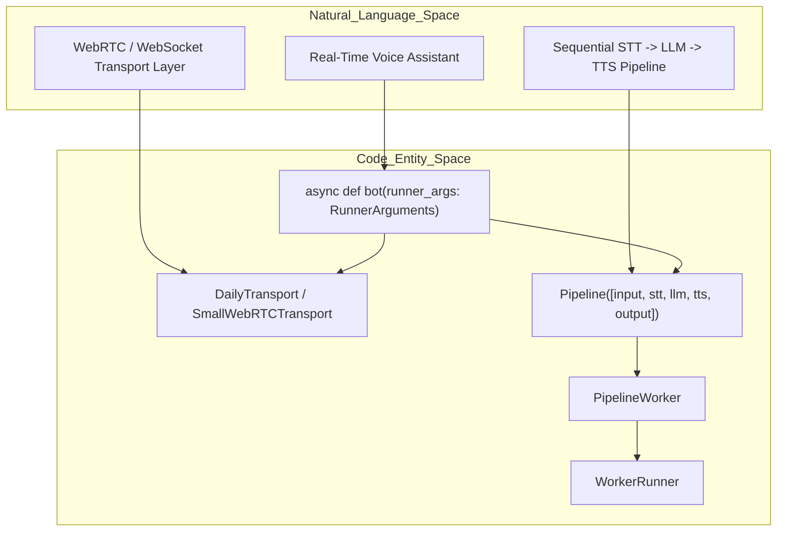
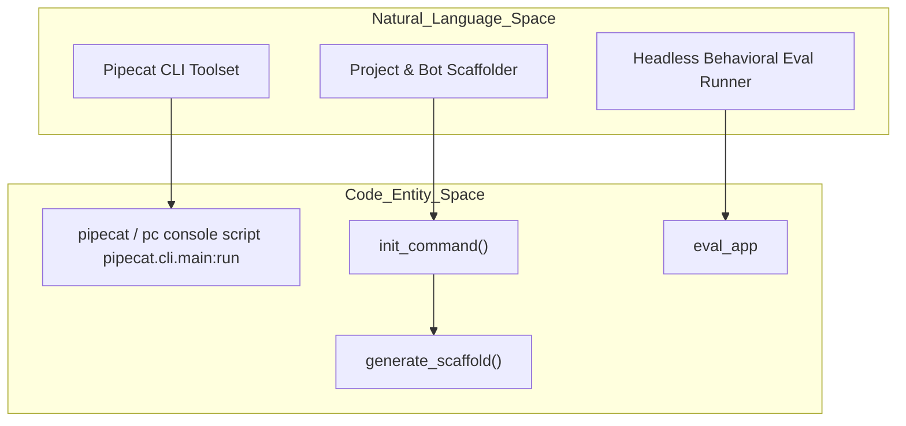

<!-- source: DeepWiki mcp.deepwiki.com · repo pipecat-ai/pipecat · page 2 Getting Started · fetched 2026-10-27 -->

# Getting Started

Relevant source files

The following files were used as context for generating this wiki page:

- [.github/workflows/coverage.yaml](.github/workflows/coverage.yaml)
- [.github/workflows/python-compatibility.yaml](.github/workflows/python-compatibility.yaml)
- [.github/workflows/tests.yaml](.github/workflows/tests.yaml)
- [README.md](README.md)
- [changelog/6208.added.md](changelog/6208.added.md)
- [env.example](env.example)
- [evals/release/manifest.yaml](evals/release/manifest.yaml)
- [evals/release/scenarios/scripted/generate_image.yaml](evals/release/scenarios/scripted/generate_image.yaml)
- [examples/README.md](examples/README.md)
- [examples/flows/README.md](examples/flows/README.md)
- [examples/flows/yaml/insurance_quote/bot.py](examples/flows/yaml/insurance_quote/bot.py)
- [examples/flows/yaml/insurance_quote/flow.yaml](examples/flows/yaml/insurance_quote/flow.yaml)
- [examples/flows/yaml/insurance_quote/handlers.py](examples/flows/yaml/insurance_quote/handlers.py)
- [examples/image-generation/image-generation-fal.py](examples/image-generation/image-generation-fal.py)
- [examples/image-generation/image-generation-google.py](examples/image-generation/image-generation-google.py)
- [examples/image-generation/image-generation-openai.py](examples/image-generation/image-generation-openai.py)
- [examples/voice/voice-rime-v1.py](examples/voice/voice-rime-v1.py)
- [pyproject.toml](pyproject.toml)
- [src/pipecat/services/rime/tts_v1.py](src/pipecat/services/rime/tts_v1.py)
- [tests/test_rime_v1_tts.py](tests/test_rime_v1_tts.py)
- [uv.lock](uv.lock)

This page guides you through installing Pipecat, configuring your environment variables, understanding the quickstart bot pattern, and exploring the available examples.

As a parent page, this section provides a high-level overview. For deep technical details regarding dependency extras, `uv.lock` dependency resolution, optional-dependency import error patterns, or complete directory mappings, refer to the child pages:
- [Installation and Extras](#2.1)
- [Examples Directory Guide](#2.2)

---

## Installation & Optional Dependencies

Pipecat is engineered with a lightweight core and a modular extras system to manage AI service SDKs and transport requirements [pyproject.toml:22-52, 68-172](). The package requires Python 3.11 or later [pyproject.toml:12]() and is distributed on PyPI under the name `pipecat-ai` [pyproject.toml:6]().

Core dependencies include foundational libraries for asynchronous networking, audio processing, and OpenAI client utilities [pyproject.toml:22-52](). Optional features—such as Daily WebRTC (`daily`), LiveKit (`livekit`), Media over QUIC (`moq`), and the Pipecat CLI (`cli`)—are enabled via `pyproject.toml` extras [pyproject.toml:68-172]().

For a comprehensive review of `pyproject.toml` extras, dependency resolution via `uv.lock`, and import error handling for missing optional packages, see [Installation and Extras](#2.1).

Sources: [pyproject.toml:6-172]()

---

## Environment Variable Configuration

Pipecat does not bundle proprietary API keys; instead, every service dynamically reads from standard environment variables defined during runtime initialization [env.example:1-280](). To configure your local development environment, copy `env.example` to `.env` and populate the required provider credentials [examples/README.md:13-18]().

Common configuration variables include service authentication keys (`OPENAI_API_KEY`, `DAILY_API_KEY`, `DEEPGRAM_API_KEY`, `CARTESIA_API_KEY`, `ANTHROPIC_API_KEY`, `GOOGLE_API_KEY`) as well as security and network controls like `PIPECAT_WEBSOCKET_AUTH` and `PIPECAT_ALLOWED_ORIGINS` [env.example:1-280]().

Sources: [env.example:1-280](), [examples/README.md:13-18]()

---

## Quickstart & Bot Entry Point Anatomy

A Pipecat application executes through an asynchronous `bot(runner_args)` entry point that wires a transport provider, AI services (STT, LLM, TTS), a conversational `Pipeline`, and executes them via `PipelineWorker` and `WorkerRunner`.

Title: "Quickstart Pipeline Architecture"

Sources: [README.md:7-29]()

---

## Examples Directory Guide

The repository includes a robust `examples/` directory structured by functional capabilities, ranging from progressive getting-started scripts to complex real-time speech-to-speech services, structured conversational flows, multi-worker agent topologies, and vision integrations [README.md:80-86](), [examples/README.md:58-147]().

For a complete map of the `examples/` tree and instructions on running bots with local audio, Daily, or Twilio transports, see [Examples Directory Guide](#2.2).

Sources: [README.md:80-86](), [examples/README.md:58-147]()

---

## The Pipecat CLI

The Pipecat CLI ships with `pipecat-ai` (activated via the `cli` extra) and provides built-in utilities for project initialization, scaffolding runnable bots, and running automated behavioral evaluation harnesses [pyproject.toml:61-66, 168-175](), [README.md:48-51]().

Title: "Pipecat CLI Toolset Architecture"

Sources: [pyproject.toml:61-66, 168-175](), [README.md:48-51]()

---

