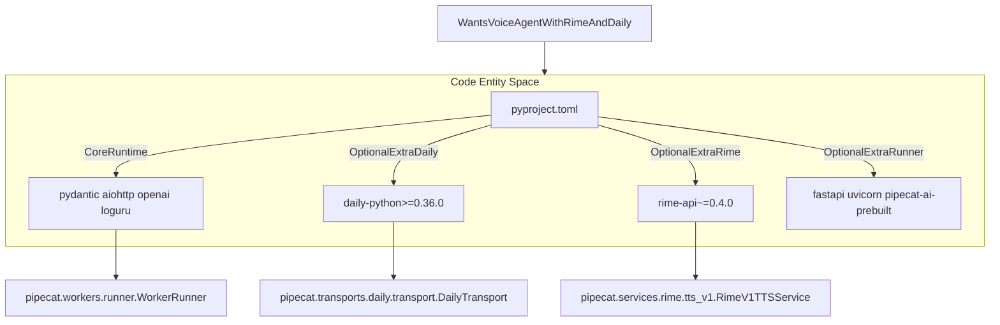
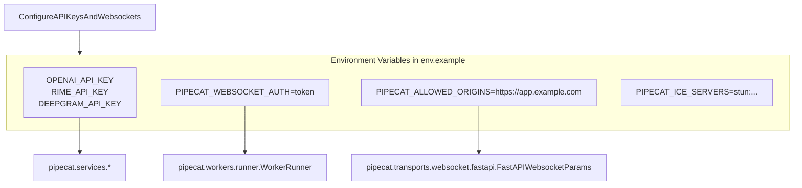
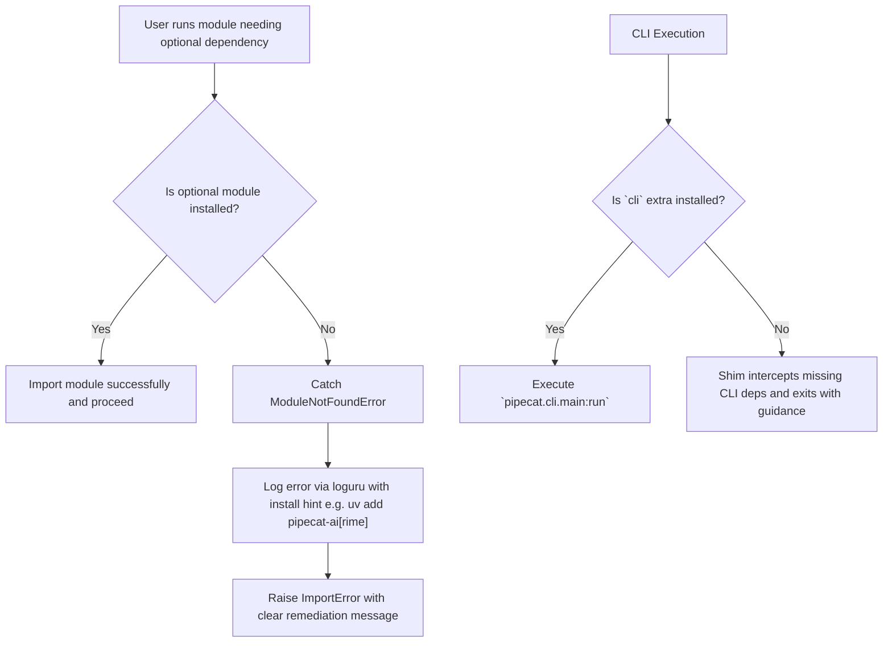

<!-- source: DeepWiki mcp.deepwiki.com · repo pipecat-ai/pipecat · page 2.1 Installation and Extras · fetched 2026-10-27 -->

# Installation and Extras

Relevant source files

The following files were used as context for generating this wiki page:

- [.github/workflows/coverage.yaml](.github/workflows/coverage.yaml)
- [.github/workflows/python-compatibility.yaml](.github/workflows/python-compatibility.yaml)
- [.github/workflows/tests.yaml](.github/workflows/tests.yaml)
- [README.md](README.md)
- [changelog/6208.added.md](changelog/6208.added.md)
- [env.example](env.example)
- [evals/release/manifest.yaml](evals/release/manifest.yaml)
- [examples/voice/voice-rime-v1.py](examples/voice/voice-rime-v1.py)
- [pyproject.toml](pyproject.toml)
- [src/pipecat/services/rime/tts_v1.py](src/pipecat/services/rime/tts_v1.py)
- [tests/test_rime_v1_tts.py](tests/test_rime_v1_tts.py)
- [uv.lock](uv.lock)

## Purpose and Scope
This section details the installation architecture of the Pipecat framework (`pipecat-ai`), focusing on dependency management via `pyproject.toml` [pyproject.toml:1-165](), deterministic resolution through `uv.lock` [uv.lock:1-10](), environment variable configuration using `env.example` [env.example:1-280](), and optional-dependency import error patterns used by services like `RimeV1TTSService` [src/pipecat/services/rime/tts_v1.py:29-35]().

Sources: [pyproject.toml:1-165](), [uv.lock:1-10](), [env.example:1-280](), [src/pipecat/services/rime/tts_v1.py:29-35]()

---

## 1. Pyproject.toml Extras Architecture

The Pipecat codebase uses a lean core dependency model defined in `pyproject.toml` [pyproject.toml:5-51](), keeping the base installation lightweight. All AI service integrations, hardware-accelerated filters, advanced transports, and developer tools are mapped to granular optional dependencies (`[project.optional-dependencies]`) [pyproject.toml:67-165]().

### Core Dependencies vs. Optional Extras

| Category | Target / Component | Configuration Key / Reference |
| :--- | :--- | :--- |
| **Core Runtime** | `aiofiles`, `aiohttp`, `loguru`, `pydantic`, `openai`, `websockets`, `numpy`, `resampy`, `soxr` | `[project] dependencies` [pyproject.toml:22-52]() |
| **Transport Extras** | WebRTC (`aiortc`), Daily (`daily-python`), LiveKit (`livekit`), WebSocket (`fastapi`), Media over QUIC (`moq`) | `[project.optional-dependencies]` [pyproject.toml:83,114,115,125,141,162]() |
| **AI Service Extras** | Anthropic, Deepgram, Google GenAI, Groq, Mistral, ElevenLabs, Rime, etc. | `[project.optional-dependencies]` [pyproject.toml:69,70,84,95,103,121,140]() |
| **Development & CLI** | Code scaffolding (`typer`, `rich`, `jinja2`), testing tools (`pytest`, `coverage`), linting (`ruff`) | `[project.optional-dependencies] cli`, `[dependency-groups] dev` [pyproject.toml:168-192]() |

Title: Natural Language to Code Entity Mapping for Installation Extras

Sources: [pyproject.toml:5-165](), [uv.lock:1-10]()

---

## 2. Deterministic Resolution with `uv.lock`

Pipecat uses `uv` for ultra-fast dependency resolution and locking. The `uv.lock` [uv.lock:1-10]() file anchors exact package versions, platform-specific wheels, and environment markers.

### Resolution Mechanics & Constraints
*   **Python Version Support**: Requires Python `>=3.11` [pyproject.toml:12] [uv.lock:3](). Special handling exists for Python 3.13 (`audioop-lts`) [pyproject.toml:25]() and Python 3.14 (`pydantic>=2.13`) [pyproject.toml:36]().
*   **Conflict Isolation**: `uv` handles complex dependency graphs where specific service connectors (e.g., `vonage-video-connector` pinning older Pydantic versions) would otherwise conflict with modern AI SDKs (like `google-genai`) through explicit markers and separation rules [pyproject.toml:93-100,159]().

Sources: [pyproject.toml:1-198](), [uv.lock:1-10]()

---

## 3. Environment Configuration (`env.example`)

Runtime configuration for API keys, service endpoints, and runner parameters is governed by environment variables mirrored in `env.example` [env.example:1-280]() and loaded via `python-dotenv` [pyproject.toml:37]().

### Key Environment Parameters

The `env.example` file provides a comprehensive list of environment variables required for various services, transports, and runner options, such as HMAC authentication (`PIPECAT_WEBSOCKET_AUTH`), origin restriction (`PIPECAT_ALLOWED_ORIGINS`), and ICE servers (`PIPECAT_ICE_SERVERS`) [env.example:263-280]().

Title: Natural Language to Code Entity Mapping for Environment Variables

Sources: [env.example:1-280](), [pyproject.toml:37]()

---

## 4. Optional-Dependency Import Error Patterns

Because Pipecat's architecture allows modular installation of services and transports, missing optional packages do not crash package initialization. Instead, Pipecat utilizes graceful degradation, lazy loading, and dedicated import error patterns.

### Try-Except Import Handling Pattern
When optional service clients or dependencies are required at runtime, modules use defensive `try...except ModuleNotFoundError` blocks to log precise remediation hints (such as the exact `uv add` or `pip install` command needed) before raising an `ImportError` [src/pipecat/services/rime/tts_v1.py:29-35]().

Title: Import Error Handling and Graceful Degradation Flow

Sources: [pyproject.toml:61-66](), [src/pipecat/services/rime/tts_v1.py:29-35]()

---

