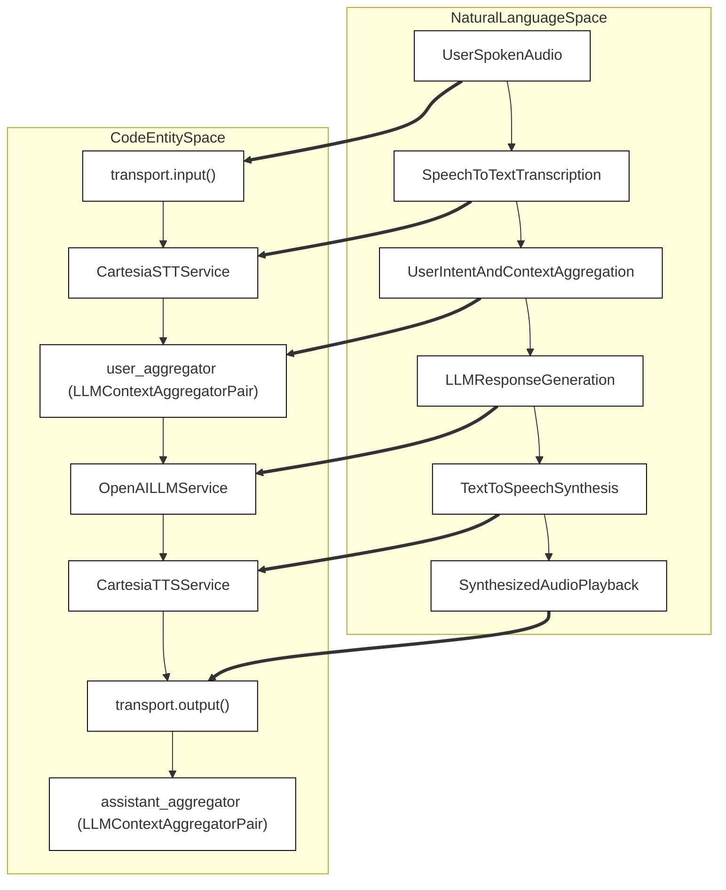
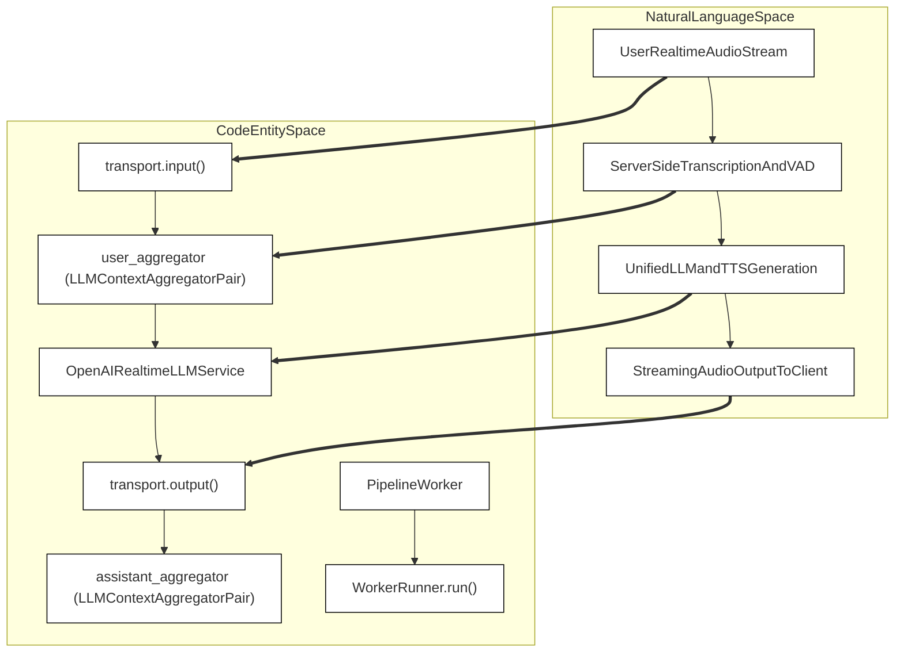

<!-- source: DeepWiki mcp.deepwiki.com · repo pipecat-ai/pipecat · page 2.2 Examples Directory Guide · fetched 2026-10-27 -->

# Examples Directory Guide

<details>
<summary>Relevant source files</summary>

The following files were used as context for generating this wiki page:

- [evals/release/scenarios/scripted/generate_image.yaml](evals/release/scenarios/scripted/generate_image.yaml)
- [examples/README.md](examples/README.md)
- [examples/flows/README.md](examples/flows/README.md)
- [examples/flows/yaml/insurance_quote/bot.py](examples/flows/yaml/insurance_quote/bot.py)
- [examples/flows/yaml/insurance_quote/flow.yaml](examples/flows/yaml/insurance_quote/flow.yaml)
- [examples/flows/yaml/insurance_quote/handlers.py](examples/flows/yaml/insurance_quote/handlers.py)
- [examples/image-generation/image-generation-fal.py](examples/image-generation/image-generation-fal.py)
- [examples/image-generation/image-generation-google.py](examples/image-generation/image-generation-google.py)
- [examples/image-generation/image-generation-openai.py](examples/image-generation/image-generation-openai.py)
- [examples/realtime/realtime-aws-nova-sonic.py](examples/realtime/realtime-aws-nova-sonic.py)
- [examples/realtime/realtime-azure.py](examples/realtime/realtime-azure.py)
- [examples/realtime/realtime-gemini-live-async-tool.py](examples/realtime/realtime-gemini-live-async-tool.py)
- [examples/realtime/realtime-gemini-live-graceful-end.py](examples/realtime/realtime-gemini-live-graceful-end.py)
- [examples/realtime/realtime-gemini-live-locally-driven-turns.py](examples/realtime/realtime-gemini-live-locally-driven-turns.py)
- [examples/realtime/realtime-gemini-live-vertex.py](examples/realtime/realtime-gemini-live-vertex.py)
- [examples/realtime/realtime-gemini-live.py](examples/realtime/realtime-gemini-live.py)
- [examples/realtime/realtime-grok-locally-driven-turns.py](examples/realtime/realtime-grok-locally-driven-turns.py)
- [examples/realtime/realtime-inworld-locally-driven-turns.py](examples/realtime/realtime-inworld-locally-driven-turns.py)
- [examples/realtime/realtime-inworld.py](examples/realtime/realtime-inworld.py)
- [examples/realtime/realtime-openai-locally-driven-turns.py](examples/realtime/realtime-openai-locally-driven-turns.py)
- [examples/realtime/realtime-openai-text.py](examples/realtime/realtime-openai-text.py)
- [examples/realtime/realtime-openai.py](examples/realtime/realtime-openai.py)
- [examples/realtime/realtime-ultravox-async-tool.py](examples/realtime/realtime-ultravox-async-tool.py)
- [examples/realtime/realtime-ultravox-text.py](examples/realtime/realtime-ultravox-text.py)
- [examples/realtime/realtime-ultravox.py](examples/realtime/realtime-ultravox.py)
- [examples/transcription/transcription-assemblyai.py](examples/transcription/transcription-assemblyai.py)
- [examples/transcription/transcription-meta.py](examples/transcription/transcription-meta.py)
- [examples/update-settings/stt/stt-assemblyai.py](examples/update-settings/stt/stt-assemblyai.py)
- [examples/update-settings/stt/stt-deepgram-flux.py](examples/update-settings/stt/stt-deepgram-flux.py)
- [examples/update-settings/stt/stt-speechmatics.py](examples/update-settings/stt/stt-speechmatics.py)
- [examples/update-settings/tts/tts-deepgram-flux.py](examples/update-settings/tts/tts-deepgram-flux.py)
- [examples/voice/voice-assemblyai-turn-detection.py](examples/voice/voice-assemblyai-turn-detection.py)
- [examples/voice/voice-assemblyai.py](examples/voice/voice-assemblyai.py)
- [examples/voice/voice-cartesia-turns.py](examples/voice/voice-cartesia-turns.py)
- [examples/voice/voice-cartesia.py](examples/voice/voice-cartesia.py)
- [examples/voice/voice-deepgram-flux-sagemaker.py](examples/voice/voice-deepgram-flux-sagemaker.py)
- [examples/voice/voice-deepgram-flux.py](examples/voice/voice-deepgram-flux.py)
- [examples/voice/voice-gladia-vad.py](examples/voice/voice-gladia-vad.py)
- [examples/voice/voice-meta.py](examples/voice/voice-meta.py)
- [examples/voice/voice-speechmatics-vad.py](examples/voice/voice-speechmatics-vad.py)

</details>


## Purpose and Scope

This page serves as a technical map and execution guide for the `examples/` directory within the Pipecat repository [`examples/README.md:1-3`](). It provides a comprehensive breakdown of the directory tree—covering getting-started guides, cascaded voice pipelines, realtime bidirectional WebSocket services, runtime settings updates, multi-worker architectures, tool use and function calling, conversation flows, and turn management—while detailing the underlying architecture, data flow, key classes (`PipelineWorker`, `WorkerRunner`, `LLMContextAggregatorPair`, `FlowManager`), and execution patterns.

Sources: [`examples/README.md:1-3`](), [`examples/README.md:58-147`]()

---

## 1. Environment Setup and Execution Mechanics

Before running any example in the Pipecat codebase, the local development environment must be configured with appropriate dependencies and API keys [`examples/README.md:5-18`](). Pipecat uses `uv` for fast dependency resolution and execution.

1. Copy the environment template from the repository root [`examples/README.md:13-18`]():
   ```bash
   cp env.example .env
   # Populate .env with valid API keys (OPENAI_API_KEY, CARTESIA_API_KEY, DAILY_API_KEY, etc.)
   ```
2. Execute any example using `uv run` [`examples/README.md:20-24`]():
   ```bash
   uv run python examples/getting-started/01-say-one-thing.py
   ```
3. Open the web interface at `http://localhost:7860/client/` and click "Connect" [`examples/README.md:26-27`]().

### Transport Switching
Most examples utilize a dynamic transport factory (`create_transport`) supporting multiple deployment targets via command-line flags [`examples/README.md:28-38`](). The `transport_params` dictionary in each example defines the available transport configurations [`examples/realtime/realtime-aws-nova-sonic.py:60-77`]().
* **Local WebRTC / Evaluation**: Default or `-t webrtc` / `-t eval` [`examples/realtime/realtime-aws-nova-sonic.py:61-77`]().
* **Daily.co WebRTC**: Requires `DAILY_API_KEY` and `DAILY_ROOM_URL` (or auto-created rooms) [`examples/README.md:32-38`]():
  ```bash
  uv run python examples/realtime/realtime-openai.py -t daily
  ```
* **Twilio Telephony**: Requires `ngrok` tunneling for webhook routing [`examples/README.md:40-56`]():
  ```bash
  ngrok http 7860
  uv run python examples/realtime/realtime-openai.py -t twilio -x NGROK_HOST_NAME
  ```

Sources: [`examples/README.md:1-58`](), [`examples/realtime/realtime-aws-nova-sonic.py:60-77`]()

---

## 2. Directory Tree Map and Architectural Breakdown

The `examples/` directory is organized by architectural complexity, service integrations, and specialized capabilities [`examples/README.md:58-147`]().

```
examples/
├── getting-started/        # Progressive introduction: minimal TTS to voice agent
├── voice/                  # Cascaded STT + LLM + TTS voice pipelines
├── realtime/               # WebSocket streaming multimodal live APIs
├── update-settings/        # Runtime configuration modifications (stt, tts, llm)
├── multi-worker/           # Multi-agent and pub/sub worker framework examples
├── flows/                  # Pipecat Flows state machines and node navigation
├── function-calling/       # Tool use and function execution across LLM providers
├── transcription/          # Dedicated Speech-to-Text logging and analysis
├── vision/                 # Multimodal image description and video frames
├── turn-management/        # Custom VAD, user turn stop strategies, and interruptions
├── observability/          # Logging, metrics collection, and OpenTelemetry
└── transports/             # Specialized transport integrations (Daily, LiveKit, MOQ)
```

Sources: [`examples/README.md:58-147`]()

### 2.1 Getting Started and Voice Agents (`getting-started/`, `voice/`)
Implements traditional cascaded architectures where audio input flows through an STT service (`DeepgramSTTService`, `CartesiaSTTService`), gets aggregated by `LLMContextAggregatorPair`, evaluated by an LLM (`OpenAILLMService`), synthesized by a TTS service (`CartesiaTTSService`), and rendered by a transport output [`examples/voice/voice-cartesia.py:89-95`]().

Sources: [`examples/README.md:60-71`](), [`examples/voice/voice-cartesia.py:89-95`]()

### 2.2 Realtime Multimodal APIs (`realtime/`)
Demonstrates bidirectional WebSocket-based streaming services where audio/text flows directly into a unified realtime service that handles STT, LLM reasoning, and TTS internally.

*   **OpenAI Realtime API** [`examples/realtime/realtime-openai.py`]() — Utilizes `OpenAIRealtimeLLMService` with `SessionProperties` and `SemanticTurnDetection` [`examples/realtime/realtime-openai.py:113-146`](). A locally-driven turn variant [`examples/realtime/realtime-openai-locally-driven-turns.py`]() disables server-side VAD and wires `SileroVADAnalyzer` into the user aggregator [`examples/realtime/realtime-openai-locally-driven-turns.py:148-175`]().
*   **Google Gemini Live** [`examples/realtime/realtime-gemini-live.py`]() — Configures `GeminiLiveLLMService` with `ToolsSchema` and function handlers [`examples/realtime/realtime-gemini-live.py:89-134`]().
*   **AWS Nova Sonic** [`examples/realtime/realtime-aws-nova-sonic.py`]() — Implements `AWSNovaSonicLLMService` with built-in `SessionContinuationParams` for handling long-duration sessions past session limits [`examples/realtime/realtime-aws-nova-sonic.py:95-123`]().
*   **Ultravox & Inworld Realtime** [`examples/realtime/realtime-ultravox.py`]() & [`examples/realtime/realtime-inworld.py`]() — Real-time voice agents utilizing specialized realtime routers and server-side semantic VAD [`examples/realtime/realtime-ultravox.py:168-172`]().

Sources: [`examples/README.md:84-87`](), [`examples/realtime/realtime-openai.py:113-146`](), [`examples/realtime/realtime-gemini-live.py:89-134`](), [`examples/realtime/realtime-aws-nova-sonic.py:95-123`](), [`examples/realtime/realtime-ultravox.py:168-172`](), [`examples/realtime/realtime-openai-locally-driven-turns.py:148-175`]()

### 2.3 Function Calling and Tool Use (`function-calling/`)
Showcases tool registration, direct function execution, asynchronous background tasks, and streaming intermediate results across providers:
*   `examples/function-calling/function-calling-openai-async.py` — OpenAI async tool execution with `@tool_options(cancel_on_interruption=False, timeout_secs=30)` and event handlers for `on_function_calls_started` [`examples/README.md:72-74`]().
*   `examples/function-calling/function-calling-google-async.py` — Google Gemini async tool handling with `UserImageRequestFrame` pushing upstream [`examples/README.md:72-74`]().
*   `examples/function-calling/function-calling-anthropic-async.py` — Anthropic Claude tool execution [`examples/README.md:72-74`]().
*   `examples/function-calling/function-calling-openai-responses-async.py` — OpenAI Responses API (`OpenAIResponsesLLMService`) with reasoning configuration [`examples/README.md:72-74`]().

Sources: [`examples/README.md:72-74`]()

### 2.4 Runtime Settings Updates (`update-settings/`)
Organized by service type (`stt/`, `tts/`, `llm/`), these examples showcase how to modify service parameters mid-stream without dropping the active transport connection [`examples/README.md:96-103`](). For instance, STT updates queue frames containing parameter deltas dynamically at runtime.

Sources: [`examples/README.md:96-103`](), [`examples/README.md:100-102`]()

### 2.5 Multi-Worker Framework (`multi-worker/`)
Exemplifies the Pipecat multi-agent framework (`pipecat.workers`), featuring `PipelineWorker` instances acting as bus peers over a `WorkerBus`, distributed message passing, and job fan-out via `job_group` [`examples/README.md:140-142`]().

Sources: [`examples/README.md:140-142`]()

### 2.6 Conversation Flows (`examples/flows/`)
Maps structured conversation graphs using `Pipecat Flows`. Flows can be defined as YAML data (`flow.yaml`) joined with Python handler functions (`handlers.py`) or purely in Python [`examples/flows/README.md:1-16`]().
*   **YAML Flows**: `yaml/hello_world/`, `yaml/food_ordering/`, `yaml/insurance_quote/` (where state is read using Jinja-like syntax such as `{{ quote.monthly_premium }}`) [`examples/flows/README.md:40-48`]().
*   **Python Flows**: `python/hello_world.py`, `python/food_ordering.py`, `python/warm_transfer.py`, `python/llm_switching.py` [`examples/flows/README.md:49-57`]().

Sources: [`examples/flows/README.md:1-57`](), [`examples/README.md:65-67`]()

### 2.7 Turn Management (`turn-management/`)
This directory contains examples demonstrating various strategies for detecting and managing user turns, including:
*   **Local Smart Turn V3**: Uses an ONNX model for local end-of-turn detection without network connectivity. The `LocalSmartTurnAnalyzerV3` class loads a bundled ONNX model (`smart-turn-v3.2-cpu.onnx`) and processes audio by resampling to 16kHz and computing Whisper-style log-mel features for inference [`src/pipecat/audio/turn/smart_turn/local_smart_turn_v3.py:28-166`](). This analyzer can be integrated into `LLMUserAggregatorParams` to drive local turn detection.
*   **VAD Integration**: Examples show how to integrate Voice Activity Detection (VAD) analyzers like `SileroVADAnalyzer` into the `LLMUserAggregator` to control when a user's turn starts and stops [`examples/realtime/realtime-openai-locally-driven-turns.py:170-175`]().

Sources: [`examples/README.md:104-106`](), [`src/pipecat/audio/turn/smart_turn/local_smart_turn_v3.py:28-166`](), [`examples/realtime/realtime-openai-locally-driven-turns.py:170-175`]()

---

## 3. Execution Data Flow and Architecture Diagrams

To bridge natural language concepts to concrete code entities, the following diagrams illustrate how frames traverse pipelines in typical Pipecat voice and realtime examples.

### Voice Pipeline Data Flow (Cascaded STT/LLM/TTS)
The following diagram maps the execution path of asynchronous function-calling pipelines, showing how user audio frames flow from the transport input through STT, context aggregation, LLM inference, TTS synthesis, and transport output.


Sources: [`examples/voice/voice-cartesia.py:89-95`](), [`examples/README.md:68-71`]()

### Realtime WebSocket Streaming Data Flow
The following diagram maps `realtime-openai.py`, illustrating how bidirectional WebSockets bypass individual cascaded STT/TTS workers by funneling audio through a single `OpenAIRealtimeLLMService` instance managed by `PipelineWorker` and `WorkerRunner`.


Sources: [`examples/realtime/realtime-openai.py:163-182`](), [`examples/README.md:84-87`]()

---

## 4. Summary of Example Categories and Execution Matrix

| Directory Path | Primary Focus | Key Classes / Frameworks | Execution Command Example |
| :--- | :--- | :--- | :--- |
| `examples/getting-started/` | Basic pipeline setup & TTS | `Pipeline`, `PipelineWorker`, `TTSService` | `uv run python examples/getting-started/01-say-one-thing.py` |
| `examples/voice/` | Cascaded Voice Agents | `CartesiaSTTService`, `OpenAILLMService`, `CartesiaTTSService` | `uv run python examples/voice/voice-cartesia.py` |
| `examples/realtime/` | Bidirectional Streaming | `OpenAIRealtimeLLMService`, `GeminiLiveLLMService` | `uv run python examples/realtime/realtime-openai.py` |
| `examples/function-calling/`| Tool Use & Async Exec | `FunctionCallParams`, `OpenAILLMService`, `@tool_options` | `uv run python examples/function-calling/function-calling-openai-async.py` |
| `examples/update-settings/`| Runtime Configuration | `STTUpdateSettingsFrame`, `TTSUpdateSettingsFrame` | `uv run python examples/update-settings/stt/stt-deepgram-flux.py` |
| `examples/multi-worker/` | Multi-Agent Framework | `PipelineWorker`, `WorkerBus`, `WorkerRunner` | `uv run python examples/multi-worker/basic-worker.py` |
| `examples/flows/` | Structured State Machines | `FlowManager`, `NodeConfig`, `FlowArgs` | `uv run python examples/flows/yaml/insurance_quote/bot.py` |
| `examples/turn-management/` | Turn Detection & Interruption | `LocalSmartTurnAnalyzerV3`, `SileroVADAnalyzer` | (Integrated into real-time or voice examples) |

Sources: [`examples/README.md:58-143`](), [`examples/realtime/realtime-openai.py:163-171`](), [`src/pipecat/audio/turn/smart_turn/local_smart_turn_v3.py:28-166`]()

---

