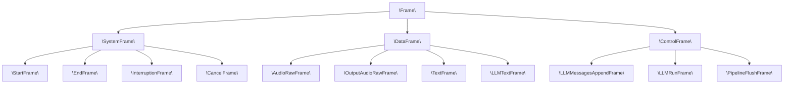
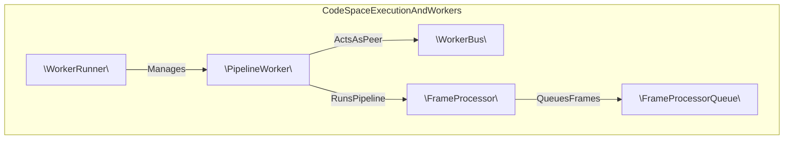

<!-- source: DeepWiki mcp.deepwiki.com · repo pipecat-ai/pipecat · page 3 Core Architecture · fetched 2026-10-27 -->

# Core Architecture

Relevant source files

The following files were used as context for generating this wiki page:

- [CHANGELOG.md](CHANGELOG.md)
- [src/pipecat/frames/frames.py](src/pipecat/frames/frames.py)
- [src/pipecat/pipeline/task.py](src/pipecat/pipeline/task.py)
- [src/pipecat/processors/aggregators/llm_response.py](src/pipecat/processors/aggregators/llm_response.py)
- [src/pipecat/processors/frame_processor.py](src/pipecat/processors/frame_processor.py)
- [src/pipecat/transports/base_input.py](src/pipecat/transports/base_input.py)
- [src/pipecat/transports/base_output.py](src/pipecat/transports/base_output.py)
- [src/pipecat/transports/base_transport.py](src/pipecat/transports/base_transport.py)

This page provides an architectural overview of Pipecat's fundamental frame-based pipeline processing model, component interactions, and execution subsystems. It serves as a parent guide to detailed subsystem documentation.

**Related pages**: For AI service integrations, see page 4. For transport implementations, see page 5. For audio/video processing, see page 6.

## Architectural Principles

Pipecat's architecture is built on these core principles:

- **Frame-based processing**: All data flows as discrete `Frame` objects with type-based priority. `SystemFrame` instances (e.g., `StartFrame`, `InterruptionFrame`, `CancelFrame`) are processed immediately with higher priority, while `DataFrame` and `ControlFrame` instances follow normal ordering [src/pipecat/processors/frame_processor.py:141-172]().
- **Asynchronous pipeline composition**: Each `FrameProcessor` runs in its own asyncio task with dual internal queues, enabling concurrent processing while maintaining ordering guarantees [src/pipecat/processors/frame_processor.py:132-184]().
- **Multi-Worker Coordination**: Pipecat pipelines support multi-agent and multi-worker execution via the `PipelineWorker` (formerly `PipelineTask`) acting as a peer on a shared `WorkerBus` [src/pipecat/pipeline/task.py:15-21]().
- **Protocol-agnostic transport**: The `BaseTransport`, `BaseInputTransport`, and `BaseOutputTransport` classes abstract communication protocols (WebRTC, WebSocket, telephony), allowing the same pipeline code to run across different transports [src/pipecat/transports/base_transport.py:96-137]().
- **Universal context management**: The `LLMContext` system provides provider-agnostic conversation storage with translation via the `BaseLLMAdapter` pattern [src/pipecat/frames/frames.py:30-51]().

Sources: [src/pipecat/frames/frames.py:30-139](), [src/pipecat/processors/frame_processor.py:132-184](), [src/pipecat/transports/base_transport.py:96-137](), [src/pipecat/pipeline/task.py:15-21]()

---

## Subsystem Overview and Child Pages

Pipecat's core architecture is organized into eleven core subsystems. Each subsystem is documented in detail on its respective child page:

### 3.1. Frame System and Processing
Frames are the fundamental unit of communication across Pipecat pipelines [src/pipecat/frames/frames.py:7-12](). The hierarchy splits into `SystemFrame` (immediate high-priority signals), `DataFrame` (sequential content like audio, video, text), and `ControlFrame` (configuration and execution signals) [src/pipecat/frames/frames.py:104-138](). Priorities and flow control are handled via `FrameProcessorQueue` [src/pipecat/processors/frame_processor.py:132-184]().

FrameClassHierarchyAndCodeEntities

Sources: [src/pipecat/frames/frames.py:64-139](), [src/pipecat/processors/frame_processor.py:132-184]()

For details, see [Frame System and Processing](#3.1).

---

### 3.2. Pipeline Architecture
Pipelines link `FrameProcessor` instances into linear or branching structures. The architecture supports standard sequential `Pipeline`, `ParallelPipeline` for concurrent evaluation branches, and `SyncParallelPipeline` for holding output until all concurrent branches converge [src/pipecat/processors/frame_processor.py:132-184]().

Sources: [src/pipecat/processors/frame_processor.py:132-184]()

For details, see [Pipeline Architecture](#3.2).

---

### 3.3. Frame Processors
The `FrameProcessor` base class implements the core lifecycle (`setup()`, `start()`, `process_frame()`, `push_frame()`, `cleanup()`) [src/pipecat/processors/frame_processor.py:132-184](). Processors function as filters, text processors, aggregators, or producer/consumer nodes within the pipeline.

Sources: [src/pipecat/processors/frame_processor.py:132-184]()

For details, see [Frame Processors](#3.3).

---

### 3.4. Pipeline Task and Execution
The execution runtime centers around `PipelineWorker` (formerly `PipelineTask`) [src/pipecat/pipeline/task.py:15-21](). It manages event handlers, frame queuing, `WorkerRunner`, service switchers (`ServiceSwitcher`/`LLMSwitcher`), app resources, and event loop sharing via `BaseTaskManager`.

PipelineExecutionAndWorkerBusEntityMapping

Sources: [src/pipecat/pipeline/task.py:15-21](), [src/pipecat/processors/frame_processor.py:132-184]()

For details, see [Pipeline Task and Execution](#3.4).

---

### 3.5. Transport I/O Architecture
Transports abstract communication protocols into `BaseTransport` [src/pipecat/transports/base_transport.py:96-137](), `BaseInputTransport` [src/pipecat/transports/base_input.py:38-44](), and `BaseOutputTransport` abstractions [src/pipecat/transports/base_output.py:66-72](). They integrate Voice Activity Detection (VAD) and manage media senders for audio and video streaming.

Sources: [src/pipecat/transports/base_transport.py:96-137](), [src/pipecat/transports/base_output.py:66-72](), [src/pipecat/transports/base_input.py:38-44]()

For details, see [Transport I/O Architecture](#3.5).

---

### 3.6. Context System
The universal `LLMContext` system manages conversation history. The `BaseLLMAdapter` pattern translates universal structures into provider-specific schemas while preserving `custom_tools` [src/pipecat/frames/frames.py:30-51]().

Sources: [src/pipecat/frames/frames.py:30-51]()

For details, see [Context System](#3.6).

---

### 3.7. Context Aggregators
Context aggregators (`LLMUserAggregator` and `LLMAssistantAggregator`) coordinate incoming transcriptions and model outputs into structured conversation turns, supporting gated context patterns and real-time service modes. The `LLMFullResponseAggregator` collects LLM text frames between start and end frames [src/pipecat/processors/aggregators/llm_response.py:20-38]().

Sources: [src/pipecat/processors/aggregators/llm_response.py:20-38]()

For details, see [Context Aggregators](#3.7).

---

### 3.8. Turn Detection and User Idle
Turn detection utilizes `UserTurnController`, specialized turn start/stop strategies, idle detection, user mute strategies, and Smart Turn analyzers within the `turns/` module [src/pipecat/frames/frames.py:30-51]().

Sources: [src/pipecat/frames/frames.py:30-51]()

For details, see [Turn Detection and User Idle](#3.8).

---

### 3.9. Interruption Handling
Interruptions are broadcast via `InterruptionFrame` objects. Frames feature an `interruptible` boolean field (default `True`, or `False` for subclasses like `UninterruptibleFrame`) which dictates whether an interruption cancels or drops them [CHANGELOG.md:67-73](), [src/pipecat/frames/frames.py:81-107]().

Sources: [CHANGELOG.md:67-73](), [src/pipecat/frames/frames.py:81-107]()

For details, see [Interruption Handling](#3.9).

---

### 3.10. Observer System and Monitoring
The observer pattern provides decoupled monitoring via `TaskObserver`, `WorkerObserver`, `TurnTrackingObserver`, `UserBotLatencyObserver`, and `StartupTimingObserver`, alongside structured logging and metrics collection [src/pipecat/processors/frame_processor.py:46-46]().

Sources: [src/pipecat/processors/frame_processor.py:46-46]()

For details, see [Observer System and Monitoring](#3.10).

---

### 3.11. RTVI Protocol
The Real-Time Voice Intelligence (RTVI) protocol integration standardizes client-server interactions via `RTVIProcessor`, `RTVIObserver`, custom serializers, and client transports. Evaluation components like `JudgeVerdict` and `LLMClassifier` integrate for real-time feedback [CHANGELOG.md:75-131]().

Sources: [CHANGELOG.md:75-131]()

For details, see [RTVI Protocol](#3.11).

---

