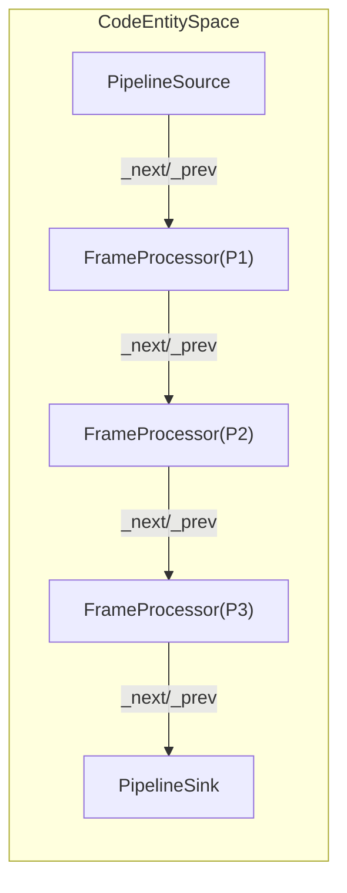
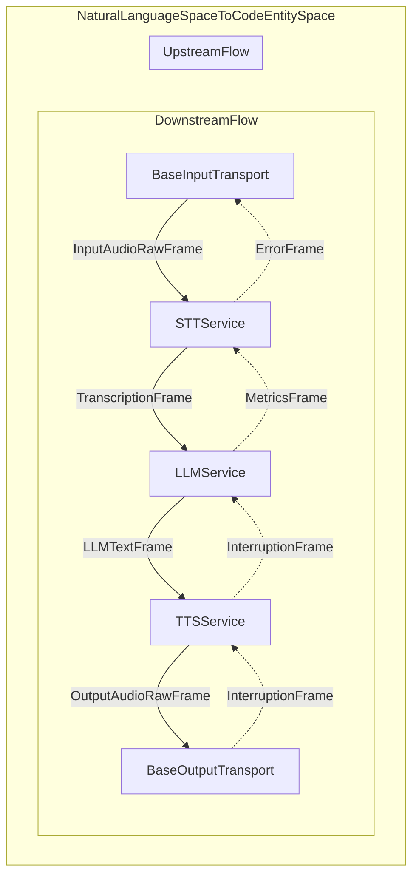
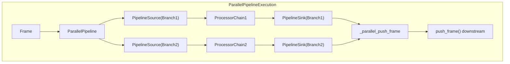
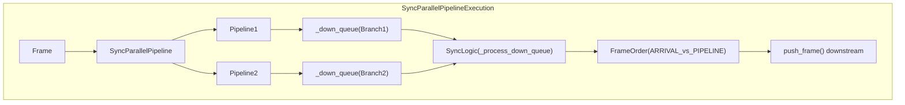

<!-- source: DeepWiki mcp.deepwiki.com · repo pipecat-ai/pipecat · page 3.2 Pipeline Architecture · fetched 2026-10-27 -->

# Pipeline Architecture

Relevant source files

The following files were used as context for generating this wiki page:

- [changelog/6086.fixed.4.md](changelog/6086.fixed.4.md)
- [examples/transcription/transcription-xai.py](examples/transcription/transcription-xai.py)
- [src/pipecat/observers/__init__.py](src/pipecat/observers/__init__.py)
- [src/pipecat/observers/base_observer.py](src/pipecat/observers/base_observer.py)
- [src/pipecat/observers/startup_timing_observer.py](src/pipecat/observers/startup_timing_observer.py)
- [src/pipecat/pipeline/base_pipeline.py](src/pipecat/pipeline/base_pipeline.py)
- [src/pipecat/pipeline/parallel_pipeline.py](src/pipecat/pipeline/parallel_pipeline.py)
- [src/pipecat/pipeline/pipeline.py](src/pipecat/pipeline/pipeline.py)
- [src/pipecat/pipeline/sync_parallel_pipeline.py](src/pipecat/pipeline/sync_parallel_pipeline.py)
- [src/pipecat/pipeline/worker_observer.py](src/pipecat/pipeline/worker_observer.py)
- [src/pipecat/services/xai/stt.py](src/pipecat/services/xai/stt.py)
- [src/pipecat/tests/utils.py](src/pipecat/tests/utils.py)
- [tests/test_aggregators.py](tests/test_aggregators.py)
- [tests/test_app_resources.py](tests/test_app_resources.py)
- [tests/test_daily_transport_service.py](tests/test_daily_transport_service.py)
- [tests/test_filters.py](tests/test_filters.py)
- [tests/test_llm_service.py](tests/test_llm_service.py)
- [tests/test_pipeline.py](tests/test_pipeline.py)
- [tests/test_startup_timing_observer.py](tests/test_startup_timing_observer.py)
- [tests/test_worker_observer.py](tests/test_worker_observer.py)
- [tests/test_xai_stt.py](tests/test_xai_stt.py)

## Purpose and Scope

This document explains Pipecat's pipeline architecture, detailing pipeline construction, `FrameProcessor` linking mechanics, parallel pipelines, synchronous parallel pipelines, and how frames flow through the system.

For information about frame processors themselves, see [Frame Processors](3.3). For pipeline execution and lifecycle management, see [Pipeline Task and Execution](3.4). For the frame types that flow through pipelines, see [Frame System and Processing](3.1).

---

## Overview

Pipelines are the fundamental organizational unit in Pipecat. They connect `FrameProcessor` instances in various topologies to create processing flows. All pipeline types inherit from `BasePipeline` [src/pipecat/pipeline/base_pipeline.py:19-25](), which itself extends `FrameProcessor` [src/pipecat/processors/frame_processor.py:1-50]().

### Pipeline Types

| Class | Module | Purpose |
|-------|--------|---------|
| `Pipeline` | `pipecat.pipeline.pipeline` | Sequential linear chain of processors [src/pipecat/pipeline/pipeline.py:91-122]() |
| `ParallelPipeline` | `pipecat.pipeline.parallel_pipeline` | Concurrent branches with deduplication and lifecycle sync [src/pipecat/pipeline/parallel_pipeline.py:24-76]() |
| `SyncParallelPipeline` | `pipecat.pipeline.sync_parallel_pipeline` | Synchronized parallel branches that hold output until all branches finish [src/pipecat/pipeline/sync_parallel_pipeline.py:128-178]() |

Sources:
- [src/pipecat/pipeline/base_pipeline.py:19-25]()
- [src/pipecat/pipeline/pipeline.py:91-122]()
- [src/pipecat/pipeline/parallel_pipeline.py:24-76]()
- [src/pipecat/pipeline/sync_parallel_pipeline.py:128-178]()
- [src/pipecat/processors/frame_processor.py:1-50]()

---

## Basic Pipeline Structure and Linking

### Pipeline Construction and Processor Linking

The `Pipeline` class connects a sequence of `FrameProcessor` instances into a linear processing chain [src/pipecat/pipeline/pipeline.py:91-122](). During initialization, `Pipeline` automatically wraps the processor list with a `PipelineSource` at the entry point and a `PipelineSink` at the exit point if custom ones are not provided [src/pipecat/pipeline/pipeline.py:113-119](). 

The internal linking mechanism establishes bidirectional references (`_prev` and `_next`) between adjacent processors, enabling traversal in both downstream and upstream directions [src/pipecat/processors/frame_processor.py:51-100]().

Title: "Pipeline Construction and Linking Flow"

Sources:
- [src/pipecat/pipeline/pipeline.py:91-122]()
- [src/pipecat/processors/frame_processor.py:51-100]()

---

## PipelineSource and PipelineSink

### PipelineSource

`PipelineSource` acts as the entry point for a pipeline. It forwards downstream frames to the next processor and upstream frames to a provided upstream handler function [src/pipecat/pipeline/pipeline.py:21-53]().

### PipelineSink

`PipelineSink` serves as the endpoint for a pipeline. It forwards downstream frames to a downstream handler function and upstream frames back through the pipeline [src/pipecat/pipeline/pipeline.py:55-89]().

Sources:
- [src/pipecat/pipeline/pipeline.py:21-89]()

---

## Frame Flow Direction

Frames in Pipecat flow in two directions through pipelines, defined by the `FrameDirection` enum [src/pipecat/processors/frame_processor.py:1-30]():

- `DOWNSTREAM`: Frames flowing from input to output (e.g., `InputAudioRawFrame` -> `STTService` -> `LLMService`).
- `UPSTREAM`: Frames flowing back from output to input (e.g., `InterruptionFrame` or `MetricsFrame`).

Title: "Natural Language Space to Code Entity Space Frame Flow"

Each processor's `process_frame()` method receives both the frame and the direction, allowing it to handle frames differently based on their flow direction [src/pipecat/processors/frame_processor.py:31-70]().

Sources:
- [src/pipecat/processors/frame_processor.py:1-70]()

---

## ParallelPipeline

`ParallelPipeline` processes frames through multiple sub-pipelines concurrently. It coordinates frame flow and ensures proper synchronization of lifecycle events like `EndFrame` [src/pipecat/pipeline/parallel_pipeline.py:24-76]().

Title: "ParallelPipeline Execution Architecture"

### Key Features

**Frame Deduplication:** The pipeline tracks frame IDs using a `_seen_ids` set in `_parallel_push_frame` to ensure each unique frame is only pushed downstream once [src/pipecat/pipeline/parallel_pipeline.py:166-175]().

**Lifecycle Synchronization:** For `StartFrame`, `EndFrame`, and `CancelFrame`, the pipeline synchronizes across all branches. It pauses processing using `pause_processing_frames()` and waits for all branches to reach the sink before continuing [src/pipecat/pipeline/parallel_pipeline.py:156-161]().

Sources:
- [src/pipecat/pipeline/parallel_pipeline.py:24-175]()

---

## SyncParallelPipeline

`SyncParallelPipeline` fans each input frame to parallel pipelines and holds the output until every pipeline finishes processing that specific frame [src/pipecat/pipeline/sync_parallel_pipeline.py:128-148]().

Title: "SyncParallelPipeline Execution Architecture"

### Synchronization Mechanism

**SyncFrame Sentinel:** After sending a real frame into a parallel pipeline, a `SyncFrame` [src/pipecat/pipeline/sync_parallel_pipeline.py:51-60]() is sent behind it. When the `SyncFrame` emerges from the pipeline's output, the system knows all output for the preceding input has been produced [src/pipecat/pipeline/sync_parallel_pipeline.py:128-148]().

**Frame Ordering:**
- `FrameOrder.ARRIVAL`: Frames are pushed in the order they arrive from any pipeline [src/pipecat/pipeline/sync_parallel_pipeline.py:32-48]().
- `FrameOrder.PIPELINE`: Frames are pushed in pipeline definition order — all frames from the first pipeline, then the second, and so on [src/pipecat/pipeline/sync_parallel_pipeline.py:32-48]().

Sources:
- [src/pipecat/pipeline/sync_parallel_pipeline.py:32-148]()

---

## Pipeline Integration

### PipelineWorker Integration

Pipelines are executed by wrapping them in a `PipelineWorker` [src/pipecat/observers/startup_timing_observer.py:34-34](). The worker manages the lifecycle of the pipeline, handling frame queuing and execution parameters. The `BaseTaskManager` supports a shared event loop and execution context [src/pipecat/observers/startup_timing_observer.py:54-54]().

### Nesting Pipelines

Pipelines can be nested within other pipelines since `Pipeline` extends `BasePipeline` [src/pipecat/pipeline/base_pipeline.py:19-25](). This allows for modular construction of complex agents.

Sources:
- [src/pipecat/pipeline/base_pipeline.py:19-25]()
- [src/pipecat/observers/startup_timing_observer.py:34-54]()

---

## Setup and Cleanup

### Setup Phase

Pipelines propagate `FrameProcessorSetup` [src/pipecat/processors/frame_processor.py:1-50]() to all contained processors concurrently via `_setup_processors()` [src/pipecat/pipeline/base_pipeline.py:26-61](). This ensures all sub-processors are initialized before frame processing begins [src/pipecat/pipeline/pipeline.py:169-176](). A processor that fails during setup will report an error and be marked as permanently failed [src/pipecat/pipeline/base_pipeline.py:26-51]().

### Cleanup Phase

Cleanup propagates through the pipeline hierarchy concurrently using `_cleanup_processors()` [src/pipecat/pipeline/base_pipeline.py:63-81](), ensuring that all processors release resources correctly [src/pipecat/pipeline/pipeline.py:178-182](). For parallel pipelines, cleanup is called on all branches [src/pipecat/pipeline/parallel_pipeline.py:128-132]().

Sources:
- [src/pipecat/pipeline/base_pipeline.py:26-81]()
- [src/pipecat/pipeline/pipeline.py:169-182]()
- [src/pipecat/pipeline/parallel_pipeline.py:128-132]()
- [src/pipecat/processors/frame_processor.py:1-50]()

---

