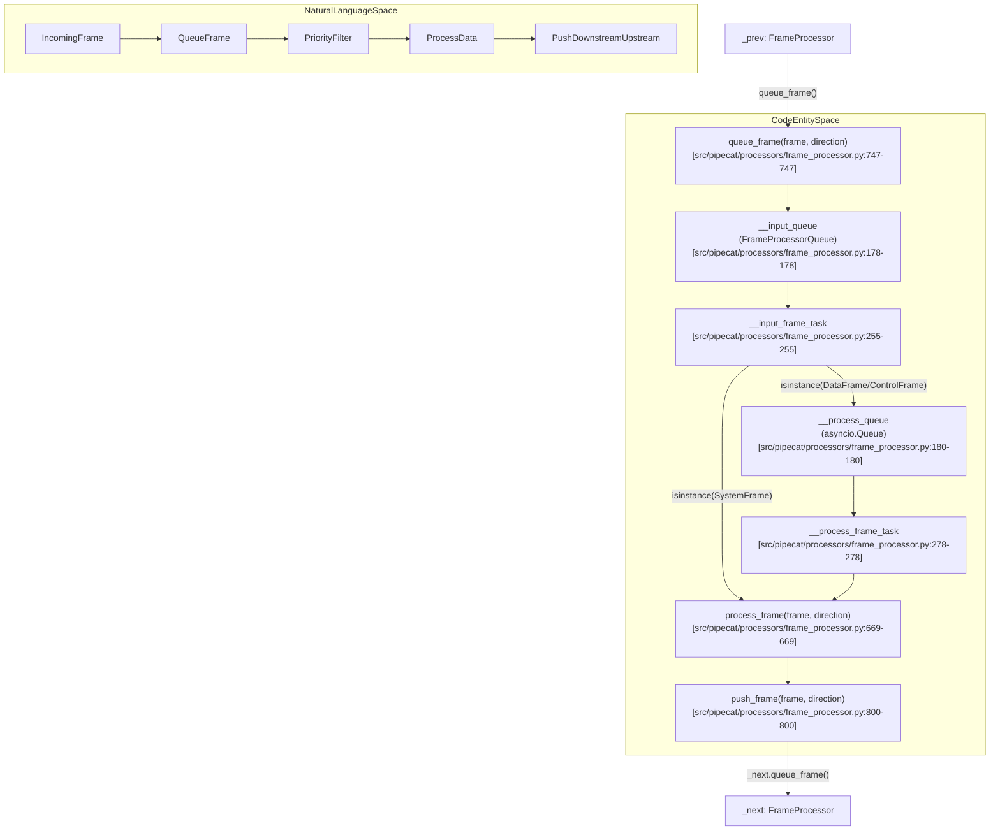
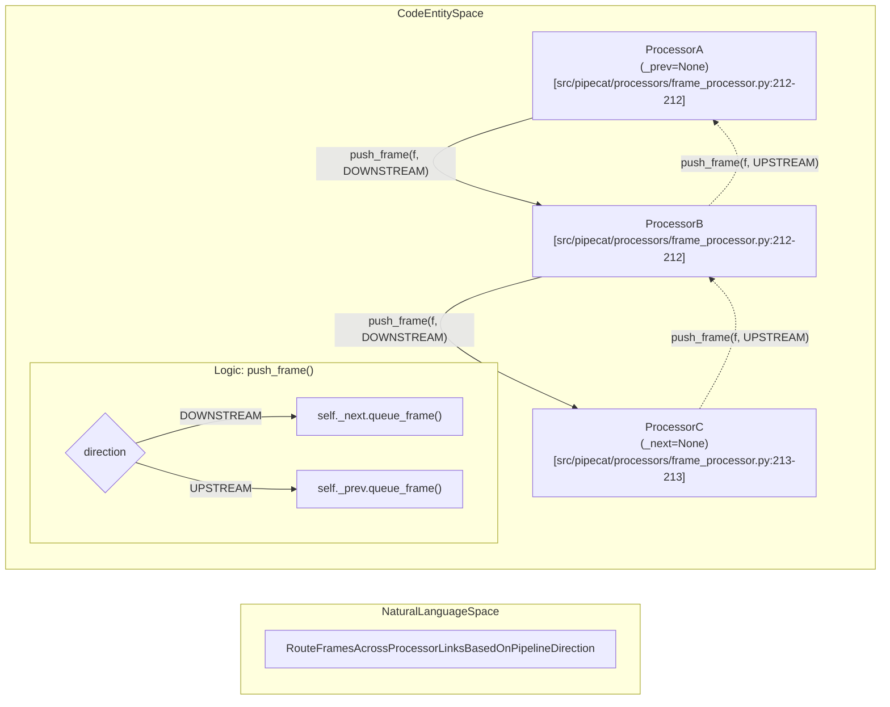

<!-- source: DeepWiki mcp.deepwiki.com · repo pipecat-ai/pipecat · page 3.3 Frame Processors · fetched 2026-10-27 -->

# Frame Processors

Relevant source files

The following files were used as context for generating this wiki page:

- [changelog/6081.fixed.md](changelog/6081.fixed.md)
- [scripts/fix-ruff-and-typecheck.sh](scripts/fix-ruff-and-typecheck.sh)
- [src/pipecat/adapters/schemas/direct_function.py](src/pipecat/adapters/schemas/direct_function.py)
- [src/pipecat/adapters/schemas/function_schema.py](src/pipecat/adapters/schemas/function_schema.py)
- [src/pipecat/adapters/schemas/tools_schema.py](src/pipecat/adapters/schemas/tools_schema.py)
- [src/pipecat/audio/filters/__init__.py](src/pipecat/audio/filters/__init__.py)
- [src/pipecat/audio/filters/base_audio_filter.py](src/pipecat/audio/filters/base_audio_filter.py)
- [src/pipecat/pipeline/llm_switcher.py](src/pipecat/pipeline/llm_switcher.py)
- [src/pipecat/pipeline/service_switcher.py](src/pipecat/pipeline/service_switcher.py)
- [src/pipecat/processors/aggregators/dtmf_aggregator.py](src/pipecat/processors/aggregators/dtmf_aggregator.py)
- [src/pipecat/processors/filters/frame_filter.py](src/pipecat/processors/filters/frame_filter.py)
- [src/pipecat/processors/filters/function_filter.py](src/pipecat/processors/filters/function_filter.py)
- [src/pipecat/processors/filters/null_filter.py](src/pipecat/processors/filters/null_filter.py)
- [src/pipecat/processors/filters/wake_check_filter.py](src/pipecat/processors/filters/wake_check_filter.py)
- [src/pipecat/utils/frame_queue.py](src/pipecat/utils/frame_queue.py)
- [src/pipecat/workers/llm/tool_decorator.py](src/pipecat/workers/llm/tool_decorator.py)
- [tests/test_auto_register_tools.py](tests/test_auto_register_tools.py)
- [tests/test_base_output_transport.py](tests/test_base_output_transport.py)
- [tests/test_dtmf_aggregator.py](tests/test_dtmf_aggregator.py)
- [tests/test_frame_processor.py](tests/test_frame_processor.py)
- [tests/test_frame_queue.py](tests/test_frame_queue.py)
- [tests/test_function_calling_adapters.py](tests/test_function_calling_adapters.py)
- [tests/test_llm_switcher.py](tests/test_llm_switcher.py)
- [tests/test_processor_usable.py](tests/test_processor_usable.py)
- [tests/test_service_switcher.py](tests/test_service_switcher.py)
- [tests/test_websocket_service_usable.py](tests/test_websocket_service_usable.py)

Frame processors are the fundamental building blocks of Pipecat pipelines. Every component that processes frames—whether it is a transport, an AI service, an aggregator, or custom business logic—inherits from the `FrameProcessor` base class [src/pipecat/processors/frame_processor.py:175-175](). This page details the `FrameProcessor` base class, lifecycle mechanics, `process_frame` and `push_frame` operations, and common processor patterns such as filters, aggregators, producer/consumers, and text processors.

For information about frame types and their hierarchy, see **3.1 Frame System and Processing**. For details on how processors are orchestrated within pipelines, see **3.2 Pipeline Architecture**.

---

## The FrameProcessor Base Class

The `FrameProcessor` class provides the foundation for all frame processing in Pipecat. It handles frame queuing, priority management, lifecycle coordination, and bidirectional frame flow [src/pipecat/processors/frame_processor.py:132-184]().

**Key characteristics:**
- **Ordered processing**: Each processor processes frames in the order they arrive [src/pipecat/processors/frame_processor.py:178-180]().
- **Priority handling**: `SystemFrame` objects are prioritized over `DataFrame` or `ControlFrame` objects using a specialized `FrameProcessorQueue` [src/pipecat/processors/frame_processor.py:132-144]().
- **Separate tasks**: Each processor runs frame processing in dedicated asyncio tasks (`__input_frame_task` and `__process_frame_task`) [src/pipecat/processors/frame_processor.py:255-278]().
- **Bidirectional flow**: Frames can flow `DOWNSTREAM` (input to output) and `UPSTREAM` (acknowledgments/errors) [src/pipecat/processors/frame_processor.py:60-70]().
- **Interruption control**: Every frame includes an `interruptible` boolean flag (default `True`, or `False` for uninterruptible frame subclasses) that determines whether an interruption drops or cancels the frame [src/pipecat/frames/frames.py:74-116]().

Sources: [src/pipecat/processors/frame_processor.py:57-278](), [src/pipecat/frames/frames.py:74-116]()

---

## Frame Processing Architecture

The following diagram bridges the conceptual pipeline architecture to the concrete code entities within `FrameProcessor`.

### Processor Internal Data Flow
Title: "FrameProcessor Internal Pipeline Mechanics"

Sources: [src/pipecat/processors/frame_processor.py:132-184](), [src/pipecat/processors/frame_processor.py:255-278](), [src/pipecat/processors/frame_processor.py:669-745]()

---

## Frame Processor Queue: Priority Handling

Pipecat uses a specialized `FrameProcessorQueue` (inheriting from `asyncio.PriorityQueue`) to ensure that system-level events (like interruptions or cancellations) bypass standard data processing queues [src/pipecat/processors/frame_processor.py:132-144]().

| Priority Level | Frame Types | Logic |
|:--- |:--- |:--- |
| `START_PRIORITY` (1) | `StartFrame` | Outranks every other frame type [src/pipecat/processors/frame_processor.py:141-164](). |
| `SYSTEM_PRIORITY` (10) | `SystemFrame` | Processed immediately by `__input_frame_task` [src/pipecat/processors/frame_processor.py:142-165](). |
| `DEFAULT_PRIORITY` (20) | `DataFrame`, `ControlFrame` | Queued in `__process_queue` and handled by `__process_frame_task` [src/pipecat/processors/frame_processor.py:143-168](). |

Sources: [src/pipecat/processors/frame_processor.py:132-184](), [src/pipecat/frames/frames.py:105-138]()

---

## The process_frame Implementation and push_frame Mechanics

Every frame processor must implement `process_frame()`. This is the primary entry point for logic.

**Signature:** `async def process_frame(self, frame: Frame, direction: FrameDirection)` [src/pipecat/processors/frame_processor.py:669-669]()

### Implementation Pattern
1. **Call Super**: Always invoke `await super().process_frame(frame, direction)` to handle internal state (like `StartFrame` tracking) [src/pipecat/processors/frame_processor.py:671-671]().
2. **Type Switch**: Use `isinstance()` to filter for relevant frames.
3. **Push**: Explicitly call `push_frame()` to move the frame (or a new one) to the next processor [src/pipecat/processors/frame_processor.py:747-747]().

### Bidirectional Flow and Pushing
Processors are linked in a doubly-linked list structure using `_prev` and `_next` pointers [src/pipecat/processors/frame_processor.py:212-213]().

### Bidirectional Frame Routing
Title: "Bidirectional Frame Routing and Direction Mechanics"

Sources: [src/pipecat/processors/frame_processor.py:212-213](), [src/pipecat/processors/frame_processor.py:669-854]()

---

## Common Processor Patterns

### 1. Filters
Filters selectively drop frames or modify their content.
- **IdentityFilter**: A basic filter that passes frames through unchanged, useful for testing or as a placeholder [src/pipecat/processors/filters/identity_filter.py:14-14]().
- **FunctionFilter**: Filters frames using a custom async function [src/pipecat/processors/filters/function_filter.py:21-27]().
- **FrameFilter**: Filters frames based on their type.
- **WakeCheckFilter**: Used for wake-phrase detection, filtering speech until a wake word is identified.

### 2. Aggregators
Aggregators collect multiple small frames into a single larger frame or manage conversation state.
- **LLMFullResponseAggregator**: Collects `LLMTextFrame` tokens received between `LLMFullResponseStartFrame` and `LLMFullResponseEndFrame` to fire an `on_completion` event [src/pipecat/processors/aggregators/llm_response.py:20-38]().
- **LLMUserAggregator**: Manages user turns, handling VAD, transcriptions, and updating the `LLMContext`.
- **LLMAssistantAggregator**: Manages assistant turns, aggregating bot output into the context.
- **DTMFAggregator**: Aggregates keypad inputs (`InputDTMFFrame`) into structured `TranscriptionFrame` objects based on idle timeouts or termination digits [src/pipecat/processors/aggregators/dtmf_aggregator.py:29-40]().

### 3. Producer and Consumer Processors
- **ProducerProcessor**: Acts as an entry point for generating frames from an external source or loop into the pipeline [src/pipecat/processors/producer_processor.py:14-14]().
- **ConsumerProcessor**: Acts as a sink or terminal processor that consumes and handles frames without pushing them further downstream [src/pipecat/processors/consumer_processor.py:14-14]().

### 4. Text Processors and Aggregators
Text processors manipulate or accumulate text chunks. Components such as text aggregators combine streaming token frames into larger sentences or structured segments, emitting frames like `AggregatedTextProgressFrame` to monitor incremental progress before final synthesis.
- **SimpleTextAggregator**: Accumulates text until sentence boundaries are detected, using `match_endofsentence` for robust sentence splitting [src/pipecat/utils/text/simple_text_aggregator.py:39-39]().
- **PatternPairAggregator**: Identifies and processes content between pattern pairs (e.g., XML tags) in streaming text, allowing for actions like `REMOVE`, `KEEP`, or `AGGREGATE` [src/pipecat/utils/text/pattern_pair_aggregator.py:95-95]().
- **SkipTagsAggregator**: A specialized aggregator that removes content within specified tags, useful for filtering out metadata or instructions from text streams [src/pipecat/utils/text/skip_tags_aggregator.py:14-14]().

### 5. Transports and Services
Transports are specialized frame processors that handle external I/O. AI services often wrap external APIs and act as processors within the pipeline.
- **BaseInputTransport**: Handles audio/video input, VAD, and pushing frames downstream [src/pipecat/transports/base_input.py:38-44]().
- **BaseOutputTransport**: Handles audio/video output, buffering, and mixing [src/pipecat/transports/base_output.py:66-72]().
- **TavusVideoService**: A service that proxies audio to Tavus and receives audio and video in return, acting as a sink transport layer [src/pipecat/services/tavus/video.py:50-50]().
- **HeyGenVideoService**: Integrates HeyGen's interactive avatar capabilities, managing bidirectional audio/video streaming and avatar animations [src/pipecat/services/heygen/video.py:62-62]().
- **ServiceSwitcher / LLMSwitcher**: Route frames between multiple child services at runtime [src/pipecat/pipeline/service_switcher.py:31-47](), [src/pipecat/pipeline/llm_switcher.py:24-30]().

Sources: [src/pipecat/processors/aggregators/llm_response.py:20-38](), [src/pipecat/transports/base_input.py:38-44](), [src/pipecat/transports/base_output.py:66-72](), [src/pipecat/processors/filters/identity_filter.py:14-14](), [src/pipecat/processors/filters/function_filter.py:21-27](), [src/pipecat/processors/producer_processor.py:14-14](), [src/pipecat/processors/consumer_processor.py:14-14](), [src/pipecat/processors/aggregators/dtmf_aggregator.py:29-40](), [src/pipecat/utils/text/simple_text_aggregator.py:39-39](), [src/pipecat/utils/text/pattern_pair_aggregator.py:95-95](), [src/pipecat/utils/text/skip_tags_aggregator.py:14-14](), [src/pipecat/services/tavus/video.py:50-50](), [src/pipecat/services/heygen/video.py:62-62](), [src/pipecat/pipeline/service_switcher.py:31-47](), [src/pipecat/pipeline/llm_switcher.py:24-30]()

---

## Lifecycle: Setup, Execution, and Cleanup

Processors follow a strict lifecycle managed by the `PipelineWorker` [src/pipecat/pipeline/task.py:9-12]().

| Phase | Method | Description |
|:--- |:--- |:--- |
| **Setup** | `setup(setup_params)` | Initializes the `clock`, `task_manager`, and starts internal processing tasks [src/pipecat/processors/frame_processor.py:594-616](). |
| **Execution** | `process_frame()` | Active loop handling incoming frames [src/pipecat/processors/frame_processor.py:255-278](). |
| **Cleanup** | `cleanup()` | Cancels all tasks created via `create_task()` and cleans up resources [src/pipecat/processors/frame_processor.py:628-647](). |

**Direct Mode**: Setting `enable_direct_mode=True` bypasses the priority queues and processing tasks, executing `process_frame()` immediately upon `queue_frame()` for simple processors where queuing overhead is undesirable [src/pipecat/processors/frame_processor.py:198-198]().

**App Resources**: Processors can access shared application state (like database handles) via `self.pipeline_worker.app_resources` [src/pipecat/processors/frame_processor.py:85-88](). Note that `tool_resources` is deprecated as of version 1.2.0 in favor of `app_resources` [src/pipecat/processors/frame_processor.py:121-128]().

Sources: [src/pipecat/processors/frame_processor.py:594-667](), [src/pipecat/pipeline/task.py:1-29](), [src/pipecat/processors/frame_processor.py:72-130]()

---

