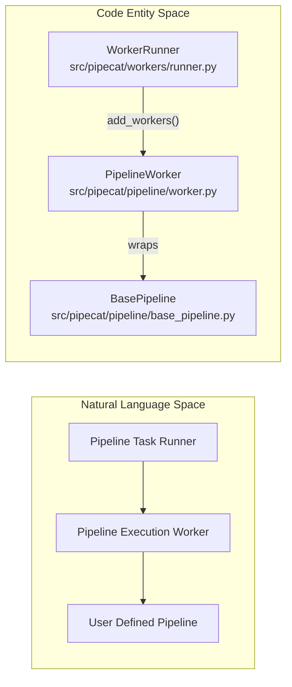
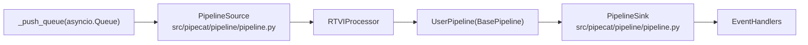
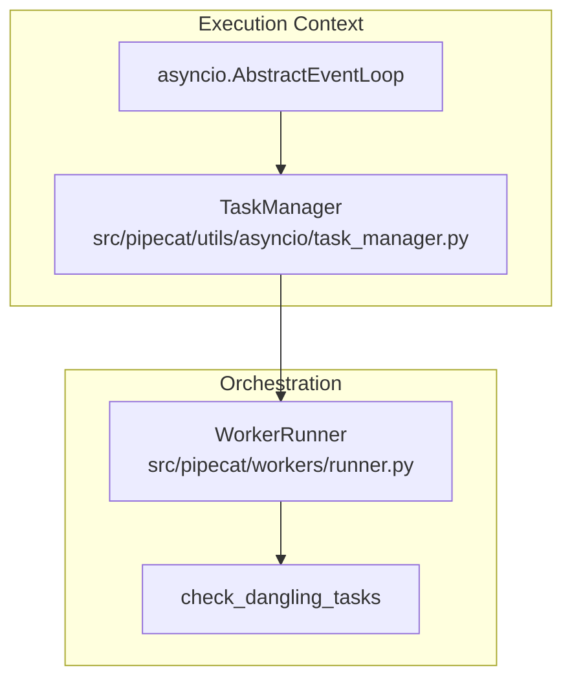
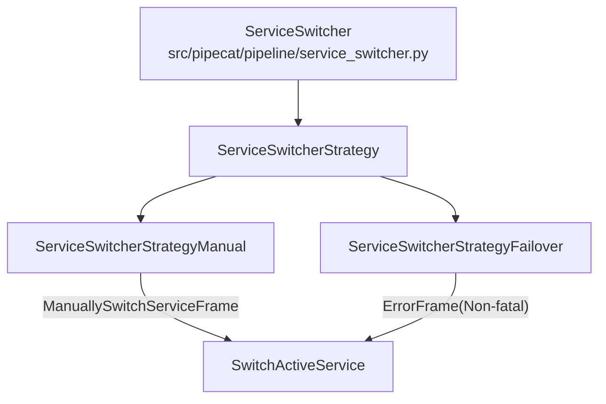

<!-- source: DeepWiki mcp.deepwiki.com · repo pipecat-ai/pipecat · page 3.4 Pipeline Task and Execution · fetched 2026-10-27 -->

# Pipeline Task and Execution

Relevant source files

The following files were used as context for generating this wiki page:

- [examples/multi-worker/code-assistant/code-assistant.py](examples/multi-worker/code-assistant/code-assistant.py)
- [examples/multi-worker/distributed-handoff/pgmq-handoff/llm.py](examples/multi-worker/distributed-handoff/pgmq-handoff/llm.py)
- [examples/multi-worker/distributed-handoff/pgmq-handoff/main.py](examples/multi-worker/distributed-handoff/pgmq-handoff/main.py)
- [examples/multi-worker/distributed-handoff/redis-handoff/llm.py](examples/multi-worker/distributed-handoff/redis-handoff/llm.py)
- [examples/multi-worker/distributed-handoff/redis-handoff/main.py](examples/multi-worker/distributed-handoff/redis-handoff/main.py)
- [examples/multi-worker/local-handoff/local-handoff-two-agents-tts.py](examples/multi-worker/local-handoff/local-handoff-two-agents-tts.py)
- [examples/multi-worker/local-handoff/local-handoff-two-agents.py](examples/multi-worker/local-handoff/local-handoff-two-agents.py)
- [examples/multi-worker/parallel-debate/parallel-debate.py](examples/multi-worker/parallel-debate/parallel-debate.py)
- [examples/multi-worker/remote-proxy-assistant/assistant.py](examples/multi-worker/remote-proxy-assistant/assistant.py)
- [examples/multi-worker/remote-proxy-assistant/main.py](examples/multi-worker/remote-proxy-assistant/main.py)
- [examples/multi-worker/sensor-controller/sensor-controller.py](examples/multi-worker/sensor-controller/sensor-controller.py)
- [src/pipecat/bus/bridge_processor.py](src/pipecat/bus/bridge_processor.py)
- [src/pipecat/bus/bus.py](src/pipecat/bus/bus.py)
- [src/pipecat/bus/queue.py](src/pipecat/bus/queue.py)
- [src/pipecat/bus/subscriber.py](src/pipecat/bus/subscriber.py)
- [src/pipecat/pipeline/runner.py](src/pipecat/pipeline/runner.py)
- [src/pipecat/pipeline/worker.py](src/pipecat/pipeline/worker.py)
- [src/pipecat/pipeline/worker_ready_decorator.py](src/pipecat/pipeline/worker_ready_decorator.py)
- [src/pipecat/utils/asyncio/task_manager.py](src/pipecat/utils/asyncio/task_manager.py)
- [src/pipecat/utils/base_object.py](src/pipecat/utils/base_object.py)
- [src/pipecat/utils/startup.py](src/pipecat/utils/startup.py)
- [src/pipecat/workers/base_worker.py](src/pipecat/workers/base_worker.py)
- [src/pipecat/workers/proxy/__init__.py](src/pipecat/workers/proxy/__init__.py)
- [src/pipecat/workers/proxy/websocket/__init__.py](src/pipecat/workers/proxy/websocket/__init__.py)
- [src/pipecat/workers/runner.py](src/pipecat/workers/runner.py)
- [tests/test_base_worker.py](tests/test_base_worker.py)
- [tests/test_bus.py](tests/test_bus.py)
- [tests/test_deepgram_stt.py](tests/test_deepgram_stt.py)
- [tests/test_job_group.py](tests/test_job_group.py)
- [tests/test_llm_worker.py](tests/test_llm_worker.py)
- [tests/test_messages.py](tests/test_messages.py)
- [tests/test_pgmq_backends.py](tests/test_pgmq_backends.py)
- [tests/test_pgmq_bus.py](tests/test_pgmq_bus.py)
- [tests/test_redis_bus.py](tests/test_redis_bus.py)
- [tests/test_runner.py](tests/test_runner.py)
- [tests/test_serializers.py](tests/test_serializers.py)
- [tests/test_task_manager.py](tests/test_task_manager.py)
- [tests/test_utils_startup.py](tests/test_utils_startup.py)
- [tests/test_websocket_proxy.py](tests/test_websocket_proxy.py)

This page covers how a pipeline is wrapped, started, and managed at runtime. As of recent versions, Pipecat has renamed core execution entities to support a multi-agent framework: `PipelineTask` is now **`PipelineWorker`**, and `PipelineRunner` is now **`WorkerRunner`** [src/pipecat/pipeline/worker.py:7-12](), [src/pipecat/workers/runner.py:7-14](). These components handle frame injection, lifecycle management, idle timeout handling, and the `app_resources` pattern for sharing state. It also covers runtime service swapping using `ServiceSwitcher` and `LLMSwitcher`, as well as shared task management through `TaskManager`.

For details about `Pipeline` and `ParallelPipeline` construction, see [Pipeline Architecture (3.2)](). For the `FrameProcessor` base class, see [Frame Processors (3.3)](). For the multi-agent capabilities, see [Multi-Worker Framework (8.3)]().

---

## Overview

`PipelineWorker` (formerly `PipelineTask`) is the execution engine for a Pipecat pipeline [src/pipecat/pipeline/worker.py:7-12](). It turns a pipeline into a peer on a shared bus, allowing it to pass typed messages and coordinate with other workers. `WorkerRunner` (formerly `PipelineRunner`) is a thin wrapper that manages OS signal handling and runs one or more workers to completion [src/pipecat/workers/runner.py:7-14]().

### Execution Architecture

Title: "Runtime Execution and Runner Mapping"

Sources: [src/pipecat/pipeline/worker.py:172-187](), [src/pipecat/workers/runner.py:7-14]()

---

## PipelineWorker and Frame Queuing

`PipelineWorker` is defined in `src/pipecat/pipeline/worker.py` [src/pipecat/pipeline/worker.py:7-12](). It orchestrates the flow of frames and manages the lifecycle of all processors in the chain [src/pipecat/pipeline/worker.py:7-11]().

### Internal Pipeline Structure

`PipelineWorker` wraps the user's pipeline between a `PipelineSource` and a `PipelineSink` [src/pipecat/pipeline/pipeline.py:141-185]().

Title: "PipelineWorker Internal Layout"

- **`PipelineSource`**: Feeds frames from the worker's internal queue into the start of the processor chain [src/pipecat/pipeline/pipeline.py:141-155]().
- **`PipelineSink`**: Sits at the end of the chain to observe frames that have completed processing and triggers worker-level event handlers [src/pipecat/pipeline/pipeline.py:158-185]().
- **Frame Queuing**: Frames are inserted into the pipeline through `queue_frame()` or `queue_frames()` [src/pipecat/pipeline/worker.py:345-353]().

Sources: [src/pipecat/pipeline/worker.py:172-268](), [src/pipecat/pipeline/pipeline.py:141-185]()

---

## Shared Application Resources (app_resources)

The `app_resources` pattern allows sharing application state (like database handles, API clients, or feature flags) across tool handlers and custom processors.

### Accessing Resources

1. **In Tool Handlers**: When an LLM triggers a tool, the handler receives `FunctionCallParams`. The resources are available via `params.app_resources` [src/pipecat/services/llm_service.py:111-156]().
2. **In Frame Processors**: During the `setup()` phase, the `FrameProcessorSetup` object contains a reference to the `pipeline_worker`. Processors access resources via `setup.pipeline_worker.app_resources` [src/pipecat/processors/frame_processor.py:72-86]().

> [!IMPORTANT]
> `tool_resources` was renamed to `app_resources` in 1.2.0. The old name is deprecated and will emit a `DeprecationWarning` if accessed [src/pipecat/processors/frame_processor.py:104-115]().

Sources: [src/pipecat/processors/frame_processor.py:72-115](), [src/pipecat/services/llm_service.py:111-156]()

---

## WorkerRunner, TaskManager, and Event Loop Integration

`WorkerRunner` manages the execution environment, including OS signal handling for graceful shutdowns [src/pipecat/workers/runner.py:83-107]().

- **Signal Handling**: It handles `SIGINT` and `SIGTERM` to cancel running workers safely [src/pipecat/workers/runner.py:164-168]().
- **Bus and Registry**: It hosts the `WorkerBus` and `WorkerRegistry` for the session [src/pipecat/workers/runner.py:145-146]().

### TaskManager Shared Event Loop

Title: "TaskManager and Runner Execution Context"

- **TaskManager**: Manages the underlying event loop (`_loop`) and task creation/cancellation lifecycle [src/pipecat/utils/asyncio/task_manager.py:127-142]().
- **`check_dangling_tasks`**: A configuration option on `WorkerRunner` and `BaseWorker`. If the worker owns its task manager, it reports its own dangling tasks; otherwise, the runner reports them [src/pipecat/workers/runner.py:117-147]().

Sources: [src/pipecat/workers/runner.py:83-147](), [src/pipecat/workers/base_worker.py:164-186](), [src/pipecat/utils/asyncio/task_manager.py:127-165]()

---

## Service Switching (ServiceSwitcher and LLMSwitcher)

Pipecat allows swapping AI services (like changing LLM providers) at runtime without restarting the pipeline.

### ServiceSwitcher and LLMSwitcher

`ServiceSwitcher` acts as a container for multiple service branches, where only one branch is active at a time [src/pipecat/pipeline/service_switcher.py:31-47]().

Title: "ServiceSwitcher Strategy Resolution"

- **`ServiceSwitcherStrategyManual`**: Switches only when a `ManuallySwitchServiceFrame` is received [src/pipecat/pipeline/service_switcher.py:148-177]().
- **`ServiceSwitcherStrategyFailover`**: Automatically moves to the next service if the current one emits an error that makes it unusable (`is_usable=False`) [src/pipecat/pipeline/service_switcher.py:180-208]().
- **`LLMSwitcher`**: A specialized version for `LLMService` [src/pipecat/pipeline/llm_switcher.py:24-30](). It ensures that context tool handlers are synced across all member LLMs when an `LLMContextFrame` is processed [src/pipecat/pipeline/llm_switcher.py:46-64]().

Sources: [src/pipecat/pipeline/service_switcher.py:31-208](), [src/pipecat/pipeline/llm_switcher.py:24-73]()

---

## Pipeline Lifecycle and Event Handlers

The execution lifecycle is managed through frames reaching the `PipelineSink` at the end of the processor chain [src/pipecat/pipeline/pipeline.py:158-185](). Event management leverages `BaseObject` and its `EventHandler` constructs [src/pipecat/utils/base_object.py:30-76]().

| Event | Trigger | Description |
|---|---|---|
| `on_pipeline_started` | `StartFrame` | Fires when the pipeline is initialized and ready. |
| `on_pipeline_finished` | Terminal Frame | Fires on `EndFrame`, `StopFrame`, or `CancelFrame`. |
| `on_pipeline_error` | `ErrorFrame` | Fires when an unhandled error occurs in the pipeline. |
| `on_idle_timeout` | `IdleFrameObserver` | Fires when no speech/activity is detected for the timeout period. |
| `on_heartbeat_timeout`| Monitor Timeout | Fires if heartbeats are missing. |

### Terminal Frames
- **`EndFrame`**: Normal termination; processors should flush and close [src/pipecat/frames/frames.py:50-50]().
- **`CancelFrame`**: Immediate abort; processors should stop immediately [src/pipecat/frames/frames.py:48-48]().
- **`StopFrame`**: Soft stop; used for pausing or temporary suspension [src/pipecat/frames/frames.py:61-61]().
- **`PipelineFlushFrame`**: Used for pipeline draining, typically after an interruption to ensure clear state [src/pipecat/frames/frames.py:59-59]().

Sources: [src/pipecat/pipeline/worker.py:172-190](), [src/pipecat/frames/frames.py:48-62](), [src/pipecat/utils/base_object.py:30-81]()

---

## Heartbeats and Idle Detection

### Heartbeats
If `enable_heartbeats` is set in `PipelineParams`, the worker injects a `HeartbeatFrame` every second [src/pipecat/pipeline/worker.py:96-98](). The worker monitors these frames at the sink; if they are delayed, it logs a warning and fires `on_heartbeat_timeout`.

### Idle Detection
The `IdleFrameObserver` watches for activity frames (like `StartFrame` or specified timeout frames) [src/pipecat/pipeline/worker.py:116-143](). If none are seen within the `idle_timeout_secs` window, it triggers the `on_idle_timeout` event.

Sources: [src/pipecat/pipeline/worker.py:96-151](), [src/pipecat/pipeline/worker.py:165-186]()

---

