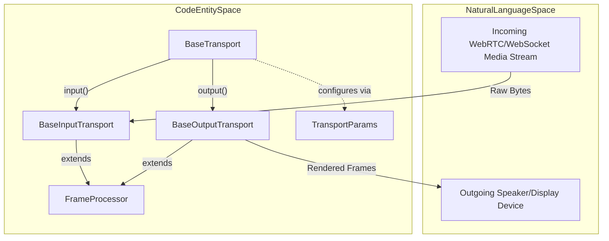
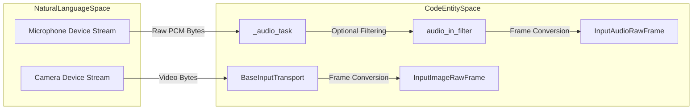
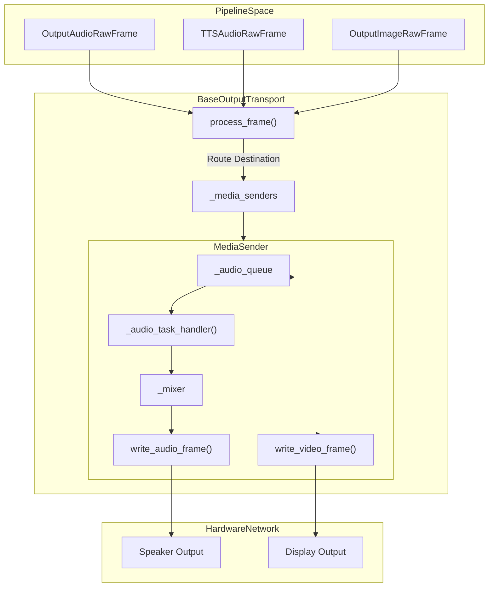

<!-- source: DeepWiki mcp.deepwiki.com · repo pipecat-ai/pipecat · page 3.5 Transport I/O Architecture · fetched 2026-10-27 -->

# Transport I/O Architecture

Relevant source files

The following files were used as context for generating this wiki page:

- [CHANGELOG.md](CHANGELOG.md)
- [changelog/5571.fixed.md](changelog/5571.fixed.md)
- [changelog/6027.fixed.5.md](changelog/6027.fixed.5.md)
- [changelog/6055.fixed.4.md](changelog/6055.fixed.4.md)
- [changelog/6056.deprecated.4.md](changelog/6056.deprecated.4.md)
- [src/pipecat/frames/frames.py](src/pipecat/frames/frames.py)
- [src/pipecat/pipeline/task.py](src/pipecat/pipeline/task.py)
- [src/pipecat/processors/aggregators/llm_response.py](src/pipecat/processors/aggregators/llm_response.py)
- [src/pipecat/processors/frame_processor.py](src/pipecat/processors/frame_processor.py)
- [src/pipecat/services/google/gemini_live/file_api.py](src/pipecat/services/google/gemini_live/file_api.py)
- [src/pipecat/transports/base_input.py](src/pipecat/transports/base_input.py)
- [src/pipecat/transports/base_output.py](src/pipecat/transports/base_output.py)
- [src/pipecat/transports/base_transport.py](src/pipecat/transports/base_transport.py)
- [src/pipecat/transports/daily/transport.py](src/pipecat/transports/daily/transport.py)
- [src/pipecat/transports/livekit/transport.py](src/pipecat/transports/livekit/transport.py)
- [src/pipecat/transports/smallwebrtc/connection.py](src/pipecat/transports/smallwebrtc/connection.py)
- [src/pipecat/transports/smallwebrtc/transport.py](src/pipecat/transports/smallwebrtc/transport.py)
- [src/pipecat/transports/video_in_sampler.py](src/pipecat/transports/video_in_sampler.py)
- [tests/test_daily_transport.py](tests/test_daily_transport.py)
- [tests/test_livekit_transport.py](tests/test_livekit_transport.py)
- [tests/test_smallwebrtc_transport.py](tests/test_smallwebrtc_transport.py)
- [tests/test_video_in_sources.py](tests/test_video_in_sources.py)

The Transport I/O Architecture defines the abstraction layer that bridges external media streams (audio, video, and control messages) with Pipecat's internal frame-based pipeline system `[src/pipecat/transports/base_transport.py:150-150]`. Transports handle bidirectional media flow: converting incoming streams into frames for pipeline processing via `BaseInputTransport` `[src/pipecat/transports/base_input.py:38-44]` and converting outgoing frames into media streams for external destinations via `BaseOutputTransport` `[src/pipecat/transports/base_output.py:66-72]`.

Sources: `[src/pipecat/transports/base_transport.py:150-150]`, `[src/pipecat/transports/base_input.py:38-44]`, `[src/pipecat/transports/base_output.py:66-72]`

## Transport Abstraction Layer

The transport abstraction consists of base classes defining the interface all transport implementations must follow `[src/pipecat/transports/base_transport.py:150-150]`, `[src/pipecat/transports/base_input.py:38-44]`, `[src/pipecat/transports/base_output.py:66-72]`:

- `BaseTransport` — Abstract base providing core transport infrastructure `[src/pipecat/transports/base_transport.py:150-150]`.
- `BaseInputTransport` — Frame processor subclass handling incoming media streams and pushing frames downstream `[src/pipecat/transports/base_input.py:38-44]`.
- `BaseOutputTransport` — Frame processor subclass handling outgoing frames and writing media to external destinations `[src/pipecat/transports/base_output.py:66-72]`.
- `TransportParams` — Pydantic model configuring transport behavior across audio and video channels `[src/pipecat/transports/base_transport.py:56-149]`.

### Diagram: Natural Language Space to Code Entity Space - Transport Abstraction

Sources: `[src/pipecat/transports/base_transport.py:56-150]`, `[src/pipecat/transports/base_input.py:38-44]`, `[src/pipecat/transports/base_output.py:66-72]`

## BaseTransport and TransportParams

`BaseTransport` serves as the abstract interface for transport implementations, offering access to input and output frame processors `[src/pipecat/transports/base_transport.py:150-150]`.

`TransportParams` is a Pydantic model configuring transport behavior across audio and video channels `[src/pipecat/transports/base_transport.py:56-149]`.

- **Audio Input**: `audio_in_enabled`, `audio_in_sample_rate`, `audio_in_channels`, `audio_in_filter`, `audio_in_passthrough`, `audio_in_stream_on_start` `[src/pipecat/transports/base_transport.py:125-130]`.
- **Audio Output**: `audio_out_enabled`, `audio_out_sample_rate`, `audio_out_channels`, `audio_out_mixer`, `audio_out_destinations`, `audio_out_10ms_chunks`, `audio_out_auto_silence` `[src/pipecat/transports/base_transport.py:113-124]`.
- **Video**: `video_in_enabled`, `video_out_enabled`, `video_out_width`, `video_out_height`, `video_out_framerate` `[src/pipecat/transports/base_transport.py:131-141]`.

Sources: `[src/pipecat/transports/base_transport.py:56-149]`

## Input Transport Architecture and VAD Integration

`BaseInputTransport` handles the conversion of incoming media streams into pipeline frames `[src/pipecat/transports/base_input.py:38-44]`.

### Diagram: Natural Language Space to Code Entity Space - Input Processing and VAD

Sources: `[src/pipecat/transports/base_input.py:38-79]`

The input transport runs an asynchronous task (`_audio_task`) that pulls raw audio from buffers, optionally applies an input audio filter (`audio_in_filter`), and wraps chunks into `InputAudioRawFrame` instances `[src/pipecat/transports/base_input.py:69-73]`. Transports integrate with Voice Activity Detection (VAD) analyzers to detect user speech states and emit user speaking frames accordingly `[src/pipecat/transports/base_input.py:38-44]`.

Sources: `[src/pipecat/transports/base_input.py:38-73]`

## Output Transport Architecture and Media Sender Mechanics

`BaseOutputTransport` converts outgoing pipeline frames into media streams using a `MediaSender` design per output destination `[src/pipecat/transports/base_output.py:66-97]`.

### Diagram: Output Pipeline and MediaSender Architecture

Sources: `[src/pipecat/transports/base_output.py:66-159]`

### Media Sender Mechanics

Each output destination is managed by a `BaseOutputTransport.MediaSender` instance `[src/pipecat/transports/base_output.py:91-97]`. Audio frames (`OutputAudioRawFrame`, `TTSAudioRawFrame`) are chunked according to `audio_out_10ms_chunks` to maintain responsiveness during interruptions `[src/pipecat/transports/base_output.py:144-149]`. Pipecat ensures that final audio fragments queued right before stream termination or turn switches are fully flushed to the transport layer before cleanup `[src/pipecat/transports/base_output.py:155-162]`.

Sources: `[src/pipecat/transports/base_output.py:91-162]`

---

