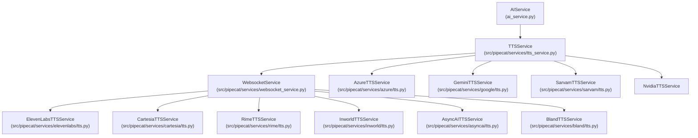
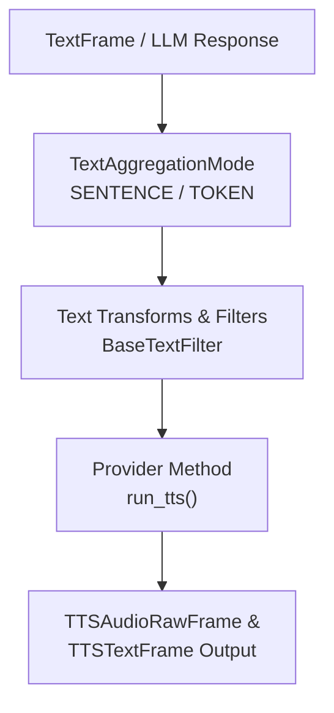

<!-- source: DeepWiki mcp.deepwiki.com · repo pipecat-ai/pipecat · page 4.3 Text-to-Speech Services · fetched 2026-10-27 -->

# Text-to-Speech Services

Relevant source files

The following files were used as context for generating this wiki page:

- [changelog/6118.fixed.6.md](changelog/6118.fixed.6.md)
- [docs/architecture/word-tracking-deck.html](docs/architecture/word-tracking-deck.html)
- [docs/architecture/word-trecking/README.md](docs/architecture/word-trecking/README.md)
- [docs/architecture/word-trecking/aggregated-frame-sequencer.md](docs/architecture/word-trecking/aggregated-frame-sequencer.md)
- [docs/architecture/word-trecking/improvements.md](docs/architecture/word-trecking/improvements.md)
- [docs/architecture/word-trecking/rtvi-integration.md](docs/architecture/word-trecking/rtvi-integration.md)
- [docs/architecture/word-trecking/text-segment-map.md](docs/architecture/word-trecking/text-segment-map.md)
- [docs/architecture/word-trecking/word-completion-tracker.md](docs/architecture/word-trecking/word-completion-tracker.md)
- [src/pipecat/processors/aggregators/llm_text_processor.py](src/pipecat/processors/aggregators/llm_text_processor.py)
- [src/pipecat/services/asyncai/tts.py](src/pipecat/services/asyncai/tts.py)
- [src/pipecat/services/aws/__init__.py](src/pipecat/services/aws/__init__.py)
- [src/pipecat/services/aws/agent_core.py](src/pipecat/services/aws/agent_core.py)
- [src/pipecat/services/aws/nova_sonic/__init__.py](src/pipecat/services/aws/nova_sonic/__init__.py)
- [src/pipecat/services/aws/nova_sonic/ready.wav](src/pipecat/services/aws/nova_sonic/ready.wav)
- [src/pipecat/services/aws/nova_sonic/session_continuation.py](src/pipecat/services/aws/nova_sonic/session_continuation.py)
- [src/pipecat/services/aws/sagemaker/__init__.py](src/pipecat/services/aws/sagemaker/__init__.py)
- [src/pipecat/services/aws/tts.py](src/pipecat/services/aws/tts.py)
- [src/pipecat/services/aws/utils.py](src/pipecat/services/aws/utils.py)
- [src/pipecat/services/azure/tts.py](src/pipecat/services/azure/tts.py)
- [src/pipecat/services/camb/tts.py](src/pipecat/services/camb/tts.py)
- [src/pipecat/services/cartesia/tts.py](src/pipecat/services/cartesia/tts.py)
- [src/pipecat/services/elevenlabs/tts.py](src/pipecat/services/elevenlabs/tts.py)
- [src/pipecat/services/fish/tts.py](src/pipecat/services/fish/tts.py)
- [src/pipecat/services/google/tts.py](src/pipecat/services/google/tts.py)
- [src/pipecat/services/gradium/tts.py](src/pipecat/services/gradium/tts.py)
- [src/pipecat/services/groq/tts.py](src/pipecat/services/groq/tts.py)
- [src/pipecat/services/hume/tts.py](src/pipecat/services/hume/tts.py)
- [src/pipecat/services/inworld/tts.py](src/pipecat/services/inworld/tts.py)
- [src/pipecat/services/kokoro/tts.py](src/pipecat/services/kokoro/tts.py)
- [src/pipecat/services/minimax/tts.py](src/pipecat/services/minimax/tts.py)
- [src/pipecat/services/neuphonic/tts.py](src/pipecat/services/neuphonic/tts.py)
- [src/pipecat/services/nvidia/stt.py](src/pipecat/services/nvidia/stt.py)
- [src/pipecat/services/nvidia/tts.py](src/pipecat/services/nvidia/tts.py)
- [src/pipecat/services/openai/tts.py](src/pipecat/services/openai/tts.py)
- [src/pipecat/services/piper/tts.py](src/pipecat/services/piper/tts.py)
- [src/pipecat/services/resembleai/tts.py](src/pipecat/services/resembleai/tts.py)
- [src/pipecat/services/rime/tts.py](src/pipecat/services/rime/tts.py)
- [src/pipecat/services/speechmatics/tts.py](src/pipecat/services/speechmatics/tts.py)
- [src/pipecat/services/tts_service.py](src/pipecat/services/tts_service.py)
- [src/pipecat/services/xtts/tts.py](src/pipecat/services/xtts/tts.py)
- [src/pipecat/utils/context/aggregated_frame_sequencer.py](src/pipecat/utils/context/aggregated_frame_sequencer.py)
- [src/pipecat/utils/context/audio_context_manager.py](src/pipecat/utils/context/audio_context_manager.py)
- [src/pipecat/utils/context/text_segment_map.py](src/pipecat/utils/context/text_segment_map.py)
- [src/pipecat/utils/context/word_completion_tracker.py](src/pipecat/utils/context/word_completion_tracker.py)
- [src/pipecat/utils/context/word_timestamp_tracker.py](src/pipecat/utils/context/word_timestamp_tracker.py)
- [src/pipecat/utils/text/alnum_utils.py](src/pipecat/utils/text/alnum_utils.py)
- [src/pipecat/utils/text/markup_utils.py](src/pipecat/utils/text/markup_utils.py)
- [src/pipecat/utils/text/transforms/units.py](src/pipecat/utils/text/transforms/units.py)
- [tests/test_aggregated_frame_sequencer.py](tests/test_aggregated_frame_sequencer.py)
- [tests/test_audio_context_manager.py](tests/test_audio_context_manager.py)
- [tests/test_aws_credentials.py](tests/test_aws_credentials.py)
- [tests/test_azure_tts.py](tests/test_azure_tts.py)
- [tests/test_gemini_tts.py](tests/test_gemini_tts.py)
- [tests/test_markup_utils.py](tests/test_markup_utils.py)
- [tests/test_piper_tts.py](tests/test_piper_tts.py)
- [tests/test_sentence_tokenizer_language.py](tests/test_sentence_tokenizer_language.py)
- [tests/test_text_segment_map.py](tests/test_text_segment_map.py)
- [tests/test_tts_frame_ordering.py](tests/test_tts_frame_ordering.py)
- [tests/test_voice_formatting.py](tests/test_voice_formatting.py)
- [tests/test_word_completion_tracker.py](tests/test_word_completion_tracker.py)
- [tests/test_word_timestamp_tracker.py](tests/test_word_timestamp_tracker.py)

## Purpose and Scope

This document covers Pipecat's text-to-speech (TTS) service architecture and implementations. TTS services convert text into synthesized speech audio, outputting audio frames that flow through the pipeline to transport layers. This page focuses on the service layer architecture, base classes, text aggregation modes, WebSocket vs HTTP transport patterns, word timestamp support, and provider implementations.

For information about speech-to-text (transcription), see [Speech-to-Text Services](4.4). For speech-to-speech services that bypass the traditional STT→LLM→TTS pipeline, see [Speech-to-Speech Services](4.5).

Sources: `[src/pipecat/services/tts_service.py:7-12]()`

---

## Base Service Architecture

Pipecat provides a hierarchy of base TTS service classes that abstract common functionality and define contracts for provider implementations.

### Class Hierarchy

Diagram: TTS Service Class Hierarchy (Code Entity Space)

Sources: `[src/pipecat/services/tts_service.py:116-116]`, `[src/pipecat/services/elevenlabs/tts.py:69-70]`, `[src/pipecat/services/rime/tts.py:126-126]`, `[src/pipecat/services/inworld/tts.py:141-143]`, `[src/pipecat/services/azure/tts.py:116-116]`, `[src/pipecat/services/sarvam/tts.py:59-60]`, `[src/pipecat/services/tts_service.py:52-52]()`

### TTSService Base Class

`TTSService` is the abstract base for all TTS implementations (`[src/pipecat/services/tts_service.py:116-146]()`), providing:

- **Initialization Parameters**: Configured via `__init__` with options like `text_aggregation_mode`, `sample_rate`, `push_text_frames`, `push_stop_frames`, `push_start_frame`, and `pause_frame_processing` (`[src/pipecat/services/tts_service.py:150-185]()`).
- **Text Aggregation**: Controls how incoming text is buffered before synthesis via `TextAggregationMode` (`SENTENCE` or `TOKEN`) (`[src/pipecat/services/tts_service.py:72-87]()`).
- **Context Management**: Uses `TTSContext` dataclasses to track whether output should be appended to context, push assistant aggregations, or remain interruptible (`[src/pipecat/services/tts_service.py:89-106]()`).
- **Frame Management**: Orchestrates `StartFrame`, `EndFrame`, and `InterruptionFrame` logic during processing (`[src/pipecat/frames/frames.py:27-48]()`).
- **Audio Streaming**: Generates `TTSAudioRawFrame` for downstream consumption (`[src/pipecat/frames/frames.py:42-42]()`).

Sources: `[src/pipecat/services/tts_service.py:72-185]`, `[src/pipecat/frames/frames.py:27-48]()`

---

## Text Aggregation Modes and Word Timestamps

### Text Aggregation Modes

Incoming text from LLMs arrives in token chunks or fragments via `TextFrame` or `LLMFullResponse` structures. `TTSService` uses `TextAggregationMode` to determine when text is sent to synthesis:

- `TextAggregationMode.SENTENCE`: Buffers text until sentence boundaries are detected. This produces more natural speech inflection but adds latency (~200-300ms per sentence) (`[src/pipecat/services/tts_service.py:76-77]()`).
- `TextAggregationMode.TOKEN`: Streams text tokens directly to the TTS engine as they arrive. This minimizes latency but can affect voice quality depending on provider capabilities (`[src/pipecat/services/tts_service.py:78-79]()`).

Sources: `[src/pipecat/services/tts_service.py:72-87]()`

### Word Timestamps and Context Tracking

Subclasses maintain tracking mechanisms using `WordTimestampTracker` (`[src/pipecat/utils/context/word_timestamp_tracker.py:16-64]()`) and `TextSegmentMap` (`[src/pipecat/utils/context/text_segment_map.py:148-175]()`) to align synthesized audio with text transcription frames (`TTSTextFrame` and aggregated progress). Word-level timestamps enable accurate synchronization between speech playback and UI highlighting or transcript logging across three versions of text: `tts_text`, `user_facing_text`, and `llm_text`.

Diagram: TTS Data Flow and Aggregation Processing

Sources: `[src/pipecat/services/tts_service.py:72-87]`, `[src/pipecat/utils/context/word_timestamp_tracker.py:16-64]`, `[src/pipecat/utils/context/text_segment_map.py:148-175]()`

---

## WebSocket vs HTTP Services

Pipecat supports both WebSocket-based bidirectional streaming TTS services and HTTP request-response TTS services.

### WebSocket Services
- **Class**: Inherit from `WebsocketService` or stream-oriented service bases (`[src/pipecat/services/tts_service.py:52-52]()`).
- **Behavior**: Maintains a persistent WebSocket connection, streaming text chunks upstream and receiving binary audio chunks and word timestamps asynchronously.
- **Interruption Handling**: Can cancel ongoing audio generation immediately by sending a clear or reset frame over the websocket without tearing down the underlying socket connection (e.g., `CartesiaTTSService`, `BlandTTSService`) (`[src/pipecat/services/bland/tts.py:7-123]()`).

### HTTP Services
- **Class**: Inherit directly from `TTSService` (e.g., `InworldHttpTTSService`, `ElevenLabsHttpTTSService`) (`[src/pipecat/services/inworld/tts.py:141-146]()`).
- **Behavior**: Issues HTTP POST requests for synthesized text segments, yielding audio frames synchronously or asynchronously within `run_tts()` (`[tests/test_tts_frame_ordering.py:104-132]()`).
- **Lifecycle**: Simpler connection management per request, but higher per-request connection overhead unless persistent connection sessions (`aiohttp.ClientSession`) are reused.

Sources: `[src/pipecat/services/inworld/tts.py:141-146]`, `[tests/test_tts_frame_ordering.py:104-132]`, `[src/pipecat/services/bland/tts.py:7-123]()`

---

## Text Processing and Transforms

Pipecat includes text transform utilities under `pipecat.utils.text.transforms` and helper functions to normalize text before synthesis.

| Transform Function / Module | Purpose |
|---|---|
| `PronunciationTransform` / `pronunciation_transform` | Handles phonetic pronunciation customizations (`[src/pipecat/services/tts_service.py:64-67]()`) |
| `normalize_ipa` | Normalizes International Phonetic Alphabet strings (`[src/pipecat/services/elevenlabs/tts.py:58-58]()`) |
| `merge_punct_tokens` | Merges punctuation tokens for word timestamp calculations (`[src/pipecat/services/tts_service.py:68-68]()`) |
| `format_elevenlabs_pronunciation` | Renders pronunciations as ElevenLabs SSML `<phoneme>` tags (`[src/pipecat/services/elevenlabs/tts.py:118-141]()`) |
| `format_cartesia_pronunciation` | Renders pronunciations as Cartesia inline phoneme blocks (`[src/pipecat/services/cartesia/tts.py:140-159]()`) |

Sources: `[src/pipecat/services/tts_service.py:64-68]`, `[src/pipecat/services/elevenlabs/tts.py:58-141]`, `[src/pipecat/services/cartesia/tts.py:140-159]()`

---

## Provider Implementations

### ElevenLabsTTSService & ElevenLabsHttpTTSService
- **Models**: Supports streaming and HTTP synthesis with advanced voice settings (`stability`, `similarity_boost`, `style`, `speed`) (`[src/pipecat/services/elevenlabs/tts.py:89-111]`, `[src/pipecat/services/elevenlabs/tts.py:170-186]()`).
- **Settings**: Defined via `ElevenLabsTTSSettings` (`[src/pipecat/services/elevenlabs/tts.py:170-186]()`).

### RimeTTSService
- **Type**: WebSocket-based TTS service using Rime's websocket JSON API (`WebsocketTTSService`) (`[src/pipecat/services/rime/tts.py:126-132]()`).
- **Settings**: Configured using `RimeTTSSettings` including segment mode and speed parameters (`[src/pipecat/services/rime/tts.py:72-103]()`).

### InworldHttpTTSService & InworldTTSService
- **Type**: HTTP and WebSocket-based TTS services supporting streaming and non-streaming modes with precise voice cloning (`[src/pipecat/services/inworld/tts.py:7-14]`, `[src/pipecat/services/inworld/tts.py:141-146]()`).
- **Settings**: Configured via `InworldTTSSettings` supporting speaking rate, temperature, and delivery modes (`[src/pipecat/services/inworld/tts.py:107-126]()`).

### CartesiaTTSService
- **Type**: WebSocket and HTTP-based TTS services utilizing Cartesia Sonic models (`[src/pipecat/services/cartesia/tts.py:7-21]()`).
- **Configuration**: Uses `GenerationConfig` for volume, speed, and emotion guidance across over 60 supported emotions (`[src/pipecat/services/cartesia/tts.py:58-77]`, `[src/pipecat/services/cartesia/tts.py:162-208]()`).

### AzureTTSService
- **Type**: SDK-based TTS service using Azure Cognitive Services Speech SDK (`[src/pipecat/services/azure/tts.py:7-43]()`).
- **Settings**: Configured via `AzureTTSSettings` supporting pitch, rate, role, style, style degree, and voice parameters (`[src/pipecat/services/azure/tts.py:72-114]()`).

### Google GeminiTTSService
- **Type**: TTS integration utilizing Google GenAI SDK and cloud speech synthesis APIs for natural voice control (`[src/pipecat/services/google/tts.py:7-15]`, `[src/pipecat/services/google/tts.py:48-55]()`).

### SarvamTTSService
- **Type**: HTTP-based TTS service supporting Sarvam AI's `bulbul:v3` and `bulbul:v4-flash` model variants for Indian and international language voice synthesis (`[src/pipecat/services/sarvam/tts.py:7-35]`, `[src/pipecat/services/sarvam/tts.py:66-96]()`).

### AsyncAITTSService
- **Type**: WebSocket-based streaming TTS service using Async AI's API (`[src/pipecat/services/asyncai/tts.py:7-12]()`).

### BlandTTSService
- **Type**: Realtime WebSocket TTS service using Bland AI's `/v2/tts/ws` endpoint, supporting `TextAggregationMode.TOKEN` and cancellation handling (`[src/pipecat/services/bland/tts.py:7-123]()`).

Sources: `[src/pipecat/services/elevenlabs/tts.py:89-186]`, `[src/pipecat/services/rime/tts.py:72-132]`, `[src/pipecat/services/inworld/tts.py:7-14]`, `[src/pipecat/services/inworld/tts.py:107-146]`, `[src/pipecat/services/cartesia/tts.py:7-208]`, `[src/pipecat/services/azure/tts.py:7-114]`, `[src/pipecat/services/google/tts.py:7-55]`, `[src/pipecat/services/sarvam/tts.py:7-96]`, `[src/pipecat/services/asyncai/tts.py:7-12]`, `[src/pipecat/services/bland/tts.py:7-123]()`

---

