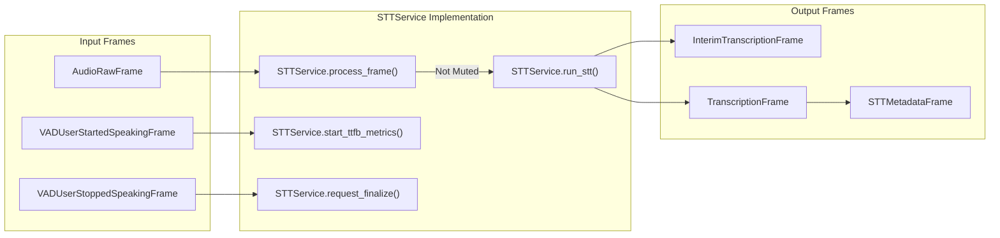
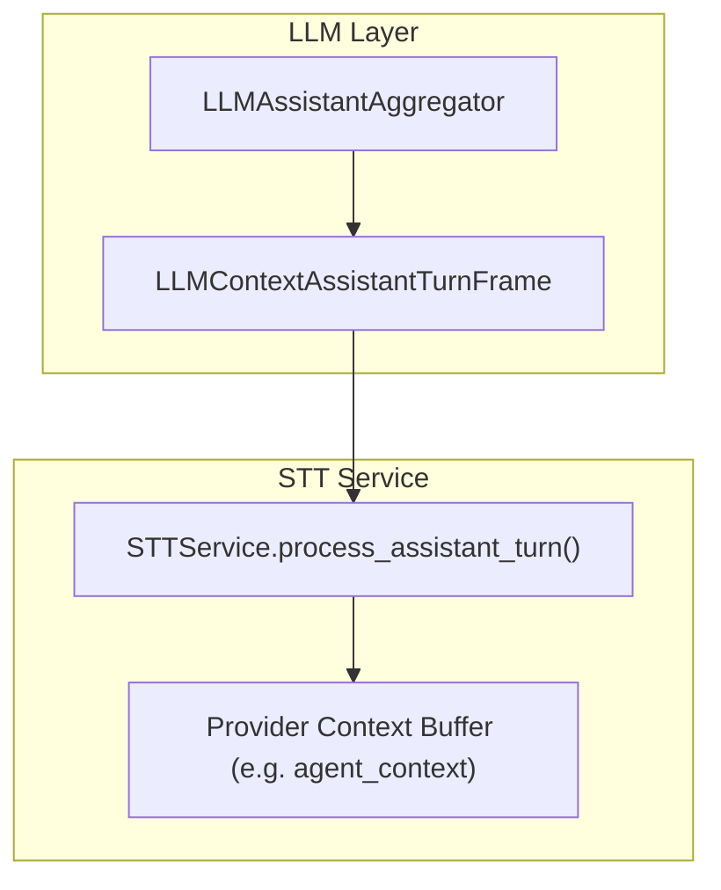

<!-- source: DeepWiki mcp.deepwiki.com · repo pipecat-ai/pipecat · page 4.4 Speech-to-Text Services · fetched 2026-10-27 -->

# Speech-to-Text Services

Relevant source files

The following files were used as context for generating this wiki page:

- [changelog/6010.deprecated.md](changelog/6010.deprecated.md)
- [changelog/6010.fixed.md](changelog/6010.fixed.md)
- [changelog/6013.added.md](changelog/6013.added.md)
- [changelog/6031.fixed.md](changelog/6031.fixed.md)
- [changelog/6090.changed.2.md](changelog/6090.changed.2.md)
- [examples/transcription/transcription-sarvam-realtime.py](examples/transcription/transcription-sarvam-realtime.py)
- [examples/voice/voice-gradium-turns.py](examples/voice/voice-gradium-turns.py)
- [examples/voice/voice-sarvam-realtime-turn-detection.py](examples/voice/voice-sarvam-realtime-turn-detection.py)
- [examples/voice/voice-sarvam-realtime.py](examples/voice/voice-sarvam-realtime.py)
- [examples/voice/voice-sarvam-vad-http.py](examples/voice/voice-sarvam-vad-http.py)
- [examples/voice/voice-sarvam.py](examples/voice/voice-sarvam.py)
- [examples/voice/voice-smallest.py](examples/voice/voice-smallest.py)
- [src/pipecat/services/assemblyai/models.py](src/pipecat/services/assemblyai/models.py)
- [src/pipecat/services/assemblyai/stt.py](src/pipecat/services/assemblyai/stt.py)
- [src/pipecat/services/aws/sagemaker/bidi_client.py](src/pipecat/services/aws/sagemaker/bidi_client.py)
- [src/pipecat/services/aws/stt.py](src/pipecat/services/aws/stt.py)
- [src/pipecat/services/azure/stt.py](src/pipecat/services/azure/stt.py)
- [src/pipecat/services/cartesia/stt.py](src/pipecat/services/cartesia/stt.py)
- [src/pipecat/services/cartesia/turns/stt.py](src/pipecat/services/cartesia/turns/stt.py)
- [src/pipecat/services/deepgram/flux/sagemaker/stt.py](src/pipecat/services/deepgram/flux/sagemaker/stt.py)
- [src/pipecat/services/deepgram/flux/sagemaker/tts.py](src/pipecat/services/deepgram/flux/sagemaker/tts.py)
- [src/pipecat/services/deepgram/flux/stt.py](src/pipecat/services/deepgram/flux/stt.py)
- [src/pipecat/services/deepgram/flux/stt_base.py](src/pipecat/services/deepgram/flux/stt_base.py)
- [src/pipecat/services/deepgram/flux/tts_base.py](src/pipecat/services/deepgram/flux/tts_base.py)
- [src/pipecat/services/deepgram/sagemaker/stt.py](src/pipecat/services/deepgram/sagemaker/stt.py)
- [src/pipecat/services/deepgram/sagemaker/tts.py](src/pipecat/services/deepgram/sagemaker/tts.py)
- [src/pipecat/services/deepgram/stt.py](src/pipecat/services/deepgram/stt.py)
- [src/pipecat/services/deepgram/tts.py](src/pipecat/services/deepgram/tts.py)
- [src/pipecat/services/elevenlabs/stt.py](src/pipecat/services/elevenlabs/stt.py)
- [src/pipecat/services/fal/stt.py](src/pipecat/services/fal/stt.py)
- [src/pipecat/services/gladia/__init__.py](src/pipecat/services/gladia/__init__.py)
- [src/pipecat/services/gladia/config.py](src/pipecat/services/gladia/config.py)
- [src/pipecat/services/gladia/stt.py](src/pipecat/services/gladia/stt.py)
- [src/pipecat/services/google/stt.py](src/pipecat/services/google/stt.py)
- [src/pipecat/services/gradium/stt.py](src/pipecat/services/gradium/stt.py)
- [src/pipecat/services/meta/__init__.py](src/pipecat/services/meta/__init__.py)
- [src/pipecat/services/meta/stt.py](src/pipecat/services/meta/stt.py)
- [src/pipecat/services/moonshine/stt.py](src/pipecat/services/moonshine/stt.py)
- [src/pipecat/services/nvidia/sagemaker/__init__.py](src/pipecat/services/nvidia/sagemaker/__init__.py)
- [src/pipecat/services/nvidia/sagemaker/stt.py](src/pipecat/services/nvidia/sagemaker/stt.py)
- [src/pipecat/services/nvidia/sagemaker/tts.py](src/pipecat/services/nvidia/sagemaker/tts.py)
- [src/pipecat/services/openai/stt.py](src/pipecat/services/openai/stt.py)
- [src/pipecat/services/sarvam/stt.py](src/pipecat/services/sarvam/stt.py)
- [src/pipecat/services/sarvam/tts.py](src/pipecat/services/sarvam/tts.py)
- [src/pipecat/services/smallest/stt.py](src/pipecat/services/smallest/stt.py)
- [src/pipecat/services/smallest/tts.py](src/pipecat/services/smallest/tts.py)
- [src/pipecat/services/soniox/stt.py](src/pipecat/services/soniox/stt.py)
- [src/pipecat/services/speechmatics/stt.py](src/pipecat/services/speechmatics/stt.py)
- [src/pipecat/services/stt_latency.py](src/pipecat/services/stt_latency.py)
- [src/pipecat/services/stt_service.py](src/pipecat/services/stt_service.py)
- [src/pipecat/services/whisper/base_stt.py](src/pipecat/services/whisper/base_stt.py)
- [src/pipecat/services/whisper/stt.py](src/pipecat/services/whisper/stt.py)
- [src/pipecat/turns/eager_end_of_turn_mixin.py](src/pipecat/turns/eager_end_of_turn_mixin.py)
- [tests/test_assemblyai_stt.py](tests/test_assemblyai_stt.py)
- [tests/test_assemblyai_sync_stt.py](tests/test_assemblyai_sync_stt.py)
- [tests/test_cartesia_stt.py](tests/test_cartesia_stt.py)
- [tests/test_cartesia_turns_stt.py](tests/test_cartesia_turns_stt.py)
- [tests/test_deepgram_flux_stt.py](tests/test_deepgram_flux_stt.py)
- [tests/test_deepgram_sagemaker_stt.py](tests/test_deepgram_sagemaker_stt.py)
- [tests/test_eager_end_of_turn_mixin.py](tests/test_eager_end_of_turn_mixin.py)
- [tests/test_eager_user_turn_strategies.py](tests/test_eager_user_turn_strategies.py)
- [tests/test_google_stt.py](tests/test_google_stt.py)
- [tests/test_gradium_stt.py](tests/test_gradium_stt.py)
- [tests/test_kokoro_tts_language.py](tests/test_kokoro_tts_language.py)
- [tests/test_meta_stt.py](tests/test_meta_stt.py)
- [tests/test_moonshine_stt.py](tests/test_moonshine_stt.py)
- [tests/test_nvidia_sagemaker_tts.py](tests/test_nvidia_sagemaker_tts.py)
- [tests/test_openai_stt.py](tests/test_openai_stt.py)
- [tests/test_sagemaker_bidi_client.py](tests/test_sagemaker_bidi_client.py)
- [tests/test_sarvam_stt.py](tests/test_sarvam_stt.py)
- [tests/test_segmented_stt.py](tests/test_segmented_stt.py)
- [tests/test_smallest_stt.py](tests/test_smallest_stt.py)
- [tests/test_smallest_tts.py](tests/test_smallest_tts.py)
- [tests/test_soniox_stt.py](tests/test_soniox_stt.py)
- [tests/test_speculation_gate.py](tests/test_speculation_gate.py)
- [tests/test_speechmatics_stt.py](tests/test_speechmatics_stt.py)
- [tests/test_stt_send_retry_first_connect.py](tests/test_stt_send_retry_first_connect.py)
- [tests/test_stt_usage_metrics.py](tests/test_stt_usage_metrics.py)
- [tests/test_websocket_stt_reconnect.py](tests/test_websocket_stt_reconnect.py)
- [tests/test_whisper_stt_language.py](tests/test_whisper_stt_language.py)

Speech-to-Text (STT) services convert audio input into text transcriptions in real-time. This document details the base STT service architecture, audio processing pipelines, TTFB/TTFS metrics collection, connection keepalive mechanisms, VAD force turn endpoints, and provider implementations including Deepgram Flux and SageMaker variants.

## 1. STT Service Base Classes and Architecture

Pipecat provides a structured class hierarchy for implementing STT services, separating WebSocket streaming, segmented processing, and specialized cloud integrations.

Title: "STT Service Code Entity Hierarchy"

```mermaid
graph TB
    subgraph BaseClasses["src/pipecat/services/stt_service.py"]
        AIService["AIService"]
        STTService["STTService"]
        WebsocketSTTService["WebsocketSTTService"]
        SegmentedSTTService["SegmentedSTTService"]
    end
    
    subgraph WebSocketProviders["WebSocket Providers"]
        Deepgram["DeepgramSTTService<br/>(deepgram/stt.py)"]
        DeepgramFlux["DeepgramFluxSTTService<br/>(deepgram/flux/stt.py)"]
        DeepgramSage["DeepgramSageMakerSTTService<br/>(deepgram/sagemaker/stt.py)"]
        FluxSage["DeepgramFluxSageMakerSTTService<br/>(deepgram/flux/sagemaker/stt.py)"]
        AssemblyAI["AssemblyAISTTService<br/>(assemblyai/stt.py)"]
        AWSTranscribe["AWSTranscribeSTTService<br/>(aws/stt.py)"]
        Cartesia["CartesiaSTTService<br/>(cartesia/stt.py)"]
        Gladia["GladiaSTTService<br/>(gladia/stt.py)"]
        Soniox["SonioxSTTService<br/>(soniox/stt.py)"]
        Speechmatics["SpeechmaticsSTTService<br/>(speechmatics/stt.py)"]
        Sarvam["SarvamSTTService<br/>(sarvam/stt.py)"]
        SarvamRealtime["SarvamRealtimeSTTService<br/>(sarvam/stt.py)"]
    end
    
    subgraph SegmentedProviders["Segmented Providers"]
        ElevenLabs["ElevenLabsSTTService<br/>(elevenlabs/stt.py)"]
        OpenAI["OpenAISTTService<br/>(openai/stt.py)"]
        Moonshine["MoonshineSTTService<br/>(moonshine/stt.py)"]
    end
    
    AIService --> STTService
    STTService --> WebsocketSTTService
    STTService --> SegmentedSTTService
    
    WebsocketSTTService --> Deepgram
    WebsocketSTTService --> DeepgramFlux
    WebsocketSTTService --> DeepgramSage
    WebsocketSTTService --> FluxSage
    WebsocketSTTService --> AssemblyAI
    WebsocketSTTService --> AWSTranscribe
    WebsocketSTTService --> Cartesia
    WebsocketSTTService --> Gladia
    WebsocketSTTService --> Soniox
    WebsocketSTTService --> Speechmatics
    WebsocketSTTService --> Sarvam
    WebsocketSTTService --> SarvamRealtime
    
    SegmentedSTTService --> ElevenLabs
    SegmentedSTTService --> OpenAI
    SegmentedSTTService --> Moonshine
```

Sources: `[src/pipecat/services/stt_service.py:51-195]`, `[src/pipecat/services/deepgram/stt.py:35-36]`, `[src/pipecat/services/assemblyai/stt.py:183-183]`

The `STTService` class (`[src/pipecat/services/stt_service.py:51-195]`) serves as the foundation, providing settings management via `STTSettings` and `STTUpdateSettingsFrame` (`[src/pipecat/services/stt_service.py:30-30]`), muting support (`[src/pipecat/services/stt_service.py:29-29]`), and assistant turn hooks (`[src/pipecat/services/stt_service.py:26-26]`). `WebsocketSTTService` manages continuous streaming over WebSockets, while `SegmentedSTTService` handles discrete audio buffers bounded by VAD events.

Sources: `[src/pipecat/services/stt_service.py:51-195]`, `[src/pipecat/services/deepgram/stt.py:35-36]`, `[src/pipecat/services/assemblyai/stt.py:183-183]`

## 2. Audio Processing and Frame Flow

Audio flows into the STT service as raw PCM data (`AudioRawFrame`), gets evaluated against mute state and VAD markers, and exits as interim or final transcription frames.

Title: "Audio Processing Code Entity Flow"

Sources: `[src/pipecat/services/stt_service.py:153-203]`, `[src/pipecat/frames/frames.py:451-501]`

When audio frames arrive, `STTService.process_frame()` checks whether transcription is muted. Upon receiving VAD start events, TTFB metrics tracking is initiated (`[src/pipecat/services/stt_service.py:153-203]`). VAD stop triggers finalization of the active speech segment.

Sources: `[src/pipecat/services/stt_service.py:153-203]`, `[src/pipecat/frames/frames.py:451-501]`

## 3. Metrics, Keepalive, and Turn Management

### TTFB and TTFS Metrics
Pipecat tracks Time to First Byte (TTFB) latency from the moment a user stops speaking to when the first transcript token or interim result returns (`[src/pipecat/services/stt_service.py:113-118]`). Additionally, P99 latency benchmarks (`[src/pipecat/services/stt_latency.py:35-35]`) are maintained across providers. `DeepgramSTTService` correctly captures TTFB even when final responses contain empty transcripts (`[src/pipecat/services/deepgram/stt.py:35-36]`). Daily transports broadcast `STTMetadataFrame` with TTFS metrics when transcription is enabled.

Sources: `[src/pipecat/services/stt_service.py:113-122]`, `[src/pipecat/services/deepgram/stt.py:35-36]`, `[src/pipecat/services/stt_latency.py:35-35]`

### Keepalive Mechanisms
WebSocket-based STT services like `WebsocketSTTService` implement keepalive loops that send silent audio chunks or heartbeat frames (e.g., every 100ms) during periods of user silence to prevent server-side connection dropouts (`[src/pipecat/services/stt_service.py:48-48]`, `[src/pipecat/services/stt_service.py:243-283]`). For example, `CartesiaSTTService` explicitly mentions that Cartesia disconnects after 3 minutes of inactivity, and silence-based keepalive is enabled by default to prevent this (`[src/pipecat/services/cartesia/stt.py:193-195]`). `SonioxSTTService` uses `KEEPALIVE_MESSAGE` (`[src/pipecat/services/soniox/stt.py:44-44]`) for this purpose.

Sources: `[src/pipecat/services/stt_service.py:48-48]`, `[src/pipecat/services/stt_service.py:243-283]`, `[src/pipecat/services/cartesia/stt.py:193-195]`, `[src/pipecat/services/soniox/stt.py:44-44]`

### VAD Force Turn Endpoint and External Strategies
Services supporting server-side endpointing emit metadata recommending `ExternalUserTurnStrategies` (`[src/pipecat/services/stt_service.py:197-203]`). This allows the pipeline to bypass local VAD silence thresholds in favor of provider-native turn detection and forced turn conclusions. For instance, `SpeechmaticsSTTService` allows configuring `TurnDetectionMode` as `VAD` or `EXTERNAL` (`[src/pipecat/services/speechmatics/stt.py:156-171]`), where `EXTERNAL` means turn boundaries are controlled by the caller.

Sources: `[src/pipecat/services/stt_service.py:197-203]`, `[src/pipecat/services/speechmatics/stt.py:156-171]`

## 4. STT Provider Implementations

### Deepgram and Deepgram Flux
`DeepgramSTTService` (`[src/pipecat/services/deepgram/stt.py:35-36]`) and `DeepgramFluxSTTService` (`[src/pipecat/services/deepgram/flux/stt.py:39-68]`) provide low-latency streaming. Flux introduces `EagerEndOfTurn` events (`on_eager_end_of_turn`), predicting turn completion before complete silence occurs (`[src/pipecat/services/deepgram/flux/stt.py:55-60]`). `DeepgramFluxSTTService` also supports multilingual use with `flux-general-multi` model and `language_hints` (`[src/pipecat/services/deepgram/flux/stt.py:50-54]`).

Sources: `[src/pipecat/services/deepgram/stt.py:35-36]`, `[src/pipecat/services/deepgram/flux/stt.py:39-68]`, `[src/pipecat/services/deepgram/flux/stt.py:50-54]`

### SageMaker Variants
Pipecat includes SageMaker-hosted variants such as `DeepgramSageMakerSTTService` and `DeepgramFluxSageMakerSTTService`, wrapping Deepgram models deployed on AWS SageMaker endpoints using bidirectional streaming clients. `AWSTranscribeSTTService` (`[src/pipecat/services/aws/stt.py:66-72]`) also integrates with AWS Transcribe for real-time transcription.

Sources: `[src/pipecat/services/aws/stt.py:66-72]`

### Other Provider Implementations
- **AssemblyAI**: `AssemblyAISTTService` supports Universal-3 Pro features, continuous partials, and `agent_context` carryover (`[src/pipecat/services/assemblyai/stt.py:183-183]`). It also handles language mapping from AssemblyAI codes to Pipecat `Language` enum (`[src/pipecat/services/assemblyai/stt.py:101-120]`).
- **Sarvam AI**: `SarvamSTTService` and `SarvamRealtimeSTTService` handle Indian language speech recognition with high VAD sensitivity options (`[src/pipecat/services/sarvam/stt.py:131-190]`). They also provide language mapping for Indian languages (`[src/pipecat/services/sarvam/stt.py:66-125]`).
- **Speechmatics**: `SpeechmaticsSTTService` handles turn detection modes (`TurnDetectionMode.VAD` vs `TurnDetectionMode.EXTERNAL`) and robust error filtering (`[src/pipecat/services/speechmatics/stt.py:156-171]`). It also includes logic for resolving models and handling deprecated parameters (`[src/pipecat/services/speechmatics/stt.py:129-154]`).
- **Soniox**: `SonioxSTTService` provides advanced endpoint sensitivity and interruption controls (`[src/pipecat/services/soniox/stt.py:84-122]`). It supports structured context for transcription steering (`[src/pipecat/services/soniox/stt.py:67-81]`) and language hints (`[src/pipecat/services/soniox/stt.py:201-206]`).
- **Azure**: `AzureSTTService` integrates with the Azure Speech SDK, supporting customizable profanity filters.
- **Cartesia**: `CartesiaSTTService` integrates with Cartesia Live transcription API, supporting keyterms to bias transcription (`[src/pipecat/services/cartesia/stt.py:84-97]`). It also includes logic to prepare and truncate keyterms to fit API limits (`[src/pipecat/services/cartesia/stt.py:48-81]`).
- **Gladia**: `GladiaSTTService` connects to Gladia's WebSocket API, supporting multiple languages, custom vocabulary, and various audio processing options (`[src/pipecat/services/gladia/stt.py:202-205]`). It provides a comprehensive language mapping (`[src/pipecat/services/gladia/stt.py:55-169]`).
- **ElevenLabs**: `ElevenLabsSTTService` uses segmented audio processing, supporting `tag_audio_events` and `keyterms` (`[src/pipecat/services/elevenlabs/stt.py:174-185]`). It also maps Pipecat `Language` enum to ElevenLabs language codes (`[src/pipecat/services/elevenlabs/stt.py:46-163]`).
- **Moonshine**: `MoonshineSTTService` provides local ONNX-based ASR requiring no external API keys.

Sources: `[src/pipecat/services/assemblyai/stt.py:183-183]`, `[src/pipecat/services/assemblyai/stt.py:101-120]`, `[src/pipecat/services/sarvam/stt.py:131-190]`, `[src/pipecat/services/sarvam/stt.py:66-125]`, `[src/pipecat/services/speechmatics/stt.py:156-171]`, `[src/pipecat/services/speechmatics/stt.py:129-154]`, `[src/pipecat/services/soniox/stt.py:84-122]`, `[src/pipecat/services/soniox/stt.py:67-81]`, `[src/pipecat/services/soniox/stt.py:201-206]`, `[src/pipecat/services/cartesia/stt.py:84-97]`, `[src/pipecat/services/cartesia/stt.py:48-81]`, `[src/pipecat/services/gladia/stt.py:202-205]`, `[src/pipecat/services/gladia/stt.py:55-169]`, `[src/pipecat/services/elevenlabs/stt.py:174-185]`, `[src/pipecat/services/elevenlabs/stt.py:46-163]`

## 5. Server-Side Turn Detection and Context Carryover

To improve transcription accuracy across turns, Pipecat synchronizes assistant context with the STT provider.

Title: "Context Carryover Code Entity Flow"

Sources: `[src/pipecat/services/stt_service.py:26-26]`, `[src/pipecat/services/stt_service.py:187-195]`, `[src/pipecat/services/assemblyai/stt.py:59-62]`

1. `LLMAssistantAggregator` emits an `LLMContextAssistantTurnFrame` when a bot response concludes (`[src/pipecat/services/stt_service.py:26-26]`).
2. `STTService.process_assistant_turn()` intercepts this frame (`[src/pipecat/services/stt_service.py:187-195]`).
3. Providers like AssemblyAI append the utterance to their rolling `agent_context` character budget to prime the model for the user's reply (`[src/pipecat/services/assemblyai/stt.py:59-62]`).

Sources: `[src/pipecat/services/stt_service.py:26-26]`, `[src/pipecat/services/stt_service.py:187-195]`, `[src/pipecat/services/assemblyai/stt.py:59-62]`

---

