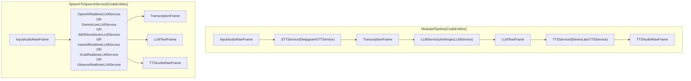
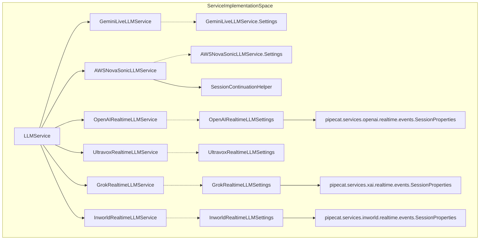

<!-- source: DeepWiki mcp.deepwiki.com · repo pipecat-ai/pipecat · page 4.5 Speech-to-Speech Services · fetched 2026-10-27 -->

# Speech-to-Speech Services

Relevant source files

The following files were used as context for generating this wiki page:

- [src/pipecat/services/aws/nova_sonic/llm.py](src/pipecat/services/aws/nova_sonic/llm.py)
- [src/pipecat/services/google/gemini_live/llm.py](src/pipecat/services/google/gemini_live/llm.py)
- [src/pipecat/services/inworld/realtime/events.py](src/pipecat/services/inworld/realtime/events.py)
- [src/pipecat/services/inworld/realtime/llm.py](src/pipecat/services/inworld/realtime/llm.py)
- [src/pipecat/services/openai/realtime/llm.py](src/pipecat/services/openai/realtime/llm.py)
- [src/pipecat/services/ultravox/llm.py](src/pipecat/services/ultravox/llm.py)
- [src/pipecat/services/xai/realtime/llm.py](src/pipecat/services/xai/realtime/llm.py)
- [tests/test_inworld_realtime_context.py](tests/test_inworld_realtime_context.py)

This page provides an overview of real-time speech-to-speech (S2S) services within the Pipecat AI framework, which utilize WebSocket-based bidirectional streaming to process audio input directly and generate native audio output. By bypassing traditional multi-step pipelines ($\text{STT} \to \text{LLM} \to \text{TTS}$), S2S services drastically reduce conversational latency and support advanced real-time capabilities like native turn detection, interruption handling, and affective dialog.

As a parent page, this document outlines the overarching architecture, shared components, and framework integrations. For granular provider implementation details, configuration properties, and usage examples, refer to the child pages:
- [OpenAI Realtime API](#4.5.1) — Covers session properties, truncation on interruption, legacy shims, Azure Realtime, and audio token usage.
- [Google Gemini Live](#4.5.2) — Covers `GeminiLiveLLMService` [src/pipecat/services/google/gemini_live/llm.py:1-25](), Vertex variants, namespace migration, affective dialog, and context window compression.
- [AWS Nova Sonic](#4.5.3) — Covers bidirectional streaming capabilities, endpointing sensitivity, context management, session continuation, and credential resolution [src/pipecat/services/aws/nova_sonic/llm.py:7-12]().
- [xAI Grok Realtime, Ultravox, and Inworld Realtime](#4.5.4) — Covers `GrokRealtimeLLMService` [src/pipecat/services/xai/realtime/llm.py:7-11](), `UltravoxRealtimeLLMService` [src/pipecat/services/ultravox/llm.py:7-12](), `InworldRealtimeLLMService` [src/pipecat/services/inworld/realtime/llm.py:7-11](), adapters, and built-in tools.

Sources: [src/pipecat/services/google/gemini_live/llm.py:1-25](), [src/pipecat/services/aws/nova_sonic/llm.py:7-12](), [src/pipecat/services/xai/realtime/llm.py:7-11](), [src/pipecat/services/ultravox/llm.py:7-12](), [src/pipecat/services/inworld/realtime/llm.py:7-11]()

---

## Architecture Overview

Speech-to-speech integrations consolidate speech recognition, language reasoning, and speech synthesis into a single continuous WebSocket session. 

### Traditional vs. Speech-to-Speech Pipeline

The following diagram bridges the conceptual "Natural Language Space" with the Pipecat "Code Entity Space" by comparing a standard modular pipeline against a unified S2S service processor.

Title: S2S vs Modular Pipeline Frame Flow

Sources: [src/pipecat/services/google/gemini_live/llm.py:33-63](), [src/pipecat/services/aws/nova_sonic/llm.py:33-56](), [src/pipecat/services/openai/realtime/llm.py:27-56](), [src/pipecat/services/ultravox/llm.py:32-54](), [src/pipecat/services/xai/realtime/llm.py:29-57](), [src/pipecat/services/inworld/realtime/llm.py:29-56]()

---

## Core Components and Configuration

All S2S services in Pipecat inherit from `LLMService` and implement bidirectional streaming. They make use of specialized settings classes and adapters to manage bidirectional configuration mapping.

| Component | Purpose | Base Class / Entity |
|-----------|---------|------------|
| **Service Class** | Main service implementation | `LLMService` [src/pipecat/services/openai/realtime/llm.py:66-66]() |
| **Settings** | Runtime-updatable configuration | `LLMSettings` [src/pipecat/services/openai/realtime/llm.py:107-107]() |
| **Adapter** | Provider-specific message translation | `GeminiLiveLLMAdapter` [src/pipecat/services/google/gemini_live/llm.py:32-32]() / `OpenAIRealtimeLLMAdapter` [src/pipecat/services/openai/realtime/llm.py:24-26]() / `AWSNovaSonicLLMAdapter` [src/pipecat/services/aws/nova_sonic/llm.py:32-32]() / `GrokRealtimeLLMAdapter` [src/pipecat/services/xai/realtime/llm.py:27-27]() / `InworldRealtimeLLMAdapter` [src/pipecat/services/inworld/realtime/llm.py:28-28]() |
| **Context** | Conversation state management | `LLMContext` [src/pipecat/services/inworld/realtime/events.py:22-22]() |

### Service Entity Relationship

The following diagram maps out the relationship between service classes, settings configurations, and session management helpers, bridging system concepts to concrete classes.

Title: S2S Service and Configuration Entities

Sources: [src/pipecat/services/google/gemini_live/llm.py:1-50](), [src/pipecat/services/aws/nova_sonic/llm.py:65-68](), [src/pipecat/services/openai/realtime/llm.py:106-118](), [src/pipecat/services/ultravox/llm.py:88-96](), [src/pipecat/services/xai/realtime/llm.py:92-104](), [src/pipecat/services/inworld/realtime/llm.py:88-100]()

---

## Key Framework Features

### `realtime_service_mode` and Metadata Frames
S2S services configure pipeline aggregators by emitting metadata frames such as `LLMServiceMetadataFrame`. When operating in realtime mode, context aggregators recognize that turn detection and audio handling are managed natively by the remote WebSocket endpoint, eliminating the need for local VAD analyzers unless specific hybrid turn strategies are requested.

Sources: [src/pipecat/services/openai/realtime/llm.py:43-43]()

### Audio Token Usage Tracking
Pipecat tracks fine-grained token consumption across S2S services via `LLMTokenUsage`. This captures input audio tokens, output audio tokens, and caching telemetry reported by providers such as OpenAI [src/pipecat/services/openai/realtime/llm.py:58-58]() and Google Gemini [src/pipecat/services/google/gemini_live/llm.py:64-64]().

Sources: [src/pipecat/services/openai/realtime/llm.py:58-58](), [src/pipecat/services/google/gemini_live/llm.py:64-64]()

### Tool Result Serialization and Async Tools
To ensure compatibility with provider WebSocket APIs, Pipecat standardizes tool result serialization across OpenAI, Inworld, and xAI Grok realtime services, preventing double-JSON-encoding bugs [src/pipecat/services/openai/realtime/llm.py:7-7]() [src/pipecat/services/inworld/realtime/llm.py:7-11]() [src/pipecat/services/xai/realtime/llm.py:7-11](). Furthermore, long-running tools can leverage the async-tool message protocol defined in `pipecat.processors.aggregators.async_tool_messages` to keep conversations active while background tasks execute [src/pipecat/services/google/gemini_live/llm.py:65-65]().

Sources: [src/pipecat/services/openai/realtime/llm.py:7-7](), [src/pipecat/services/inworld/realtime/llm.py:7-11](), [src/pipecat/services/xai/realtime/llm.py:7-11](), [src/pipecat/services/google/gemini_live/llm.py:65-65]()

---

## Namespace Migrations and Child Pages

Legacy module paths are maintained as deprecated shims pointing to the standardized modular structure:
- `pipecat.services.openai_realtime_beta` $\to$ `pipecat.services.openai.realtime`
- `pipecat.services.gemini_multimodal_live` $\to$ `pipecat.services.google.gemini_live`
- `pipecat.services.aws_nova_sonic` $\to$ `pipecat.services.aws.nova_sonic`
- `pipecat.services.grok.realtime` $\to$ `pipecat.services.xai.realtime` [src/pipecat/services/xai/realtime/llm.py:7-11]()

For comprehensive implementation guides, configuration properties, and code examples, please examine the individual child pages:
1. [OpenAI Realtime API](#4.5.1)
2. [Google Gemini Live](#4.5.2)
3. [AWS Nova Sonic](#4.5.3)
4. [xAI Grok Realtime, Ultravox, and Inworld Realtime](#4.5.4)

Sources: [src/pipecat/services/xai/realtime/llm.py:7-11]()

---

