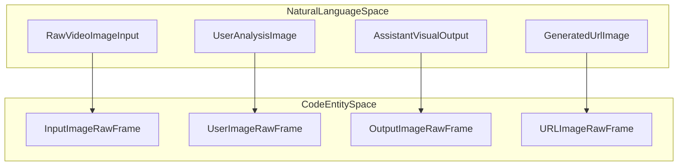
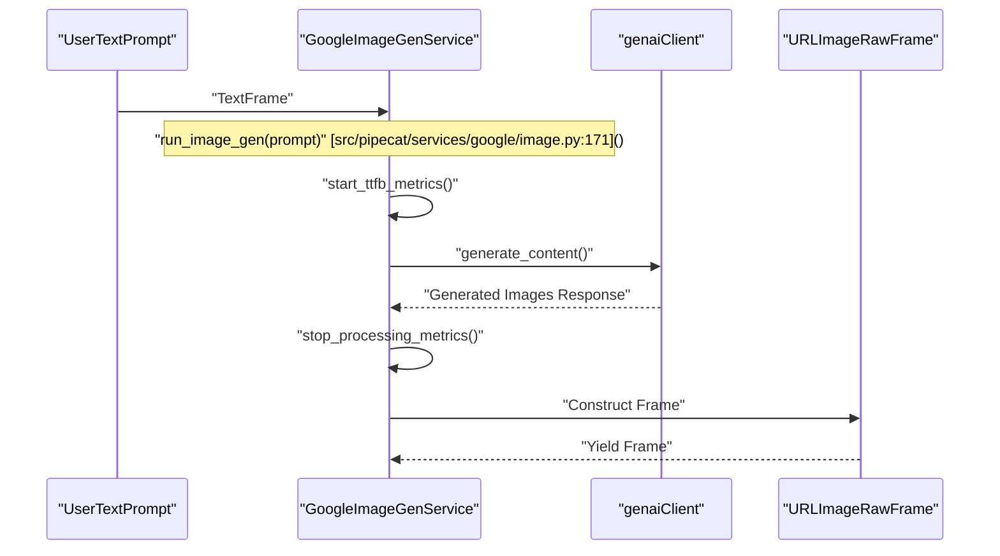
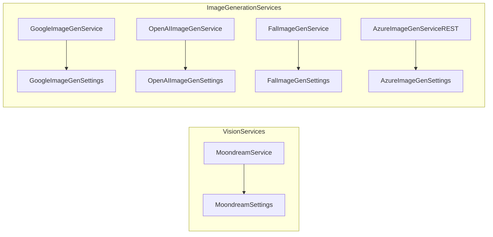

<!-- source: DeepWiki mcp.deepwiki.com · repo pipecat-ai/pipecat · page 4.6 Vision and Image Services · fetched 2026-10-27 -->

# Vision and Image Services

<details>
<summary>Relevant source files</summary>

The following files were used as context for generating this wiki page:

- [src/pipecat/services/azure/image.py](src/pipecat/services/azure/image.py)
- [src/pipecat/services/fal/image.py](src/pipecat/services/fal/image.py)
- [src/pipecat/services/google/image.py](src/pipecat/services/google/image.py)
- [src/pipecat/services/image_service.py](src/pipecat/services/image_service.py)
- [src/pipecat/services/moondream/vision.py](src/pipecat/services/moondream/vision.py)
- [src/pipecat/services/openai/image.py](src/pipecat/services/openai/image.py)
- [src/pipecat/services/vision_service.py](src/pipecat/services/vision_service.py)
- [tests/test_google_image_gen.py](tests/test_google_image_gen.py)
- [tests/test_openai_image_gen.py](tests/test_openai_image_gen.py)

</details>


This page documents Pipecat's vision and image processing capabilities, covering specialized vision model integrations (`MoondreamService`, `GoogleImageGenService`, `OpenAIImageGenService`, `FalImageGenService`, `AzureImageGenServiceREST`), image frame types, and multimodal context handling.

Sources: [src/pipecat/frames/frames.py:232-344](), [src/pipecat/services/vision_service.py:23-29](), [src/pipecat/services/image_service.py:22-28](), [src/pipecat/services/moondream/vision.py:7-11]()

---

## Overview

Pipecat provides comprehensive support for vision and image processing through:

- **Image Frame Types**: Structured frame classes (`InputImageRawFrame`, `UserImageRawFrame`, `OutputImageRawFrame`, `URLImageRawFrame`) for different image sources and destinations [src/pipecat/frames/frames.py:232-344]().
- **Vision-Capable LLMs**: Multimodal language models that can analyze images, including Google Gemini, AWS Bedrock (Nova/Claude), and Anthropic Claude.
- **Specialized Vision Services**: Local vision-language models like `MoondreamService` for image analysis and description [src/pipecat/services/moondream/vision.py:134-140]().
- **Image Generation Services**: Specialized services for text-to-image generation using `GoogleImageGenService` [src/pipecat/services/google/image.py:70-76](), `OpenAIImageGenService` [src/pipecat/services/openai/image.py:86-91](), `FalImageGenService` [src/pipecat/services/fal/image.py:79-84](), and `AzureImageGenServiceREST` [src/pipecat/services/azure/image.py:39-45]().
- **Image Processing Base Classes**: Foundational abstractions for analyzing visual content (`VisionService`) [src/pipecat/services/vision_service.py:23-29]() and generating images (`ImageGenService`) [src/pipecat/services/image_service.py:22-28]().

Vision capabilities enable conversational AI agents to analyze user-provided images in real-time and generate images as responses to user prompts.

Sources: [src/pipecat/frames/frames.py:232-344](), [src/pipecat/services/vision_service.py:23-29](), [src/pipecat/services/image_service.py:22-28](), [src/pipecat/services/moondream/vision.py:134-140](), [src/pipecat/services/google/image.py:70-76]()

---

## Image Frame Type Hierarchy

Pipecat uses a specific hierarchy of frames to distinguish between raw video input, user-uploaded images, and bot-generated visual content.

### Code Entity Association: Image Frames
The following diagram bridges natural language visual concepts to their specific `Frame` class implementations in the codebase.



Sources: [src/pipecat/frames/frames.py:232-344]()

### Key Image Frame Types

| Frame Type | Purpose | Key Attributes |
|------------|---------|----------------|
| `InputImageRawFrame` | Raw video/image data from transport input. | `image`, `size`, `format` [src/pipecat/frames/frames.py:248-261]() |
| `UserImageRawFrame` | Image content intended for analysis. | `image`, `text` (prompt/question) [src/pipecat/frames/frames.py:264-277]() |
| `OutputImageRawFrame` | Generic image output to be rendered by transport. | `image`, `size`, `format` [src/pipecat/frames/frames.py:280-297]() |
| `URLImageRawFrame` | Image generated by a service, often containing a remote URL or base64 data. | `url`, `image` (bytes) [src/pipecat/frames/frames.py:310-325]() |
| `AssistantImageRawFrame` | Specifically marks an image as part of the bot's turn. | `image`, `size` [src/pipecat/frames/frames.py:299-308]() |

Sources: [src/pipecat/frames/frames.py:232-344]()

---

## Vision Analysis Services

Vision services process images (typically `UserImageRawFrame`) to generate textual descriptions or answer questions about visual content.

### Moondream (Local Vision)

`MoondreamService` provides local image analysis using the Moondream vision-language model. It supports hardware acceleration (CUDA, MPS, XPU) via `torch` [src/pipecat/services/moondream/vision.py:43-66]().

- **Implementation**: It overrides `run_vision()` to perform inference using `AutoModelForCausalLM` [src/pipecat/services/moondream/vision.py:134-140]().
- **Data Flow**: It receives a `UserImageRawFrame`, processes visual encoding, and queries the local model.
- **Output**: Yields frames containing analysis results [src/pipecat/services/vision_service.py:48-61]().

### Vision Service Base Class

All vision analysis services inherit from `VisionService`, which simplifies the `process_frame` logic by automatically handling `UserImageRawFrame` and metrics [src/pipecat/services/vision_service.py:23-29]().

```python
async def process_frame(self, frame: Frame, direction: FrameDirection):
    await super().process_frame(frame, direction)

    if isinstance(frame, UserImageRawFrame) and frame.text:
        await self.start_processing_metrics()
        await self.process_generator(self.run_vision(frame))
        await self.stop_processing_metrics()
    else:
        await self.push_frame(frame, direction)
```

Sources: [src/pipecat/services/vision_service.py:23-82](), [src/pipecat/services/moondream/vision.py:43-140]()

---

## Image Generation Services

Image generation services take text prompts and produce `URLImageRawFrame` objects containing inline bytes or remote URLs.

### Supported Providers

| Service | Model Default | Key Features |
|---------|---------------|--------------|
| `GoogleImageGenService` | `gemini-3.1-flash-image` | Supports `number_of_images` and `aspect_ratio`. `negative_prompt` is deprecated and ignored [src/pipecat/services/google/image.py:43-68](). |
| `OpenAIImageGenService` | `gpt-image-2.5-flare` | Configurable `image_size` and `quality`. Handles both hosted URLs and base64-encoded inline responses [src/pipecat/services/openai/image.py:70-84](), [src/pipecat/services/openai/image.py:152-191](). |
| `FalImageGenService` | `fal-ai/fast-sdxl` | Supports `seed`, `num_inference_steps`, and `expand_prompt` [src/pipecat/services/fal/image.py:33-77](). |
| `AzureImageGenServiceREST` | User-defined | REST-based polling for asynchronous generation [src/pipecat/services/azure/image.py:39-48](). |
| `ImageGenService` (Base) | N/A | Processes `TextFrame` and calls `run_image_gen()` [src/pipecat/services/image_service.py:22-28](). |

Sources: [src/pipecat/services/google/image.py:43-68](), [src/pipecat/services/openai/image.py:70-191](), [src/pipecat/services/fal/image.py:33-77](), [src/pipecat/services/azure/image.py:39-48](), [src/pipecat/services/image_service.py:22-28]()

### Code Entity Association: Text-to-Image Pipeline
The following diagram bridges high-level text generation concepts to actual execution functions and classes within `GoogleImageGenService`.



Sources: [src/pipecat/services/google/image.py:171-193](), [src/pipecat/services/image_service.py:22-81](), [src/pipecat/services/openai/image.py:152-191]()

---

## Implementation Details: Service Settings

Modern Pipecat services use a unified `Settings` pattern for configuration, allowing for runtime updates and clear parameter definitions.

### Code Entity Association: Service Settings
The following diagram maps vision and image services to their respective configuration settings classes in the codebase.



Sources: [src/pipecat/services/moondream/vision.py:125-131](), [src/pipecat/services/google/image.py:43-68](), [src/pipecat/services/openai/image.py:70-84](), [src/pipecat/services/fal/image.py:33-77](), [src/pipecat/services/azure/image.py:27-37]()

| Service | Settings Class | Key Parameters |
|---------|----------------|----------------|
| Moondream | `MoondreamSettings` | `model` [src/pipecat/services/moondream/vision.py:125-131]() |
| Google Image | `GoogleImageGenSettings` | `model`, `number_of_images`, `aspect_ratio`, `image_size`, `negative_prompt` [src/pipecat/services/google/image.py:43-68]() |
| OpenAI Image | `OpenAIImageGenSettings` | `model`, `image_size`, `quality` [src/pipecat/services/openai/image.py:70-84]() |
| FAL Image | `FalImageGenSettings` | `seed`, `num_inference_steps`, `image_size`, `expand_prompt`, `negative_prompt`, `guidance_scale` [src/pipecat/services/fal/image.py:33-77]() |
| Azure Image | `AzureImageGenSettings` | `model`, `image_size` [src/pipecat/services/azure/image.py:27-37]() |

Services initialize these settings in their `__init__` methods, ensuring that explicitly provided `Settings` objects take precedence over deprecated parameters.

Sources: [src/pipecat/services/moondream/vision.py:125-181](), [src/pipecat/services/google/image.py:43-139](), [src/pipecat/services/openai/image.py:70-148](), [src/pipecat/services/fal/image.py:33-148](), [src/pipecat/services/azure/image.py:27-101]()

---

