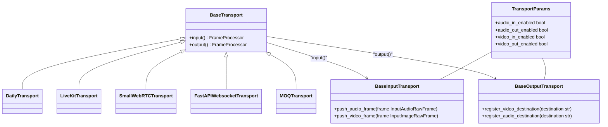
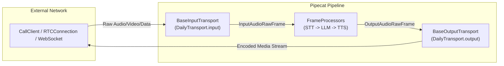
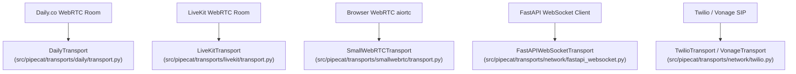

<!-- source: DeepWiki mcp.deepwiki.com · repo pipecat-ai/pipecat · page 5 Transport Layer · fetched 2026-10-27 -->

# Transport Layer

Relevant source files

The following files were used as context for generating this wiki page:

- [changelog/5571.fixed.md](changelog/5571.fixed.md)
- [changelog/6027.fixed.5.md](changelog/6027.fixed.5.md)
- [changelog/6055.fixed.4.md](changelog/6055.fixed.4.md)
- [changelog/6056.deprecated.4.md](changelog/6056.deprecated.4.md)
- [src/pipecat/services/google/gemini_live/file_api.py](src/pipecat/services/google/gemini_live/file_api.py)
- [src/pipecat/transports/daily/transport.py](src/pipecat/transports/daily/transport.py)
- [src/pipecat/transports/livekit/transport.py](src/pipecat/transports/livekit/transport.py)
- [src/pipecat/transports/smallwebrtc/connection.py](src/pipecat/transports/smallwebrtc/connection.py)
- [src/pipecat/transports/smallwebrtc/transport.py](src/pipecat/transports/smallwebrtc/transport.py)
- [src/pipecat/transports/video_in_sampler.py](src/pipecat/transports/video_in_sampler.py)
- [tests/test_daily_transport.py](tests/test_daily_transport.py)
- [tests/test_livekit_transport.py](tests/test_livekit_transport.py)
- [tests/test_smallwebrtc_transport.py](tests/test_smallwebrtc_transport.py)
- [tests/test_video_in_sources.py](tests/test_video_in_sources.py)

## Purpose and Scope

This page provides a high-level overview of the Pipecat transport layer, which acts as the outermost shell bridging the frame-based pipeline architecture to real-time communication systems (WebRTC, WebSockets, telephony, and local hardware). For low-level details about transport input/output splitting, see [Transport I/O Architecture](#3.5). 

For comprehensive implementation details, configuration options, and advanced features, refer to the child pages:
- **Daily Transport**: See [Daily Transport](#5.1).
- **LiveKit Transport**: See [LiveKit Transport](#5.2).
- **WebSocket Transports**: See [WebSocket Transports](#5.3).
- **Telephony and Serializers**: See [Telephony and Serializers](#5.4).
- **Local, Test, and MOQ Transports**: See [Local, Test, and MOQ Transports](#5.5).

Sources: [src/pipecat/transports/base_transport.py:7-12]()

---

## Architecture and Abstraction

A transport in Pipecat divides external communication into input and output processors that inherit from `FrameProcessor` [src/pipecat/processors/frame_processor.py:175-193](). 

- **`BaseTransport`**: The parent configuration and factory class defining `input()` and `output()` methods [src/pipecat/transports/base_transport.py:92-134]().
- **`BaseInputTransport`**: Captures raw audio, video, and data messages from the peer and emits `InputAudioRawFrame`, `UserAudioRawFrame`, `InputImageRawFrame`, and `InputTransportMessageFrame` objects [src/pipecat/transports/base_input.py:36-42]().
- **`BaseOutputTransport`**: Consumes `OutputAudioRawFrame`, `TTSAudioRawFrame`, `OutputImageRawFrame`, and message frames from the pipeline, writing them out to the external peer [src/pipecat/transports/base_output.py:60-66]().

### Transport Class Hierarchy

Sources: [src/pipecat/transports/base_transport.py:25-134](), [src/pipecat/transports/base_input.py:36-180](), [src/pipecat/transports/base_output.py:60-197]()

---

## Pipeline Integration

Transports are inserted directly into the `Pipeline` list, serving as the boundary between the internal `PipelineWorker` execution loop and external network sockets or media tracks [src/pipecat/transports/base_transport.py:117-133]().

### Transport Pipeline Execution Flow

Sources: [src/pipecat/transports/base_transport.py:117-133](), [src/pipecat/transports/daily/transport.py:56-56]()

---

## Natural Language to Code Entity Mapping

To bridge natural language concepts to concrete code implementations within Pipecat, the following architecture map links communication platforms and protocols to their corresponding Python classes:

### Transport Protocol Entity Map

Sources: [src/pipecat/transports/daily/transport.py:56](), [src/pipecat/transports/livekit/transport.py:45](), [src/pipecat/transports/smallwebrtc/transport.py:44]()

---

## Available Transports and Child Pages

Pipecat supports a wide variety of transport protocols. Below is an overview mapped to their respective child pages:

1. **Daily Transport**: Integrates Daily.co WebRTC rooms, streaming, recording, dial-in/out, SIP transfer frames, and STT metadata broadcasting. For details, see [Daily Transport](#5.1).
2. **LiveKit Transport**: Provides WebRTC integration for LiveKit rooms, participant tracks, audio mixing, and room event hooks. For details, see [LiveKit Transport](#5.2).
3. **WebSocket Transports**: Covers FastAPI-based WebSockets, client WebSockets, SmallWebRTC via `aiortc`, and WhatsApp transport integration. For details, see [WebSocket Transports](#5.3).
4. **Telephony and Serializers**: Details integrations for Twilio, Vonage, Telnyx, Plivo, and audio payload serializers. For details, see [Telephony and Serializers](#5.4).
5. **Local, Test, and MOQ Transports**: Covers local audio/Tk hardware transports, GStreamer file sources, and Media over QUIC (`MOQTransport`). For details, see [Local, Test, and MOQ Transports](#5.5).

Sources: [src/pipecat/transports/daily/transport.py:56](), [src/pipecat/transports/livekit/transport.py:45](), [src/pipecat/transports/smallwebrtc/transport.py:44]()

---

