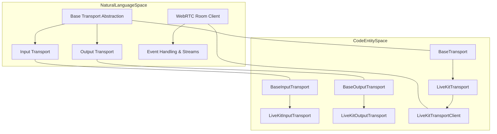
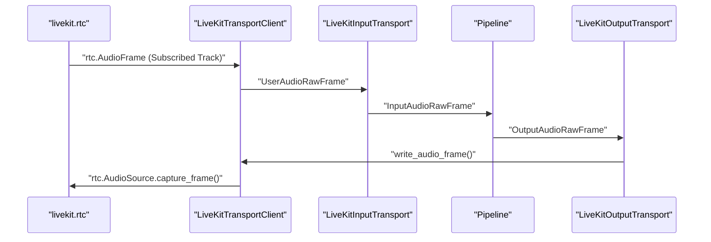
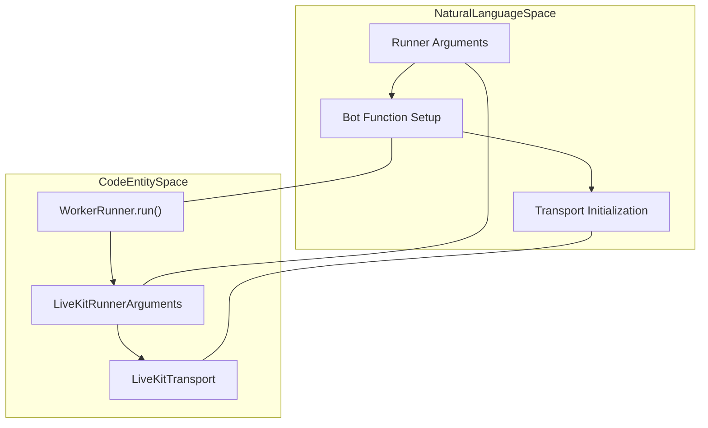

<!-- source: DeepWiki mcp.deepwiki.com · repo pipecat-ai/pipecat · page 5.2 LiveKit Transport · fetched 2026-10-27 -->

# LiveKit Transport

Relevant source files

The following files were used as context for generating this wiki page:

- [changelog/3415.added.md](changelog/3415.added.md)
- [changelog/5571.fixed.md](changelog/5571.fixed.md)
- [changelog/6027.fixed.5.md](changelog/6027.fixed.5.md)
- [changelog/6055.fixed.4.md](changelog/6055.fixed.4.md)
- [changelog/6056.deprecated.4.md](changelog/6056.deprecated.4.md)
- [examples/transports/transports-moq.py](examples/transports/transports-moq.py)
- [src/pipecat/runner/livekit.py](src/pipecat/runner/livekit.py)
- [src/pipecat/runner/moq.py](src/pipecat/runner/moq.py)
- [src/pipecat/runner/run.py](src/pipecat/runner/run.py)
- [src/pipecat/runner/types.py](src/pipecat/runner/types.py)
- [src/pipecat/runner/utils.py](src/pipecat/runner/utils.py)
- [src/pipecat/services/google/gemini_live/file_api.py](src/pipecat/services/google/gemini_live/file_api.py)
- [src/pipecat/transports/daily/transport.py](src/pipecat/transports/daily/transport.py)
- [src/pipecat/transports/livekit/transport.py](src/pipecat/transports/livekit/transport.py)
- [src/pipecat/transports/moq/__init__.py](src/pipecat/transports/moq/__init__.py)
- [src/pipecat/transports/moq/transport.py](src/pipecat/transports/moq/transport.py)
- [src/pipecat/transports/smallwebrtc/connection.py](src/pipecat/transports/smallwebrtc/connection.py)
- [src/pipecat/transports/smallwebrtc/transport.py](src/pipecat/transports/smallwebrtc/transport.py)
- [src/pipecat/transports/video_in_sampler.py](src/pipecat/transports/video_in_sampler.py)
- [src/pipecat/utils/file_storage.py](src/pipecat/utils/file_storage.py)
- [tests/test_daily_transport.py](tests/test_daily_transport.py)
- [tests/test_livekit_transport.py](tests/test_livekit_transport.py)
- [tests/test_moq_transport.py](tests/test_moq_transport.py)
- [tests/test_runner_run.py](tests/test_runner_run.py)
- [tests/test_smallwebrtc_transport.py](tests/test_smallwebrtc_transport.py)
- [tests/test_video_in_sources.py](tests/test_video_in_sources.py)

This page covers the LiveKit transport integration for Pipecat: its configuration, class hierarchy, frame types, audio/video I/O, data channel messaging, DTMF support, participant event handling (including active speaker changes), and the LiveKit runner helper. For the abstract transport base classes that LiveKit builds on, see [Transport I/O Architecture](3.5) `[src/pipecat/transports/base_transport.py:50-150]()`. For the Daily WebRTC transport, see [Daily Transport](5.1) `[src/pipecat/transports/daily/transport.py:7-12]()`. For WebSocket-based transports, see [WebSocket Transports](5.3) `[src/pipecat/transports/smallwebrtc/transport.py:7-12]()`.

---

## Overview

The LiveKit transport connects a Pipecat pipeline to a LiveKit room, enabling real-time audio and video streaming with connected participants. It is implemented in `src/pipecat/transports/livekit/transport.py` and installed via the `livekit` extra `[src/pipecat/transports/livekit/transport.py:7-12]`, `[src/pipecat/transports/livekit/transport.py:57-64]()`.

The transport uses LiveKit's Python SDK (`livekit-rtc`) internally and requires a LiveKit server URL and a room access token `[src/pipecat/transports/livekit/transport.py:57-64]()`.

Sources: `[src/pipecat/transports/livekit/transport.py:7-12]()`, `[src/pipecat/transports/livekit/transport.py:57-64]()`

---

## Class Hierarchy

The LiveKit transport follows the standard Pipecat transport pattern, separating input, output, and the underlying SDK client.

### Class Hierarchy and Architecture Mapping

Sources: `[src/pipecat/transports/livekit/transport.py:441-456]()`, `[src/pipecat/transports/livekit/transport.py:504-515]()`, `[src/pipecat/transports/base_transport.py:50-150]`, `[src/pipecat/transports/base_input.py:1-56]`, `[src/pipecat/transports/base_output.py:1-57]()`

---

## Configuration: `LiveKitParams`

`LiveKitParams` extends `TransportParams` with defaults appropriate for LiveKit `[src/pipecat/transports/livekit/transport.py:140-180]`, `[src/pipecat/transports/base_transport.py:56-149]()`.

| Field | Default | Description |
|---|---|---|
| `audio_out_enabled` | `False` | Enable sending audio to participants `[src/pipecat/transports/base_transport.py:113-113]()`. |
| `audio_in_enabled` | `False` | Enable receiving audio from participants `[src/pipecat/transports/base_transport.py:125-125]()`. |
| `video_out_enabled` | `False` | Enable sending video frames `[src/pipecat/transports/base_transport.py:133-133]()`. |
| `video_in_enabled` | `False` | Enable receiving video frames `[src/pipecat/transports/base_transport.py:131-131]()`. |
| `audio_in_user_tracks` | `True` | Receive each participant's audio as its own stream of `UserAudioRawFrame`s tagged with their identity `[src/pipecat/transports/livekit/transport.py:163-168]()`. |
| `audio_out_queue_size_ms` | `1000` | Buffer size of the outgoing audio source, in milliseconds `[src/pipecat/transports/livekit/transport.py:169-170]()`. |
| `video_out_max_bitrate` | `None` | Maximum bitrate of the published video track, in bits per second `[src/pipecat/transports/livekit/transport.py:171-174]()`. |

Note: Video stream processing only starts if `video_in_enabled` is `True` to prevent memory leaks from undrained queues `[tests/test_livekit_transport.py:47-55]()`.

Sources: `[src/pipecat/transports/livekit/transport.py:140-180]()`, `[src/pipecat/transports/base_transport.py:56-149]()`, `[tests/test_livekit_transport.py:47-55]()`

---

## Callbacks: `LiveKitCallbacks`

`LiveKitCallbacks` is a Pydantic `BaseModel` containing async callable fields for room and participant lifecycle events `[src/pipecat/transports/livekit/transport.py:181-187]()`.

| Callback | Signature | Triggered when |
|---|---|---|
| `on_connected` | `async ()` | Bot successfully joins the LiveKit room `[src/pipecat/transports/livekit/transport.py:185-185]()`. |
| `on_disconnected` | `async ()` | Bot leaves the room `[src/pipecat/transports/livekit/transport.py:186-186]()`. |
| `on_before_disconnect` | `async ()` | Called before the bot disconnects from the room `[tests/test_livekit_transport.py:63-63]()`. |
| `on_participant_connected` | `async (participant_id)` | A remote participant joins `[src/pipecat/transports/livekit/transport.py:187-187]()`. |
| `on_participant_disconnected` | `async (participant_id)` | A remote participant leaves `[src/pipecat/transports/livekit/transport.py:188-188]()`. |
| `on_audio_track_subscribed` | `async (participant_id)` | Audio track from participant is available `[src/pipecat/transports/livekit/transport.py:189-189]()`. |
| `on_audio_track_unsubscribed` | `async (participant_id)` | Audio track from participant is removed `[src/pipecat/transports/livekit/transport.py:190-190]()`. |
| `on_video_track_subscribed` | `async (participant_id)` | Video track from participant is available `[src/pipecat/transports/livekit/transport.py:191-191]()`. |
| `on_video_track_unsubscribed` | `async (participant_id)` | Video track from participant is removed `[src/pipecat/transports/livekit/transport.py:192-192]()`. |
| `on_data_received` | `async (data, participant_id)` | Data channel message received `[src/pipecat/transports/livekit/transport.py:193-193]()`. |
| `on_first_participant_joined` | `async (participant_id)` | The first participant joins the room `[src/pipecat/transports/livekit/transport.py:194-194]()`. |
| `on_dtmf_event` | `async (event)` | A SIP DTMF tone is received `[src/pipecat/transports/livekit/transport.py:195-195]()`. |
| `on_active_speaker_changed` | `async (speaker_info)` | Called when the room's loudest speaker changes `[src/pipecat/transports/livekit/transport.py:196-196]()`. |

Sources: `[src/pipecat/transports/livekit/transport.py:181-197]()`, `[tests/test_livekit_transport.py:63-75]()`

---

## `LiveKitTransport` and `LiveKitTransportClient`

`LiveKitTransport` is the top-level class. It instantiates and owns `LiveKitTransportClient`, `LiveKitInputTransport`, and `LiveKitOutputTransport` `[src/pipecat/transports/livekit/transport.py:441-515]`.

`LiveKitTransportClient` manages the underlying `livekit.rtc.Room` connection. It handles low-level API interactions including room management, audio streaming, and data messaging `[src/pipecat/transports/livekit/transport.py:221-440]()`.

**Key Functions:**
- `connect()`: Joins the room and sets up event listeners. Uses `tenacity` for retries via `@retry` `[src/pipecat/transports/livekit/transport.py:255-274]()`.
- `send_data()`: Sends bytes to specific participants or broadcasts to all via `room.local_participant.publish_data` `[src/pipecat/transports/livekit/transport.py:348-360]()`.
- Resource cleanup: The client maintains registries for `_audio_streams` and `_video_streams` to track native streams and their associated producer tasks, properly disposing of them via `aclose()` and task cancellation upon unsubscription `[tests/test_livekit_transport.py:144-161]()`.

Sources: `[src/pipecat/transports/livekit/transport.py:221-515]()`, `[tests/test_livekit_transport.py:144-161]()`

---

## Audio and Video I/O

### Media Data Flow

Sources: `[src/pipecat/transports/livekit/transport.py:24-50]()`, `[src/pipecat/transports/livekit/transport.py:348-360]()`, `[src/pipecat/transports/livekit/transport.py:575-585]()`

**Input Audio:**
Incoming audio from subscribed tracks is processed by `LiveKitTransportClient` and pushed to the input transport as `UserAudioRawFrame` or `InputAudioRawFrame` depending on mixing settings `[src/pipecat/transports/livekit/transport.py:163-168]()`, `[src/pipecat/transports/livekit/transport.py:575-585]()`. If a resampler is required, `create_stream_resampler` is used `[src/pipecat/transports/livekit/transport.py:25-26]()`.

**Output Audio:**
`LiveKitOutputTransport.write_audio_frame()` sends audio to the client, which uses an `rtc.AudioSource` to capture frames for the room's published track `[src/pipecat/transports/livekit/transport.py:575-585]()`.

Sources: `[src/pipecat/transports/livekit/transport.py:24-26]()`, `[src/pipecat/transports/livekit/transport.py:163-168]`, `[src/pipecat/transports/livekit/transport.py:575-585]()`

---

## Data Channel Messaging

Data messages are sent and received through LiveKit's built-in data channel `[src/pipecat/transports/livekit/transport.py:348-395]()`.

### Sending Messages
Use `LiveKitOutputTransportMessageFrame` or `LiveKitOutputTransportMessageUrgentFrame`. These frames allow targeting specific participants via `participant_id` `[src/pipecat/transports/livekit/transport.py:119-138]()`.

| Frame Class | Behavior |
|---|---|
| `LiveKitOutputTransportMessageFrame` | Queued with media frames `[src/pipecat/transports/livekit/transport.py:119-127]()`. |
| `LiveKitOutputTransportMessageUrgentFrame` | Sent immediately, bypassing the media queue `[src/pipecat/transports/livekit/transport.py:130-138]()`. |

Sources: `[src/pipecat/transports/livekit/transport.py:119-138]()`

### Receiving Messages
When data is received, the client triggers the `on_data_received` callback and pushes an `InputTransportMessageFrame` into the pipeline `[src/pipecat/transports/livekit/transport.py:108-116]`, `[src/pipecat/transports/livekit/transport.py:390-395]()`.

Sources: `[src/pipecat/transports/livekit/transport.py:108-116]`, `[src/pipecat/transports/livekit/transport.py:390-395]()`

---

## DTMF Support

LiveKit transport supports sending DTMF tones via RFC 4733 event codes `[src/pipecat/transports/livekit/transport.py:67-80]()`. `DTMF_CODE_MAP` translates keypad characters into their respective integer codes `[src/pipecat/transports/livekit/transport.py:67-80]()`.

| Key | Code |
|---|---|
| `0-9` | `0-9` `[src/pipecat/transports/livekit/transport.py:68-77]()` |
| `*` | `10` `[src/pipecat/transports/livekit/transport.py:78-78]()` |
| `#` | `11` `[src/pipecat/transports/livekit/transport.py:79-79]()` |

The transport handles `OutputDTMFFrame` (queued) and `OutputDTMFUrgentFrame` (immediate).

Sources: `[src/pipecat/transports/livekit/transport.py:67-80]()`

---

## LiveKit Runner Helper

Pipecat provides a development runner that supports LiveKit through `LiveKitRunnerArguments`, integrating with the worker runner infrastructure `[src/pipecat/runner/run.py:133-141]()`.

### Runner Architecture Mapping

Sources: `[src/pipecat/runner/run.py:133-141]()`, `[src/pipecat/runner/livekit.py:1-50]()`

---

