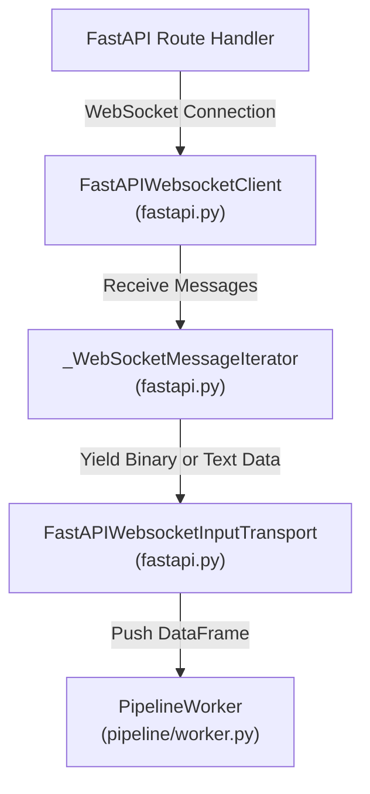
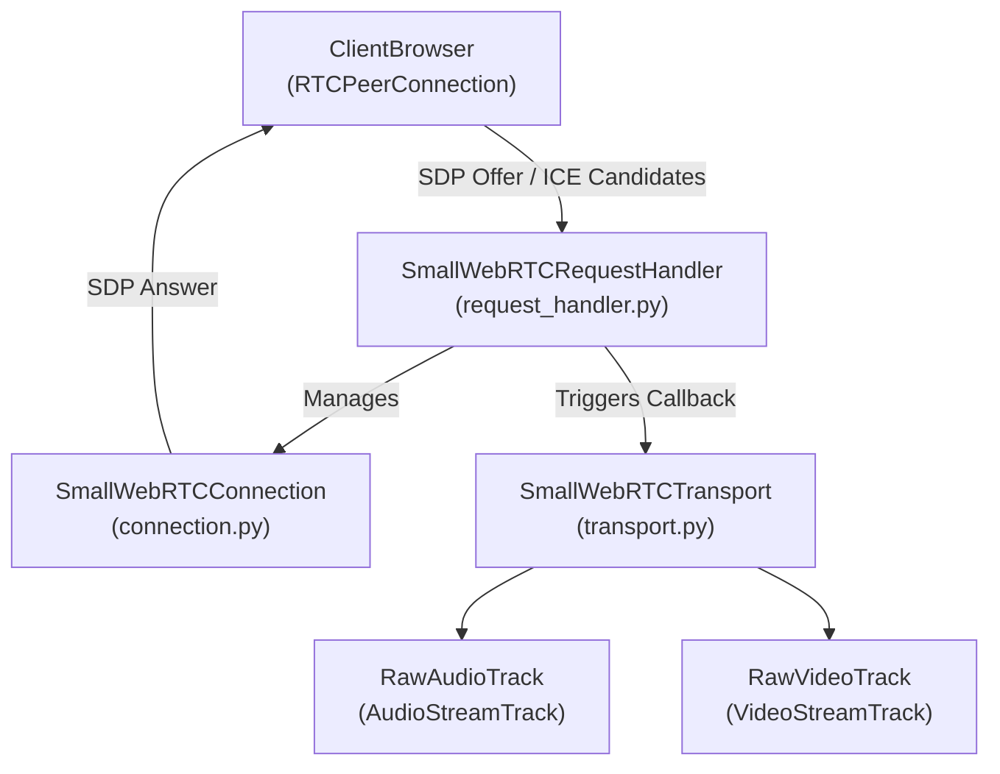
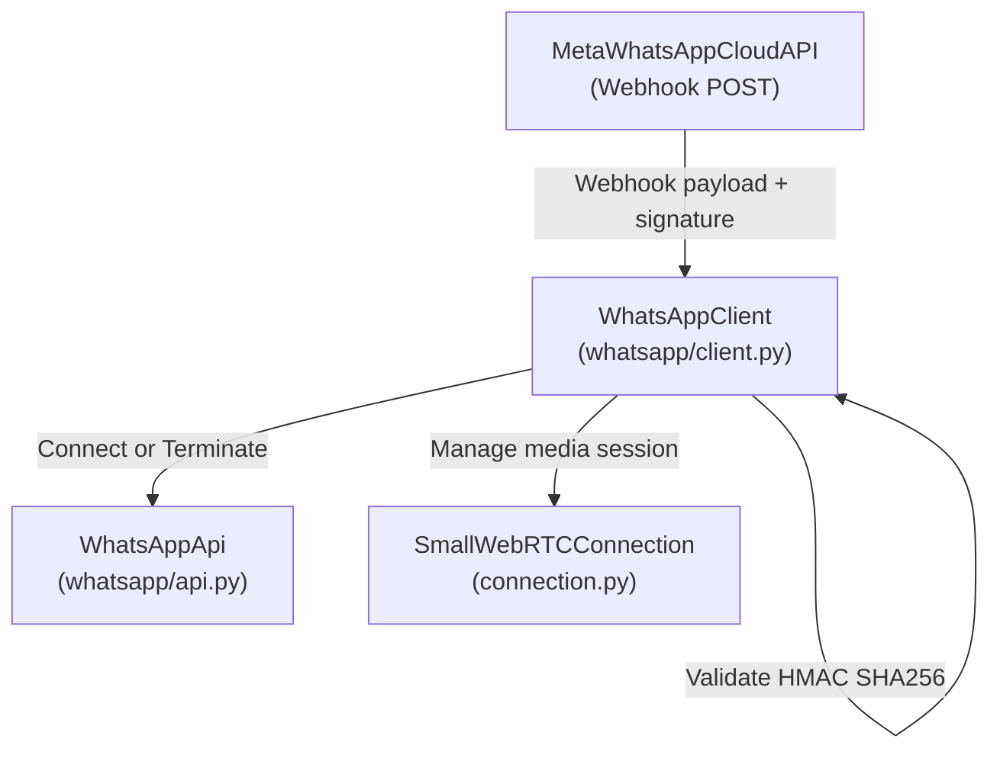

<!-- source: DeepWiki mcp.deepwiki.com · repo pipecat-ai/pipecat · page 5.3 WebSocket Transports · fetched 2026-10-27 -->

# WebSocket Transports

Relevant source files

The following files were used as context for generating this wiki page:

- [src/pipecat/runner/daily.py](src/pipecat/runner/daily.py)
- [src/pipecat/transports/smallwebrtc/request_handler.py](src/pipecat/transports/smallwebrtc/request_handler.py)
- [src/pipecat/transports/tavus/transport.py](src/pipecat/transports/tavus/transport.py)
- [src/pipecat/transports/websocket/client.py](src/pipecat/transports/websocket/client.py)
- [src/pipecat/transports/websocket/fastapi.py](src/pipecat/transports/websocket/fastapi.py)
- [src/pipecat/transports/websocket/server.py](src/pipecat/transports/websocket/server.py)
- [src/pipecat/transports/whatsapp/__init__.py](src/pipecat/transports/whatsapp/__init__.py)
- [src/pipecat/transports/whatsapp/api.py](src/pipecat/transports/whatsapp/api.py)
- [src/pipecat/transports/whatsapp/client.py](src/pipecat/transports/whatsapp/client.py)
- [tests/test_fastapi_websocket.py](tests/test_fastapi_websocket.py)
- [tests/test_tavus_transport.py](tests/test_tavus_transport.py)
- [tests/test_websocket_client_transport.py](tests/test_websocket_client_transport.py)
- [tests/test_websocket_server_transport.py](tests/test_websocket_server_transport.py)

This page covers Pipecat's WebSocket-based and lightweight WebRTC transport implementations. It details three pure WebSocket transports (`FastAPIWebsocketTransport`, `WebsocketClientTransport`, and the deprecated `SingleClientWebsocketServerTransport`), the `SmallWebRTCTransport` (which implements WebRTC signaling and media streaming using the `aiortc` library), and the `WhatsAppTransport`.

These transports form the foundation for browser-to-bot connections, telephony provider integration, and embedded device communication. For telephony serializers operating over WebSockets, see [5.4](). For Daily and LiveKit WebRTC transports, see [5.1]() and [5.2](). For the underlying transport class abstractions (`BaseTransport`, `BaseInputTransport`, `BaseOutputTransport`), see [3.5]().

---

## Transport Architecture and Hierarchy

The following diagram illustrates the relationship between the base transport abstractions and the concrete WebSocket/WebRTC transport classes implemented across the codebase, linking architecture to specific code entities.

**Title: WebSocket Transport Class Hierarchy**

```mermaid
classDiagram
    class BaseTransport {
        <<abstract>>
        +input() BaseInputTransport
        +output() BaseOutputTransport
    }
    class BaseInputTransport {
        <<abstract>>
    }
    class BaseOutputTransport {
        <<abstract>>
    }

    BaseTransport <|-- FastAPIWebsocketTransport : "fastapi.py"
    BaseTransport <|-- SingleClientWebsocketServerTransport : "server.py"
    BaseTransport <|-- WebsocketClientTransport : "client.py"
    BaseTransport <|-- SmallWebRTCTransport : "transport.py"
    BaseTransport <|-- WhatsAppTransport : "client.py"

    BaseInputTransport <|-- FastAPIWebsocketInputTransport
    BaseOutputTransport <|-- FastAPIWebsocketOutputTransport
    FastAPIWebsocketTransport --> FastAPIWebsocketInputTransport : "fastapi.py"
    FastAPIWebsocketTransport --> FastAPIWebsocketOutputTransport : "fastapi.py"

    BaseInputTransport <|-- SingleClientWebsocketServerInputTransport
    BaseOutputTransport <|-- SingleClientWebsocketServerOutputTransport
    SingleClientWebsocketServerTransport --> SingleClientWebsocketServerInputTransport : "server.py"
    SingleClientWebsocketServerTransport --> SingleClientWebsocketServerOutputTransport : "server.py"

    BaseInputTransport <|-- WebsocketClientInputTransport
    BaseOutputTransport <|-- WebsocketClientOutputTransport
    WebsocketClientTransport --> WebsocketClientInputTransport : "client.py"
    WebsocketClientTransport --> WebsocketClientOutputTransport : "client.py"

    BaseInputTransport <|-- SmallWebRTCInputTransport
    BaseOutputTransport <|-- SmallWebRTCOutputTransport
    SmallWebRTCTransport --> SmallWebRTCInputTransport : "transport.py"
    SmallWebRTCTransport --> SmallWebRTCOutputTransport : "transport.py"
    SmallWebRTCTransport --> SmallWebRTCConnection : "connection.py"
```

Sources: [src/pipecat/transports/websocket/fastapi.py:38-40](), [src/pipecat/transports/websocket/server.py:42-44](), [src/pipecat/transports/websocket/client.py:38-40](), [src/pipecat/transports/smallwebrtc/transport.py:208-300](), [src/pipecat/transports/base_transport.py:1-50]()

---

| Transport Class | Module | Primary Use Case |
|---|---|---|
| `FastAPIWebsocketTransport` | `pipecat.transports.websocket.fastapi` | FastAPI route accepts a `WebSocket` instance and passes it to the transport [src/pipecat/transports/websocket/fastapi.py:7-12]() |
| `SingleClientWebsocketServerTransport` | `pipecat.transports.websocket.server` | Standalone asyncio WebSocket server (Deprecated in favor of FastAPI) [src/pipecat/transports/websocket/server.py:7-12](), [src/pipecat/transports/websocket/server.py:45]() |
| `WebsocketClientTransport` | `pipecat.transports.websocket.client` | Pipecat initiates an outbound client connection to a remote WebSocket URL [src/pipecat/transports/websocket/client.py:7-12]() |
| `SmallWebRTCTransport` | `pipecat.transports.smallwebrtc.transport` | Browser-to-bot WebRTC using `aiortc` and custom HTTP signaling [src/pipecat/transports/smallwebrtc/transport.py:7-12]() |
| `WhatsAppTransport` | `pipecat.transports.whatsapp.client` | Integration with Meta's WhatsApp Business Cloud API [src/pipecat/transports/whatsapp/client.py:7-12]() |

Sources: [src/pipecat/transports/websocket/fastapi.py:7-12](), [src/pipecat/transports/websocket/server.py:7-12](), [src/pipecat/transports/websocket/client.py:7-12](), [src/pipecat/transports/smallwebrtc/transport.py:7-12](), [src/pipecat/transports/whatsapp/client.py:7-12]()

---

## FastAPI WebSocket Transport

`FastAPIWebsocketTransport` is the recommended transport when hosting conversational agents inside an ASGI application using FastAPI [src/pipecat/transports/websocket/fastapi.py:7-12](). It accepts an active `WebSocket` instance and wraps it with input and output frame processors [src/pipecat/transports/websocket/fastapi.py:38-40]().

### Configuration and Message Iteration

- **`FastAPIWebsocketParams`** [src/pipecat/transports/websocket/fastapi.py:59-90]() — configuration parameters extending `TransportParams`:
  - `add_wav_header`: Whether to prepend WAV headers to outgoing raw PCM audio frames [src/pipecat/transports/websocket/fastapi.py:83]().
  - `serializer`: Optional `FrameSerializer` for encoding and decoding structured frames [src/pipecat/transports/websocket/fastapi.py:84]().
  - `session_timeout`: Optional timeout in seconds after which idle sessions are terminated [src/pipecat/transports/websocket/fastapi.py:85]().
  - `fixed_audio_packet_size`: Optional fixed-size packetization for raw PCM audio payloads, useful when remote WebSocket endpoints require strict framing [src/pipecat/transports/websocket/fastapi.py:86]().
  - `allowed_origins`: List of allowed origins for Cross-Site WebSocket Hijacking (CSWSH) protection. Defaults to `PIPECAT_ALLOWED_ORIGINS` environment variable [src/pipecat/transports/websocket/fastapi.py:87]().
  - `ws_close_timeout`: Maximum time in seconds to wait for the WebSocket close handshake during shutdown [src/pipecat/transports/websocket/fastapi.py:88-89]().

- **`_WebSocketMessageIterator`** [src/pipecat/transports/websocket/fastapi.py:105-124]() — asynchronous iterator that processes raw ASGI WebSocket messages, yielding either binary `bytes` or text `str` frames [src/pipecat/transports/websocket/fastapi.py:114-122]().

**Title: FastAPI WebSocket Data Flow Mapping**

Sources: [src/pipecat/transports/websocket/fastapi.py:59-124]()

---

## WebSocket Server Transport (Deprecated)

`SingleClientWebsocketServerTransport` spawns its own standalone WebSocket listener using the `websockets` library [src/pipecat/transports/websocket/server.py:19-22](). **Note:** This transport is deprecated in favor of `FastAPIWebsocketTransport` [src/pipecat/transports/websocket/server.py:45]().

### Reference Counting and Drain Mechanics
In `SingleClientWebsocketServerInputTransport`, the underlying server connection is reference-counted between the input and output transports via `_server_refs` [src/pipecat/transports/websocket/server.py:131-141](). The connection is drained and closed only after both input and output transports have released their holds [src/pipecat/transports/websocket/server.py:171-191](). This ensures trailing audio (such as a goodbye message spoken by TTS via Flows' `end_conversation` action) finishes transmitting before teardown [src/pipecat/transports/websocket/server.py:136-140]().

Sources: [src/pipecat/transports/websocket/server.py:44-66](), [src/pipecat/transports/websocket/server.py:131-191]()

---

## WebSocket Client Transport

`WebsocketClientTransport` establishes an outbound WebSocket client connection from Pipecat to an external WebSocket server [src/pipecat/transports/websocket/client.py:7-12](). 

### Session Management
- **`WebsocketClientSession`** [src/pipecat/transports/websocket/client.py:81-200]() handles the connection lifecycle using `websockets.asyncio.client.connect` [src/pipecat/transports/websocket/client.py:21](), asynchronous message sending, and task management [src/pipecat/transports/websocket/client.py:108-170]().
- **`WebsocketClientParams`** [src/pipecat/transports/websocket/client.py:45-56]() configures WAV header injection, custom request headers, and serializers [src/pipecat/transports/websocket/client.py:53-55]().

Sources: [src/pipecat/transports/websocket/client.py:45-120](), [src/pipecat/transports/websocket/client.py:127-186]()

---

## SmallWebRTC Transport

The SmallWebRTC implementation provides a lightweight WebRTC server-side stack using `aiortc` [src/pipecat/transports/smallwebrtc/transport.py:7-12]().

**Title: SmallWebRTC Data and Control Flow**

Sources: [src/pipecat/transports/smallwebrtc/transport.py:7-12](), [src/pipecat/transports/smallwebrtc/connection.py:7-12](), [src/pipecat/transports/smallwebrtc/request_handler.py:7-12]()

### Key Classes & Sinks
- **`SmallWebRTCConnection`** manages `RTCPeerConnection` instances, data channels, and SCTP packet size clamping to prevent MTU overflow on restrictive networks [src/pipecat/transports/smallwebrtc/connection.py:28-68]().
- **`SmallWebRTCRequestHandler`** [src/pipecat/transports/smallwebrtc/request_handler.py:86-118]() processes HTTP signaling requests and supports both `SINGLE` and `MULTIPLE` connection modes [src/pipecat/transports/smallwebrtc/request_handler.py:79-85]().

Sources: [src/pipecat/transports/smallwebrtc/connection.py:28-68](), [src/pipecat/transports/smallwebrtc/request_handler.py:79-118]()

---

## WhatsApp Transport

`WhatsAppClient` integrates Pipecat with Meta's WhatsApp Cloud API for handling voice calls over WebRTC [src/pipecat/transports/whatsapp/client.py:35-46]().

### Integration Workflow

**Title: WhatsApp Webhook and Call Management Architecture**

Sources: [src/pipecat/transports/whatsapp/client.py:35-176](), [src/pipecat/transports/whatsapp/api.py:1-40]()

### Security and Verification
- **Webhook Verification:** `handle_verify_webhook_request()` validates subscription challenges (`hub.mode`, `hub.challenge`, `hub.verify_token`) [src/pipecat/transports/whatsapp/client.py:129-157]().
- **Signature Validation:** Incoming webhook bodies are verified using HMAC-SHA256 signatures validated against `X-Hub-Signature-256` headers and the configured WhatsApp App Secret [src/pipecat/transports/whatsapp/client.py:159-176]().

Sources: [src/pipecat/transports/whatsapp/client.py:129-176]()

---

## Origin Restriction and Security

To protect against Cross-Site WebSocket Hijacking (CSWSH), WebSocket transports (`FastAPIWebsocketTransport` and `SingleClientWebsocketServerTransport`) evaluate incoming `Origin` headers against `allowed_origins` [src/pipecat/transports/websocket/fastapi.py:87](), [src/pipecat/transports/websocket/server.py:65](). When configured, connection requests with missing or unlisted origin headers are rejected [src/pipecat/transports/websocket/fastapi.py:41](), [src/pipecat/transports/websocket/server.py:46]().

Sources: [src/pipecat/transports/websocket/fastapi.py:41](), [src/pipecat/transports/websocket/server.py:46]()

---

