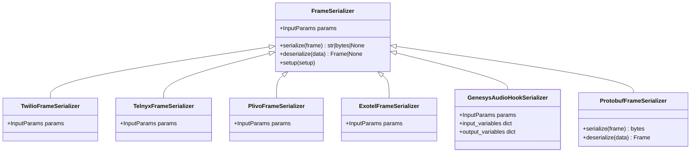
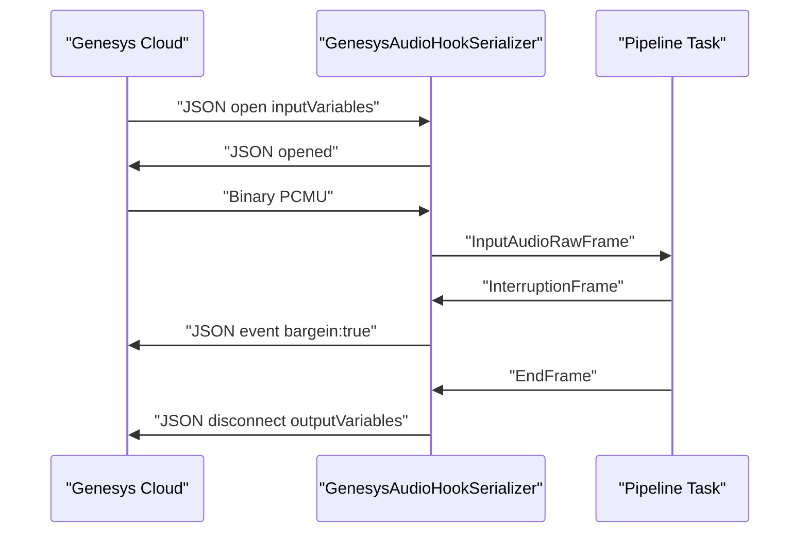
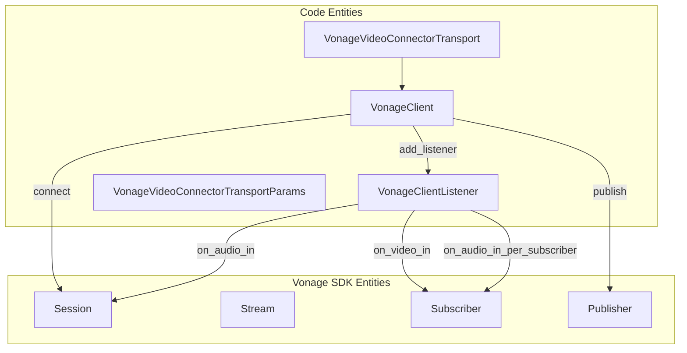
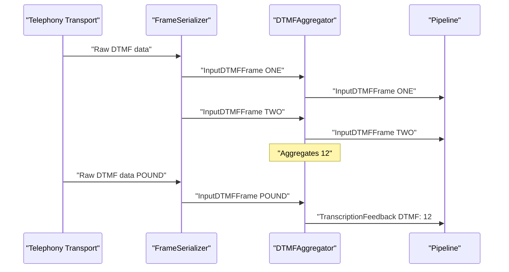

<!-- source: DeepWiki mcp.deepwiki.com · repo pipecat-ai/pipecat · page 5.4 Telephony and Serializers · fetched 2026-10-27 -->

# Telephony and Serializers

Relevant source files

The following files were used as context for generating this wiki page:

- [LICENSE](LICENSE)
- [examples/video-avatar/video-avatar-heygen-transport.py](examples/video-avatar/video-avatar-heygen-transport.py)
- [examples/video-avatar/video-avatar-heygen-video-service.py](examples/video-avatar/video-avatar-heygen-video-service.py)
- [examples/video-avatar/video-avatar-lemonslice-transport.py](examples/video-avatar/video-avatar-lemonslice-transport.py)
- [examples/video-avatar/video-avatar-simli-video-service.py](examples/video-avatar/video-avatar-simli-video-service.py)
- [examples/video-avatar/video-avatar-tavus-transport.py](examples/video-avatar/video-avatar-tavus-transport.py)
- [examples/video-avatar/video-avatar-tavus-video-service.py](examples/video-avatar/video-avatar-tavus-video-service.py)
- [src/pipecat/audio/dtmf/utils.py](src/pipecat/audio/dtmf/utils.py)
- [src/pipecat/audio/filters/rnnoise_filter.py](src/pipecat/audio/filters/rnnoise_filter.py)
- [src/pipecat/audio/utils.py](src/pipecat/audio/utils.py)
- [src/pipecat/frames/frames.proto](src/pipecat/frames/frames.proto)
- [src/pipecat/frames/protobufs/frames_pb2.py](src/pipecat/frames/protobufs/frames_pb2.py)
- [src/pipecat/processors/frameworks/strands_agents.py](src/pipecat/processors/frameworks/strands_agents.py)
- [src/pipecat/serializers/base_serializer.py](src/pipecat/serializers/base_serializer.py)
- [src/pipecat/serializers/exotel.py](src/pipecat/serializers/exotel.py)
- [src/pipecat/serializers/genesys.py](src/pipecat/serializers/genesys.py)
- [src/pipecat/serializers/plivo.py](src/pipecat/serializers/plivo.py)
- [src/pipecat/serializers/protobuf.py](src/pipecat/serializers/protobuf.py)
- [src/pipecat/serializers/telnyx.py](src/pipecat/serializers/telnyx.py)
- [src/pipecat/serializers/twilio.py](src/pipecat/serializers/twilio.py)
- [src/pipecat/serializers/vonage.py](src/pipecat/serializers/vonage.py)
- [src/pipecat/transports/lemonslice/api.py](src/pipecat/transports/lemonslice/api.py)
- [src/pipecat/transports/lemonslice/transport.py](src/pipecat/transports/lemonslice/transport.py)
- [src/pipecat/transports/vonage/client.py](src/pipecat/transports/vonage/client.py)
- [src/pipecat/transports/vonage/video_connector.py](src/pipecat/transports/vonage/video_connector.py)
- [tests/test_audio_utils.py](tests/test_audio_utils.py)
- [tests/test_dtmf_utils.py](tests/test_dtmf_utils.py)
- [tests/test_processor_unusable_policy.py](tests/test_processor_unusable_policy.py)
- [tests/test_protobuf_serializer.py](tests/test_protobuf_serializer.py)
- [tests/test_rnnoise_cancellation.py](tests/test_rnnoise_cancellation.py)
- [tests/test_rnnoise_filter.py](tests/test_rnnoise_filter.py)
- [tests/test_rnnoise_resampling.py](tests/test_rnnoise_resampling.py)
- [tests/test_soxr_resamplers.py](tests/test_soxr_resamplers.py)
- [tests/test_vonage_video_connector.py](tests/test_vonage_video_connector.py)
- [tests/test_websocket_transport.py](tests/test_websocket_transport.py)

This page documents telephony integrations (Twilio, Vonage, Telnyx, Exotel, Plivo, Genesys), audio serializers, DTMF frames, LemonSlice transport, `VonageVideoConnectorTransport`, and resampler options within the Pipecat AI framework. It covers protocol-specific messaging, audio resampling, DTMF handling, and lifecycle management for voice-over-IP (VoIP) and real-time sessions.

---

## FrameSerializer Base Class

`FrameSerializer` [src/pipecat/serializers/base_serializer.py:23-29]() is the abstract base class for all serializers. It bridges the Pipecat frame system and external wire protocols.

| Method | Direction | Description |
|---|---|---|
| `serialize(frame)` | Pipeline → Wire | Converts a `Frame` to `str`, `bytes`, or `None` [src/pipecat/serializers/base_serializer.py:84-95]() |
| `deserialize(data)` | Wire → Pipeline | Converts raw WebSocket data to a `Frame` or `None` [src/pipecat/serializers/base_serializer.py:97-108]() |
| `setup(setup)` | Lifecycle | Called on pipeline start to configure sample rates [src/pipecat/serializers/base_serializer.py:76-82]() |

### Configuration Parameters
The `InputParams` configuration [src/pipecat/serializers/base_serializer.py:31-45]() includes:
- `ignore_rtvi_messages: bool = True` — Prevents RTVI protocol control messages from being sent to telephony media streams [src/pipecat/serializers/base_serializer.py:35-36]().
- `resampler_clear_after_secs: float | None = 0.2` — Configures the stream resampler history clearing to avoid audio artifacts after periods of silence. Set to `None` for providers with irregular gaps (e.g., Genesys) [src/pipecat/serializers/base_serializer.py:37-40]().

**Serializer Class Hierarchy (Natural Language to Code Entity Mapping):**

Sources: [src/pipecat/serializers/base_serializer.py:23-45](), [src/pipecat/serializers/twilio.py:57-93](), [src/pipecat/serializers/telnyx.py:39-86](), [src/pipecat/serializers/exotel.py:29-54](), [src/pipecat/serializers/genesys.py:81-128](), [src/pipecat/serializers/protobuf.py:40-46]()

---

## Telephony Serializers

Telephony providers typically stream audio over WebSockets using provider-specific JSON envelopes for control and base64-encoded audio for media.

### Provider Comparison

| Serializer | Audio Codec | Rate | DTMF | Auto Hang-Up | Interruption Event |
|---|---|---|---|---|---|
| `TwilioFrameSerializer` [src/pipecat/serializers/twilio.py:57-67]() | PCMU (μ-law) | 8kHz | ✓ | ✓ (REST) | `{"event":"clear"}` |
| `TelnyxFrameSerializer` [src/pipecat/serializers/telnyx.py:39-49]() | PCMU/PCMA | 8kHz | ✓ | ✓ (REST) | `{"event":"clear"}` |
| `PlivoFrameSerializer` [src/pipecat/serializers/plivo.py:32-42]() | PCMU (μ-law) | 8kHz | ✓ | ✓ (REST) | `{"event":"clearAudio"}` |
| `ExotelFrameSerializer` [src/pipecat/serializers/exotel.py:29-38]() | PCM (raw) | 8kHz | ✓ | ✗ | `{"event":"clear"}` |
| `GenesysAudioHookSerializer` [src/pipecat/serializers/genesys.py:81-93]()| PCMU (binary) | 8kHz | ✓ | ✓ (Handshake)| Barge-in event |

### Validation and Auto Hang-up
If `auto_hang_up` is enabled, the serializers validate credentials during `__init__`:
- **Twilio**: Requires `call_sid`, `account_sid`, and `auth_token` [src/pipecat/serializers/twilio.py:114-128](). The `base_url` parameter allows targeting Twilio-compatible backends or self-hosted servers via `_build_call_resource_url()` [src/pipecat/serializers/twilio.py:32-54](), [src/pipecat/serializers/twilio.py:91]().
- **Telnyx**: Requires `call_control_id` and `api_key` [src/pipecat/serializers/telnyx.py:91-102]().
- **Plivo**: Requires `call_id`, `auth_id`, and `auth_token` [src/pipecat/serializers/plivo.py:79-92]().

When the pipeline pushes an `EndFrame` or `CancelFrame`, the serializer triggers a REST API call to terminate the telephony session [src/pipecat/serializers/twilio.py:178-185](), [src/pipecat/serializers/telnyx.py:144-151](), [src/pipecat/serializers/plivo.py:130-137]().

Sources: [src/pipecat/serializers/twilio.py:32-175](), [src/pipecat/serializers/telnyx.py:39-151](), [src/pipecat/serializers/plivo.py:32-137](), [src/pipecat/serializers/exotel.py:29-122]()

---

## Genesys AudioHook Serializer

The `GenesysAudioHookSerializer` [src/pipecat/serializers/genesys.py:81-93]() implements the AudioHook protocol (v2) for Genesys Cloud.

**Key Features:**
*   **Handshake**: Automatically handles `open` → `opened` and `close` → `closed` message cycles [src/pipecat/serializers/genesys.py:49-64](), [src/pipecat/serializers/genesys.py:88]().
*   **Variables**: Captures `input_variables` from Architect flows and allows setting `output_variables` for post-call processing [src/pipecat/serializers/genesys.py:121](), [src/pipecat/serializers/genesys.py:196-197]().
*   **Audio Channels**: Configurable via `AudioHookChannel` to process `EXTERNAL` (customer), `INTERNAL` (agent), or `BOTH` [src/pipecat/serializers/genesys.py:66-72]().
*   **Barge-in**: Maps `InterruptionFrame` to AudioHook barge-in events [src/pipecat/serializers/genesys.py:92]().

**Genesys Handshake Flow:**

Sources: [src/pipecat/serializers/genesys.py:49-64](), [src/pipecat/serializers/genesys.py:81-128](), [src/pipecat/serializers/genesys.py:196-197]()

---

## Vonage Video Connector

The `VonageVideoConnectorTransport` [src/pipecat/transports/vonage/video_connector.py:49-55]() supports real-time WebRTC sessions via the Vonage Video Connector SDK.

**Capabilities:**
*   **Individual Audio Streams**: Supports individual audio stream subscription via `_audio_in_per_subscriber_cb` [src/pipecat/transports/vonage/client.py:170-174](), [src/pipecat/transports/vonage/video_connector.py:151-161]().
*   **Captions Support**: Supports receiving transcription frames directly from the Vonage session via `captions_in_enabled` [src/pipecat/transports/vonage/client.py:98-127](), [src/pipecat/transports/vonage/video_connector.py:141-151]().
*   **Video Integration**: Handles `UserImageRawFrame` for incoming video and `OutputImageRawFrame` for publishing bot video [src/pipecat/transports/vonage/client.py:175](), [src/pipecat/transports/vonage/video_connector.py:162-165]().
*   **Buffer Management**: Configurable `clear_buffers_on_interruption` [src/pipecat/transports/vonage/client.py:98-127]().

**Vonage Video Entity Mapping (Code Entity Space):**

Sources: [src/pipecat/transports/vonage/client.py:85-113](), [src/pipecat/transports/vonage/video_connector.py:49-55](), [src/pipecat/transports/vonage/client.py:145-177]()

---

## ProtobufFrameSerializer

The `ProtobufFrameSerializer` [src/pipecat/serializers/protobuf.py:40-46]() provides binary serialization for high-performance WebSocket communication.

**Logic:**
1.  **Serialization**: Maps frames to fields in `frames_pb2.Frame` [src/pipecat/serializers/protobuf.py:97-110]().
2.  **RTVI Handling**: Sets `ignore_rtvi_messages = False` by default to allow control messages over WebSockets [src/pipecat/serializers/protobuf.py:77]().
3.  **Transport Messages**: Wraps `OutputTransportMessageFrame` into a `MessageFrame` data class for binary transmission [src/pipecat/serializers/protobuf.py:30-38](), [src/pipecat/serializers/protobuf.py:89-95]().

Sources: [src/pipecat/serializers/protobuf.py:30-65](), [src/pipecat/serializers/protobuf.py:77-110]()

---

## LemonSlice Transport

The `LemonSliceTransportClient` [src/pipecat/transports/lemonslice/transport.py:124-133]() integrates Pipecat with LemonSlice avatars for real-time voice conversations with synchronized avatars.

**Implementation:**
*   **API Interaction**: Uses `LemonSliceApi` to create a session and obtain a room URL [src/pipecat/transports/lemonslice/api.py:19](), [src/pipecat/transports/lemonslice/transport.py:141-158]().
*   **Daily Integration**: Internally manages a `DailyTransportClient` to join the room where the avatar is hosted [src/pipecat/transports/lemonslice/transport.py:41-45](), [src/pipecat/transports/lemonslice/transport.py:165]().
*   **Synchronized Speaking**: Forwards speaking state via `BotStartedSpeakingFrame` and `BotStoppedSpeakingFrame` to sync avatar lip movements [src/pipecat/transports/lemonslice/transport.py:23-35]().

Sources: [src/pipecat/transports/lemonslice/transport.py:23-45](), [src/pipecat/transports/lemonslice/transport.py:123-177]()

---

## Audio Resampling and DTMF

### Resampling Options
Telephony providers usually require **8000 Hz** mono audio. Serializers use `create_stream_resampler()` [src/pipecat/audio/utils.py:42-51]() to bridge the pipeline's internal rate to the provider's rate [src/pipecat/serializers/twilio.py:150-155](). 

The `SOXRStreamAudioResampler` uses `clear_after_secs` (default `0.2`) to control state clearing after inactivity [src/pipecat/serializers/base_serializer.py:37-44](), [src/pipecat/serializers/genesys.py:177](). This is exposed via `resampler_clear_after_secs` in the `InputParams` of all telephony serializers [src/pipecat/serializers/base_serializer.py:37-44]().

### DTMF Handling
`InputDTMFFrame` [src/pipecat/frames/frames.py:23]() is deserialized from provider-specific messages:
- **Twilio**: Extracts digit from DTMF events via `InputDTMFFrame` and `KeypadEntry` [src/pipecat/audio/dtmf/types.py](), [src/pipecat/serializers/twilio.py:23]().
- **Exotel**: Extracts digit from `dtmf` payload [src/pipecat/serializers/exotel.py:161-169]().
- **Telnyx**: Handles DTMF via event deserialization [src/pipecat/serializers/telnyx.py:30]().
- **Plivo**: Handles DTMF via event deserialization [src/pipecat/serializers/plivo.py:23]().
- **Genesys**: Supported via the `EVENT` message type in the AudioHook protocol [src/pipecat/serializers/genesys.py:61]().

The `DTMFAggregator` processor aggregates `InputDTMFFrame` instances into a sequence. It flushes the aggregated digits as a `TranscriptionFrame` when a timeout occurs, a termination digit (default `#`) is received, or an `EndFrame`/`CancelFrame` is processed. This allows DTMF input to be processed by LLM context aggregators.

**DTMF Aggregation Flow:**

Sources: [src/pipecat/serializers/twilio.py:15-23](), [src/pipecat/serializers/telnyx.py:30](), [src/pipecat/serializers/exotel.py:161-169](), [src/pipecat/serializers/genesys.py:61](), [src/pipecat/audio/utils.py:42-51](), [src/pipecat/serializers/base_serializer.py:37-44]()

---

