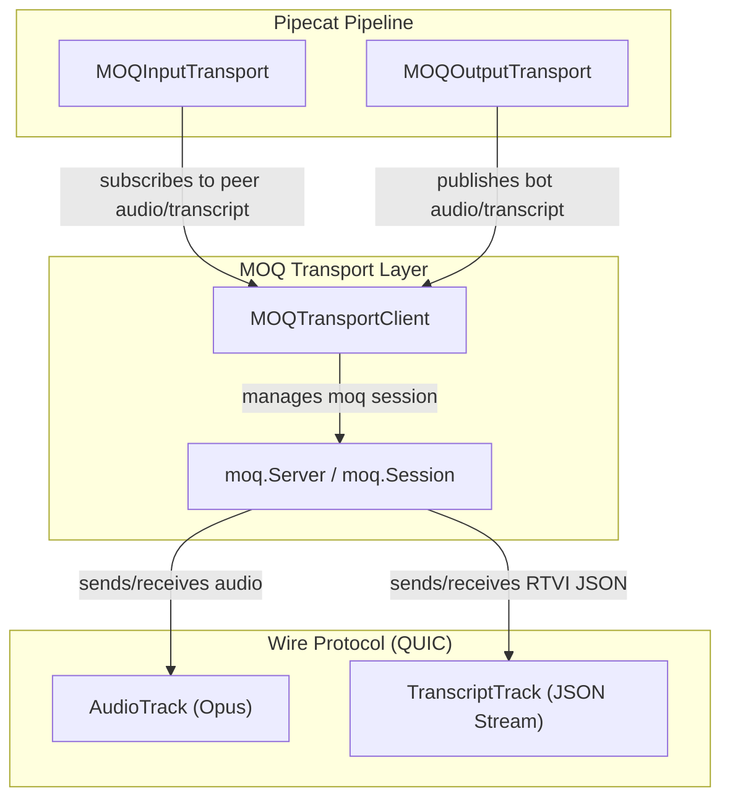
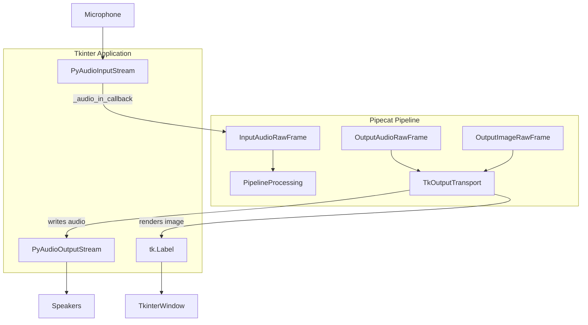

<!-- source: DeepWiki mcp.deepwiki.com · repo pipecat-ai/pipecat · page 5.5 Local, Test, and MOQ Transports · fetched 2026-10-27 -->

# Local, Test, and MOQ Transports

Relevant source files

The following files were used as context for generating this wiki page:

- [changelog/3415.added.md](changelog/3415.added.md)
- [examples/transports/transports-moq.py](examples/transports/transports-moq.py)
- [pyrightconfig.json](pyrightconfig.json)
- [src/pipecat/runner/livekit.py](src/pipecat/runner/livekit.py)
- [src/pipecat/runner/moq.py](src/pipecat/runner/moq.py)
- [src/pipecat/runner/run.py](src/pipecat/runner/run.py)
- [src/pipecat/runner/types.py](src/pipecat/runner/types.py)
- [src/pipecat/runner/utils.py](src/pipecat/runner/utils.py)
- [src/pipecat/services/heygen/client.py](src/pipecat/services/heygen/client.py)
- [src/pipecat/services/heygen/video.py](src/pipecat/services/heygen/video.py)
- [src/pipecat/services/tavus/video.py](src/pipecat/services/tavus/video.py)
- [src/pipecat/services/xai/realtime/events.py](src/pipecat/services/xai/realtime/events.py)
- [src/pipecat/transports/heygen/transport.py](src/pipecat/transports/heygen/transport.py)
- [src/pipecat/transports/local/audio.py](src/pipecat/transports/local/audio.py)
- [src/pipecat/transports/local/tk.py](src/pipecat/transports/local/tk.py)
- [src/pipecat/transports/moq/__init__.py](src/pipecat/transports/moq/__init__.py)
- [src/pipecat/transports/moq/transport.py](src/pipecat/transports/moq/transport.py)
- [src/pipecat/utils/file_storage.py](src/pipecat/utils/file_storage.py)
- [tests/test_moq_transport.py](tests/test_moq_transport.py)
- [tests/test_runner_run.py](tests/test_runner_run.py)
- [tests/test_xai_realtime_voices.py](tests/test_xai_realtime_voices.py)

This page covers transport implementations used for **local development, automated testing, and low-latency media streaming via QUIC**. It details the `LocalAudioTransport`, `TkLocalTransport`, GStreamer pipeline source, specialized avatar transports (Tavus/HeyGen), and the `MOQTransport` architecture.

For production WebRTC and telephony transports, see [Daily Transport](5.1), [LiveKit Transport](5.2), [WebSocket Transports](5.3), and [Telephony and Serializers](5.4).

---

## Media over QUIC (MOQ) Transport

The `MOQTransport` provides a bidirectional, low-latency transport over QUIC using the `moq-rs` Python bindings `[src/pipecat/transports/moq/transport.py:7-16]()`. It allows Pipecat bots to act as their own MoQ servers (`serve=True`), removing the requirement for an external relay during local development `[src/pipecat/runner/run.py:92-93]`.

### Key Architecture & Implementation Details
- **Bidirectional RTVI:** RTVI JSON messages ride on a compressed, ordered JSON stream track, ensuring lossless delivery of protocol events like `client-ready` and tool results `[src/pipecat/transports/moq/transport.py:11-16]()`.
- **Audio Pacing & Downmixing:** Audio is transmitted as a single Opus track, with resampling handled from pipeline rates to browser WebCodecs requirements. Helper functions like `_downmix_s16_to_mono` handle stereo-delivered-as-mono normalization `[src/pipecat/transports/moq/transport.py:11-16]()`, `[tests/test_moq_transport.py:11-46]()`.
- **Serve Mode:** Setting `serve=True` (or via CLI flags) binds a UDP socket via `moq.Server` to accept direct browser connections.
- **Client Mode:** The bot dials a relay at `relay_url` while the browser dials independently, supporting NAT traversal `[tests/test_moq_transport.py:23-26]()`.
- **Error Handling:** Connection hangups are classified using `_is_normal_close` and `_is_peer_gone` to prevent false error traces `[src/pipecat/transports/moq/transport.py:81-126]()`.

**Diagram: MOQ Transport Entity Mapping**

Sources: `[src/pipecat/transports/moq/transport.py:7-45]()`, `[tests/test_moq_transport.py:11-46]()`

---

## Local Audio Transport

This transport connects the pipeline directly to system hardware (microphones and speakers) using PyAudio `[src/pipecat/transports/local/audio.py:7-11]()`.

- **Input (`LocalAudioInputTransport`):** Captures audio via a PyAudio stream callback (`_audio_in_callback`) and pushes `InputAudioRawFrame` objects into the pipeline `[src/pipecat/transports/local/audio.py:46-51]()`, `[src/pipecat/transports/local/audio.py:108-118]()`.
- **Output (`LocalAudioOutputTransport`):** Writes `OutputAudioRawFrame` data using a `ThreadPoolExecutor` (`_executor`) to prevent blocking the asyncio event loop `[src/pipecat/transports/local/audio.py:121-126]()`, `[src/pipecat/transports/local/audio.py:140-146]()`, `[src/pipecat/transports/local/audio.py:186-199]()`.

**Diagram: Local Audio Hardware Interaction**

Sources: `[src/pipecat/transports/local/audio.py:78-118]()`, `[src/pipecat/transports/local/audio.py:155-199]()`

---

## Tkinter Local Transport

The Tkinter transport extends local audio capabilities with a desktop graphical window for video display `[src/pipecat/transports/local/tk.py:7-11]()`.

- **Video Rendering (`TkOutputTransport`):** Uses a `tk.Label` and `tk.PhotoImage` to render `OutputImageRawFrame` data `[src/pipecat/transports/local/tk.py:133-138]()`, `[src/pipecat/transports/local/tk.py:155-165]()`.
- **Audio I/O:** Uses `TkInputTransport` and `TkOutputTransport` mirroring PyAudio device binding `[src/pipecat/transports/local/tk.py:60-65]()`, `[src/pipecat/transports/local/tk.py:133-138]()`.

**Diagram: Tkinter Transport Data Flow**

Sources: `[src/pipecat/transports/local/tk.py:120-130]()`, `[src/pipecat/transports/local/tk.py:155-165]()`, `[src/pipecat/transports/local/tk.py:174-180]()`

---

## GStreamer Pipeline Source

The `GStreamerPipelineSource` functions as a media input source by wrapping a GStreamer pipeline string for file-based or streaming inputs.

- **Implementation:** Leverages `decodebin` for container-agnostic decoding.
- **Synchronization:** Uses `clock_sync` to align processing with the GStreamer clock, essential for file or RTSP inputs.
- **Frame Output:** Yields `InputAudioRawFrame` and `InputImageRawFrame` directly into the processor chain.

Sources: `[src/pipecat/runner/run.py:1-20]()`

---

## Avatar Transports

Specialized transports and services for real-time video avatar generation.

### Tavus Integration
The `TavusVideoService` proxies media streams to the Tavus streaming API via `TavusTransportClient` `[src/pipecat/services/tavus/video.py:50-55]()`, `[src/pipecat/services/tavus/video.py:116-128]()`.

- **Bot Audio:** Delivered through the `conversation.echo` API to drive avatar lip-syncing `[src/pipecat/services/tavus/video.py:82-84]()`.
- **Persona:** Default `persona_id` is `pipecat0`, signaling Tavus to use the Pipecat bot's voice replica `[src/pipecat/services/tavus/video.py:71-84]()`.
- **Frame Handling:** Captures participant video and audio via `_on_participant_video_frame` and `_on_participant_audio_data`, emitting `OutputImageRawFrame` and `SpeechOutputAudioRawFrame` `[src/pipecat/services/tavus/video.py:167-191]()`.

Sources: `[src/pipecat/services/tavus/video.py:50-128]()`, `[src/pipecat/services/tavus/video.py:167-191]()`

### HeyGen Integration
The HeyGen integration uses `HeyGenClient` to manage WebSocket control channels and LiveKit media streams `[src/pipecat/services/heygen/client.py:75-88]()`.

- **Service Modes:** Supports `INTERACTIVE_AVATAR` and `LIVE_AVATAR` configurations with distinct API structures `[src/pipecat/services/heygen/client.py:54-59]()`, `[src/pipecat/services/heygen/client.py:136-144]()`.
- **Media Handling:** Manages `AudioRawFrame` and `ImageRawFrame` routing for bidirectional avatar sessions `[src/pipecat/services/heygen/client.py:27-29]()`.

Sources: `[src/pipecat/services/heygen/client.py:27-88]()`, `[src/pipecat/services/heygen/client.py:136-144]()`

---

## Comparison Summary

| Transport | Extra Requirement | Media Protocol | Primary Use Case |
| :--- | :--- | :--- | :--- |
| **MOQ** | `pipecat-ai[moq]` | QUIC (WebTransport) | Low-latency browser streaming |
| **Local Audio** | `pipecat-ai[local]` | PortAudio / PCM | CLI development / testing |
| **TkLocal** | `pipecat-ai[local]` | PortAudio + Tkinter | Local desktop demos with video |
| **GStreamer** | System GStreamer | GStreamer Pipeline | File or RTSP stream input |
| **Tavus** | `pipecat-ai[daily]` | Daily / REST API | High-fidelity video avatars |
| **HeyGen** | `pipecat-ai[heygen]` | WebSocket / LiveKit | Real-time interactive avatars |

Sources: `[src/pipecat/runner/run.py:161-181]()`, `[src/pipecat/transports/local/audio.py:24-31]()`, `[src/pipecat/services/heygen/client.py:47-49]()`

---

