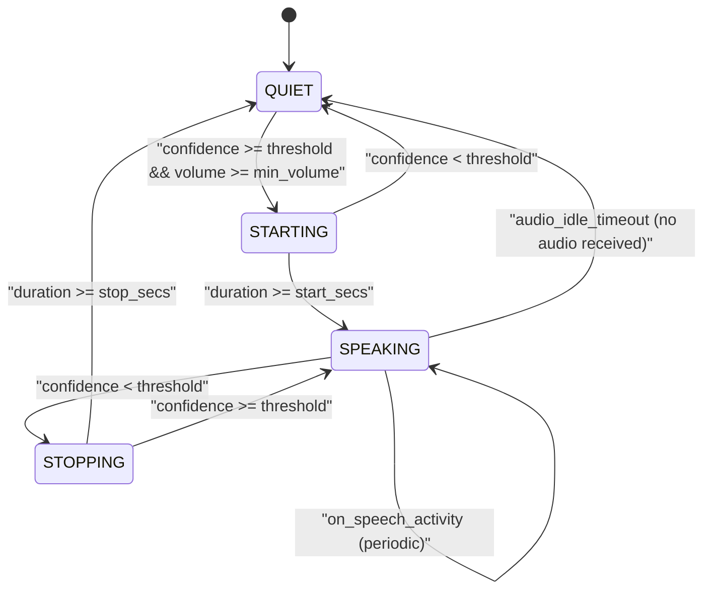
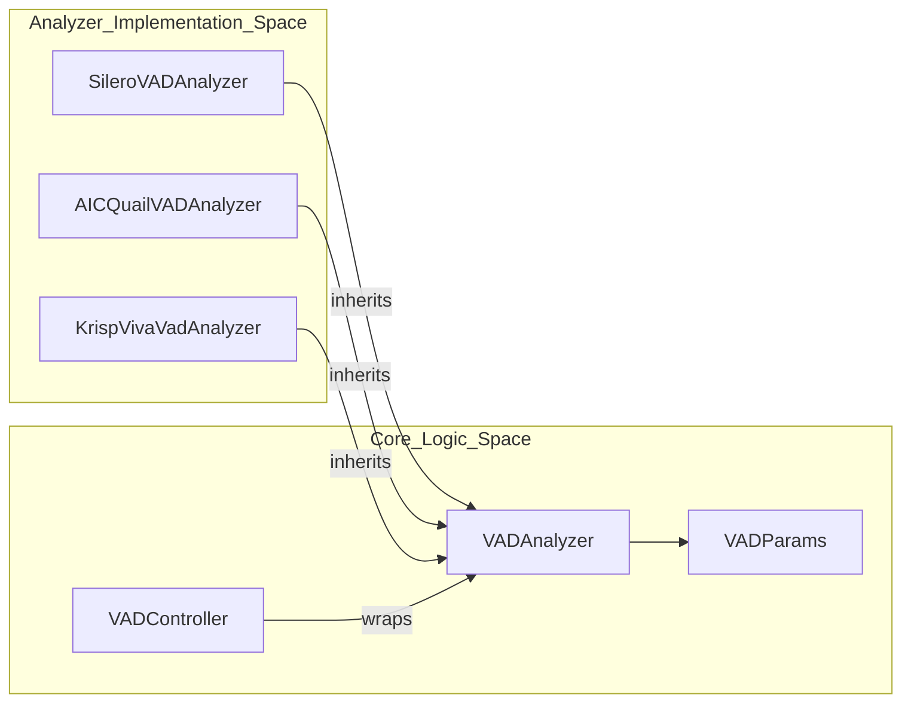
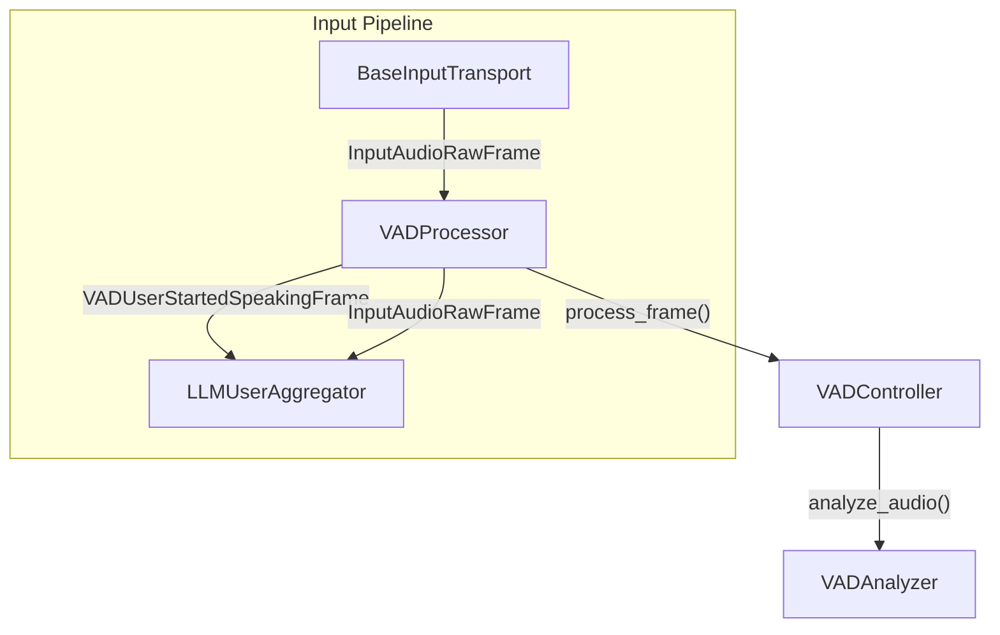

<!-- source: DeepWiki mcp.deepwiki.com · repo pipecat-ai/pipecat · page 6.1 Voice Activity Detection · fetched 2026-10-27 -->

# Voice Activity Detection

Relevant source files

The following files were used as context for generating this wiki page:

- [.gitignore](.gitignore)
- [src/pipecat/audio/turn/smart_turn/_whisper_features.py](src/pipecat/audio/turn/smart_turn/_whisper_features.py)
- [src/pipecat/audio/turn/smart_turn/local_smart_turn_v3.py](src/pipecat/audio/turn/smart_turn/local_smart_turn_v3.py)
- [src/pipecat/audio/vad/data/silero_vad.onnx](src/pipecat/audio/vad/data/silero_vad.onnx)
- [src/pipecat/audio/vad/silero.py](src/pipecat/audio/vad/silero.py)
- [src/pipecat/audio/vad/vad_controller.py](src/pipecat/audio/vad/vad_controller.py)
- [src/pipecat/processors/aggregators/llm_context_summarizer.py](src/pipecat/processors/aggregators/llm_context_summarizer.py)
- [src/pipecat/processors/audio/vad_processor.py](src/pipecat/processors/audio/vad_processor.py)
- [src/pipecat/utils/context/llm_context_summarization.py](src/pipecat/utils/context/llm_context_summarization.py)
- [src/pipecat/utils/env.py](src/pipecat/utils/env.py)
- [tests/assets/continuous_speech_16k.wav](tests/assets/continuous_speech_16k.wav)
- [tests/test_context_summarization.py](tests/test_context_summarization.py)
- [tests/test_llm_context_summarizer.py](tests/test_llm_context_summarizer.py)
- [tests/test_local_smart_turn_v3_features.py](tests/test_local_smart_turn_v3_features.py)
- [tests/test_local_smart_turn_v3_resample.py](tests/test_local_smart_turn_v3_resample.py)
- [tests/test_silero_vad.py](tests/test_silero_vad.py)
- [tests/test_vad_controller.py](tests/test_vad_controller.py)
- [tests/test_vad_processor.py](tests/test_vad_processor.py)
- [tests/test_wake_phrase_user_turn_start_strategy.py](tests/test_wake_phrase_user_turn_start_strategy.py)

This page documents Voice Activity Detection (VAD) concepts in Pipecat, detailing the `VADAnalyzer` interface, concrete implementations such as Silero, AIC, and Krisp VIVA VAD, the `VADController` and `VADProcessor` state machines, and integration with input transports and user turn aggregators.

Related pages:
- For **turn detection strategies** that build on VAD events, see [Turn Detection and User Idle](3.8)()
- For **interruption handling** triggered by VAD, see [Interruption Handling](3.9)()
- For **noise filtering** (AIC Filter, Krisp VIVA) which can also supply an audio enhancement signal, see [Audio Filters and Enhancement](6.2)()
- For **transport-level VAD configuration**, see [Daily Transport](5.1)()

---

## Overview

Voice Activity Detection (VAD) determines when a user begins and stops speaking by analyzing incoming audio frames. In Pipecat, VAD is implemented through a decoupled multi-layer architecture:

1.  **Analyzers (`VADAnalyzer`)**: Concrete backends (e.g., `SileroVADAnalyzer`, `AICQuailVADAnalyzer`, `KrispVivaVadAnalyzer`) that calculate voice confidence scores from raw audio buffers [src/pipecat/audio/vad/vad_analyzer.py:63-69]().
2.  **Controller (`VADController`)**: Manages the `VADState` machine (`QUIET`, `STARTING`, `SPEAKING`, `STOPPING`) and handles audio idle timeouts [src/pipecat/audio/vad/vad_controller.py:30-67]().
3.  **Processor (`VADProcessor`)**: A `FrameProcessor` wrapper that intercepts raw audio frames and pushes VAD events (`VADUserStartedSpeakingFrame`, `VADUserStoppedSpeakingFrame`) into the pipeline [src/pipecat/processors/audio/vad_processor.py:29-42]().

Sources: [src/pipecat/audio/vad/vad_analyzer.py:63-69](), [src/pipecat/audio/vad/vad_controller.py:30-67](), [src/pipecat/processors/audio/vad_processor.py:29-42]()

---

## VAD State Machine

The `VADAnalyzer` and `VADController` maintain an internal state machine to filter out momentary noise or brief pauses, ensuring stable "Started" and "Stopped" events are emitted.

**Diagram: VAD State Transitions in VADAnalyzer**

**VAD States (`VADState`):**
- `QUIET`: No voice activity detected [src/pipecat/audio/vad/vad_analyzer.py:41-41]().
- `STARTING`: Transitioning from quiet; speech detected but not yet confirmed by `start_secs` [src/pipecat/audio/vad/vad_analyzer.py:42-42]().
- `SPEAKING`: Active voice confirmed [src/pipecat/audio/vad/vad_analyzer.py:43-43]().
- `STOPPING`: Silence detected; waiting for `stop_secs` to confirm speech has ended [src/pipecat/audio/vad/vad_analyzer.py:44-44]().

**Audio Idle Detection:**
The `VADController` includes an `audio_idle_timeout` (default 1.0s) to prevent the state machine from getting stuck in `SPEAKING` if the audio stream stops abruptly (e.g., user mutes microphone) [src/pipecat/audio/vad/vad_controller.py:69-86](). When this timeout is reached, the controller forces a transition to `QUIET` and triggers `on_speech_stopped` via the `_audio_idle_handler` [src/pipecat/audio/vad/vad_controller.py:144-146]().

Sources: [src/pipecat/audio/vad/vad_analyzer.py:31-45](), [src/pipecat/audio/vad/vad_controller.py:69-86](), [src/pipecat/audio/vad/vad_controller.py:144-146]()

---

## VADAnalyzer Interface

All VAD backends implement the `VADAnalyzer` abstract base class. Analyzers process audio buffers asynchronously using a dedicated execution utility and return a confidence score between 0.0 and 1.0 [src/pipecat/audio/vad/vad_analyzer.py:63-93]().

**Diagram: VAD Code Entity Mapping**

### Key Method Contracts

| Method | Return Type | Description |
|---|---|---|
| `num_frames_required()` | `int` | Samples needed per call to `voice_confidence()` [src/pipecat/audio/vad/vad_analyzer.py:121-128](). |
| `voice_confidence(buffer)` | `float` | Analyzes audio buffer and returns score in `[0.0, 1.0]` [src/pipecat/audio/vad/vad_analyzer.py:130-140](). |
| `set_params(params)` | `None` | Updates `VADParams` (confidence, start/stop secs, min_volume) [src/pipecat/audio/vad/vad_analyzer.py:151-161](). |
| `cleanup()` | `None` | Releases execution resources [src/pipecat/audio/vad/vad_analyzer.py:243-255](). |

Sources: [src/pipecat/audio/vad/vad_analyzer.py:63-255]()

---

## Supported VAD Analyzers

### AIC Quail VAD (`AICQuailVADAnalyzer`)
The recommended standalone VAD implementation for ai-coustics users. It uses the standalone Quail VAD 2.0 model from the `aic-sdk` and works independently of filters.

> [!IMPORTANT]
> Older AIC VAD implementations are deprecated in favor of `AICQuailVADAnalyzer`. Additionally, the environment variable `AIC_LICENSE_KEY` has been standardized to `AIC_SDK_LICENSE`.

Sources: [src/pipecat/audio/vad/vad_analyzer.py:63-140]()

### Krisp VIVA VAD (`KrispVivaVadAnalyzer`)
Uses the Krisp VIVA SDK for high-accuracy noise-robust voice activity detection [src/pipecat/audio/vad/krisp_viva_vad.py:7-35]().
-   **Sample Rates**: Supports 8kHz, 16kHz, 32kHz, 44.1kHz, and 48kHz [src/pipecat/audio/vad/krisp_viva_vad.py:7-12]().
-   **Initialization**: Requires a `.kef` model file path, typically resolved via `KRISP_VIVA_VAD_MODEL_PATH` [src/pipecat/audio/vad/krisp_viva_vad.py:39-74]().
-   **Resource Management**: Uses `KrispVivaSDKManager` for singleton reference counting across components [src/pipecat/audio/krisp_instance.py:98-107]().

Sources: [src/pipecat/audio/vad/krisp_viva_vad.py:7-152](), [src/pipecat/audio/krisp_instance.py:98-187]()

### Silero VAD (`SileroVADAnalyzer`)
The default VAD implementation in Pipecat, utilizing the Silero VAD ONNX model [src/pipecat/audio/vad/silero.py:7-12]().
-   **Sample Rates**: Supports 8kHz and 16kHz audio streams [src/pipecat/audio/vad/silero.py:7-12]().
-   **Tensor Handling**: Internally expands NumPy array dimensions if `ndim == 1` to match ONNX runtime expectations [src/pipecat/audio/vad/silero.py:79-84]().

Sources: [src/pipecat/audio/vad/silero.py:7-144](), [src/pipecat/audio/vad/silero.py:146-181]()

---

## VADController and Processor

The `VADController` wraps a `VADAnalyzer` instance to manage state transitions and emit asynchronous events [src/pipecat/audio/vad/vad_controller.py:30-67]().

**VADController Events:**
-   `on_speech_started`: Fired when `VADState` transitions to `SPEAKING` [src/pipecat/audio/vad/vad_controller.py:105-105]().
-   `on_speech_stopped`: Fired when `VADState` transitions to `QUIET` [src/pipecat/audio/vad/vad_controller.py:106-106]().
-   `on_speech_activity`: Fired periodically (default every 0.2s) during active speech [src/pipecat/audio/vad/vad_controller.py:107-107]().

**VADProcessor Integration:**
The `VADProcessor` (`FrameProcessor`) listens to these controller events and pushes corresponding pipeline frames downstream [src/pipecat/processors/audio/vad_processor.py:29-42]():
-   `VADUserStartedSpeakingFrame` [src/pipecat/processors/audio/vad_processor.py:71-77]()
-   `VADUserStoppedSpeakingFrame` [src/pipecat/processors/audio/vad_processor.py:79-85]()
-   `UserSpeakingFrame` [src/pipecat/processors/audio/vad_processor.py:87-89]()

**Cleanup:**
`VADController.cleanup()` cancels idle timers and releases analyzer resources [src/pipecat/audio/vad/vad_controller.py:158-169](), while `VADAnalyzer.cleanup()` terminates its internal execution resources [src/pipecat/audio/vad/vad_analyzer.py:243-255]().

Sources: [src/pipecat/audio/vad/vad_controller.py:30-169](), [src/pipecat/processors/audio/vad_processor.py:29-134](), [src/pipecat/audio/vad/vad_analyzer.py:243-255]()

---

## Integration with Transports and Aggregators

VAD is typically positioned in the input pipeline immediately following audio reception to drive conversation turns and user interruption handling.

**Diagram: VAD Data Flow Architecture**

**Implementation Details:**
When `VADProcessor` receives an `InputAudioRawFrame`, it immediately pushes the frame downstream to preserve audio streaming continuity, while asynchronously running VAD evaluation via the analyzer [src/pipecat/processors/audio/vad_processor.py:114-134](), [src/pipecat/audio/vad/vad_analyzer.py:90-93]().

Sources: [src/pipecat/processors/audio/vad_processor.py:114-134](), [src/pipecat/audio/vad/vad_controller.py:121-135](), [src/pipecat/audio/vad/vad_analyzer.py:90-93]()

---

