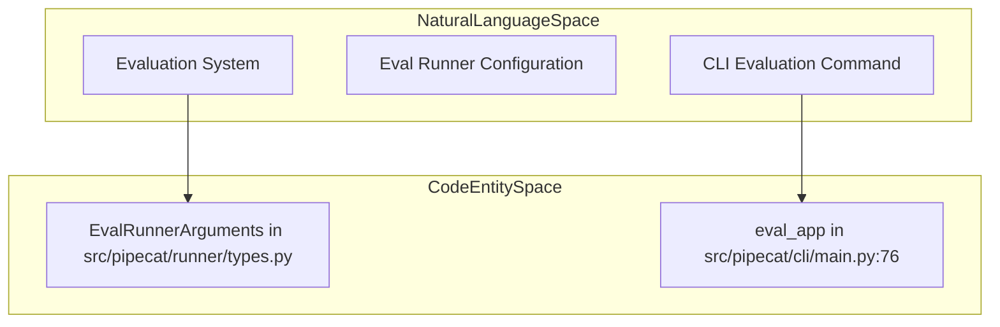
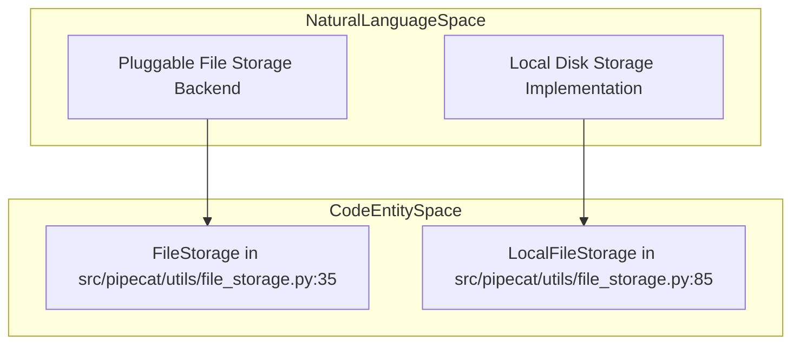

<!-- source: DeepWiki mcp.deepwiki.com · repo pipecat-ai/pipecat · page 7 Development Tools · fetched 2026-10-27 -->

# Development Tools

<details>
<summary>Relevant source files</summary>

The following files were used as context for generating this wiki page:

- [changelog/3415.added.md](changelog/3415.added.md)
- [examples/transports/transports-moq.py](examples/transports/transports-moq.py)
- [src/pipecat/runner/livekit.py](src/pipecat/runner/livekit.py)
- [src/pipecat/runner/moq.py](src/pipecat/runner/moq.py)
- [src/pipecat/runner/run.py](src/pipecat/runner/run.py)
- [src/pipecat/runner/types.py](src/pipecat/runner/types.py)
- [src/pipecat/runner/utils.py](src/pipecat/runner/utils.py)
- [src/pipecat/transports/moq/__init__.py](src/pipecat/transports/moq/__init__.py)
- [src/pipecat/transports/moq/transport.py](src/pipecat/transports/moq/transport.py)
- [src/pipecat/utils/file_storage.py](src/pipecat/utils/file_storage.py)
- [tests/test_moq_transport.py](tests/test_moq_transport.py)
- [tests/test_runner_run.py](tests/test_runner_run.py)

</details>


This page provides an overview of development tools, execution runners, testing frameworks, client SDKs, and repository automation utilities available in the Pipecat framework [src/pipecat/runner/run.py:7-93](). These components streamline the local development lifecycle, facilitate automated behavioral evaluation, support project scaffolding via the CLI [src/pipecat/cli/main.py:7-17](), and manage continuous integration and documentation.

As a parent page, this section offers a high-level summary of each ecosystem domain. For deep technical details, refer to the child pages:
- [Pipeline Runner and Development Patterns](#7.1) — Detailed coverage of `WorkerRunner`, FastAPI server setup, runner arguments, transport helpers, MoQ configuration, and pluggable file storage.
- [Testing and Evaluation Framework](#7.2) — Detailed coverage of `EvalRunner`, behavioral test scenarios, dual-pipeline topology, and CLI evaluation commands.
- [Client SDKs and Tools](#7.3) — Detailed coverage of the Pipecat CLI (`pipecat init`), project generators, service registry, agent templates, and debugging tools.
- [Repository Automation, Docs Build, and Contribution Workflow](#7.4) — Detailed coverage of CI workflows, automation scripts, Sphinx documentation builds, and contribution guidelines.

---

## 7.1. Pipeline Runner and Development Patterns

The Pipecat development runner (`src/pipecat/runner/run.py:7-93]`) provides a FastAPI-based server environment that executes Pipecat bots while managing WebRTC connections, Daily rooms, LiveKit sessions, Media over QUIC (MoQ) streams, and telephony webhook/WebSocket infrastructure [src/pipecat/runner/run.py:10-25](). Bots implement an `async def bot(runner_args: RunnerArguments)` entry point function [src/pipecat/runner/run.py:18-20]() which the server discovers and executes upon connection.

The runner passes transport-specific parameters through subclasses of `RunnerArguments` [src/pipecat/runner/types.py:137-173]() and handles session-scoped file storage via the `FileStorage` abstract base class and `LocalFileStorage` implementation [src/pipecat/utils/file_storage.py:35-146]().

### Runner Arguments Type Hierarchy

```mermaid
classDiagram
    class "RunnerArguments" {
        +bool handle_sigint
        +bool handle_sigterm
        +float pipeline_idle_timeout_secs
        +Any body
        +CallData call_data
        +str session_id
        +argparse.Namespace cli_args
        +FileStorage file_storage
    }
    class "DailyRunnerArguments" {
        +str room_url
        +str token
    }
    class "MOQRunnerArguments" {
        +str host
        +int port
        +str path
        +str namespace
        +str bot_id
        +str client_id
        +bool serve
        +str bind
        +str tls_cert
        +str tls_key
        +str tls_generate
        +str tls_host
        +bool tls_insecure
        +str connect
        +str cert_fingerprint
    }
    class "WebSocketRunnerArguments" {
        +WebSocket websocket
    }
    class "SmallWebRTCRunnerArguments" {
        +Any webrtc_connection
    }
    class "LiveKitRunnerArguments" {
        +str url
        +str room_name
        +str token
    }
    class "EvalRunnerArguments" {
        +Any config
    }
    class "VonageRunnerArguments" {
        +str ncco_url
        +str event_url
    }
    "RunnerArguments" <|-- "DailyRunnerArguments"
    "RunnerArguments" <|-- "MOQRunnerArguments"
    "RunnerArguments" <|-- "WebSocketRunnerArguments"
    "RunnerArguments" <|-- "SmallWebRTCRunnerArguments"
    "RunnerArguments" <|-- "LiveKitRunnerArguments"
    "RunnerArguments" <|-- "EvalRunnerArguments"
    "RunnerArguments" <|-- "VonageRunnerArguments"
```
Title: Runner Arguments Type Hierarchy
Sources: `[src/pipecat/runner/run.py:18-40]()`, `[src/pipecat/runner/types.py:137-173]()`

### Natural Language to Code Entity Mapping: Runner and Transport Configuration

```mermaid
graph TD
    subgraph "NaturalLanguageSpace"
        NL_Runner[""Development Server and FastAPI App""]
        NL_Args[""Runner Arguments and Session Configuration""]
        NL_MoQ[""Media over QUIC Transport""]
    end

    subgraph "CodeEntitySpace"
        CE_RunnerApp[""FastAPI app in src/pipecat/runner/run.py""]
        CE_RunnerArgs[""RunnerArguments in src/pipecat/runner/types.py:143""]
        CE_WorkerRunner[""WorkerRunner in pipecat.workers.runner""]
        CE_MoQTransport[""MOQTransport in src/pipecat/transports/moq/transport.py""]
        CE_MoQRunnerArgs[""MOQRunnerArguments in src/pipecat/runner/types.py""]
        CE_MoQValidateArgs[""_validate_moq_args() in src/pipecat/runner/moq.py:57""]
    end

    NL_Runner --> CE_RunnerApp
    NL_Runner --> CE_WorkerRunner
    NL_Args --> CE_RunnerArgs
    NL_MoQ --> CE_MoQTransport
    NL_MoQ --> CE_MoQRunnerArgs
    NL_MoQ --> CE_MoQValidateArgs
```
Title: Runner and Transport Configuration Mapping
Sources: `[src/pipecat/runner/run.py:7-93]()`, `[src/pipecat/runner/types.py:143-173]()`, `[src/pipecat/runner/moq.py:57-168]()`

For comprehensive details on FastAPI app wiring, endpoint configuration, security features, and file storage resolvers, see [Pipeline Runner and Development Patterns](#7.1).

Sources: `[src/pipecat/runner/run.py:7-93]()`, `[src/pipecat/runner/types.py:137-173]()`, `[src/pipecat/runner/moq.py:57-168]()`

---

## 7.2. Testing and Evaluation Framework

Pipecat includes a behavioral evaluation subsystem located under `pipecat.evals` designed for headless testing of conversational agents [src/pipecat/runner/types.py:299-302](). It simulates client sessions using the RTVI protocol, validating outputs against predefined scenarios and latency budgets.

### Natural Language to Code Entity Mapping: Evaluation Framework


Title: Evaluation System Code Mapping
Sources: `[src/pipecat/runner/types.py:299-302]()`, `[src/pipecat/cli/main.py:76-76]()`

For deep dives into dual-pipeline topologies, scenario definitions, test runner execution, and CI/CD integration, see [Testing and Evaluation Framework](#7.2).

Sources: `[src/pipecat/runner/types.py:299-302]()`, `[src/pipecat/cli/main.py:76-76]()`

---

## 7.3. Client SDKs and Tools

The Pipecat ecosystem provides command-line tools and client SDKs to simplify bot initialization and structure project layouts:
- **Pipecat CLI (`pipecat`)**: Centered around `pipecat init`, it scaffolds runnable applications, configures service registries, and initializes test evaluation suites when the `--eval` flag is passed [src/pipecat/cli/main.py:7-17](), `[src/pipecat/cli/commands/init.py:7-35]()`, `[src/pipecat/cli/agent_templates/AGENTS.md:36-37]()`.
- **Coding Agent Integration**: Scaffolds guidelines such as `AGENTS.md` and `GETTING_STARTED.md` to assist AI coding agents in writing correct Pipecat code [src/pipecat/cli/commands/init.py:7-35]()].

### Natural Language to Code Entity Mapping: File Storage and Upload Subsystem


Title: File Storage and Upload Subsystem Mapping
Sources: `[src/pipecat/utils/file_storage.py:35-146]()`

For details on client SDKs, debugging tools, and project generator options, see [Client SDKs and Tools](#7.3).

Sources: `[src/pipecat/cli/main.py:7-17]()`, `[src/pipecat/cli/commands/init.py:7-35]()`, `[src/pipecat/cli/agent_templates/AGENTS.md:36-37]()`, `[src/pipecat/utils/file_storage.py:35-146]()`

---

## 7.4. Repository Automation, Docs Build, and Contribution Workflow

Maintaining the Pipecat repository involves automated scripts, documentation builds, and standardized contribution workflows:
- **Automation Scripts**: Utility scripts under `scripts/` handle provider tracking, deprecation scanning, and changelog generation.
- **Documentation**: Built using Sphinx (`docs/api`) alongside architectural documentation notes (`docs/architecture`).
- **Contribution Workflow**: Governed by `CONTRIBUTING.md` and a changelog fragment workflow.

For complete coverage of CI workflows, repository scripts, and contribution guidelines, see [Repository Automation, Docs Build, and Contribution Workflow](#7.4).

Sources: `[src/pipecat/runner/run.py:7-93]()`

---

