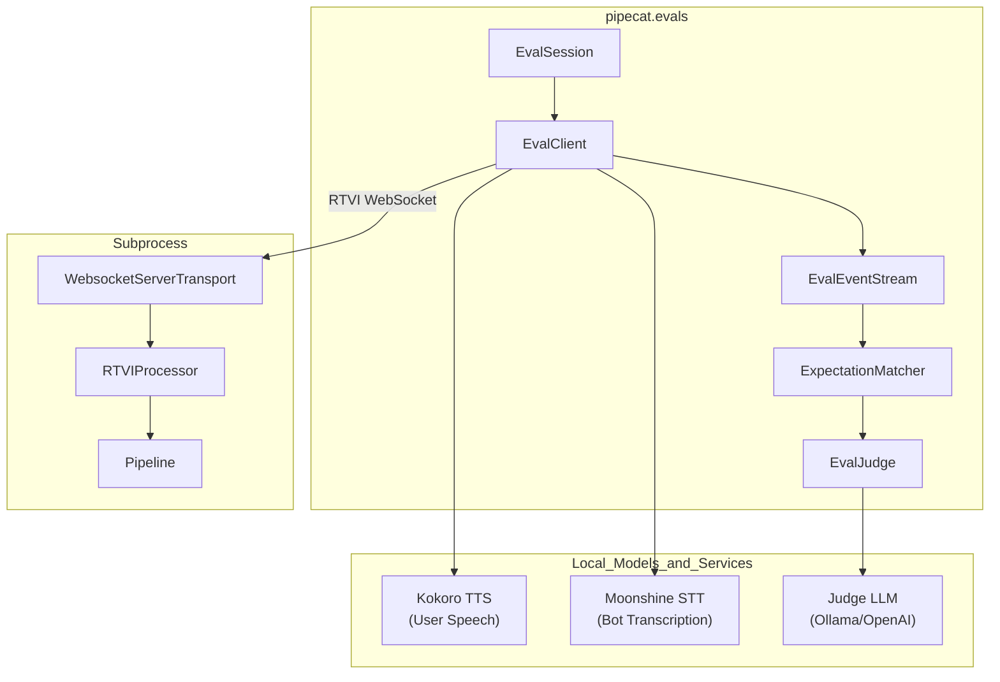
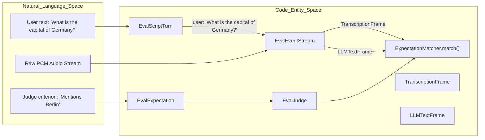
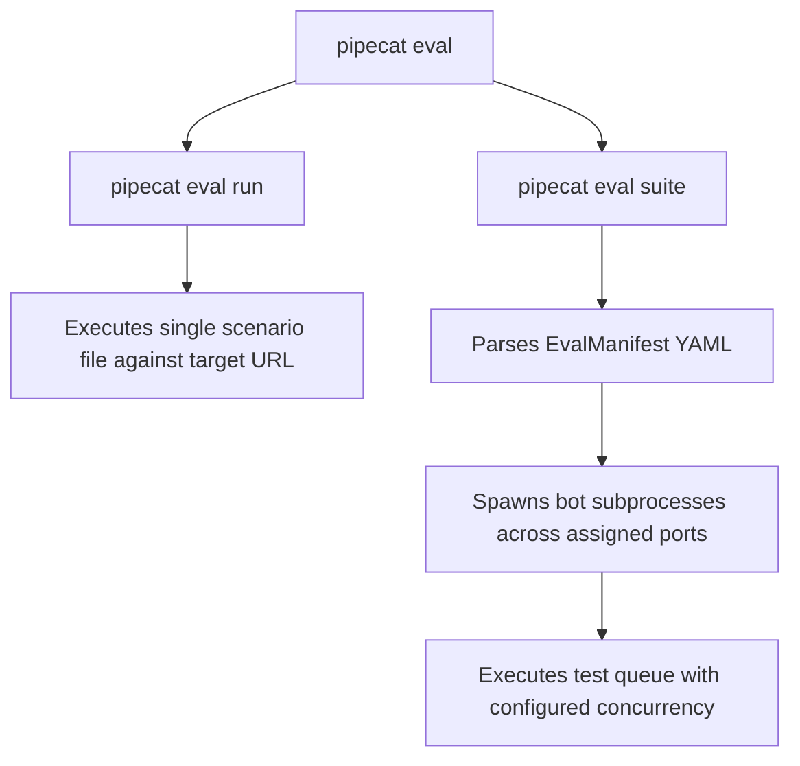

<!-- source: DeepWiki mcp.deepwiki.com · repo pipecat-ai/pipecat · page 7.2 Testing and Evaluation Framework · fetched 2026-10-27 -->

# Testing and Evaluation Framework

<details>
<summary>Relevant source files</summary>

The following files were used as context for generating this wiki page:

- [changelog/6088.added.md](changelog/6088.added.md)
- [changelog/6183.added.3.md](changelog/6183.added.3.md)
- [evals/llm-with-backend/README.md](evals/llm-with-backend/README.md)
- [evals/llm-with-backend/scenarios/turns/accepted_offer.yaml](evals/llm-with-backend/scenarios/turns/accepted_offer.yaml)
- [evals/llm-with-backend/scenarios/turns/aside_while_waiting.yaml](evals/llm-with-backend/scenarios/turns/aside_while_waiting.yaml)
- [evals/llm-with-backend/scenarios/turns/cancel_and_replace.yaml](evals/llm-with-backend/scenarios/turns/cancel_and_replace.yaml)
- [evals/llm-with-backend/scenarios/turns/cancel_delegation.yaml](evals/llm-with-backend/scenarios/turns/cancel_delegation.yaml)
- [evals/llm-with-backend/scenarios/turns/concurrent_delegations.yaml](evals/llm-with-backend/scenarios/turns/concurrent_delegations.yaml)
- [evals/llm-with-backend/scenarios/turns/delegate_ack.yaml](evals/llm-with-backend/scenarios/turns/delegate_ack.yaml)
- [evals/llm-with-backend/scenarios/turns/delegate_with_aside.yaml](evals/llm-with-backend/scenarios/turns/delegate_with_aside.yaml)
- [evals/llm-with-backend/scenarios/turns/implicit_cancel.yaml](evals/llm-with-backend/scenarios/turns/implicit_cancel.yaml)
- [evals/llm-with-backend/scenarios/turns/partial_cancel.yaml](evals/llm-with-backend/scenarios/turns/partial_cancel.yaml)
- [evals/llm-with-backend/scenarios/turns/progress_inquiry.yaml](evals/llm-with-backend/scenarios/turns/progress_inquiry.yaml)
- [evals/release/README.md](evals/release/README.md)
- [examples/transcription/transcription-xai.py](examples/transcription/transcription-xai.py)
- [src/pipecat/cli/commands/eval.py](src/pipecat/cli/commands/eval.py)
- [src/pipecat/evals/base_driver.py](src/pipecat/evals/base_driver.py)
- [src/pipecat/evals/client.py](src/pipecat/evals/client.py)
- [src/pipecat/evals/client_transport.py](src/pipecat/evals/client_transport.py)
- [src/pipecat/evals/events.py](src/pipecat/evals/events.py)
- [src/pipecat/evals/fastapi_transport.py](src/pipecat/evals/fastapi_transport.py)
- [src/pipecat/evals/harness.py](src/pipecat/evals/harness.py)
- [src/pipecat/evals/judge.py](src/pipecat/evals/judge.py)
- [src/pipecat/evals/matcher.py](src/pipecat/evals/matcher.py)
- [src/pipecat/evals/results.py](src/pipecat/evals/results.py)
- [src/pipecat/evals/scenario.py](src/pipecat/evals/scenario.py)
- [src/pipecat/evals/script.py](src/pipecat/evals/script.py)
- [src/pipecat/evals/script_driver.py](src/pipecat/evals/script_driver.py)
- [src/pipecat/evals/serializer.py](src/pipecat/evals/serializer.py)
- [src/pipecat/evals/services.py](src/pipecat/evals/services.py)
- [src/pipecat/evals/simulation.py](src/pipecat/evals/simulation.py)
- [src/pipecat/evals/simulation_driver.py](src/pipecat/evals/simulation_driver.py)
- [src/pipecat/evals/simulation_judge.py](src/pipecat/evals/simulation_judge.py)
- [src/pipecat/evals/suite.py](src/pipecat/evals/suite.py)
- [src/pipecat/evals/transport.py](src/pipecat/evals/transport.py)
- [src/pipecat/evals/tts.py](src/pipecat/evals/tts.py)
- [src/pipecat/services/xai/stt.py](src/pipecat/services/xai/stt.py)
- [src/pipecat/tests/utils.py](src/pipecat/tests/utils.py)
- [tests/cli/test_eval_display.py](tests/cli/test_eval_display.py)
- [tests/cli/test_eval_judge.py](tests/cli/test_eval_judge.py)
- [tests/test_aggregators.py](tests/test_aggregators.py)
- [tests/test_app_resources.py](tests/test_app_resources.py)
- [tests/test_daily_transport_service.py](tests/test_daily_transport_service.py)
- [tests/test_evals_client_transport.py](tests/test_evals_client_transport.py)
- [tests/test_evals_judge.py](tests/test_evals_judge.py)
- [tests/test_evals_scenario.py](tests/test_evals_scenario.py)
- [tests/test_evals_serializer.py](tests/test_evals_serializer.py)
- [tests/test_evals_services.py](tests/test_evals_services.py)
- [tests/test_evals_session.py](tests/test_evals_session.py)
- [tests/test_evals_simulation.py](tests/test_evals_simulation.py)
- [tests/test_evals_simulation_judge.py](tests/test_evals_simulation_judge.py)
- [tests/test_evals_suite.py](tests/test_evals_suite.py)
- [tests/test_evals_transport.py](tests/test_evals_transport.py)
- [tests/test_filters.py](tests/test_filters.py)
- [tests/test_llm_service.py](tests/test_llm_service.py)
- [tests/test_pipeline.py](tests/test_pipeline.py)
- [tests/test_runner_utils.py](tests/test_runner_utils.py)
- [tests/test_xai_stt.py](tests/test_xai_stt.py)

</details>


## Purpose and Scope

This document details Pipecat's automated testing and evaluation framework for voice and multimodal conversational bots [src/pipecat/evals/client.py:7-16](). The framework provides automated end-to-end testing via an evaluation harness (`pipecat.evals`) that interacts with a bot under test over the Real-Time Voice Interface (RTVI) protocol [src/pipecat/evals/client.py:7-16](). It covers session orchestration (`EvalSession`), multi-bot suite execution (`EvalSuite`, `EvalManifest`), scenario definitions (`EvalScenario`, `EvalScriptScenario`, `EvalSimulationScenario`), serialization mechanics (`RTVIEvalSerializer`), the `pipecat eval` CLI, release evaluation workflows, and unit test infrastructure [src/pipecat/cli/commands/eval.py:7-12](), [src/pipecat/evals/scenario.py:7-27](), [src/pipecat/evals/suite.py:7-13]().

Sources: [src/pipecat/cli/commands/eval.py:7-12](), [src/pipecat/evals/client.py:7-16](), [src/pipecat/evals/scenario.py:7-27](), [src/pipecat/evals/suite.py:7-13]()

---

## Evaluation Architecture and Dual-Pipeline Topology

The testing framework employs a behavioral evaluation model where an evaluation harness (`pipecat.evals`) connects to a running bot via a WebSocket transport (`-t eval`). The harness acts as an RTVI client (`EvalClient`), driving conversations using text, synthesized voice (via local TTS engines like Kokoro), or recordings, and evaluating responses using heuristic matchers or judge LLMs [src/pipecat/evals/client.py:7-16](), [src/pipecat/evals/judge.py:7-23](), [src/pipecat/evals/services.py:7-16]().

### System Topology



**Key Architectural Features:**
- **Scenario-Driven Evaluation**: Test definitions specify turns, expected events, payload contents, and timing constraints [src/pipecat/evals/scenario.py:7-27]().
- **Dual Evaluation Modes**: Supports *scripted* scenarios (`EvalScriptScenario`, user turns and expected responses predefined) and *simulated* scenarios (`EvalSimulationScenario`, an LLM persona dynamically carries on a conversation against a goal) [src/pipecat/evals/scenario.py:12-20](), [src/pipecat/evals/scenario.py:190-194]().
- **RTVI Serialization**: Internal pipeline frames are serialized into standardized RTVI messages across the WebSocket transport layer [src/pipecat/evals/serializer.py:1-43]().
- **Offline / Local Execution**: Leverages local inference engines (Kokoro TTS, Moonshine or Whisper STT, and Ollama for judge evaluations) to execute continuous integration testing without external cloud billing overhead [src/pipecat/evals/services.py:7-16]().

Sources: [src/pipecat/evals/client.py:7-16](), [src/pipecat/evals/judge.py:7-23](), [src/pipecat/evals/scenario.py:7-27](), [src/pipecat/evals/scenario.py:190-194](), [src/pipecat/evals/serializer.py:1-43](), [src/pipecat/evals/services.py:7-16]()

---

## Natural Language Space to Code Entity Space

The evaluation framework bridges abstract natural language criteria and audio telemetry into concrete execution objects and code assertions.

### Mapping Natural Language to Code Entities



Sources: [src/pipecat/evals/events.py:1-20](), [src/pipecat/evals/judge.py:7-141](), [src/pipecat/evals/scenario.py:34-71](), [src/pipecat/evals/script.py:123-127](), [src/pipecat/frames/frames.py:65-65](), [src/pipecat/frames/frames.py:73-73]()

---

## Core Evaluation Components and Data Structures

The framework is organized around several primary modules within `pipecat.evals`:

| Component Module | Key Class / Function | Role & Implementation Details |
|------------------|----------------------|--------------------------------|
| `pipecat.evals.session` | `EvalSession`, `EvalSessionParams` | Manages connection establishment, timeouts, and orchestration for single-scenario runs [src/pipecat/evals/session.py:29-29](). |
| `pipecat.evals.scenario` | `EvalScenarioFile`, `EvalKind` | Parses YAML scenario definitions via `_ScenarioLoader` and distinguishes scripted (`EvalKind.SCRIPT`) vs. simulated (`EvalKind.SIMULATION`) runs [src/pipecat/evals/scenario.py:164-194](), [src/pipecat/evals/scenario.py:200-203](). |
| `pipecat.evals.suite` | `EvalSuite`, `EvalManifest` | Manages multi-bot concurrency, dynamic port allocation, and artifact collection for suites [src/pipecat/evals/suite.py:7-60](). |
| `pipecat.evals.client` | `EvalClient`, `_BotFrameSink` | Implements the RTVI client pipeline, handles frame isolation, and routes user inputs [src/pipecat/evals/client.py:7-16](), [src/pipecat/evals/client.py:98-110](). |
| `pipecat.evals.serializer` | `EvalClientSerializer` | Intercepts control frames, config updates, and context resets during eval runs [src/pipecat/evals/serializer.py:1-50](). |

### Scenario Definition Structure

Scenarios are defined in YAML files. The parser uses `_ScenarioLoader` to ensure plain decimal integers retain their numeric type (preventing octal/hex reinterpretation of DTMF sequences) while allowing `!include` tags for shared configurations [src/pipecat/evals/scenario.py:23-26](), [src/pipecat/evals/scenario.py:164-186]().

```yaml
name: capital_question
turns:
  - user: "What is the capital of Germany?"
    expect:
      - event: user_transcription
        text_contains: "Germany"
      - event: llm_response
        eval: "mentions Berlin"
        within_ms: 5000
  - expect:
      - event: llm_response
        absent: true
        within_ms: 3000
```

Sources: [src/pipecat/evals/client.py:7-117](), [src/pipecat/evals/scenario.py:23-26](), [src/pipecat/evals/scenario.py:164-194](), [src/pipecat/evals/serializer.py:1-50](), [src/pipecat/evals/session.py:29-29](), [src/pipecat/evals/suite.py:7-60]()

---

## Pipecat Eval CLI

The framework exposes testing utilities via the `pipecat eval` Typer command line interface [src/pipecat/cli/commands/eval.py:7-12](). It automatically loads environment variables from the nearest `.env` file via `load_dotenv` during its callback [src/pipecat/cli/commands/eval.py:104-117]().

### CLI Execution Flow



### Common CLI Commands

- **Run a single scenario**:
  ```sh
  pipecat eval run scenarios/scripted/capital_question.yaml --url ws://localhost:7900
  ```
- **Run an entire evaluation suite**:
  ```sh
  pipecat eval suite manifest.yaml --concurrency 4 --debug
  ```

Sources: [src/pipecat/cli/commands/eval.py:7-12](), [src/pipecat/cli/commands/eval.py:94-117](), [src/pipecat/evals/suite.py:7-60]()

---

## Release Evaluation Suites and Turn-Completion Scenarios

Before generating a release, maintainers execute validation suites against core examples using `EvalManifest` definitions [src/pipecat/evals/suite.py:7-14](). The suite runner allocates ports starting at `DEFAULT_BASE_PORT = 7900`, enforces retry and stop timeouts (`BOT_CONNECT_TIMEOUT_S = 60.0`, `BOT_STOP_TIMEOUT_S = 10.0`), and executes tasks up to the configured concurrency limit [src/pipecat/evals/suite.py:129-142]().

Turn-completion scenario suites specifically validate that conversational bots correctly detect end-of-turn conditions and do not prematurely truncate user input. The suite runner captures pipeline logs per run using `capture_pipeline_logs()` [src/pipecat/evals/suite.py:56-56](), [src/pipecat/evals/suite.py:153-165]().

```python
@contextlib.contextmanager
def capture_pipeline_logs(
    logs_dir: Path, prefix: str, *, name: str, enabled: bool
) -> Iterator[None]:
    """Capture the harness's logs for one run into a single ``<prefix>.debug.log``."""
    # ... implementation details ...
```

Sources: [src/pipecat/evals/suite.py:7-14](), [src/pipecat/evals/suite.py:56-56](), [src/pipecat/evals/suite.py:129-165]()

---

## CI/CD Workflows and Unit Test Infrastructure

Unit tests and integration checks execute automatically on GitHub Actions [.github/workflows/tests.yaml:1-23](). The test workflow sets up Python 3.12, synchronizes dependencies with service extras via `uv`, and executes the `pytest` test suite:

```yaml
jobs:
  test:
    name: "Unit Tests"
    runs-on: ubuntu-latest
    timeout-minutes: 30
    steps:
      - name: Checkout repo
        uses: actions/checkout@v4
      - name: Install uv
        uses: astral-sh/setup-uv@v3
        with:
          version: "latest"
      - name: Set up Python
        run: uv python install 3.12
      - name: Install dependencies
        run: |
          uv sync --group dev \
            --extra anthropic \
            --extra aws \
            --extra aws-nova-sonic \
            --extra azure \
            --extra cli \
            --extra daily \
            --extra deepgram \
            --extra google \
            --extra langchain \
            --extra livekit \
            --extra mcp \
            --extra moq \
            --extra pgmq \
            --extra piper \
            --extra redis \
            --extra runner \
            --extra sagemaker \
            --extra sarvam \
            --extra speechmatics \
            --extra tracing \
            --extra websocket
      - name: Test with pytest
        run: |
          uv run pytest
```

Sources: [.github/workflows/tests.yaml:1-60](), [src/pipecat/evals/suite.py:129-130]()

---

