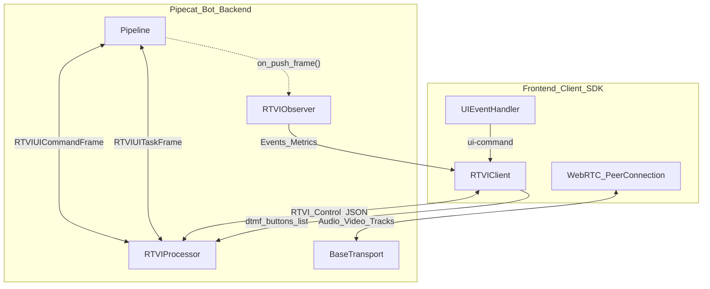
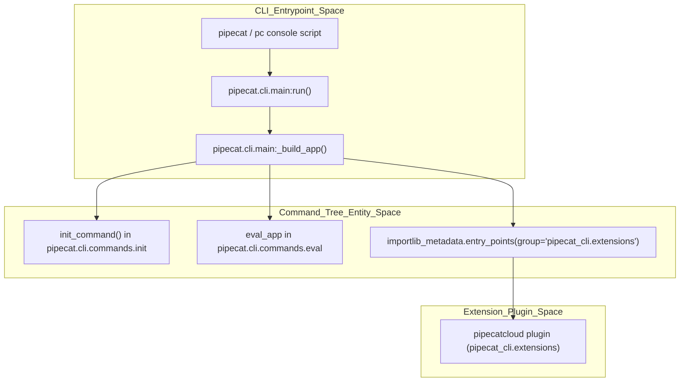
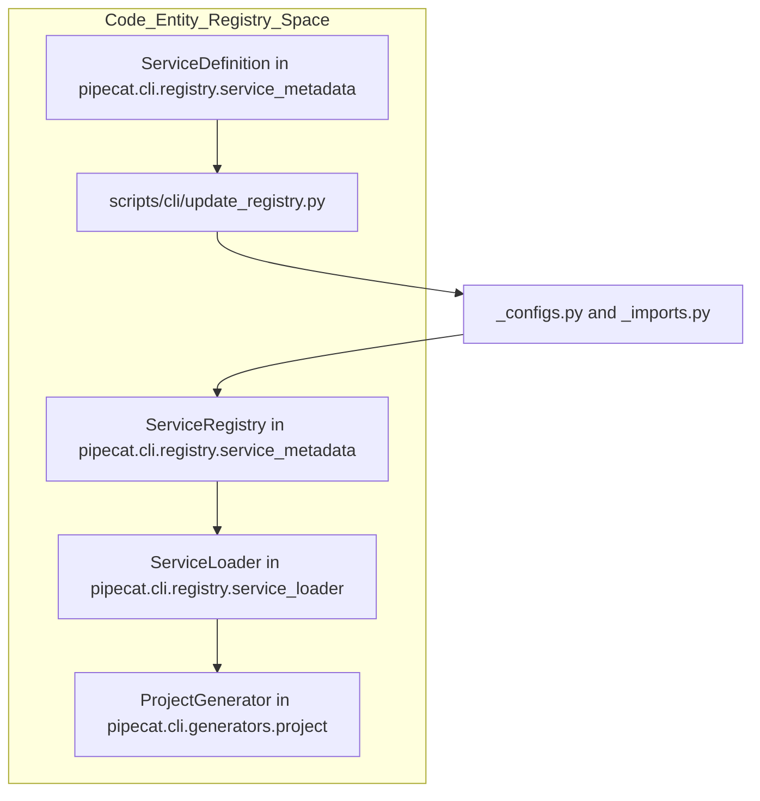

<!-- source: DeepWiki mcp.deepwiki.com · repo pipecat-ai/pipecat · page 7.3 Client SDKs and Tools · fetched 2026-10-27 -->

# Client SDKs and Tools

<details>
<summary>Relevant source files</summary>

The following files were used as context for generating this wiki page:

- [src/pipecat/cli/agent_templates/AGENTS.md](src/pipecat/cli/agent_templates/AGENTS.md)
- [src/pipecat/cli/agent_templates/GETTING_STARTED.md](src/pipecat/cli/agent_templates/GETTING_STARTED.md)
- [src/pipecat/cli/commands/init.py](src/pipecat/cli/commands/init.py)
- [src/pipecat/cli/config_validator.py](src/pipecat/cli/config_validator.py)
- [src/pipecat/cli/generators/project.py](src/pipecat/cli/generators/project.py)
- [src/pipecat/cli/hub_status.py](src/pipecat/cli/hub_status.py)
- [src/pipecat/cli/main.py](src/pipecat/cli/main.py)
- [src/pipecat/cli/prompts/questions.py](src/pipecat/cli/prompts/questions.py)
- [src/pipecat/cli/registry/__init__.py](src/pipecat/cli/registry/__init__.py)
- [src/pipecat/cli/registry/_configs.py](src/pipecat/cli/registry/_configs.py)
- [src/pipecat/cli/registry/_imports.py](src/pipecat/cli/registry/_imports.py)
- [src/pipecat/cli/registry/service_loader.py](src/pipecat/cli/registry/service_loader.py)
- [src/pipecat/cli/registry/service_metadata.py](src/pipecat/cli/registry/service_metadata.py)
- [src/pipecat/cli/templates/README.md.jinja2](src/pipecat/cli/templates/README.md.jinja2)
- [src/pipecat/cli/templates/server/env.example.jinja2](src/pipecat/cli/templates/server/env.example.jinja2)
- [src/pipecat/cli/templates/server/evals/starter_audio.yaml.jinja2](src/pipecat/cli/templates/server/evals/starter_audio.yaml.jinja2)
- [src/pipecat/cli/templates/server/evals/starter_text.yaml.jinja2](src/pipecat/cli/templates/server/evals/starter_text.yaml.jinja2)
- [tests/cli/test_cli_extensions.py](tests/cli/test_cli_extensions.py)
- [tests/cli/test_hub_status.py](tests/cli/test_hub_status.py)
- [tests/cli/test_init_agent_ready.py](tests/cli/test_init_agent_ready.py)
- [tests/cli/test_init_context_hub.py](tests/cli/test_init_context_hub.py)
- [tests/cli/test_project_generation.py](tests/cli/test_project_generation.py)

</details>


This page covers Pipecat's client-side SDK ecosystem, the Pipecat command-line interface (`pipecat` or `pc`), project generation and service registry architecture, debugging tools like `WhiskerObserver`, agent coding guidelines, and example application patterns.

---

## 1. Client SDKs and RTVI Protocol

Pipecat client SDKs implement the **RTVI (Real-Time Voice Interface)** protocol, providing a standardized mechanism for client front-end components (`RTVIClient`) to manage session lifecycle, handle WebRTC audio/video streams, and exchange control messages with a Pipecat backend worker [src/pipecat/cli/registry/service_metadata.py:91-118]().

### Supported Platforms

Official client SDKs bridge web, mobile, desktop, and embedded hardware platforms to Pipecat agents:

| SDK | Platform | Key Features |
|-----|----------|--------------|
| **JavaScript** | Web | Core WebRTC state management, peer connection control, and RTVI event handlers. |
| **React** | Web | Higher-order React hooks and UI components for web applications. |
| **React Native** | Mobile | Native-bridged mobile components for iOS and Android. |
| **Swift** | iOS/macOS | Native WebRTC and protocol implementation for Apple ecosystems. |
| **Kotlin** | Android | Native Android client library. |
| **C++** | Cross-platform | High-performance native bindings. |
| **ESP32** | IoT/Hardware | Lightweight embedded client for edge voice devices. |

### Client-Bot Data Flow

The `RTVIProcessor` receives client control messages (text inputs, audio signals, function call parameters, and DTMF button events), while the `RTVIObserver` serializes pipeline events into outgoing client messages such as transcription markers and speaking state changes [src/pipecat/cli/registry/service_metadata.py:91-118](), [src/pipecat/cli/registry/service_loader.py:197-210]().

**RTVI Protocol Data Flow**


Sources: `src/pipecat/cli/registry/service_metadata.py:91-118](), [src/pipecat/cli/registry/service_loader.py:197-210`()

---

## 2. Pipecat CLI Architecture

The Pipecat CLI (`pipecat` or `pc`) is implemented using Typer and exposes commands for project initialization (`init_command`), scaffolding, and evaluation runners [src/pipecat/cli/main.py:7-12](), [src/pipecat/cli/commands/init.py:7-35](). Its dependencies are isolated behind the `cli` optional extra to keep core runtime installations lightweight [src/pipecat/cli/main.py:14-17](), [pyproject.toml:166-173]().

### Console Scripts and Graceful Degradation

The package defines two console script entry points (`pipecat` and `pc`) targeting `pipecat.cli.main:run` [pyproject.toml:65-66](). If the user attempts to run CLI commands without installing the `cli` extra dependencies, the module intercepts execution and displays an installation hint via `_INSTALL_HINT` rather than raising an unhandled `ImportError` [src/pipecat/cli/main.py:22-30]().

### Sub-CLI Extension Discovery and Plugin Isolation

The CLI builds its command tree lazily via `_build_app()` [src/pipecat/cli/main.py:69-83](). First-party commands include `init` (`init_command`) and the `eval` sub-typer group (`eval_app`) [src/pipecat/cli/main.py:76-118](). Additional extensions (such as `pipecat cloud`) are discovered dynamically at runtime through `importlib.metadata.entry_points(group="pipecat_cli.extensions")` [src/pipecat/cli/main.py:119-138](). Each plugin is loaded in isolation so that a third-party dependency failure does not break core CLI commands [src/pipecat/cli/main.py:124-144]().

**CLI Application and Extension Architecture**


Sources: `src/pipecat/cli/main.py:7-144](), [src/pipecat/cli/commands/init.py:7-35](), [pyproject.toml:65-66`()

---

## 3. Service Registry, Loader, and Code Generators

Pipecat maintains a centralized service metadata repository in `pipecat.cli.registry.service_metadata` to drive configuration generation, dependency checks, and import resolution [src/pipecat/cli/registry/service_metadata.py:7-24]().

### Service Definition Structure

The `ServiceDefinition` dataclass defines identifiers, package extras, default class names, environment variable bindings, and settings parameters [src/pipecat/cli/registry/service_metadata.py:39-76]().

```python
@dataclass
class ServiceDefinition:
    value: str
    label: str
    package: str
    class_name: list[str] | None = None
    env_prefix: str | None = None
    include_params: list[str] | None = None
    settings_params: list[str] | None = None
    manual_config: bool = False
    recommended: bool = False
    additional_imports: list[str] | None = None
    param_defaults: dict[str, str] | None = None
```
*(Cited from [src/pipecat/cli/registry/service_metadata.py:39-76]())*

### Auto-Generated Configurations

Files such as `_configs.py` and `_imports.py` are auto-generated from service definitions via `scripts/cli/update_registry.py` [src/pipecat/cli/registry/service_metadata.py:11-15](), [src/pipecat/cli/registry/_configs.py:1-10](), [src/pipecat/cli/registry/_imports.py:1-10](). The `ServiceRegistry` and `ServiceLoader` query these artifacts to construct instantiated service objects or resolve import statements during project generation [src/pipecat/cli/registry/service_metadata.py:127-137](), [src/pipecat/cli/registry/service_loader.py:42-104](), [src/pipecat/cli/generators/project.py:25-35]().

**Service Registry and Configuration Flow**


Sources: `src/pipecat/cli/registry/service_metadata.py:7-137](), [src/pipecat/cli/registry/_configs.py:1-12](), [src/pipecat/cli/registry/_imports.py:1-12](), [src/pipecat/cli/generators/project.py:25-35`()

---

## 4. Development Tools, Whisker Debugger, and Evaluation Framework

### Whisker Debugger
`Whisker` is a real-time visual inspection tool for Pipecat pipelines. The `WhiskerObserver` can be injected into pipeline tasks during project generation to stream metrics, frame latencies, and processor events to the Whisker debugging interface [src/pipecat/cli/registry/service_metadata.py:117]().

### Evaluation Framework and Testing
The evaluation subsystem (`pipecat.evals`) provides automated regression testing and behavior validation [tests/cli/test_project_generation.py:121-207]():
*   **Eval CLI**: Commands like `pipecat eval suite <manifest>` run scripted scenarios or persona simulations against bots [src/pipecat/cli/main.py:117]().
*   **Eval-Ready Scaffolding**: Passing `--eval` to `pipecat init` inserts an `eval` transport parameter block into `transport_params` and populates starter YAML test suites under `server/evals/` [src/pipecat/cli/commands/init.py:43-44](), [src/pipecat/cli/registry/service_metadata.py:123]().
*   **Ruff Formatting & Linting**: Generated source files are automatically formatted and verified using the bundled `ruff` binary [pyproject.toml:171]() and linted against Pyflakes error rules [tests/cli/test_project_generation.py:100-117]().

Sources: `src/pipecat/cli/registry/service_metadata.py:117-123](), [tests/cli/test_project_generation.py:100-117](), [pyproject.toml:171`()

---

## 5. Agent Templates and Example Applications

Generated projects follow standardized architectural patterns depending on the selected pipeline mode and transport [src/pipecat/cli/agent_templates/AGENTS.md:1-46]().

### Agent Coding Guides (`AGENTS.md`)
When initializing a project, `pipecat init` generates `AGENTS.md` (instructions for AI coding assistants), `CLAUDE.md` (pointer for Claude Code), and `GETTING_STARTED.md` (developer onboarding instructions) [src/pipecat/cli/commands/init.py:7-19](). These files establish strict non-negotiable rules for AI agents: scaffolding first rather than writing boilerplate, verifying APIs against live sources or the Context Hub, and executing headless evaluations before deployment [src/pipecat/cli/agent_templates/AGENTS.md:10-16]().

### Context Hub Integration
The **Pipecat Context Hub** maintains a local vector index of Pipecat source code, examples, and documentation [src/pipecat/cli/agent_templates/GETTING_STARTED.md:7-12](). Developers or agents populate or refresh the index via `pipecat context-hub refresh` to prevent out-of-date API generations [src/pipecat/cli/agent_templates/GETTING_STARTED.md:18-24]().

### Pipeline Execution Modes
*   **Cascade Mode**: A conventional modular pipeline structure (`STT → LLM → TTS`). Independent service instances process streaming audio and text frames sequentially [src/pipecat/cli/agent_templates/AGENTS.md:46-46]().
*   **Realtime Mode**: Speech-to-speech bidirectional streaming architectures (e.g., OpenAI Realtime API, Gemini Live) operating with `realtime_service_mode=True` [src/pipecat/cli/agent_templates/AGENTS.md:46-46]().

Sources: `src/pipecat/cli/commands/init.py:7-19](), [src/pipecat/cli/agent_templates/AGENTS.md:10-46](), [src/pipecat/cli/agent_templates/GETTING_STARTED.md:7-24`()

---

