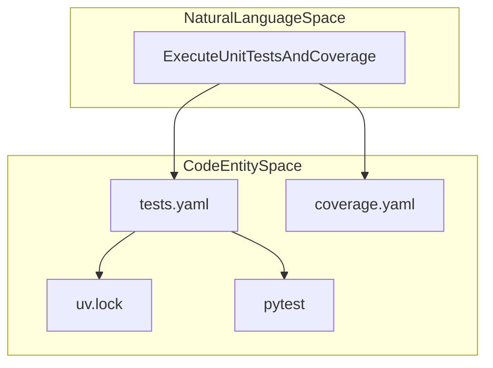
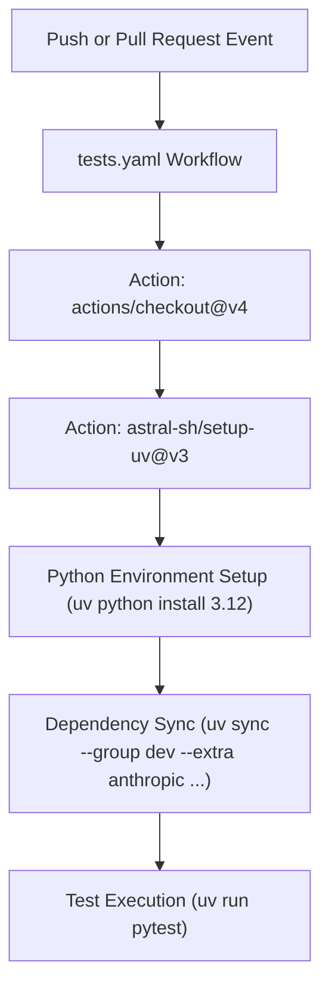
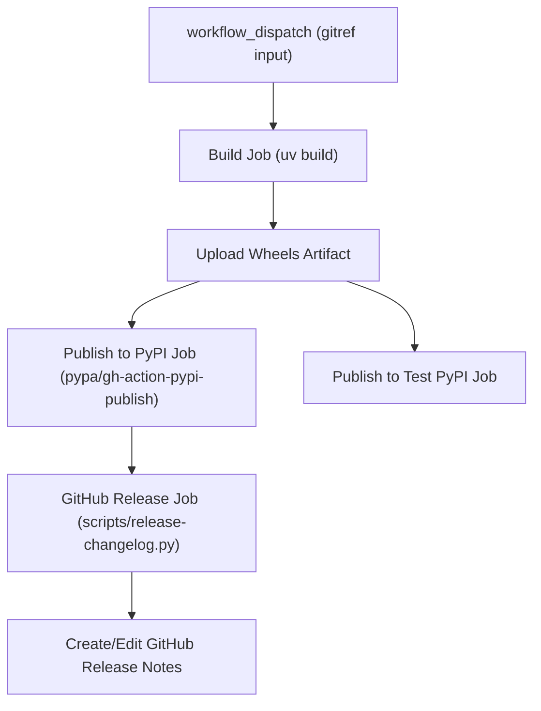
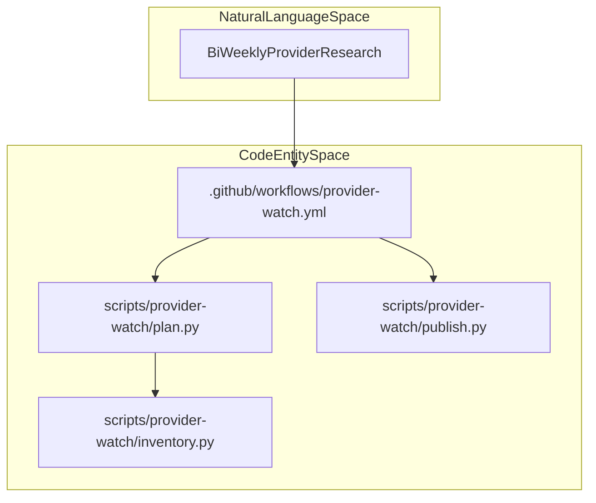
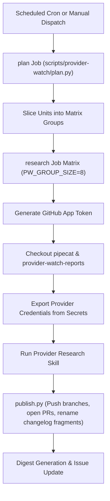
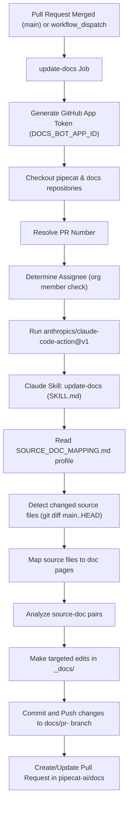
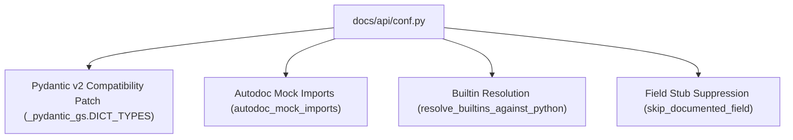

<!-- source: DeepWiki mcp.deepwiki.com · repo pipecat-ai/pipecat · page 7.4 Repository Automation, Docs Build, and Contribution Workflow · fetched 2026-10-27 -->

# Repository Automation, Docs Build, and Contribution Workflow

Relevant source files

The following files were used as context for generating this wiki page:

- [.claude-plugin/marketplace.json](.claude-plugin/marketplace.json)
- [.claude/agents/provider-watch-researcher.md](.claude/agents/provider-watch-researcher.md)
- [.claude/skills/changelog/SKILL.md](.claude/skills/changelog/SKILL.md)
- [.claude/skills/cleanup/SKILL.md](.claude/skills/cleanup/SKILL.md)
- [.claude/skills/code-review/SKILL.md](.claude/skills/code-review/SKILL.md)
- [.claude/skills/docstring/SKILL.md](.claude/skills/docstring/SKILL.md)
- [.claude/skills/pr-description/SKILL.md](.claude/skills/pr-description/SKILL.md)
- [.claude/skills/pr-submit/SKILL.md](.claude/skills/pr-submit/SKILL.md)
- [.claude/skills/prose-review/SKILL.md](.claude/skills/prose-review/SKILL.md)
- [.claude/skills/provider-research-digest/SKILL.md](.claude/skills/provider-research-digest/SKILL.md)
- [.claude/skills/provider-research/REPORT_TEMPLATE.md](.claude/skills/provider-research/REPORT_TEMPLATE.md)
- [.claude/skills/provider-research/RESEARCH_GUIDE.md](.claude/skills/provider-research/RESEARCH_GUIDE.md)
- [.claude/skills/provider-research/SKILL.md](.claude/skills/provider-research/SKILL.md)
- [.claude/skills/provider-research/agents/openai.yaml](.claude/skills/provider-research/agents/openai.yaml)
- [.claude/skills/update-docs/PROFILE_CONTRACT.md](.claude/skills/update-docs/PROFILE_CONTRACT.md)
- [.claude/skills/update-docs/REVIEW.md](.claude/skills/update-docs/REVIEW.md)
- [.claude/skills/update-docs/SKILL.md](.claude/skills/update-docs/SKILL.md)
- [.claude/skills/update-docs/SOURCE_DOC_MAPPING.md](.claude/skills/update-docs/SOURCE_DOC_MAPPING.md)
- [.codex/agents/provider-watch-researcher.toml](.codex/agents/provider-watch-researcher.toml)
- [.github/workflows/build.yaml](.github/workflows/build.yaml)
- [.github/workflows/format.yaml](.github/workflows/format.yaml)
- [.github/workflows/generate-changelog.yml](.github/workflows/generate-changelog.yml)
- [.github/workflows/provider-watch.yml](.github/workflows/provider-watch.yml)
- [.github/workflows/publish.yaml](.github/workflows/publish.yaml)
- [.github/workflows/publish_test.yaml](.github/workflows/publish_test.yaml)
- [.github/workflows/update-docs.yml](.github/workflows/update-docs.yml)
- [.pre-commit-config.yaml](.pre-commit-config.yaml)
- [.readthedocs.yaml](.readthedocs.yaml)
- [CLAUDE.md](CLAUDE.md)
- [COMMUNITY_INTEGRATIONS.md](COMMUNITY_INTEGRATIONS.md)
- [docs/api/README.md](docs/api/README.md)
- [docs/api/build-docs.sh](docs/api/build-docs.sh)
- [docs/api/conf.py](docs/api/conf.py)
- [docs/api/index.rst](docs/api/index.rst)
- [docs/api/install-deps.sh](docs/api/install-deps.sh)
- [scripts/deprecations/deprecations.json](scripts/deprecations/deprecations.json)
- [scripts/deprecations/generate.py](scripts/deprecations/generate.py)
- [scripts/deprecations/generate_removals.py](scripts/deprecations/generate_removals.py)
- [scripts/deprecations/removals.json](scripts/deprecations/removals.json)
- [scripts/deprecations/scan.py](scripts/deprecations/scan.py)
- [scripts/provider-watch/digest.py](scripts/provider-watch/digest.py)
- [scripts/provider-watch/probe.py](scripts/provider-watch/probe.py)
- [scripts/provider-watch/publish.py](scripts/provider-watch/publish.py)
- [scripts/release-changelog.py](scripts/release-changelog.py)
- [src/pipecat/evals/_session_subprocess.py](src/pipecat/evals/_session_subprocess.py)
- [src/pipecat/evals/script_session.py](src/pipecat/evals/script_session.py)
- [src/pipecat/evals/session.py](src/pipecat/evals/session.py)
- [src/pipecat/evals/simulation_session.py](src/pipecat/evals/simulation_session.py)
- [src/pipecat/services/camb/__init__.py](src/pipecat/services/camb/__init__.py)
- [src/pipecat/utils/deprecation.py](src/pipecat/utils/deprecation.py)
- [tests/test_deprecation_markers.py](tests/test_deprecation_markers.py)
- [tests/test_provider_watch_scripts.py](tests/test_provider_watch_scripts.py)
- [tests/test_text_type_deprecations.py](tests/test_text_type_deprecations.py)

## Purpose and Scope
This page details the repository automation, documentation generation, and contribution processes within the Pipecat AI codebase. It covers GitHub Actions workflows for testing, code coverage, publishing, and provider research automation, utility scripts in `scripts/`, AI agent skills in `.claude/`, Sphinx API documentation builds in `docs/api/` and architecture notes, dependency management via `uv`, community contribution guidelines, and the `towncrier` changelog fragment workflow.

---

## GitHub Workflows (`.github/workflows/`)

The `.github/workflows/` directory houses workflow definitions that automate integration testing, code coverage checks, package publishing, and maintenance tasks.

### Tests and Coverage

Unit testing and code coverage execution are governed by `.github/workflows/tests.yaml` and `.github/workflows/coverage.yaml`.

**Figure 1: Natural Language to Code Entity Space for Unit Testing Automation**

**Figure 2: Unit Tests Execution Flow**

The unit tests workflow installs development dependencies alongside specific extras (such as `anthropic`, `aws`, `cli`, `daily`, `deepgram`, `google`, `langchain`, `livekit`, `pgmq`, `piper`, `redis`, `runner`, `sagemaker`, `sarvam`, `tracing`, and `websocket`) and executes tests using `pytest` [.github/workflows/tests.yaml:33-60]().

Code coverage is handled by `.github/workflows/coverage.yaml`, which invokes `uv run coverage run` and `uv run coverage xml` to generate coverage metrics and upload reports to Codecov via `codecov/codecov-action@v5` [.github/workflows/coverage.yaml:55-63]().

Sources:
- [.github/workflows/tests.yaml:1-60]()
- [.github/workflows/coverage.yaml:1-63]()

### Publishing and Release Workflows

Package distribution and GitHub releases are managed via `.github/workflows/publish.yaml` and `.github/workflows/publish_test.yaml`.

**Figure 3: Release and Publishing Pipeline**

The `publish.yaml` workflow triggers on manual dispatch (`workflow_dispatch`), building wheels via `uv build`, publishing to PyPI and TestPyPI, and executing `scripts/release-changelog.py` to compile release notes from `CHANGELOG.md` for the GitHub Release [.github/workflows/publish.yaml:1-117]().

Sources:
- [.github/workflows/publish.yaml:1-117]()
- [.github/workflows/publish_test.yaml:1-51]()

### Provider Watch Automation

The `.github/workflows/provider-watch.yml` workflow runs bi-weekly on Mondays or via manual dispatch to monitor and research AI service provider updates [.github/workflows/provider-watch.yml:14-30]().

**Figure 4: Natural Language to Code Entity Space for Provider Watch**

**Figure 5: Provider Watch Automation Workflow**

The `plan` job uses `scripts/provider-watch/plan.py` to group service units, which are then processed concurrently by matrix jobs [tests/test_provider_watch_scripts.py:127-131](). The `scripts/provider-watch/publish.py` script manages branch pushes, draft pull requests, changelog fragment renaming, and issue updates [.github/workflows/provider-watch.yml:8-11]().

Sources:
- [.github/workflows/provider-watch.yml:1-364]()
- [scripts/provider-watch/publish.py:1-192]()
- [tests/test_provider_watch_scripts.py:127-164]()

### Documentation Update Workflow

The `.github/workflows/update-docs.yml` workflow automates documentation updates in the `pipecat-ai/docs` repository when changes are merged into `main` in the `pipecat-ai/pipecat` repository, or when manually triggered [.github/workflows/update-docs.yml:1-20]().

**Figure 6: Automated Documentation Update Workflow**

This workflow uses a GitHub App token to interact with both repositories [.github/workflows/update-docs.yml:35-45](). It checks out both `pipecat` and `docs` repositories, resolves the PR number, and determines an assignee if the PR author is a `pipecat-ai` organization member [.github/workflows/update-docs.yml:65-98](). The core logic is executed by the `anthropics/claude-code-action@v1` action, which invokes the `update-docs` skill. This skill analyzes the diff, maps source files to documentation pages using the `SOURCE_DOC_MAPPING.md` profile, makes targeted edits, and then commits, pushes, and creates/updates a pull request in the `pipecat-ai/docs` repository [.github/workflows/update-docs.yml:99-177]().

Sources:
- [.github/workflows/update-docs.yml:1-177]()
- [.claude/skills/update-docs/SKILL.md:1-153]()

---

## Scripts Directory (`scripts/`)

Utility scripts support repository maintenance, code analysis, and release management.

### Provider Watch Utilities (`scripts/provider-watch/`)

*   **`inventory.py`**: Scans the codebase to discover provider service classes, default models, environment variables, and documentation URLs [tests/test_provider_watch_scripts.py:34-106]().
*   **`plan.py`**: Partitions scanned service units into groups for matrix execution in GitHub Actions [tests/test_provider_watch_scripts.py:127-131]().
*   **`digest.py`**: Parses YAML frontmatter from report files to render Markdown digests [scripts/provider-watch/digest.py:8-40]().
*   **`publish.py`**: Handles publishing provider reports, pushing branches, creating draft pull requests, renaming towncrier changelog fragments, and updating digest issues [scripts/provider-watch/publish.py:8-38]().
*   **`probe.py`**: Validates provider credentials before probe execution [tests/test_provider_watch_scripts.py:11-12]().

### Deprecations and Release Scripts

*   **`scripts/deprecations/generate.py`**: Regenerates the `deprecations.json` registry from `.. deprecated::` directives and `@deprecated` decorators in the source code. This script is run as a pre-commit hook to ensure the registry is up-to-date [.pre-commit-config.yaml:46-51]().
*   **`scripts/deprecations/scan.py`**: Scans the codebase for deprecation markers and generates `deprecations.json`.
*   **`scripts/deprecations/generate_removals.py`**: Generates a list of planned removals based on deprecation data.
*   **`scripts/release-changelog.py`**: Extracts changelog sections for specific git tags during release generation [.github/workflows/publish.yaml:102-106]().

### CLI Utilities (`scripts/cli/`)

*   **`scripts/cli/imports/update_imports.py`**: Regenerates the CLI's service registry imports (`_imports.py`) based on service module changes. This is an AST-based process and does not require full service SDKs. It's configured as a pre-commit hook [.pre-commit-config.yaml:28-33]().
*   **`scripts/cli/check_registry.py`**: Checks the completeness of the CLI service registry. This is also a pre-commit hook [.pre-commit-config.yaml:34-39]().

Sources:
- [tests/test_provider_watch_scripts.py:1-178]()
- [scripts/provider-watch/publish.py:1-192]()
- [.github/workflows/publish.yaml:102-106]()
- [.pre-commit-config.yaml:28-51]()
- [scripts/deprecations/deprecations.json:1-159]()

---

## AI Agent Skills and Configurations (`.claude/`)

The repository integrates AI agent workflows and skills within the `.claude/` directory.

*   **`update-docs` Skill**: Located in `.claude/skills/update-docs/SKILL.md`, this skill maps code changes to documentation pages using `SOURCE_DOC_MAPPING.md` [.claude/skills/update-docs/SKILL.md:8-17](). It defines the process for detecting changed source files, mapping them to documentation pages, analyzing source-doc pairs, and making targeted edits.
*   **`provider-watch-researcher` Agent**: Defined in `.claude/agents/provider-watch-researcher.md`, this agent executes provider research sweeps. It leverages the `provider-research` skill to generate reports.
*   **`provider-research` Skill**: This skill, located at `.claude/skills/provider-research/SKILL.md`, is responsible for researching provider services. It uses a `RESEARCH_GUIDE.md` and `REPORT_TEMPLATE.md` to structure its output.
*   **`provider-research-digest` Skill**: This skill, located at `.claude/skills/provider-research-digest/SKILL.md`, renders a digest from the provider-watch reports.
*   **`changelog` Skill**: Located at `.claude/skills/changelog/SKILL.md`, this skill assists with changelog entries.
*   **`pr-description` Skill**: Located at `.claude/skills/pr-description/SKILL.md`, this skill helps generate pull request descriptions.
*   **`pr-submit` Skill**: Located at `.claude/skills/pr-submit/SKILL.md`, this skill assists with submitting pull requests.
*   **`docstring` Skill**: Located at `.claude/skills/docstring/SKILL.md`, this skill helps with generating docstrings.
*   **`code-review` Skill**: Located at `.claude/skills/code-review/SKILL.md`, this skill performs code reviews.
*   **`prose-review` Skill**: Located at `.claude/skills/prose-review/SKILL.md`, this skill performs prose reviews.
*   **`cleanup` Skill**: Located at `.claude/skills/cleanup/SKILL.md`, this skill assists with code cleanup tasks.

Sources:
- [.claude/skills/update-docs/SKILL.md:1-341]()
- [.claude/agents/provider-watch-researcher.md]()
- [.claude/skills/provider-research/SKILL.md]()
- [.claude/skills/provider-research-digest/SKILL.md]()
- [.claude/skills/changelog/SKILL.md]()
- [.claude/skills/pr-description/SKILL.md]()
- [.claude/skills/pr-submit/SKILL.md]()
- [.claude/skills/docstring/SKILL.md]()
- [.claude/skills/code-review/SKILL.md]()
- [.claude/skills/prose-review/SKILL.md]()
- [.claude/skills/cleanup/SKILL.md]()

---

## Documentation Build and Sphinx Configuration (`docs/api/`)

API documentation is generated using Sphinx via `docs/api/conf.py`.

**Figure 7: Sphinx Documentation Configuration Mechanics**

Key features in `docs/api/conf.py`:
*   **Pydantic v2 Compatibility Patch**: Patches `_pydantic_gs.DICT_TYPES` to support `Union`-wrapped dictionary types (`Optional[Dict[str, Any]]`) during Sphinx model inspection [docs/api/conf.py:9-28]().
*   **Mock Imports**: `autodoc_mock_imports` mocks optional dependencies (e.g., `krisp_audio`, `fastapi`, `deepgram`, `torch`, `transformers`) to prevent import errors during documentation builds [docs/api/conf.py:76-137]().
*   **Builtin Resolution**: `resolve_builtins_against_python` ensures Python builtins resolve against the Python intersphinx inventory [docs/api/conf.py:156-161]().
*   **Field Stub Skipping**: `skip_documented_field` suppresses redundant field stubs when docstrings already document class attributes [docs/api/conf.py:191-193]().
*   **ReadTheDocs Configuration**: The `.readthedocs.yaml` file configures the Read the Docs build environment, specifying the OS, Python version, apt packages, and post-install steps using `uv` to install dependencies and build the Sphinx documentation [.readthedocs.yaml:1-15]().

Sources:
- [docs/api/conf.py:1-193]()
- [.readthedocs.yaml:1-15]()

---

## Contribution Workflow and Dependency Management (`CONTRIBUTING.md`)

Contributions to Pipecat follow a structured pull request and changelog workflow.

### Bug Reports and Minimal Reproductions
Bug reports must include a minimal runnable reproduction (e.g., a single-file bot or test using `run_test()` from `pipecat.tests.utils`) [CONTRIBUTING.md:39-41](). Unverified AI-generated reports are subject to closure [CONTRIBUTING.md:54-61]().

### Dependency Management with `uv`
Dependency management relies on `uv` and `uv.lock`. Adding or updating packages requires updating `pyproject.toml`, running `uv lock`, and syncing local environments via `uv sync` [CONTRIBUTING.md:165-178]().

### Community Integrations
The `COMMUNITY_INTEGRATIONS.md` guide outlines the process for developers to create and maintain their own service integrations. It specifies repository requirements (source code, foundational example, `README.md`, `LICENSE`, code documentation, changelog) and the submission process for listing integrations on the official Pipecat documentation site [COMMUNITY_INTEGRATIONS.md:1-79]().

Sources:
- [CONTRIBUTING.md:1-179]()
- [COMMUNITY_INTEGRATIONS.md:1-140]()

---

## Changelog Fragment Workflow (`changelog/`)

Pipecat uses `towncrier` with changelog fragments located in `changelog/` to prevent merge conflicts [CONTRIBUTING.md:68-70]().

*   **File Naming Pattern**: `<PR_number>.<type>.md` (e.g., `1234.added.md`, `5678.fixed.md`) [CONTRIBUTING.md:77-79]().
*   **Fragment Types**: `added`, `changed`, `deprecated`, `removed`, `fixed`, `performance`, `security`, and `other` [CONTRIBUTING.md:82-90]().
*   **Multiple Changes**: Separate fragment files are used for different types of changes, or numbered files for multiple changes of the same type (e.g., `1234.changed.md`, `1234.changed.2.md`) [CONTRIBUTING.md:120-132](). Related changes can use nested bullets in a single fragment [CONTRIBUTING.md:134-140]().
*   **Draft Preview**: Contributors can preview rendered changelog outputs using `towncrier build --draft --version Unreleased` [CONTRIBUTING.md:147-150]().
*   **Skipping Entries**: Changelog entries can be skipped for documentation-only changes, internal refactoring, test-only changes, or CI/build configuration changes [CONTRIBUTING.md:155-162]().

Sources:
- [CONTRIBUTING.md:68-164]()

---

