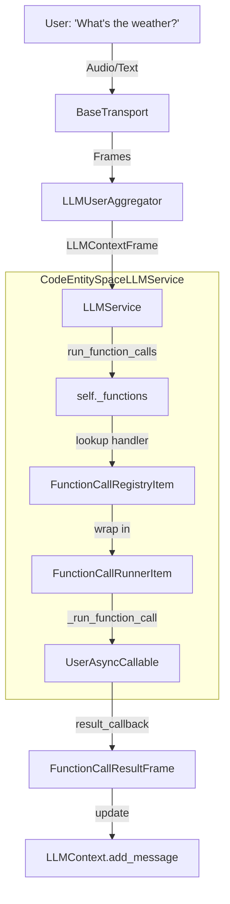
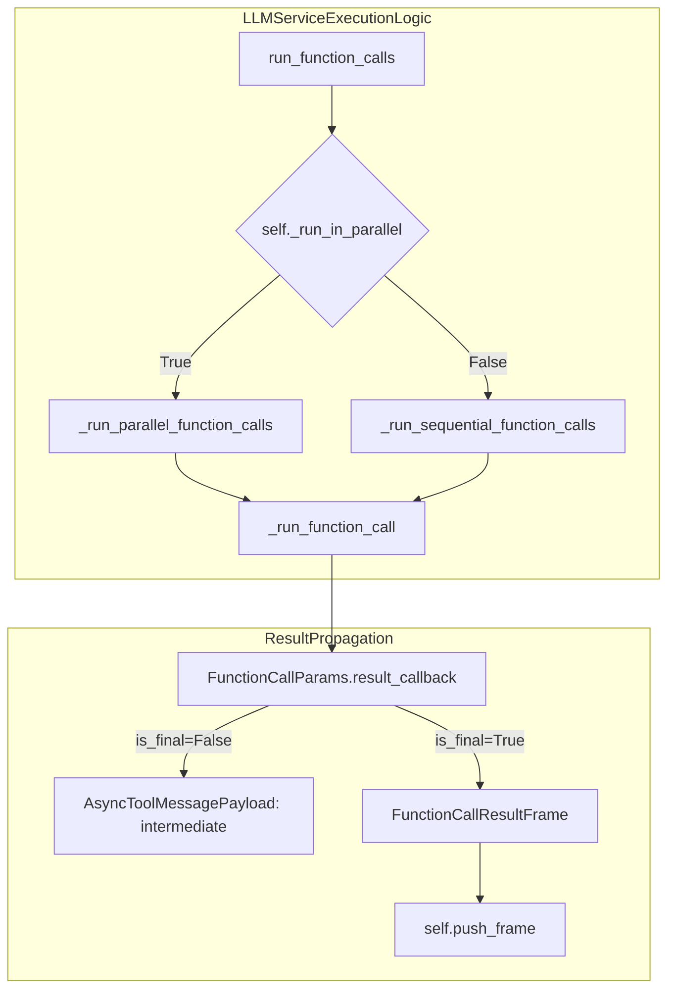
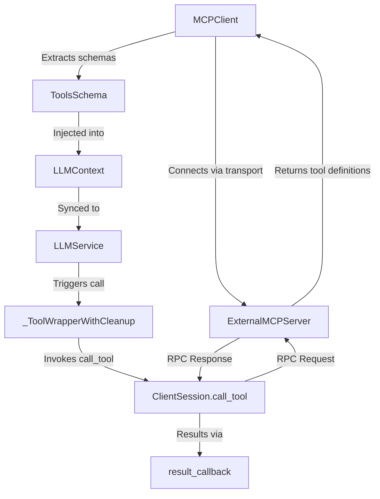
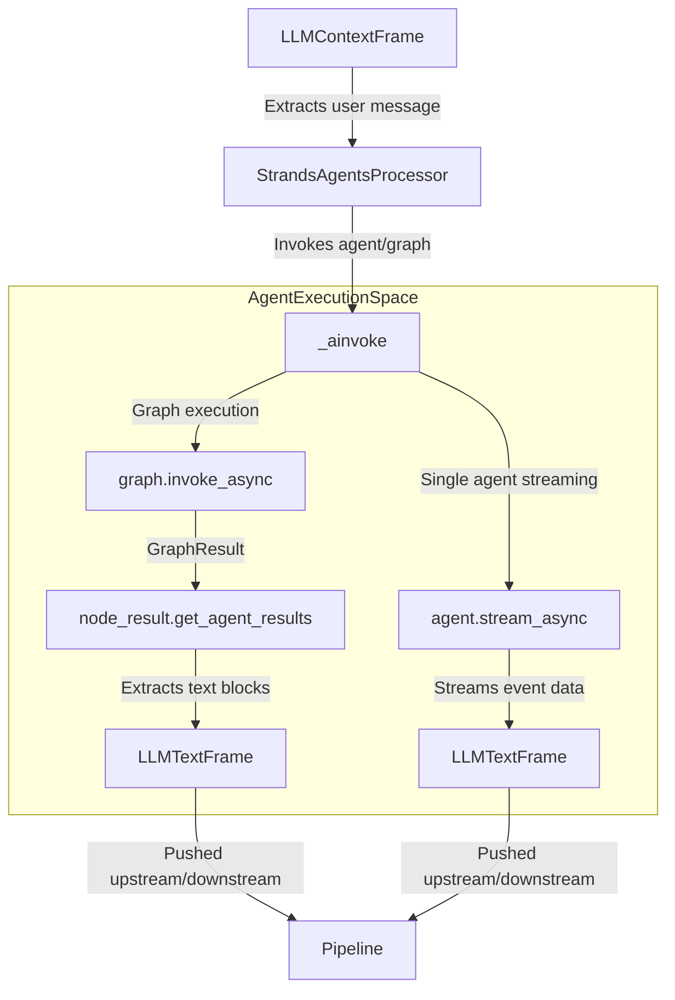

<!-- source: DeepWiki mcp.deepwiki.com · repo pipecat-ai/pipecat · page 8.1 Function Calling and Tool Use · fetched 2026-10-27 -->

# Function Calling and Tool Use

<details>
<summary>Relevant source files</summary>

The following files were used as context for generating this wiki page:

- [changelog/5689.fixed.md](changelog/5689.fixed.md)
- [examples/function-calling/function-calling-anthropic-async-stream.py](examples/function-calling/function-calling-anthropic-async-stream.py)
- [examples/function-calling/function-calling-anthropic-async.py](examples/function-calling/function-calling-anthropic-async.py)
- [examples/function-calling/function-calling-google-async-stream.py](examples/function-calling/function-calling-google-async-stream.py)
- [examples/function-calling/function-calling-google-async.py](examples/function-calling/function-calling-google-async.py)
- [examples/function-calling/function-calling-openai-async-stream.py](examples/function-calling/function-calling-openai-async-stream.py)
- [examples/function-calling/function-calling-openai-async.py](examples/function-calling/function-calling-openai-async.py)
- [examples/function-calling/function-calling-openai-responses-async-stream.py](examples/function-calling/function-calling-openai-responses-async-stream.py)
- [examples/function-calling/function-calling-openai-responses-async.py](examples/function-calling/function-calling-openai-responses-async.py)
- [examples/mcp/mcp-multiple-mcp.py](examples/mcp/mcp-multiple-mcp.py)
- [examples/mcp/mcp-stdio.py](examples/mcp/mcp-stdio.py)
- [examples/mcp/mcp-streamable-http-gemini-live.py](examples/mcp/mcp-streamable-http-gemini-live.py)
- [examples/mcp/mcp-streamable-http.py](examples/mcp/mcp-streamable-http.py)
- [scripts/fix-ruff-and-typecheck.sh](scripts/fix-ruff-and-typecheck.sh)
- [src/pipecat/adapters/schemas/direct_function.py](src/pipecat/adapters/schemas/direct_function.py)
- [src/pipecat/adapters/schemas/function_schema.py](src/pipecat/adapters/schemas/function_schema.py)
- [src/pipecat/adapters/schemas/tools_schema.py](src/pipecat/adapters/schemas/tools_schema.py)
- [src/pipecat/audio/dtmf/utils.py](src/pipecat/audio/dtmf/utils.py)
- [src/pipecat/audio/filters/rnnoise_filter.py](src/pipecat/audio/filters/rnnoise_filter.py)
- [src/pipecat/pipeline/llm_switcher.py](src/pipecat/pipeline/llm_switcher.py)
- [src/pipecat/pipeline/service_switcher.py](src/pipecat/pipeline/service_switcher.py)
- [src/pipecat/processors/aggregators/async_tool_messages.py](src/pipecat/processors/aggregators/async_tool_messages.py)
- [src/pipecat/processors/filters/frame_filter.py](src/pipecat/processors/filters/frame_filter.py)
- [src/pipecat/processors/filters/function_filter.py](src/pipecat/processors/filters/function_filter.py)
- [src/pipecat/processors/filters/null_filter.py](src/pipecat/processors/filters/null_filter.py)
- [src/pipecat/processors/filters/wake_check_filter.py](src/pipecat/processors/filters/wake_check_filter.py)
- [src/pipecat/processors/frameworks/strands_agents.py](src/pipecat/processors/frameworks/strands_agents.py)
- [src/pipecat/services/mcp_service.py](src/pipecat/services/mcp_service.py)
- [src/pipecat/workers/llm/tool_decorator.py](src/pipecat/workers/llm/tool_decorator.py)
- [tests/test_async_tool_messages.py](tests/test_async_tool_messages.py)
- [tests/test_auto_register_tools.py](tests/test_auto_register_tools.py)
- [tests/test_dtmf_utils.py](tests/test_dtmf_utils.py)
- [tests/test_function_calling_adapters.py](tests/test_function_calling_adapters.py)
- [tests/test_llm_switcher.py](tests/test_llm_switcher.py)
- [tests/test_mcp_service.py](tests/test_mcp_service.py)
- [tests/test_processor_usable.py](tests/test_processor_usable.py)
- [tests/test_rnnoise_cancellation.py](tests/test_rnnoise_cancellation.py)
- [tests/test_rnnoise_filter.py](tests/test_rnnoise_filter.py)
- [tests/test_rnnoise_resampling.py](tests/test_rnnoise_resampling.py)
- [tests/test_service_switcher.py](tests/test_service_switcher.py)
- [tests/test_soxr_resamplers.py](tests/test_soxr_resamplers.py)
- [tests/test_websocket_service_usable.py](tests/test_websocket_service_usable.py)

</details>


This page documents function calling and tool use in Pipecat's LLM services. Function calling enables LLMs to invoke application-defined functions during conversation, allowing real-time agents to execute business logic, query external databases, interact with APIs, or leverage agent frameworks.

For details on core LLM services, see `[src/pipecat/services/llm_service.py](). For context management, see `[src/pipecat/processors/aggregators/llm_context.py]()`.

## Overview

Pipecat provides a unified, asynchronous function-calling architecture across all supported LLM providers. The framework manages:
- **Declarative and Direct Registration**: Converting Python async functions and schemas into provider-native tool definitions `[src/pipecat/adapters/schemas/direct_function.py:53-120]()`.
- **Execution Control**: Running tools in parallel or sequentially.
- **Timeout Management**: Global and per-function timeout enforcement via `timeout_secs`.
- **Result Handling**: Automatic context updates and LLM continuation via `FunctionCallResultFrame`.
- **Interruption Support**: Cancelling in-flight function calls on user interruptions when `cancel_on_interruption=True` `[src/pipecat/services/llm_service.py:113]()`.
- **Async Streaming and Tool Protocols**: Supporting intermediate updates for long-running tools via `result_callback` and `async_tool_messages` `[src/pipecat/processors/aggregators/async_tool_messages.py:9-30]()`.
- **External Framework Integrations**: Native support for Model Context Protocol (MCP), LangChain, and Strands Agents `[src/pipecat/services/mcp_service.py:150-178]()`, `[src/pipecat/processors/frameworks/strands_agents.py:27-85]().
- **App Resources**: Sharing state (e.g., database handles, API clients) across tool handlers via `app_resources`.

### Natural Language Space to Code Entity Space

The following diagram bridges natural language inputs received from the transport layer to the internal code entities executing the tool call.

**Diagram: Request to Code Entity Flow**

Sources: `[src/pipecat/services/llm_service.py:116-158]()`, `[src/pipecat/processors/aggregators/llm_context.py:60-63]()`

---

## Function Registration and Auto-Registration

Tools passed via `LLMContext` or updated mid-session via `LLMSetToolsFrame` are automatically registered by the LLM service if they include handlers or are direct functions `[src/pipecat/pipeline/llm_switcher.py:62-74]()`.

### LLMContext Auto-Registration
When initializing an `LLMContext`, developers can supply a list of `FunctionSchema` objects or direct function callables. The LLM service automatically synchronizes these handlers across services and switchers `[src/pipecat/pipeline/llm_switcher.py:62-74]()`:

```python
from pipecat.processors.aggregators.llm_context import LLMContext
from pipecat.adapters.schemas.function_schema import FunctionSchema
from pipecat.services.llm_service import FunctionCallParams

async def my_handler(params: FunctionCallParams):
    await params.result_callback({"status": "ok"})

schema = FunctionSchema(
    name="get_status",
    description="Get status",
    properties={},
    required=[],
    handler=my_handler
)

context = LLMContext(tools=[schema])
```

### Direct Function Registration
The `DirectFunction` pattern allows developers to use standard Python async functions as tools without manually defining JSON schemas `[src/pipecat/adapters/schemas/direct_function.py:37-50]()`. `BaseDirectFunctionWrapper` inspects the function signature and docstring to extract metadata `[src/pipecat/adapters/schemas/direct_function.py:53-120]()`:
- **Introspection**: Automatically converts Python type hints into JSON Schema property definitions `[src/pipecat/adapters/schemas/direct_function.py:122-137]()`.
- **Validation**: Verifies that the function is an `async def` and that its first parameter is named `params` (`FunctionCallParams`) `[src/pipecat/adapters/schemas/direct_function.py:85-108]()`.

Sources: `[src/pipecat/adapters/schemas/direct_function.py:37-120]()`, `[src/pipecat/pipeline/llm_switcher.py:62-74]()`

---

## Tool Options and Decorators

The `@tool_options` decorator configures tool execution behavior directly on handler functions `[src/pipecat/adapters/schemas/direct_function.py:270-285]()`.

| Option | Description | Default |
|--------|-------------|---------|
| `cancel_on_interruption` | If `True`, cancels the tool task when the user interrupts the bot `[src/pipecat/services/llm_service.py:113]()`. | `True` |
| `timeout_secs` | Maximum execution time allowed for the tool before timeout handling. | `None` |
| `cancellable_by_llm` | If `True`, the LLM may cancel this call while it runs via a generated `cancel_<name>` tool `[src/pipecat/pipeline/llm_switcher.py:129]()`. | `False` |

```python
from pipecat.adapters.schemas.direct_function import tool_options
from pipecat.services.llm_service import FunctionCallParams
import asyncio

@tool_options(cancel_on_interruption=False, timeout_secs=30)
async def long_running_tool(params: FunctionCallParams, query: str):
    """Perform a long operation that shouldn't be interrupted."""
    await asyncio.sleep(15)
    await params.result_callback({"status": "done"})
```
Sources: `[src/pipecat/services/llm_service.py:113-116]()`, `[src/pipecat/adapters/schemas/direct_function.py:270-285]()`

---

## Execution Flow, Modes, and Async Streaming

`LLMService` orchestrates function execution based on whether parallel execution is enabled and how tools report results.

**Diagram: Execution Orchestration and Streaming**


### Execution Modes and Protocols
- **Parallel vs. Sequential**: Parallel execution utilizes `asyncio.gather()` to concurrently invoke multiple tool calls requested by the model. Sequential execution runs them one after another.
- **Async Streaming / Intermediate Results**: For long-running asynchronous tasks configured with `cancel_on_interruption=False`, tools can report incremental progress using `result_callback(..., FunctionCallResultProperties(is_final=False))` `[src/pipecat/processors/aggregators/async_tool_messages.py:9-30]()`.
- **Async Tool Message Protocol**: The `async_tool_messages` module manages structured context payloads (`started`, `intermediate`, `final`) to ensure intermediate results and task cancellations are correctly communicated to the LLM without corrupting conversation history `[src/pipecat/processors/aggregators/async_tool_messages.py:31-120]()`.

Sources: `[src/pipecat/services/llm_service.py:33-56]()`, `[src/pipecat/processors/aggregators/async_tool_messages.py:9-120]()`

---

## Model Context Protocol (MCP) Integration

Pipecat supports integrating external tools hosted on Model Context Protocol (MCP) servers through `MCPClient` `[src/pipecat/services/mcp_service.py:7-39]()`. It handles stdio, Server-Sent Events (SSE), and streamable HTTP transports `[src/pipecat/services/mcp_service.py:41-118]()`.

**Diagram: MCP Client Data Flow**

Sources: `[src/pipecat/services/mcp_service.py:38-178]()`, `[src/pipecat/adapters/schemas/tools_schema.py]()`

---

## LangChain and Strands Agents Frameworks

Pipecat integrates with external agent frameworks to support advanced agent reasoning graphs and stateful orchestration.

### Strands Agents Processor
`StrandsAgentsProcessor` integrates Strands Agents and multi-agent graphs into Pipecat's frame pipeline `[src/pipecat/processors/frameworks/strands_agents.py:27-35]()`. It processes incoming `LLMContextFrame` objects, extracts user messages, and executes either single-agent streaming (`stream_async`) or multi-agent graph invocations (`invoke_async`), emitting the results as `LLMTextFrame` objects `[src/pipecat/processors/frameworks/strands_agents.py:64-153]()`.

**Diagram: Strands Agents Integration**

Sources: `[src/pipecat/processors/frameworks/strands_agents.py:27-153]()`

---

## App Resources Pattern

Application-level resources (such as database connections, authenticated HTTP clients, or shared state caches) can be attached to the `PipelineWorker` via `app_resources`. These resources are automatically made available inside every tool invocation via `params.app_resources`.

Sources: `[src/pipecat/services/llm_service.py:116-157]()`

---

