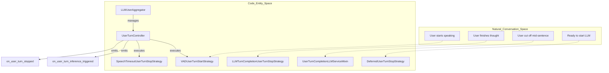
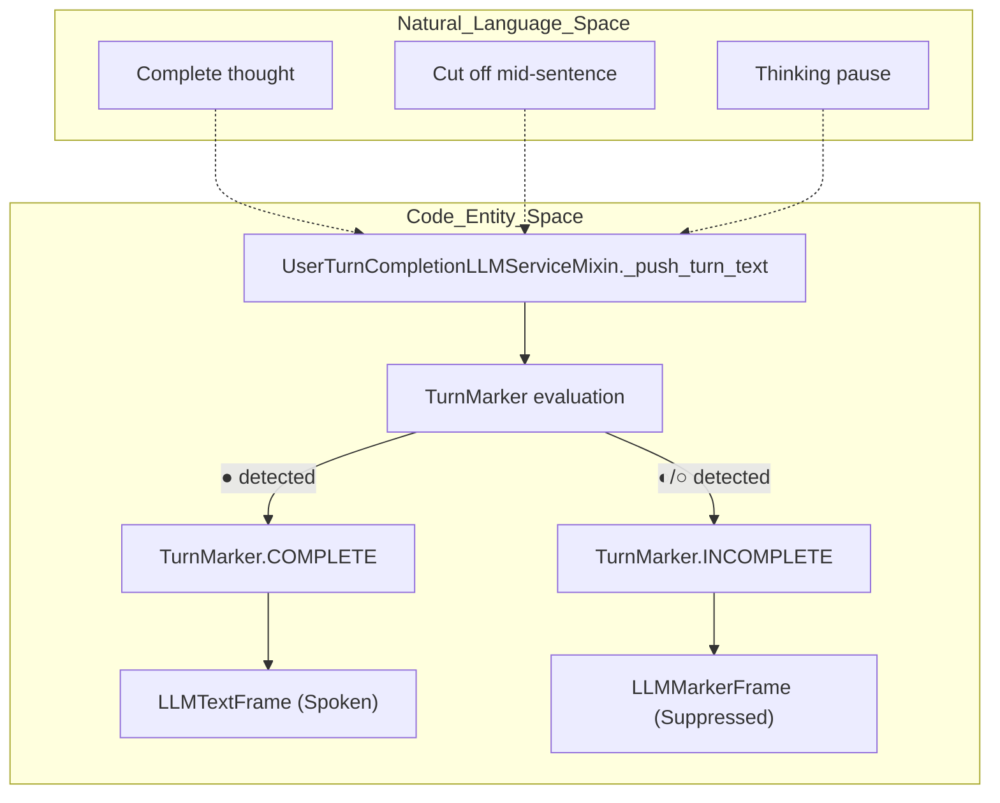

<!-- source: DeepWiki mcp.deepwiki.com · repo pipecat-ai/pipecat · page 8.2 Building Natural Conversations · fetched 2026-10-27 -->

# Building Natural Conversations

<details>
<summary>Relevant source files</summary>

The following files were used as context for generating this wiki page:

- [evals/release/scenarios/scripted/filter_incomplete_turns.yaml](evals/release/scenarios/scripted/filter_incomplete_turns.yaml)
- [examples/features/features-voicemail-detection.py](examples/features/features-voicemail-detection.py)
- [examples/turn-management/turn-management-detect-user-idle.py](examples/turn-management/turn-management-detect-user-idle.py)
- [examples/turn-management/turn-management-filter-incomplete-turns-function-calling.py](examples/turn-management/turn-management-filter-incomplete-turns-function-calling.py)
- [examples/turn-management/turn-management-filter-incomplete-turns-user-idle.py](examples/turn-management/turn-management-filter-incomplete-turns-user-idle.py)
- [examples/turn-management/turn-management-filter-incomplete-turns.py](examples/turn-management/turn-management-filter-incomplete-turns.py)
- [examples/turn-management/turn-management-interruption-config.py](examples/turn-management/turn-management-interruption-config.py)
- [examples/turn-management/turn-management-smart-turn-local-coreml.py](examples/turn-management/turn-management-smart-turn-local-coreml.py)
- [examples/turn-management/turn-management-smart-turn-local.py](examples/turn-management/turn-management-smart-turn-local.py)
- [examples/turn-management/turn-management-turn-tracking-observer.py](examples/turn-management/turn-management-turn-tracking-observer.py)
- [examples/turn-management/turn-management-user-assistant-turns.py](examples/turn-management/turn-management-user-assistant-turns.py)
- [examples/turn-management/turn-management-user-mute-strategy.py](examples/turn-management/turn-management-user-mute-strategy.py)
- [src/pipecat/processors/aggregators/llm_response_universal.py](src/pipecat/processors/aggregators/llm_response_universal.py)
- [src/pipecat/services/cartesia/turns/stt.py](src/pipecat/services/cartesia/turns/stt.py)
- [src/pipecat/services/deepgram/flux/sagemaker/stt.py](src/pipecat/services/deepgram/flux/sagemaker/stt.py)
- [src/pipecat/services/deepgram/flux/stt.py](src/pipecat/services/deepgram/flux/stt.py)
- [src/pipecat/services/deepgram/flux/stt_base.py](src/pipecat/services/deepgram/flux/stt_base.py)
- [src/pipecat/services/deepgram/flux/tts_base.py](src/pipecat/services/deepgram/flux/tts_base.py)
- [src/pipecat/services/deepgram/sagemaker/stt.py](src/pipecat/services/deepgram/sagemaker/stt.py)
- [src/pipecat/services/deepgram/sagemaker/tts.py](src/pipecat/services/deepgram/sagemaker/tts.py)
- [src/pipecat/services/deepgram/stt.py](src/pipecat/services/deepgram/stt.py)
- [src/pipecat/services/deepgram/tts.py](src/pipecat/services/deepgram/tts.py)
- [src/pipecat/services/speechmatics/stt.py](src/pipecat/services/speechmatics/stt.py)
- [src/pipecat/turns/eager_end_of_turn_mixin.py](src/pipecat/turns/eager_end_of_turn_mixin.py)
- [src/pipecat/turns/user_stop/__init__.py](src/pipecat/turns/user_stop/__init__.py)
- [src/pipecat/turns/user_stop/external_user_turn_completion_stop_strategy.py](src/pipecat/turns/user_stop/external_user_turn_completion_stop_strategy.py)
- [src/pipecat/turns/user_stop/llm_turn_completion_user_turn_stop_strategy.py](src/pipecat/turns/user_stop/llm_turn_completion_user_turn_stop_strategy.py)
- [src/pipecat/turns/user_turn_completion_mixin.py](src/pipecat/turns/user_turn_completion_mixin.py)
- [src/pipecat/turns/user_turn_strategies.py](src/pipecat/turns/user_turn_strategies.py)
- [tests/test_cartesia_stt.py](tests/test_cartesia_stt.py)
- [tests/test_cartesia_turns_stt.py](tests/test_cartesia_turns_stt.py)
- [tests/test_context_aggregators_universal.py](tests/test_context_aggregators_universal.py)
- [tests/test_deepgram_flux_stt.py](tests/test_deepgram_flux_stt.py)
- [tests/test_deepgram_sagemaker_stt.py](tests/test_deepgram_sagemaker_stt.py)
- [tests/test_eager_end_of_turn_mixin.py](tests/test_eager_end_of_turn_mixin.py)
- [tests/test_eager_user_turn_strategies.py](tests/test_eager_user_turn_strategies.py)
- [tests/test_langchain.py](tests/test_langchain.py)
- [tests/test_rtvi_observer_config.py](tests/test_rtvi_observer_config.py)
- [tests/test_speculation_gate.py](tests/test_speculation_gate.py)
- [tests/test_speechmatics_stt.py](tests/test_speechmatics_stt.py)
- [tests/test_stt_send_retry_first_connect.py](tests/test_stt_send_retry_first_connect.py)
- [tests/test_user_turn_completion_mixin.py](tests/test_user_turn_completion_mixin.py)

</details>


## Purpose and Scope

This document covers advanced conversational patterns and turn management in Pipecat, focusing on creating natural, responsive voice interactions. Topics include:

- **Turn management architecture** for controlling conversation flow boundaries and strategy lifecycle callbacks.
- **Turn detection and analysis** using VAD, transcriptions, and ML-based smart turn models.
- **Incomplete turn filtering** to detect when users are cut off mid-thought using LLM markers (`●`/`○`/`◐`).
- **`UserTurnCompletionLLMServiceMixin`** implementation details for LLM service integration.
- **Turn completion strategies** including `LLMTurnCompletionUserTurnStopStrategy`, `DeferredUserTurnStopStrategy`, and `ExternalUserTurnCompletionStopStrategy`.
- **Conversational flow patterns** leveraging integrated aggregators and event handlers.

For basic context management and message aggregation, see [3.7 Context Aggregators](). For interruption handling, see [3.9 Interruption Handling](). For function calling patterns, see [8.1 Function Calling and Tool Use]().

Sources: [src/pipecat/turns/user_turn_controller.py:32-49](), [src/pipecat/turns/user_turn_completion_mixin.py:7-13]()

---

## Turn Management Architecture & Strategy Lifecycle Callbacks

Pipecat structures conversations into discrete **turns**: alternating periods when the user speaks and when the assistant responds. Turn management is handled by the `UserTurnController`, which coordinates pluggable strategies to detect turn boundaries [src/pipecat/turns/user_turn_controller.py:32-49]().

### Strategy Lifecycle Callbacks

Turn start and stop strategies implement lifecycle hooks (`handle_user_turn_started()`, `handle_user_turn_stopped()`) to maintain robust state across utterance boundaries. For instance, strategies like `SpeechTimeoutUserTurnStopStrategy` preserve physical VAD state rather than erroneously ending a user turn mid-utterance.

### Core Components

The following diagram bridges the natural language concept of a "conversation turn" to the specific code entities in Pipecat.

**Natural Conversation to Code Entity Mapping**


Sources: [src/pipecat/turns/user_turn_controller.py:32-49](), [src/pipecat/turns/user_turn_strategies.py:55-79](), [src/pipecat/turns/user_turn_strategies.py:11-23](), [src/pipecat/turns/user_turn_completion_mixin.py:7-13]()

---

## Turn Detection and Analysis

Detecting the end of a user turn is critical for low-latency conversations. Pipecat supports several stop strategies:

### Smart Turn Analysis
The `TurnAnalyzerUserTurnStopStrategy` uses ML models (such as `LocalSmartTurnAnalyzerV3`) to analyze audio, VAD state, and transcripts to predict turn completion.

- **`BaseTurnAnalyzer`**: A base class for ML-based analyzers that predicts when the user has finished their turn [src/pipecat/audio/turn/base_turn_analyzer.py:39-44]().
- **`EndOfTurnState`**: An enumeration with `COMPLETE` and `INCOMPLETE` states returned by analyzers [src/pipecat/audio/turn/base_turn_analyzer.py:21-31]().
- **`BaseSmartTurn`**: Provides common functionality for smart turn detection including audio buffering, speech tracking, and ML model integration [src/pipecat/audio/turn/smart_turn/base_smart_turn.py:52-58]().

**State Management**: The `TurnAnalyzerUserTurnStopStrategy` handles stale speech state by dropping the analyzer's buffered speech state in `handle_user_turn_stopped` so a stale silence timer cannot trigger a phantom end-of-turn after an externally-ended turn.

### Timeout Strategies
The `SpeechTimeoutUserTurnStopStrategy` uses two independent timers after VAD stops:
1. **`user_speech_timeout`**: A policy floor for how long to wait for the user to resume.
2. **`wait_for_transcript`**: A kwarg to ensure a transcription is processed before completion. When `False`, turn-end signals immediately once the analyzer reports `COMPLETE`, moving transcripts off the latency-critical path.

Sources: [src/pipecat/turns/user_stop/speech_timeout_user_turn_stop_strategy.py:27-111](), [src/pipecat/turns/user_stop/turn_analyzer_user_turn_stop_strategy.py:34-115](), [src/pipecat/audio/turn/base_turn_analyzer.py:21-31](), [src/pipecat/audio/turn/smart_turn/base_smart_turn.py:52-58]()

---

## Incomplete Turn Filtering and `UserTurnCompletionLLMServiceMixin`

Incomplete turn filtering uses the LLM to detect when a user was **cut off mid-thought** and suppresses the bot's response if the input was incomplete or required a pause.

### Turn Completion Markers

When using `FilterIncompleteUserTurnStrategies` [src/pipecat/turns/user_turn_strategies.py:104-105](), the LLM is instructed via system prompt instructions [src/pipecat/turns/user_turn_completion_mixin.py:134-144]() to prefix every response with a marker:

| Marker | Name | Meaning | Action |
| :--- | :--- | :--- | :--- |
| `●` (`USER_TURN_COMPLETE_MARKER`) | **COMPLETE** | User finished a complete thought. | Bot responds normally; fires `UserTurnInferenceCompletedFrame`. [src/pipecat/turns/user_turn_completion_mixin.py:43-43]() |
| `◐` (`USER_TURN_INCOMPLETE_SHORT_MARKER`) | **INCOMPLETE SHORT** | User was cut off mid-word/sentence. | Suppress response; wait for short timeout (~5s). [src/pipecat/turns/user_turn_completion_mixin.py:44-44]() |
| `○` (`USER_TURN_INCOMPLETE_LONG_MARKER`) | **INCOMPLETE LONG** | User needs time to think (e.g., "Hmm..."). | Suppress response; wait for long timeout (~10s). [src/pipecat/turns/user_turn_completion_mixin.py:45-45]() |

### Implementation: UserTurnCompletionLLMServiceMixin

The `UserTurnCompletionLLMServiceMixin` class [src/pipecat/turns/user_turn_completion_mixin.py:34-35]() provides the logic to process these markers. It buffers incoming model tokens until a valid marker is identified [src/pipecat/turns/user_turn_completion_mixin.py:326-340]().

**Marker Processing Logic and State Space Mapping**


Sources: [src/pipecat/turns/user_turn_completion_mixin.py:38-45](), [src/pipecat/turns/user_turn_completion_mixin.py:34-35](), [src/pipecat/turns/user_turn_completion_mixin.py:326-434](), [tests/test_user_turn_completion_mixin.py:43-120]()

If a timeout expires, the mixin pushes an `LLMMessagesAppendFrame` with a re-prompt and triggers a new `LLMRunFrame` [src/pipecat/turns/user_turn_completion_mixin.py:406-434]().

Sources: [src/pipecat/turns/user_turn_completion_mixin.py:34-144](), [tests/test_user_turn_completion_mixin.py:43-164]()

---

## Turn Completion Strategies

Pipecat uses a strategy-based API for turn completion. 

### Key Classes and Wrappers

- **`FilterIncompleteUserTurnStrategies`**: A convenience wrapper that takes detector strategies (like VAD), wraps them in `deferred()`, and appends the `LLMTurnCompletionUserTurnStopStrategy` [src/pipecat/turns/user_turn_strategies.py:104-155]().
- **`deferred(strategy)`**: A wrapper function that creates a `DeferredUserTurnStopStrategy`. It allows a strategy to fire the `on_user_turn_inference_triggered` event (to start the LLM) but suppresses the `on_user_turn_stopped` event.
- **`LLMTurnCompletionUserTurnStopStrategy`**: Extends `ExternalUserTurnCompletionStopStrategy`. It pushes an `LLMUpdateSettingsFrame` on start to enable filtering and configure the completion mixin.
- **`ExternalUserTurnCompletionStopStrategy`**: A base class that finalizes a turn whenever a `UserTurnInferenceCompletedFrame` is received.

### Events

- **`on_user_turn_inference_triggered`**: Fired when a detector suggests the user has finished. This triggers the LLM to start generating a response and marker [src/pipecat/turns/user_turn_controller.py:41-44]().
- **`on_user_turn_stopped`**: Fired only when the turn is semantically final (e.g., the LLM confirmed with `●` or a timeout occurred) [src/pipecat/turns/user_turn_controller.py:45-45]().

Sources: [src/pipecat/turns/user_turn_strategies.py:104-155](), [src/pipecat/turns/user_stop/llm_turn_completion_user_turn_stop_strategy.py:18-43](), [src/pipecat/turns/user_turn_controller.py:32-75]()

---

## User Idle Detection

The `UserIdleController` monitors user activity and triggers an event when the user has been quiet for a specific duration after the bot finishes speaking [src/pipecat/turns/user_idle_controller.py:25-48]().

- **`on_user_turn_idle`**: Emitted when the idle timeout expires [src/pipecat/turns/user_idle_controller.py:40-40]().
- **Timer Management**: The timer starts on `BotStoppedSpeakingFrame` and is cancelled by `UserStartedSpeakingFrame` or `BotStartedSpeakingFrame` [src/pipecat/turns/user_idle_controller.py:88-109]().
- **Guards**: The timer is suppressed while a user turn is in progress or while function calls are pending to avoid false triggers [src/pipecat/turns/user_idle_controller.py:103-103]().

Sources: [src/pipecat/turns/user_idle_controller.py:25-117]()

---

## Conversational Flow Patterns & Examples

Pipecat provides built-in patterns for managing conversation state across components using context aggregators and turn strategies.

### Example Configuration

```python
from pipecat.turns.user_turn_strategies import FilterIncompleteUserTurnStrategies
from pipecat.turns.user_turn_completion_mixin import UserTurnCompletionConfig

user_turn_strategies = FilterIncompleteUserTurnStrategies(
    config=UserTurnCompletionConfig(
        incomplete_short_timeout=5.0,
        incomplete_long_timeout=10.0
    )
)
```

Sources: [src/pipecat/turns/user_turn_strategies.py:133-144](), [src/pipecat/turns/user_turn_completion_mixin.py:176-193]()

---

