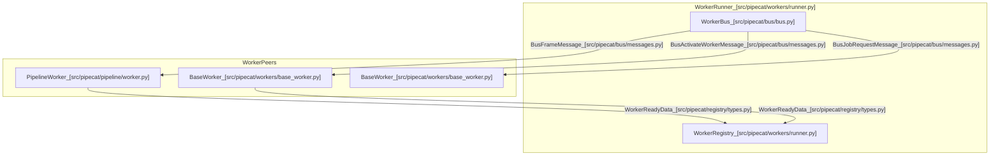
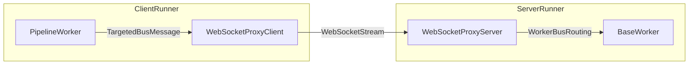

<!-- source: DeepWiki mcp.deepwiki.com · repo pipecat-ai/pipecat · page 8.3 Multi-Worker Framework · fetched 2026-10-27 -->

# Multi-Worker Framework

Relevant source files

The following files were used as context for generating this wiki page:

- [src/pipecat/bus/__init__.py](src/pipecat/bus/__init__.py)
- [src/pipecat/bus/bridge_processor.py](src/pipecat/bus/bridge_processor.py)
- [src/pipecat/bus/bus.py](src/pipecat/bus/bus.py)
- [src/pipecat/bus/local/async_queue.py](src/pipecat/bus/local/async_queue.py)
- [src/pipecat/bus/messages.py](src/pipecat/bus/messages.py)
- [src/pipecat/bus/network/__init__.py](src/pipecat/bus/network/__init__.py)
- [src/pipecat/bus/network/pgmq.py](src/pipecat/bus/network/pgmq.py)
- [src/pipecat/bus/network/pgmq_backends.py](src/pipecat/bus/network/pgmq_backends.py)
- [src/pipecat/bus/network/redis.py](src/pipecat/bus/network/redis.py)
- [src/pipecat/bus/queue.py](src/pipecat/bus/queue.py)
- [src/pipecat/bus/subscriber.py](src/pipecat/bus/subscriber.py)
- [src/pipecat/pipeline/worker.py](src/pipecat/pipeline/worker.py)
- [src/pipecat/utils/startup.py](src/pipecat/utils/startup.py)
- [src/pipecat/workers/base_worker.py](src/pipecat/workers/base_worker.py)
- [src/pipecat/workers/runner.py](src/pipecat/workers/runner.py)
- [tests/test_base_worker.py](tests/test_base_worker.py)
- [tests/test_bus.py](tests/test_bus.py)
- [tests/test_job_group.py](tests/test_job_group.py)
- [tests/test_messages.py](tests/test_messages.py)
- [tests/test_pgmq_backends.py](tests/test_pgmq_backends.py)
- [tests/test_pgmq_bus.py](tests/test_pgmq_bus.py)
- [tests/test_redis_bus.py](tests/test_redis_bus.py)
- [tests/test_runner.py](tests/test_runner.py)
- [tests/test_serializers.py](tests/test_serializers.py)
- [tests/test_utils_startup.py](tests/test_utils_startup.py)
- [tests/test_websocket_proxy.py](tests/test_websocket_proxy.py)

Introduced to evolve Pipecat's execution model into a distributed actor system, the **Multi-Worker Framework** (`pipecat.workers`) treats every agent, processing pipeline, tool, or UI component as an independent `BaseWorker` communicating over a shared `WorkerBus` [src/pipecat/workers/base_worker.py:119-120](). This enables complex multi-agent orchestration patterns—such as task handoffs, parallel consensus debates, background sidecar services, and distributed micro-agents—while preserving a unified asynchronous lifecycle.

This is a parent page. For detailed deep-dives, see the child pages:
- [Worker Architecture and Bus](#8.3.1) — Deep dive into the WorkerBus pub/sub system, BusMessage types, BusSubscriber, local AsyncQueueBus, distributed RedisBus and PgmqBus, BridgeProcessor, and WorkerRegistry for peer discovery.
- [Worker Types and Patterns](#8.3.2) — Document BaseWorker, PipelineWorker, LLMWorker, LLMContextWorker, UIWorker, WebSocket proxy server/client, job context and lifecycle, llm_with_backend, and multi-worker examples including openclaw.

---

## High-Level Architecture

The multi-worker framework transitions Pipecat from a single, monolithic pipeline to a peer-to-peer actor topology. A `WorkerRunner` hosts and orchestrates `BaseWorker` instances, managing their attachment to a shared `WorkerBus` [src/pipecat/workers/runner.py:84-89](). Every `PipelineWorker` acts as an equal peer on this bus, capable of exchanging frames, lifecycle commands, and structured job payloads [src/pipecat/pipeline/worker.py:172-173]().

### Core Framework Components

| Component | Role | Code Entity |
| :--- | :--- | :--- |
| **WorkerBus** | Abstract messaging backbone for pub/sub routing | `WorkerBus` [src/pipecat/bus/bus.py:49-54]() |
| **WorkerRunner** | Orchestrates worker lifecycles, runner signaling, and tasks | `WorkerRunner` [src/pipecat/workers/runner.py:84-89]() |
| **BaseWorker** | Abstract base class for all bus-participating actors | `BaseWorker` [src/pipecat/workers/base_worker.py:119-120]() |
| **PipelineWorker** | Wraps a standard Pipecat pipeline to run as a bus peer | `PipelineWorker` [src/pipecat/pipeline/worker.py:172-173]() |
| **WorkerRegistry** | Tracks peer readiness and discovery across runner domains | `WorkerRegistry` [src/pipecat/workers/runner.py:146-147]() |

### Code-to-System Mapping: The Multi-Worker Ecosystem

The diagram below bridges the conceptual agent space with concrete classes and message types implemented in `pipecat.workers`.

Diagram: "MultiWorkerEcosystemMapping"

Sources: [src/pipecat/bus/messages.py:94-107](), [src/pipecat/workers/runner.py:84-147](), [src/pipecat/pipeline/worker.py:172-173](), [src/pipecat/bus/bus.py:49-54](), [src/pipecat/workers/base_worker.py:119-120]()

Sources: [src/pipecat/workers/runner.py:84-89](), [src/pipecat/bus/bus.py:49-54](), [src/pipecat/workers/base_worker.py:119-120](), [src/pipecat/pipeline/worker.py:172-173]()

---

## Worker Architecture and Bus

The communication layer relies on `WorkerBus`, providing asynchronous pub/sub messaging where subscribers maintain individual priority queues [src/pipecat/bus/bus.py:42-46](). The bus segregates system messages from data messages to guarantee administrative priority.

For detailed information on `AsyncQueueBus`, distributed backends (`RedisBus`, `PgmqBus`), bridge processors, and registry discovery, see [Worker Architecture and Bus](#8.3.1).

Sources: [src/pipecat/bus/bus.py:42-54](), [src/pipecat/bus/bridge_processor.py:43-47](), [src/pipecat/bus/network/redis.py:27-29](), [src/pipecat/bus/network/pgmq.py:30-32]()

---

## Worker Types, Patterns, and Decorators

The framework supplies specialized worker implementations for concrete tasks:
- **`PipelineWorker`**: Embeds a standard Pipecat `Pipeline` inside a bus peer [src/pipecat/pipeline/worker.py:172-173]().
- **`BaseWorker`**: Manages low-level bus attachment, lifecycle states, and structured job requests [src/pipecat/workers/base_worker.py:119-126]().

Workers coordinate long-running tasks using structured job groups via the `job_group()` context manager and decorators [src/pipecat/workers/base_worker.py:123-143]().

For detailed worker types, lifecycle states, and decorators, see [Worker Types and Patterns](#8.3.2).

Sources: [src/pipecat/pipeline/worker.py:172-173](), [src/pipecat/workers/base_worker.py:119-143]()

---

## Deployment, Runners, and WebSocket Proxies

Execution is managed by `WorkerRunner`, which handles startup sequences, signal interception, and resource cleanup [src/pipecat/workers/runner.py:84-89](). Workers are registered using `add_workers(*workers)` before invoking `runner.run()` [src/pipecat/workers/runner.py:20-22]().

### Distributed Topologies with WebSocket Proxies

When workers run across distinct network boundaries, **WebSocket Proxies** bridge the gap by forwarding targeted bus messages between client environments and server runners [tests/test_websocket_proxy.py:85-119]().

### Code-to-System Mapping: Distributed WebSocket Proxies

Diagram: "DistributedWebSocketProxyTopology"

Sources: [tests/test_websocket_proxy.py:85-119](), [src/pipecat/workers/runner.py:84-89](), [src/pipecat/workers/base_worker.py:119-120]()

Sources: [src/pipecat/workers/runner.py:84-89](), [tests/test_websocket_proxy.py:85-119]()

---

## Multi-Worker Examples

Reference implementations under `examples/multi-worker/` showcase common distributed patterns:
- **`local-handoff`**: Demonstrates active worker transitioning and delegation between conversational agents.
- **`parallel-debate`**: Implements multi-agent consensus generation where responses are aggregated.
- **`code-assistant`**: Uses background sidecar workers supporting a primary voice interaction loop.

For complete code examples and deeper usage patterns, refer to [Worker Types and Patterns](#8.3.2).

Sources: [src/pipecat/workers/runner.py:84-89]()

---
*Next: [Worker Architecture and Bus](#8.3.1)*

---

