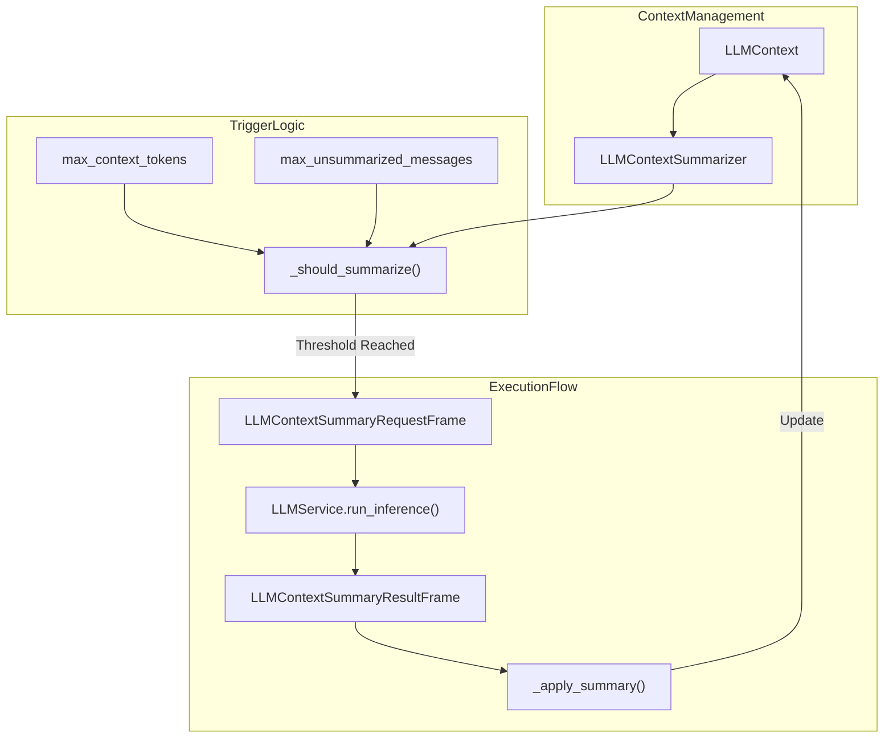
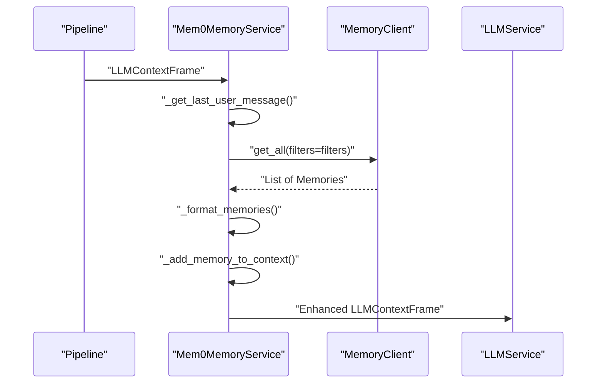
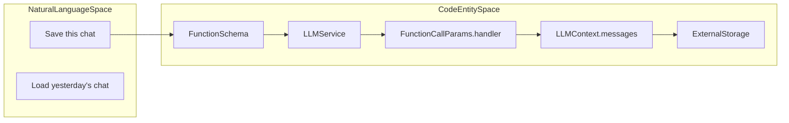
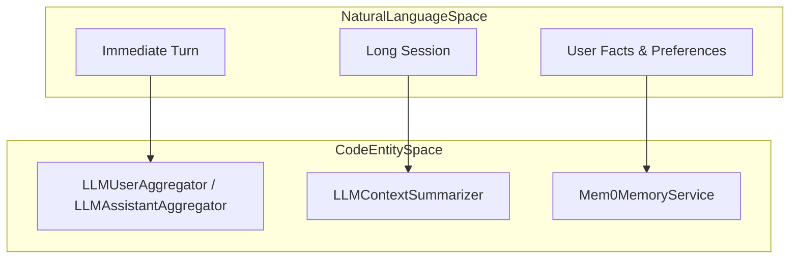

<!-- source: DeepWiki mcp.deepwiki.com · repo pipecat-ai/pipecat · page 8.6 Memory and Persistent Context · fetched 2026-10-27 -->

# Memory and Persistent Context

Relevant source files

The following files were used as context for generating this wiki page:

- [examples/rag/rag-gemini-grounding-metadata.py](examples/rag/rag-gemini-grounding-metadata.py)
- [examples/rag/rag-gemini.py](examples/rag/rag-gemini.py)
- [examples/rag/rag-mem0.py](examples/rag/rag-mem0.py)
- [src/pipecat/audio/vad/vad_controller.py](src/pipecat/audio/vad/vad_controller.py)
- [src/pipecat/processors/aggregators/llm_context_summarizer.py](src/pipecat/processors/aggregators/llm_context_summarizer.py)
- [src/pipecat/processors/audio/vad_processor.py](src/pipecat/processors/audio/vad_processor.py)
- [src/pipecat/services/mem0/memory.py](src/pipecat/services/mem0/memory.py)
- [src/pipecat/utils/context/llm_context_summarization.py](src/pipecat/utils/context/llm_context_summarization.py)
- [tests/test_context_summarization.py](tests/test_context_summarization.py)
- [tests/test_llm_context_summarizer.py](tests/test_llm_context_summarizer.py)
- [tests/test_mem0.py](tests/test_mem0.py)
- [tests/test_vad_controller.py](tests/test_vad_controller.py)
- [tests/test_vad_processor.py](tests/test_vad_processor.py)
- [tests/test_wake_phrase_user_turn_start_strategy.py](tests/test_wake_phrase_user_turn_start_strategy.py)

## Purpose and Scope

This document covers memory and persistent context management in Pipecat, including long-term semantic memory storage, conversation history persistence, and automated context summarization. These features enable conversational AI agents to maintain continuity across long-running sessions and remember user preferences over time.

Key components documented here include:
- **`LLMContextSummarizer`**: Automatic compression of conversation history to stay within token limits [src/pipecat/processors/aggregators/llm_context_summarizer.py:61-74]().
- **`Mem0MemoryService`**: Integration with the Mem0 service for semantic memory retrieval and storage, including the `get_memories()` convenience method [src/pipecat/services/mem0/memory.py:39-45]().
- **Persistent Storage Patterns**: Implementation of "save/load" mechanics using LLM function calling and persistent context management.
- **Pipecat Flows Context**: Strategies for managing context during state transitions.

Sources: [src/pipecat/processors/aggregators/llm_context_summarizer.py:61-74](), [src/pipecat/services/mem0/memory.py:39-45]()

---

## Context Summarization

The `LLMContextSummarizer` is a utility and processor that manages the lifecycle of context compression. It monitors the `LLMContext` and triggers summarization when configurable thresholds (token count or message count) are reached [src/pipecat/processors/aggregators/llm_context_summarizer.py:61-74]().

### Summarization Architecture

Summarization typically occurs within the context of an aggregator. When a response turn starts (detected via `LLMFullResponseStartFrame`), the summarizer evaluates the current context size. If thresholds are exceeded, it emits an `on_request_summarization` event [src/pipecat/processors/aggregators/llm_context_summarizer.py:130](), which results in an `LLMContextSummaryRequestFrame` being sent to an LLM service.

Title: Summarization Data Flow

Sources: [src/pipecat/processors/aggregators/llm_context_summarizer.py:61-139](), [src/pipecat/utils/context/llm_context_summarization.py:120-152]()

### Configuration Parameters

Summarization behavior is controlled by two primary configuration classes:

1.  **`LLMContextSummaryConfig`**: Controls *how* the summary is generated (prompt, target length, model) [src/pipecat/utils/context/llm_context_summarization.py:62-101]().
2.  **`LLMAutoContextSummarizationConfig`**: Controls *when* summarization is triggered [src/pipecat/utils/context/llm_context_summarization.py:120-152]().

| Parameter | Default | Description |
| :--- | :--- | :--- |
| `max_context_tokens` | 8000 | Trigger summarization when estimated tokens exceed this [src/pipecat/utils/context/llm_context_summarization.py:149](). |
| `max_unsummarized_messages` | 20 | Trigger when this many new messages accumulate [src/pipecat/utils/context/llm_context_summarization.py:150](). |
| `target_context_tokens` | 6000 | The `max_tokens` passed to the LLM for the summary result [src/pipecat/utils/context/llm_context_summarization.py:95](). |
| `min_messages_after_summary` | 4 | Number of recent messages to keep uncompressed [src/pipecat/utils/context/llm_context_summarization.py:96](). |
| `summarization_timeout` | 120.0 | Maximum seconds to wait for a summary response [src/pipecat/utils/context/llm_context_summarization.py:30](), [src/pipecat/utils/context/llm_context_summarization.py:100](). |

Sources: [src/pipecat/utils/context/llm_context_summarization.py:30-101](), [src/pipecat/utils/context/llm_context_summarization.py:149-152]()

### Token Estimation
Since real-time pipelines often lack immediate access to a specific model's tokenizer, Pipecat uses a heuristic-based estimation in `LLMContextSummarizationUtil`:
- **`CHARS_PER_TOKEN`**: 4 characters [src/pipecat/utils/context/llm_context_summarization.py:33]().
- **`TOKEN_OVERHEAD_PER_MESSAGE`**: 10 tokens per message [src/pipecat/utils/context/llm_context_summarization.py:34]().
- **`IMAGE_TOKEN_ESTIMATE`**: 500 tokens per image content [src/pipecat/utils/context/llm_context_summarization.py:35]().

Sources: [src/pipecat/utils/context/llm_context_summarization.py:32-38]()

---

## Mem0 Memory Service

The `Mem0MemoryService` is a `FrameProcessor` that integrates with Mem0 to provide long-term semantic memory [src/pipecat/services/mem0/memory.py:39-45](). It intercepts message frames in the pipeline and enhances context with relevant historical snippets retrieved from the Mem0 vector store.

### Data Flow for Memory Retrieval

Title: Memory Injection Sequence

Sources: [src/pipecat/services/mem0/memory.py:39-45](), [src/pipecat/services/mem0/memory.py:131-169]()

### Key Features and 2.0.0 Changes
- **Requirement**: Pipecat integrates with `mem0ai` [src/pipecat/services/mem0/memory.py:30-36]().
- **Entity ID Filters**: In Mem0 2.0.0, entity IDs (`user_id`, `agent_id`, `run_id`) must be provided inside a `filters` dictionary rather than as top-level kwargs for local clients [src/pipecat/services/mem0/memory.py:144-158](). For cloud clients, it uses an `OR` clause structure [src/pipecat/services/mem0/memory.py:160-169]().
- **API Version Deprecation**: The `api_version` parameter in `InputParams` is deprecated as Mem0 2.0.0 removed this from its client [src/pipecat/services/mem0/memory.py:53-58](), [src/pipecat/services/mem0/memory.py:118-124]().
- **Context Injection**: Memories are inserted into the context at a specific `position` (default is 1, usually right after the system prompt) [src/pipecat/services/mem0/memory.py:72]().
- **Automatic Storage**: The service automatically stores new memories asynchronously using `asyncio.to_thread` to avoid blocking the event loop [src/pipecat/services/mem0/memory.py:156]().
- **`get_memories()` Convenience Method**: This method allows retrieving all stored memories for a user/agent/run ID outside the pipeline flow [src/pipecat/services/mem0/memory.py:131-142](). It is particularly useful for initializing a session with a personalized greeting based on historical data.

Sources: [src/pipecat/services/mem0/memory.py:30-169]()

---

## Persistent Context Patterns

Pipecat supports persisting full conversation history to external storage using function calling. This allows users to "Save" or "Load" specific conversation states.

### Entity Mapping: Persistence Logic

Title: Persistence Logic Mapping

Sources: [src/pipecat/services/mem0/memory.py:39-45]()

---

## Context in Pipecat Flows

When using the Pipecat Flows framework (`pipecat.flows`), memory is managed via context strategies during node transitions.

- **APPEND**: New messages are added to existing context (default).
- **RESET**: Context is cleared and replaced with the new node's messages.
- **On-Demand Summarization**: Applications should push an `LLMSummarizeContextFrame` in a `pre_action` to trigger on-demand summarization when navigating states.

Sources: [src/pipecat/processors/aggregators/llm_context_summarizer.py:16-23]()

---

## Multi-turn History Management

Managing history effectively requires balancing the "recency" of the conversation with the "depth" of the memory.

| Strategy | Component | Best For |
| :--- | :--- | :--- |
| **Short-term** | `LLMUserAggregator` / `LLMAssistantAggregator` | Managing the immediate back-and-forth turns. |
| **Mid-term** | `LLMContextSummarizer` | Keeping long conversations within the model's active window [src/pipecat/processors/aggregators/llm_context_summarizer.py:61-74](). |
| **Long-term** | `Mem0MemoryService` | Remembering facts across weeks/months [src/pipecat/services/mem0/memory.py:39-45](). |
| **Session-based** | Persistence Functions | Explicitly saving/loading a specific "save file" or state via external storage. |

### Entity Mapping: Multi-turn Memory Stack

Title: Memory Stack Mapping

Sources: [src/pipecat/processors/aggregators/llm_context_summarizer.py:61-74](), [src/pipecat/services/mem0/memory.py:39-45](), [src/pipecat/utils/context/llm_context_summarization.py:120-152]()

---

