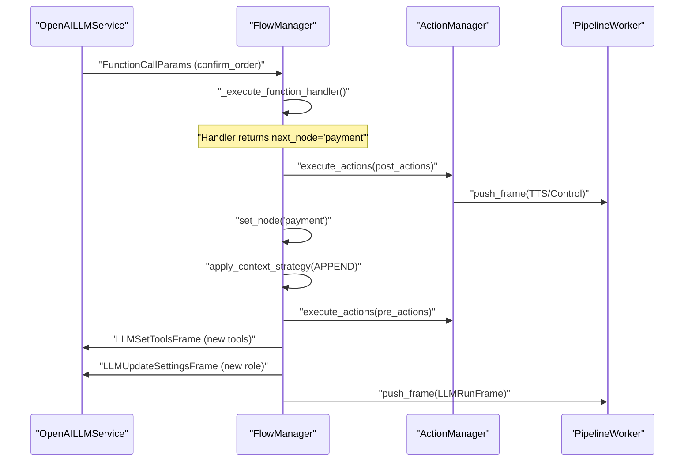
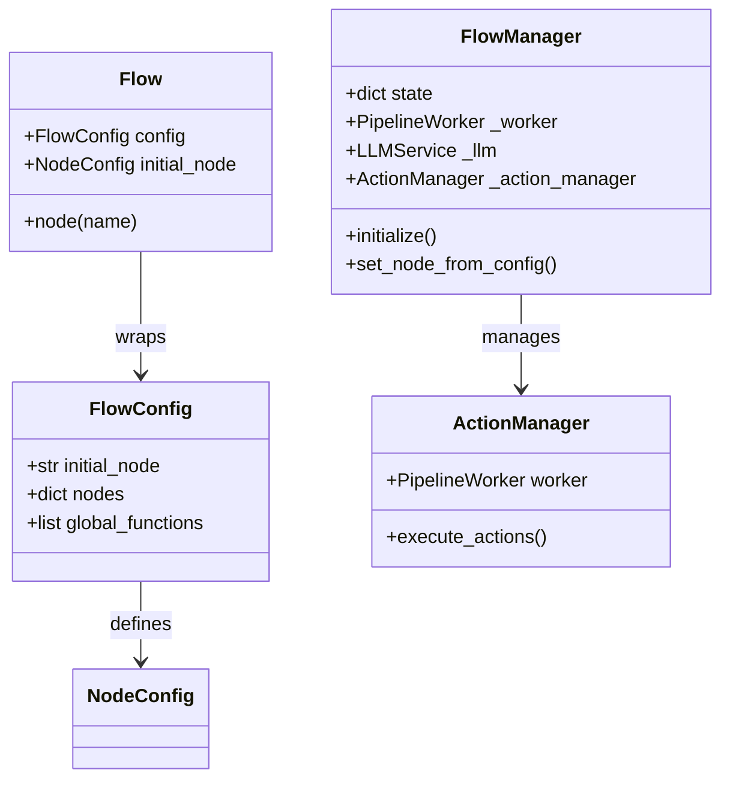

<!-- source: DeepWiki mcp.deepwiki.com · repo pipecat-ai/pipecat · page 8.7 Conversation Flows · fetched 2026-10-27 -->

# Conversation Flows

Relevant source files

The following files were used as context for generating this wiki page:

- [evals/release/scenarios/scripted/generate_image.yaml](evals/release/scenarios/scripted/generate_image.yaml)
- [examples/README.md](examples/README.md)
- [examples/flows/README.md](examples/flows/README.md)
- [examples/flows/yaml/insurance_quote/bot.py](examples/flows/yaml/insurance_quote/bot.py)
- [examples/flows/yaml/insurance_quote/flow.yaml](examples/flows/yaml/insurance_quote/flow.yaml)
- [examples/flows/yaml/insurance_quote/handlers.py](examples/flows/yaml/insurance_quote/handlers.py)
- [examples/image-generation/image-generation-fal.py](examples/image-generation/image-generation-fal.py)
- [examples/image-generation/image-generation-google.py](examples/image-generation/image-generation-google.py)
- [examples/image-generation/image-generation-openai.py](examples/image-generation/image-generation-openai.py)
- [scripts/flows/write_flow_config_schema.py](scripts/flows/write_flow_config_schema.py)
- [src/pipecat/__init__.py](src/pipecat/__init__.py)
- [src/pipecat/flows/__init__.py](src/pipecat/flows/__init__.py)
- [src/pipecat/flows/actions.py](src/pipecat/flows/actions.py)
- [src/pipecat/flows/config.py](src/pipecat/flows/config.py)
- [src/pipecat/flows/exceptions.py](src/pipecat/flows/exceptions.py)
- [src/pipecat/flows/flow.py](src/pipecat/flows/flow.py)
- [src/pipecat/flows/flow_config.schema.json](src/pipecat/flows/flow_config.schema.json)
- [src/pipecat/flows/manager.py](src/pipecat/flows/manager.py)
- [src/pipecat/flows/types.py](src/pipecat/flows/types.py)
- [src/pipecat/utils/yaml.py](src/pipecat/utils/yaml.py)
- [tests/test_flows_config.py](tests/test_flows_config.py)
- [tests/test_flows_flow.py](tests/test_flows_flow.py)
- [tests/test_utils_yaml.py](tests/test_utils_yaml.py)
- [tests/test_version_banner.py](tests/test_version_banner.py)

The Pipecat Flows framework (`pipecat.flows`) provides a structured conversation management system designed to orchestrate complex, stateful interactions across different LLM providers [src/pipecat/flows/__init__.py:6-14](). It enables developers to define predefined and dynamic conversation paths with explicit state management, action handling, and cross-provider compatibility [src/pipecat/flows/manager.py:7-25]().

As of Pipecat **1.5.0**, the Flows framework is bundled directly within the `pipecat-ai` package. Users migrating from previous versions should update their imports from `pipecat_flows` to `pipecat.flows` [src/pipecat/__init__.py:40-50]().

Sources: [src/pipecat/flows/__init__.py:1-46](), [src/pipecat/flows/manager.py:7-25](), [src/pipecat/__init__.py:40-50]()

## Architecture and Core Components

The framework is built around the `FlowManager` class, which acts as the central orchestrator for conversation state, function registration, and node transitions [src/pipecat/flows/manager.py:89-167]().

### FlowManager
The `FlowManager` (`src/pipecat/flows/manager.py`) coordinates the lifecycle of a conversation by managing:
*   **LLM Context**: Updating and resetting context during state transitions via a `context_aggregator` [src/pipecat/flows/manager.py:112]().
*   **Function Registration**: Dynamically registering tools available in the current conversation state [src/pipecat/flows/manager.py:148-167]().
*   **Action Execution**: Handling pre-inference and post-inference actions through an internal `ActionManager` (`src/pipecat/flows/actions.py`) [src/pipecat/flows/manager.py:153]().
*   **State Persistence**: Maintaining a `state` dictionary (`self._state`) for cross-node data storage and retrieval [src/pipecat/flows/manager.py:164]().

Sources: [src/pipecat/flows/manager.py:89-167]()

### NodeConfig and Declarative FlowConfig
A conversation is modeled as a collection of nodes. Each `NodeConfig` (`src/pipecat/flows/types.py`) defines the behavior of the agent at a specific point in the flow [src/pipecat/flows/types.py:182-204]():
*   `role_message`: The system instruction for the LLM in this state (`str`), sent via `LLMUpdateSettingsFrame` [src/pipecat/flows/types.py:189-192]().
*   `task_messages`: A list of messages defining the current node's objectives [src/pipecat/flows/types.py:186]().
*   `functions`: A list of tools available to the LLM while in this node, which can be `FlowsFunctionSchema` or direct Python functions [src/pipecat/flows/types.py:198-199]().
*   `pre_actions` / `post_actions`: Actions to execute before or after LLM inference [src/pipecat/flows/types.py:200-201]().
*   `respond_immediately`: Boolean indicating if the LLM should trigger immediately upon entering the node (defaults to `True`) [src/pipecat/flows/types.py:203-204]().

Flows can also be declared using `FlowConfig` (`src/pipecat/flows/config.py`) via YAML or JSON files, joining schemas to application handlers using the `Flow` class [src/pipecat/flows/config.py:92-113](), [src/pipecat/flows/flow.py:51-68]().

Sources: [src/pipecat/flows/types.py:182-204](), [src/pipecat/flows/config.py:92-113](), [src/pipecat/flows/flow.py:51-68]()

## Data Flow and Transitions

The following diagrams illustrate state transitions and component mappings within the execution pipeline.

**Flow State Transition Sequence**

Sources: [src/pipecat/flows/manager.py:89-167](), [src/pipecat/flows/actions.py:20-60](), [src/pipecat/flows/types.py:182-204]()

**Flow Architecture Component Map**

Sources: [src/pipecat/flows/manager.py:89-167](), [src/pipecat/flows/flow.py:51-122](), [src/pipecat/flows/config.py:92-113]()

## Context Management Strategies

When transitioning between nodes, the `FlowManager` uses a `ContextStrategy` configuration to determine how conversation history is handled [src/pipecat/flows/types.py:134-171]():

| Strategy | Description |
| :--- | :--- |
| `APPEND` | New node messages are added to existing history (default) [src/pipecat/flows/types.py:138](). |
| `RESET` | Conversation history is cleared and replaced with new node messages [src/pipecat/flows/types.py:139](). |
| `RESET_WITH_SUMMARY` | **Deprecated in 1.5.0**. Use `LLMSummarizeContextFrame` in `pre_actions` instead [src/pipecat/flows/types.py:140-147](). |

Sources: [src/pipecat/flows/types.py:134-180](), [src/pipecat/flows/manager.py:158-160]()

## Function and Tool Handling

The framework supports multiple ways to register functions, ensuring compatibility with different LLM providers and complex logic requirements.

### Global Functions
`global_functions` can be passed to the `FlowManager` constructor. These functions are registered once during initialization and are automatically included alongside node-specific tools at every node [src/pipecat/flows/manager.py:117-136]().

### Function Handlers and FlowArgs
Flows supports several handler signatures:
*   **Direct Functions**: Async functions where the schema is automatically derived from signatures and docstrings via `flows_direct_function` [src/pipecat/flows/__init__.py:43]().
*   **FlowsFunctionSchema**: Explicit schema definitions when fine-grained control over properties and types is needed [src/pipecat/flows/types.py:58]().
*   **FlowArgs**: Type alias for function handler arguments (`dict[str, Any]`), where each invocation receives its own mutable dictionary [src/pipecat/flows/types.py:59-79]().
*   **Handler Return Values**: Handlers return a result dictionary (sent back to the LLM) and an optional transition instruction [src/pipecat/flows/flow.py:46-50]().

### NO_RESPONSE and Branching
*   **NO_RESPONSE**: A consolidated function can return `(result, NO_RESPONSE)`, allowing the function call to complete without transitioning nodes or triggering an immediate LLM response generation [src/pipecat/flows/types.py:29](), [tests/test_flows_flow.py:75-78]().
*   **Branching**: `FlowConfig.Branch` enables conditional transitions based on fields within a tool's result object (e.g., matching a `status` field to specific node targets) [src/pipecat/flows/config.py:131-149]().

### Action Handling
Actions are discrete tasks performed by the `ActionManager`. Built-in actions include:
*   `tts_say`: Immediately speaks a string using the pipeline's TTS service [src/pipecat/flows/types.py:116-117]().
*   `end_conversation`: Speaks an optional farewell and ends the session [src/pipecat/flows/types.py:118-119]().
*   `function`: Executes an inline function in the pipeline queue [src/pipecat/flows/config.py:74]().

Sources: [src/pipecat/flows/manager.py:117-162](), [src/pipecat/flows/types.py:29-132](), [src/pipecat/flows/config.py:131-149](), [src/pipecat/flows/flow.py:46-78]()

## Cross-Provider Compatibility and LLMSwitcher Integration

The `FlowManager` integrates cleanly with `LLMSwitcher`, allowing conversation flows to traverse multiple LLM providers (e.g., switching from OpenAI to Anthropic or Google Gemini mid-flow) [src/pipecat/flows/manager.py:111](), [examples/flows/README.md:38]().

When the underlying service swaps via `LLMSwitcher`, the `FlowManager` ensures that tools (`LLMSetToolsFrame`) and system prompts (`LLMUpdateSettingsFrame`) are re-synchronized across the new provider interface.

Sources: [src/pipecat/flows/manager.py:73-76](), [examples/flows/README.md:38]()

## Flows Examples Directory Guide

Reference implementations demonstrating YAML and Python flow paradigms are located under `examples/flows/` [examples/README.md:66-67]():
*   [`examples/flows/yaml/hello_world/`](../../examples/flows/yaml/hello_world) — Minimal two-node YAML flow [examples/flows/README.md:42]().
*   [`examples/flows/yaml/food_ordering/`](../../examples/flows/yaml/food_ordering) — Full-featured flow with branching, pre-actions, global functions, and transition-only entries [examples/flows/README.md:43]().
*   [`examples/flows/yaml/restaurant_reservation/`](../../examples/flows/yaml/restaurant_reservation) — Demonstrates a branch table keyed on a tool's result and the shim pattern for logic-dependent transitions [examples/flows/README.md:44]().
*   [`examples/flows/yaml/patient_intake/`](../../examples/flows/yaml/patient_intake) — Shows data-capture tools, boolean branching, and reading session facts from state [examples/flows/README.md:45]().
*   [`examples/flows/yaml/insurance_quote/`](../../examples/flows/yaml/insurance_quote) — Complex data-collection flow reading computed state variables (`{{ quote.monthly_premium }}`) [examples/flows/yaml/insurance_quote/flow.yaml:45-64](), [examples/flows/README.md:46]().
*   [`examples/flows/yaml/podcast_interview/`](../../examples/flows/yaml/podcast_interview) — Example of a node that transitions back to itself [examples/flows/README.md:47]().
*   [`examples/flows/python/hello_world.py`](../../examples/flows/python/hello_world.py) — The smallest possible flow, in code; the pair of `yaml/hello_world/` [examples/flows/README.md:51]().
*   [`examples/flows/python/food_ordering.py`](../../examples/flows/python/food_ordering.py) — Code-based flow definition with explicit node and edge functions [examples/flows/README.md:52]().
*   [`examples/flows/python/food_ordering_advanced_functionschema.py`](../../examples/flows/python/food_ordering_advanced_functionschema.py) — The same food-ordering flow but using `FlowsFunctionSchema` for advanced schema control (e.g., enums, numeric ranges) [examples/flows/README.md:53]().
*   [`examples/flows/python/warm_transfer.py`](../../examples/flows/python/warm_transfer.py) — A flow driven by transport events, demonstrating transferring a caller to a human agent with hold music from a parallel pipeline (DailyTransport only) [examples/flows/README.md:54]().
*   [`examples/flows/python/multi_worker_handoff.py`](../../examples/flows/python/multi_worker_handoff.py) — Multi-worker composition bridging structured reservation flows with free-form `LLMWorker` routers over the `WorkerBus` [examples/flows/README.md:55]().
*   [`examples/flows/python/llm_switching.py`](../../examples/flows/python/llm_switching.py) — Demonstrates switching between LLM providers during a conversation; the flow is incidental to the `LLMSwitcher` [examples/flows/README.md:56]().

Sources: [examples/README.md:66-67](), [examples/flows/README.md:1-58](), [examples/flows/yaml/insurance_quote/flow.yaml:1-73]()

---

