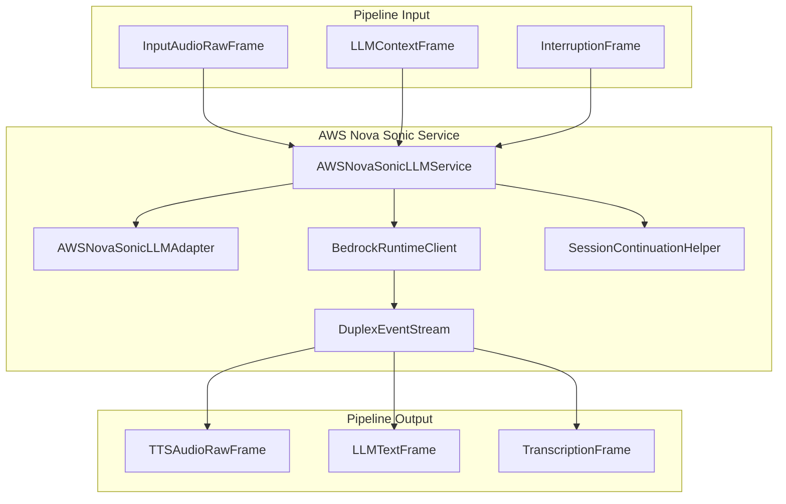
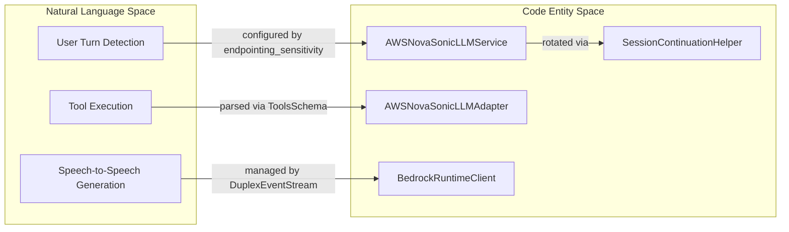

<!-- source: DeepWiki mcp.deepwiki.com · repo pipecat-ai/pipecat · extra page AWS Nova Sonic · fetched 2026-10-27 -->

# AWS Nova Sonic

Relevant source files

The following files were used as context for generating this wiki page:

- [src/pipecat/services/aws/__init__.py](src/pipecat/services/aws/__init__.py)
- [src/pipecat/services/aws/agent_core.py](src/pipecat/services/aws/agent_core.py)
- [src/pipecat/services/aws/nova_sonic/__init__.py](src/pipecat/services/aws/nova_sonic/__init__.py)
- [src/pipecat/services/aws/nova_sonic/llm.py](src/pipecat/services/aws/nova_sonic/llm.py)
- [src/pipecat/services/aws/nova_sonic/ready.wav](src/pipecat/services/aws/nova_sonic/ready.wav)
- [src/pipecat/services/aws/nova_sonic/session_continuation.py](src/pipecat/services/aws/nova_sonic/session_continuation.py)
- [src/pipecat/services/aws/sagemaker/__init__.py](src/pipecat/services/aws/sagemaker/__init__.py)
- [src/pipecat/services/aws/tts.py](src/pipecat/services/aws/tts.py)
- [src/pipecat/services/aws/utils.py](src/pipecat/services/aws/utils.py)
- [src/pipecat/services/google/gemini_live/llm.py](src/pipecat/services/google/gemini_live/llm.py)
- [src/pipecat/services/google/tts.py](src/pipecat/services/google/tts.py)
- [src/pipecat/services/inworld/realtime/events.py](src/pipecat/services/inworld/realtime/events.py)
- [src/pipecat/services/inworld/realtime/llm.py](src/pipecat/services/inworld/realtime/llm.py)
- [src/pipecat/services/nvidia/stt.py](src/pipecat/services/nvidia/stt.py)
- [src/pipecat/services/nvidia/tts.py](src/pipecat/services/nvidia/tts.py)
- [src/pipecat/services/openai/realtime/llm.py](src/pipecat/services/openai/realtime/llm.py)
- [src/pipecat/services/openai/tts.py](src/pipecat/services/openai/tts.py)
- [src/pipecat/services/speechmatics/tts.py](src/pipecat/services/speechmatics/tts.py)
- [src/pipecat/services/ultravox/llm.py](src/pipecat/services/ultravox/llm.py)
- [src/pipecat/services/xai/realtime/llm.py](src/pipecat/services/xai/realtime/llm.py)
- [tests/test_aws_credentials.py](tests/test_aws_credentials.py)
- [tests/test_gemini_tts.py](tests/test_gemini_tts.py)
- [tests/test_inworld_realtime_context.py](tests/test_inworld_realtime_context.py)

## Purpose and Scope

This document covers AWS Nova Sonic integration in Pipecat, detailing speech-to-speech capabilities, endpointing sensitivity, context management, session continuation, AWS credential resolution, and asynchronous client streaming via AWS Bedrock. AWS Nova Sonic is implemented via `AWSNovaSonicLLMService` [src/pipecat/services/aws/nova_sonic/llm.py:7-11](), providing bidirectional audio streaming, text generation, and function calling capabilities.

Sources: [src/pipecat/services/aws/nova_sonic/llm.py:7-11]()

## Overview

AWS Nova Sonic operates as a speech-to-speech LLM service that accepts PCM audio input and yields PCM audio output directly [src/pipecat/services/aws/nova_sonic/llm.py:7-11](). By utilizing AWS Bedrock's bidirectional streaming API (`DuplexEventStream`), it bypasses the need for separate STT and TTS services in the pipeline.

### Key Capabilities

- **Native Audio Processing**: Streams raw audio frames directly between the user and Bedrock [src/pipecat/services/aws/nova_sonic/llm.py:7-11]().
- **Duplex Event Stream**: Relies on `DuplexEventStream` for real-time bi-directional messaging [src/pipecat/services/aws/nova_sonic/llm.py:91-91]().
- **Function Calling**: Supports tool use and execution within the bidirectional audio stream [src/pipecat/services/aws/nova_sonic/llm.py:29-32]().
- **Text Generation Stages**: Employs `TextStage` (`FINAL` and `SPECULATIVE`) to distinguish between what has been spoken versus what is planned [src/pipecat/services/aws/nova_sonic/llm.py:119-128]().
- **Endpointing Sensitivity**: Configurable via `endpointing_sensitivity` ("LOW", "MEDIUM", or "HIGH") to control user turn termination speed [src/pipecat/services/aws/nova_sonic/llm.py:181-186]().
- **Session Continuation**: Managed via `SessionContinuationHelper` to handle background session rotation and exceed standard AWS session limits [src/pipecat/services/aws/nova_sonic/llm.py:65-68]().

Sources: [src/pipecat/services/aws/nova_sonic/llm.py:7-11](), [src/pipecat/services/aws/nova_sonic/llm.py:29-32](), [src/pipecat/services/aws/nova_sonic/llm.py:65-68](), [src/pipecat/services/aws/nova_sonic/llm.py:91-91](), [src/pipecat/services/aws/nova_sonic/llm.py:119-128](), [src/pipecat/services/aws/nova_sonic/llm.py:181-186]()

## Service Architecture and Data Flow

The `AWSNovaSonicLLMService` class translates pipeline frames into Bedrock-compatible payloads using `AWSNovaSonicLLMAdapter` [src/pipecat/services/aws/nova_sonic/llm.py:32]() and manages the underlying `BedrockRuntimeClient` [src/pipecat/services/aws/nova_sonic/llm.py:76-79]().

**Diagram: AWS Nova Sonic Service Architecture**

Sources: [src/pipecat/services/aws/nova_sonic/llm.py:32](), [src/pipecat/services/aws/nova_sonic/llm.py:76-91]()

## Bridging Natural Language Space to Code Entities

To map conversational concepts to concrete codebase components, the following diagram illustrates how user utterances and turn management interface with specific service and adapter classes.

**Diagram: Natural Language Space to Code Entity Mapping**

Sources: [src/pipecat/services/aws/nova_sonic/llm.py:29-32](), [src/pipecat/services/aws/nova_sonic/llm.py:65-68](), [src/pipecat/services/aws/nova_sonic/llm.py:76-91](), [src/pipecat/services/aws/nova_sonic/llm.py:181-186]()

## AWS Credential Resolution

Pipecat resolves AWS credentials using explicit constructor parameters, environment variables (`AWS_ACCESS_KEY_ID`, `AWS_SECRET_ACCESS_KEY`, `AWS_SESSION_TOKEN`, `AWS_REGION`), or fallback credential resolvers provided by the underlying SDK components (`StaticCredentialsResolver`) [src/pipecat/services/aws/nova_sonic/llm.py:90-90]().

Sources: [src/pipecat/services/aws/nova_sonic/llm.py:90-90]()

## Context Management and Session Continuation

### Context Handling
AWS Nova Sonic integrates with Pipecat's universal `LLMContext` system [src/pipecat/services/aws/nova_sonic/llm.py:60-60](). The `AWSNovaSonicLLMAdapter` [src/pipecat/services/aws/nova_sonic/llm.py:32]() maps context structures into the event payloads expected by the Bedrock streaming endpoint.

### Session Continuation
Because long-running conversational sessions may approach provider limits, `SessionContinuationHelper` handles background session rotation and state preservation without interrupting the active audio stream [src/pipecat/services/aws/nova_sonic/llm.py:65-68](). This helper ensures that the conversation can continue seamlessly even when the underlying AWS session needs to be refreshed or re-established.

Sources: [src/pipecat/services/aws/nova_sonic/llm.py:32](), [src/pipecat/services/aws/nova_sonic/llm.py:60-68]()

## Endpointing Sensitivity and Text Stages

### Endpointing Sensitivity
The `endpointing_sensitivity` parameter determines how quickly Nova Sonic infers that a user has stopped speaking [src/pipecat/services/aws/nova_sonic/llm.py:181-186]():
-   **`LOW`**: Slower response triggers, allowing longer pauses.
-   **`MEDIUM`**: Default moderation.
-   **`HIGH`**: Highly sensitive detection that reacts rapidly to pauses.

This setting is crucial for tailoring the conversational flow to different user interaction styles and application requirements.

### Text Generation Stages
Responses use the `TextStage` enum to handle real-time modifications [src/pipecat/services/aws/nova_sonic/llm.py:119-128]():
-   **`FINAL`**: Verified text output that has been committed to the conversation history [src/pipecat/services/aws/nova_sonic/llm.py:127-127]().
-   **`SPECULATIVE`**: Preliminary text generation that may be revised or canceled if an interruption occurs [src/pipecat/services/aws/nova_sonic/llm.py:128-128]().

This distinction allows the system to provide immediate, albeit potentially provisional, responses while maintaining the flexibility to adapt to new user input or model revisions.

Sources: [src/pipecat/services/aws/nova_sonic/llm.py:119-128](), [src/pipecat/services/aws/nova_sonic/llm.py:181-186]()

---

