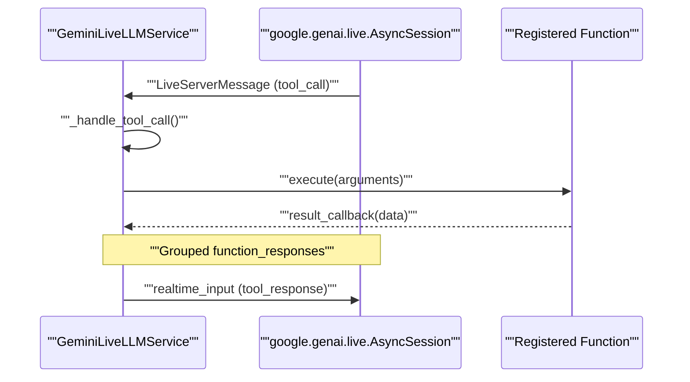

<!-- source: DeepWiki mcp.deepwiki.com · repo pipecat-ai/pipecat · extra page Google Gemini Live · fetched 2026-10-27 -->

# Google Gemini Live

<details>
<summary>Relevant source files</summary>

The following files were used as context for generating this wiki page:

- [examples/function-calling/function-calling-google-vertex.py](examples/function-calling/function-calling-google-vertex.py)
- [examples/thinking/thinking-anthropic.py](examples/thinking/thinking-anthropic.py)
- [examples/thinking/thinking-functions-anthropic.py](examples/thinking/thinking-functions-anthropic.py)
- [examples/thinking/thinking-functions-google-vertex.py](examples/thinking/thinking-functions-google-vertex.py)
- [examples/thinking/thinking-functions-google.py](examples/thinking/thinking-functions-google.py)
- [examples/thinking/thinking-functions-openai-responses.py](examples/thinking/thinking-functions-openai-responses.py)
- [examples/thinking/thinking-google-vertex.py](examples/thinking/thinking-google-vertex.py)
- [examples/thinking/thinking-google.py](examples/thinking/thinking-google.py)
- [examples/thinking/thinking-openai-responses-http.py](examples/thinking/thinking-openai-responses-http.py)
- [examples/thinking/thinking-openai-responses.py](examples/thinking/thinking-openai-responses.py)
- [examples/update-settings/llm/llm-google-vertex.py](examples/update-settings/llm/llm-google-vertex.py)
- [src/pipecat/services/aws/nova_sonic/llm.py](src/pipecat/services/aws/nova_sonic/llm.py)
- [src/pipecat/services/google/gemini_live/llm.py](src/pipecat/services/google/gemini_live/llm.py)
- [src/pipecat/services/google/vertex/__init__.py](src/pipecat/services/google/vertex/__init__.py)
- [src/pipecat/services/google/vertex/llm.py](src/pipecat/services/google/vertex/llm.py)
- [src/pipecat/services/inworld/realtime/events.py](src/pipecat/services/inworld/realtime/events.py)
- [src/pipecat/services/inworld/realtime/llm.py](src/pipecat/services/inworld/realtime/llm.py)
- [src/pipecat/services/openai/realtime/llm.py](src/pipecat/services/openai/realtime/llm.py)
- [src/pipecat/services/ultravox/llm.py](src/pipecat/services/ultravox/llm.py)
- [src/pipecat/services/xai/realtime/llm.py](src/pipecat/services/xai/realtime/llm.py)
- [tests/test_google_safety_settings.py](tests/test_google_safety_settings.py)
- [tests/test_google_thinking_defaults.py](tests/test_google_thinking_defaults.py)
- [tests/test_inworld_realtime_context.py](tests/test_inworld_realtime_context.py)

</details>


This page documents the Google Gemini Live speech-to-speech service integration in Pipecat. Gemini Live provides real-time conversational AI with integrated speech-to-speech capabilities using Google's Live API [src/pipecat/services/google/gemini_live/llm.py:7-12]().

## Overview

`GeminiLiveLLMService` is a speech-to-speech service that combines STT, LLM, and TTS into a unified bidirectional streaming interface [src/pipecat/services/google/gemini_live/llm.py:7-12]().

**Key Characteristics:**
- **Single-service S2S**: Audio input flows directly to the service; audio output streams back without intermediate TTS processors [src/pipecat/services/google/gemini_live/llm.py:9-11]().
- **Native Audio Processing**: The model processes audio internally rather than performing explicit separate transcription steps [src/pipecat/services/google/gemini_live/llm.py:9-11]().
- **WebSocket-Based**: Utilizes a persistent WebSocket connection via the `google.genai` SDK (`AsyncSession`) [src/pipecat/services/google/gemini_live/llm.py:79-108]().
- **Universal Context**: Integrates with Pipecat's universal `LLMContext` system for message history and tool definitions [src/pipecat/services/google/gemini_live/llm.py:64-65]().

Sources: [src/pipecat/services/google/gemini_live/llm.py:7-108]()

## Namespace Migration and Deprecation

The service was previously named `GeminiMultimodalLiveLLMService` and located in legacy packages. It has been migrated to `pipecat.services.google.gemini_live` [src/pipecat/services/google/gemini_live/llm.py:7-12]().

| Old Type (Deprecated) | New Type |
| :--- | :--- |
| `GeminiMultimodalLiveLLMService` | `GeminiLiveLLMService` [src/pipecat/services/google/gemini_live/llm.py:236]() |
| `GeminiMultimodalLiveContext` | Universal `LLMContext` [src/pipecat/services/google/gemini_live/llm.py:64-65]() |
| `GeminiMultimodalModalities` | `GeminiModalities` [src/pipecat/services/google/gemini_live/llm.py:215]() |

Sources: [src/pipecat/services/google/gemini_live/llm.py:215-225](), [src/pipecat/services/google/gemini_live/llm.py:236-250]()

## Service Architecture

The following diagram bridges natural language space to code entity space, mapping Pipecat pipeline data flows to the internal `GeminiLiveLLMService` implementation and the Google GenAI SDK entities.

Title: "Gemini Live Data Flow and Entity Mapping"
```mermaid
graph TB
    subgraph "Natural Language & Pipeline Space"
        InputAudio[""InputAudioRawFrame""]
        InputImage[""InputImageRawFrame""]
        InputText[""InputTextRawFrame""]
        OutputAudio[""TTSAudioRawFrame""]
        OutputText[""LLMTextFrame""]
        UpdateSettings[""LLMUpdateSettingsFrame""]
    end
    
    subgraph "Code Entity Space: GeminiLiveLLMService"
        ProcessFrame[""process_frame()""]
        ContextMgr[""_context: LLMContext""]
        Session[""_session: AsyncSession""]
        ReceiveTask[""_receive_task()""]
        
        subgraph "Audio Pipeline Subsystem"
            SendAudio[""_send_audio()""]
            AudioQueue[""_pending_audio_chunks""]
            SendTask[""_audio_send_task()""]
        end
        
        subgraph "Configuration & Logic"
            Settings[""GeminiLiveLLMService.Settings""]
            Connect[""_connect()""]
            HandleContext[""_handle_context()""]
            RunFunctions[""run_function_calls()""]
        end
    end
    
    subgraph "Google GenAI SDK Space"
        GenAIClient[""google.genai.Client""]
        LiveSession[""google.genai.live.AsyncSession""]
        LiveConnectConfig[""google.genai.types.LiveConnectConfig""]
        ServerMessage[""google.genai.types.LiveServerMessage""]
    end
    
    InputAudio --> ProcessFrame
    InputImage --> ProcessFrame
    InputText --> ProcessFrame
    UpdateSettings --> ProcessFrame
    
    ProcessFrame -->|"_send_audio()"| AudioQueue
    AudioQueue --> SendTask
    SendTask -->|"realtime_input"| LiveSession
    
    ProcessFrame -->|"_handle_context()"| ContextMgr
    ContextMgr -->|"LiveConnectConfig"| Connect
    Connect -->|"client.live.connect()"| GenAIClient
    GenAIClient --> LiveSession
    
    LiveSession -->|"stream"| ReceiveTask
    ReceiveTask -->|"parse"| ServerMessage
    
    ServerMessage -->|"server_content.model_turn (audio)"| OutputAudio
    ServerMessage -->|"server_content.model_turn (text)"| OutputText
    ServerMessage -->|"tool_call"| RunFunctions
```

Sources: [src/pipecat/services/google/gemini_live/llm.py:79-108](), [src/pipecat/services/google/gemini_live/llm.py:236-260]()

## Key Implementation Details

### Audio and Video Handling
- **Audio Queueing**: Audio frames are buffered in `_pending_audio_chunks` and dispatched via a dedicated `_audio_send_task` [src/pipecat/services/google/gemini_live/llm.py:79-120]().
- **Image Input**: `InputImageRawFrame` instances are encoded and transmitted via `realtime_input` messages [src/pipecat/services/google/gemini_live/llm.py:40]().
- **User Audio Preroll**: To mitigate speech-onset clipping when server-side VAD is disabled, the service replays an audio pre-roll buffer governed by `user_audio_preroll_secs`, falling back to `DEFAULT_USER_AUDIO_PREROLL_SECS` (0.5s) or `AUTOSIZED_USER_AUDIO_PREROLL_MARGIN_SECS` (0.1s) [src/pipecat/services/google/gemini_live/llm.py:83-152]().

Sources: [src/pipecat/services/google/gemini_live/llm.py:40](), [src/pipecat/services/google/gemini_live/llm.py:79-152]()

### Token Usage and Metrics
- **Modality Breakdown**: Token counts are extracted from `usage_metadata`, tracking input audio tokens, output audio tokens, and cache hits [src/pipecat/services/google/gemini_live/llm.py:123-141]().
- **Reasoning Tokens**: Reasoning token counts map to OpenTelemetry attributes (`gen_ai.usage.reasoning.output_tokens`) [src/pipecat/services/google/gemini_live/llm.py:50-52]().

Sources: [src/pipecat/services/google/gemini_live/llm.py:50-52](), [src/pipecat/services/google/gemini_live/llm.py:123-141]()

### Context Window Compression
The service integrates `ContextWindowCompressionConfig` with a `SlidingWindow` strategy to automatically prune historical context upon reaching token thresholds [src/pipecat/services/google/gemini_live/llm.py:90-91](), [src/pipecat/services/google/gemini_live/llm.py:109-110]().

Sources: [src/pipecat/services/google/gemini_live/llm.py:90-91](), [src/pipecat/services/google/gemini_live/llm.py:109-110]()

### Affective Dialog and Thinking Mode
- **Affective Dialog**: Enabled via `enable_affective_dialog` in settings to produce expressive voice outputs [src/pipecat/services/google/gemini_live/llm.py:158]().
- **Thinking Config**: Supports `ThinkingConfig` to capture reasoning streams, emitting `LLMThoughtStartFrame`, `LLMThoughtTextFrame`, and `LLMThoughtEndFrame` [src/pipecat/services/google/gemini_live/llm.py:49-52](), [src/pipecat/services/google/gemini_live/llm.py:112]().

Sources: [src/pipecat/services/google/gemini_live/llm.py:49-52](), [src/pipecat/services/google/gemini_live/llm.py:112](), [src/pipecat/services/google/gemini_live/llm.py:158]()

### Files API
The `GeminiFileAPI` utility handles uploading and managing external files (images, audio) referenced as multimodal inputs in Gemini sessions [src/pipecat/services/google/gemini_live/llm.py:83]().

Sources: [src/pipecat/services/google/gemini_live/llm.py:83]()

### Function Call Execution Flow

Title: "Gemini Live Function Calling Sequence"


Sources: [src/pipecat/services/google/gemini_live/llm.py:79-113]()

## Vertex AI Integration

`GoogleVertexLLMService` and associated Vertex variants provide enterprise integration via Google Cloud Vertex AI, authenticating through GCP credentials (`credentials` or `credentials_path`) using `project_id` and `location` [src/pipecat/services/google/vertex/llm.py:49-79]().

Sources: [src/pipecat/services/google/vertex/llm.py:49-134]()

## VAD and Sensitivity
Internal VAD configuration is supported via `StartSensitivity` and `EndSensitivity` inside `SpeechConfig` [src/pipecat/services/google/gemini_live/llm.py:81-115]().

Sources: [src/pipecat/services/google/gemini_live/llm.py:81-115]()

---

