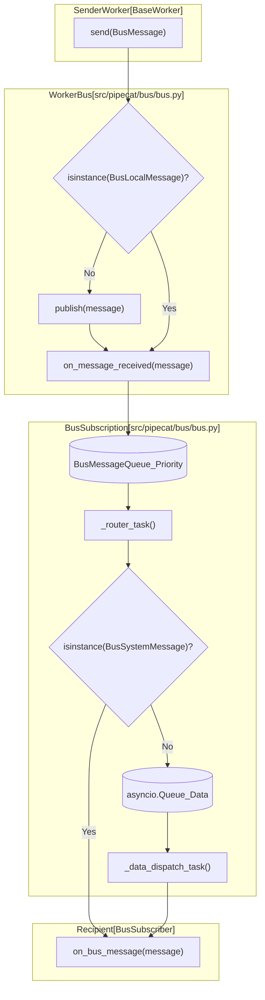
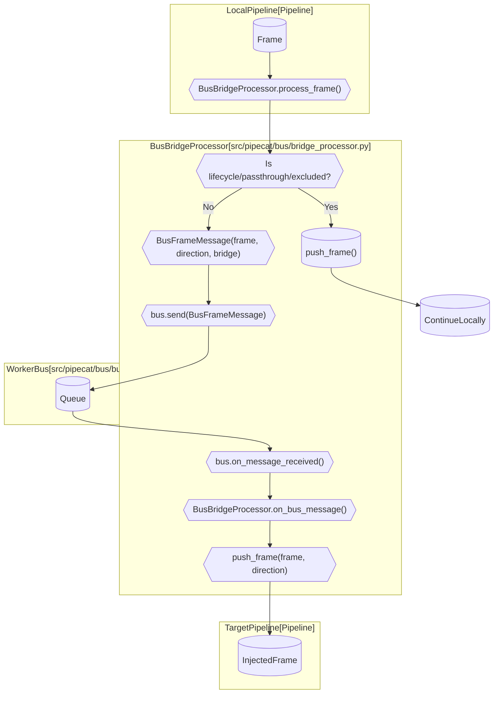
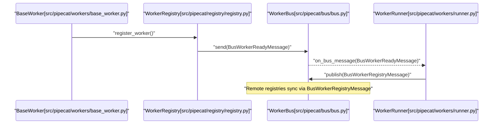
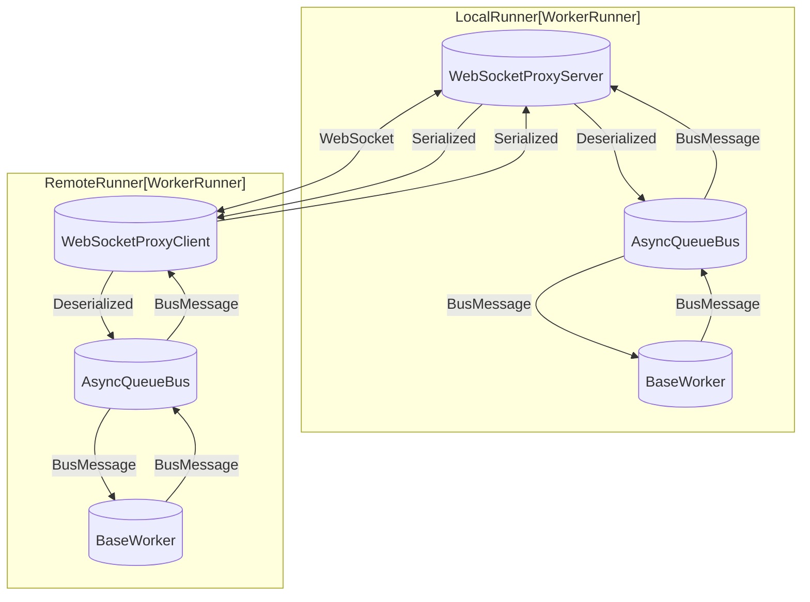

<!-- source: DeepWiki mcp.deepwiki.com · repo pipecat-ai/pipecat · extra page Worker Architecture and Bus · fetched 2026-10-27 -->

# Worker Architecture and Bus

Relevant source files

The following files were used as context for generating this wiki page:

- [src/pipecat/bus/__init__.py](src/pipecat/bus/__init__.py)
- [src/pipecat/bus/bridge_processor.py](src/pipecat/bus/bridge_processor.py)
- [src/pipecat/bus/bus.py](src/pipecat/bus/bus.py)
- [src/pipecat/bus/local/async_queue.py](src/pipecat/bus/local/async_queue.py)
- [src/pipecat/bus/messages.py](src/pipecat/bus/messages.py)
- [src/pipecat/bus/network/__init__.py](src/pipecat/bus/network/__init__.py)
- [src/pipecat/bus/network/pgmq.py](src/pipecat/bus/network/pgmq.py)
- [src/pipecat/bus/network/pgmq_backends.py](src/pipecat/bus/network/pgmq_backends.py)
- [src/pipecat/bus/network/redis.py](src/pipecat/bus/network/redis.py)
- [src/pipecat/bus/queue.py](src/pipecat/bus/queue.py)
- [src/pipecat/bus/subscriber.py](src/pipecat/bus/subscriber.py)
- [src/pipecat/pipeline/worker.py](src/pipecat/pipeline/worker.py)
- [src/pipecat/utils/startup.py](src/pipecat/utils/startup.py)
- [src/pipecat/workers/base_worker.py](src/pipecat/workers/base_worker.py)
- [src/pipecat/workers/runner.py](src/pipecat/workers/runner.py)
- [tests/test_base_worker.py](tests/test_base_worker.py)
- [tests/test_bus.py](tests/test_bus.py)
- [tests/test_job_group.py](tests/test_job_group.py)
- [tests/test_messages.py](tests/test_messages.py)
- [tests/test_pgmq_backends.py](tests/test_pgmq_backends.py)
- [tests/test_pgmq_bus.py](tests/test_pgmq_bus.py)
- [tests/test_redis_bus.py](tests/test_redis_bus.py)
- [tests/test_runner.py](tests/test_runner.py)
- [tests/test_serializers.py](tests/test_serializers.py)
- [tests/test_utils_startup.py](tests/test_utils_startup.py)
- [tests/test_websocket_proxy.py](tests/test_websocket_proxy.py)

The Worker Bus is the central nervous system of Pipecat's multi-agent framework. It provides a pub/sub infrastructure that enables asynchronous communication between workers and the `WorkerRunner`. This system allows workers to coordinate actions, share conversation state, and transport pipeline frames across process boundaries [src/pipecat/bus/messages.py:7-11]().

Sources: [src/pipecat/bus/messages.py:7-11]()

---

## WorkerBus System

The `WorkerBus` is an abstract base class (`WorkerBus`) that defines the interface for inter-worker and runner-worker communication [src/pipecat/bus/bus.py:49-61](). It manages a set of `BusSubscription` objects, each representing a local subscriber's state (`BusSubscriber`), including its priority queues and dispatch tasks [src/pipecat/bus/bus.py:27-48]().

### Message Priority and Queuing

The bus implements a dual-queue system for every subscriber (`BusSubscription`) to ensure that critical control signals (like cancellations) are never stuck behind high-volume data (like audio frames) [src/pipecat/bus/bus.py:169-192]().

1. **Priority Queue (`BusMessageQueue`)**: Receives all incoming messages [src/pipecat/bus/bus.py:43-43]().
2. **Router Task (`_router_task`)**: Reads from the priority queue. If a message is a `BusSystemMessage`, it is dispatched immediately to the subscriber via `on_bus_message`. If the subscriber raises an exception, the router logs it and continues to ensure the dispatch task does not die [src/pipecat/bus/bus.py:169-185]().
3. **Data Queue (`asyncio.Queue`)**: Stores `BusDataMessage` types [src/pipecat/bus/bus.py:44-44]().
4. **Data Dispatch Task (`_data_dispatch_task`)**: Processes data messages sequentially in FIFO order to maintain causal consistency for pipeline operations [src/pipecat/bus/bus.py:187-192]().

Sources: [src/pipecat/bus/bus.py:27-192]()

### Bus Message Hierarchy

Messages are categorized by their priority and scope [src/pipecat/bus/messages.py:32-78]():

| Message Type | Description | Priority |
| :--- | :--- | :--- |
| `BusDataMessage` | Standard messages (frames, job requests, TTS commands) [src/pipecat/bus/messages.py:69-75](). | Normal (FIFO) |
| `BusSystemMessage` | High-priority control messages (cancellation, registry updates, errors) [src/pipecat/bus/messages.py:79-86](). | High (OOB) |
| `BusLocalMessage` | Mixin for messages that must never leave the local process (e.g., carrying object references like a `BaseWorker` instance) [src/pipecat/bus/messages.py:62-65](). | N/A |

Sources: [src/pipecat/bus/messages.py:32-86]()

### Message Data Flow

The following diagram illustrates how a message flows from a sender through the `WorkerBus` to a `BusSubscriber`.

#### WorkerBus Message Flow

Sources: [src/pipecat/bus/bus.py:127-192](), [src/pipecat/bus/messages.py:32-78]()

---

## Concrete Bus Implementations

### Local: AsyncQueueBus
The `AsyncQueueBus` is the default in-process implementation. It uses `asyncio.Queue` for transport and is suitable for single-process, multi-agent setups where all workers share the same memory space [src/pipecat/bus/local/async_queue.py:1-10]().

Sources: [src/pipecat/bus/local/async_queue.py:1-10]()

### Distributed: RedisBus
The `RedisBus` uses Redis Pub/Sub for cross-process communication. It serializes `BusMessage` objects using a `MessageSerializer` (defaulting to `JSONMessageSerializer`) before publishing them to a configured Redis channel [src/pipecat/bus/network/redis.py:27-42]().

* **Requirements**: `uv add "pipecat-ai[redis]"` [src/pipecat/bus/network/redis.py:21-24]().
* **Behavior**: Messages with the `BusLocalMessage` mixin bypass Redis and are delivered directly to local subscribers via `on_message_received` [src/pipecat/bus/network/redis.py:31-32](), [src/pipecat/bus/bus.py:136-139]().

Sources: [src/pipecat/bus/network/redis.py:27-109](), [src/pipecat/bus/bus.py:136-139]()

### Distributed: PgmqBus
The `PgmqBus` uses PostgreSQL Message Queue (PGMQ) for transport. It supports two backends for different security models [src/pipecat/bus/network/pgmq.py:31-55]().

1. **`DirectPgmqBackend`**: Calls `pgmq.*` functions directly. It discovers peers by scanning for queue-name prefixes [src/pipecat/bus/network/pgmq_backends.py:139-154]().
2. **`IsolatedPgmqBackend`**: Calls `SECURITY DEFINER` Postgres wrappers (`public.bus_join`, `bus_publish`, `bus_subscribe`, `bus_archive`, `bus_leave`) via an `asyncpg` pool. This is suitable when peers should be isolated and the channel name itself acts as the capability to access the bus [src/pipecat/bus/network/pgmq.py:46-48](), [src/pipecat/bus/network/pgmq_backends.py:23-29]().

Sources: [src/pipecat/bus/network/pgmq.py:31-135](), [src/pipecat/bus/network/pgmq_backends.py:1-30]()

---

## BridgeProcessor: Transporting Frames

Pipeline `Frame` objects are not native bus messages. To send a frame across the bus, it must be wrapped in a `BusFrameMessage`, which includes the frame, its intended `FrameDirection`, and an optional bridge identifier [src/pipecat/bus/messages.py:94-106]().

### BusBridgeProcessor
A mid-pipeline processor (`BusBridgeProcessor`) used by workers to exchange frames with other workers via the bus [src/pipecat/bus/bridge_processor.py:43-49]().
* **Outbound**: It intercepts frames in `process_frame`, wraps them in `BusFrameMessage`, and sends them to the bus [src/pipecat/bus/bridge_processor.py:133-139]().
* **Inbound**: It implements `BusSubscriber.on_bus_message`, unwraps `BusFrameMessage` payloads, and pushes the frames into the local pipeline [src/pipecat/bus/bridge_processor.py:141-171]().
* **Exclusions**: Lifecycle frames (`StartFrame`, `EndFrame`, `CancelFrame`, `StopFrame`) [src/pipecat/bus/bridge_processor.py:39-39]() and urgent transport frames (`OutputTransportMessageUrgentFrame`) [src/pipecat/bus/bridge_processor.py:40-40]() pass through locally and never cross the bus [src/pipecat/bus/bridge_processor.py:117-126]().

### _BusEdgeProcessor
Used internally by `PipelineWorker` when the `bridged` parameter is set (`_BusEdgeProcessor`). It acts as a "tee," allowing frames to continue through the local pipeline while simultaneously forwarding them to the bus [src/pipecat/bus/bridge_processor.py:174-188]().

Sources: [src/pipecat/bus/bridge_processor.py:39-192](), [src/pipecat/bus/messages.py:94-106]()

#### BusBridgeProcessor Frame Flow

Sources: [src/pipecat/bus/bridge_processor.py:41-192](), [src/pipecat/bus/messages.py:94-106]()

---

## WorkerRegistry and Peer Discovery

The `WorkerRegistry` tracks all known workers across local and remote runners. It facilitates peer discovery in distributed environments.

1. **Registration**: When a worker becomes ready, it is registered, and a `BusWorkerReadyMessage` is broadcast [src/pipecat/bus/messages.py:240-252]().
2. **Discovery Messages**: The runner uses `BusWorkerRegistryMessage` to broadcast snapshots of its managed workers so remote runners can synchronize their registries [src/pipecat/bus/messages.py:224-237]().

Sources: [src/pipecat/bus/messages.py:224-252]()

#### Worker Discovery and Registry Flow

Sources: [src/pipecat/bus/messages.py:224-252]()

---

## Distributed Proxying

For workers that cannot connect directly to a shared bus (e.g., a worker running in a remote environment or behind a firewall), Pipecat provides WebSocket-based proxying.

* **`WebSocketProxyServer`**: Sits on a local `WorkerBus` and forwards messages targeted at a remote worker over a WebSocket connection [src/pipecat/workers/proxy/websocket/server.py:28-33](). It accepts a Starlette `WebSocket` connection and manages the receive loop to deserialize incoming messages and put them on the local bus [src/pipecat/workers/proxy/websocket/server.py:181-205](). It also forwards messages from the local worker to the remote client based on target and source worker names [src/pipecat/workers/proxy/websocket/server.py:165-170]().
* **`WebSocketProxyClient`**: Connects to the server and appears as a local worker to its peers [src/pipecat/workers/proxy/websocket/client.py:22-26](). It forwards outbound messages to the `WebSocketProxyServer` and injects inbound messages into its local bus [src/pipecat/workers/proxy/websocket/client.py:146-152](). It handles connection and disconnection events [src/pipecat/workers/proxy/websocket/client.py:100-101]().

Sources: [src/pipecat/workers/proxy/websocket/client.py:22-178](), [src/pipecat/workers/proxy/websocket/server.py:28-179]()

#### WebSocket Proxy Architecture

Sources: [src/pipecat/workers/proxy/websocket/client.py:22-178](), [src/pipecat/workers/proxy/websocket/server.py:28-179]()

---

