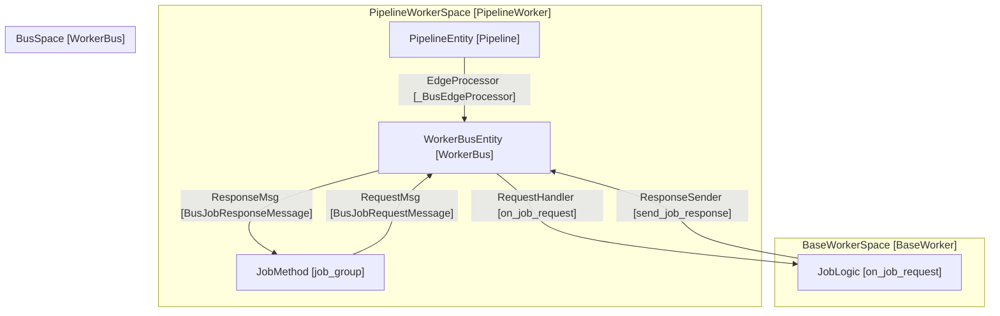
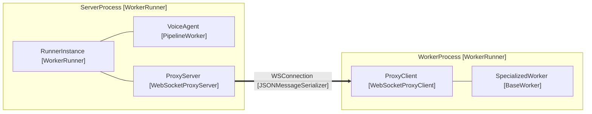
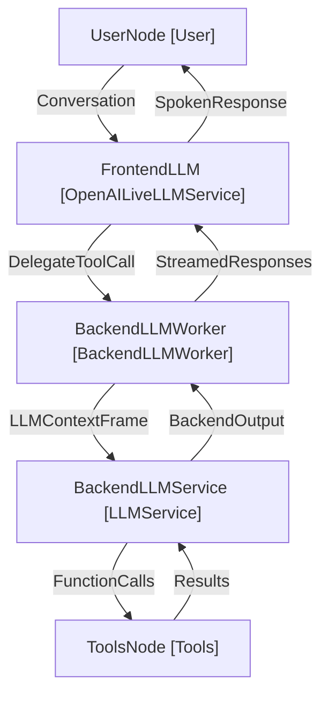

<!-- source: DeepWiki mcp.deepwiki.com · repo pipecat-ai/pipecat · extra page Worker Types and Patterns · fetched 2026-10-27 -->

# Worker Types and Patterns

Relevant source files

The following files were used as context for generating this wiki page:

- [changelog/5689.added.3.md](changelog/5689.added.3.md)
- [changelog/5689.added.md](changelog/5689.added.md)
- [changelog/5689.changed.3.md](changelog/5689.changed.3.md)
- [changelog/5689.fixed.3.md](changelog/5689.fixed.3.md)
- [examples/multi-worker/README.md](examples/multi-worker/README.md)
- [examples/multi-worker/openclaw-agent/README.md](examples/multi-worker/openclaw-agent/README.md)
- [examples/multi-worker/openclaw-agent/openclaw-agent.py](examples/multi-worker/openclaw-agent/openclaw-agent.py)
- [examples/multi-worker/openclaw-agent/openclaw_worker.py](examples/multi-worker/openclaw-agent/openclaw_worker.py)
- [examples/multi-worker/ui-worker/async-tasks/README.md](examples/multi-worker/ui-worker/async-tasks/README.md)
- [examples/multi-worker/ui-worker/async-tasks/bot.py](examples/multi-worker/ui-worker/async-tasks/bot.py)
- [examples/multi-worker/ui-worker/deixis/README.md](examples/multi-worker/ui-worker/deixis/README.md)
- [examples/multi-worker/ui-worker/deixis/bot.py](examples/multi-worker/ui-worker/deixis/bot.py)
- [examples/multi-worker/ui-worker/document-review/README.md](examples/multi-worker/ui-worker/document-review/README.md)
- [examples/multi-worker/ui-worker/document-review/bot.py](examples/multi-worker/ui-worker/document-review/bot.py)
- [examples/multi-worker/ui-worker/form-fill/README.md](examples/multi-worker/ui-worker/form-fill/README.md)
- [examples/multi-worker/ui-worker/form-fill/bot.py](examples/multi-worker/ui-worker/form-fill/bot.py)
- [examples/multi-worker/ui-worker/hello-snapshot/README.md](examples/multi-worker/ui-worker/hello-snapshot/README.md)
- [examples/multi-worker/ui-worker/hello-snapshot/bot.py](examples/multi-worker/ui-worker/hello-snapshot/bot.py)
- [examples/multi-worker/ui-worker/shopping-list/README.md](examples/multi-worker/ui-worker/shopping-list/README.md)
- [examples/multi-worker/ui-worker/shopping-list/bot.py](examples/multi-worker/ui-worker/shopping-list/bot.py)
- [examples/persistent-context/persistent-context-openai-live-responses-delegation.py](examples/persistent-context/persistent-context-openai-live-responses-delegation.py)
- [examples/realtime/realtime-openai-live-client-delegation-speaking-policy.py](examples/realtime/realtime-openai-live-client-delegation-speaking-policy.py)
- [examples/realtime/realtime-openai-live-client-delegation.py](examples/realtime/realtime-openai-live-client-delegation.py)
- [examples/realtime/realtime-openai-live-responses-delegation.py](examples/realtime/realtime-openai-live-responses-delegation.py)
- [src/pipecat/adapters/services/open_ai_live_adapter.py](src/pipecat/adapters/services/open_ai_live_adapter.py)
- [src/pipecat/bus/ui/__init__.py](src/pipecat/bus/ui/__init__.py)
- [src/pipecat/bus/ui/messages.py](src/pipecat/bus/ui/messages.py)
- [src/pipecat/pipeline/job_context.py](src/pipecat/pipeline/job_context.py)
- [src/pipecat/pipeline/llm_with_backend.py](src/pipecat/pipeline/llm_with_backend.py)
- [src/pipecat/services/openai/live/__init__.py](src/pipecat/services/openai/live/__init__.py)
- [src/pipecat/services/openai/live/events.py](src/pipecat/services/openai/live/events.py)
- [src/pipecat/services/openai/live/llm.py](src/pipecat/services/openai/live/llm.py)
- [src/pipecat/services/openclaw/__init__.py](src/pipecat/services/openclaw/__init__.py)
- [src/pipecat/services/openclaw/client.py](src/pipecat/services/openclaw/client.py)
- [src/pipecat/services/openclaw/frames.py](src/pipecat/services/openclaw/frames.py)
- [src/pipecat/services/openclaw/gateway.py](src/pipecat/services/openclaw/gateway.py)
- [src/pipecat/workers/base_ui_worker.py](src/pipecat/workers/base_ui_worker.py)
- [src/pipecat/workers/llm/__init__.py](src/pipecat/workers/llm/__init__.py)
- [src/pipecat/workers/llm/backend_llm_worker.py](src/pipecat/workers/llm/backend_llm_worker.py)
- [src/pipecat/workers/llm/llm_context_worker.py](src/pipecat/workers/llm/llm_context_worker.py)
- [src/pipecat/workers/llm/llm_worker.py](src/pipecat/workers/llm/llm_worker.py)
- [src/pipecat/workers/ui/__init__.py](src/pipecat/workers/ui/__init__.py)
- [src/pipecat/workers/ui/ui_job_context.py](src/pipecat/workers/ui/ui_job_context.py)
- [src/pipecat/workers/ui/ui_tools.py](src/pipecat/workers/ui/ui_tools.py)
- [src/pipecat/workers/ui/ui_worker.py](src/pipecat/workers/ui/ui_worker.py)
- [tests/test_backend_llm_worker.py](tests/test_backend_llm_worker.py)
- [tests/test_bridge_processor.py](tests/test_bridge_processor.py)
- [tests/test_bus_network.py](tests/test_bus_network.py)
- [tests/test_frame_adapters.py](tests/test_frame_adapters.py)
- [tests/test_llm_with_backend.py](tests/test_llm_with_backend.py)
- [tests/test_openai_live_service.py](tests/test_openai_live_service.py)
- [tests/test_openclaw.py](tests/test_openclaw.py)
- [tests/test_pipeline_worker_ui_bridge.py](tests/test_pipeline_worker_ui_bridge.py)
- [tests/test_rtvi_observer_function_calls.py](tests/test_rtvi_observer_function_calls.py)
- [tests/test_ui_job_lifecycle.py](tests/test_ui_job_lifecycle.py)
- [tests/test_ui_tools.py](tests/test_ui_tools.py)
- [tests/test_ui_worker.py](tests/test_ui_worker.py)

This page documents the core worker abstraction layer (`BaseWorker`), runtime pipeline orchestration (`PipelineWorker`), AI-specialized implementations (`LLMWorker`, `LLMContextWorker`, `UIWorker`), network proxying (`WebSocketProxyServer`, `WebSocketProxyClient`), job lifecycle management, advanced composition patterns such as `LLMWithBackend`, and multi-worker examples including openclaw integration.

## Core Worker Classes

The multi-worker framework relies on a class hierarchy that bridges asynchronous message routing (`BusSubscriber`) with frame-based pipeline processing or direct business logic.

### BaseWorker
`BaseWorker` is the abstract foundation for all workers in the system [src/pipecat/workers/base_worker.py:119](). It manages worker activation state, bus subscriptions, registry publishing, and inter-worker job requests.

- **`attach(registry, bus, worker_runner)`**: Links the worker to the shared infrastructure, subscribing it to the bus and registering it for peer discovery [src/pipecat/workers/base_worker.py:300-315]().
- **`start()` / `stop()`**: Lifecycle hooks for resource management, transitioning the worker to active and starting background dispatch tasks [src/pipecat/workers/base_worker.py:318-340]().
- **`on_bus_message(message)`**: The primary entry point for handling incoming `BusMessage` instances [src/pipecat/workers/base_worker.py:441]().
- **`on_job_request(message)`**: Handles `BusJobRequestMessage` for task-based execution, allowing non-pipeline workers to provide direct services over the bus [src/pipecat/workers/base_worker.py:491]().
- **`send_job_stream_end()`**: Cleans up active jobs from `_active_jobs` upon termination, preventing memory leaks and spurious cancellation events [src/pipecat/workers/base_worker.py:133-135]().

Sources: [src/pipecat/workers/base_worker.py:119-140](), [src/pipecat/workers/base_worker.py:300-340](), [src/pipecat/workers/base_worker.py:441-491]()

### PipelineWorker
`PipelineWorker` extends worker capabilities to manage a Pipecat frame-processing `Pipeline` [src/pipecat/pipeline/worker.py:172](). It acts as an adapter between message bus commands and downstream/upstream frame generation.

- **`queue_frame(frame, direction)`**: Injects frames directly into the pipeline graph [src/pipecat/pipeline/worker.py:461]().
- **`job(worker_name, params)`**: An async context manager that requests a job from a specific peer worker and waits for its completion.
- **`job_group(*workers, params)`**: Implements a fan-out pattern to request jobs across multiple workers concurrently, aggregating their responses [src/pipecat/pipeline/job_context.py:191-206]().
- **RTVI Bridge**: Automatically translates `BusUICommandMessage` and job events into RTVI frames (`RTVIUICommandFrame`, `RTVIUIJobGroupFrame`) for client presentation [src/pipecat/pipeline/worker.py:33-40](), [src/pipecat/pipeline/worker.py:328-340]().

Sources: [src/pipecat/pipeline/worker.py:33-40](), [src/pipecat/pipeline/worker.py:172-185](), [src/pipecat/pipeline/worker.py:328-340](), [src/pipecat/pipeline/worker.py:461]()

### LLMWorker and LLMContextWorker
`LLMWorker` extends `PipelineWorker` with built-in LLM pipeline setup and automatic tool registration via the `@tool` decorator [src/pipecat/workers/llm/llm_worker.py:66-76]().
- **Frame Deferral**: When `defer_tool_frames` is enabled, frames queued during tool execution are held in `_deferred_frames` and released only after all active tools complete, avoiding race conditions with interim audio or text [src/pipecat/workers/llm/llm_worker.py:109-115]().
- **`LLMContextWorker`**: Pre-configures a dedicated `LLMContext` and `LLMContextAggregatorPair` for secondary or auxiliary reasoning tasks separate from the main conversation loop [src/pipecat/workers/llm/llm_context_worker.py:20-21]().

Sources: [src/pipecat/workers/llm/llm_worker.py:66-135](), [src/pipecat/workers/llm/llm_context_worker.py:20-21]()

### UIWorker
`UIWorker` coordinates state synchronization and user interface control between backend workers and the client via RTVI [src/pipecat/workers/ui/ui_worker.py:7-11]():
- **`@ui_event`**: Decorator for registering handlers for client-side events [src/pipecat/workers/ui/ui_worker.py:100]().
- **Accessibility & Snapshots**: Processes `BusUIEventMessage` payloads containing client DOM or application state snapshots [src/pipecat/bus/ui/messages.py:37]().
- **`ui_job_group`**: Specialized fan-out mechanism for client-visible background operations like async research or form filling [src/pipecat/bus/ui/messages.py:41]().

Sources: [src/pipecat/workers/ui/ui_worker.py:7-155](), [src/pipecat/bus/ui/messages.py:37-41]()

### Diagram: Worker Architecture & Bus Mapping
Title: "Worker Bus Routing Topology"

Sources: [src/pipecat/workers/base_worker.py:491](), [src/pipecat/pipeline/worker.py:172](), [src/pipecat/bus/bridge_processor.py:29]()

---

## Job Context and Lifecycle

Asynchronous work across workers is governed by structured parameter models, status enums, and event protocols.

- **`JobParams`**: Configures a job sent to a single worker, including `name`, `payload`, `timeout`, `label`, and `cancellable` [src/pipecat/pipeline/job_context.py:23-47]().
- **`JobGroupParams`**: Extends `JobParams` for multi-worker requests, adding `cancel_on_error` to determine group behavior if any member worker fails [src/pipecat/pipeline/job_context.py:49-61]().
- **`JobStatus`**: Represents terminal states: `COMPLETED`, `CANCELLED`, `FAILED`, and `ERROR` [src/pipecat/pipeline/job_context.py:108-125]().
- **`JobGroup`**: Tracks fan-out progress, timeouts, event streams, and response collection keyed by worker name [src/pipecat/pipeline/job_context.py:191-206]().

Sources: [src/pipecat/pipeline/job_context.py:23-61](), [src/pipecat/pipeline/job_context.py:108-125](), [src/pipecat/pipeline/job_context.py:191-206]()

---

## WebSocket Proxy Server and Client

To scale workers across process or network boundaries, Pipecat provides proxy components that extend a `WorkerBus` over a WebSocket connection.

- **`WebSocketProxyServer`**: Hosted inside a FastAPI or application server, it accepts remote client connections, validates them, and bridges inbound/outbound messages to the local `WorkerBus` [src/pipecat/workers/proxy/websocket/server.py:28]() / [src/pipecat/workers/proxy/websocket/server.py:148-169]().
- **`WebSocketProxyClient`**: Connects a remote process runner to a central proxy server, forwarding targeted bus messages while filtering out local broadcast messages [src/pipecat/workers/proxy/websocket/client.py:22-52]() / [src/pipecat/workers/proxy/websocket/client.py:146-152]().

Sources: [src/pipecat/workers/proxy/websocket/server.py:28](), [src/pipecat/workers/proxy/websocket/server.py:148-169](), [src/pipecat/workers/proxy/websocket/client.py:22-52](), [src/pipecat/workers/proxy/websocket/client.py:146-152]()

### Diagram: Remote Worker Topology via WebSocket Proxy
Title: "WebSocket Proxy Worker Integration"

Sources: [src/pipecat/workers/proxy/websocket/client.py:22-52](), [src/pipecat/workers/runner.py:84-104]()

---

## LLM with Backend Pattern (`llm_with_backend`)

The `llm_with_backend` pattern (`LLMWithBackend`) separates conversational frontend handling from heavy backend task execution [src/pipecat/pipeline/llm_with_backend.py:7-23]().

- **Frontend**: A fast conversational LLM (or speech-to-speech model) maintaining direct dialogue with the user. This can be an `OpenAILiveLLMService` [src/pipecat/services/openai/live/llm.py:1-7] or any other `LLMService`.
- **Backend (`BackendLLMWorker`)**: Runs a larger model with tools and reasoning engines [src/pipecat/pipeline/llm_with_backend.py:39-46](). It handles complex tasks delegated by the frontend [src/pipecat/workers/llm/backend_llm_worker.py:7-12]().
- **Protocol**: The frontend exposes a `delegate` tool [src/pipecat/pipeline/llm_with_backend.py:54](). When invoked, messages are transmitted to the backend asynchronously. Responses stream back and are rendered into the frontend's conversation context using designated prefixes (e.g., `Backend:`, `Backend (thinking):`) [src/pipecat/pipeline/llm_with_backend.py:57-65](). The backend's model is instructed on how to communicate with the frontend using `BACKEND_PAIRING_INSTRUCTION` [src/pipecat/workers/llm/backend_llm_worker.py:128-149]().

Sources: [src/pipecat/pipeline/llm_with_backend.py:7-76](), [src/pipecat/workers/llm/backend_llm_worker.py:7-12](), [src/pipecat/workers/llm/backend_llm_worker.py:128-149](), [src/pipecat/services/openai/live/llm.py:1-7]()

### Diagram: LLMWithBackend Data Flow
Title: "LLMWithBackend Data Flow"

Sources: [src/pipecat/pipeline/llm_with_backend.py:7-23](), [src/pipecat/pipeline/llm_with_backend.py:54](), [src/pipecat/pipeline/llm_with_backend.py:57-65](), [src/pipecat/workers/llm/backend_llm_worker.py:7-12](), [src/pipecat/services/openai/live/llm.py:1-7]()

---

## Multi-Worker Example Patterns and OpenClaw Integration

Pipecat supports multiple specialized integration patterns and agent gateways.

### OpenClaw Integration
Pipecat integrates with OpenClaw agents through `OpenClawGatewayClient` [src/pipecat/services/openclaw/client.py:196](). The client connects to the OpenClaw Gateway WebSocket interface to drive remote agents via `chat.send`, event streams (`chat`), steering (`sessions.steer`), and abort handlers [src/pipecat/services/openclaw/client.py:7-13]().

Sources: [src/pipecat/services/openclaw/client.py:7-196]()

### Example Patterns Table

| Pattern | Description | Key Code Entities |
| :--- | :--- | :--- |
| **Local Handoff** | Agent transfers conversation control to another worker on the same bus. | `BusActivateWorkerMessage`, `BaseWorker.attach()` [examples/multi-worker/local-handoff/local-handoff-two-agents.py]() |
| **Parallel Debate** | Main agent fans out a topic to multiple `LLMContextWorker` instances simultaneously. | `job_group()` [examples/multi-worker/parallel-debate/parallel-debate.py]() |
| **UI Task Fan-out** | Dispatching background workers (e.g. Wikipedia search) with live progress cards. | `UIWorker`, `send_job_update()` [examples/multi-worker/ui-worker/async-tasks/bot.py:28-35]() |
| **Distributed Task** | Workers execute across separate processes using PGMQ or Redis brokers. | `PgmqBus`, `RedisBus` [examples/multi-worker/distributed-handoff/pgmq-handoff/llm.py](), [examples/multi-worker/distributed-handoff/redis-handoff/llm.py]() |
| **Remote Assistant** | Specialized agent runs in an isolated container or host via WebSocket proxy. | `WebSocketProxyClient`, `WebSocketProxyServer` [examples/multi-worker/remote-proxy-assistant/assistant.py]() |
| **OpenClaw Agent** | Connecting Pipecat audio/text pipelines to external OpenClaw Gateway runtimes. | `OpenClawGatewayClient`, `OpenClawGatewayService` [src/pipecat/services/openclaw/client.py:7-21](), [examples/multi-worker/openclaw-agent/openclaw_worker.py]() |
| **Document Review** | Voice LLM delegates review tasks to a `UIWorker` which uses peer workers for clarity/tone analysis. | `UIWorker`, `job_group`, `_SimulatedReviewer` [examples/multi-worker/ui-worker/document-review/bot.py:28-40]() |
| **Shopping List** | Voice LLM calls tools on a `UIWorker` to manage a shopping list, using a classifier to identify items. | `UIWorker`, `@job update`, `_checkboxes` [examples/multi-worker/ui-worker/shopping-list/bot.py:30-40]() |
| **Form Fill** | Voice LLM guides user through form filling, using `UIWorker`'s `screen` job to list, fill, and click elements. | `UIWorker`, `screen_tools` [examples/multi-worker/ui-worker/form-fill/bot.py:33-41]() |

Sources: [src/pipecat/pipeline/worker.py:38-40](), [src/pipecat/workers/proxy/websocket/client.py:22-52](), [src/pipecat/services/openclaw/client.py:7-21](), [examples/multi-worker/ui-worker/async-tasks/bot.py:28-35](), [examples/multi-worker/local-handoff/local-handoff-two-agents.py](), [examples/multi-worker/parallel-debate/parallel-debate.py](), [examples/multi-worker/distributed-handoff/pgmq-handoff/llm.py](), [examples/multi-worker/distributed-handoff/redis-handoff/llm.py](), [examples/multi-worker/remote-proxy-assistant/assistant.py](), [examples/multi-worker/openclaw-agent/openclaw_worker.py](), [examples/multi-worker/ui-worker/document-review/bot.py:28-40](), [examples/multi-worker/ui-worker/shopping-list/bot.py:30-40](), [examples/multi-worker/ui-worker/form-fill/bot.py:33-41]()

---

