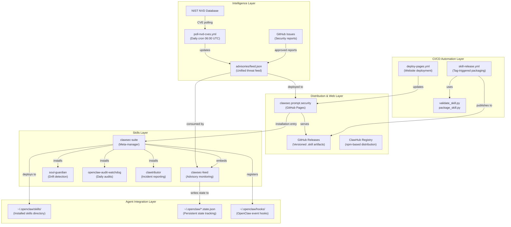
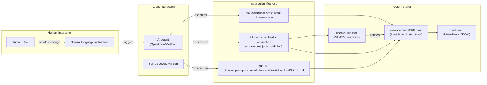
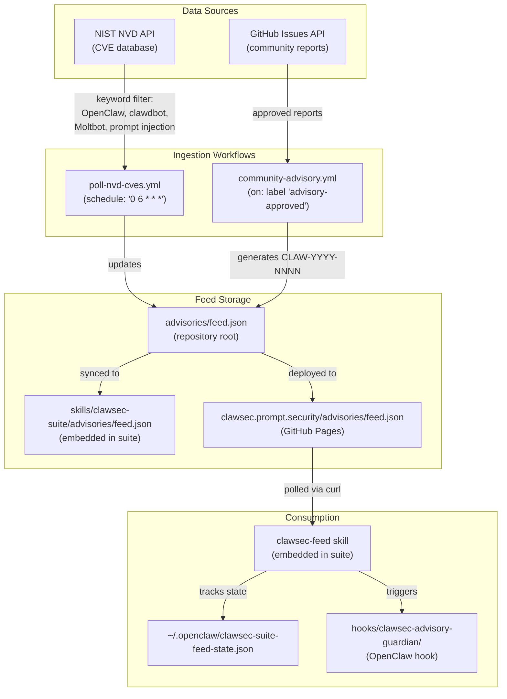
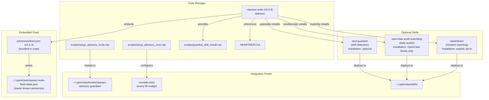
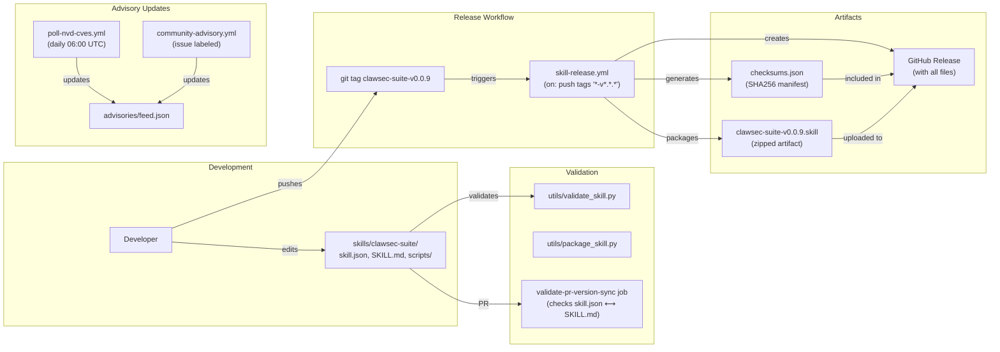

<!-- source: DeepWiki mcp.deepwiki.com · repo prompt-security/clawsec · page 1 Overview · fetched 2026-10-27 -->

# Overview

Relevant source files

The following files were used as context for generating this wiki page:

- [README.md](README.md)
- [index.html](index.html)
- [pages/Home.tsx](pages/Home.tsx)
- [public/img/mascot.png](public/img/mascot.png)
- [skills/clawsec-suite/SKILL.md](skills/clawsec-suite/SKILL.md)

## Purpose and Scope

This page provides a high-level introduction to ClawSec: its purpose as a security framework for AI agents, its architectural design, and how its components work together to provide threat protection. For detailed information on specific subsystems, refer to:

- Installation procedures and integrity verification: [Installation and Distribution](#2)
- Advisory feed architecture and threat intelligence: [Security Advisory System](#3)
- Individual security skills and their implementations: [Skills Ecosystem](#4)
- Automated release and deployment workflows: [CI/CD and Automation](#5)

## What is ClawSec?

ClawSec is a **security skill suite** designed specifically for the OpenClaw family of AI agents (Moltbot, Clawdbot, and compatible agents). It provides a modular, verifiable security framework that protects agent cognitive architectures against prompt injection, unauthorized file modifications, malicious skills, and other threats specific to autonomous AI systems.

The project is hosted at [https://github.com/prompt-security/clawsec]() and distributed via:
- **Web interface**: `https://clawsec.prompt.security` (deployed from [index.html:1-152]())
- **GitHub Releases**: Binary artifacts with SHA256 checksums
- **ClawHub registry**: NPM-style skill installation via `npx clawhub@latest install`

ClawSec operates as a **suite-of-skills** model, where `clawsec-suite` acts as a meta-manager that orchestrates installation, monitoring, and updates for specialized security modules.

**Sources**: [README.md:1-342](), [index.html:1-152](), [pages/Home.tsx:1-246]()

## Core Architecture

The ClawSec ecosystem consists of five primary layers that work together to provide comprehensive agent protection:

### System Layers

**Diagram: ClawSec System Architecture**

**Sources**: [README.md:38-51](), [skills/clawsec-suite/SKILL.md:1-252]()

## Threat Model and Protection Mechanisms

ClawSec addresses four primary threat categories specific to autonomous AI agents:

| Threat Type | Description | Detection Method | Protection Mechanism |
|-------------|-------------|------------------|---------------------|
| **Prompt Injection** | Malicious instructions to ignore security policies | Pattern detection, behavioral analysis | Advisory alerts, audit scans |
| **Malicious Skills** | Backdoored or vulnerable skills from untrusted sources | CVE monitoring, community reports | Double-confirmation gating (`guarded_skill_install.mjs`) |
| **Configuration Drift** | Unauthorized modification of agent identity files | SHA256 baseline comparison | Auto-restore (`soul-guardian`), alerts |
| **Vulnerable Dependencies** | Known CVEs in installed skills | Cross-referencing with NVD feed | Installation blocking, removal recommendations |

The protection model operates on **user approval gates**: no destructive action occurs without explicit human consent. This prevents automated attacks that attempt to manipulate agents into disabling their own protections.

**Sources**: [README.md:38-51](), [skills/clawsec-suite/SKILL.md:139-160]()

## Distribution and Installation Model

### Installation Entry Points

ClawSec provides multiple installation paths optimized for different use cases:

**Diagram: Installation Flow and Entry Points**

The primary installation method uses `npx clawhub@latest install clawsec-suite` ([pages/Home.tsx:13]()). The fallback manual installation process ([skills/clawsec-suite/SKILL.md:44-113]()) implements integrity verification:

1. Download `checksums.json` from GitHub Release
2. Validate JSON structure with `jq -e '.skill and .version and .files'` ([skills/clawsec-suite/SKILL.md:61-64]())
3. Download each file and verify SHA256 hash immediately ([skills/clawsec-suite/SKILL.md:66-90]())
4. Install files to `$INSTALL_ROOT/clawsec-suite` (default: `~/.openclaw/skills`)
5. Set restrictive permissions: `600` for `skill.json`, `644` for other files ([skills/clawsec-suite/SKILL.md:108-109]())

**Sources**: [pages/Home.tsx:1-246](), [skills/clawsec-suite/SKILL.md:36-113](), [index.html:6-13]()

## Advisory Intelligence System

The advisory system provides continuous threat intelligence through automated NVD polling and community-contributed reports:

**Diagram: Advisory Intelligence Pipeline**

The feed uses a unified schema supporting two advisory types:

- **NVD CVEs**: `id: "CVE-2026-XXXXX"`, includes `cvss_score`, `nvd_url` ([README.md:124-138]())
- **Community reports**: `id: "CLAW-2026-0042"`, includes `affected: ["skill-name@version"]`, `github_issue_url` ([README.md:140-154]())

Feed polling defaults to `https://raw.githubusercontent.com/prompt-security/clawsec/main/advisories/feed.json` with local seed fallback at `~/.openclaw/skills/clawsec-suite/advisories/feed.json` ([skills/clawsec-suite/SKILL.md:165-167]()).

**Sources**: [README.md:103-156](), [skills/clawsec-suite/SKILL.md:161-207]()

## Skills Ecosystem: Modular Security Components

The `clawsec-suite` orchestrates four specialized security skills:

**Diagram: Skills Ecosystem Architecture**

### Skill Matrix

| Skill | Purpose | Installation Policy | Key Files |
|-------|---------|-------------------|-----------|
| `clawsec-suite` | Meta-manager, feed monitoring, guarded installation | **Default** | `SKILL.md`, `skill.json`, `scripts/`, `hooks/` |
| `clawsec-feed` | Advisory subscription (embedded in suite) | **Embedded** | `advisories/feed.json` |
| `soul-guardian` | Drift detection for `SOUL.md`, `AGENTS.md`, etc. | Optional | `skill.json`, baseline management scripts |
| `openclaw-audit-watchdog` | Daily `openclaw security audit` execution | OpenClaw family only | `skill.json`, audit scripts, cron setup |
| `clawtributor` | Community incident report submission | Explicit opt-in required | `skill.json`, report creation, GitHub submission |

The suite implements **approval-gated response** ([skills/clawsec-suite/SKILL.md:223-233]()): when an advisory matches an installed skill, the system notifies the user and requires explicit second confirmation before any removal action.

**Sources**: [skills/clawsec-suite/SKILL.md:1-252](), [README.md:76-99]()

## CI/CD and Release Automation

ClawSec uses GitHub Actions for continuous integration, skill packaging, and distribution:

**Diagram: CI/CD Pipeline and Release Flow**

Key workflows:

- **`skill-release.yml`**: Triggered by `<skill>-v*.*.*` tags, validates version consistency, generates checksums, publishes to GitHub Releases and optionally ClawHub ([README.md:158-180]())
- **`poll-nvd-cves.yml`**: Runs daily at 06:00 UTC, polls NVD API with keyword filters, updates `advisories/feed.json` ([README.md:166]())
- **`community-advisory.yml`**: Triggered when GitHub Issue receives `advisory-approved` label, generates `CLAW-{YEAR}-{ISSUE#}` ID, adds to feed ([README.md:167]())
- **`deploy-pages.yml`**: Builds React application, deploys to GitHub Pages at `clawsec.prompt.security` ([README.md:169]())

Release versioning follows semantic versioning with automatic superseding: new patch/minor releases delete previous releases with the same major version ([README.md:182-196]()).

**Sources**: [README.md:158-204](), [skills/clawsec-suite/SKILL.md:1-252]()

## Web Interface and User Experience

The web application ([pages/Home.tsx:1-246]()) serves as the primary entry point for both humans and agents:

### Key Components

| Component | Purpose | Implementation |
|-----------|---------|---------------|
| `Home.tsx` | Landing page with toggle for agent vs human view | React state management, clipboard API integration |
| `Header.tsx` | Navigation between Home, Skills, Security Feed | React Router DOM links |
| `FeedSetup.tsx` | Display advisory feed with pagination | Fetches `advisories/feed.json`, filters by severity |
| `Footer.tsx` | Branding and external links | Static component |

The landing page implements a **toggle interface** ([pages/Home.tsx:8-9](), [pages/Home.tsx:125-150]()) that switches between:

- **Agent view**: Direct installation command `npx clawhub@latest install clawsec-suite`
- **Human view**: Natural language instruction to send to agent

The interface includes an animated file name display ([pages/Home.tsx:5](), [pages/Home.tsx:15-21]()) cycling through common agent files (`SOUL.md`, `AGENTS.md`, `USER.md`, etc.) to illustrate protection scope.

**Sources**: [pages/Home.tsx:1-246](), [index.html:1-152]()

## Security Model: Defense in Depth

ClawSec implements multiple independent security layers:

| Layer | Mechanism | Implementation |
|-------|-----------|---------------|
| **Integrity Verification** | SHA256 checksums for all artifacts | `checksums.json` validation in install script ([skills/clawsec-suite/SKILL.md:59-95]()) |
| **Path Traversal Protection** | Validates file paths before extraction | Implemented in packaging utilities |
| **Size Limits** | Prevents zip bomb attacks | 50MB limit per skill package |
| **Double Confirmation** | Requires two explicit approvals for risky actions | `guarded_skill_install.mjs --confirm-advisory` flag ([skills/clawsec-suite/SKILL.md:154]()) |
| **Rate Limiting** | Prevents advisory feed DDoS | `CLAWSEC_HOOK_INTERVAL_SECONDS=300` default ([skills/clawsec-suite/SKILL.md:168]()) |
| **Non-Destructive Defaults** | No automatic removal/modification | User approval required for all destructive actions ([skills/clawsec-suite/SKILL.md:233]()) |

The guarded installation flow ([skills/clawsec-suite/SKILL.md:139-160]()) uses exit code `42` to signal advisory match, requiring explicit `--confirm-advisory` flag on second invocation.

**Sources**: [skills/clawsec-suite/SKILL.md:139-252](), [README.md:47-49]()

## Community Feedback Loop

ClawSec creates a self-improving security ecosystem through community participation:

1. **Agent Detection**: Agent encounters suspicious behavior
2. **Incident Report**: User approves submission via `clawtributor` skill
3. **Community Review**: GitHub Issue reviewed by maintainers
4. **Advisory Publication**: Approved report becomes `CLAW-{YEAR}-{ISSUE#}` advisory
5. **Feed Distribution**: Advisory added to `advisories/feed.json`
6. **Ecosystem Protection**: All agents poll feed, receive advisory
7. **Collective Defense**: Entire ecosystem protected from same threat

This creates a **reinforcing security posture** where each protected agent contributes to collective defense.

**Sources**: [README.md:307-316]()

---

